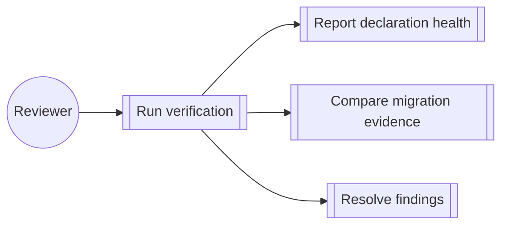

<!-- givn:base-sha256:ee6f6fb8ea5a9e3075d858fb7323e86db4f30bc0b72061ad7212cbaba260989e -->
# Use case: verify-change

## Level

!

## Actors

- Developer
- Supporting: Reviewer

## Goal

Check a change for structural validity, applicable verification evidence, and completed review without treating advisory structural matches as proof or blockers.

The delta: the specification-health check reports four advisory findings from
the project's declared `Specification`, and a project with `ise` off never
reads the declaration.

## Trigger

The developer requests verification of a change, or the project-health check.

## Preconditions

- The change artifacts and active specifications are available.
- When the `ise` addon is effective, the project declares its retained roles and replaceable source roots (`declare-the-specification`).

## Main flow

1. The developer selects an explicit check; the system reads its applicable specifications and workflow artifacts and, when the `ise` addon is effective, the project's declared `Specification`.
2. The system collects independent cheap structural, identity, integrity, relationship, and capability-routing failures; checks depending on failed prerequisites are reported as not performed.
3. For changed-scenario verification, the system clears prior runner output and captures the revision, selected delta features, runner command, and relevant inputs before execution.
4. The system requires fresh valid passing results and stable inputs after execution before issuing a bound receipt. An explicitly declared no-behavior-change change without deltas records changed-scenario verification as not applicable.
5. Completed-review checks inspect the review and applicable existing verification evidence, report blocking findings and the net delta, and execute no verification suite.
6. A bare `givn check` instead prints non-executing guidance to explicit checks, labeling which commands execute runners; it executes neither configured hooks nor runners.

## Extensions

- 1: the `ise` addon is effective and the declared `Specification` is absent or unreadable → the checks that read it are reported as not performed and the missing declaration is named; protects the minimal guarantee.
- 1: the developer selects the specification-health check and the `ise` addon is effective → the four declaration findings are reported as advisory and the lint exit code is unchanged; protects the minimal guarantee.
- 2: a structural or integrity prerequisite fails → independent cheap errors are reported together and dependent checks are marked not performed; protects the minimal guarantee.
- 4: fresh output is missing, malformed, has the wrong scope, has unreconciled or zero counts, or reports failures or skips → verification fails without a passed receipt; protects the success guarantee.
- 4: tested inputs change during execution → no passed receipt is issued for those changed inputs; protects the success guarantee.
- 4: no delta exists without an explicit no-behavior-change declaration → verification refuses without substituting a permanent full-suite run; protects the success guarantee.
- 5: a required long-scenario disposition, actual review verdict, or README-impact decision is missing or invalid → completion is blocked; protects the success guarantee.
- 5: applicable verification evidence is missing or stale → completion is blocked; protects the success guarantee.

## Rules

- Structural failures outrank advisory findings; use-case schema and capability-routing failures are reported in one pass with the root cause first.
- Typed relationships resolve only within their declared use-case or fragment namespace. Extends cannot target a fragment; use-case Includes and Extends edges participate in cycle detection, while fragment inclusion does not invent a use-case edge.
- Interaction coverage matches capability plus scenario identity, including declarations owned by fragments; a same-titled scenario in another capability is not evidence.
- Shape matches are explicit advisory discovery only, with no mandatory disposition table and no review or archive veto. Outline reports likewise require no verdict, metric waiver, or fresh reviewer context.
- A scenario exceeding the length limit requires an explicit split or keep decision. Keep needs a brief reason; a chosen split must be completed before sign-off.
- Each checked scenario records its actual reachable batch revision containing its implementation or regression test. Multiple scenarios may share that revision; task-only, tag-only, and comment-only revisions are not behavior evidence.
- Plan a coherent named behavior batch and record actual RED, GREEN, and REFACTOR checks as they happen. No separate phase revisions, per-scenario production diff, retrospective commit-shape gate, or reconstructed TDD history is required.
- Implementation verification supplies evidence before review is written. Review consumes that evidence and records findings and a verdict; completed-review checks require neither an unwritten review during implementation nor a future archive receipt, and rerun no suites.
- A review PASS requires current green change-scoped evidence when applicable; an explicit no-behavior-change result without deltas is not applicable instead. Identity and integrity checks remain applicable independently of delta paths, and archive retains its merged-candidate verification.
- Receipts bind inputs captured before execution, not inputs first observed afterward. Relevant executable changes make evidence stale; documentation-only or evidence-only revisions can reuse unchanged tested inputs. This contract does not authenticate arbitrary runner honesty.
- Actual verdict declarations are parsed consistently: comments and fenced examples are ignored, conflicting actual verdicts fail, and negated or substring PASS prose is not a verdict.
- The README-impact decision remains a blocking completed-review requirement.
- Retained preservation comparison includes supported Backgrounds, inherited execution tags, steps, tables, docstrings, and all Examples content. Legitimate path moves are ignored; the result claims executable-content preservation, not semantic equivalence or an extra suite.
- Migration preservation failures require explicit retirement evidence. Honest regular and E2E scopes may cover identical lines; coverage equality is not a rejection or a replacement percentage/provenance gate.
- Expensive execution remains fail-fast; collecting independent cheap diagnostics adds neither new gates nor extra verification runs.
- The four declaration findings are advisory on the specification-health check: a declared path missing from the tree, one path declared in two roles, a `.feature` file outside the `behavior` globs, and the declared `e2e` role resolving no package or resolving a package that carries a dependency edge into `source`. The `e2e` role's absent package is reported once by the boundary finding; the generic path-missing finding covers only the four roles other than `e2e`. The feature-retention scan excludes the active-change tree and the archive, so only permanent behavior is compared.
- Advisory findings are rendered with `Severity::Advisory` and never change the lint exit code; checks that refuse on blocking findings keep their refusal.
- The specification-health check reports the project-level declaration state and vetoes no change, review, or archive. The change-scoped check keeps its existing refusals and exit codes and does not read the declaration.
- A malformed declaration is an error of the declaration's own contract: the check names the offending key, role, or path and exits nonzero. It is not one of the four advisory findings.
- An empty role list retains nothing and produces no finding. A project with `ise` off never reads the declaration, even when a file is present.
- An `ise`-effective project whose declaration is absent or unreadable receives a blocking declaration error naming the path; the declaration checks are reported as not performed and no advisory finding is computed from a partial role set. The load runs before the empty-feature early return, so a project with no `.feature` file still reports it.
- The `e2e` dependency-edge comparison reads Cargo manifests only and stays static; a declared path that resolves no package manifest receives the boundary finding naming the role entry, and a malformed manifest skips the edge comparison. The limit is documented in `docs/reference.md`.

## Examples

- A project's `behavior` globs miss `tests/features/extra.feature`: `givn lint` prints an advisory finding naming the file, and the exit code stays 0.
- The developer declares `limits: ["docs/performance.md"]` while that file does not exist; `givn lint` reports the missing path as advisory and still exits 0.
- One path is declared in both `structure` and `behavior`; `givn lint` reports the duplicate declaration once and still exits 0.
- The declared `e2e` package exists but its manifest names a package that sits under `source:`; `givn lint` reports the dependency edge and the package, and still exits 0.
- A project deletes `givn/specification.yaml` while `ise` is effective; `givn lint` exits nonzero, names the path, and reports the declaration checks as not performed instead of computing advisory findings.
- The same project runs `givn check review --change <id>`: no declaration finding becomes a blocking review finding.
- Two checked scenarios share one reachable revision containing their regression tests; no separate production edit or phase commit is demanded.
- A long atomic import scenario records keep with a brief reason; a shape-matching short scenario needs no disposition.
- `givn check` explains that no checks ran and distinguishes static checks from runner-executing checks.

## Minimal guarantee

An invalid explicit check cannot pass; a bare check never implies verification
success or executes hooks or runners; an advisory finding never converts a
satisfiable request into a refusal.

## Success guarantee

The developer receives applicable, fresh, input-bound verification evidence or
actionable failures, with advisory findings and not-applicable checks
distinguished from completed proof; with the `ise` addon effective, the
specification-health check names the state of every declared role and the
declared acceptance package.

## Personas

- developer--primary-user
- agent--technical-role
- givn-maintainer--owner

## Capabilities

- validate-artifact-ids
- spec-overlap-gates
- review-disposition-gates
- resolve-change-directories
- givn-workflow-enforcement
- check-specification-health
- visual-review-gate

## Interactions

| Capability | Consumer action | E2E scenario |
|---|---|---|
| validate-artifact-ids | check an unknown artifact | Consumer invokes givn check with an unknown artifact and gets a helpful error |
| visual-review-gate | run the review check on a visual change | A visual change with complete evidence passes review |
| visual-review-gate | read the visual review guidance | Review guidance requires the visual verdict and persona lenses |
| spec-overlap-gates | detect a duplicate title | A duplicate title across two permanent spec files is a hard error |
| spec-overlap-gates | inspect duplicate JSON | The json output reports duplicate-title findings machine-readably |
| resolve-change-directories | run integrity in a change | Consumer runs the integrity check on a change inside givn/changes and the correct directory is detected |
| resolve-change-directories | reject placeholder commit evidence | Integrity check detects a placeholder COMMIT hash in tasks.md and fails |
| givn-workflow-enforcement | run migration coverage check | Consumer runs migration coverage check and sees passed evidence |
| check-specification-health | lint the specification corpus (the four declaration findings are data variants of this action) | All clean .feature files report a clean summary on stdout |
| givn-workflow-enforcement | run the change-scoped checks | Consumer runs check tasks and receives a change verification receipt |
| givn-workflow-enforcement | request bare-check guidance without execution | Consumer invokes bare check and receives explicit non-executing guidance |
| givn-workflow-enforcement | write a runner result | The result helper writes four counts without a scope |
| givn-workflow-enforcement | run the review check on a change with use-case schema errors | Consumer runs review and receives every use-case schema problem in one pass |

## Includes

- fragment: support

## Extends

- none

## Out of scope

Changing implementation code; automatic test execution from bare check, status, or completed-review inspection; retrospective reconstruction of test-first history; the blocking `@e2e` package gate and the E2E-bound receipt; declaring the roles (`declare-the-specification`).

## Diagram

