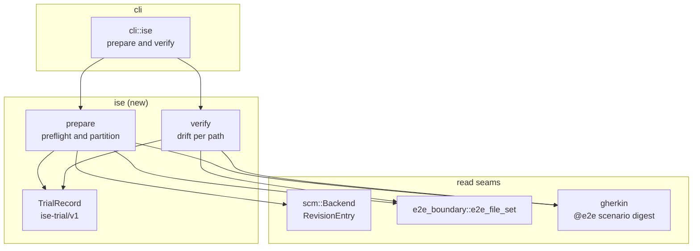
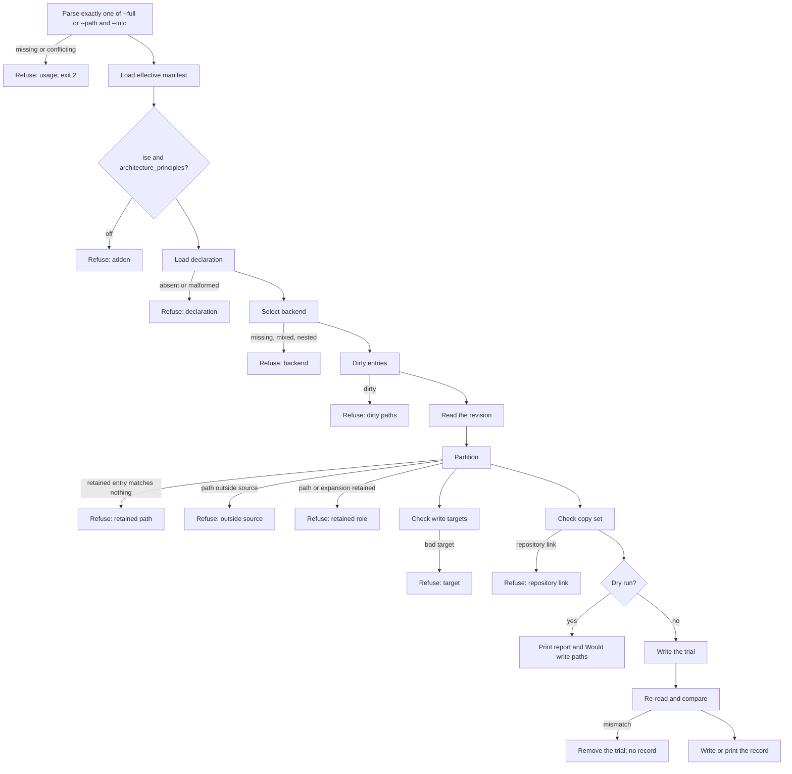
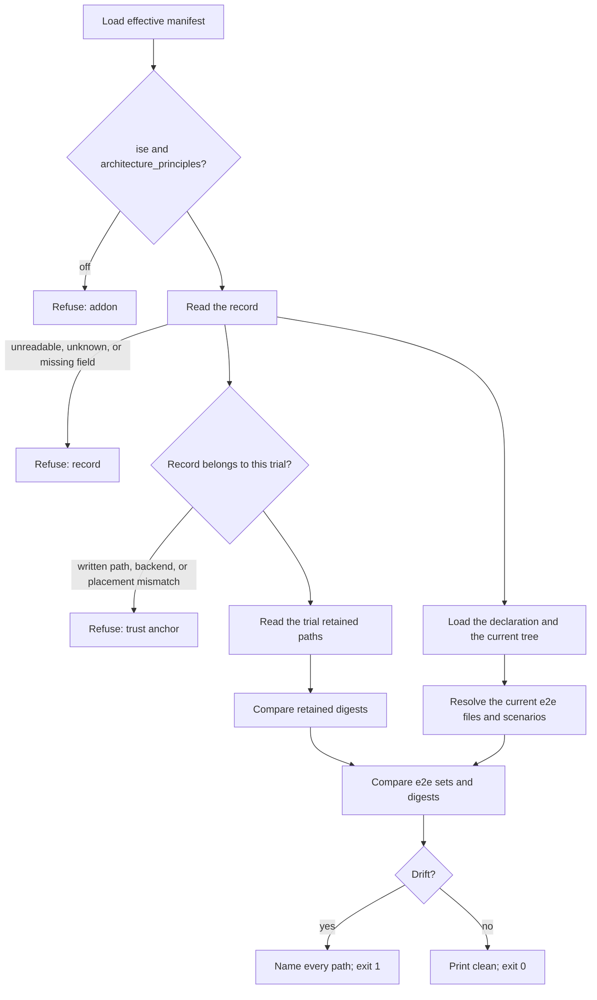

# Design: add-ise-clean-room-commands

## Overview

Two commands, one component, and two extended read seams:

1. **`src/ise/` (new) owns the clean-room trial.** It reads exactly one
   replacement form (`--full` or repeated `--path`), partitions the selected
   revision into retained, kept source, replaced, and outside-the-declaration
   paths; checks the nine conditions before any write; writes the trial and
   compares every file to the revision; records the per-path identities; and
   re-checks a verifier's record against the trial and the current checkout.
   `src/cli/ise.rs` is the CLI adapter.
2. **`src/scm.rs` gains revision entries.** `revision_files` returns
   `RevisionEntry { path, kind, executable }` for every tracked path at a
   revision. Git reads `git ls-tree` modes. Fossil reads the check-in
   manifest's `F` lines, because `fossil ls` exposes neither the executable
   bit nor the symlink flag; the reader decodes `\s` in `F` line paths and
   accepts a 40-hex or a 64-hex blob hash.
3. **`src/e2e_boundary/` gains a revision-safe file-set resolver.** The new
   `e2e_file_set` reuses the declaration glob matcher, the declaration path
   normalizer, and the nearest-manifest rule to resolve the `e2e` role to the
   tracked files of its packages without reading the working tree. It is a
   second contract on the same resolver: a revision tree in, a resolved file
   set out, consumed by `ise` for `replace` and `verify`.
4. **`src/gherkin/` gains a scenario digest.** It parses the `behavior` feature
   files at the revision, selects the scenarios tagged `@e2e`, and hashes the
   title and executable content per feature file. It is a second contract on
   the parser: a feature string in, the selected scenario digest out, consumed
   by `ise`.

The change adds no dependency and no config key. A project with `ise` off
gets no new command behavior: both commands refuse by name before reading the
declaration. The checkout is never written, including the receipt path.

## Visual Design Contract

```
- Interface: terminal
- Viewports: not applicable (terminal text surface)
- States: not applicable
- Design system: none (CLI)
```

`Interface: terminal` is deliberate: the change alters terminal text, a YAML
record, and exit codes, not a rendered screen. Each `@e2e` scenario commits a
transcript at
`givn/changes/add-ise-clean-room-commands/evidence/visual/<scenario-slug>/transcript.txt`:
`developer-prepares-a-clean-room-trial-from-a-recorded-revision` and
`verifier-re-checks-a-prepared-trial-and-receives-the-frozen-input-report`.

**Baseline asserted at every transcript-producing assertion:**

- every refusal names the condition and the path, role, revision, or target it
  is about;
- no Rust module, struct, or field name appears in user-facing output;
- exit codes: `0` for a successful preparation or a clean re-check, `1` for a
  refusal or drift, `2` for a clap usage error;
- the report prints the ten fixed lines, plus `Receipt path` only when a
  receipt path was given, and `--dry-run` adds a `Would write:` block after
  them;
- the record uses the domain names below and carries the full digests.

**Personas:** `developer--primary-user`, `agent--technical-role`,
`givn-maintainer--owner` are confirmed. `developer--primary-user` prepares the
trial, `agent--technical-role` reads the refusals and the report, and
`givn-maintainer--owner` owns the declaration and the backend parity.

## Use-Case Traceability

Owning use-case ID: `prepare-an-ise-test` (`clean-room-preparation`,
`trial-input-verification`).
Ideation source: `ise-rebuildability`.
Confirmed Persona IDs: `developer--primary-user`, `agent--technical-role`,
`givn-maintainer--owner`.

| Use-case contract element | Technical decision | Capability / scenario evidence |
|---|---|---|
| Prepare reads the selected revision, never the working tree | `Backend::revision_files` and `revision_blobs`; the working tree is read only for the dirty check and the current e2e re-check | `clean-room-preparation`: the ignored-file success scenario and the dirty-check refusal; the E2E prepare scenario |
| Exactly one replacement form is required | A clap argument group requires one of `--full` and `--path` and marks them mutually exclusive; neither or both is exit 2 naming both flags | `clean-room-preparation`: the neither-form and both-forms scenarios |
| Deletion is set arithmetic on named tracked files and named directories | `--path` accepts a tracked file or a directory; a directory expands to every tracked file beneath it; a glob is never expanded; a named path absent from the revision removes nothing | `clean-room-preparation`: the directory-expansion, full-replacement, glob, duplicate, and absent-replacement scenarios; D1 |
| A full replacement names every tracked file under the source roots | `--full` is the union of every declared `source:` root resolved at the revision; no implicit default exists | `clean-room-preparation`: the full-replacement scenarios asserting `Not replaced: 0` with no retained path under a source root and `Not replaced: 1` for a retained `src/keep.rs` |
| A retained role takes precedence over the source roots | Retained match is tested before the source-root test, for a named file, for a named directory's expansion, and for `--full`; a retained file under a source root stays in the trial, so `Replaced` counts only non-retained files; naming a retained path refuses | `clean-room-preparation`: the retained-role and directory-contains-retained scenarios; the retained fixtures of the ignored-file, executable-bit, and explicit-revision scenarios |
| `Not replaced` is a containment count | Direct tracked siblings in the removed files' parent directories, excluding the named files | `clean-room-preparation`: the `Not replaced: 2`, `Not replaced: 0`, and `Not replaced: 1` scenarios |
| `Outside the declaration` counts uncopied files | The partition's fourth set; never an error | `clean-room-preparation`: the E2E prepare scenario asserts the outside file is absent |
| Only the `e2e` package is frozen; component steps are implementation | The `E2E digest` covers resolved `e2e` files and the selected `@e2e` scenarios only; kept source has no focused identity | `trial-input-verification`: the kept-source no-drift scenario |
| The trial is a plain directory, never a branch or worktree | `create_dir` plus file writes; no SCM command creates the target | `clean-room-preparation`: the version-control-metadata scenario asserts `.git` and `.fslckout` absence; the E2E prepare scenario asserts the written path |
| The checkout is never written | Both write targets are checked outside the checkout; the receipt path cannot sit in the trial, be its ancestor, or be aliased by a symlinked parent | `clean-room-preparation`: the inside-checkout, existing-target, existing-target-file, receipt-inside-trial, receipt-inside-checkout, receipt-ancestor, symlinked-target, and existing-receipt scenarios; D2 |
| Nine refusals before any write, and no declaration read with the addon off | The ordered preflight in `src/ise/mod.rs`; every check precedes `create_dir`; the addon check runs before the declaration load | `clean-room-preparation`: one scenario per condition (the backend condition has three, the addon condition has two) |
| A written file that differs fails and leaves no record | Post-write re-read and compare; remove the partial trial on mismatch; write the record only after all files match | `clean-room-preparation`: the re-read unit test named in the testability section (an injectable writer corrupts one path inside `src/ise`); the CLI cannot race a deterministic fixture |
| The report prints ten fixed lines plus an optional receipt line, and a dry run adds a `Would write:` block | `src/cli/ise.rs` renders the `Report` struct; the dry-run block is the sorted union of the retained and kept-source paths | `clean-room-preparation`: the E2E prepare scenario asserts every line; the dry-run scenario asserts the block |
| The record carries the revision, named paths, counts, identities, backend, and version | `TrialRecord` with `content_scope: ise-trial/v1` | `clean-room-preparation`: the E2E prepare scenario asserts `replaced_digest`, `written_path`, and `backend` |
| An omitted receipt prints the record and writes nothing | Report then YAML record on stdout; no `Receipt path` line | `clean-room-preparation`: the stdout-record scenario |
| A dry run writes nothing and prints the paths it would use | The preflight, partition, counts, and identities run; the writer is skipped | `clean-room-preparation`: the dry-run scenario |
| Verify refuses a record that does not belong to this trial | Canonicalized `written_path` equals `--at`, `backend` equals the selected backend, and the record path lies outside the trial | `trial-input-verification`: the inside-trial, written-path-mismatch, and backend-mismatch scenarios; D9 |
| Verify re-checks retained and `e2e` identities per path | `src/ise/verify.rs` compares the trial's retained files and the current e2e set and scenario map | `trial-input-verification`: the clean, retained-drift, trial-e2e, checkout-e2e, checkout-gained-path, scenario, scenario-gained, and missing-path scenarios |
| Verify names every drifting path in one run | One `BTreeMap` of reasons, rendered after all checks | `trial-input-verification`: the three-drift scenario |
| With `ise` off, both commands refuse and read no declaration or record | The manifest and prerequisite check runs before `SpecificationDeclaration::load` and before the record read | `clean-room-preparation` and `trial-input-verification`: the ise-off and architecture-principles-off scenarios; the verify ise-off scenario uses a corrupted record |
| Git and Fossil agree | `RevisionEntry` is backend-neutral; one partition and one writer | `clean-room-preparation`: the Fossil scenario (with `allow-symlinks on`, an executable, and a symlink); D6 |

## Architecture Impact

New modules:

- `src/ise/mod.rs`: `replace`, the preflight order, the trial write with its
  re-read, and the report model.
- `src/ise/partition.rs`: the partition (`Partition`), refusals 5 to 7, the
  counts, and the `behavior` feature resolution the re-check reuses.
- `src/ise/record.rs`: `TrialRecord`, `Counts`, the YAML shape, and the
  per-path/rollup digest helpers.
- `src/ise/verify.rs`: the drift checks and the record trust anchor.
- `src/cli/ise.rs`: clap-independent entry functions, output formatting, and
  exit mapping.

Modified modules:

- `src/main.rs`: add `Commands::Ise` with `replace` and `verify`.
- `src/cli/mod.rs`: declare `pub mod ise;`.
- `src/scm.rs`: `RevisionEntry` and the new `revision_files` return type.
- `src/git.rs`: parse `ls-tree` modes into kind and executable.
- `src/fossil.rs`: read the check-in manifest for the full path list, kinds,
  and executable bits; decode `\s` in `F` line paths; accept a 40-hex or a
  64-hex blob hash; keep `revision_blobs` as `fossil cat`.
- `src/e2e_boundary/mod.rs` and `paths.rs`: expose the shared glob matcher,
  the declaration path normalizer, and nearest-manifest resolution, and add
  `e2e_file_set`.
- `src/gherkin/content.rs` or `parse.rs`: add the `@e2e` scenario selection and
  digest over a feature string.
- `src/config/declaration.rs`: the path normalizer becomes `pub(crate)` so the
  trial's `--path` values use the declaration's rule; the strict loader itself
  is consumed as is.

Unchanged: `src/config/lock.rs` (the change lock is not this command's
authority), `src/proof.rs` (the trial record is a separate scope), and
`src/e2e_boundary`'s change-boundary conditions.



Arrows point from consumer to provider.

### Contracts and Components

| Contract | Consumer use case | Consumers | Implementing component today | Split trigger |
|---|---|---|---|---|
| `CleanRoomTrial` (`replace`, `verify`, `TrialRecord`) | `prepare-an-ise-test` (`clean-room-preparation`, `trial-input-verification`) | `cli::ise` | `src/ise` (new) | a second materialization mode (branch/worktree) or a second record scope |
| `RevisionContent` (`revision_files`, `revision_blobs`) | `prepare-an-ise-test` (read one revision) | `ise` (`replace`, `verify`) | `src/scm`, `src/git`, `src/fossil` | a third backend or a revision stream instead of a path list |
| `RevisionE2eFileSet` (`e2e_file_set`) | `prepare-an-ise-test` (freeze the resolved `e2e` package) | `ise` (`replace`, `verify`) | `src/e2e_boundary` (one responsibility: resolve the declared `e2e` role, now over a supplied revision tree) | a second resolution rule or a non-Cargo manifest |
| `ScenarioDigest` (selected `@e2e` scenarios per feature file) | `prepare-an-ise-test` (freeze the selected `@e2e` scenarios) | `ise` (`replace`, `verify`) | `src/gherkin` (one responsibility: parse a feature string and select by tag) | a second selection rule or a non-Gherkin behavior format |

`revision_files` and `revision_blobs` have no caller outside `src/scm.rs` in
the current tree: this change's reader is their first consumer, so the
`RevisionEntry` return-type change migrates no existing consumer.

The trial record carries no verifier runner command. The independent verifier
chooses and records the runner outside the record, so a changed runner is a
verifier decision, not trial drift. `cli::lint` and `cli::check` keep
consuming the existing `E2eBoundary` contract for the change boundary.

## Technology Decisions

| Technology | Version | Resolution |
|---|---|---|
| Rust | edition 2024, repository-pinned toolchain | Repository-pinned; unchanged |
| `serde_yaml_ng` | 0.10.0 | Locked in `Cargo.lock`; existing; serializes the trial record |
| `sha2` | 0.11.0 | Locked in `Cargo.lock`; existing; hashes the trial identities |
| `cucumber` (cucumber-rs) | 0.23.0 | Locked in `Cargo.lock`; existing test runner |
| `toml` | 1.2.1 | Locked; existing; not used by this change (the e2e file set needs only manifest directory names) |
| `git`, `fossil` CLIs | repository toolchain | Existing test and runtime requirement; the Fossil scenario requires `fossil` on PATH |

No new dependency and no version selected from memory.

## Decisions

- Decides D1 (seed `Q4`): **the replacement unit is named by `--path` (a
  tracked file or a directory) or by `--full` (every tracked file under every
  declared `source:` root), and exactly one form is required.** A `--path`
  file at the revision is removed; a `--path` directory expands to every
  tracked file beneath it, and the retained-role check runs over the
  expansion; a directory that contains a retained path refuses, naming the
  retained path and its role; a value outside every source root refuses; a
  value that is neither a tracked file nor a directory removes nothing and is
  not a tenth refusal; a glob-shaped value is never expanded. `--full` is the
  union of the source roots at the revision after the retained-role test: when
  a tracked path matches both a retained role and a `source:` root, the
  retained role wins and the file stays in the trial under `--full` as well as
  under `--path`. `Replaced` therefore counts only files that are not
  retained. On a declaration that keeps its retained roles outside the source
  roots, which the scenarios use, the report shows `Not replaced: 0`. `--path` values and
  `--full` are checked for the retained role before any removal. Neither form
  nor both forms are valid: each is a usage error (exit 2) that names
  `--full` and `--path`. `Replaced` counts the removed tracked
  files, `named_paths` keeps every distinct `--path` value (empty under
  `--full`), and `Not replaced` counts the direct tracked files in the
  removed files' parent directories that were not named. Rejected: an
  implicit whole-source default (one flag would silently replace the product
  where a component was meant) and glob patterns (they introduce matching
  into deletion). Realized in the partition in `src/ise/partition.rs` and the
  record fields.
- Decides D2 (plan `S4` risk): **both write targets lie outside the checkout,
  and both are created new.** The trial directory must not exist; the
  receipt path must not exist, must not lie inside the trial, and must not be
  an ancestor of the trial. The containment check resolves the deepest
  existing ancestor so a symlinked parent cannot alias a path inside the
  checkout. Rejected: a receipt path inside the trial (the builder can edit
  the record with the trial) and overwriting an existing record (evidence from
  an earlier trial is destroyed). Realized in `src/ise/mod.rs` before
  `create_dir`.
- Decides D3 (plan `S4`, the lock fact): **the effective project manifest
  decides `ise`.** `Replace` and `Verify` are project-scoped and take no
  `--change`; `config::lock::ise_effective_for_change` remains the authority
  for `givn check tasks`, review, and archive. Rejected: the change lock (the
  commands would need an active change) and both (a project-level
  materialization would be blocked by an unrelated lock). Realized in
  `src/cli/ise.rs`.
- Decides D4 (plan `S4` presentation): **per-path digest maps plus a rollup
  per identity.** The report prints the first 12 lowercase hex characters of
  the rollup followed by `…`; the record carries the full 64-character
  digests. An omitted `--receipt` prints the report and then the YAML record
  to stdout, and prints no `Receipt path` line. Rejected: one rollup (verify
  could not name a path), the file contents (a second corpus), and a
  `Receipt path: stdout` line (the use-case report rule makes the line
  conditional). Realized in `src/ise/record.rs` and `src/cli/ise.rs`.
- Decides D5 (local): **the `e2e` frozen set is revision-resolved.** Each path
  matched by the `e2e` role resolves to its nearest `Cargo.toml` directory in
  the revision tree; every tracked file under each resolved root is in the
  set. A matched path that resolves no manifest is its own root. The
  `@e2e` scenarios come from the `.feature` files matched by the `behavior`
  role and are hashed per feature file. Rejected: role-matched paths only (a
  resolved package can contain files outside the matched path, and the
  declaration's rule says the frozen digest covers resolved files) and all
  feature files (it would freeze undeclared behavior). Realized in
  `src/e2e_boundary` and `src/ise/record.rs`.
- Decides D6 (local): **Fossil entry kinds come from the check-in manifest.**
  The `F` lines carry the path, a 40-hex or a 64-hex blob hash, and the `x`
  (executable) and `l` (symlink) flags; `\s` in the path decodes to a space.
  `fossil artifact <revision>` is the read; a failed read or a malformed `F`
  line refuses before any write. Fossil writes an `l` entry only when the
  repository has `allow-symlinks on`, so the fixture sets that and asserts an
  executable and a symlink. Git derives the same facts from `git ls-tree`
  modes (`100644`, `100755`, `120000`, `160000`). Rejected: `fossil ls`
  alone (it reports neither fact) and refusing Fossil (the guarantee covers
  both backends). Realized in `src/fossil.rs` and `src/git.rs`.
- Decides D7 (local): **the per-path digest includes the entry kind.** The
  record stores `kind` as one of `f` (regular), `x` (executable regular), and
  `l` (symlink); the digest is
  `sha256(path NUL kind NUL executable-marker NUL bytes-or-target)` with the
  marker `1` or `0`. The rollup hashes the sorted `path NUL digest` pairs.
  The resolved `e2e` package file set and the `behavior` feature set are
  disjoint by construction (the `e2e` role holds the runner and the step
  definitions, the `behavior` role holds the feature files), so no path
  appears twice in the `e2e` rollup and no duplicate-path tie-break exists.
  The existing `e2e_boundary::hash_entry` stays for the change receipt; it
  does not distinguish a symlink from a regular file with the same target
  text, which the trial identity must. Realized in `src/ise/record.rs`.
- Decides D8 (local): **verify re-resolves the current e2e set.** It loads the
  declaration, builds the working tree from `Backend::content_paths`, resolves
  the current e2e file set and scenario map, and compares both sets and the
  recorded digests. The retained set is checked from the record, not
  re-resolved, because the trial is the recorded retained set. Rejected:
  checking only the record's e2e paths (it would miss a new package file or
  feature) and re-resolving the retained set (the trial intentionally reflects
  the revision, not the current declaration). Realized in `src/ise/verify.rs`.
- Decides D9 (local): **the record is the verifier's trust anchor only after
  three identity checks.** `verify` canonicalizes `--at` and refuses unless
  the record's `written_path` equals it, the record's `backend` equals the
  selected backend, and the record path itself lies outside the trial; it
  then asserts `replaced_digest` is a 64-hex value and re-checks the retained
  and `e2e` identities. Rejected: trusting the record's placement alone (a
  record from another trial or another backend would verify against the wrong
  directory) and recomputing the replaced digest (the removed files are not
  in the trial, and the checkout may have changed since). Realized in
  `src/ise/verify.rs`.
- Decides D10 (local): **both commands require `ise` and its
  `architecture_principles` prerequisite.** The effective manifest is read
  first; either add-on off refuses by name before the declaration or the
  record is read, matching the use case's precondition. Rejected: checking
  only `ise` (the add-on pair is refused in both directions by `givn addons`,
  but a hand-edited config can still disagree). Realized in `src/cli/ise.rs`.

No decision is carried. Each decision is foundational for this change and its
reversal is a code and record-scope change; none is deferred to usage.

## Data Model Changes

### `RevisionEntry`

```rust
pub struct RevisionEntry {
    pub path: String,
    pub kind: EntryKind,   // Regular | Symlink | Submodule
    pub executable: bool,
}

impl Backend {
    pub fn revision_files(
        &self,
        revision: &str,
        root: &str, // "" means every tracked path
    ) -> Result<Vec<RevisionEntry>>;
}
```

- Git: `git ls-tree -r -z <revision> -- <root>` (no pathspec when `root` is
  empty). Mode `100755` sets `executable`; `120000` is `Symlink`; `160000` is
  `Submodule`.
- Fossil: `fossil artifact <revision_arg>` (with `HEAD` mapped to `current`)
  prints the check-in manifest. Each `F <path> <hash> [flags]` line yields one
  entry; the path has `\s` decoded to a space, the hash may be 40-hex or
  64-hex, `x` sets `executable`, and `l` sets `Symlink` (Fossil writes `l`
  only with `allow-symlinks on`). An `F` line without a 40-hex or 64-hex hash,
  or with an unknown flag, refuses with the line and the revision.
  `revision_blobs` stays `fossil cat -r <revision> <path>`.

### Trial record (`ise-trial/v1`)

```yaml
schema: 1
content_scope: ise-trial/v1
backend: git
revision: 8c1f2ab5e7d0c9a4b3f2e1d0c9b8a7f6e5d4c3b2
named_paths:
  - crates/x/src/keys/parser.rs
  - crates/x/tests/keys.rs
replaced_paths:
  - crates/x/src/keys/parser.rs
  - crates/x/tests/keys.rs
counts:
  retained: 214
  kept_source: 72
  replaced: 2
  outside_declaration: 3
  not_replaced: 2
retained_digest: "<64 hex>"
e2e_digest: "<64 hex>"
replaced_digest: "<64 hex>"
retained_files:
  givn/specs/demo/spec.feature: "<64 hex>"
  tests/e2e/Cargo.toml: "<64 hex>"
e2e_files:
  tests/e2e/Cargo.toml: "<64 hex>"
  tests/e2e/steps/keys.rs: "<64 hex>"
e2e_scenarios:
  givn/specs/demo/spec.feature: "<64 hex>"
written_path: /tmp/ise-passuff
givn_version: 0.9.17
```

- `named_paths` is the sorted, deduplicated `--path` input; it is empty under
  `--full`, which has no named values. `replaced_paths` is the sorted tracked
  set actually removed (a named directory contributes its expansion).
  `counts.replaced` is `replaced_paths.len()`.
- `retained_files`, `e2e_files`, and `e2e_scenarios` are sorted by path;
  `retained_digest`, `e2e_digest`, and `replaced_digest` are rollups over
  them.
- The record's `kind` per path is `f` (regular), `x` (executable regular), or
  `l` (symlink); the ordered map carries `path: digest` and the kind travels
  inside the digest.
- The record is read with `deny_unknown_fields`; a schema other than `1`, a
  content scope other than `ise-trial/v1`, an unknown field, or a missing
  field refuses with the record path and the reason.
- `revision` is the resolved identifier when `--at` is omitted or `HEAD`, and
  the supplied identifier otherwise. The content digests, not the string, are
  the evidence.
- No timestamp is recorded: the trial is identified by its revision and
  digests, and a timestamp would add a changing field without evidence value.

### Identity rule

For one path and its revision or written content (`kind` is `f`, `x`, or `l`):

```text
digest(path, kind, executable, bytes_or_target) =
    sha256(path || NUL || kind || NUL || (executable ? "1" : "0") || NUL ||
           (kind == l ? target : bytes))
rollup(entries) = sha256(join(sorted(path || NUL || digest || "\n")))
```

- `retained_digest` = rollup over `retained_files`.
- `e2e_digest` = rollup over `e2e_files` and `e2e_scenarios` together, sorted
  by path; the scenario digest per feature file is
  `sha256(feature_path || NUL || each scenario title and executable_content in
  file order)`. The resolved `e2e` package file set and the `behavior` feature
  set are disjoint by construction, so no path appears twice and the rollup
  needs no duplicate-path tie-break.
- `replaced_digest` = rollup over the removed paths' revision entries, using
  the same rule.
- The report abbreviation is `first 12 hex characters + "…"`.

### Report (`replace`)

```text
Backend: git
Revision: 8c1f2ab5e7d0c9a4b3f2e1d0c9b8a7f6e5d4c3b2
Retained: 214
Kept source: 72
Replaced: 2
Outside the declaration: 3
Not replaced: 2
Retained digest: 4f1c9a2b7d01…
E2E digest: 82be07c3e5a9…
Written path: /tmp/ise-passuff
Receipt path: /tmp/ise-passuff-trial.yaml
```

`Receipt path` appears only when `--receipt` was given. With `--dry-run`, the
same lines are printed and then:

```text
Would write:
  givn/specs/demo/spec.feature
  src/kept.rs
```

The list is the sorted union of the retained and kept-source paths.

### Verify output

Clean:

```text
Trial: /tmp/ise-passuff
Retained: clean
E2E: clean
```

Drift (exit 1):

```text
Trial: /tmp/ise-passuff
Retained drift: givn/specs/demo/spec.feature (the trial differs from the record)
E2E drift: tests/e2e/steps/keys.rs (the checkout differs from the record)
E2E drift: givn/specs/demo/spec.feature (the selected @e2e scenarios differ in the checkout)
Verification failed: 3 drifting path(s)
```

Reasons a path can carry:

| Reason | Meaning |
|---|---|
| `the path is missing from the trial` | A recorded retained path is absent from the trial. |
| `the trial differs from the record` | The per-path digest differs in the trial. |
| `the path is missing from the checkout's e2e package` | A recorded e2e file is absent from the current e2e set. |
| `the checkout's e2e package gained this path` | The current e2e set has a file the record does not. |
| `the checkout differs from the record` | The current e2e file digest differs. |
| `the selected @e2e scenarios differ in the checkout` | The per-feature scenario digest differs or the feature path is missing. |

The record trust anchor runs before any identity check. An unreadable record,
a wrong scope, an unknown field, a missing field, a record path inside the
trial, a `written_path` that canonicalizes to something other than `--at`, or a
`backend` that is not the selected backend refuses (exit 1) and names the
record and the mismatch. A `replaced_digest` that is not a 64-hex value is a
record error.

## Replace Flow

The parser requires exactly one of `--full` and `--path` and a `--into` value;
neither, both, or an omitted `--into` is a usage error (exit 2) that names the
missing or conflicting flags and writes nothing.

The checks run in this order. Every one precedes the first write.

1. **Addon.** Load the effective manifest; `ise` off, or its
   `architecture_principles` prerequisite off, refuses and reads no
   declaration.
2. **Declaration.** `SpecificationDeclaration::load`; absent or malformed
   refuses with the declaration path and the loader's reason.
3. **Backend.** `scm::select`; missing, mixed, and nested refuse with the
   selector's message.
4. **Dirty checkout.** `Backend::dirty_entries`; every dirty path is printed.
5. **Revision.** Resolve `HEAD` with `Backend::revision`; an explicit revision
   is checked with `commit_exists`. Read `revision_files(revision, "")`.
6. **Partition.** Derive directories from the file paths. Retained roles are
   tested in `behavior`, `structure`, `contracts`, `limits`, `e2e` order; the
   first match wins. A declared role entry that is non-empty and matches
   nothing refuses. Each `--path` value is normalized with the declaration's
   normalizer: a tracked file is a candidate, a directory expands to every
   tracked file beneath it, a value that is neither contributes nothing, and a
   glob-shaped value is never expanded. Over the candidate set, a retained-role
   match refuses (naming the path and the role), a path outside every source
   root refuses; the survivors join `replaced_paths` (`--full` supplies the
   union of the source roots instead). Non-retained tracked files inside a
   source root are kept source; the rest are outside the declaration. `Not
   replaced` counts direct tracked siblings of the removed files.
7. **Targets.** The trial directory and the receipt path are resolved to
   absolute paths, checked outside the checkout, and checked absent. The
   receipt path is also checked outside the trial and not an ancestor of it.
8. **Copy set.** A `Submodule` entry or a path component `.git`, `.fslckout`,
   or `_FOSSIL_` refuses.
9. **Writes.** The trial is created with `create_dir` after its parent is
   created. Directories are created per path. A regular file is written and
   its executable bit set on unix; a symlink is created with its recorded
   target. A symlink entry on a platform without symlink support refuses.
10. **Re-read.** Every written path is read again and compared to the revision
    entry by kind, executable bit, and bytes or target. A mismatch removes the
    trial and writes no record. No delta scenario covers this rule: a
    deterministic fixture cannot corrupt a file between the write and the
    re-read. The mismatch is proven by the injectable-writer unit test in
    `src/ise/mod.rs`.
11. **Record.** The identities and counts are assembled; the trial record is
    written with `create_new`, or the YAML is printed to stdout. A record
    write failure removes the trial and reports the record path.

`--dry-run` stops after step 8 and prints the ten fixed report lines, the
optional receipt path, and the `Would write:` block. It performs the count and
identity computation from the revision, not from a trial.



## Verify Flow

1. Load the effective manifest; `ise` off, or its `architecture_principles`
   prerequisite off, refuses and reads no record or declaration.
2. Read the record with the strict schema. An unreadable record, a wrong
   scope, an unknown field, or a missing field refuses with the record path and
   the reason.
3. Confirm the trial directory exists.
4. Confirm the record belongs to this trial: the canonicalized `written_path`
   equals `--at`, the record's `backend` equals the selected backend, and the
   record path lies outside the trial; assert `replaced_digest` is a 64-hex
   value. A mismatch refuses and names the record and the mismatch.
5. For every `retained_files` path, compute the trial digest. A missing path
   or a mismatch is drift.
6. Load the declaration and build the current tree from
   `Backend::content_paths` (tracked plus untracked non-ignored). Resolve the
   current e2e file set and the current `@e2e` scenario map.
7. Compare the current e2e file set to `e2e_files`: a missing or extra path is
   drift. Compare each common path's current digest to the record: a mismatch
   is drift.
8. Compare the current scenario map to `e2e_scenarios`: a missing or extra
   feature path, or a changed per-feature digest, is drift.
9. Print every reason once per path and exit 1; otherwise print the clean lines
   and exit 0.

The retained check already covers every e2e file that sits in the trial, because
the e2e files are retained. The e2e identity's current-checkout check is what
detects a changed package or a changed scenario in the project.



## Partition Rules

**Placement boundaries.** Every tracked path at the revision belongs to exactly
one placement. A retained match is tested first, so it wins over a `source:`
root; the table is the single statement of that precedence.

| Placement | A tracked path belongs here when | Copied | Counted |
|---|---|---|---|
| Retained | a retained role matches the path, or every tracked file under a directory it matches; the first match in `behavior`, `structure`, `contracts`, `limits`, `e2e` order wins | yes | `Retained`; never `Replaced`, even when a `source:` root also matches |
| Replaced | a `--path` value resolves to it, or `--full` is given and a `source:` root matches it and no retained role matches it | no | `Replaced` |
| Kept source | a `source:` root matches it and it is neither retained nor replaced | yes | `Kept source` |
| Outside the declaration | no retained role and no source root matches it | no | `Outside the declaration` |

Retained precedence applies to `--full` as well as to `--path`: a retained file
under a declared source root stays in the trial, so `Replaced` counts only files
that are not retained.

- **Retained.** A tracked file matched by one of the five retained role
  patterns, or every tracked file under a derived directory the pattern
  matches. The first matching role wins. A declared non-empty role entry that
  matches no path or directory at the revision is refusal 5.
- **Replaced.** A `--path` value that resolves to tracked files, after the
  retained-role and source-root checks: a file contributes itself, a directory
  contributes every tracked file beneath it, and `--full` contributes every
  tracked file under every source root that no retained role matches. A named
  value that resolves to no tracked file removes nothing; it stays in
  `named_paths` only. A glob-shaped value is never expanded.
- **Kept source.** A tracked file inside a source root that is neither
  retained nor replaced.
- **Outside the declaration.** A tracked file outside every retained role and
  every source root. It is not copied and is not an error.
- **`Not replaced`.** The direct tracked files in the parent directories of
  `replaced_paths` that are not in `replaced_paths`. Parent directories are
  deduplicated; the count is over direct children, not the whole subtree. A
  `--full` replacement removes every tracked file under the source roots that
  no retained role matches, so the count is `0` when no retained path sits
  under a source root; a retained file under a source root stays in the trial
  and is counted as `1`.
- **Paths.** All values are project-relative `/` paths. A named value is
  normalized with the declaration's normalizer; an absolute value or one that
  escapes the project is outside every source root and refuses.
- **Duplicates.** Repeated `--path` values collapse to one `named_paths`
  entry and one removal.

## Refusals and Exit Codes

| # | Condition | Named output |
|---|---|---|
| 1 | Declaration absent or unreadable | `givn/specification.yaml` and the loader reason |
| 2 | `ise` off, or `architecture_principles` off | `ise` or `architecture_principles` and the enable command |
| 3 | Dirty checkout | the dirty paths |
| 4 | Missing, mixed, or nested backend | the selector's message |
| 5 | A declared retained entry matches nothing | the entry and the revision |
| 6 | A `--path` value outside every source root | the path |
| 7 | A `--path` value, or a tracked file under a named directory, matched by a retained role | the path and the role |
| 8 | A target inside the checkout, existing, inside the trial, an ancestor of the trial, or an existing receipt | the target or receipt path |
| 9 | A repository link or nested marker in the copy set | the file |

The table keeps the topic's condition numbering. The execution order in the
flow above runs the addon check first, so an `ise`-off project never reads the
declaration; the remaining conditions follow the flow order. The replacement
form rule is a parser condition, not a tenth refusal: neither form, both
forms, or an omitted `--into` is a usage error with exit `2` that names the
missing or conflicting flags.

Exit codes: `0` success or clean, `1` refusal, drift, read/parse failure, or
write failure, `2` clap usage. Every refusal prints `ise replace: <reason>` or
`ise verify: <reason>` and writes nothing.

## External Boundary Cases

| Boundary | Adversarial cases the scenarios must cover |
|---|---|
| Declaration | absent; malformed; `ise` off; `architecture_principles` off; empty role lists; a retained entry matching nothing |
| Revision | `HEAD`; explicit revision; absent revision; a revision blob read failure; Fossil manifest read failure |
| Replacement form | neither `--full` nor `--path`; both; omitted `--into` |
| Replacement | absent path; outside source; retained role; directory that contains a retained path; duplicate; directory; glob-shaped value |
| Target | inside the checkout; existing directory; existing file; receipt inside the trial; receipt inside the checkout; receipt ancestor; symlinked parent; existing receipt |
| Copy set | submodule; nested marker; symlink; executable; ignored and untracked files (absent); `.git` and `.fslckout` absent |
| Record | unreadable; wrong scope; wrong schema; non-64-hex replaced digest; unknown field; missing field; record inside the builder's authority; record write failure |
| Verify | retained drift; trial e2e file drift; checkout e2e file drift; scenario drift; missing path; extra path; several drifts; written-path mismatch; backend mismatch; record placed inside the trial |
| Precedence | addon before declaration; nine refusals before the first write; record only after every written file matches |

## Guidance Amendments

| Asset / artifact | Change |
|---|---|
| `docs/reference.md` | Add the two commands: flags including `--full` and repeated `--path`, report lines, record scope and fields, the nine refusals, verify drift lines, exit codes, the receipt-path placement rule, the dry-run output, and the Git/Fossil entry-kind rule. |
| `docs/glossary.md` | Add `Trial directory`, `Trial record`, and `Trial E2E digest`; scope the `E2E identity` anti-term so the trial's printed `E2E digest` is not confused with the change receipt's `E2E identity`. |
| `docs/arc42/02-architecture-constraints.md` | Add the clean-room materialization and trial-record constraints. |
| `docs/arc42/03-context-and-scope.md` | Add the CLI interface rows and the independent-verifier entity; add clean-room preparation to the in-scope list. |
| `docs/arc42/04-solution-strategy.md` | Add the clean-room trial strategy row. |
| `docs/arc42/05-building-block-view.md` | Add `cli::ise` and `ise`; update the module map and responsibilities, including the two new read seams. |
| `docs/arc42/06-runtime-view.md` | Add the replace and verify flows. |
| `docs/arc42/08-crosscutting-concepts.md` | Add the `ise-trial/v1` record, the identity rule, and the receipt-path placement. |
| `docs/arc42/11-risks-and-technical-debt.md` | Add the replacement-typo, added-file, target-race, Fossil-manifest, and Rule-nested selection rows. |
| `docs/arc42/adr/ADR-076-clean-room-trial-record.md` and `docs/arc42/adr/README.md` | Record the trial record decision; the active register gains the proposed row. Chapter 09 remains the link and does not duplicate the body. |
| `docs/arc42/README.md` | Add the clean-room trial commands to the current-state list. |

`docs/domain-model.md` needs no change: the model scopes itself to domain units
and explicitly excludes internal Rust components, command parsing, and file
formats, so the trial record and the command are architecture, not domain
structure.

`assets/instructions/ise.md` is unchanged: its five obligations already name the
`Specification` boundary and the frozen `e2e` package. The command contract is a
CLI reference, not a new obligation.

## E2E smoke-test infrastructure

- **Runner**: `./run-tests.sh --e2e` (`verify.e2e_command`) with
  `GIVN_RESULT_SCOPE=e2e`.
- **Step definitions**: the four `*_steps.rs` files below, plus the fixture
  support module. No new `@e2e` step is added to an existing file.
- **Local infrastructure**: no server, database, container, or browser. Each
  scenario creates a `tempfile::TempDir`, writes a minimal Givn project, uses
  a real Git worktree or a real Fossil checkout, and runs the built `givn`
  binary (`env!("CARGO_BIN_EXE_givn")`). The Fossil fixture sets
  `allow-symlinks on`, commits an executable and a symlink, and asserts both
  entry kinds in the trial; it requires `fossil` on PATH, and a missing
  executable surfaces the backend's named refusal.
- **Framework**: cucumber-rs, because the product's real interface is the CLI.
- **Strict-mode proof**: `.fail_on_skipped()` in `tests/features_runner.rs`;
  an undefined step is a failed `NotFound`, the result writer records
  `failed = 1`, and the run exits 1. The setup batch adds a scratch unbound
  step probe and records the nonzero exit and the four counts; `givn check
  tasks` refuses the change while a selected delta scenario is `@wip`.

## Step Definitions

| Capability | Step definition file | Permanent merge target |
|---|---|---|
| `clean-room-preparation` | `tests/steps/clean_room_preparation_steps.rs` | same file |
| `clean-room-preparation` (E2E) | `tests/steps/clean_room_preparation_e2e_steps.rs` | same file |
| `trial-input-verification` | `tests/steps/trial_input_verification_steps.rs` | same file |
| `trial-input-verification` (E2E) | `tests/steps/trial_input_verification_e2e_steps.rs` | same file |

The fixture builders (temporary Git and Fossil projects, declarations,
revisions, dirty and ignored files, gitlinks, targets, receipts, record
rewrites) live in `tests/steps/ise_clean_room_support.rs`, registered in
`tests/steps/mod.rs`; it carries no `#[given]`/`#[when]`/`#[then]`.

Every delta phrase is bound in these permanent files; no delta step copy is
introduced.

Test runner command (from `givn/commands.yaml`):

```text
./run-tests.sh --non-e2e
```

E2E runner command:

```text
./run-tests.sh --e2e
```

Single-scenario run command:

```text
GIVN_FEATURES=givn/changes/add-ise-clean-room-commands/specs cargo test --locked --test features_runner -- --exact "prepare-an-ise-test/clean-room-preparation.feature::Developer prepares a clean-room trial from a recorded revision"
```

## Strict Mode

`cucumber-rs` 0.23 with `.fail_on_skipped()` in `tests/features_runner.rs`.
An undefined step is rewritten to a failed `NotFound` step, the writer records
`failed = 1`, and the process exits 1. The change's step files bind every
phrase; `givn check tasks` refuses the change while a selected delta scenario
is `@wip`. The setup batch records the scratch unbound-step probe and the
`givn check tasks` refusal without a receipt.

**Not-implemented stub pattern.** Every delta phrase is bound in its permanent
step file to a function that returns `Err(anyhow!("not implemented: <step
text>"))` before the production change exists. RED is therefore a failed step
that names the phrase, never a compile error, a warning, or a skip. The same
task batch replaces the stub body with the real assertion and the production
code; no stub survives its batch and no scenario passes by skipping.

## Interaction Coverage Matrix

| Inventory entry | @e2e scenario title | Real interface | Driving mechanism |
|---|---|---|---|
| clean-room-preparation: prepare a clean-room trial from a selected revision (the `--path` and `--full` forms, the nine refusals, dry run, and both backends are variants) | Developer prepares a clean-room trial from a recorded revision | CLI | Real `givn ise replace` subprocess in a temp Git project; assert the ten fixed report lines plus the receipt path, the trial contents, and the record fields |
| trial-input-verification: re-check a prepared trial's frozen inputs (clean, retained drift, e2e drift, current-checkout drift, and a record that does not belong to the trial are variants) | Verifier re-checks a prepared trial and receives the frozen-input report | CLI | Real `givn ise verify` subprocess against a prepared trial; assert the clean report and exit 0 |

Every row has a non-empty driving mechanism. The product is a CLI, so every
`@e2e` scenario drives the compiled `givn` binary as a real subprocess.

## Persona impact

| Capability | Persona | Impact |
|---|---|---|
| `clean-room-preparation` | `developer--primary-user` | One command replaces the hand-written worktree and deletion script; the report names the backend, revision, counts, and identities; a refusal names the condition and leaves the checkout untouched. |
| `clean-room-preparation` | `agent--technical-role` | The report and record use domain names and stable lines; the refusals name the flag or declaration entry to repair. |
| `clean-room-preparation` | `givn-maintainer--owner` | Git and Fossil produce one partition; the record is `ise-trial/v1` and the backend-specific read limit is documented. |
| `trial-input-verification` | `developer--primary-user` | The verifier can confirm the frozen inputs before running the suite; a changed retained or e2e file is named, not summarized. |
| `trial-input-verification` | `agent--technical-role` | A clean run prints two clean lines; drift prints one line per path with a reason and exits 1. |
| `trial-input-verification` | `givn-maintainer--owner` | The record's per-path digests make the frozen set auditable without reading the file contents. |

## Local Runnability

The product needs no services: `cargo run -- instructions` (the declared
`run.command`) starts it. The new commands run with
`cargo run -- ise replace ...` or `cargo run -- ise verify ...`. Tests need
only the repository toolchain plus `git` and `fossil`. No external service,
container, or browser is involved, so no digital twin is required.

Foreseeable interface obstacles and their fixes:

- **Fossil entry kinds.** `fossil ls` does not report the executable bit or a
  symlink. The reader parses the check-in manifest from `fossil artifact`; the
  fixture sets `allow-symlinks on`, commits an executable file and a symlink,
  and asserts both entry kinds.
- **Fossil path escapes.** A manifest `F` line escapes a space as `\s`; the
  reader decodes it before comparing or writing the path.
- **A gitlink without a submodule.** The fixture writes a `160000` index entry
  with `git update-index --add --cacheinfo`, so the refusal is testable
  without cloning a second repository.
- **Symlink on a non-unix host.** The unix step preserves the link. On a host
  without symlink support, the command refuses a symlink entry; the step
  asserts that named refusal instead of silently passing.
- **A target path that does not exist.** The containment check canonicalizes
  the deepest existing ancestor and appends the missing components, so a
  symlinked parent cannot alias a path inside the checkout.

## Coverage

| Process | Started by | Instrumented artifact | Profile output | Merge step | Non-zero production probe |
|---|---|---|---|---|---|
| Gherkin runner and `givn` subprocesses | `./measure-coverage.sh` | cargo coverage builds for the non-E2E and E2E scopes | `coverage/non-e2e-cobertura.xml`, `coverage/e2e-cobertura.xml` | `./merge-coverages.sh` | `ise::replace` (the E2E prepare scenario) and `ise::verify` (the E2E verify scenario) |

Measured population: `src/`. Excluded: tests, generated assets, and fixtures.
The population is declared before the first run and is not changed after
seeing the result.

## Risks and Trade-offs

- **A replacement typo removes nothing.** D1 keeps the nine refusals exact; the
  report's `Replaced` count is the signal, and the record lists both
  `named_paths` and `replaced_paths`. A typo is the same class of mistake as a
  named path that is absent at the revision; the alternative (a tenth refusal
  for an absent replacement) contradicts the settled nine. A whole-product
  replacement uses `--full`, which cannot typo a path. Recorded as R-142.
- **The identity covers the recorded set, not later additions.** A builder can
  add a file to the trial without changing the retained or e2e identities.
  The frozen `e2e` suite, not the digest, is the acceptance authority; the
  record proves what was handed over. Recorded as R-143.
- **The target containment check is not a lock.** A concurrent local writer
  can create a symlink between the check and the write. The trial is created
  with `create_dir`, the trial record with `create_new`, and the check
  resolves the deepest existing ancestor; the residual race needs local write
  access to the target's parent. Recorded as R-144.
- **Fossil manifest parsing is a second reader.** A manifest read or parse
  failure refuses before any write; the fixture sets `allow-symlinks on` and
  asserts an executable and a symlink, which is what Fossil records. Recorded
  as R-145.
- **The scenario selection inherits R-8.** `has_e2e_scenarios` does not inspect
  scenarios nested under `Rule:`; the trial's selection uses the same rule and
  does not claim more. Recorded as R-146.
- **The record is YAML.** It is project data read by an external verifier; the
  strict schema and the `ise-trial/v1` scope make a future format a new scope,
  not a silent change.
- **The `Revision` string for an explicit revision is not resolved.** A moving
  ref such as `main` can name a different commit later. The per-path digests
  are the evidence; the record's revision string is context, not proof.
