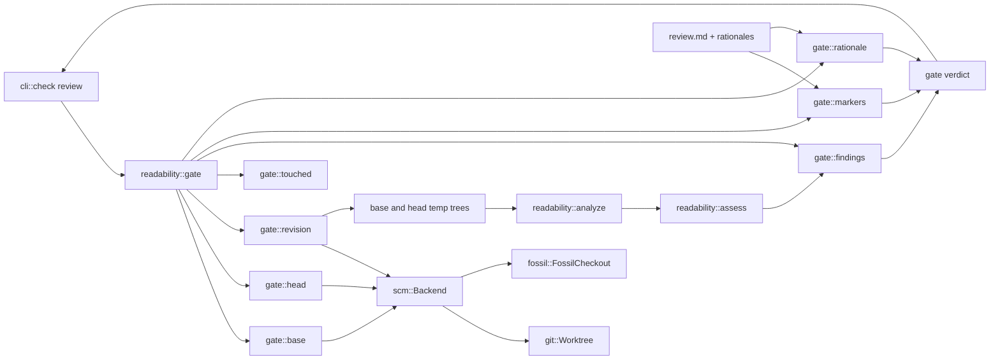
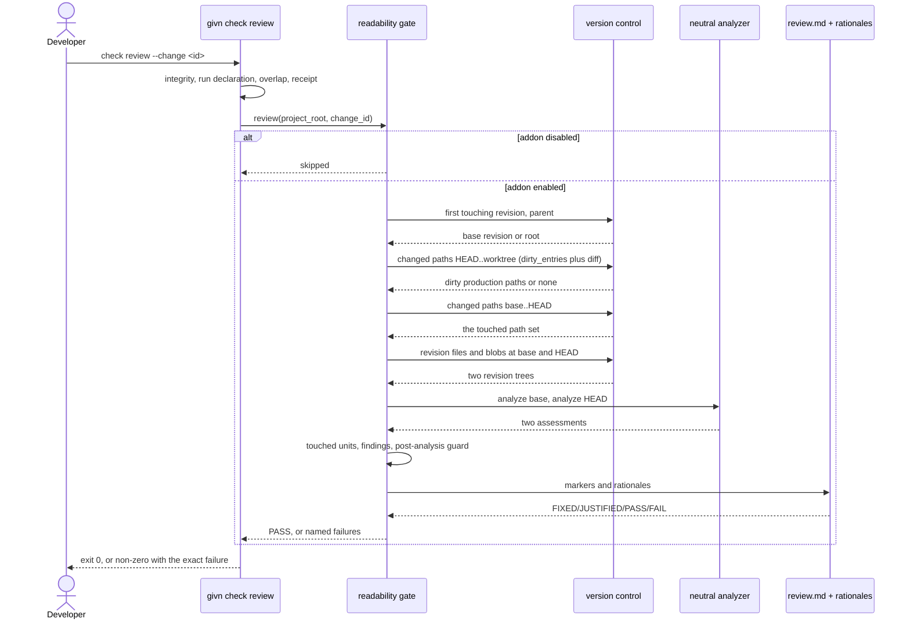

# Design: add-readability-review-gate

Status: design complete; every proposal question is resolved; design review
hardened on 2026-10-20 (see `design-review.md`). No production code changed.

## Context

This is the second change of the confirmed two-change readability experiment.
The first change, the on-demand report (`add-readability-report`), is archived.
It delivered the opt-in default-off `readability` addon, the neutral
`SourceAnalyzer` port, the shared metrics and classification, and the advisory
`givn readability report` command. It stores no baseline.

This change does two things in one PR:

1. it revises the report to be findings-only at schema version 2, and
2. it turns the same pipeline into a review gate with exactly two outcomes per
   gate finding: `FIXED` or `JUSTIFIED`.

The gate is change-relative by construction: it derives the base from
version-control history, analyzes the committed head, and never reads a stored
watchlist. The report's archived change stays historical and is not edited.

## Report Revision: Findings Only (Option A)

The report stops telling anyone what to do. `ClassifiedUnit` keeps its
classification, metrics, evidence, methods, and outline; it loses `action` and
`recommendation`. The `Action` enum is deleted.

### Production files and behavior

| File | Change |
|---|---|
| `src/readability/classify.rs` | Delete `Action`; delete `ClassifiedUnit.action` and `ClassifiedUnit.recommendation`; `decide()` returns `(Classification, Vec<Evidence>)`. Classification rules and thresholds are unchanged. |
| `src/readability/report.rs` | `SCHEMA_VERSION` becomes `2`; human output labels each unit `FINDING` or `WITHIN-LIMITS`, sorts by classification then path then unit id, and drops the `recommendation:` line; JSON drops `action` and `recommendation`; `summary.findings` stays the count of classifications other than `within-limits`; delete the unused `_action_label` helper and the `Action` import. |
| `src/readability/mod.rs` | Stop re-exporting `Action`. |
| `tests/steps/readability_report_steps.rs`, `tests/steps/readability_report_e2e_steps.rs` | Replace recommendation assertions with finding/classification assertions; add the schema-2 assertions; delete the recommendation step functions and their bindings, including `report_recommends_plan` and the watch/exception/advisory/trait-composition/no-action/no-plan assertions. |
| `tests/steps/readability_report_support.rs` | `assessment_counts` stops counting actions and returns `(units, classified, findings)`; the fixture helpers are otherwise unchanged. |
| `givn/specs/assess-code-structure/usecase.md` | Remove "one action" and every action/recommendation sentence; the report's success guarantee becomes one classification and no recommendation. |
| `givn/specs/assess-code-structure/readability-report.feature` | Merged from the delta below at archive. |
| `givn/changes/add-readability-review-gate/specs/assess-code-structure/readability-report.feature` | New delta: 10 modified scenarios, 3 removed titles, 5 added scenarios, including the report E2E and the JSON findings count. |

The archived report change (`givn/archive/add-readability-report/**`) is not
edited. Its design described schema 1; this design records the supersession.

### Exact human output

```text
readability report — rust, 1 file, 1 unit, 1 finding
findings only: this report does not block review or archive

FINDING       type    src/engine.rs::Engine   god-type
              code lines 620; methods 24; public methods 9; fields 3; LCOM4 4; TCC 0.312
              type-code-lines 620 > 500
```

- The status column is exactly `FINDING` or `WITHIN-LIMITS`.
- There is no `recommendation:` line and no advice sentence.
- Units sort by classification label, then path, then unit id.
- Metrics, evidence, diagnostics, and unsupported sections are unchanged.
- The header line and the `findings only:` line are stable tokens.

### Exact JSON shape

```json
{
  "report": "readability",
  "schema_version": 2,
  "rules_version": 1,
  "scope": { "language": "rust", "roots": ["src"], "production_only": true },
  "capabilities": { "language": "rust", "supported_constructs": [], "limitations": [], "resolution_labels": [] },
  "summary": { "files_scanned": 1, "files_analyzed": 1, "files_failed": 0, "units": 1, "units_classified": 1, "units_unsupported": 0, "findings": 1, "unsupported": 0 },
  "files": [],
  "units": [
    {
      "id": "type:src/engine.rs::Engine",
      "kind": "type",
      "name": "Engine",
      "declaration_file": "src/engine.rs",
      "files": ["src/engine.rs", "src/engine/parts.rs"],
      "classification": "god-type",
      "metrics": {},
      "evidence": [],
      "methods": [],
      "outline": []
    }
  ],
  "failures": [],
  "unsupported": []
}
```

`action` and `recommendation` are absent, not null. No other key is removed.
The schema bump is durable: a consumer of schema 1 must migrate, and
`schema_version` is the only signal. `rules_version` stays 1 because no
threshold or classification rule changes.

### Report E2E change

The permanent scenario "A developer runs a readability report and sees the
classified units" keeps its title and is `@givn.modified`. It stops asserting a
plan and asserts the `FINDING` label, the `god-type` classification, and the
absence of a recommendation. Its delta lives in the report delta file above.

## Technology Decisions

| Decision | Choice | Why |
|---|---|---|
| Language and build | Existing Rust binary, edition 2024 | No new runtime, no new process. |
| Analysis | Existing `src/readability/` public API (`analyze`, `assess`, `model`, renderers) through `readability::rust_analyzer()` | The report already proves the pipeline; a second metric implementation would drift. |
| Version-control access | Existing `src/scm.rs` seam; five new `Backend` methods implemented in `src/git.rs` and `src/fossil.rs` | The gate must not branch on Git vs Fossil, and the revision trees must come from the backend that owns the project. |
| Temporary trees | Two `tempfile::TempDir`s under the system temp directory, removed on drop | The analyzer takes a project root; a temporary checkout is the simplest way to analyze the base and the committed head without touching the working tree. `tempfile` is already in `Cargo.lock` as a dev-dependency; it moves to `[dependencies]` with no version change. |
| Review record | Plain `review.md` markers plus change-scoped Markdown rationales | The fixed vocabulary and a mechanically checkable artifact are enough; no schema or daemon. |
| Output | Plain deterministic stdout, non-zero exit on a failed decision | Matches every existing `givn check` gate. |
| Network/model | None | The gate is a review gate; a model call would make the verdict non-deterministic. |

### Version freshness

| Technology | Version | Resolution |
|---|---|---|
| Rust toolchain / edition | edition 2024 (existing) | No change; the project already builds on it. |
| `cucumber` test runner | 0.23 (existing dev-dependency) | Already resolved in `Cargo.lock`; no change. |
| `tempfile` | 3.x | Already declared as `tempfile = "3"` in `Cargo.toml` and resolved in `Cargo.lock`; promoted from `[dev-dependencies]` to `[dependencies]` without selecting a new version. |
| Git / Fossil executables | Local installations, already required by Givn | No version pin; the seam uses the same executables as the existing history and archive gates. |

## Decisions

| ID | Decision | Realized in |
|---|---|---|
| D1 | **Decides D1 (answered 2026-10-20, user):** the change base is the parent of the first reachable commit that touched `givn/changes/<change-id>/`. Git uses `rev-list --reverse --full-history --parents HEAD -- <dir>` and takes the first line's first parent; Fossil uses `timeline ... --reverse -r ancestors current` and the recorded `parent:` of the oldest matching check-in. A root commit has no parent and therefore an empty base tree. No reachable touch fails with the D6 message. A shallow repository fails before any guess. | `src/readability/gate/base.rs`; `src/scm.rs` |
| D2 | **Decides D2:** the gate adds no feedback ledger. The per-change `review.md` markers and the rationale artifacts are the structured evidence; the experiment feedback stays the manual record in `givn/ideation/readability-experiment/feedback.md`, curated by the owner. The gate writes no feedback file, telemetry, baseline, or classification cache. | No write path in `src/readability/gate.rs`; conditional review instruction |
| D3 | **Decides D3:** a marker names the report's stable unit id, `type:<declaration-file>::<Name>` or `module:<file>`. A `JUSTIFIED` marker requires a rationale at `givn/changes/<id>/readability/rationales/<unit-slug>.md` whose `Unit:` is exactly that id. A type rationale does not cover the file's module finding; two types in one file need two rationales. | `src/readability/gate/markers.rs`, `src/readability/gate/rationale.rs` |
| D4 | **Decides D4:** fix-or-justify. `FIXED` is accepted only when the unit has no gate finding at head; `JUSTIFIED` is accepted only when the unit still has a gate finding at head and a valid rationale exists. A finding with neither fails. `WATCH`, `PLAN`, and `EXCEPTION` do not exist. A rationale must be substantive, evidence-based, and owner-approved; DD10 defines the mechanical floor, and ownership and scope are banned reasons. | `src/readability/gate/findings.rs`, `src/readability/gate/rationale.rs` |
| D5 | **Decides D5:** when at least one gate finding exists, `review.md` must record `READABILITY: PASS`; `FAIL <reason>` fails the review even when every finding is decided. No outline artifact or hash is required. The outline-only comprehension review stays procedural: the marker is an attestation, and the gate cannot prove the reviewer never opened the source. | `src/readability/gate/markers.rs`; conditional review instruction |
| D6 | **Decides D6:** when no reachable commit touched the change directory, the gate fails with `change directory 'givn/changes/<id>/' has no reachable commit; commit the change directory before review`. There is no fallback to `HEAD`, the working tree, or a merge-base. | `src/readability/gate/base.rs` |
| D7 | **Decides D7 (answered 2026-10-20, user):** the head is the committed `HEAD`, exported to a temporary tree. A changed production path in the working tree fails before analysis with `production paths are dirty; commit or discard before review: <paths>`. Non-production paths (`review.md`, rationales, docs) may stay uncommitted. | `src/readability/gate/head.rs` |
| D8 | **Decides D8 (answered 2026-10-20, user):** this change also revises the report to findings-only at schema version 2. The archived report change stays historical; the permanent report spec and use case are modified by the report delta. | `src/readability/classify.rs`, `src/readability/report.rs`, report delta |
| DD1 | The gate calls `readability::analyze` once on the base tree and once on the head tree, then `readability::assess` on each `Analysis`. It reads `ClassifiedUnit` for classification/metrics/evidence and `Analysis.units` for file membership and trait/implementor relations. It computes no metric and makes no classification decision of its own beyond the gate's finding predicate. | `src/readability/gate.rs` |
| DD2 | No `syn` import outside `src/readability/syn_adapter.rs`. The gate obtains the analyzer through `readability::rust_analyzer()`; the report's source-scan test is extended to include `src/readability/gate*`. | `src/readability/mod.rs`; existing scan test |
| DD3 | The SCM seam gains exactly five methods on `Backend`: `first_touching_revision`, `parent_revision`, `revision_files`, `revision_blobs`, and `changed_paths`. The gate never runs `git` or `fossil` directly. `changed_paths(from, to)` returns the revision difference when both sides are revisions; for `(HEAD, Worktree)` it reuses the existing `dirty_entries` for tracked and untracked/extra worktree paths and adds the revision difference, so the dirty guard and the touched-path set share one operation. Git reads blobs through one `git cat-file --batch -z` process (NUL-delimited); Fossil reads each file with `fossil cat -r`. | `src/scm.rs`, `src/git.rs`, `src/fossil.rs` |
| DD4 | `revision_files` returns `(RepoPath, EntryKind)` where `EntryKind` is `Regular`, `Symlink`, or `Submodule`. A non-UTF-8 path fails closed. Regular files are materialized; a symlink or submodule is recorded as a diagnostic, and a touched unit that depends on it fails closed. Fossil has no submodules and stores symlinks as regular file content; its `ls` maps to `Regular` and the limitation is documented. | `src/scm.rs`, `src/git.rs`, `src/fossil.rs`, `src/readability/gate/revision.rs` |
| DD5 | The base and head trees contain only the production roots (default `src/`). The gate does not export `givn/`, `tests/`, `benches/`, `examples/`, or `target/`. A revision without production sources is an empty analysis, not an error. | `src/readability/gate/revision.rs` |
| DD6 | A parse failure or unreadable file on a changed production path fails the gate closed with the path, the side (`base` or `head`), and the diagnostic. A partially unsupported unit is classified from visible syntax and carries its diagnostics; a wholly unsupported touched unit fails closed. The gate never invents a size. | `src/readability/gate/findings.rs` |
| DD7 | A post-analysis guard inspects the head tree only: every changed production `.rs` path present at head must be analyzed (including `Failed` with a diagnostic) or named by a diagnostic. A deletion needs no head entry: it is proven by the base unit's `Removed` finding. A `.rs` path present at head that the analyzer never saw fails with `changed production file '<path>' was not analyzed; the analyzer scope or extension filter is wrong`. | `src/readability/gate/findings.rs` |
| DD8 | A changed path marks every head unit whose `declaration_file` or `files` contains it, the file's module unit, and every implementor of a touched trait. Base and head units are matched by `UnitId`; a base finding with no head counterpart is a removal, not a silent closure. | `src/readability/gate/touched.rs` |
| DD9 | A gate finding is a touched unit that is a report finding at the change base or at the committed head, excluding a `data-only` size classification without a method finding. A data-only unit with a method over 100 code lines or complexity 50 is a `MethodLength` gate finding. The term is used consistently: "gate finding" in review text, "report finding" in report text. | `src/readability/gate/findings.rs` |
| DD10 | Rationale validation is mechanical and deterministic: exact unit and classification; `Finding:` names the reason; `Alternatives considered:` rejects empty, `none`, and `n/a` and must name at least one alternative plus why it was rejected; `Evidence:` must cite a concrete metric or path from the finding; `Why this shape is right:` must name the unit's responsibility; `Owner:` must be the confirmed owner (`givn-maintainer--owner` in this project); a banned phrase fails; `Follow-up:` and `Expiry:` must appear together. Truth and quality remain the owner's judgment. | `src/readability/gate/rationale.rs` |
| DD11 | The review record vocabulary is exactly `READABILITY: FIXED <unit>`, `READABILITY: JUSTIFIED <unit>`, `READABILITY: PASS`, and `FAIL <reason>`. An unknown `READABILITY:` line fails with `UnknownMarker`. `FAIL` matches only as the exact token followed by a space and a non-empty reason; `FAILED` and `FAILURE` are not markers. Fenced code blocks are ignored, so an example inside a fence is not a record. Duplicate identical `FIXED` or `JUSTIFIED` lines count once and are harmless; duplicate `PASS` lines are harmless; two different decisions for one unit fail. Marker unit ids are case-sensitive and never resolved through a file alias. | `src/readability/gate/markers.rs` |
| DD12 | The gate runs inside `run_mandatory_checks("review")` after the verification-receipt check, so a stale receipt or a structural failure is reported first. It adds no CLI command or flag. | `src/cli/check.rs` |
| DD13 | The conditional review instruction lives in `assets/instructions/review.md` behind `{{#if addons.readability}}`; `readability` joins `KNOWN_ADDON_KEYS` and both `addon_flags` maps. The maps live in `src/skills/targets.rs` and `src/cli/instructions.rs`; either add the key to both or extract one shared helper. The instruction states the fix-or-justify rule, the rationale mechanical floor, and the ownership boundary. | `assets/instructions/review.md`, `src/skills/render.rs`, `src/skills/targets.rs`, `src/cli/instructions.rs` |
| DD14 | The use-case contracts are updated: `givn/specs/verify-change/usecase.md` gains the capability, one interaction row, and the fix-or-justify rule; `givn/specs/assess-code-structure/usecase.md` becomes findings-only. | Both `usecase.md` files |
| DD15 | The gate is a read view: its only writes are the two temporary trees under the system temp directory, removed before the command returns. Output is byte-stable for the same base, head, rules version, and review record. | `src/readability/gate.rs` |
| DD16 | The report's findings-only revision bumps `schema_version` to 2 and removes `action` and `recommendation`; `rules_version` stays 1. The report still exits 0 for findings and remains advisory. | `src/readability/report.rs` |

No proposal question is left unresolved. D1, D7, and D8 are answered by the
user; D2 is answered here; D3-D6 are carried in the proposal and decided above.

## Use-case Traceability

Owning use case: `verify-change`. Actor: **Developer**; supporting actor:
**Reviewer**. Personas are review lenses, not Gherkin actors:
`developer--primary-user`, `agent--technical-role`,
`givn-maintainer--owner`.

| Use-case element | Guarantee / rule / event | Technical decision | E2E or other evidence |
|---|---|---|---|
| Goal: check a change for structural validity before archive | Minimal guarantee | The gate adds readability findings to the existing review result (DD1, DD12) | `@e2e` "A developer runs the review with accounted readability findings and it passes" |
| Main flow 1: read the active specifications and workflow artifacts | Preconditions | The gate reads the change directory, `review.md`, and the rationale artifacts (D3, DD15) | Marker and rationale scenarios |
| Main flow 2: confirm the verification receipt | Precondition | The gate runs after the receipt check (DD12) | Existing receipt scenarios |
| Main flow 3: detect duplicate behavior, structural overlap, invalid references | Existing gate | Unchanged; the readability gate runs after the existing review checks (DD12) | Existing permanent scenarios |
| Main flow 5: report blocking and advisory findings | Success guarantee | Every gate finding is reported with its unit id, classification, base/head size, and missing decision (D4, DD9) | `@e2e`; unaccounted-finding scenarios |
| Extension 5: a review disposition is missing → completion is blocked | Blocking rule | A finding without FIXED or JUSTIFIED blocks review (D4) | "A new type over the readable size with no decision fails" |
| Rule: structural failures outrank other findings | Ordering | Receipt and structural checks run first; the readability gate runs last (DD12) | Design order; CLI integration test |
| Rule: a review PASS requires a current green receipt | Precondition | The gate runs only after `check_change_receipt` succeeds (DD12) | Existing receipt scenarios |
| Rule: each checked scenario records one real, unique revision whose message names the scenario | Unchanged | The readability gate does not read or alter task commits (DD12) | Existing task-commit scenarios |
| Rule: the README-impact decision is reported before review and remains blocking | Unchanged | The preflight is unchanged (DD12) | Existing README-impact scenarios |
| Rule: migration coverage cannot regress without an explicit retirement record | Unchanged | The migration check is not touched (DD12) | Existing migration scenarios |
| Rule: every blocking overlap has an explicit disposition | Analogy | Every gate finding has exactly one FIXED or JUSTIFIED decision (D3, D4) | Decision table; marker scenarios |
| Rule: when the readability experiment is enabled, every gate finding needs a decision | New rule | Fix-or-justify; `WATCH`, `PLAN`, and `EXCEPTION` are gone (D4) | Decision table; rationale scenarios |
| Capability ownership: `readability-review-gate` under `verify-change` | New capability | The capability and its interaction row are added to the use-case contract (DD14) | Routing table; Interaction Coverage Matrix |
| Capability ownership: `readability-report` under `assess-code-structure` | Modified capability | Findings-only report at schema 2 (D8, DD16) | Report delta; report E2E |
| Minimal guarantee: an invalid change cannot pass the verification gate | Blocking rule | A finding without a decision, an invalid rationale, or a `FAIL` marker exits non-zero (D4, D5) | E2E and failure scenarios |
| Success guarantee: the developer receives a complete verification result | Output | The gate names each finding, its unit id, base/head size, and the missing decision (DD15) | Gate output assertions |
| Events | None | The gate has no event/state model; it is a read view (DD15) | No event scenario |

### Persona impact

| Persona | User-visible surface | Impact |
|---|---|---|
| `developer--primary-user` | `givn check review` stdout/stderr; `givn readability report` | Sees findings without advice; cannot pass review with an undecided finding; must commit production changes before review. |
| `agent--technical-role` | Review instruction plus rationale artifacts and markers | Writes the rationale with the required fields, records `READABILITY: FIXED` or `READABILITY: JUSTIFIED`, and re-runs the review until it passes. |
| `givn-maintainer--owner` | Rationale approval; experiment record | Approves the substantive reason; the gate checks fields and bans ownership/scope reasons but does not grade the rationale. No baseline or ledger to curate. |

## Architecture Impact

New module tree (plain listing, not a diagram):

```text
src/readability/
  gate.rs              orchestration: base -> head -> touched -> findings -> decisions -> verdict
  gate/base.rs         change-base resolution and diagnostics
  gate/head.rs         committed-HEAD selection and dirty-production guard
  gate/revision.rs     revision-tree export and temporary trees
  gate/touched.rs      changed paths -> touched units (across files and implementors)
  gate/findings.rs     finding predicate, reasons, unit-level decisions, post-analysis guard
  gate/markers.rs      review.md marker parser
  gate/rationale.rs    rationale artifact lookup and validation
src/readability/classify.rs  remove Action and recommendation
src/readability/report.rs    schema 2, findings-only human and JSON output
src/cli/check.rs             calls the gate after the verification-receipt check
src/scm.rs                   five revision/tree/path methods on Backend
src/git.rs                   Git implementations
src/fossil.rs                Fossil implementations
assets/instructions/review.md  conditional fix-or-justify block
src/skills/render.rs  readability in KNOWN_ADDON_KEYS
src/skills/targets.rs  readability in the sync addon_flags map
src/cli/instructions.rs  readability in the instruction addon_flags map
givn/specs/verify-change/usecase.md  capability and interaction row
givn/specs/assess-code-structure/usecase.md  findings-only report contract
```



Dependency direction: `cli::check -> readability::gate -> readability::{model,
analyze, assess}` and `gate::{base,head,revision} -> scm`. The `cli::check ->
readability` edge already exists for the report; the gate adds an internal
module edge in the same direction, not a new cross-component dependency,
ownership boundary, or deployment boundary. `gate::markers` and
`gate::rationale` depend only on text; no gate module imports `syn`; `scm` does
not depend on `readability`.

`GateOutcome` is rendered by `src/cli/check.rs`; the gate modules produce the
value and the exact tokens, and no gate module prints.



## Data Model

All gate types live in `src/readability/gate.rs` and its submodules. They are
plain data; nothing is serialized, persisted, or cached.

| Type | Fields | Purpose |
|---|---|---|
| `GateRequest` | `project_root: PathBuf`, `change_id: String`, `change_dir: PathBuf`, `roots: Vec<PathBuf>` | One review run; `roots` defaults to `["src"]`. |
| `ChangeBase` | `first_touch: String`, `parent: Option<String>` | The first reachable change-directory commit and its first parent; `None` means an empty base tree. |
| `HeadGuard` | `dirty_production: Vec<RepoPath>` | Working-tree paths that prevent analysis. |
| `RevisionTree` | `root: TempDir`, `files: Vec<(RepoPath, EntryKind)>`, `diagnostics` | One materialized revision. |
| `GateAnalysis` | `base: Assessment`, `head: Assessment`, `head_units`, `diagnostics` | Two assessments plus the head relations needed for implementor lookup. |
| `TouchedSet` | `units: BTreeSet<UnitId>`, `changed_paths: BTreeSet<RepoPath>` | The units to evaluate. |
| `GateFinding` | `unit_id`, `path`, `files`, `kind`, `name`, `head_classification: Option<Classification>`, `base_code_lines: Option<u32>`, `head_code_lines: Option<u32>`, `method_findings: Vec<String>`, `reason: FindingReason`, `decision: Decision` | One gate finding. |
| `FindingReason` | `NewType`, `NewModule`, `ExistingGrown`, `ExistingNotGrown`, `CrossedThreshold`, `Fixed`, `MethodLength`, `Removed` | Why the unit is a gate finding or a base finding that is fixed at head; drives the exact message. |
| `Decision` | `Missing`, `Fixed { marker_count: usize }`, `Justified { rationale: PathBuf }` | The two accepted outcomes plus the failure state. |
| `ReviewMarkers` | `verdict: Option<Verdict>`, `fixed: BTreeMap<UnitId, usize>`, `justified: BTreeMap<UnitId, usize>`, `fail: Vec<String>` | Parsed `review.md`. |
| `RationaleArtifact` | `path`, `unit`, `classification`, `finding`, `evidence`, `why`, `alternatives`, `owner`, `follow_up`, `expiry` | A validated rationale. |
| `GateOutcome` | `base`, `findings: Vec<GateFinding>`, `markers`, `diagnostics`, `failures: Vec<GateFailure>` | Rendered by the CLI; `failures` is empty only on PASS. |
| `GateFailure` | `Unaccounted`, `InvalidFixed`, `MissingRationale`, `JustifiedWithoutFinding`, `ConflictingDecisions`, `InvalidRationale`, `MissingVerdict`, `FailMarker`, `MissingRecord`, `UnknownMarker`, `SlugCollision`, `DirtyProduction`, `NoChangeCommit`, `ShallowRepository`, `AnalysisFailed`, `UnanalyzedFile`, `UnsupportedUnit`, `SkippedEntryDependency`, `NonUtf8Path`, `NewlinePath` | One reason the gate fails; rendered as `FAILURE  <code>  <message>`. |
| `Verdict` | `Pass`, `Fail` | The `READABILITY:` line. |

## Change Base and Revision Trees

### Base resolution

1. Let `dir = "givn/changes/<change-id>"`.
2. Ask `first_touching_revision(dir)`.
   - Git: refuse a shallow repository (`git rev-parse --is-shallow-repository`
     returning `true`) with the shallow message; then
     `git rev-list --reverse --full-history --parents HEAD -- <dir>` and take
     the first line. The first token is the commit; the second token is its
     first parent.
   - Fossil: `fossil timeline -n 0 -t ci -p <dir> -F %H --reverse -r ancestors current`
     and take the first line of that oldest-first output. `--reverse` is
     required: without it the first line is the newest check-in. `ancestors
     current` is required too: sibling timelines are not ancestors and must
     never become the base.
3. If there is no line, fail with the D6 message. No fallback.
4. `parent_revision(first_touch)`:
   - Git: the first parent from step 2; absent for a root commit.
   - Fossil: the `parent:` field of `fossil info <rev>`; absent for the first
     check-in. A merge check-in also carries `merged-from:`; `parent:` is the
     first parent and `merged-from:` is the merged-in check-in, which is never
     the base.
5. `parent = None` means an empty base tree: every head unit is new. A merge
   commit's first parent is the branch state before the merge. A rebase rewrites
   the first touch and its parent; the gate recomputes both and stores nothing.
6. A production commit that lands before the change-directory commit is part of
   the base. It is not part of this change and never reported as growth.

### Head and dirty guard

The head is the committed `HEAD`, never the working tree.

1. `changed_paths(Some("HEAD"), RevisionSpec::Worktree)` reuses the existing
   `dirty_entries` for tracked and untracked/extra worktree paths, adds the
   revision diff, and keeps only paths under the production roots.
2. If that set is non-empty, fail with
   `production paths are dirty; commit or discard before review: <path>[, <path>]`.
   Non-production paths (`review.md`, rationales, docs, `givn/`) are ignored.
3. Materialize the `HEAD` production tree with `revision_files("HEAD", roots)`
   and `revision_blobs("HEAD", regular_paths)` and analyze it. The gate never
   reads the working copy for production metrics.

This makes the analyzed revision exactly the revision a current verification
receipt tested.

### Revision-tree materialization

1. Create a `tempfile::TempDir` outside the project for each side.
2. Ask `revision_files(revision, roots)`.
   - Git: `git ls-tree -r -z <rev> -- <roots>`; parse
     `mode type hash\tpath\0`. Modes `100644`/`100755` are `Regular`, `120000`
     is `Symlink`, `160000` is `Submodule`.
   - Fossil: `fossil ls -r <rev> <roots>`; every entry is `Regular` because
     Fossil has no submodule kind and stores symlinks as file content.
3. Reject an absolute path, `..`, a path outside the roots, a path that is not
   valid UTF-8 (`revision path is not valid UTF-8: <lossy>`), or a path that
   contains `\n` or `\r` (`revision path contains a line break: <lossy>`). The
   refusal keeps line-oriented Fossil output unambiguous; Git paths are read
   with NUL delimiters.
4. Read bytes for regular files:
   - Git: one `git cat-file --batch -z` process over NUL-terminated
     `<rev>:<path>` requests.
   - Fossil: one `fossil cat <path> -r <rev>` per file.
5. Write `Regular` bytes to `<temp>/<path>`, creating parent directories.
   Record `Symlink` and `Submodule` as diagnostics and do not write them. A
   touched unit that depends on a skipped entry fails closed.
6. Analyze the temp root with the same `AnalysisRequest` scope as the other side
   (`language: Rust`, `roots`, `include_test_sources: false`).
7. Drop both temp dirs before returning. A temp path never appears in output.

A revision with no production sources is an empty analysis, not an error. The
base tree normally does not contain the change directory; the gate never reads
it there.

## Touched-Unit Selection

Inputs: head `Analysis`, base `Analysis`, and the changed production paths from `changed_paths(base, HEAD)`. A deletion contributes a path with no head entry.

1. Index head units by `UnitId`; index `SourceUnit.files` and
   `SourceUnit.declaration_file`.
2. For every changed production path:
   - mark every head unit whose `declaration_file` equals the path;
   - mark every head unit whose `files` contains the path (a type implemented
     in another file is the type, not just the file);
   - mark the module unit for the path;
   - if the marked unit is a trait (`TypeKind::Trait`), mark every unit in its
     `ImplementedBy` relations, transitively one level.
3. For every marked type unit, mark its declaration-file module unit.
4. For every changed path, find base units whose `files` contained it. A base
   unit with no head unit of the same `UnitId` is a gate finding with reason
   `Removed`; it requires `FIXED`.
5. Match base and head by `UnitId`, never by file path. A move to a new module
   path changes the id: the old unit is `Removed` and needs `FIXED`, and the new
   unit is new debt and needs its own decision. A split creates new ids and a
   removed base unit.
6. Sort the touched set by `(path, unit_id)`.

A changed path outside the production roots contributes no unit. If the change
touches no production unit, the gate reports `touched 0 unit(s), 0 finding(s)`
and requires no marker. A touched file with only `#[cfg(test)]` items produces
no production code-line delta and no finding.

## Findings and Decisions

### Finding predicate

`is_report_finding(unit)` is `classification != WithinLimits`.
`is_gate_finding(unit)` is:

```text
(classification != WithinLimits && classification != DataOnly)
|| !method_findings.is_empty()
```

A `data-only` unit is exempt from the size rule even at 620 code lines. A
data-only unit with a method over 100 code lines or complexity 50 is a
`MethodLength` finding. A unit at exactly 500 code lines is within limits; at
501 it is a finding. A module at exactly 1,000 is a finding because the report's
`module` classification starts at 500. A new interface under 500 with more than
50 public methods is a finding.

### Finding reasons

First match wins:

| # | Base | Head | Reason |
|---|---|---|---|
| 1 | any | no head unit | `Removed` |
| 2 | no base unit | finding | `NewType` for a type, `NewModule` for a module |
| 3 | finding at base | finding, `head > base` | `ExistingGrown` |
| 4 | finding at base | finding, `head <= base` | `ExistingNotGrown` |
| 5 | under threshold at base | finding | `CrossedThreshold` |
| 6 | any | method finding without a size finding | `MethodLength` |
| 7 | finding | no gate finding | `Fixed` (the accepted `FIXED` case) |

Exact finding messages:

```text
new type: <head> code lines, <public_methods> public methods; classification <label>
new module: <head> code lines; classification <label>
existing finding grew: <base> -> <head> code lines; classification <label>
existing finding did not grow: <base> -> <head> code lines; classification <label>
crossed threshold: <base> -> <head> code lines; classification <label>
removed: base <base> code lines; finding no longer fires
fixed at head: <base> -> <head> code lines; classification <head-label>
long method: <method_code_lines> code lines, complexity <complexity>; classification <label>
```

The printed size is the measured analyzer value. Conditional code is counted as
written, and a parent-module `#[cfg(test)]` is not propagated (arc42 R-108), so
the value is an upper bound, never a claim of exactness. A new false-large
finding needs `FIXED` or `JUSTIFIED`; an existing non-growing false-large
finding also needs `JUSTIFIED`. There is no cfg exemption.

### Decision rules

Every gate finding has exactly one decision:

- `FIXED`: accepted only when the unit has no gate finding at head (including
  `Removed`). The marker is `READABILITY: FIXED <unit>`.
- `JUSTIFIED`: accepted only when the unit has a gate finding at head and a
  valid rationale exists. The marker is `READABILITY: JUSTIFIED <unit>` and the
  rationale path is `givn/changes/<id>/readability/rationales/<unit-slug>.md`.
- `MISSING`: neither; the review fails.

Invalid combinations fail:

| Situation | Failure |
|---|---|
| `FIXED` on a unit still a finding at head | `FIXED marker for <unit>, but <unit> is still a finding: <classification> <head> code lines (base <base>)` |
| `JUSTIFIED` on a unit with no finding at head | `JUSTIFIED marker for <unit>, but <unit> is not a finding at head; use READABILITY: FIXED <unit>` |
| `JUSTIFIED` with no rationale | `JUSTIFIED marker for <unit> has no rationale at <path>` |
| Both markers for one unit | `conflicting decisions for <unit>` |
| The same marker repeated | Harmless; the decision is counted once. |
| No decision | `readability review: FAIL (N finding(s) without a decision)`; the line is `1 finding without a decision` for exactly one and `N findings without a decision` otherwise. |
| Orphan marker for an untouched unit | advisory only; a finding may have been closed after the marker was written |

A rationale's `Unit:` must match a gate finding exactly. A type rationale does
not cover the file's module finding; two types in one file need two rationales.

`touched N unit(s), M finding(s)` in the output counts touched units and gate
findings separately: a touched unit that never was and is not a finding is
counted in `N` only.

### Rationale artifact

Path: `givn/changes/<change-id>/readability/rationales/<unit-slug>.md`.

Slug rule: lowercase the unit id, replace every run of characters outside
`[a-z0-9]` with `-`, trim leading/trailing `-`. Examples:

```text
type:src/engine.rs::Engine -> type-src-engine-rs-engine
module:src/history.rs      -> module-src-history-rs
```

Two units that produce the same slug are a hard error: the writer must split
the file or rename the unit; the gate reports
`rationale slug collision for <unit> and <unit>`.

Required fields, each non-empty:

```text
Unit: type:src/engine.rs::Engine
Classification: god-type
Finding: existing-grown
Evidence: 620 -> 700 code lines, 24 methods, 9 public methods, LCOM4 4, TCC 0.312; every call site is in src/cli/check.rs.
Why this shape is right: The type owns the review state machine and its phase order; splitting it would move the transition rules into two modules.
Alternatives considered: Extract the renderer and the SCM adapter. Rejected: rendering already delegates to readability::report, and SCM access is one hop through scm::Backend; both extractions add indirection without removing a responsibility.
Owner: givn-maintainer--owner
```

Validation is mechanical and deterministic:

- `Unit:` matches the gate finding's unit id exactly.
- `Classification:` matches the head classification.
- `Finding:` matches the gate finding's reason label (`new-type`, `new-module`,
  `existing-grown`, `existing-not-grown`, `crossed-threshold`,
  `method-length`, `removed`). `fixed` is not a rationale reason.
- `Evidence:` must cite at least one concrete metric or path from the gate
  finding: a measured number with its unit, a metric name (`code lines`,
  `public methods`, `LCOM4`, `TCC`), or a project-relative path that appears in
  the finding. "It is fine" fails.
- `Why this shape is right:` must name the unit's responsibility: it contains
  the unit's short name (the type name, or the module file stem) and at least
  one sentence of eight words or more that is not a restatement of the
  classification. "It works" fails.
- `Alternatives considered:` rejects empty, `none`, `n/a`, `-`, and any
  dismissal token. It must name at least one alternative and why it was
  rejected: at least one `Rejected:` clause (case-insensitive) with a named
  alternative before it. A bare plan or a category such as "legacy" fails.
- `Owner:` must match a confirmed persona id under the durable collection
  `givn/personas/*.md` whose `Role:` names an ownership authority. In this
  project that is `givn-maintainer--owner`. An unknown id, a non-owner persona,
  or `none` fails; a project with no owner persona fails closed with
  `no confirmed owner persona under givn/personas/; add one before recording a JUSTIFIED decision`.
- The prose does not contain a banned phrase: `not my code`, `not this change`,
  `predates my work`, `no capacity`, `out of scope`, `legacy`, `too risky`,
  `no time`, `will do later`, `later`. Phrases match case-insensitively on
  whole-word boundaries, so `later` does not match `translator` or `lateral`.
- `Follow-up:` and `Expiry:` appear together when the shape is temporary;
  neither is required for a permanent shape. The gate checks the pair, not the
  calendar.

The gate does not grade truth or plausibility. The owner still judges the
rationale; the mechanical floor only proves that a concrete alternative,
concrete evidence, a named responsibility, and a confirmed owner are present.
The owner approves the content by writing `READABILITY: JUSTIFIED <unit>`, and
the review guidance states that the content criteria are authoritative.
Banned-reason failures:

```text
rationale <path>: banned reason 'not my code'
rationale <path>: Unit: <x> does not match the gate finding <unit>
rationale <path>: Classification: <x> does not match <y>
rationale <path>: Evidence: must cite a concrete metric or path from the gate finding
rationale <path>: Why this shape is right: must name the unit's responsibility
rationale <path>: Alternatives considered: must name at least one alternative and why it was rejected
rationale <path>: missing Owner:
rationale <path>: Owner: '<x>' is not a confirmed owner; use givn-maintainer--owner
rationale <path>: no confirmed owner persona under givn/personas/; add one before recording a JUSTIFIED decision
rationale <path>: missing Follow-up:
rationale <path>: missing Expiry:
rationale slug collision for <unit> and <unit>
```

A slug collision is a hard error because two units would share one artifact; the
writer must split the rationale or change the unit, and the two ids are printed
in `(unit_id)` order.

## Review Markers and Verdict

### `review.md`

The gate reads `<change>/review.md`. The complete vocabulary is:

| Marker | Meaning |
|---|---|
| `READABILITY: FIXED <unit>` | The unit is under its threshold at head, or the finding no longer fires. |
| `READABILITY: JUSTIFIED <unit>` | The unit remains a gate finding at head and a valid rationale exists. |
| `READABILITY: PASS` | The semantic review ran and found the touched units explainable. Required when at least one gate finding exists. |
| `FAIL <reason>` | The semantic review failed; the review must not pass. |

Parsing rules:

- A marker is a line whose trimmed content, after an optional leading `- `,
  starts with `READABILITY: ` or `FAIL `. The unit is trimmed and optional
  backticks around it are removed.
- Fenced code blocks (` ``` `) are ignored, so a vocabulary example pasted into
  a fence is not a record. An inline mention after other prose is not a marker.
- `FAIL` is a whole token: it must be followed by exactly one space and a
  non-empty reason. `FAILED`, `FAILURE`, and a bare `FAIL` are not markers and
  fail as unknown lines.
- Marker names and unit ids are case-sensitive. A `READABILITY:` line outside
  the vocabulary fails with `unknown readability marker: <line>`
  (`GateFailure::UnknownMarker`).
- A marker may not name a file or a shortened id; it names the exact unit id.
- Duplicate identical `FIXED` or `JUSTIFIED` lines count once and are harmless;
  duplicate `PASS` lines are harmless; `READABILITY: PASS` and `FAIL` together
  fail; two different decisions for one unit fail as conflicting.
- A missing `review.md` with a gate finding fails with
  `readability record is missing; create givn/changes/<id>/review.md and record 'READABILITY: PASS'`.

### Verdict rules

- At least one gate finding and no `READABILITY: PASS`:
  `readability review: FAIL (missing 'READABILITY: PASS')`.
- `FAIL <reason>`: `readability review: FAIL (<reason>)`; this wins over all
  decisions.
- No gate findings: `readability review: PASS`; no marker required, and inert
  markers do not fail.
- All gate findings decided and `PASS`: `readability review: PASS`.
- Every failure is rendered once as a `FAILURE  <code>  <message>` line. The
  code is the kebab-case variant name (`unaccounted`, `invalid-fixed`,
  `missing-rationale`, `justified-without-finding`, `conflicting-decisions`,
  `invalid-rationale`, `missing-verdict`, `fail-marker`, `missing-record`,
  `unknown-marker`, `slug-collision`, `dirty-production`, `no-change-commit`,
  `shallow-repository`, `analysis-failed`, `unanalyzed-file`,
  `unsupported-unit`, `skipped-entry-dependency`, `non-utf8-path`,
  `newline-path`). Failures sort by `(rank, variant order, path, unit id)`, where the variant order is the order listed in each group below:
  repository/base/head (`NoChangeCommit`, `ShallowRepository`,
  `DirtyProduction`), analysis (`AnalysisFailed`, `UnanalyzedFile`,
  `UnsupportedUnit`, `SkippedEntryDependency`, `NonUtf8Path`, `NewlinePath`),
  record/marker (`MissingRecord`, `UnknownMarker`, `MissingVerdict`,
  `FailMarker`), rationale (`SlugCollision`, `InvalidRationale`,
  `MissingRationale`, `JustifiedWithoutFinding`), decision (`InvalidFixed`,
  `ConflictingDecisions`, `Unaccounted`). With one failure the final line keeps
  the specific message; with several it is
  `readability review: FAIL (<N> failures; first: <first failure message>)`.
  The final line is always the last line of output.

### Semantic review

The outline-only comprehension review (fresh context, the outline alone, state
each unit's responsibility and call order) stays procedural. `READABILITY:
PASS` records that it happened. The gate cannot prove the reviewer stayed out of
the source and does not claim to.

## CLI and Check Integration

`src/cli/check.rs` calls the gate from `run_mandatory_checks("review")` after
`check_change_receipt` and before returning success:

```text
review:
  integrity
  run declaration
  overlap / retirement / routing
  verification receipt
  readability review        <- new
```

Behavior matrix:

| Situation | Behavior |
|---|---|
| Addon disabled | No analysis, no output, no markers required. Review behaves exactly as before. |
| No `--change` | The gate is skipped with the existing change-scoped warning; it cannot compute a base without a change. |
| Addon enabled, no gate finding | `readability review: PASS`; no marker required. |
| Addon enabled, all findings FIXED or JUSTIFIED | `readability review: PASS`; exit 0. |
| Addon enabled, a finding has no decision | `readability review: FAIL (N finding(s) without a decision)`; exit non-zero. |
| `FAIL <reason>` present | Exit non-zero with the reason, even if every finding is decided. |
| Missing `READABILITY: PASS` with a finding | Exit non-zero with the missing-verdict message. |
| Base has no reachable change-directory commit | Exit non-zero with the D6 message. |
| Repository is shallow | Exit non-zero with the shallow message. |
| Production path is dirty | Exit non-zero before analysis with the dirty message. |
| Revision file cannot be read or parsed | Exit non-zero with the path, the side, and the diagnostic. |
| Changed `.rs` file present at head not seen by the analyzer | Exit non-zero with the post-analysis-guard message. A deleted file is not an unanalyzed file; its base unit is `Removed`. |
| Unknown `READABILITY:` line | Exit non-zero with `unknown readability marker: <line>`. |
| Two units share a rationale slug | Exit non-zero with `rationale slug collision for <unit> and <unit>`. |
| Rationale fails the mechanical floor | Exit non-zero with the field-specific message. |
| Several failures | Exit non-zero and print every `FAILURE` line plus the aggregate final line. |

### Exact output

Stable tokens. Gate findings and decisions sort by `(path, unit_id)`; a
decision line follows its finding. The header counts touched units and gate
findings separately (`1 finding` / `N findings` only appears in the failure
line; the header always uses `unit(s)` and `finding(s)`):

```text
Readability review gate
  base 4f2a9c1 (parent of 9b1d7e0)
  head HEAD
  touched 2 unit(s), 2 finding(s)
  FINDING   type:src/cohesive.rs::Cohesive  new type: 650 code lines, 4 public methods; classification cohesive-large-type
  DECISION  JUSTIFIED  type:src/cohesive.rs::Cohesive  rationale givn/changes/test-change/readability/rationales/type-src-cohesive-rs-cohesive.md
  FINDING   type:src/engine.rs::Engine  fixed at head: 620 -> 480 code lines; classification within-limits
  DECISION  FIXED      type:src/engine.rs::Engine  marker READABILITY: FIXED type:src/engine.rs::Engine
readability review: PASS
```

`Cohesive` is `JUSTIFIED`, not `FIXED`: it is a new 650-line finding at head.
`Engine` is `FIXED`: it was a base finding and is under its threshold at head.

A complete MISSING failure block:

```text
Readability review gate
  base 4f2a9c1 (parent of 9b1d7e0)
  head HEAD
  touched 2 unit(s), 2 finding(s)
  FINDING   type:src/cohesive.rs::Cohesive  new type: 650 code lines, 4 public methods; classification cohesive-large-type
  DECISION  MISSING    type:src/cohesive.rs::Cohesive  record READABILITY: JUSTIFIED type:src/cohesive.rs::Cohesive and create givn/changes/test-change/readability/rationales/type-src-cohesive-rs-cohesive.md
  FINDING   type:src/engine.rs::Engine  existing finding grew: 620 -> 700 code lines; classification god-type
  DECISION  MISSING    type:src/engine.rs::Engine  record READABILITY: JUSTIFIED type:src/engine.rs::Engine and create givn/changes/test-change/readability/rationales/type-src-engine-rs-engine.md
readability review: FAIL (2 findings without a decision)
```

- A `FINDING` line renders every gate finding, including a base finding that is
  fixed at head; that line's reason reads `fixed at head` and it needs no
  rationale suggestion. A touched unit that is not and never was a gate finding
  gets no `FINDING` line.
- A `MISSING` decision line names the exact marker and, because `JUSTIFIED` is
  the remaining option, the rationale path.
- `touched N unit(s), M finding(s)` counts touched units and gate findings; a
  touched unit that is not and never was a gate finding is counted in `N` only.
- On one failure the final line is
  `readability review: FAIL (<reason>)` and the same line is returned to the
  CLI error so stderr contains it. On several failures every `FAILURE` line is
  printed and the final line aggregates them.
- On PASS the final line is always exactly `readability review: PASS`.
- There is no `readability review passed` variant.
- `base none (root change commit; empty base tree)` replaces the base line for a
  root commit.
- The gate never prints a temp path, timestamp, host value, or analyzer
  identity.

## Review Instruction and Ownership

When the addon is enabled, `givn instructions review` appends a conditional
block to the served review instruction. The block:

- states that the gate runs inside `givn check review`, analyzes the committed
  `HEAD`, and fails on a dirty production path;
- gives the exact vocabulary: `READABILITY: FIXED <unit>`,
  `READABILITY: JUSTIFIED <unit>`, `READABILITY: PASS`, `FAIL <reason>`;
- states fix-or-justify: a unit under its threshold gets `FIXED`; a unit still
  over its threshold gets `JUSTIFIED` with a rationale;
- gives the rationale path and the mechanical floor: a named alternative with
  why it was rejected, concrete evidence (a metric or a path from the finding),
  the unit's responsibility, and the confirmed owner;
- states the banned reasons and that truth and quality are the owner's judgment;
- states: "A justification cannot use ownership or scope as a reason. Code is
  owned by everyone working on the project; leaving debt because it is not your
  code is not acceptable.";
- says to record `READABILITY: PASS` only after the outline comprehension,
  expressive-name, and single-responsibility review, and to re-run
  `givn check review` until it prints `readability review: PASS`.

The block is rendered by `{{#if addons.readability}}`; `readability` is added
to `KNOWN_ADDON_KEYS` and to both `addon_flags` maps (`src/skills/targets.rs`
and `src/cli/instructions.rs`), or those two copies are replaced by one shared
helper.

`assets/instructions/dev-principles.md` gains the general principle:

> Code is owned by everyone working on the project. Seeing technical debt and
> leaving it because "it was not me" is not acceptable. Leave existing code
> better than you found it whenever you touch it.

and the anti-pattern:

> Not my code: leaving a defect or debt in a file because someone else wrote
> it.

## Determinism and Offline Behavior

- No network, model, clock, or random value is read. The base revision is a
  content address; both trees are written under process-private temp
  directories.
- Touched units, gate findings, and decisions sort by `(path, unit_id)`.
  Metrics are integers; ratios are permille.
- Paths are project-relative with `/`. Temp paths, absolute paths, timestamps,
  and analyzer identity never enter the output.
- A second run on the same base, head, rules version, and review record produces
  byte-identical output.
- The only writes are the two temp trees, removed on drop. No project file is
  written by the gate.

## Step Definitions

| Capability | Step definition file |
|---|---|
| `readability-review-gate` | `tests/steps/readability_review_gate_steps.rs` |
| `readability-review-gate` (E2E) | `tests/steps/readability_review_gate_e2e_steps.rs` |
| support only (no bindings) | `tests/steps/readability_review_gate_support.rs` |
| `readability-report` delta | `tests/steps/readability_report_steps.rs` |
| `readability-report` delta (E2E) | `tests/steps/readability_report_e2e_steps.rs` |
| `readability-report` delta (support only) | `tests/steps/readability_report_support.rs` |

`tests/steps/mod.rs` registers all three gate files. The report delta extends the
two report step files and their support file: `assessment_counts` stops counting
actions and returns `(units, classified, findings)`, and the recommendation step
functions are deleted. The support file owns the
fixture builders: sized types split across a declaration and a parts file so the
modules stay under 500, a one-file large type that creates both a type and a
module finding, a data-only enum, a trait and implementor, a review record
writer, and a rationale writer.

Test runner command (from `verify.command`):

```text
./run-tests.sh --non-e2e
```

which resolves to `cargo nextest run --locked --test features_runner` with
`GIVN_CUCUMBER_TAGS='not @e2e and not @givn.removed'` (or the
`GIVN_TEST_RUNNER=cargo` fallback).

Single-scenario run command:

```sh
GIVN_FEATURES=givn/changes/add-readability-review-gate/specs \
  cargo test --locked --test features_runner -- \
  "verify-change/readability-review-gate.feature::A justified marker with a complete rationale passes" \
  --exact --nocapture
```

## Strict Mode

`tests/features_runner.rs` already calls `GivnWorld::cucumber().fail_on_skipped()`
and exits non-zero when `stats.failed > 0 || stats.skipped > 0`. Every new step
body starts as `unimplemented!("<step text>: no assertion yet")`; no empty body
and no no-op `Ok(())` is allowed. RED is recorded before production code exists.

Strict proofs for this change — regular and E2E:

```sh
GIVN_FEATURES=givn/changes/add-readability-review-gate/specs \
  ./run-tests.sh --non-e2e
GIVN_FEATURES=givn/changes/add-readability-review-gate/specs \
  ./run-tests.sh --e2e
```

The E2E probe is run with the new E2E step file present and every new step body
`unimplemented!`; the run must fail with a non-zero exit and report the
unimplemented step, proving the E2E scope is strict before the fixture is
implemented.

## Test Strategy

### Layers

| Layer | Interface | What it proves |
|---|---|---|
| In-process gate API | `givn::readability::gate::review` with real temp Git and Fossil repositories | Every finding/decision rule, marker parsing, rationale validation, base edges, touched-unit selection, determinism. |
| Real CLI E2E | `givn check review --change <id>` subprocess in a review-ready temp project | The user action end-to-end: the gate is wired into review, reads `review.md` and rationales, and passes only when every finding is decided. |
| Report E2E | `givn readability report` subprocess | Findings-only human output, no recommendation, schema 2. |

No non-E2E scenario re-asserts only the E2E outcome. No scenario uses a
test-only CLI flag.

### E2E infrastructure

| Item | Value |
|---|---|
| Interface type | CLI (real subprocess) |
| E2E runner | `./run-tests.sh --e2e` = `GIVN_CUCUMBER_TAGS=@e2e cargo nextest run --locked --test features_runner` |
| E2E step file | `tests/steps/readability_review_gate_e2e_steps.rs` |
| Framework | Existing `cucumber` 0.23 with `features_runner`. |
| Real driver | `common::run_givn(env, ["check", "review", "--change", "test-change"])`; captures stdout, stderr, and exit. |
| Local infrastructure | `cargo`, `git`, and a temporary directory. No network. |
| Digital twins | None: Git and Fossil are local; the analyzer is in-process. |

### Exact E2E fixture sequence

The E2E scenario drives one real `givn check review` subprocess in a temp Git
project. The fixture is built in this order; every production path is committed
before `givn check review` runs, because the gate analyzes `HEAD` and refuses a
dirty production path.

1. `common::make_init_root()` creates a temp Git project. Run `givn init
   --agents opencode` with an explicit target so the interactive prompt never
   runs. This commit is the project scaffold.
2. Enable the addon: `givn addons enable readability` writes `givn/config.yaml`.
   Commit `givn/config.yaml` (`chore(test-change): enable readability`).
3. Base `src/` commit: `src/engine.rs` declares `Engine` and
   `src/engine/parts.rs` implements it, 620 code lines across the type; each
   file stays under 500 so the base has one type gate finding and no module gate
   finding. This commit is before the change directory exists and is therefore
   part of the base, not part of the change.
4. Change-directory commit: `givn/changes/test-change/proposal.md`,
   `design.md`, and `tasks.md`. This is the first touch of
   `givn/changes/test-change/`; its parent is the base the gate will analyze.
5. Preconditions and source change, in one or more commits:
   - shrink `Engine` to 480 code lines;
   - add `Cohesive` at 650 code lines split across `src/cohesive.rs` and
     `src/cohesive/parts.rs`;
   - add one delta feature under `givn/changes/test-change/specs/`, its step
     definition file, and the step file registration in `tests/steps/mod.rs`;
   - add the design's Step Definitions table;
   - add a task row whose `COMMIT:` is a real revision reachable from `HEAD`
     and whose message body names the scenario (commit the implementation first,
     read its hash with `git rev-parse HEAD`, then commit the `tasks.md` edit
     with the same scenario name in its body);
   - write a complete `run:` declaration and a `verify.command` in
     `givn/commands.yaml`;
   - write the result-runner script (e.g. `tools/verify.sh`), make it
     executable, and commit it with `verify.command`; the script writes the four
     counts through `givn test-result` and exits 0;
   - preserve the project's coverage commands or set `addons.coverage: false`;
     never leave a dangling `coverage.command` after removing its script;
   - keep the README scaffold block intact.
6. Run `givn check tasks --change test-change` with the result-runner helper and
   assert the change verification receipt is current at `HEAD`.
7. Write `review.md` with these lines (non-production paths may stay
   uncommitted):
   ```text
   README-IMPACT: none
   READABILITY: FIXED type:src/engine.rs::Engine
   READABILITY: JUSTIFIED type:src/cohesive.rs::Cohesive
   READABILITY: PASS
   ```
   Write
   `givn/changes/test-change/readability/rationales/type-src-cohesive-rs-cohesive.md`
   with every required section, a named alternative, concrete evidence, a
   responsibility sentence, and `Owner: givn-maintainer--owner`.
8. Run `givn check review --change test-change`; assert exit 0, assert stdout
   contains `touched 6 unit(s), 2 finding(s)` (the two types and the four module
   units; Engine is the base finding and Cohesive the head finding), and assert
   the last stdout line is exactly `readability review: PASS`.

The fixture's README-impact decision is `none` because the capability changes
no README-managed block. The change's own review records the same decision
(`README-IMPACT: none`) and states the README bullet update in `README.md` as
already applied by this change.

The disabled-addon variant is a regular scenario, not E2E: the same fixture with
`addons.readability` absent or false, no markers and no rationale; assert exit 0
and stdout does not contain `readability review:`.

### Report E2E

The modified report scenario runs `givn readability report` in a temp project
with a 620-line god type and asserts `FINDING`, `god-type`, and the absence of
`recommendation:`. A `--json` assertion covers `schema_version: 2` and the
absence of `action`/`recommendation`.

## Interaction Coverage Matrix

Inventory sources: `givn/specs/verify-change/usecase.md` has 11 pre-existing
rows; this change adds its 12th row. `givn/specs/assess-code-structure/usecase.md`
has the report row, which this change modifies. The matrix covers all 13 rows.

| # | Capability | Consumer action | E2E scenario | Interface / driver |
|---|---|---|---|---|
| 1 | `validate-artifact-ids` | check an unknown artifact | Consumer invokes givn check with an unknown artifact and gets a helpful error | CLI; existing `@e2e` |
| 2 | `visual-review-gate` | run the review check on a visual change | A visual change with complete evidence passes review | CLI; existing `@e2e` |
| 3 | `visual-review-gate` | read the visual review guidance | Review guidance requires the visual verdict and persona lenses | CLI; existing `@e2e` |
| 4 | `spec-overlap-gates` | detect a duplicate title | A duplicate title across two permanent spec files is a hard error | CLI; existing `@e2e` |
| 5 | `spec-overlap-gates` | inspect duplicate JSON | The json output reports duplicate-title findings machine-readably | CLI; existing `@e2e` |
| 6 | `review-disposition-gates` | pass a disposed review | Review passes when every shape match is disposed and reports the net-delta receipt | CLI; existing `@e2e` |
| 7 | `resolve-change-directories` | run integrity in a change | Consumer runs the integrity check on a change inside givn/changes and the correct directory is detected | CLI; existing `@e2e` |
| 8 | `resolve-change-directories` | reject placeholder commit evidence | Integrity check detects a placeholder COMMIT hash in tasks.md and fails | CLI; existing `@e2e` |
| 9 | `givn-workflow-enforcement` | run migration coverage check | Consumer runs migration coverage check and sees passed evidence | CLI; existing `@e2e` |
| 10 | `givn-workflow-enforcement` | run the change-scoped checks | Consumer runs check tasks and receives a change verification receipt | CLI; existing `@e2e` |
| 11 | `givn-workflow-enforcement` | write a runner result | The result helper writes four counts without a scope | CLI; `@e2e` added to the existing permanent scenario, which already drives the real `givn test-result` subprocess (the former E2E gap is closed here) |
| 12 | `readability-report` (modified) | run a readability report | A developer runs a readability report and sees the classified units | CLI; modified `@e2e` in the report delta |
| 13 | `readability-review-gate` (new) | run the readability review during check review | A developer runs the review with accounted readability findings and it passes | CLI; `tests/steps/readability_review_gate_e2e_steps.rs` builds the fixture above and asserts exit 0 plus `readability review: PASS` |

The disabled-addon scenario is a configuration variant of row 13, not a separate
inventory row: it uses the same capability and driver with the addon off, and it
is a regular (non-E2E) scenario.

Overlap dispositions the change's review will record: every shape match
involving the new E2E scenario "**A developer runs the review with accounted
readability findings and it passes**" is `boundary`, because the scenario drives
a real `givn check review` subprocess in a review-ready temp project and no
permanent scenario exercises that capability. The same `boundary` disposition
covers "**The readability review does not run when the experiment is disabled**"
(different configuration and interface), the report E2E scenario "**A developer
runs a readability report and sees the classified units**" (different capability
and command), and the non-E2E gate scenarios (the E2E scenario proves wiring end
to end, not a rule already covered in-process).

The guidance scenario is not a separate inventory entry: it is an informational
output with no state change and no side effect.

## Visual Design Contract

```text
- Interface: none
- Viewports: not applicable — the capability renders no screen, HTML, CSS, or JavaScript
- Design system: docs/design/design-system.md (unchanged)
```

The output is plain UTF-8 text; redirecting it to a file loses no meaning. The
`@e2e` captured stdout/stderr and exit code are the evidence; no screenshot is
required.

## Coverage Process Boundaries

Coverage is enabled in this project (`addons.coverage: true`).

| Process | Started by | Instrumented artifact | Profile output | Merge step | Non-zero production probe |
|---|---|---|---|---|---|
| `features_runner` | `./measure-coverage.sh` | `target/llvm-cov-target/debug/deps/features_runner-*` | `LLVM_PROFILE_FILE` under `target/llvm-cov-target/` | `cargo llvm-cov report --cobertura` once per scope | `readability::gate::findings::classify_finding`, `gate::rationale::validate`, `gate::markers::parse_review` |
| `givn` CLI subprocess | `common::run_givn` | `target/llvm-cov-target/debug/givn` | inherited `LLVM_PROFILE_FILE` | same report after the scope | `cli::check::run -> readability::gate::review` |

`run_givn` does not override `LLVM_PROFILE_FILE`; it only removes
`GIVN_FEATURES` and sets `FOSSIL_USER`.

## Local Runnability and Digital Twins

- **Local run command**: `cargo run -- check review --change <id>` with
  `cargo run -- addons enable readability`.
- **Isolated network**: none. Git/Fossil are local; the analyzer is in-process.
- **Digital twins**: none.
- **Test isolation**: every scenario uses its own `TempDir` and its own Git or
  Fossil repository.

### Interface obstacles and named fixes

| Obstacle | Named fix |
|---|---|
| The change directory is uncommitted, so there is no first touch. | Fail closed with the D6 message; do not guess a base. |
| Git merge commits have two parents. | Use the first parent; a merge's branch state is the base. |
| Git root commit has no parent. | Empty base tree; every head unit is new. |
| A shallow clone hides the first touch. | Fail closed with the shallow message. |
| Fossil has sibling timelines. | Walk `ancestors current` only; never a sibling. |
| A rebase rewrites the first touch. | Recompute the base each run; store nothing. |
| A source commit lands before the change directory. | It is part of the base, not the change. |
| The working tree is dirty. | Fail closed before analysis; the head is the committed revision. |
| A file move changes the unit id. | The old unit is `Removed` and needs `FIXED`; the new unit needs its own decision. |
| A type implemented in another file could be missed. | Map every changed path to units by `SourceUnit.files`, then add the type's module and trait implementors. |
| A trait change could miss its implementors. | Expand touched traits through `ImplementedBy`. |
| A base tree with no `src/` could abort. | Empty analysis is valid; every head unit is new. |
| A symlink, submodule, a non-UTF-8 path, or a path containing a line break could be written as source. | Fail closed or record a diagnostic; a touched unit that depends on a skipped entry fails; newline paths are refused so line-oriented output stays unambiguous. |
| A changed `.rs` file could be invisible to the analyzer. | Post-analysis guard fails closed. |
| A temp path could leak into output. | Render only `RepoPath`; never render a temp root. |
| Re-running the gate could differ. | Sort all collections; integer metrics; no clock, network, or model. |
| The gate could write a baseline. | No project write path; only the two temp trees. |
| A missing review record could silently pass. | With findings, a missing `review.md` or a missing verdict fails. |
| The conditional instruction could be rendered without knowing the addon key. | Add `readability` to `KNOWN_ADDON_KEYS` and `addon_flags` first. |

## ADR Amendments

No new ADR file is created. Three candidates are qualified separately, because
they route differently:

| # | Candidate | Qualification | Routing | Target |
|---|---|---|---|---|
| 1 | Gate behavior, marker vocabulary, and rationale contract | `NOT_QUALIFIED` | `CANONICAL_ARTIFACT` | `givn/specs/verify-change/readability-review-gate.feature` |
| 2 | Mandatory review-check member | `QUALIFIED` | `AMEND_ADR` | `docs/arc42/adr/ADR-028-hooks-and-mandatory-checks.md` |
| 3 | SCM seam refinement | `QUALIFIED` | `AMEND_ADR` | `docs/arc42/adr/ADR-071-scm-backend-selection.md` |

Candidate 1 fails the strict qualification gate because it is observable review
behavior owned by the capability, the `verify-change` use case, and this design.
It adds one internal call edge (`cli::check -> readability::gate`) in the same
direction the report already uses; it adds no cross-component dependency, no
ownership boundary, and no deployment boundary. The earlier claim that it adds
"no dependency direction" was too broad: the internal module edge is real, but
it does not move an architectural boundary.

Candidate 2 passes because it changes which mandatory checks run and when review
may pass, and that authority belongs to ADR-028. Candidate 3 passes because the
five history/revision operations change a shared component contract that both
backends implement, and that authority belongs to ADR-071.

### ADR-028 (mandatory checks)

`docs/arc42/adr/ADR-028-hooks-and-mandatory-checks.md` gains a dated
amendment: the mandatory review check gains a conditional member — when
`addons.readability` is enabled, `givn check review --change <id>` analyzes the
production units the change touched at the committed head and the change base
and refuses while any gate finding has neither `READABILITY: FIXED` nor
`READABILITY: JUSTIFIED`. The member is conditional on the opt-in addon, but
once enabled it cannot be removed or downgraded by a `post` entry. `FAIL
<reason>` always blocks. `docs/arc42/09-architecture-decisions.md` records the
amendment and `docs/arc42/adr/README.md` adds the relationship row. The active
register count stays 26 accepted records and no proposed records.

### ADR-071 (SCM seam)

`docs/arc42/adr/ADR-071-scm-backend-selection.md` gains a dated amendment: the
seam gains five history/revision operations used by the gate —
`first_touching_revision`, `parent_revision`, `revision_files`,
`revision_blobs`, and `changed_paths`. `revision_files` returns each
project-relative path with its entry kind (`regular`, `symlink`, `submodule`)
and fails on a non-UTF-8 path or a path containing a line break. `changed_paths`
uses the existing `dirty_entries` for the worktree side plus the revision diff,
so the dirty guard and the touched-path set share one operation. Git resolves
the first touch from `rev-list --reverse --full-history --parents`, reads blobs
with NUL-delimited `cat-file --batch -z`, and refuses a shallow repository;
Fossil walks `timeline ... --reverse -r ancestors current`, takes the first
(oldest) line, and uses the `parent:` field of `fossil info`, never
`merged-from:`. The gate runs no `git` or `fossil` command itself. The
backend-selection decision (markers, fixed order, named refusals, no config key)
is unchanged. `docs/arc42/09-architecture-decisions.md` records the amendment
and `docs/arc42/adr/README.md` updates the ADR-071 relationship row.

## arc42 Impact

The arc42-docs step updates `givn/changes/add-readability-review-gate/arc42.md`
and the durable chapters below. This design does not create those files.

| # | Chapter | Affected | Why |
|---|---|---|---|
| 1 | 01 introduction-and-goals | Yes | FR-46 becomes findings-only; FR-47 becomes fix-or-justify at committed HEAD. |
| 2 | 02 architecture-constraints | Yes | TC-43 gains committed HEAD, dirty guard, FIXED/JUSTIFIED, rationale schema, shallow/root/merge rules. |
| 3 | 03 context-and-scope | Yes | Report is schema 2 findings-only; review output names unit ids and rationales. |
| 4 | 04 solution-strategy | Yes | Report has no recommendation; gate is fix-or-justify, not watch/plan/exception. |
| 5 | 05 building-block-view | Yes | `gate::head`, `gate::revision`, `gate::rationale`; `Action` removed. |
| 6 | 06 runtime-view | Yes | 6.20: committed HEAD, dirty guard, unit-level decisions, rationale validation. |
| 7 | 07 deployment-view | No | Still one binary. |
| 8 | 08 crosscutting-concepts | Yes | Findings-only report; new marker table and rationale contract. |
| 9 | 09 architecture-decisions | Yes | ADR-028 and ADR-071 dated amendments; no new ADR. |
| 10 | 10 quality-requirements | Yes | Q-109 and Q-112–Q-117 updated; report schema 2. |
| 11 | 11 risks-and-technical-debt | Yes | R-108–R-115 updated or added (R-108 remains the conditional-compilation limitation, formerly R-97); R-115 for schema 2; D-24–D-26 updated. |
| 12 | 12 glossary | Yes | Remove action/watch/plan/exception/closure; add finding decision, fixed/justified, rationale, code ownership, review head, readable size, plan limit, inspect band, and the finding umbrella. |

## Risks

| Risk | Response |
|---|---|
| Base and head extraction reads two revision trees (one blob read per production file). | Runs once per review; Git uses one `cat-file --batch` process per side, Fossil one `cat` per file. Measure before optimizing; no cache (a cache becomes a baseline). |
| Git/Fossil command output parsing is fragile across versions. | Keep parsing in the SCM seam, cover both backends with fixtures, and fail closed with the command's stderr. |
| The first-touch rule depends on the change directory being committed. | D6 fails closed with a named remedy; review already requires a receipt bound to a committed revision. |
| A dirty production tree blocks review. | D7 is deliberate: the gate analyzes the revision the receipt tested; the message names the paths and the remedy. |
| A merge commit's first parent may not be the developer's intended base. | Documented and deterministic; the change directory's first touch is normally linear. |
| A rebase changes the base. | The gate recomputes and stores nothing; the result is the new history's truth. |
| A shallow clone hides history. | Fail closed; fetch full history. |
| A file move changes the unit id. | The old unit needs `FIXED`; the new unit needs its own decision. This is the honest result, not a ratchet reset bug. |
| Threshold tuning is directional. | The thresholds are the report's `rules_version: 1`; tuning bumps the rules version, not the marker vocabulary. |
| LCOM4/TCC are syntactic. | Report the evidence; a rationale is the owner's escape hatch, and the gate does not grade it. |
| Conditional code is counted as written (R-108). | Print the measured size, never exactness; a false-large new or existing non-growing finding still needs a decision; a rationale may cite the cfg overcount with evidence. |
| A rationale can be plausible prose without being true. | The mechanical floor rejects `none`/`n/a`/empty alternatives, requires a named alternative and why it was rejected, concrete evidence, a named responsibility, and a confirmed owner; the owner still judges truth, and the review guidance states the evidence expectation. |
| A boilerplate rationale could satisfy the mechanical floor without a real reason. | The floor is a deterministic minimum, not a truth test: the owner rejects content that does not explain the shape, and the experiment record keeps the accepted rationales visible. No model call is added. |
| The gate's own dogfood unit may not fire at review time. | The design-time measurement and the review-time refresh are both recorded: `module:src/cli/check.rs` is a gate finding only when its head code-line count exceeds 500; if the implementation keeps it under the threshold, the review records no marker for it (a `JUSTIFIED` marker on a non-finding is rejected) and moves the first rationale to the first touched unit that is a gate finding. |
| The outline-only review cannot be proven isolated. | D5 records it as a procedural attestation. |
| The gate can be bypassed by disabling the addon. | The experiment is opt-in by design; promotion is a later owner decision. |
| The gate's `src/` scope misses workspace members. | Documented limitation; the report's `--path` remains the explicit workspace tool. |
| Report schema 2 breaks a schema-1 consumer. | `schema_version` is bumped exactly once; the archived report change stays schema 1 as historical evidence; no in-repo consumer reads the old keys. |
| `FIXED` and `JUSTIFIED` markers are longer than paths. | Unit-level accounting is the point: a file path cannot distinguish a type from its module or two types in one file. |

## Dogfooding This Change's Own Review

This repository opts in for the change's own review (Q5=A): the review step runs
`givn addons enable readability`, commits `givn/config.yaml`, and then runs the
same gate it delivers. The review plan records:

```text
README-IMPACT: updated - What it is
READABILITY: JUSTIFIED module:src/cli/check.rs
READABILITY: PASS
```

and the first rationale is
`givn/changes/add-readability-review-gate/readability/rationales/module-src-cli-check-rs.md`.

Design-time measurements from `givn readability report --json`:

| Unit | Design-time measurement | Role |
|---|---|---|
| `module:src/cli/check.rs` | 477 code lines, 611 physical lines, 13 methods, largest 84 code lines, complexity 25 | Intended dogfood unit; the gate call and `GateOutcome` rendering are the change's growth |
| `module:src/readability/classify.rs` | longest method 161 code lines | Fallback if `check.rs` stays under the readable size |
| `module:src/readability/report.rs` | longest method 136 code lines | Fallback if `check.rs` stays under the readable size |

The rationale file is written now and its evidence is refreshed at review time.
`module:src/cli/check.rs` is a gate finding only if its head code-line count
exceeds 500; the review task re-measures it, updates `Evidence:` and, when the
reason is still `crossed-threshold`, records the marker. If the module stays
under 500, the gate requires no decision and the review records no marker for it
(a `JUSTIFIED` marker on a non-finding is rejected), then writes the first
rationale for the first touched unit that is a gate finding.

## Open Technical Questions

None. D1, D7, and D8 are answered by the user; D2 is answered here; D3-D6 are
decided in the ledger. The design review resolved Q1-Q11 and hardened the plan
(see `design-review.md`). The remaining work is implementation and is tracked
as tasks, not as review questions: enable the addon and commit
`givn/config.yaml`, implement the report delta and gate modules, add the SCM
methods, update the use-case rows and ADR paragraphs, and refresh the dogfood
rationale evidence at review time.
