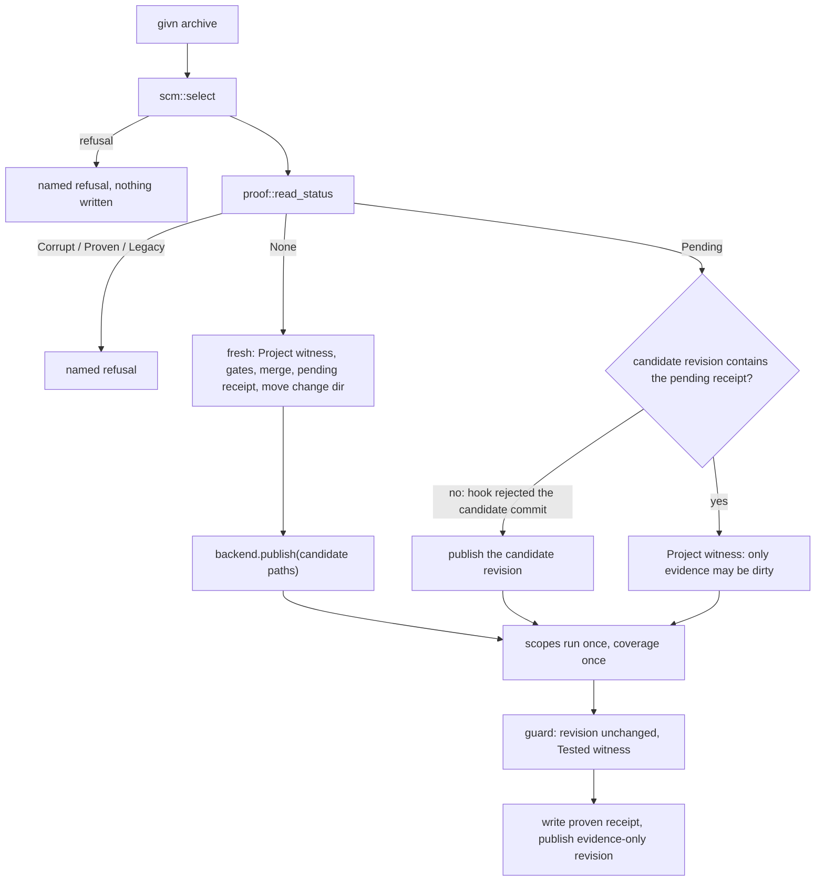

# Design: archive-change

## Technical Decisions

### Fossil checkout handle

A new module `src/fossil.rs` owns the Fossil implementation behind the
existing selection seam. `scm::Backend` gains a second variant:

```rust
pub enum Backend {
    Git(crate::git::Worktree),
    Fossil(crate::fossil::FossilCheckout),
}
```

`FossilCheckout` carries the project root (the checkout root, guaranteed by
the marker at the root) and exposes the operations the archive needs. Every
operation shells out to the `fossil` executable with `std::process::Command`,
the same pattern `git.rs` uses for Git.

| Operation | Fossil mechanism | Notes |
|---|---|---|
| `revision()` | `fossil info`, parse the first token of the `checkout:` line | 40-hex displayed identifier; the 64-hex stored hash is not used in the receipt; a missing `checkout:` line (for example a fake marker without a repository) is an error, never an empty revision |
| `dirty_entries()` | `fossil changes --differ`, parse `<STATUS>  <path>` lines | `EXTRA` files are included, so untracked files count as dirty on both backends (Q3); a hard rename prints `RENAMED    old  ->  new`, so the parser splits on `->` and keeps the destination path |
| `publish(paths, message)` | validate the dirty set is inside `paths`, then `fossil addremove` and `fossil commit -m <message>` | Fossil has no index, so "stage then commit" becomes "record all changes, then commit all"; the witnesses bound the dirty set, and the pre-commit validation keeps the candidate exact. `fossil addremove` respects ignore globs |
| `revision_contains(path)` | `fossil cat <path>` exits 0 when the path is in the current revision | detects an unpublished candidate after a rejected commit: an added-but-uncommitted path exits 1, a committed path exits 0 |
| `stage_paths` / `has_staged_changes` / `commit_staged` | named refusal | these are the managed-upgrade operations; seed 3 owns their Fossil implementation |

`fossil addremove` respects ignore globs by default, so ignored files are not
force-added here (the managed-upgrade force rule is seed 3's concern).

### Revision identity

`revision()` returns the 40-hex identifier Fossil displays (`checkout:` in
`fossil info`; `New_Version:` on commit prints 64 hex). The receipt records
the displayed identifier on both backends, matching the use-case example
("40 hex shown, 64 hex stored").

### Archive moves onto the seam

`src/cli/archive.rs` replaces `git::Worktree::open` with `scm::select` and
threads `&Backend` through the pipeline. Behavior changes are limited to the
backend seam plus one repair path:



The one new repair rule: when the pending receipt exists but the current
revision does not contain it, the candidate publication was rejected (a
backend hook) and the rerun publishes the candidate again instead of assuming
the merge is committed. The merged files are already on disk, so no merge or
gate runs again.

`revision_contains` reads the committed revision only, never the index or the
checkout state: Git uses `git cat-file -e HEAD:<path>`, Fossil uses
`fossil cat <path>`. On a Git hook rejection the index still holds the staged
merge, so an index-based check would wrongly report the candidate as
published.

Witness ordering on resume: `ensure_clean(Witness::Project)` runs on the fresh
path and on the published-candidate resume path, but not on the
unpublished-candidate republish path — after a rejected publication the
staged/recorded merge is intentionally dirty, and blocking there would make
the archive unrepairable. `Backend::publish`'s dirty-set validation is the
exactness guard on that path, so the republish cannot pick up unrelated
changes.

Candidate publication keeps the existing path list (`givn/specs`,
`givn/archive/<change>`, `givn/changes/<change>`) and the existing messages;
the Fossil `publish` validates that the dirty set is inside that list before
recording anything.

### Backend-neutral messages

The archive's dirty-path and hook-rejection messages lose their Git-only
wording:

| Case | Message shape |
|---|---|
| Nested root | `scm::select`'s neutral message (project root must be the worktree top level / checkout root) |
| Candidate rejected, Git | `archive blocked: the candidate revision was rejected. The merged state is staged but not committed; the archive is not proven. Resolve the error and rerun ...` |
| Candidate rejected, Fossil | `archive blocked: the candidate revision was rejected. The merged state stays in the checkout uncommitted; the archive is not proven. Resolve the error and rerun ...` |
| No version control | `scm::select`'s neutral "a version-controlled project is required" refusal |

### Receipt revision vocabulary

The receipt fields `candidate_commit` / `tested_commit` become
`candidate_revision` / `tested_revision` (`src/proof.rs`,
`write_proven`'s parameter, readers in the step definitions). The change is
additive-compatible: `#[serde(default)]` keeps old receipts parseable, no
reader branches on the schema number, and `read_status` only inspects
`status`.

### Temporary managed-upgrade refusal (handoff to seed 3)

`scm::select` now returns `Backend::Fossil` instead of refusing, so
`givn upgrade` on a Fossil checkout would otherwise reach unimplemented
operations. `migration.rs` therefore refuses right after selection, before
any write:

```
Fossil checkout detected at '<root>'; the Fossil backend is not available for the managed upgrade in this version
```

This keeps the permanent `scm-backend-selection` scenario "A Fossil checkout
is refused by name until the Fossil backend is available" true (non-zero
exit, names the checkout, root, and "not available", mutates nothing). Seed 3
(`maintain-project`) removes the refusal and updates that scenario when the
managed upgrade lands on Fossil.

### Test environment

The Fossil scenarios need real Fossil operations, so the test suite now
depends on the `fossil` executable:

- Locally verified with fossil 2.26 `[611144ddd9]` (checked `fossil version`,
  2026-09-14).
- CI (ubuntu-24.04) installs the distribution package with
  `sudo apt-get update && sudo apt-get install -y --no-install-recommends
  fossil` before the acceptance suites; noble ships 1:2.23-1ubuntu0.1 (checked
  packages.ubuntu.com/noble/fossil, 2026-09-14).
- Only commands present in both 2.23 and 2.26 are used: `init`, `open -f`,
  `add`, `addremove`, `commit`, `changes --differ`, `status -b`, `info`,
  `cat`, `diff --brief --checkin <rev>`, `hook add --command ... --type`,
  `hook delete all`; `fossil sql` is avoided.
- `fossil` is a hard suite prerequisite: a machine without it cannot run the
  Fossil scenarios, and they fail loudly rather than skipping.

The fixture repository file lives outside the checkout (a second temp dir),
so it is never an EXTRA entry. `fossil open -f` leaves the already-scaffolded
`givn/` tree as EXTRA entries; the fixture then records and commits them.

## Production Impact

- `src/fossil.rs` (new): `FossilCheckout`, revision/dirty/publish/contains.
- `src/lib.rs` and `src/main.rs`: register `pub mod fossil;` in both module
  trees (the binary does not use the library).
- `src/scm.rs`: `Backend::Fossil`, delegating methods, `publish`,
  `revision_contains`, the managed-upgrade support check; the Fossil
  "not available in this version" selection refusal is removed.
- `src/cli/archive.rs`: seam-based backend, resume republication, neutral
  messages, receipt field rename.
- `src/cli/migration.rs`: preflight upgrade-support refusal.
- `src/proof.rs`: receipt field rename (`candidate_revision`,
  `tested_revision`).
- `tests/common/mod.rs`: `make_fossil_root`, `fossil`, `fossil_init`,
  `fossil_commit_all` helpers; `TestEnv` gains a backend field set at
  construction; `commit_fixture` branches on that field and never sniffs
  markers (the `scm-backend-selection` fixture writes a fake `.fslckout` and
  must not be mistaken for a real Fossil checkout).
- `tests/steps/archive_proof_support.rs`, `archive_proof_steps.rs`,
  `archive_proof_e2e_steps.rs`: backend-parameterized fixtures and steps.
- `tests/steps/adr_qualification_gate_steps.rs`: the binding for the new
  register count (28 accepted decisions) asserted by the modified
  `adr-qualification-gate` scenario.
- `givn/specs/fragments/adr-qualification-gate.feature`: permanent scenario
  count aligned to 28 in the same change (the delta carries the modification
  for the archive merge).
- `.github/workflows/ci.yml`: install the `fossil` package before the
  acceptance suites.
- `AGENTS.md`: record the `fossil` prerequisite in the testing section.

User-visible surface: CLI text only (new refusal/rejection wording and the
Fossil archive path). No `## Visual Design Contract` section; the archive
capability declares no visual interface and is exempt, following the
`scm-backend` precedent.

## Test Design

The executable scenarios live in the change delta:

```text
givn/changes/archive-change/specs/archive-change/archive-proof.feature
givn/changes/archive-change/specs/archive-change/usecase.md
givn/changes/archive-change/specs/fragments/adr-qualification-gate.feature
```

Step definitions, one file per capability plus its E2E companion and the
shared support module:

| File | Binds |
|---|---|
| `tests/steps/archive_proof_steps.rs` | The backend-parameterized Givens (`a <backend> project ... ready to archive`, `an unproven archive candidate ... in a <backend> project`, the Fossil EXTRA/edited Givens, the refusal Givens that also take the tree snapshot), the candidate-revision/finalization/checkout-state Thens, the republish Whens (`the commit hook accepts ...`), and the missing-`fossil` invocation. |
| `tests/steps/archive_proof_e2e_steps.rs` | The `@e2e` archive outline through the compiled binary on both backends. |
| `tests/steps/archive_proof_support.rs` | Backend-parameterized fixture setup (`ready_change`), the tree snapshot helper, receipt readers, staged/changed path helpers for both backends. |
| `tests/steps/adr_qualification_gate_steps.rs` | The `28 accepted decisions` register-count Then for the modified `adr-qualification-gate` scenario. |
| `tests/steps/scm_backend_selection_steps.rs` | Reused: the shared refusal Thens (`stderr names the project root and the missing version-controlled project`, `stderr names the project root and the worktree top level`, `no file in the project changed`); `snapshot_tree` becomes `pub(crate)` so the archive refusal Givens can take the same snapshot. |

Step-text strategy: the modified Given texts carry the backend as a step
value (`a <backend> project with a completed change ... ready to archive`,
`an unproven archive candidate ... in a <backend> project`), so one binding
branches on `Git`/`Fossil`. The renamed Thens (`candidate revision
rejection`, `tested revision`, `finalization revision`, `merged state is
present in the checkout but not committed`, `candidate revision contains
exactly the merged corpus paths`) are bound in `archive_proof_steps.rs`; the
`the candidate state is committed` and `candidate commit` bindings are
replaced. The `a Fossil checkout whose project root is the checkout root`
Given is reused from `scm_backend_selection_steps.rs` for the
missing-executable scenario. New step bodies start as `unimplemented!()`
during RED.

Path helpers: Git uses `git show --name-only --format=` for a revision's
paths and `git cat-file -e HEAD:<path>` for containment; Fossil uses
`fossil diff --brief --checkin <rev>` for a revision's paths and
`fossil cat <path>` for containment. The candidate/finalization exact-content
assertions parse those outputs.

Unit tests in `src/fossil.rs` cover the parsers no scenario can reach
through the archive: the `fossil changes --differ` status/path split
(including the `RENAMED old -> new` destination rule) and the missing
`checkout:` line error from `revision()`.

Runner and strict mode: `verify.command` is `./run-tests.sh`; the cucumber
runner in `tests/features_runner.rs` sets `.fail_on_skipped()`, so an
undefined or pending step fails the run.

Single-scenario command:

```sh
GIVN_FEATURES=givn/changes/archive-change/specs cargo test --test features_runner -- --name "A Fossil EXTRA file blocks the archive"
```

E2E scope command:

```sh
GIVN_FEATURES=givn/changes/archive-change/specs ./run-tests.sh --e2e
```

## Interaction Coverage Matrix

| Inventory entry | @e2e scenario title | Real interface | Driving mechanism |
|---|---|---|---|
| archive a completed change | Consumer archives a completed change and receives a proven archive | givn CLI | The compiled `givn` binary runs `givn archive --change proof-real` in a real committed Git project and a real committed Fossil checkout (outline examples); the test asserts exit 0 and a proven receipt |
| repair a blocked archive | Consumer repairs a blocked archive and the rerun proves it | givn CLI | The compiled binary runs the archive twice around a committed repair; the test asserts exit 0 and a proven receipt |
| inspect an unproven archive candidate | Consumer inspects an unproven archive candidate | givn CLI | The compiled binary runs `givn status` against an unproven candidate; the test asserts the listing and resume route |

## Use-Case Traceability

| Use-case guarantee, rule, or event | Design decision | Capability | E2E evidence |
|---|---|---|---|
| Clean-state witness includes files the backend would not publish (Q3) | Fossil `dirty_entries()` uses `fossil changes --differ`, which includes `EXTRA`; Git keeps untracked entries | archive-proof | The Git untracked and Fossil EXTRA scenarios |
| Candidate revision contains exactly the merged corpus paths | `publish` validates the dirty set against the candidate paths before committing; Git stages exactly those paths | archive-proof | "Archive publishes the merged candidate before running the full suite" (both backends) |
| Tested revision equals the published candidate revision | `revision()` is read once before the scopes and re-checked before finalization; the receipt binds it | archive-proof | "A proven archive records a verification receipt binding the tested revision" (both backends) |
| Finalization revision contains only resolved evidence | Evidence paths are resolved before finalization and the Tested witness bounds the dirty set | archive-proof | The finalization assertion in the receipt-binding outline |
| Hook rejection leaves the archive unproven and repairable (Q13) | Resume detects an unpublished candidate via `revision_contains` and republishes it; backend-specific messages describe the intermediate state | archive-proof | "A rejected candidate revision leaves the archive unproven and repairable" plus the Git/Fossil intermediate-state scenarios |
| No backend is selected: refusal before mutation | `scm::select` refuses before any write; the archive never opens a backend directly | archive-proof | "Archive requires a version-controlled project" |
| The project root is the checkout root (Q4) | `scm::select` keeps the boundary check; the archive consumes the selected backend | archive-proof | "Archive requires the project root to be the checkout root" |
| A backend without its executable is refused by name (Q14) | `select` maps `NotFound` to a named `fossil`/`git` refusal before mutation | archive-proof | "A Fossil checkout without the `fossil` executable is refused by name" |
| Forward repair without repeating the merge | Resume path reuses the published candidate and the on-disk merge; only scopes and finalization rerun | archive-proof | "Repairing a failed candidate forward proves it without repeating the merge" (both backends) |
| The managed upgrade stays Git-only until seed 3 | `migration.rs` refuses Fossil by name before writing; the selection scenario stays true | scm-backend-selection | The existing Fossil refusal scenario stays green |
| Confirmed Personas | developer--primary-user (repairable failures), agent--technical-role (deterministic commands), givn-maintainer--owner (one seam) | — | Review lens, not a scenario actor |

## Local Runnability

`./run-tests.sh` runs the full suite; no server, database, or third-party
service is involved. External executables: `git`, `fossil` (new; installed
locally, added to CI), and the compiled `givn` binary. No digital twin is
required — Fossil is a local tool, not a remote service.

Anticipated obstacles and their fixes:

- `fossil open` refuses a non-empty directory: the fixture uses
  `fossil open -f` and then records the scaffolded tree with
  `fossil addremove` + `fossil commit`.
- The repository file must not be inside the checkout (it would be EXTRA):
  the fixture keeps `repo.fossil` in a second temp directory owned by the
  test environment.
- A rejected `fossil commit` exits non-zero and prints
  `Before-commit hook failed` on stderr; the Fossil `publish` propagates the
  exit code and wraps stderr, so no output parsing is needed.
- `fossil commit` cannot name a directory that contains missing files; the
  Fossil `publish` therefore commits the whole (witness-bounded) dirty set
  instead of naming paths.
