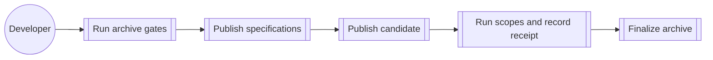

# Use case: archive-change

## Level

!

## Actors

- Developer

## Goal

Publish a completed change into the permanent specification corpus and prove
the published state, without losing behavior or leaving a partial archive.

## Trigger

The developer archives a reviewed change.

## Preconditions

- The change has passed its required workflow gates.
- The project state is committed in Git.
- The permanent corpus is available for update.

## Main flow

1. Run the archive gates and confirm the project state is committed.
2. Merge the accepted behavior and use-case documents.
3. Publish the merged state as the archive candidate.
4. Run each verification scope once against the candidate and check the
   reported scenario counts.
5. Measure coverage once and publish it.
6. Record the verification receipt and mark the archive proven.
7. Finalize the archive with a commit that adds only evidence and managed
   documentation.

## Extensions

- Uncommitted work blocks the archive and names the offending files.
- A failed scope leaves an unproven candidate for forward repair.
- Finalization refuses a tested tree that changed outside the declared evidence.

## Rules

- A use-case replacement must match its recorded base revision.
- Feature behavior is never silently dropped.
- Only a proven archive is complete; an unproven candidate is never reported as proven.
- A rerun resumes an unproven candidate and refuses a proven archive.

## Examples

- A new capability is installed under its declared use case.

## Minimal guarantee

A failed archive is never reported as proven, and its candidate remains
repairable in place.

## Success guarantee

The permanent corpus contains the accepted change, and a verification receipt
binds the proven archive to the commit that passed every verification scope.

## Personas

- none

## Capabilities

- archive-proof
- grouped-merge-for-new-capabilities
- preserve-docstrings-on-archive
- extract-coverage-gate
- enforce-post-merge-e2e-gate

## Interactions

| Capability | Consumer action | E2E scenario |
|---|---|---|
| archive-proof | archive a completed change | Consumer archives a completed change and receives a proven archive |
| archive-proof | repair a blocked archive | Consumer repairs a blocked archive and the rerun proves it |
| archive-proof | inspect an unproven archive candidate | Consumer inspects an unproven archive candidate |
| grouped-merge-for-new-capabilities | archive a new capability | Consumer archives a new capability and the merged spec lands in its declared use case |
| grouped-merge-for-new-capabilities | archive without routing | Archive is blocked when a new capability has no declared routing decision |
| grouped-merge-for-new-capabilities | archive a multi-file change | Nothing is merged when one delta file of a change has no routing decision |
| preserve-docstrings-on-archive | archive a modified scenario | Consumer archives a modified scenario and the permanent spec keeps the docstring |
| extract-coverage-gate | archive with coverage | Consumer archives a change with coverage enabled and the coverage summary appears in README |
| enforce-post-merge-e2e-gate | archive an E2E delta | Consumer archives a delta that adds e2e scenarios and is blocked without a configured runner |

## Includes

- usecase: verify-change
- fragment: support

## Extends

- none

## Out of scope

Reviewing implementation design or inventing new behavior during archive.

## Diagram

<!-- givn:base-sha256:d63674012e081971ad158b4ed7822c1006bd8d3a96581355588693751403c1c6 -->
