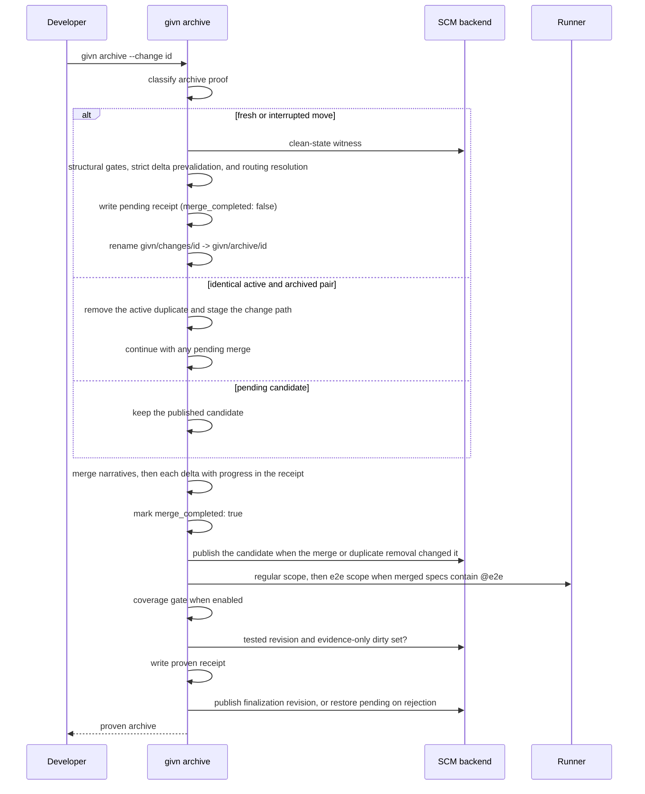

# Design: archive-transaction-safety

## Problem

`givn archive` merges the delta into the permanent corpus, copies the change
directory to `givn/archive/<id>/`, writes the pending receipt, then deletes the
active directory (`src/cli/archive.rs`). A failure between copy and delete
leaves both directories. `proof::read_status` classifies every both-directory
state as `Corrupt`, so the operator must delete one side by hand. A recovery
reset that restores the active change recreates the same state.

## Decisions

- **Decides D1 (proposal): reconcile an identical pending candidate, reject a
  conflicting one.** The comparison is conservative: every active artifact
  must exist in the archive candidate with byte-identical content; a path that
  exists only in the active change is a conflict. Archive-only extras are
  accepted because the archive is the authoritative candidate, and evidence
  paths (`verification.json`, `evidence/**`, `verification/**`, `results/**`)
  are ignored on both sides because they are outputs. Identical is
  `PendingWithActive`: the rerun removes the duplicate active directory and,
  when that removal changes the revision, publishes the deletion together with
  any pending merge as one candidate revision. Different content is `Corrupt`
  with a conflict-specific message. The active duplicate is never authoritative:
  evidence that exists only there is output and is not copied back, and a file
  deleted only from the active duplicate stays absent in the candidate. That
  trade-off is what makes the reset-recovery state safe to reconcile without
  trusting an edited copy. Realized in `src/proof.rs` (`read_status`,
  `candidate_matches_active`) and `src/cli/archive.rs` (`run`).
- **Decides D2 (proposal): one atomic rename, no copy-and-delete.** After every
  pre-publication gate passes, the pending receipt is written into the active
  change directory and `std::fs::rename` moves the directory to
  `givn/archive/<id>`. Both paths live under the project root. If the rename
  fails (including a cross-filesystem target), the command refuses by name and
  leaves the active change in place with the pending receipt, which is an
  exempt evidence path. A rerun re-runs the pre-publication gates and retries
  the rename; it does not trust a possibly edited change just because the
  receipt exists. D2's rejected alternative is a persistent transaction marker
  with copy phases: it keeps the both-directory window and requires the
  recovery machinery this change is removing. Realized in
  `src/cli/archive.rs` (`move_change_to_archive`, `run`).
- **Decides D3 (proposal): a failed verification rolls forward.** The pending
  candidate stays published, the operator repairs the committed state, and a
  rerun verifies it again. No rollback or `git reset` path is added. Realized
  by leaving the existing resume branch intact.
- **D4: the pending receipt records merge progress.** The move happens before
  the merge, so an interrupted merge leaves a pending candidate whose
  permanent corpus is incomplete. The receipt carries
  `merge_completed: bool`, `merged_deltas: Vec<String>` (relative delta paths
  already applied), and `merge_in_progress: Option<String>`. Before merging a
  file, `merge_in_progress` is written; after the file is applied,
  `merged_deltas` gains the path and `merge_in_progress` clears. A resume skips
  completed files, retries the in-progress file with the idempotent rule, and
  runs not-yet-started files with the strict rule, so a duplicate `@givn.added`
  from another change is still rejected. A completed merge sets
  `merge_completed: true`. Realized in `src/proof.rs` (`Receipt`,
  `mark_merge_progress`) and `src/cli/archive.rs`.
  The merge plan is resolved before the move: relative delta path, parsed
  feature, permanent target path, and retirement target directory. The dry-run
  validation and routing read use the active change; after the move the same
  plan is applied against the archived delta path. A resume rebuilds the plan
  from the archive candidate and, for a new capability, reads the proposal from
  the archive candidate.
- **D5: a single delta file is idempotent on retry.** The in-progress retry
  compares the parsed scenario (keyword, tags after stripping, steps, tables,
  docstrings, examples), not raw source lines. An `@givn.added` scenario that
  already exists with the same parsed body is a no-op; a different body under
  the same title still fails. `@givn.modified` replaces with the same parsed
  body as a no-op. `@givn.removed` is a no-op when the title is already absent.
  A retried `@givn.retired` file is a no-op when the capability is already
  absent and the tombstone already names the change; otherwise it removes the
  remaining capability file, repeats the last-capability directory cleanup, and
  records the tombstone once. The tombstone write is atomic and its entry list
  is de-duplicated by capability and change. Realized in
  `src/gherkin/merge.rs` (`apply_deltas`, `apply_deltas_retry`) and
  `src/cli/archive.rs` (`process_delta_file`, `record_retirement`).
- **D6: active-change evidence is an evidence path.** The clean-state witness
  and the tested-tree guard exempt exactly `givn/changes/<id>/verification.json`
  and the prefixes `givn/changes/<id>/evidence/` and
  `givn/changes/<id>/verification/`, in addition to the archive directory,
  README, and coverage outputs. Prefixes carry a trailing separator so
  `evidence-other/` is not exempt. Realized in `src/proof.rs`
  (`is_evidence_path`).
- **D7: a proven working-tree receipt is final only when the committed receipt
  is proven.** `write_proven` precedes the evidence-only publication, so a
  crash or a rejected hook can leave a proven receipt on disk while the
  tested history still carries the pending receipt. On `ArchiveProof::Proven`,
  archive reads the receipt committed at the current revision. If it is
  proven, the command refuses. If it is pending or absent and the working-tree
  proven receipt names the current revision as `tested_revision`, archive
  publishes the evidence-only finalization again. If the tested revision does
  not match, archive restores a pending receipt and resumes verification.
  This makes both the rejection path and the crash window recoverable. Realized
  in `src/cli/archive.rs` and the SCM backends' `revision_file` seam.

ADR check: ADR-070 (forward-only archive proof) and ADR-072 (witness-bounded
publication) were read. This change is not a new ADR. It is product workflow
behavior owned by the archive-change use case plus this design, and a
refinement that neither record needs to amend. The ADR gate result is
`NOT_QUALIFIED`; canonical destination: `design.md` (the use case states the
observable contract without repeating the technical rationale).

## State model

`ArchiveProof` is `None`, `Legacy`, `Pending`, `PendingWithActive`, `Proven`,
or `Corrupt { both_dirs, pending_conflict }`. The last variant carries enough
detail for the three distinct refusal messages.

| Active change | Archive directory | Receipt | `ArchiveProof` | Behavior |
|---|---|---|---|---|
| absent | absent | — | `None` | refuse: change not found |
| present | absent | no receipt | `None` | fresh archive |
| present | absent | pending receipt | `None` | rerun gates, retry the move |
| absent | present | none | `Legacy` | refuse: already archived |
| absent | present | pending | `Pending` | resume merge/verification |
| present | present | pending, active content matches | `PendingWithActive` | remove active duplicate, publish tracked deletion, resume |
| present | present | pending, content differs | `Corrupt { both_dirs: true, pending_conflict: true }` | refuse: candidate conflicts |
| present | present | no receipt or proven | `Corrupt { both_dirs: true, pending_conflict: false }` | refuse: both exist |
| absent | present | proven | `Proven` | refuse: already proven |
| absent | present | unreadable | `Corrupt { both_dirs: false, pending_conflict: false }` | refuse: unreadable receipt |

## Transition



A failure before the rename leaves the active change with its pending receipt.
A failure after the rename leaves a pending candidate. The two-directory state
exists only for recovering a state produced outside this transition (an old
binary or a manual/reset restore), and it is resolved only when the active
artifacts are a byte-identical subset of the candidate.

## Merge recovery

### Witness scopes

The clean-state witness is not skipped on a recovery path; its allowed set is
narrowed to the paths the recovery itself may legitimately dirty:

| Path | Allowed set |
|---|---|
| Fresh archive or interrupted move | evidence paths only |
| Pending candidate, merge complete | evidence paths only |
| Pending candidate, merge incomplete | evidence paths plus the exact permanent feature/narrative targets in the merge plan and `givn/specs/.retired.yaml` |
| Identical active/archive pair | evidence paths plus `givn/changes/<id>/` and, when the merge is incomplete, the merge-plan targets |

After a duplicate active directory is removed, the change path is staged
(`git add -A -- givn/changes/<id>` / Fossil `addremove`). If the restore was
only staged or untracked, staging returns the index to the candidate revision
and `has_staged_changes` is false: no publication is needed and the archive
continues to verification. If the restore was committed, the staged deletion
differs from the candidate and the candidate is republished once, after any
pending merge, so the candidate contains both the deletion and the merged
corpus. Unrelated dirty paths still fail the narrowed witness.

The pre-publication gate dry-runs every delta file against the current
permanent corpus before any mutation. The dry run catches duplicate added
titles, missing modified/removed titles, stale narrative base hashes, invalid
capability tags, a retirement whose capability does not exist, and two delta
files for the same capability in one change.

A merge interruption is recovered from the receipt:

| Receipt state | Meaning | Rerun |
|---|---|---|
| `merge_completed: false`, no in-progress file | files in `merged_deltas` are applied; the rest were not started | skip completed, merge the rest strictly |
| `merge_completed: false`, `merge_in_progress: "x"` | file `x` may have been written before the receipt update | skip completed, retry `x` under D5, merge the rest strictly |
| `merge_completed: true` | merge finished; only publication or verification remains | no merge |

The permanent spec write in `merge_file` becomes atomic (temp file in the same
directory, then rename) so a crash cannot leave a torn feature file. Archive
startup removes reserved `*.givn-tmp` files under `givn/specs` and the pending
receipt temp under the change/archive directory before running the witness, so
a crash leaves no unclassifiable dirty path.

## Architecture impact

| File | Change |
|---|---|
| `src/cli/archive.rs` | Order the transition move-then-merge; re-run gates on a transition resume; remove the copy/remove sequence and the dead `copy_dir_all`; narrow the witness on recovery paths; remove and stage a recovered active duplicate, then publish once after the merge; merge from the archived delta path with per-file progress; republish finalization when the committed receipt is pending; emit the three corrupt messages. |
| `src/proof.rs` | Add `PendingWithActive` and the detailed `Corrupt` variant, the merge-progress receipt fields, atomic receipt writes, `candidate_matches_active`, merge-progress writers, and the active-change evidence exemptions. |
| `src/gherkin/merge.rs` | Add the parsed-scenario retry comparison and idempotent added/modified/removed application; make the permanent write atomic. |
| `src/scm.rs`, `src/git.rs`, `src/fossil.rs` | Add `revision_file(path)` so finalization can distinguish a committed proven receipt from a working-tree-only proven receipt; expose the existing staging and `has_staged_changes` seams to the recovery path. |
| `src/state.rs` | Treat `PendingWithActive` as an unproven archive in status listing. |
| `src/cli/status.rs` | Include `unproven_archives` in the single-active JSON view. |
| `tests/steps/archive_proof_steps.rs` | Bind the new corrupt, interrupted-merge, retry, evidence, finalization-rejection, and status scenarios. |
| `tests/steps/archive_proof_support.rs` | Build the staged active duplicate, the in-progress merge candidate, the blocked archive location, and the finalization-rejecting hook. |

No new module or dependency is introduced. `FossilCheckout::publish`'s
allowed-path check is already component-aware (`Path::starts_with` compares
path components, not string prefixes), so `givn/changes/x-other` is not
accepted for `givn/changes/x`; no change is needed there.

## Data model

`verification.json` keeps schema `1` and gains additive fields:

```json
{
  "schema": 1,
  "change": "archive-transaction-safety",
  "status": "pending",
  "merge_completed": false,
  "merged_deltas": ["archive-change/archive-proof.feature"],
  "merge_in_progress": null,
  "candidate_revision": null,
  "tested_revision": null,
  "scopes": {},
  "coverage": null,
  "started_at_unix": 0,
  "finished_at_unix": null
}
```

All three fields use `#[serde(default)]`, so receipts written before this
change read as an unmade merge and an empty progress list; D5's retry path
handles the resulting re-application. Receipt writes go to a temporary file in
the same directory and are renamed into place, so a reader never sees a
truncated receipt.

## Failure behavior

| Failure | Resulting state | Next action |
|---|---|---|
| Gate fails before the receipt write | active change only | repair and rerun |
| Rename fails | active change plus pending receipt | rerun re-runs gates and retries the rename |
| Merge fails | pending candidate with per-file progress | rerun retries the in-progress file and continues |
| Candidate publication rejected | pending candidate, dirty merged state | rerun republishes |
| Verification scope fails | pending candidate, `merge_completed: true` | repair commit and rerun |
| Tested-tree guard fails | pending candidate, unproven | repair evidence and rerun |
| Finalization publication rejected or interrupted | proven receipt on disk, pending receipt in the tested history | next run republishes finalization when `tested_revision` matches HEAD, otherwise restores pending and re-verifies |
| Both directories, active subset equal | `PendingWithActive` | remove duplicate, stage the path, merge when needed, publish once if the revision changed |
| Both directories, differing content | `Corrupt` | operator resolves the conflict |
| Archive-only unreadable receipt | `Corrupt` | operator repairs the receipt |

## Use-case traceability

| Contract element | Technical decision | E2E evidence |
|---|---|---|
| Main-flow step 2 (move as one transition) | D2 rename plus pending receipt | Consumer repairs a blocked archive and the rerun proves it |
| Main-flow step 3 (merge) | D4 progress plus D5 retry | Consumer archives a completed change and receives a proven archive |
| Extension 1 (dirty work blocks) | D6 evidence predicate | Q-80 scenario in the permanent feature |
| Extension 2 (interrupted move) | D2 transition resume | New retry scenario |
| Extension 3 (interrupted merge) | D4/D5 | New interrupted-merge scenario |
| Extension 5 (hook rejects candidate) | Existing resume publication | Consumer repairs a blocked archive and the rerun proves it |
| Extension 6 (scope fails) | D3 forward repair | Consumer repairs a blocked archive and the rerun proves it |
| Extension 8 (tested tree changed) | D6 evidence predicate | Finalization-refuses scenario in the permanent feature |
| Rule (tested revision equals candidate) | Candidate republish after duplicate removal | New interrupted-move scenario |
| Minimal guarantee (never proven when failed) | D7 finalization restoration | New finalization-rejection scenario |
| Success guarantee (receipt binds tested revision) | Existing finalization guard | Consumer archives a completed change and receives a proven archive |

Persona disposition (review lenses, not Gherkin actors):

| Persona | Relevance | Evidence |
|---|---|---|
| developer--primary-user | Runs the archive command and repairs a blocked candidate. | The corrupt/conflict and retry scenarios; `stderr` messages |
| agent--technical-role | Invokes archive through the CLI and follows the printed resume command. | Resume route from `givn status` and `givn instructions` |
| givn-maintainer--owner | Owns the receipt schema and the one-state invariant. | `verification.json` progress fields and the proof unit tests |

No new Persona is introduced. The operator's "none" in the proposal means no
new Persona was confirmed for this change; the existing owning-use-case
Personas above remain the review lenses.

## Test design

The executable scenarios live in:

```text
givn/changes/archive-transaction-safety/specs/archive-change/archive-proof.feature
givn/changes/archive-transaction-safety/specs/archive-change/usecase.md
```

Step definitions, one file per capability plus its E2E companion and support:

| File | Binds |
|---|---|
| `tests/steps/archive_proof_steps.rs` | The modified conflict scenario, the no-receipt corrupt scenario, the interrupted-move and interrupted-merge Givens, the blocked/unblocked archive location, the finalization-rejecting hook, the evidence file, and the unchanged-receipt assertion. |
| `tests/steps/archive_proof_e2e_steps.rs` | Unchanged: the existing `@e2e` archive outline through the compiled binary. |
| `tests/steps/archive_proof_support.rs` | Fixture helpers: create a staged active duplicate from a real pending candidate, create an in-progress merge candidate (merged spec plus `merge_completed: false` and `merge_in_progress` set), block/unblock the archive location, and write the finalization-rejecting hook. |

Runner and strict mode:

- Regular scope: `./run-tests.sh --non-e2e`. The review gate sets
  `GIVN_FEATURES` to the change's `specs/` directory; archive sets it to
  `givn/specs`.
- E2E scope: `./run-tests.sh --e2e`.
- Single scenario:
  `GIVN_FEATURES=givn/changes/archive-transaction-safety/specs/archive-change cargo nextest run --test features_runner -E 'test(<scenario title>)'`.
  The libtest fallback is
  `GIVN_FEATURES=... GIVN_TEST_RUNNER=cargo ./run-tests.sh --non-e2e`.
- Strict mode: `tests/features_runner.rs` sets `.fail_on_skipped()`.
- RED stub pattern: add each new step body as
  `panic!("not implemented: <step>")` (never an empty body), run the single
  scenario, observe the panic, then replace the body with the assertion and
  implementation. Remove every `@wip` before archive.

Unit tests for the non-scenario algorithms:

| Unit test | Covers |
|---|---|
| `proof::tests::candidate_comparison_truth_table` | equal, active subset, active-only artifact, evidence on either side, receipt/results on the archive side |
| `proof::tests::evidence_prefixes_do_not_match_siblings` | `evidence-other/` is not exempt; exact `verification.json` is |
| `proof::tests::receipt_write_is_atomic` | no temporary receipt remains and the JSON parses |
| `merge::tests::retry_added_identical_is_noop` / `retry_added_different_body_fails` | D5 added semantics |
| `merge::tests::retry_removed_absent_is_noop` / `retry_modified_is_idempotent` | D5 modified/removed semantics |
| `archive::tests::retirement_retry_is_idempotent_and_cleans_up` | D5 retirement semantics, including a retry after the capability file was already removed and a duplicate tombstone check |
| `state::tests::pending_with_active_is_unproven` | status/instructions listing |

Scenario-level RED evidence:

| Scenario | RED before implementation |
|---|---|
| A change present as both active and archived is refused as corrupt | the current binary prints the generic both-directory message; the conflict-specific assertion fails |
| A change present as both active and archived without a receipt is refused as corrupt | the current binary already refuses; this is a regression guard that still pins the no-receipt branch after the conflict change |
| An interrupted archive move resumes from an identical pending candidate | the current binary removes neither duplicate; it refuses as corrupt or blocks on the staged restore |
| An interrupted merge resumes from its pending candidate | the current resume skips the merge; the permanent merged-scenario assertion fails |
| An in-flight delta file is retried without duplicating its scenarios | the current merge rejects the already-added title |
| A failed archive move keeps the change retryable | the current binary leaves both directories or repeats the merge; the second run fails |
| Change evidence does not block the archive | the current witness rejects `givn/changes/<id>/evidence/...` or `verification/...` |
| A rejected finalization publication leaves the archive unproven | the current binary leaves a proven working-tree receipt and the next run refuses as already proven |
| An interrupted archive move is surfaced by project status | `PendingWithActive` is not listed as an unproven archive |

## Interaction coverage matrix

| Inventory entry | @e2e scenario title | Real interface | Driving mechanism |
|---|---|---|---|
| archive a completed change | Consumer archives a completed change and receives a proven archive | CLI | `common::run_givn` subprocess against a seeded Git/Fossil project |
| repair a blocked archive | Consumer repairs a blocked archive and the rerun proves it | CLI | `common::run_givn` subprocess after a committed repair |
| inspect an unproven archive candidate | Consumer inspects an unproven archive candidate | CLI | `common::run_givn` subprocess running `givn status` |
| archive a new capability | Consumer archives a new capability and the merged spec lands in its declared use case | CLI | existing archive-proof e2e driver |
| archive without routing | Archive is blocked when a new capability has no declared routing decision | CLI | existing archive-proof e2e driver |
| archive a multi-file change | Nothing is merged when one delta file of a change has no routing decision | CLI | existing archive-proof e2e driver |
| archive a modified scenario | Consumer archives a modified scenario and the permanent spec keeps the docstring | CLI | existing archive-proof e2e driver |
| archive with coverage | Consumer archives a change with coverage enabled and the coverage summary appears in README | CLI | existing archive-proof e2e driver |
| archive an E2E delta | Consumer archives a delta that adds e2e scenarios and is blocked without a configured runner | CLI | existing archive-proof e2e driver |

The delta adds no `@e2e` scenario and no new interaction: the interrupted-move
resume is the existing "repair a blocked archive" action with a different
precondition.

## E2E infrastructure

- E2E runner: `./run-tests.sh --e2e` (`verify.e2e_command`), filtered to
  `@e2e`.
- E2E step definitions: `tests/steps/archive_proof_e2e_steps.rs`, separate
  from the regular archive-proof steps.
- Local infrastructure: no server, database, or container. The real interface
  is the compiled `givn` binary invoked as a subprocess in a temporary
  Git/Fossil project.
- Framework: `cucumber-rs` with the project's custom nextest harness.
- Strict-mode proof: `.fail_on_skipped()` in `tests/features_runner.rs`; an
  undefined E2E step fails the run.

## Local runnability

`cargo run -- <command>` starts the only process. There are no external
services or digital twins. The archive tests create temporary Git and Fossil
projects locally (`git` and `fossil` are the only external executables).

## Visual Design Contract

- Interface: none
- Viewports: not applicable
- Design system: not applicable

The change alters CLI state messages and file-transition behavior. It
introduces no rendered screen, so no viewport, browser driver, or screenshot
applies, and the delta adds no `@e2e` scenario that would need a terminal
transcript. The opposite classification does not hold: the archive path has no
HTML, CSS, or JavaScript surface.

## Coverage process boundaries

| Process | Started by | Instrumented artifact | Profile output | Merge step | Non-zero production probe |
|---|---|---|---|---|---|
| Non-e2e feature runner | `measure-coverage.sh` (`cargo llvm-cov nextest`, `not @e2e`) | `features_runner` test binary and the `givn` binary it spawns | per-test profraw set under the target directory | `cargo llvm-cov report --cobertura` to `coverage/non-e2e-cobertura.xml` | `archive_proof` scenarios exercise `archive::run` and `proof::read_status` |
| E2E feature runner | `measure-coverage.sh` (`cargo llvm-cov nextest`, `@e2e`) | the same binaries | separate profraw set after `cargo llvm-cov clean --profraw-only` | report to `coverage/e2e-cobertura.xml` | the archive `@e2e` outline exercises the real CLI transition |
| Ready fixture | `measure-coverage.sh` (`cov_ready`) | `ready_fixture` test binary | profraw discarded by the clean before the first group | not merged | none; it only prepares the on-demand fixture process |

`merge-coverages.sh` unions the two reports into
`coverage/cobertura-coverage.xml`; archive publishes that output as evidence.
