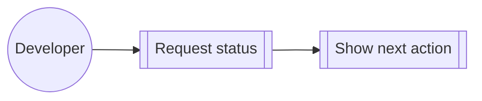

# Use case: inspect-change-state

## Level

!

## Actors

- Developer

## Goal

Understand the current change and artifact state without reading workflow files
by hand.

## Trigger

The developer requests change status.

## Preconditions

- A Givn project exists.

## Main flow

1. Discover active and archived changes.
2. Read artifact completion and task progress.
3. Report the next required workflow action.

## Extensions

- Invalid change identities are rejected.

## Rules

- Skipped artifacts remain visible in status output.
- Uppercase and lowercase completed task markers are equivalent.

## Examples

- A path traversal change identity is rejected before filesystem access.

## Minimal guarantee

Status inspection does not mutate change artifacts.

## Success guarantee

The developer can identify the current stage and next action.

## Personas

- developer--primary-user

## Capabilities

- validate-change-id-input
- remove-dead-skip-list-code
- fix-uppercase-checkbox-parsing
- givn-status-command

## Interactions

| Capability | Consumer action | E2E scenario |
|---|---|---|
| validate-change-id-input | reject unsafe status identity | Consumer invokes givn status with a path traversal change id and gets a clear error |
| remove-dead-skip-list-code | inspect skipped status | Consumer runs givn status on a change with skipped artifacts and sees them correctly |
| fix-uppercase-checkbox-parsing | inspect uppercase task status | Consumer runs givn status on a change with uppercase checkboxes |

## Includes

- fragment: support

## Extends

- none

## Out of scope

Mutating change artifacts or completing workflow tasks on the developer's
behalf.

## Diagram

<!-- givn:base-sha256:897894303db86ea221ae9a0d9385bbeb371b59e1492585a23c940ea6f465ca98 -->
