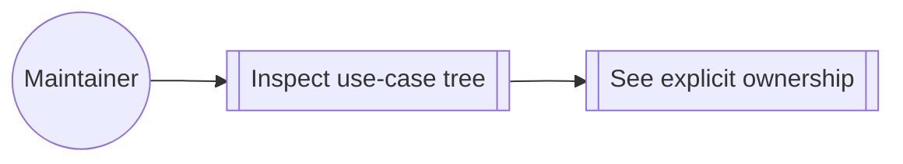

# Use case: make-usecases-canonical

## Level

!

## Actors

- Givn maintainer

## Goal

Represent active specifications and their relationships with explicit use-case
contracts.

## Trigger

The maintainer inspects or validates the permanent specification corpus.

## Preconditions

- The project has an active Givn specification corpus.

## Main flow

1. The maintainer inspects use-case ownership.
2. Givn reports capabilities and interaction evidence under the owning use case.

## Extensions

- Invalid narratives are reported with their source path.

## Rules

- A capability has exactly one use-case owner.
- Reusable behavior is represented as a fragment.

## Examples

- A tree report names a use case rather than a group.

## Minimal guarantee

The existing corpus remains inspectable when a narrative is invalid.

## Success guarantee

Use-case identity is visible in discovery output.

## Personas

- givn-maintainer--owner

## Capabilities

- canonical-usecase-contract

## Interactions

| Capability | Consumer action | E2E scenario |
|---|---|---|
| canonical-usecase-contract | inspect use-case tree | Use-case tree reports explicit use-case ownership |

## Includes

- none

## Extends

- none

## Out of scope

Changing the observable behavior of existing product capabilities.

## Diagram

<!-- givn:base-sha256:6e5299c1a6f8b570536ea54d2b27113239d73c00f7444c5ad5041fdbb27af601 -->
