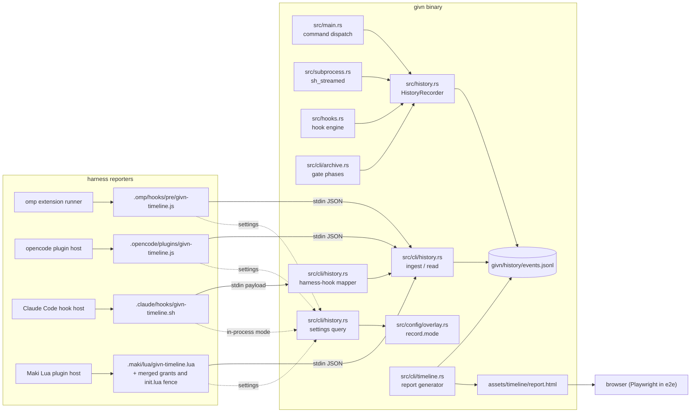

# Design: development-timeline

## Overview

The change has three layers, each with one owner:

1. **The development record** — an append-only, scope-tagged event log, written
   by Givn itself while it runs commands (`src/history.rs` owns the schema, the
   store, and the scope resolution). Instrumentation is deliberately thin and
   centralized: the command dispatcher, the single shell-execution choke point
   (`src/subprocess.rs::sh_streamed`), the hook engine, the archive phase
   boundaries, and `givn commit` emit entries.
2. **The intake and the reporters** — a Givn-owned command
   (`givn history ingest`) that validates agent-reported events and appends
   them, plus one generated reporter per supported harness (omp, opencode,
   Claude Code, Maki), each installed in that harness's own generated
   guidance locations and each delivering through the one intake. (Maki is the
   exception to "beside the attribution integration": it has no attribution
   asset, so its reporter's three files are the only integration it receives.)
   The `agents` target is a skills mirror with no runtime, so it has nothing to
   report.
3. **The report** — `givn timeline` reads the record for one scope and writes a
   single self-contained HTML file (`assets/timeline/report.html` + the report
   model). The browser screen is hand-authored inline CSS/JS/SVG: no
   third-party JavaScript, no CDN, no server, no build step.

Recording is best-effort by construction: a record that cannot be written warns
and continues, and no recorded entry ever changes the outcome of the work it
records. The record is a consumer of existing signals, never a new gate.

## Use-Case Traceability

> Owning use-case ID: `inspect-development-history` (new in this change)
> Ideation source: none
> Confirmed Persona IDs: `developer--primary-user`, `agent--technical-role`

| Use-case contract element | Technical decision | Capability / E2E evidence |
|---|---|---|
| Guarantee: recording never changes the outcome of the work it records | Every write is best-effort and swallowed with a warning; the command's own exit code is untouched (`src/history.rs::record`) | development-record: "A record that cannot be written never fails the command it records" |
| Guarantee: the record is append-only | One JSONL line per entry, opened append-only; no rewrite, no reordering | development-record: "The record is append-only across commands" |
| Guarantee: every entry belongs to exactly one scope | `resolve_scope` binds change → ideation topic → project, in that order | development-record: "Activity outside a change belongs to the project scope" |
| Rule: a duration is measured, never inferred | `std::time::Instant` around the step itself; no back-filling from neighbours | development-record: "A recorded step keeps a measured duration and its outcome" |
| Rule: the record keeps metadata and one bounded label | `bound_label` truncates the subject to ≤ 120 characters; complete command and tool input text are stored only in `full` mode, and the full question text is always stored (capped at 4 000 characters) | development-record: "A recorded label is bounded to 120 characters" |
| Rule: reading the record never extends it | `givn history`, `givn history settings`, and `givn timeline` run without a recorder | development-record: "Reading the development record does not extend it" |
| Guarantee: an ideation is reportable before a change exists | A topic window renders the topic's own entries; `resolve_scope` binds them to the one unfinished topic | development-record: "Activity during an ideation belongs to its topic scope" and development-report: "The report of an ideation topic names the work done before the change exists" |
| Extension: a rejected event leaves the record intact | `givn history ingest` validates each event and keeps the accepted ones | agent-activity-reporting: "A reported event that does not match the intake contract is rejected without corrupting the record" |
| Extension: the report's empty state | The report model marks a scope with no entries `empty` and the screen renders the empty state | development-report: "The report shows the empty state for a scope with no recorded activity" (report level) and "Consumer opens the report of a scope with no recorded activity" (`@e2e` Web UI) |
| Goal: see what was worked on and how long it took | The report ranks the longest steps, totals wait time and tokens, and counts subagent fan-out | development-report: "Consumer opens the generated development report in a browser" |
| Persona `developer--primary-user` | The report is read by the developer; it answers the three questions the requester named (slowest step, agent fan-out, waiting) | development-report: "The report names the agent's fan-out into small subagents" |
| Persona `agent--technical-role` | The intake is a machine contract: stdin JSON, stable exit codes, a rejected event reported without failing the caller; every supported harness reaches it the same way | agent-activity-reporting: "Consumer installs the agent reporter and its reported activity lands in the record" (outline over the four harnesses) |
| Guarantee: every supported harness reports its own activity | One generated reporter per executing agent target (omp, opencode, Claude Code, Maki), all delivering through `givn history ingest`; the `agents` skills mirror gets none; Maki also receives Givn's guidance in `.maki/`, because Maki reads project commands only from `.maki/commands/` and `.claude/commands/` | agent-activity-reporting: "Every supported harness receives a development reporter" and "The neutral skills target receives no development reporter" |
| Rule: a recorded duration is measured, never inferred | The harness's own `duration_ms` or `created` timestamp is used where it exists; otherwise the reporter stamps its own start (omp and Maki tool events, Claude pre-tool and permission waits) | agent-activity-reporting: "A wait the harness does not time is still recorded with a duration" and "Maki's reporter keeps the harness's own tool duration and marks what its harness omits" |
| Gap honesty: a harness that cannot deliver a signal | Token usage is read from the harness's own session record where no payload carries it (Claude), marked unavailable where the harness reports none for that kind (Maki's main-session-only turns), and never rendered as zero | agent-activity-reporting: "Token usage read from the harness's own session record is recorded with its model", "Absent token usage is recorded as unavailable", and "Maki's reporter keeps the harness's own tool duration and marks what its harness omits" |

Actors in Gherkin stay the roles defined in the use case (Developer, Authoring
agent); the Persona IDs above are review lenses, never Gherkin actors.

## Technology Decisions

No new language, framework, or Rust dependency is introduced. The report is a
static asset so it needs no runtime of its own; the only new toolchain is a
Node-based browser driver for the browser tier.

| Technology | Version | Resolution |
|---|---|---|
| Rust | existing workspace toolchain (edition 2024) | unchanged; the crate builds with the repository's own `cargo` |
| cucumber-rs (`tests/features_runner.rs`) | existing `cucumber = "0.23"` dev-dependency | reused; no second runner |
| `serde_json` / `serde` / `rust-embed` | existing `Cargo.toml` entries | reused for the record, the intake payload, and the report asset; no new crate |
| Node.js | latest LTS | resolution strategy: install the current LTS (`nvm install --lts`, or nodejs.org) at setup time. The design machine reported `node --version` = `v22.20.0` on 2026-10-16; the version is not pinned by Givn |
| Playwright | 1.64.1 | looked up, not remembered: `npm view playwright version` and `https://registry.npmjs.org/playwright/latest` both reported `1.64.1` on 2026-10-16. The setup step pins the resolved version in `tests/e2e/package.json`; the design does not |
| Chromium (browser under test) | the build bundled with the resolved Playwright | `npx playwright install chromium` at setup time; never a system browser |
| omp (reporter host) | 18.6.1 | verified 2026-10-16: the installed package `@oh-my-pi/pi-coding-agent` 18.6.1 under `~/.bun/install/global/node_modules`, whose shipped types are the contract the reporter is written against (external contract → R-84) |
| opencode (reporter host) | 2.0.26, V2 plugin API | verified 2026-10-16: `opencode --version` (`opencode v2.0.26`) and the running CLI's own log (`~/.local/share/opencode/log/opencode.log`, `version=2.0.26`). The target API is **V2** per the official migration guide (`https://opencode.ai/v2/docs/build/plugins/migrate-v1`: V1 implementations do not run in V2; V2 default-exports `{ id, setup(ctx) }`; local V2 plugins live in `.opencode/plugins/`; a published plugin depends on `@opencode/plugin` at a version compatible with its CLI — npm `latest` 2.0.30, with 2.0.26 at the CLI's own tag). Hook names, payload types, event envelope, and `Tokens.Info` were read from the tagged upstream source at `v2.0.26` and cross-checked against the live `opencode.db` |
| Claude Code (reporter host) | 2.1.266 | verified 2026-10-16: `claude --version` (`2.1.266 (Claude Code)`) with `~/.local/bin/claude → ~/.local/share/claude/versions/2.1.266`; the event set cross-checked against the changelog shipped with that build (`~/.claude/cache/changelog.md`, top section `## 2.1.266`), payload schemas from the published hook documentation (which describes a newer build and is used for schemas only), corroborated by real transcripts under `~/.claude/projects/-home-buster-projects-givn/*.jsonl` |
| Maki (reporter host) | 0.6.3 | verified 2026-10-16: `maki --version` reports `maki 0.6.3` (installed at `/home/buster/.local/bin/maki`); the autocmd names and payload fields were read from the Lua API reference (`https://maki.sh/docs/lua-api/#maki-api-create_autocmd`) and the plugin layout and permission rules from the plugins guide (`https://maki.sh/docs/plugins/`), then confirmed with real probe projects (plugin load with `--trust`, skip without it, synthetic events through the real intake). The Lua surface is the harness's own, so drift is R-90 |
| Report technology | hand-authored inline CSS + vanilla JS + inline SVG in one file | chosen over Mermaid, d3, or any CDN-delivered library: the report must render with no network, must not add a JavaScript dependency to a single-binary Rust project, and must be deterministic for screenshots. A second, third-party visual stack would also need its own version policy |

**Why a Node driver is acceptable in a Rust repository.** The browser tier has
no Rust-native equivalent that is this repository's default: the design
instruction names Playwright as the default browser driver, and Playwright is a
Node library. The driver is a single Node script invoked by the Rust steps
(`tests/common/browser.rs`); it is development-time tooling only and ships
nowhere near the `givn` binary (`tests/e2e/` is not part of the crate). `node`
is already required on `PATH` by the existing omp/OpenCode attribution E2E.

## Decisions

- **Decides D3: a Givn-owned intake command, fed in batches by the reporter.**
  The generated omp asset buffers each turn's events and posts them to
  `givn history ingest` (stdin JSON) at turn end and at session end. Chosen over
  the reporter writing record lines itself because the record's format then has
  exactly one owner and a buggy or stale reporter cannot corrupt the store; the
  reporter keeps no knowledge of the line format. Cost accepted: one short-lived
  process per flush, and a version relationship between the installed reporter
  and the installed Givn (a stale reporter's events are rejected with a warning
  and the rest are kept). Realized in `assets/agent-integrations/omp/givn-timeline.js`
  and `src/cli/history.rs`.
- **Decides D4: an on-demand command that writes one self-contained file.**
  `givn timeline [--change <id>|--topic <id>] [--out <path>]` writes the report
  and prints its path. Opening it stays the developer's own step, exactly as the
  proposal requires ("its path is printed so the developer decides whether to
  open it"), so the command gains no `--open` flag — and no `--json` mode
  either: the report model is embedded in the file the command writes, and the
  machine-readable view of the record itself is `givn history --json`, which
  already exists and is covered by the `development-record` scenarios. With
  `--out` omitted the report goes to the default path
  `givn/history/reports/<scope>.html` (chapter 07's project footprint), so the
  flagless form — render the resolved scope into the default path and print it —
  is the whole default. Chosen over an automatic publish in the archive gate (a
  frozen report cannot benefit from a later renderer fix, and the gate would
  gain a rendering step) and over a local server (a listening port and a
  supervised process are a network surface this tool does not have today).
  Realized in `src/cli/timeline.rs`.
- **Decides D5: the record keeps everything, with the project as the fallback
  scope.** Work outside a change or an ideation is the answer to "where did the
  time go" just as much as work inside one, and dropping it would make the
  question unanswerable; unrelated stretches appear as the project scope in the
  record and as the "outside a scope" band when a project report is rendered.
  Cost accepted: the store grows with unrelated work. Realized in
  `src/history.rs::resolve_scope` and the report's band assembly; the resolution
  rules and the project report window that renders those entries are specified
  in *Scope resolution and the report window* below.
- **Decides D1: one local project store, kept out of repository history.**
  Approved by the operator on 2026-10-16. The record lives at
  `givn/history/events.jsonl`, and keeping it out of repository history is split
  by who owns the destination:

  **The rule.** The recorder never writes a versioned file; the record path
  reaches the versioned destinations only through the commands that own them
  (`givn init`, `givn skills sync`, `givn upgrade` — the existing
  `write_ignores` path), while the recorder asserts the never-dirty
  destinations on every write.

  | State of the project | Destination | Written by |
  |---|---|---|
  | A Git worktree exists | the `# givn:begin:history` block in `.git/info/exclude`, resolved with `git rev-parse --git-path info/exclude` and **re-asserted idempotently on every record write** (best effort); never `.gitignore` | the recorder |
  | No repository exists yet (`givn init` in a bare directory) | the `# givn:begin:history` block in `.gitignore` as the scaffold-time safety net | the recorder at its first write (nothing is tracked yet; the user commits the scaffold) |
  | A Fossil checkout exists and `.fossil-settings/ignore-glob` is **absent** | the repository-level `ignore-glob` setting (`fossil settings --value ignore-glob` … `fossil settings ignore-glob <value>`), never-tracked and effective while no file overrides it | the recorder |
  | A Fossil checkout exists and `.fossil-settings/ignore-glob` is **present** | the record path is part of the **managed entry list inside that file**; a committed file overrides the repository setting, so writing the setting alone would leave the store an `EXTRA` | the owning commands (`givn init`, `givn skills sync`, `givn upgrade`) through `write_ignores` — never the recorder at plain-command time |

  The Fossil entry form is **`givn/history/*`**, not `givn/history`: a Fossil
  glob must match the entire path and `*` crosses `/`, so a bare directory path
  matches nothing. Repository existence is decided by the backend markers at the
  project root — the same markers `scm::select` reads — and **never** by whether
  `scm::select` succeeds, because select also bails for a nested root, both
  markers at the root, or a missing executable; a select-keyed branch would
  write a versioned file while a worktree exists.

  **Why the never-dirty constraint holds.** A recorder runs at command start, so
  a write to a versioned ignore file would dirty the working tree before the
  command did anything, and `givn upgrade`'s clean-checkout precondition
  (`src/cli/migration.rs`: "automatic managed upgrade requires a clean checkout")
  would refuse a project that did nothing wrong; for a store that was already
  committed, no ignore destination could suppress its modification either. The
  ownership split is what keeps the versioned write inside a command that owns
  and commits that file. Rejected: committing the record with the change,
  because agent telemetry would enter repository history permanently and could
  then only be removed with a history rewrite; and a user-level store outside
  the project, because it is invisible to project review and is lost with the
  home directory. Realized in `src/history.rs::store_path`,
  `src/history.rs::ensure_ignored`, and the existing
  `src/skills/rules.rs::write_ignores` call sites.
- **Decides D2: bounded metadata by default, behind a three-state project mode
  (`on`, the default), with complete content only in `full`.** Approved by the
  operator on 2026-10-16 as "metadata plus a bounded label", and extended by the
  operator's addendum on 2026-10-17 into a durable, auditable capture control:
  `record.mode: on | off | full` in `givn/config.yaml`, where `off` writes
  nothing new, `on` (the default, and the fallback for an absent or invalid
  value, with one warning) records every available metadata field plus full
  question text up to 4 000 characters, and `full` adds the complete
  LLM-facing content under the 64 KiB-per-field / 256 KiB-per-entry caps; the
  intake is the single enforcement site for every bound and, together with
  Claude's in-process `harness_hook`, one of the two sites that enforce `off`,
  and `givn history ingest --with-full-content` overrides the configured mode
  for one payload. Four settled sub-decisions sharpen the control. **(a) `off` is
  absolute:** `--with-full-content` overrides `on`/`full` only; when the project
  mode is `off` the flag is ignored with a one-line warning and exit 0, because
  a durable privacy decision must not be bypassed by a one-shot flag (rejected:
  letting the flag override `off`). **(b) Lowering the mode is forward-looking:**
  switching `full` → `on`/`off` never deletes, rewrites, or hides already
  captured entries; a purge would be a separate explicit command, never a
  side effect of a config edit (rejected: an implicit purge on lowering).
  **(c) The key is parsed leniently:** the project-config parse path is
  `src/config/overlay.rs::OverlayDoc` (not `src/config/manifest.rs`, whose
  `deny_unknown_fields` governs the manifest), and `OverlayDoc` gains a raw
  `record` value so a non-string or unknown `record.mode` is a one-warning
  fallback to `on`, never a config-parse failure; `givn upgrade` preserves the
  uncommented project key. **(d) A report content budget:** the self-contained
  report embeds full content up to **8 MiB** in total and marks the rest
  `content omitted; see the record`, while the store keeps every byte
  (*Report Generation*). Rejected: complete payloads by default, because
  credentials and private code that pass through a command would be written into
  the record without the project's decision; counts only, because the developer
  could not see which task the agent looped around; a boolean switch, because
  "record nothing at all" and "record everything" are different operator
  intents; and unlimited report embedding, because the details region is
  visually bounded but the file would not be. Realized in
  `src/history.rs` (mode resolution and `bound_label`),
  `src/config/overlay.rs` (lenient `record` field), and `src/cli/history.rs`
  (the settings query, intake enforcement, and the two off-enforcement sites).
- **Decides D6: the hybrid workflow report is the report's visual direction.**
  Approved by the operator on 2026-10-17 after five rendered mockups (vertical
  pipeline, workbench, dense gantt, workflow cards, hybrid). The hybrid keeps
  the two things the requester needs — a real time axis and the nested subagent
  work — but reads top to bottom: overall statistics, the change workflow as a
  phase stack, each phase expandable into a vertical time axis whose session
  lanes stand side by side with the selected lane's log, then the detailed
  statistics. The dense horizontal timeline approved on 2026-10-16 is
  superseded; the phase-lane and dashboard views remain reference alternatives
  in `docs/design/design-system.md`. Realized in `assets/timeline/report.html`
  and the Visual Design Contract below.

- **Decides D7: linked ideation is an optional, labeled group with start markers.**
  The operator asked to include the optional ideation and its sub-phases
  (2026-10-17). Chosen over a silent scope merge, time-proximity inference, and
  deriving phases from the mutable `session.md` phase line: the group is shown
  only when the change's proposal (or seed path) names a topic and the topic
  directory exists; the group has its own ideation stack (`frame` through
  `handoff`), entries, lanes, log, and totals, while the change keeps its own
  current state and KPIs. Ideation phases are recorded as start markers at the
  first observed artifact (the first persona file, `eventstorming.md`,
  `use-case-definitions.md`, the first elaborated use case, the first seed or
  the published topic doc) because ideation produces several artifacts while a
  phase is active; Frame is the opening stage. Historical topics that predate
  the record stay empty and say so. Rejected: backfilling from git history or
  file mtimes (not recorded work), and merging the two scopes' totals.


## Record Model And Intake Contract

### When the recorder engages

The recorder engages **only when the project root carries the Givn scaffold
(`givn/`)**. Before the scaffold exists it writes nothing and creates no
directory, so a refused command in a bare root — `givn init` with no agent
target, or a root a backend preflight refuses — leaves that root exactly as it
was. A successful `givn init` creates the scaffold and then records.

The rule keys on the **scaffold**, never on the VCS markers: once `givn/` exists,
every command records, including refusals and failures, and a scaffolded project
without a usable backend still records (its own store write is legitimate — the
ignore destinations are Task 10/11's business, not the recorder's).

### Test-side exclusion of the store

The store is Givn runtime state, not project content, so the acceptance suite's
project-state comparison helpers exclude `givn/history/**`:
`tests/steps/scm_backend_selection_steps.rs::snapshot_tree`/`collect_tree`
(which already skips `.git`/`.fslckout`/`_FOSSIL_` and drives "no file in the
project changed") and `tests/steps/serve_extended_rules_steps.rs::project_files`/
`collect_project_files` (which drives "no project file changed"). Without the
exclusion, a legitimate command entry makes refusal and guidance scenarios
report a changed project. The other tree walkers in the suite never reach the
record directory (their callers root them at `givn/specs` or at feature files),
so the exclusion is scoped to the record directory and changes no other path's
behavior.

### Scope resolution and the report window

`resolve_scope` binds every recorded entry to exactly one scope from the
project's own state, without a new state file:

- **Change scope** — exactly one active change, the rule
  `givn instructions <artifact>` already applies (`src/cli/instructions.rs:84-86`
  over `state::list_changes`): one active change records into it, zero active
  changes fall through, and several active changes fall through too — a recorder
  never guesses which of two changes is being worked on.
- **Ideation scope** — exactly one *unfinished* ideation topic:
  `givn/ideation/<topic>/session.md` exists and carries no `## Completion`
  section — the section the handoff step appends beside its "handoff complete"
  phase line. All three topics in this repository carry one today, so nothing
  here is scoped to a topic. Several unfinished topics fall through for the same
  ambiguity reason.
- **Project scope** — the fallback for work outside a change or an ideation.

The intake payload's `change` and `topic` are **optional overrides** a reporter
sets when it knows its own scope: a present value wins over the resolution
above, an absent one is resolved by the binary, and when both are present the
change scope wins — the record's one ordering is change → topic → project. A
named scope that does not exist is a per-event rejection and never a silent
fallback, so a stale reporter cannot mis-attribute work.

**The report window.** `givn timeline --change <id>` renders that change's
entries and `--topic <id>` that topic's. `givn timeline` with no scope flag
renders the **project report**: every project-scope entry appears in the
"outside a scope" band, so work done between two changes is rendered and not
merely recorded — which is what makes the approved D5 answer reachable.
Ideation reporting is not a special case of the change path: a topic window is
the topic's own entries, and its band carries the topic's session work, which is
the part of an ideation that exists before any change directory does. Bands are
the report's rows — one per archived change, one per change or topic in flight,
and the "outside a scope" band in the project report — exactly the design
system's `Band row` primitive with its "outside a scope" state. Entries inside
every band are ordered by `at` (the entry's recorded end timestamp), never by
their position in the store's file: the store is append-only and concurrent
writers make file order and time order different things, while `at` is the only
ordering the record guarantees.

**Rejected: an active-scope marker file read by the reporters.** A
`givn/history/active-scope` marker could be written when a change or a topic
starts and read by each reporter, so the reporter would name its own scope.
Rejected because it duplicates state the project already derives from the
filesystem (ADR-014 recomputes state rather than storing a second copy of it),
because it needs its own write path, repair path, and staleness handling for
exactly the two rules above, and because a reporter forwarding a stale marker is
still wrong while the binary resolving from the project cannot be — the
resolution rule lives in one place and is exercised by the recording scenarios.

### On-disk record

One file per project: `givn/history/events.jsonl`. One JSON object per line,
appended, never rewritten. Field set (serde-serialized `HistoryEntry`):

| Field | Type | Meaning |
|---|---|---|
| `schema` | integer | record schema version; a reader skips a line whose schema it does not know |
| `id` | integer | unique per project, minted at append time under the store's exclusive append lock from the store's current last line — a second Givn process appending at the same time cannot mint the same id |
| `at` | string | RFC 3339 UTC end timestamp of the entry, millisecond precision |
| `scope` | object | `{"kind": "change"｜"ideation"｜"project", "id": "<change-id>｜<topic-id>｜<project-name>"}` |
| `source` | string | `givn` (Givn recorded it) or `agent` (reported through the intake) |
| `kind` | string | `command`, `phase`, `hook`, `step`, `revision`, `session`, `turn`, `tool`, `subagent`, `question`, `usage` |
| `name` | string | domain name of the entry (for example `givn check tasks`, `verify`, `archive gate: verification scopes`) |
| `label` | string, optional | the bounded subject label (≤ 120 characters, truncation marked with `…`) |
| `duration_ms` | integer, optional | measured duration; absent for a point entry |
| `outcome` | string | `ok`, `failed`, `skipped`, `unknown` |
| `parent` | integer, optional | the `id` of the enclosing entry (a step inside a command, a subagent inside a turn); a parent is only ever an id minted by the same process, so a parent link always names an entry that exists in the store |
| `session` | string, optional | the harness session id, carried once the intake stops dropping the payload header |

`kind: "usage"` entries carry `data: {input, output, cache_read, cache_write,
total_tokens, model, subagent}`; `question` entries always carry
`data.question` (`{text, truncated, bytes}`); `full`-mode entries carry
`data.content` (`{<named field>: {text, truncated, bytes}, truncated}`); every
other entry carries `data` only where the report needs a non-generic value (for
example `exit_code` on a step entry).

### Storage rationale and scale

The store stays dependency-free append-only JSONL, and that is a decision, not
an omission. A whole ideation can run for hours to days and produce hundreds of
tasks and thousands of tool calls, so the expected order of magnitude is at most
**10,000 entries × ~200 bytes ≈ 2 MB** for one long ideation. The report build
is one sequential scan of that file (tens of thousands of short lines) plus an
in-memory grouping: milliseconds on the same hardware that already parses the
spec corpus and runs the archive gate, measured against a file smaller than the
repository's own lockfile. No bottleneck has been measured anywhere in this
change, and AGENTS.md's rule is explicit — do not guess at bottlenecks, measure
before optimizing — so no index, database, or background daemon is introduced
on speculation.

Rejected alternatives:

- **DuckDB** — an embedded analytical database would give SQL over the record,
  but it is a large C++ dependency inside a binary whose profile is deliberately
  size-optimized (`opt-level = "z"`, `lto = true`, `strip = true`, and thirteen
  small dependencies in `Cargo.toml`, ADR-004/ADR-069). The dependency would
  outweigh the feature it serves.
- **SQLite** — smaller than DuckDB and still a native dependency plus a schema
  and migration surface, for a workload that is one append and one scan. It
  buys nothing the JSONL does not already do at this scale.

The plain JSONL is also the interoperability win: because the format is one
JSON object per line, the record can be queried directly from outside Givn with
`jq`, DuckDB, or SQLite's JSON functions, so ad-hoc analytics needs no Givn
dependency and no export step. If a real run ever measures slowness, the record
file is the interface: a later change can add an index, a derived store, or a
compaction command behind the same file contract without changing what is
recorded (D-23).

### Ignoring the store without dirtying the worktree

`ensure_ignored` runs on **every** record write (not only when the store is
created, so a store that predates the repository still becomes ignored) and it
never writes a versioned file. The destinations split by ownership:

| State of the project | Destination | Writer |
|---|---|---|
| Git worktree | `.git/info/exclude` block, re-asserted idempotently on every write | the recorder |
| No repository yet | `.gitignore` block (scaffold-time safety net) | the recorder at its first write |
| Fossil checkout, no `.fossil-settings/ignore-glob` file | the repository-level `ignore-glob` setting (never-tracked, effective while no file overrides it) | the recorder |
| Fossil checkout with `.fossil-settings/ignore-glob` present | `givn/history/*` in that file's managed entry list | `givn init` / `givn skills sync` / `givn upgrade` through the existing `write_ignores` |

Two details matter. The Fossil entry is `givn/history/*`, not `givn/history`,
because a Fossil glob must match the whole path and `*` crosses `/` (a bare
directory path matches nothing). And the Fossil destinations are a
**deduplicated entry list without fence markers** — only the two Git
destinations are fenced `# givn:begin:history` blocks — so re-running either
one never duplicates an entry and user entries stay untouched.

Repository existence is decided by the backend markers at the project root, the
same markers `scm::select` reads, never by `scm::select` succeeding: select also
bails for a nested root, both markers at the root, or a missing executable, and
a select-keyed branch would write a versioned file while a worktree exists.

The result is the property the change promises: the record stays ignored, no
command can dirty a worktree through an ignore write, `givn upgrade`'s
clean-checkout precondition is never affected, and a clean clone becomes ignored
on its first Givn command.

### Capture completeness

Grounding: the four harness inventories (`agent://OmpSpec`, `agent://ClaudeSpec`,
`agent://OpencodeSpec`, `agent://MakiSpec`) enumerate what each installed harness
actually exposes, with `supported`/`captured`/evidence per taxonomy id. This
section turns that list into the record's contract.

**Two tiers.** Every reporter captures, by default, *all available metadata* —
bounded, never gated. Complete LLM-facing content is captured only when a
project opts in. Question text is the one content value that is always captured
in full, because a question is the human-workflow event the operator most needs
to read.

**Default metadata (always, bounded — where the harness exposes it).** Per
kind, added to the entry's `data` (and, for the session, to the new top-level
`session` field). "Always" means the reporter captures every field its harness
actually exposes, never that every harness exposes every field; the
per-harness availability table below is the authoritative qualification, and
no scenario promises a field a harness cannot provide. Seeded records are used
only to exercise a field a harness cannot expose (and then the assertion is
about the record's representation of absence), never to substitute for a
reporter-driven capture:

| Kind | Captured by default |
|---|---|
| any entry | the harness `session` id (the intake no longer drops the payload header), the working directory, and — where the harness exposes it — `agent` identity `{kind, id, name, depth, parent}` and the session title |
| `session` | start/end and the harness's exit/stop reason, status (`working`/`needs_input`/`idle`) where exposed, focus/switch transitions with their reason, transcript path |
| `turn` | `index`, `stop_reason`/`finish` (raw word), `model`, `usage` (input/output/reasoning/cache-read/cache-write/total), `cost` (real and list price where present), `context_size`/`context_window`, round-trips/`num_turns`, and retry/fallback signals (`attempt`, `max_attempts`, `delay_ms`, model fallback `from`/`to`) |
| `tool` | `tool_call_id`, the bounded input subject (existing label rule), `error` (bounded), `output_bytes`, a bounded `result_meta` (host details such as exit code, wall time, truncation counts), `duration_source` (`host` or `reporter`), parent/agent attribution |
| `question` | the **full question text** (below), the question and option counts, the harness's wait measurement, and the answer outcome where exposed |
| `subagent` | `id`, `name`/`title`, agent type/source, `session_file`, parent link, routing (`agent`, model patterns, spawn key, advisor role), status, duration, and tokens where the harness attributes them |
| `phase` (compaction/plan/file-index) | compaction trigger, sizes before/after and window, aborted/skipped/will-retry; plan state and path; file-index root, file count, crashed/truncated flags |
| extras | background-task id/type/status/description; MCP notification `server`/`method` (never its params); user shell/Python `cwd` and a bounded command/code subject; model-switch `from`/`to`/source; provider request status and request id (never payloads or headers) |

**Per-harness availability (the four inventories' verdicts).** The default
table is a ceiling; this table is what each installed harness can actually
fill. A blank cell means the surface exposes no such value, and the record
then omits it rather than inventing a zero:

| Field | omp 18.6.1 | Claude Code 2.1.266 | opencode 2.0.26 | Maki 0.6.3 |
|---|---|---|---|---|
| turn index / count | `turnIndex` | **absent** (no turn index or count) | **absent** (no turn count) | `num_turns` (round-trips, not an index) |
| stop reason | `message.stopReason` | **absent** (no stop reason) | `finish` / `rawFinish` | `TurnEnd.reason` |
| model | `message.model` | transcript `assistant.message.model` | `step.started.model` | **partial** — `ModelChanged` is TUI-only; a headless turn may carry no model |
| cost | `message.usage.cost` | transcript `cost-state` rollup | `step.ended.cost` / `session.usage.updated.cost` | `TurnEnd.cost` / `list_cost` |
| context size / window | `ctx.getContextUsage()` / `usage.contextTokens` / `message.contextSnapshot` | **partial** — `SessionStart` resume/fork `context_tokens` only | **absent** (no event; `Model.Info.limit` is not an observation) | `TurnEnd.context_size` / `context_window` |
| session title | readable via the session API, no title event | `SessionStart.session_title` | `session.created` / `session.renamed` title | **partial** — TUI-only; `session.read.title` is nil headless |
| transcript path | session manager / stop hook / subagent lifecycle | `transcript_path`, `agent_transcript_path` | **absent** (SQLite, no path) | **absent** (no path API; `maki.session.messages` reads the live transcript) |

Per-harness sources are the inventory rows: omp (`turn_start.timestamp`,
`turn_end.message.stopReason/usage/cost`, `toolCallId`, `tool_result` error/bytes,
`tool_approval_requested/resolved`, `task:subagent:lifecycle` +
`before_subagent_spawn` + `ctx.agent`, `auto_compaction_*`/`session_compact`,
`goal_updated`, `mcp_notification`, `auto_retry_*`/`retry_fallback_*`,
`getSessionName`, `getUsageStatistics`, `user_bash`/`user_python`);
Claude Code (`SessionStart` source/model/title, `SessionEnd` reason,
`Stop`/`StopFailure` stop reason, `PostToolUseFailure` error text,
`PostToolUse.tool_response` bytes/host `duration_ms`, `PermissionRequest` mode and
suggestions, `SubagentStart/Stop` identity and transcript path, `PreCompact`/
`PostCompact` trigger and summary, `Notification` type/text, transcript
`cost-state` rollups and `turn_duration`); opencode
(`session.created` title/agent/model/parentID, `session.step.ended.finish/
rawFinish/cost/tokens`, `session.tool.*` ids and content, `permission.asked/
replied`, `form.created/replied/cancelled` with `form.fields[]`,
`session.usage.updated`, child sessions for subagents, `session.status`);
Maki (`ToolDone` `is_error`/`bytes`/`input`, `TurnEnd` `reason`/`usage`/`cost`/
`list_cost`/`context_size`/`context_window`/`num_turns`, `SessionStatusChanged`
title/focused, `TaskStatusChanged`, `ModelChanged`, `CompactionDone`
sizes/summary, `SessionTitleChanged`, `SessionEnd` reason/deadline). The
inventories' `captured: no/partial` rows for the current reporters are the
implementation gap this round closes — including the opencode reporter's
mismatched id keys (`data.id` vs `data.sessionID`, `data.form.id`,
`permission.replied.requestID`), which currently lose tool names, subagent
identity, permission waits, and question text.

**Bounds (one documented set).**

| Bound | Value | Applies to |
|---|---|---|
| label | 120 characters, first line, `…` | tool/entry labels (unchanged) |
| text metadata | 240 characters, first 3 lines, `…` | session title, subagent name/description, notification text, and other short descriptive values |
| error text | 1 000 characters, first line kept, `…` | a failed tool/turn error string |
| question text | **4 000 characters per question entry**, all questions and option labels joined, `truncated: true` when the cap is hit | the always-captured question text |
| full-content field | 64 KiB per field, `truncated: true` and the original `bytes` recorded | tool input/output text, assistant/thinking text, user prompts, compaction summaries, plan content, subagent transcript excerpts |
| full-content entry | 256 KiB per entry across its content fields | one entry's content bundle |

**The intake is the single enforcement site for every bound in that table.**
A reporter may truncate earlier as an optimization, but the intake re-applies
the label, text-metadata, error, question, per-field content, and per-entry
aggregate bounds to every event, so a stale or custom reporter cannot exceed
them and no per-reporter table exists. Question text is the one content value
that is always captured, so its bound is enforced even when the mode is `on`.

**Wire schema for the two always-shaped values.** Both are additive members of
the entry's `data` object under schema 1, so older readers skip them and no
migration exists:

| Field | Shape | Bound and marker |
|---|---|---|
| `data.question` | `{"text": "<all questions and option labels joined>", "truncated": <bool>, "bytes": <original UTF-8 byte length>}` | 4 000 characters per question entry; `truncated: true` and the original `bytes` survive the cut |
| `data.content` | named fields per kind: `tool_input`, `tool_output`, `assistant_text`, `thinking_text`, `user_prompt`, `compaction_summary`, `plan_content`, `draft_text`, `subagent_transcript`; each field is `{"text": "<content>", "truncated": <bool>, "bytes": <original UTF-8 byte length>}`, and the object carries `"truncated": <bool>` when any field or the aggregate was cut | 64 KiB per field, then 256 KiB per entry across its content fields, applied in the kind's field order; a field cut at either bound keeps `truncated: true` and its original `bytes` |

**The capture mode.** Capture is a three-state project setting,
`record.mode: on | off | full` in `givn/config.yaml` (a documented project-owned
key; the default when absent is **`on`**):

| Mode | What is captured |
|---|---|
| `off` | Nothing new: no store append, no pending state, and no record-side ignore write. Reporters skip their work entirely after their one mode query. `givn history ingest` and the Claude `harness_hook` are the enforcement sites too: a stale payload is warned about and exits 0 without appending, writing pending state, or calling `ensure_ignored`. `givn history`, `givn history settings`, and `givn timeline` still read whatever the store already holds. |
| `on` (default) | Every available metadata field: turn cost/context/model/stop reason/retry signals, tool call ids, output bytes, bounded error text, subagent identity/routing/duration, waits, compaction/plan state, session and title; bounded text per the bounds table; question text in full. No LLM-facing content. |
| `full` | `on` plus the complete content set (tool inputs/outputs, assistant and thinking text, user prompts, compaction summaries, plan content, draft text, subagent transcripts/messages) under the caps above. |

**The switch is forward-looking.** Lowering the mode (`full` → `on` or `off`)
never deletes, rewrites, or hides entries that were already captured; reports
keep rendering them and the store keeps every byte. A purge is a separate,
explicit operator action, never an implicit side effect of a config edit. An
absent or unparseable value resolves to `on` and prints one warning per process
naming the key and the fallback (never a refusal — a broken config must not stop
the work being recorded). The project-config parse path is
`src/config/overlay.rs::OverlayDoc`, not `src/config/manifest.rs`: `OverlayDoc`
gains a lenient raw `record` value, so a non-string or unknown `record.mode` is
the one-warning fallback, never a whole-config parse failure, and `givn upgrade`
preserves the uncommented project key.

`givn history ingest --with-full-content` is a per-invocation override of
`on`/`full` for one payload (tests and manual capture), documented in
`givn history --help` as such: the help text names the `on`/`full` scope and the
one-line `off` warning. **`off` is absolute:** under `off` the flag is ignored
with that one-line warning and exit 0, because a durable privacy decision must
not be bypassed by a one-shot flag. The config mode remains the durable control.

The **intake** enforces the mode and every bound (defence in depth): an event
that carries a `content` object is recorded metadata-only when the effective
mode is not `full`, and the content is dropped while the event is still
appended — a stale reporter cannot bloat or leak the store. Under `off` the
intake appends nothing at all and the Claude `harness_hook` writes neither a
store line nor pending state; both warn once and exit 0.

**The settings query.** Reporters learn the mode with one cheap
`givn history settings` query. Human output is
`record mode: <on|off|full> (source: <config|default>)`; `--json` prints
`{"mode": "on|off|full", "source": "config|default"}`. Both exit 0; an unknown
or unreadable value warns once and reports `on`/`default`; outside a Givn
project (no `givn/` scaffold) the command exits 1 with
`error: not a Givn project (givn/ not found)`. `givn history settings` is a
non-recorded read view — the `records()` exemption in `src/main.rs` alongside
`givn history` and `givn timeline` — so a reporter's mode query never appends a
`command` entry. The unreachable `source: flag` value is dropped: `source` is
`config` when the key supplied the mode and `default` otherwise. Rejected
alternatives: *always send and strip* (sensitive text would cross argv/stdin,
process listings, and any wrapper, and the work would be wasted); *a
per-invocation flag only* (a reporter that flushes automatically cannot be made
to capture continuously by a flag on one manual call); *an implicit
"full-if-present"* (the operator wants a durable, auditable switch, and a
privacy-bearing default must be explicit).

**How each reporter discovers the mode (and what it does when the query
fails).**

| Harness | Discovery | On failure |
|---|---|---|
| omp | One **subprocess** `givn history settings --json` call at session start (plugin setup), cached for the session; the plugin host is not the Givn binary. | Treat as `on`: report metadata, never block the turn. |
| opencode | One **subprocess** call at plugin `setup(ctx)`, cached for the session. | Treat as `on`. |
| Claude Code | Resolved **in-process** inside `givn history harness-hook --harness claude`: the generated shim execs that binary, so the hook process calls the mode resolver directly. There is no second query and no pending-file mode cache; the pending file keeps only starts/kind/label. | Treat as `on` (one warning); the pending file is written only after the mode is known, so `off` never creates one. |
| Maki | One **subprocess** query at its first event callback (the same `maki.fn.jobstart` + `jobwait` mechanism its flush uses), cached in a module-local table; `setup()` runs no blocking job — that path is unverified, so it is not used. | Treat as `on`. |

The failure discipline is uniform: a failed, timed-out, or malformed settings
query degrades to `on` (metadata only — the least surprising and least invasive
tier), emits one warning into the harness log, and never blocks or fails the
harness's own work. When `off`, a reporter does not flush pending state either
(that would be a record write by another name), and any pending file it finds is
left for the next `on` mode session's normal prune. Claude's in-process
resolution is what makes that ordering safe: the mode is known before any
pending-state or store write. The record-side ignore write is skipped under
`off` too — the store path is unchanged, so an existing ignore entry stays
correct.

**Record data contract.** The schema stays **`schema: 1`**: `data` is an open
object whose additions are ignored by older readers, and the only new envelope
field is `session` (a string, carried by every entry once the intake stops
dropping the payload header), so no migration, no rewrite of existing lines, and
a record written before this change stays readable. The always-captured
question text lives in `data.question` (`{text, truncated, bytes}`), and
content, in `full` mode, lives in `data.content`'s named fields
(`{text, truncated, bytes}` each) with the intake's 64 KiB/256 KiB caps; both
are additive `data` members, stored inline in the same JSONL line, so the
placement rule below holds by construction and no second store exists.

**Placement (and why it is ignored by construction).** Everything the record
needs lives under `givn/history/`: the record at `givn/history/events.jsonl`
(including inline full content), the generated reports at
`givn/history/reports/<scope>.html`, and the pending state at
`givn/history/pending/`. There is no second content file or directory. Because
the managed ignore block already covers that root — `givn/history/` in
`.git/info/exclude` for Git, re-asserted on every record write, and
`givn/history/*` in the Fossil managed entry list — the record, the content, the
reports, and the pending state are all ignored without a new destination. The
scaffold-time `.gitignore` block (written before a repository exists) covers the
same root.

**Never captured as structured values, at any mode.** Provider wire payloads
(`before_provider_request`/`after_provider_response` bodies and headers), MCP
protocol frames and their `params`, harness system prompts, credentials and
environment secrets as dedicated fields, UI-dialog internals, and the
control-surface results (tool-call rewrites, cancellation decisions, injected
messages) are excluded: they are either secrets or not workflow evidence, and
the inventories mark them as control surface rather than observed work. Full
content is not a secret filter: a credential that appears inside a captured
command, file, prompt, or tool output is captured with that work. The default
`on` mode stores no LLM-facing content, so it avoids that class; `full` is the
project's explicit decision, and R-92 records the residual.

**Report rendering.** The lane log surfaces exactly these facts for a
selected entry, each escaped and each stated as "not reported" when the record
does not carry it: session id and title; status; stop reason; model; cost (real
and list price where present); context size and context window; tool call id;
output bytes; the bounded error text; parent and agent attribution; retry
(`attempt`, `max_attempts`, `delay_ms`, fallback `from`/`to`); and permission
mode. When the entry carries `data.content`, the panel renders **one bounded,
scrollable content region** beneath the facts: every named field in its own
labelled block, its cap and `truncated` mark, and its original `bytes`; the
region is escaped, never part of the accessible summary line, and links to no
remote resource. The report embeds full content up to a **documented total
budget of 8 MiB** across the whole document; beyond it, the remaining content is
not embedded and the affected entry shows the exact note
`content omitted; see the record`, while the store keeps every byte. The
budget is applied in record order, so the same record always produces the same
report.

### Pending state for process-per-hook harnesses

A harness that runs every hook as its own process (Claude Code) cannot hold a
start timestamp in memory, so its reporter keeps a small pending-state file per
session under `givn/history/pending/<harness>-<session-id>.json`:
`{<tool_use_id>: {started_at, kind, label}}` — starts, kind, and label only.
Entries are written atomically before the tool runs, consumed by the matching
end event, and pruned by age (older than 24 hours) and at session end. **The
file carries no mode cache:** Claude resolves the mode in-process inside the
binary's `harness_hook`, so the pending file is written only after the mode is
known, and under `off` no pending file is created or extended. The file holds
no payload content — only the opaque harness id, the start time, the entry kind,
and the same bounded label the record would keep — so it obeys the record's
label bound. Losing it costs a duration, never an entry: a start without an end
becomes an unmeasured entry, and an end without a start keeps the harness's own
`duration_ms` when the harness provides one. In-process harnesses (omp,
opencode, Maki) keep the same state in memory and need no file.

### Intake payload

`givn history ingest` reads one JSON object from stdin:

```json
{
  "schema": 1,
  "reporter": "omp",
  "session": "<harness session id>",
  "change": "development-timeline",
  "topic": null,
  "events": [
    {"kind": "turn", "at": "2026-10-16T09:12:44.321Z", "turn": 12,
     "duration_ms": 41230, "model": "deepseek/deepseek-flash",
     "usage": {"input": 12043, "output": 812, "cache_read": 9000,
               "cache_write": 0, "total_tokens": 21855}},
    {"kind": "tool", "at": "2026-10-16T09:12:44.321Z", "tool": "bash",
     "label": "cargo test", "duration_ms": 1240, "outcome": "ok",
     "content": {
       "tool_input": {"text": "cargo test", "truncated": false, "bytes": 10},
       "tool_output": {"text": "test result: ok.", "truncated": false, "bytes": 16}
     }},
    {"kind": "subagent", "at": "2026-10-16T09:12:44.321Z", "agent": "scout",
     "subagent": "Architect.Scout", "status": "completed", "duration_ms": 61300},
    {"kind": "question", "at": "2026-10-16T09:12:44.321Z",
     "label": "Which store should the record use?", "duration_ms": 480000,
     "question": {"text": "Which store should the record use?",
                  "truncated": false, "bytes": 38}}
  ]
}
```

Rules the intake enforces, and the reason each exists:

- an event whose `kind` is unknown, whose `at` is unparsable, or that lacks a
  required field for its kind is **rejected individually**: it is named on
  stderr and the remaining events are still appended (the reporter must never be
  able to corrupt or block the record);
- `scope` is resolved from the optional `change`/`topic` overrides, falling back
  to `resolve_scope` (*Scope resolution and the report window*); a named scope
  that does not exist is a per-event rejection;
- the effective mode and every bound are applied **here**, not by the reporter:
  under `off` nothing is appended and the intake warns once; under `on` a
  `content` object is dropped while the event is kept; every label, text
  metadata, error, question, per-field content, and per-entry aggregate bound is
  re-applied to every event. `--with-full-content` raises the effective mode to
  `full` for this payload only when the configured mode is not `off`; under
  `off` the flag is ignored with one warning and exit 0;
- a `subagent` entry whose harness cannot report that subagent's tokens carries
  `data.usage = "unavailable"` — the same marker the `turn` payload uses for
  absent usage (the `Absent token usage is recorded as unavailable` rule) — so
  the report's subagent token column reads "unavailable" instead of showing a
  zero. Maki's reporter sets it, because Maki's `TurnEnd` covers only the main
  session;
- exit codes: `0` when the payload was read (rejected events are warnings), `2`
  when stdin is not readable JSON at all. A record that cannot be written warns
  and still exits `0` — the reporter's caller must not fail because Givn's disk
  was full.

## Capture Architecture

### Givn self-instrumentation points

| Point | File | Entries emitted |
|---|---|---|
| Command dispatch | `src/main.rs` | one `command` entry per `givn` invocation (name, scope, duration, outcome, exit code); one `phase` entry labelled with the artifact's `STAGE_ARTIFACTS` filename when the post-command change state first marks an artifact `Done` (the report's artifact-appearance transition) — subject to the engagement rule below: nothing is emitted or created before the project carries the Givn scaffold |
| Shell execution (the single choke point) | `src/subprocess.rs::sh_streamed` | one `step` entry per shell command with its existing `label` (gate hook, verification scope, coverage pass) and its measured duration |
| Hook engine | `src/hooks.rs::run_artifact_hooks`, `run_archive_gate_hooks` | one `hook` entry per hook, parented to the command entry |
| Archive gate phases | `src/cli/archive.rs::run` | one `phase` entry per gate phase (the ten numbered phases), parented to the archive command |
| Verification scopes | `src/cli/archive.rs::run_scope` | the scope `duration_ms` that already exists is recorded as the step's duration |
| Commit | `src/cli/commit.rs::commit` | one `revision` entry per created revision (backend, revision id) |
| Check | `src/cli/check.rs::run` | the mandatory-check boundary as `phase` entries labelled with the artifact id; a gate phase is never an artifact-appearance transition |

**Three read views are deliberately not recorded: `givn history`,
`givn history settings`, and `givn timeline`.** Reading the record never mutates
it, and an inspection that appended an entry about itself would put the newest
entry into every report it produced and make the record's size depend on how
often it was read. All three therefore run without a recorder
(`src/main.rs::records` excludes the `History` read view and its `settings`
subcommand alongside `Timeline`); every other command, including the intake,
records normally — **within the engagement rule of the record model section**:
this section lists what is recorded once the project carries the Givn scaffold,
and before that scaffold exists the recorder writes nothing and creates no
directory.

The recorder is a small `HistoryRecorder` value created once per process
(`src/history.rs`): it holds the store path and the resolved scope, mints each
entry's `id` when it appends (under the store's append lock, from the store's
current last line), and exposes `record(entry)` plus a `span(name)` guard that
measures `Instant::now()..drop`. It never returns an error to its caller.

### The harness reporters

The repository's agent targets are `opencode`, `agents`, `claude`, `omp`, and
`maki` (`src/skills/targets.rs::AgentTarget::ALL`). Four of them execute the
agent's work and therefore have activity to report; the fifth is a skills mirror
that no harness runs, so it receives no reporter — `sync_agent_integrations`
writes integrations for exactly those four.

Maki is the one target whose reporter is a **plugin written in the harness's own
language**. Its guidance consumption overlaps the other targets but is not a
substitute for writing it: Maki reads skills from `.maki/skills/`, `.claude/skills/`,
`.opencode/skills/`, and `.agents/skills/`, and it reads *project commands* only
from `.maki/commands/` and `.claude/commands/` — and Givn writes commands for
neither `claude` nor any other target than `opencode` and `omp`. The `maki`
target is therefore a full target: it owns skills (`SKILL.md` files, the
convention every target shares) and commands (Markdown with optional `---`
frontmatter and `$ARGUMENTS`, verified against
`https://maki.sh/docs/commands/`), so it is usable on its own, and it also
carries its reporter. It is the only reporter harness with **no attribution
asset** to sit beside; its reporter files are the only integration it receives.

| Harness | Asset | Install path | Registration | Process model |
|---|---|---|---|---|
| omp 18.6.1 | `assets/agent-integrations/omp/givn-timeline.js` | `.omp/hooks/pre/givn-timeline.js` | auto-discovered `pre` hook factory (no manifest) | in-process, one buffer for the session |
| opencode 2.0.26 | `assets/agent-integrations/opencode/givn-timeline.js` | `.opencode/plugins/givn-timeline.js` | auto-discovered; `setup(ctx)` registers hooks plus one event subscription | in-process, one buffer for the session |
| Claude Code 2.1.266 | `assets/agent-integrations/claude/givn-timeline.sh` | `.claude/hooks/givn-timeline.sh` + one entry per event in `.claude/settings.local.json` | command hook per event, merged into the project settings file | one process per hook invocation |
| Maki 0.6.3 | `assets/agent-integrations/maki/givn-timeline.lua` + `assets/agent-integrations/maki/plugin.toml` | `.maki/skills/<name>/SKILL.md` and `.maki/commands/<name>.md` (guidance), `.maki/lua/givn-timeline.lua`, `.maki/plugin.toml` (merged), and a managed fence in `.maki/init.lua` (merged) | exported `setup()` called from the managed `init.lua` fence; it registers the autocmds | in-process, one buffer per Maki session |

Shared wiring: the reporter assets are copied verbatim by
`src/skills/targets.rs::sync_agent_integrations`, the generated paths join
`managed_generated_paths` (so `givn init`, `givn skills sync`, and the managed
upgrade keep them current and the migration allowlist stages them), and those
paths are listed in `src/skills/rules.rs::ignore_entries()` so the `local-only`
policy keeps them out of a repository. The two merged files are the exception to
"copied verbatim": `.maki/lua/givn-timeline.lua` is copied, while
`.maki/plugin.toml` and the fence inside `.maki/init.lua` are merged into
user-owned files and therefore appear in neither list. All four reporters deliver
through `givn history ingest`, and none of
them knows the record's line format (ADR-073). Because a Claude hook is its own
process, its payload mapping lives in the binary (`givn history harness-hook
--harness claude`) and the generated asset stays a three-line `sh` shim that
pipes stdin to it — the same shape the attribution integration already uses.

#### omp — verified against the installed package 18.6.1 (2026-10-16)

Handlers and what each one contributes (event names and payload fields read from
the shipped types of the installed `@oh-my-pi/pi-coding-agent` 18.6.1; the
contract is external, so its drift is R-84):

| omp event | Reported |
|---|---|
| `session_start` | session entry (session id from `ctx.sessionManager.getSessionId()`) |
| `turn_start` / `turn_end` | turn entry with `turnIndex`; `turn_end.message.usage` becomes the turn's usage; the turn is the flush boundary |
| `tool_execution_start` / `tool_execution_end` | tool entry: omp emits no timestamps and no duration on either event, so the reporter stamps `Date.now()` on start and pairs by `toolCallId` |
| `message_end` / `assistant_message` | usage entries (`message.usage`: input, output, cacheRead, cacheWrite, totalTokens, cost) with `message.model` |
| `before_subagent_spawn` | the dispatch record: agent definition name and the attempted model patterns |
| `pi.events.on("task:subagent:lifecycle", …)` | subagent start/complete with `id`, `agent`, `status`, `sessionFile`, `parentToolCallId` |
| rebound handler in a subagent session (`ctx.agent.kind === "sub"`) | that subagent's own turns, tools, and usage, tagged with `ctx.agent.name` and `parentId` |
| a `tool_execution_start` naming the question tool | the start of a question wait; the matching end closes it and the wait duration is recorded; the question's first line becomes the label |
| `session_shutdown` | final flush (the shutdown budget is 2 s, so the flush is one `pi.exec` and an await) |

#### opencode — verified against the installed CLI 2.0.26 (2026-10-16)

- **Entry contract (V2):** the default export is a definition with a stable
  `id` and `async setup(ctx)` (the shape the guide writes as
  `Plugin.define({ id, async setup(ctx) { … } })`); `setup` may return a cleanup
  function. Hooks are registered per domain: `ctx.session.hook(<name>)`
  (`prompt`, `context`, `compaction`, `generate`, `title`, `model.request`,
  `http.request`, `http.response`, `retry`),
  `ctx.tool.hook("execute.before"｜"execute.after")`,
  `ctx.shell.hook("create.before")`, `ctx.permission.hook("evaluate")`.
- **Event stream:** events arrive only through `ctx.event.subscribe({signal})`,
  an async iterable over the server's event stream. Every event carries
  `{id, type, created, data, location?, metadata?}` with `created` in epoch
  milliseconds plus a durable `{aggregateID, seq, version}` — so, unlike its
  hooks, the opencode event stream *does* carry timestamps.

| opencode source | Reported |
|---|---|
| `session.step.started` / `session.step.ended` / `session.step.failed` | turn entries with the step's model, its `Tokens.Info` usage and cost; the step end is the flush boundary |
| `session.usage.updated` | session-level usage totals, covering a turn whose step events were missed |
| `session.tool.input.started` … `session.tool.success` / `session.tool.failed` | tool entries using the harness's own `created` timestamps and the tool name, keyed by the tool call id |
| `ctx.tool.hook("execute.before")` / `("execute.after")` | the pairing backstop: hook payloads carry no timestamp, and a call can end without a success event |
| `session.created` / `session.forked` carrying `parentID`, plus the `subagent` tool (legacy name `task`) | subagent spans: a child session is a subagent, and its own step events carry its tokens |
| `permission.asked` / `permission.replied`, `form.created` / `replied` / `cancelled`, the `question` tool | question and permission waits |
| `session.execution.succeeded` / `failed` / `interrupted`, `session.status` | the turn/step outcome and the flush boundary |

Verified how: `opencode --version` reports `opencode v2.0.26`, and the running
CLI's own log (`~/.local/share/opencode/log/opencode.log`) reports
`version=2.0.26` and the plugin paths it loads on 2026-10-16. The hook names,
payload types, event envelope, and `Tokens.Info` fields were read from the
tagged upstream source at `v2.0.26` (`packages/plugin/src/promise/*.ts`,
`packages/schema/src/*.ts`) and cross-checked against the live
`~/.local/share/opencode/opencode.db` (`session_v2.version = 2.0.26`, the
distinct tool names for those sessions, and the message-type histogram).

Target API: the **V2** plugin API of the installed CLI, as the official
migration guide requires (`https://opencode.ai/v2/docs/build/plugins/migrate-v1`,
read 2026-10-16: "V1 plugin implementations do not run in V2"; a V2 plugin
default-exports a definition with a stable `id` and `setup(ctx)` that registers
its hooks through the context; the local-plugin directory for V2 files is
`.opencode/plugins/`; a published plugin depends on `@opencode/plugin` at a
version compatible with the CLI it targets). Verified against the installed CLI
2.0.26 and its tagged upstream source (`v2.0.26`):

- **(a) discovery path** — `.opencode/plugins/` is the V2 local-plugin
  directory (the guide's configuration section: "use `.opencode/plugins/` for
  V2 files"; the older `.opencode/plugin/` is still scanned), corroborated by
  the installed CLI's own log, which loads
  `.opencode/plugins/givn-attribution.js` in this project.
- **(b) entry shape** — a bare `export default { id, async setup(ctx) { … } }`
  with **no import** is accepted; `Plugin.define` is the guide's documented
  helper, not a requirement. The working generated attribution asset has
  exactly that shape today and the installed CLI loads it, and the archived
  `support-opencode-2` change drove the same shape against real 2.0.22 servers
  with a recorded contract probe.
- **(c) stable plugin id** — the reporter's id is `givn-timeline`, unique per
  location and matching its asset and the sibling `givn-attribution`; the guide
  requires a stable `id` because plugin storage and diagnostics are scoped by it.
- **(d) no V1 hooks** — the reporter registers only V2 domain APIs
  (`ctx.session.hook(…)`, `ctx.tool.hook("execute.before"｜"execute.after")`,
  `ctx.shell.hook("create.before")`, `ctx.permission.hook("evaluate")`) plus one
  `ctx.event.subscribe` iterable. It contains no V1 string-key hook object
  (`server()`, `"tool.execute.before"`, `"shell.env"`, `"chat.params"`), which
  is precisely what the migration guide's mapping table retires.

Recorded note: the V2 API is young, so **the installed CLI version defines the
surface this reporter targets** — the repository pins no type package, and R-84
tracks that drift. This working copy's untracked, gitignored dev pin
(`.opencode/.gitignore` ignores `.opencode/package.json`) names
`@opencode/plugin` at `2.0.26` — the CLI's own tagged line, and the package that
carries the V2 domain surface this reporter uses — so the working copy and the
reporter agree on the package. It replaced the pin the earlier draft of this
note recorded (`@opencode-ai/plugin` 1.18.14) when the operator moved it on
2026-10-16; that older `v2` subtree exposed only the
`options/agent/aisdk/catalog/command/integration/plugin/reference/skill`
domains and could not describe the session, tool, shell, permission, and event
domains this reporter uses. The file remains local dev config, not repository
content and not a design input: because the reporter imports nothing, no type
package decides its behaviour.

#### Claude Code — verified against the installed 2.1.266 (2026-10-16)

| Claude Code source | Reported |
|---|---|
| `PreToolUse` (`tool_name`, `tool_input`, `tool_use_id`) | tool start: the payload carries **no timestamp and no duration**, so the reporter stamps `Date.now()` into its pending state keyed by `tool_use_id` |
| `PostToolUse` (`duration_ms`, `tool_response`) and `PostToolUseFailure` (`duration_ms`, `error`) | tool end with the harness's own `duration_ms`; the pending entry is consumed and pruned |
| `PreToolUse` with `tool_name == "AskUserQuestion"` | question entry whose label is the first question; the matching `PostToolUse` closes it, and the wait duration is that call's `duration_ms`, which includes the human's answer time |
| `PermissionRequest` (`tool_name`, `tool_input`) and `Notification` with `notification_type` `permission_prompt` / `idle_prompt` | the start of a permission or idle wait; because `duration_ms` **excludes** time spent in permission prompts, the wait duration comes from the reporter's own pending-state stamps |
| `SubagentStart` / `SubagentStop` (`agent_id`, `agent_type`, `agent_transcript_path`) joined through the `Agent` tool call's `tool_use_id` and the subagent's `agent-<id>.meta.json` (`toolUseId`) | subagent spans with their identity and their own transcript |
| `Stop` (`last_assistant_message`, `background_tasks`) and `SubagentStop` | the turn boundary and the usage flush point |
| `SessionStart` / `SessionEnd` | session span, final flush, pending-state pruning |
| the transcript at `transcript_path`, and `agent_transcript_path` for a subagent | token usage: assistant entries carry `message.usage.{input_tokens, cache_creation_input_tokens, cache_read_input_tokens, output_tokens, output_tokens_details.thinking_tokens}` beside `message.model`, and `type:"cost-state"` entries carry the session rollup per model |

Registration: command hooks in `.claude/settings.local.json` shaped
`hooks.<Event>[{matcher, hooks:[{type:"command", command}]}]`. The existing
merger (`merge_claude_settings`) knows only `PreToolUse` and is idempotent by
command equality alone; it is extended to merge this reporter's per-event
entries idempotently per `(event, matcher, command)` — so a changed matcher is
re-applied — without touching user entries or the attribution entry.

Verified how: `claude --version` reports `2.1.266 (Claude Code)` with
`~/.local/bin/claude → ~/.local/share/claude/versions/2.1.266` on 2026-10-16.
The event set was cross-checked against the changelog shipped inside the
installed build (`~/.claude/cache/changelog.md`, top section `## 2.1.266`),
because the published hook documentation describes a newer build (it cites
2.1.271 and later and lists two events absent from 2.1.266); payload schemas
came from that documentation and were corroborated by real transcripts under
`~/.claude/projects/-home-buster-projects-givn/*.jsonl` — the usage keys above,
a `cost-state` rollup entry, subagent transcripts carrying `isSidechain` and
`agentId` beside `.meta.json`, and a real `AskUserQuestion` call.

Recorded gaps: hook payloads carry no timestamps at all and no token usage or
cost, so pre-tool starts and permission waits are measured from the reporter's
own pending state and token usage is read from the session record; that record
is written asynchronously and may lag the live turn, so usage is collected only
at `Stop`, `SubagentStop`, and `SessionEnd` and never assumed current mid-turn;
a background subagent launch answers `status: "async_launched"` with no usage in
the tool response, so a subagent's tokens come from its own transcript at
`SubagentStop`; `SubagentStop` also fires for the harness's internal helper
agents, which are recorded as subagent spans like any other; and the two events
the current documentation adds after this build (`PostToolBatch`,
`UserPromptExpansion`) are not planned against.

#### Maki — verified against the installed binary 0.6.3 (2026-10-16)

**Install path and the loading decision.** A Maki plugin is reachable only
through `init.lua`: it is "the only file maki runs", it `require()`s the modules
under `lua/`, and nothing under `lua/` loads on its own. The `maki` target
therefore writes its normal agent guidance *and* the reporter:

| Generated path | Ownership | Purpose |
|---|---|---|
| `.maki/skills/<name>/SKILL.md` | managed generated | the workflow skills, in the location Maki reads (`/docs/skills/` also lists `.claude`, `.opencode`, and `.agents`, but Maki can be selected alone) |
| `.maki/commands/<name>.md` | managed generated | the slash commands; Maki's discovery walks cwd → nearest `.git` root and reads `.maki/commands/` then `.claude/commands/` at each level, and the file is Markdown with optional `---` frontmatter (`name`, `description`, `argument-hint`) whose body substitutes `$ARGUMENTS` — the same shape Givn already renders for its command-owning targets, so `.maki/commands/<name>.md` needs no new template |
| `.maki/lua/givn-timeline.lua` | managed generated | the reporter module (asset `agent-integrations/maki/givn-timeline.lua`) |
| `.maki/plugin.toml` | **merged, user-owned** | the permission grants (see below) |
| a managed fence inside `.maki/init.lua` | **merged, user-owned file** | the three-line block that loads the module |

The managed `init.lua` fence is exactly:

```lua
-- givn:begin:timeline
local ok, reporter = pcall(require, "givn-timeline")
if ok and type(reporter) == "table" and reporter.setup then
  reporter.setup()
end
-- givn:end:timeline
```

`pcall(require, "givn-timeline").setup()` is **wrong** and was rejected after
reproduction: `pcall` returns a status *and* the value, so the call indexes a
boolean, raises, exits 1, and kills the rest of the user's `init.lua`. The form
above keeps the fence and fails soft. Givn owns only the fenced region, creates
`.maki/init.lua` when it is absent, and never otherwise touches the file.

`.maki/plugin.toml` is **merged, never clobbered** — the `merge_claude_settings`
precedent: the reporter's grants are added idempotently per key, a key the user
already wrote is never removed or flipped, and surrounding content is untouched.
When Givn creates the file it writes the grants explicitly —
`fs_read = true`, `fs_write = true`, `run = true`, and `net = false`,
`env = false`, `agent = false` — so the created file is self-documenting. For a
file the user owns, the truthful statement is the *code*'s: the reporter calls
only `fs_read`, `fs_write`, and `run`, and Givn adds nothing else. (A
self-written `plugin.toml` defaults every unnamed key to granted, which is why
the created file names all six; the design does not claim a bound it cannot
enforce on a user-edited file.) The `run` grant is what the intake call needs.

Chosen over the alternative installation, a hand-placed *start package* under
Maki's data directory (`<maki-data>/site/pack/…`, which loads at startup with no
`init.lua` edit): a package lives outside the project, so a project-scoped
reporter could not be installed, refreshed, or removed with the rest of that
project's generated guidance, and every project on the machine would receive it
whether it selected Maki or not.

**Path ownership (mirroring the `.claude/settings.local.json` precedent).**
`.maki/lua/givn-timeline.lua` and the `.maki/skills/**` and `.maki/commands/**`
files are **managed generated paths**: they join `managed_generated_paths`, so
`givn upgrade` stages them through its allowlist and the reconcile step removes
them when the target or an addon is deselected; under the `local-only` policy
they are also named in `ignore_entries` and excluded by `givn commit`'s
stage-all path, exactly like the other targets' generated files.
`.maki/init.lua` and `.maki/plugin.toml` are **not** generated paths: they are
merged user files, so they are never force-staged, never removed, and never
silently rewritten — matching how `.claude/settings.local.json` is handled as a
managed-but-merged file. No `.maki` file becomes a strict rule without being
named in that list. Three seams carry that membership in code:
`src/skills/targets.rs::managed_generated_paths` (the allowlist),
`src/skills/rules.rs::is_rule_path` with its `tracked_rule_paths` sibling (the
strict-rule classification), and the addon-removal target lists in
`src/cli/addons.rs` (around lines 407 and 421), which must remove a deselected
addon's `.maki/skills/<addon>` directory and `.maki/commands/<addon>.md` files
the same way they remove the other targets' — otherwise a disabled addon leaves
its guidance behind in `.maki/`.

**Folder trust is part of the contract.** Maki gates *automatic shared project
configuration*: in an untrusted folder it prints `warning: skipped shared
project config in <path> because the folder is not trusted; run maki trust add
--yes PATH and restart Maki, or pass --trust to load it for one run` and loads
nothing from `.maki/`. Verified with a probe project on 2026-10-16: the
untrusted run loaded no plugin (no marker file), and the same project with
`--trust` did. The reporter therefore runs exactly in the projects the developer
has trusted for Maki; a project that never trusts `.maki/` gets no record — an
empty timeline, not a failure (R-90).

**Autocmd mapping** (names and payload fields read from the Lua API reference,
`https://maki.sh/docs/lua-api/#maki-api-create_autocmd`, and confirmed against
the installed 0.6.3 binary):

| Maki autocmd | Reported |
|---|---|
| `ToolStart` (`data.tool_id`, `data.tool`) | tool start; **no host event carries a timestamp**, so the reporter stamps its own start in its in-memory pending state, keyed by `tool_id` |
| `ToolDone` (`data.tool_id`, `data.tool`, `data.is_error`, `data.bytes`; `data.duration_ms` and `data.input` only for a call that actually ran) | tool end. **Cancelled-call rule:** a call that never ran is detected by the absence of *both* `data.duration_ms` and `data.input` (the API reference marks both present only for a call that ran), and it is recorded **without** a duration — never as zero; a measured call that lacks a host duration still gets the reporter's own stamp. **Label rule:** the entry is labelled with the bounded subject of `data.input` — the first of its `command`, `file_path`, `path`, `pattern`, or `query` — and with the tool name when the call never ran or carries no usable subject; the subject is cut to its first line and to the record's 120-character bound, so under `on` the full input is not stored; under `full` the complete post-layer `data.input` is stored as `data.content.tool_input`, and the matching `tool_result` is read from `maki.session.messages` at the flush as `data.content.tool_output` (the live transcript needs no new grants) |
| `TurnStart` (`data.text`) | turn start, stamped by the reporter; `data.text` is prompt content, so under `on` it is not stored and under `full` it is stored as `data.content.user_prompt` under the content caps. **TUI-only**: a headless (`-p`) or ACP session never fires it, so a headless turn's start is unknown and the turn entry carries no duration — never a zero |
| `TurnEnd` (`data.reason`, `data.usage` — four token fields, cache included —, `data.cost`, `data.list_cost`, `data.context_size`, `data.context_window`, `data.num_turns`) | turn entry with usage and outcome; the flush boundary. It still fires headlessly, so turn usage is recorded, while the turn's duration is available only when `TurnStart` was seen |
| `TurnError` | turn entry with `outcome: failed` |
| `AutoCompacting` / `CompactionDone` (`context_size`, `context_size_before`/`_after`, `data.summary`) | `phase` entries labelled `compacting` and `compacted` (the second with `outcome: ok`), so a compaction shows up as the long step it is; `data.summary` is content, so under `on` it is not stored and under `full` it is stored as `data.content.compaction_summary` under the caps |
| `SessionStatusChanged` (`data.status` = `working`/`needs_input`/`idle`) | the question-wait derivation: `needs_input` opens a wait and the next `working` closes it, with the reporter's own measurement. The wait's label is the harness's own bounded `data.title`, falling back to `needs input` when it is absent. **At the close the reporter reads `maki.session.messages`** (the live transcript; works in TUI, `-p`, SDK, and ACP, and needs no new grants) to find the blocking `question` tool_use and stores its `input.questions[]` as the always-captured `data.question`; when no matching question is in the transcript, the entry keeps the bounded title label and stores no full text |
| `TaskStatusChanged` (`data.id`, `data.name`, `data.status` = `working`/`done`/`error`) | subagent spans: `working` opens one, `done`/`error` closes it, and the entry carries `data.usage = "unavailable"` because Maki never reports a subagent's tokens (the intake's usage marker). **Headless coverage not established**: in the headless run reproduced on 2026-10-17 the record carried the `task` tool entry (799 ms) and **no subagent span**, although Maki's own log shows the subagent session opening and closing (`duration_ms 795`, `input_tokens 8512`); `maki.task.list()` returned `nil, "no interactive UI attached"`, so a plugin could not enumerate subagents there either. Whether this event reaches a `task`-tool subagent outside the TUI is **not** established — the 0.6.3 binary's bundled reference names only `TurnStart` and `PlanReady` as `maki-ui`-only |
| `ModelChanged` (`data.model`, `data.previous_spec`) | the model attributed to subsequent usage entries, because no usage payload names a model |
| `SessionEnd` (`data.reason`, `data.deadline_ms`) | session end, then the final flush. `deadline_ms` is the shared teardown grace period, and a job started inside a callback dies with the dispatch unless it is awaited, so the flush awaits its `givn history ingest` job with `maki.fn.jobwait` inside the callback |
| `SessionReset` (TUI `/new`; same path as `SessionEnd` with `reason = "reset"`) | flush, then clear that session's buffer |
| `SessionTitleChanged`, `SessionFocusChanged`, `TaskFocusChanged`, `PlanReady`, `InputChanged`, `FileIndexReady` | not recorded: session bookkeeping, UI focus, or a plan path with no timeline value |

**Why the transcript and not the tool slot.** Maki's `tool.question.input`
slot exposes the same questions array, but a slot on an undeclared tool needs
**every** permission — `fs_read`, `fs_write`, `net`, `env`, `run`, and `agent` —
including network and agent access the reporter does not otherwise need. The
live `maki.session.messages` transcript needs none beyond the reporter's
existing `fs_read`/`fs_write`/`run` grants, so it is the chosen surface.
Residual, stated rather than hidden: the transcript is read at the wait's
close, so a wait whose blocking call is not a `question` tool (a permission
prompt, plan form, or Lua float also produces `needs_input`) or whose session
has already ended keeps only the bounded title label — the wait duration is
still recorded, and the record never invents question text.

**Gaps (recorded, not invented).**

- **No timestamps anywhere.** Every start comes from the reporter, and only
  `ToolDone` can supply a host-measured duration.
- **`TurnEnd` fires once per turn and only for the main session.** A subagent
  turn therefore never yields a usage entry: per-subagent token usage is
  unavailable through Maki, the subagent span, when the harness reports it, is
  still recorded and carries `data.usage = "unavailable"`, and the report's
  subagent token column reads "unavailable" (R-90, and the report's
  missing-signal rule).
- **Headless Maki's subagent span is not reproduced, and the event's coverage
  outside the TUI is not established.** Reproduced on 2026-10-17 with the
  committed reporter: Maki's own log shows the subagent session opening and
  closing (`name "State the number 42"`, `duration_ms 795`, `input_tokens 8512`)
  while the record carries only the `task` tool entry (`duration_ms 799`) and no
  subagent span, and `maki.task.list()` answers `nil, "no interactive UI
  attached"` outside the TUI, so a plugin cannot enumerate subagents there.
  Whether `TaskStatusChanged` reaches a `task`-tool subagent outside the TUI is
  **not** established: the 0.6.3 binary's bundled reference names only
  `TurnStart` and `PlanReady` as `maki-ui`-only ("Everything else fires under
  `maki -p` and sdk mode as well"), so the design records the run's observation
  rather than a TUI-only rule. The parity claim therefore stays per-harness and
  honest: **omp, opencode, and Claude Code
  produce subagent spans** (omp from the `task:subagent:lifecycle` frames and its
  rebound subagent handlers; opencode from child sessions with `parentID`;
  Claude Code from `SubagentStart`/`SubagentStop` with `agent_transcript_path`),
  while **the reproduced headless Maki run contributed measured tool calls and
  turn usage only** — no subagent span, no subagent tokens, and (below) no turn
  durations.
- **Turn events are driver-dependent.** `TurnStart` and `PlanReady` come from
  the TUI only, and `maki-acp` runs the agent on its own loop and does not call
  the dispatcher yet (so plugins loaded under ACP receive no turn events at
  all), while a headless session delivers `TurnEnd` without `TurnStart`. The
  reporter never depends on `TurnStart` for a turn's start: a turn is closed by
  `TurnEnd`/`TurnError`, and its start falls back to the last observed activity,
  recorded as unmeasured rather than invented. Consequence reproduced
  headlessly: the turn entry is present **without** a `duration_ms`, so the
  widened ranking simply omits it while the turn's usage is still recorded.
- **`FileIndexReady` carries no `session_id`** (it is about a directory) and is
  not recorded; every other event carries `data.session_id`, which is what keeps
  two concurrent sessions apart in the buffer.
- **A malformed `.maki/plugin.toml` denies everything.** Maki denies every gated
  call when the file cannot be parsed and logs a warning at load time, so the
  reporter's intake call fails and the timeline is silently empty for that
  project. That is the same class as the trust gate — the harness, not Givn,
  decides — and the reporter's own warning plus the report's gap notice are what
  make it visible; Givn never rewrites a user-owned file to "fix" it.
- **The folder-trust gate** decides whether the reporter runs at all.

**Failure discipline.** The module is defensive like the other three, and two
constraints are reproduced, not assumed. First, **no `maki.*` asynchronous call
may sit in the module body**: top-level async breaks `pcall(require)`, so the
module only defines tables and functions at load time and every host call happens
inside a callback or an explicit `run()` the loader calls. Second, the flush:
`maki.fn.system` does not exist, `maki.fn.jobstart` has no stdin option, and a
job left unawaited in a task scope is lost, so the flush writes the payload to a
temporary file and runs
`maki.fn.jobstart({ "sh", "-c", "cat <payload-file> | <givn> history ingest" }, { scope = "plugin" })`
followed by `maki.fn.jobwait(id, <timeout>)` **inside the callback that owns it**
(the API's job-lifetime rule). The explicit `scope = "plugin"` is required: the
exported `run()` can execute at load time, where no task is active and the
default task scope raises `jobstart: no active task` (reproduced), and the
`jobwait` in the same call still collects the job. Starts are stamped with
`os.clock()`, the
monotonic clock the probe used, because no host event carries a timestamp.
`setup()` and every callback are wrapped so a `maki` error is logged once through
`maki.log.error` and never propagates (raising inside a dispatch would break it),
the buffer is bounded, a failed flush warns once and counts the dropped events,
and the module exports its callback table so the test driver can drive a handler
directly. The intake contract is unchanged: the same `givn history ingest`
payload, validated per event.

**Test driver.** Two real-binary steps, with no model call and no network. The
binary itself is **provisioned and pinned** like the browser tier: the
setup-script family (`./setup-e2e-browser.sh`'s sibling work, named in Task 24a's
GREEN list and in the workflow requirements) downloads
`maki-v0.6.3-x86_64-unknown-linux-musl.tar.gz` (≈31 MB) from
`https://github.com/tontinton/maki/releases/download/v0.6.3/`, verifies its
checksum, and extracts it into a local bin directory, and the row is strictly
required — the `@e2e` scope fails on a skipped step, so a missing binary is a
failure, never a skip.

1. **load proof** — the step writes the project and runs the real binary as
   `maki --trust prompt` (the `prompt` subcommand prints the rendered system
   prompt and exits), then asserts the plugin's load marker and exit 0. Verified
   on 2026-10-16: `maki --trust prompt` exits 0 and loads the project plugin,
   the same directory without `--trust` is skipped, and
   `maki --trust prompt -p "…"` is rejected by the CLI (exit 2, `unexpected
   argument '-p'`) because `prompt` is a subcommand while `--trust` is a boolean
   flag — the driver must not pass `-p` to that subcommand. A real turn
   (`maki --trust -p "…"`, which does exit 0 and fire `SessionEnd` when it runs)
   is deliberately **not** part of the suite: it needs a model and network.
2. **mapping proof** — the exact working shape, reproduced during the grill:
   - the **test-written** `.maki/init.lua` requires the reporter module and calls
     its exported `setup()`/`run()` at top level (the shipped asset's own fence
     stays the fail-soft `pcall` form); a module body must contain no `maki.*`
     asynchronous call, because top-level async breaks `pcall(require)`;
   - the driver fires synthetic events with
     `maki.api.exec_autocmds("<Event>", { data = { … } })`, which "runs every
     matching autocmd callback to completion before it returns", so the generated
     reporter's real callbacks run against the real intake;
   - the flush inside those callbacks is
     `maki.fn.jobstart({ "sh", "-c", "cat <payload-file> | <givn> history ingest" }, { scope = "plugin" })`
     followed by `maki.fn.jobwait(id, <timeout>)`, because there is no
     `maki.fn.system`, `jobstart` has no stdin option, a job left unawaited in a
     task scope is lost, and the explicit plugin scope is what lets the flush
     work when `run()` executes at load time (no active task);
   - the step then asserts `givn history --change demo --json`.

   Driver and helpers live in `tests/steps/agent_activity_reporting_e2e_steps.rs`
   with the shared support in `tests/steps/development_timeline_support.rs` — the
   e2e step file must gain the `maki` entry, since its driver table would
   otherwise panic on the row.

#### Failure discipline per harness

- **omp:** handlers never throw (a throw on `tool_call` is fail-closed and would
  block the tool); the buffer is bounded at 1,000 events with one warning; the
  flush happens at turn end and at `session_shutdown` (2 s budget).
- **opencode:** `setup` registers every hook inside the existing guarded
  wrappers, so one failing registration never stops the others; the event
  subscription fills a bounded buffer flushed at step end and at
  `session.execution.*`; because hooks are awaited, no hook path does I/O.
- **Claude Code:** every mapping step is best-effort and the mapper always exits
  `0` (a non-zero exit is a hook error and exit `2` blocks the tool), the
  payload is parsed defensively, and the pending state is written atomically and
  pruned by age and at session end. Tool-level hooks are registered `async: true`
  so they never slow the agent; `Stop` and `SessionEnd` are synchronous with a
  short timeout so the final flush is bounded (`SessionEnd` shares a 1.5 s
  budget).
- **Maki:** `setup()` and every autocmd callback are wrapped so a `maki` error is
  logged once and never propagates into the dispatch; the buffer is bounded; the
  flush is one awaited `maki.fn.jobstart` + `maki.fn.jobwait` pair with a short
  timeout, awaited inside the callback that owns it so the job survives the
  dispatch; a failed flush warns once and counts the dropped events.
- **All four:** the number of dropped events is counted and reported, so the
  report shows a gap instead of a silently short timeline.

#### What the report shows when a harness cannot deliver a signal

Missing data is rendered as missing, never as zero:

- an unmeasured duration renders as "not measured" and an unknown outcome as
  `unknown`, and neither is counted in the duration totals;
- absent token usage renders as "unavailable" (the existing `Absent token usage
  is recorded as unavailable` scenario), and the summary states how many turns
  were unmeasured rather than summing them as zero;
- a harness that exposes no per-subagent usage contributes subagent spans whose
  token column reads "unavailable", while session-level totals still include
  them;
- the record-gap notice names the dropped count and the harness that dropped it.

## Report Generation

`givn timeline` builds a `ReportModel` from the record and writes one HTML file:

- **Workflow view**: a change or ideation report reads top to bottom. The
  header states the scope, the derived current state, and how many of the
  report scope's own phases are done — nine for a change report, six for a
  topic's ideation workflow; the KPI strip states elapsed, active, waiting,
  tool calls, subagent spans, and cost, each read from the model's summary; the
  workflow stack lists the report scope's workflow phases in order: the change
  workflow's nine (`propose`, `specs`, `design`, `arc42`, `design-review`,
  `tasks`, `implement`, `review`, `archive`) for a change report, and the
  ideation workflow's six (`frame`, `personas`, `event-storming`,
  `use-case-definition`, `use-case-elaboration`, `handoff`) for a topic report
  (*Linked ideation and the ideation workflow*), each with its status,
  wall/active/waiting time, tool and subagent counts, the names of its lanes,
  and an activity sparkline. Expanding a phase draws its
  vertical time axis (time flows down) with one lane per recorded session beside
  each other, the selected lane's log below the axis, and per-phase zoom
  Fit / 1 h / 15 m. Recorded work the record places in no workflow stage renders
  as one "no recorded stage transition" group beneath the stack, with the same
  lane timeline, and the report states that gap. Statistics follow: longest
  steps, question waits, repeated-step groups, the phase table, and token
  totals. The project report keeps the existing band rows — one row per scope —
  and this workflow view applies to the change or ideation scope the report was
  asked for.
- **Phase derivation rule**: Givn records one `phase` entry when an artifact
  file of the change appears — the command dispatcher emits it, labelled with
  the artifact's `STAGE_ARTIFACTS` filename, at the end of the first recorded
  command that observes the artifact `Done` — and an entry belongs to the stage
  of the latest such transition at or before its own `at`. The gate entry
  `givn check --artifact <id>` keeps the artifact id label and is never a
  transition: a check runs while a stage is active, not when its artifact
  appears. Entries recorded before the band's first transition stay in the
  opening stage only when that first transition is `proposal.md` (the record
  starts where the workflow starts); when the first transition is later, those
  entries belong to the "no recorded stage transition" group, and a scope with
  no transitions gets that one group instead of an invented phase name. The
  ideation workflow uses its own marker-start derivation, never this table
  (*Linked ideation and the ideation workflow*). The CLI
  `@e2e` scenario asserts one concrete stage name against a seeded record whose
  last transition is `tasks.md`.
- **Ordering**: within every band the spans are ordered by `at` (the entry's
  recorded end timestamp), never by the entry's line position in the store. The
  store is append-only and concurrent writers make file order and time order
  different things, while `at` is the only ordering the record guarantees.
- **Summary**: total elapsed, active, waiting, tool calls, subagent spans, and cost (the six KPI facts in *Hybrid workflow report*), the ranked longest entries, the number of entries,
  the question-wait total and count, the subagent count and combined duration,
  token totals overall, per model, and per subagent.
- **Ranking rule**: the ranking covers **every recorded entry that carries a
  measured `duration_ms`** — `command`, `phase`, `hook`, `step`, `revision`,
  `session`, `turn`, `tool`, `subagent`, `question` — longest first, with the
  existing tie-breaking (equal durations break on the earlier `at`, then the
  lower `id`), over the whole record and never the zoomed window. Restricting it
  to subprocess steps (`kind == "step"`) is what left this repository's own
  report with an empty ranking while its record held seventy-five measured
  entries, including a 3.6 s `skills sync` and a 799 ms `task` tool call — the
  operator asked to see "single calls to subagents, what took the time". Each
  rendered row carries the entry's visible label, **its kind**, and its
  duration, so a gate step, a command, a tool call, a turn, and a subagent span
  are distinguishable at a glance (`RankedStep` gains a `kind` field and the
  row markup gains the kind element). An entry the harness could not measure is
  simply absent from the ranking, never rendered as zero. The list heading stays
  **"Longest steps"**: these are the longest measured steps of the development,
  whatever layer recorded them, and the new kind element carries the
  distinction, so no design-system wording changes.
- **Aggregation at low zoom**: within an expanded phase, a lane never draws one
  shape per entry when that would be unreadable. The threshold is the lane's
  time-per-pixel **at the current zoom**, applied at every level and not only at
  Fit: entries shorter than that threshold — dense agent ticks and short steps
  in particular — collapse into one aggregate tick per time bucket; the tick
  names how many entries it covers and their combined measured duration, and
  clicking it zooms the phase to that bucket instead of opening a log entry that
  stands for many. A record of tens of thousands of entries therefore renders at
  a bounded number of shapes at Fit, 1 h, and 15 m; the timeline's scroll height
  is capped and the lane scrolls, so 15 m never forces one tick per sub-second
  entry. Individual ticks replace their aggregate as the phase's zoom narrows
  and the threshold permits, and the summary and the longest-step ranking always
  cover the full record, never only the visible window. The model carries each
  phase's Fit-zoom aggregate buckets, so the regular scenario reads them from
  the written file; the asset re-applies the same criterion for the narrower
  zooms. This is proven by the regular scenario "A dense record is reported as
  aggregates instead of raw ticks", which is a rendering rule rather than a
  second interaction, so it adds no `@e2e` scenario and no inventory row.
- **Details facts and content budget**: the report model carries every entry's
  new `session` and `data` members unchanged — `stop_reason`, `cost`,
  `context_size`/`context_window`, `tool_call_id`, `output_bytes`, `error`,
  `parent`/`agent`, retry, and `permission_mode` — and the lane log renders the
  exact fact list in *Hybrid workflow report*. `ReportModel` gains
  `content_budget_bytes: 8_388_608` and `content_bytes`; `render_report` embeds
  `data.content` fields in record order until the budget is exhausted, then
  replaces the remaining fields with the omission marker
  (`content_omitted: true` on the entry and the text
  `content omitted; see the record`), never modifying the store. The model
  payload element carries the same budget and omission facts, so the regular
  scenario and the e2e lane-log assertion read them from the written file
  itself.
- **Rendering**: the generator substitutes exactly two markers in the asset,
  each once, and nothing else. (1) The **model payload element** —
  `<script id="report-model" type="application/json">` — receives the JSON model
  in place of the asset's `/*__GIVN_REPORT_DATA__*/` slot, with `<` escaped as
  `\u003c` so a recorded label can never close the element; this is the
  machine-readable model the asset's inline script parses and the e2e tiers
  read. (2) The **text-view marker** `<!--__GIVN_REPORT_VIEW__-->` receives the
  same model rendered as the file's own visible text — the scope line, the
  current-state line, one line per workflow phase (status, wall/active/waiting,
  tools, subagents, its lane names, its repeated-group count, and its Fit
  aggregate count), the "no recorded stage transition" line when the record
  assigns entries to no stage, the summary (including the six KPI facts), and
  the empty state — so the written file reads without script and the
  non-browser scenarios assert its content directly. For the project report the
  same text view lists the band rows instead of the phase stack, because the
  project report keeps the band model. On top of that text view the inline script builds the interactive
  workflow stack (or the band rows for the project report): it renders the phase cards from the model's `workflow`,
  expands a phase into a vertical axis whose lanes are the phase's distinct
  sessions, wires phase expansion, lane selection, tick focus, and the
  per-phase zoom (Fit / 1 h / 15 m), and renders the selected lane's log,
  extended by the aggregation rule above. The script never calls `fetch`, never
  loads a remote resource, and never uses `Date.now()` — the view is derived
  from the embedded timestamps, the current-state fields, and the embedded
  linked-ideation link, so the same record, change state, and link always
  render identically, and the file stays one
  self-contained document with no server and no third-party JavaScript.
  `givn timeline` writes to `givn/history/reports/<scope>.html` when `--out`
  names no other path, which is the chapter 07 footprint.
- **Accessibility**: the workflow stack is a sequence of labelled expander
  buttons with `aria-expanded` inside `main`; each expanded phase is a labelled
  region with a vertical axis; each lane's header is a focusable button whose
  accessible name carries the lane name and its duration, and its ticks are
  separate focusable elements (never nested controls); the lane log is a
  labelled region; the per-phase zoom controls are buttons with a visible focus ring;
  the page has a real `title`, one `h1`, and `header`/`main` landmarks;
  `prefers-reduced-motion` disables the phase-expansion and zoom transitions.

### Hybrid workflow report

The hybrid is the report screen for the change or ideation scope the report was
asked for; the project report keeps its band rows. Its rules:

- **Current state.** For a change scope whose directory exists at
  `givn/changes/<id>`, `givn timeline` reads the change's derived state
  (`src/state.rs`: `stage_label()`, `next_required()`, task progress, and the
  `.givn-skip` list) and reports the stage label, the next required artifact,
  and the task counts. The state's artifact ids map onto the workflow through
  one table, never by list position:

  | State artifact id | Workflow phase |
  |---|---|
  | `proposal` | `propose` |
  | `specs` | `specs` |
  | `design` | `design` |
  | `arc42-docs` | `arc42` |
  | `design-review` | `design-review` |
  | `tasks` | `tasks`, or `implement` while its status is `partial` |
  | `review` | `review` |

  The current phase is that mapping of `next_required()`; a `partial` `tasks`
  artifact means the change is implementing, so the current phase is
  `implement` (the stage `tasks.md`'s appearance opens). With every required
  artifact done the current phase is `archive`. A `next_required()` artifact
  outside the table leaves the current phase underived: the header still prints
  the stage label and the artifact, and no phase is marked active instead of
  guessing one. The header prints the stage label and the phase as separate
  words, so "tasks-done, next review" and the active `review` phase are not
  conflated. It states only what the change state exposes (stage, next artifact,
  task progress, and the count of done phases of nine); it does not count review
  findings or claim a running time, which the state does not expose. A change
  id whose `givn/changes/<id>` directory does not exist is resolved against
  `givn/archive/<id>`: when the archive directory exists the change is archived
  (every phase `done`, no current state); when neither directory exists the
  report says "recorded only, no live change state" and marks no phase `done`,
  never assuming an archive. A topic or the project report likewise has no live
  state: `current_state` is `None` and the header says "no live change state".
  For a topic the current phase is the furthest ideation marker its record
  names and every earlier ideation phase is `done` (*Linked ideation and the
  ideation workflow*), expressed as the ideation workflow's statuses; when the
  record names none, no ideation phase is current and the header says so. The
  header's done count is over the scope's own workflow: nine change phases or
  six ideation phases. The model carries the change result as
  `current_state: Option<CurrentState>`; the text view prints it. The scenario
  that proves this drives a real change directory whose artifacts produce the
  state, never a step that supplies the label.
- **Phase statuses.** For a change report the workflow order is
  `WORKFLOW_STAGES` (nine phases, in the change workflow's order); a topic
  report's stages and statuses are the ideation derivation in *Linked ideation
  and the ideation workflow*, and its header counts ideation phases of six, so
  the e2e open scenario's topic row reads "of 6 phases done". Phases before the
  current phase are `done`, the
  current phase is `active`, phases after it are `queued`. A phase whose mapped
  state artifact is `skipped` is `skipped`, which wins over `done` and `queued`;
  a skipped artifact is never the current phase, because `next_required()`
  ignores it. A phase with no recorded entries renders its status and zero
  recorded minutes, never an invented duration. Archived changes render every
  phase `done` and carry no `current_state`.
- **Recorded stage coverage.** An entry's stage is the phase derivation's
  result. Entries the record assigns to no stage — a scope with no transition,
  or entries before a first transition that is not `proposal.md` — belong to one
  "no recorded stage transition" group rendered below the phase stack, with the
  same lane timeline, and the report states the gap. They are never placed under
  a phase the record does not support and never under a guessed opening phase.
  A state-done phase with no recorded entries shows its status and zero recorded
  minutes.
- **Phase facts.** Wall time is the first to the last recorded entry assigned to
  the phase (the existing phase derivation); active time is wall time minus the
  question waits inside the phase; tools, subagents, and waits are counted from
  the entries; none is inferred, and a phase with one entry has zero wall time.
  The activity sparkline buckets the phase's entries by recorded time. The
  report-level KPI facts are: elapsed, the summary's elapsed; waiting, the
  summary's wait total; active, elapsed minus waiting when both are measured and
  otherwise "not measured"; tool calls, the number of `tool` entries; subagent
  spans, the summary's subagent count; cost, the sum of every recorded real cost
  (`data.cost.total` when the fact is the cost object, `data.cost` when it is a
  number) or "unavailable" when none is recorded. All six are model fields and
  the text view prints them.
- **Lanes.** Within a phase, one lane per distinct recorded `session`; entries
  whose `session` the record does not name go to the unattributed lane. A lane
  is named by a recorded subagent span only when the span's `data.subagent`
  equals the lane's session id (opencode's child-session flush); it then carries
  that span's `data.agent` definition as well. Otherwise the lane is named by
  the recorded `session` entry's title when one exists, else by the session's
  short id. **A lane that merely contains a subagent span keeps its own name**:
  the span is drawn inside that lane and never renames it, and no "subagent
  lane" is created for a span the record places in the spawning session.
  **Tool calls are never assigned to a subagent the record does not name**:
  omp and Maki report one session, so their subagent spans sit in the agent's
  lane, and selecting such a span shows its span and usage and states that no
  tool calls were attributable (R-93). Claude's subagent transcript is read for
  usage, not for tool entries, and opencode's flush carries one session id for
  its whole batch, so a flush that mixed sessions attributes its entries to the
  flush's session id. The report states each limit instead of inventing
  per-entry parentage. Lanes beyond the four defined hues cycle those hues; the
  lane name, never the hue, carries identity.
- **Lane log.** The selected lane's entries sorted by `at`: tool calls, turns,
  revisions, questions, and the subagent span itself, each with its recorded
  fact list, outcome, duration, and content when captured; failed and repeated
  entries are marked. The log is bounded by the 8 MiB content budget and the
  existing caps; the store keeps every byte.
- **Recorder self-recording.** The recorder's own command entries are
  recorded — the store keeps them and `givn history` still reads them — but
  they are recording infrastructure, not development work. Two invocations
  qualify: the intake, `givn history ingest` (one flush per turn), and the
  process-per-hook mapper, `givn history harness-hook --harness <name>` (one
  process per harness hook event). `build_report_model` drops them as its
  first step, before the content budget and before every derivation (bands,
  stage assignment, the phase scaffold, lanes, lane logs, repeated-step
  groups, aggregates, the ranking, elapsed, phase counts, and entry totals),
  so no derived number or surface can disagree and neither the budget nor
  `omitted_content` ever names one. The project, change, and topic reports
  share that one model and therefore the same omission.
  The exclusion is exact: a `command` entry whose `name` is `history` and
  whose bounded invocation label is `history ingest` or begins with
  `history ingest `, or begins with `history harness-hook ` — the subcommand
  is followed by a word boundary, never a substring match. A label such as
  `history ingest-extra`, and a `commit` message or tool label that merely
  quotes the phrase, never matches; no other command is hidden. A scope whose
  record holds only these entries renders the empty state. In the rules
  below, "recorded entry" means an entry of the report's model after this
  omission.
- **Repeated-step groups.** Within a phase, entries with the same kind and the
  same normalized label (trimmed, whitespace collapsed) are grouped when the
  group holds at least five entries; the report names the count and the combined
  measured duration. Different kinds never merge, and a group never hides an
  entry from the ranking. The model carries the groups so the text view and the
  regular scenario state them, and the asset marks their members. This answers
  the "loops around a task / too many small tasks" question at the phase level.
- **Model delta.** `ReportModel` gains `workflow: Vec<WorkflowPhase>` and
  `current_state: Option<CurrentState>` (serialized only inside the report; no
  store change). `WorkflowPhase` carries the stage, status, first/last recorded
  instants, wall/active/waiting ms, tool count, subagent count, its
  `lanes: Vec<Lane>` (session key, visible name, entry ids, first/last, measured
  duration), its `repeated: Vec<RepeatedGroup>` (kind, normalized label, count,
  combined measured duration, entry ids), and its `aggregates: Vec<PhaseAggregate>`
  (Fit-zoom bucket bounds, entry ids, count, combined measured duration).
  `Lane`, `RepeatedGroup`, and `PhaseAggregate` carry ids, names, and totals
  only; the entries themselves appear once in `entries`, so the model grows by
  the phase/lane/group scaffold and never by a second copy of the record.
  `CurrentState` carries the change stage label, the current workflow phase, the
  next required artifact, and task progress where the change state has them.
  `ReportModel` also gains `unstaged: Option<WorkflowPhase>` — the same
  scaffold with `stage: None` and no status for entries the record assigns to no
  stage, absent when every entry has a stage. `Summary` gains
  `active_ms: Option<u64>`, `tool_calls: usize`, and
  `cost_total: Option<f64>` beside its existing totals. The asset renders ticks
  and the selected lane's log from `entries` plus the scaffold; the text view
  prints the phase lines, lane names, group counts, current state, and summary,
  so the regular scenarios assert the written file without a browser.
- **Mobile.** Below 720 px the report is one column: the KPI strip becomes two
  columns, the phase cards are full width with their stats wrapping, the
  expanded phase's lanes scroll horizontally inside the card, the lane log sits
  below the axis, and the phase table scrolls inside its card. The expanded
  phase, the selected lane, and the zoom state survive the layout change.
- **Evidence.** The four browser scenarios (open, expand a phase, select a
  timeline element, zoom the timeline) capture the hybrid at desktop 1920x1080
  and mobile 360x780. The open, select, zoom, generate, and empty scenarios keep
  their existing titles and therefore their existing evidence directories, which
  this delta refreshes in place; the new expand scenario commits its own pair
  under its own slug.

### Linked ideation and the ideation workflow

A change may begin in an ideation topic. The report includes that optional
pre-change phase without merging scopes silently.

- **Link.** A change's proposal records `Ideation topic: <id>` (falling back to
  a `Seed path: givn/ideation/<topic>/changes/<seed>.md` when the topic line is
  absent); the link is used only when `givn/ideation/<id>/` exists. The value is
  normalized before use: surrounding whitespace, backticks, and quotes are
  stripped; a bare `<id>` or a `givn/ideation/<id>` path (with or without a
  trailing slash) resolves by taking the path's last segment; and a value whose
  first token is `none` — including `none — <reason>` — means no link. A
  `Seed path` value names the topic by its `givn/ideation/<topic>/changes/`
  path segment; its filename is not validated, because the proposal template's
  `<uc-id>` placeholder and the handoff's `<change-id>` seed names both occur.
  A normalized value that names no existing topic directory is no link. A
  proposal with `Ideation topic: none` (or no seed) has no ideation group — no
  inference from project entries, time proximity, or the mutable topic state.
  Archived changes resolve their proposal from `givn/archive/<id>/`. The
  resolved link is embedded in the model at generation, so the written document
  is deterministic over the record, the change state, and that link snapshot
  (Q-99/R-96).
- **Ideation phases.** The ideation workflow is `frame`, `personas`,
  `event-storming`, `use-case-definition`, `use-case-elaboration`, `handoff`
  (domain labels: Frame, Personas, Event Storming, Use Case Definition, Use
  Case Elaboration, Handoff). `frame` is the opening stage: entries before the
  first marker belong to it.
- **Start markers.** Unlike the change workflow (whose artifacts conclude a
  stage), ideation phases produce several artifacts while active, so a marker
  names the stage it **starts**: the first `personas/*.md` starts `personas`,
  `eventstorming.md` starts `event-storming`, `use-case-definitions.md` starts
  `use-case-definition`, the first `use-cases/*.md` starts
  `use-case-elaboration`, and the first `changes/*.md` or the published
  `docs/ideation/<topic>.md` starts `handoff`. The dispatcher observes markers
  for exactly the scope the command was recorded under — its start-resolved
  scope, or the intake's topic override — never a new post-command resolution
  and never a change- or project-scoped command's guess. A command recorded in
  topic T scans T at its end and records one `phase` entry per first-observed
  marker, even when that command appends T's `## Completion` section (the
  handoff command's own start scope is still T); a change- or project-scoped
  command records no ideation marker, so a finished or historical topic is
  never backfilled. Entries are deduplicated by label in T's scope and parented
  to the observing command's own entry exactly as a change transition is; gate
  entries never count; `frame.md` is not a marker (it is Frame work, and Frame
  is the opening stage).
- **Topic report.** `givn timeline --topic <id>` renders the ideation workflow
  in place of the change workflow: statuses from the recorded markers (the
  furthest marker in ideation order is active, every earlier ideation phase
  `done`, every later one `queued`; before any marker Frame is active and the
  rest queued), no change phase, no next required artifact, and a header count
  of ideation phases done of six. Entries before the first marker are Frame,
  never a guessed later phase; a scope with no entries keeps the empty state.
  The topic report has no "no recorded stage transition" group: the ideation
  derivation always places an entry in an ideation phase.
- **Change report.** When the link exists, a labeled **ideation group** is
  rendered above the change workflow: the same phase-card stack with the six
  ideation phases and the topic report's marker statuses, each expandable into
  the same vertical lanes and lane log, with the group's own recorded entries
  and totals. It is a separate labelled section with its own `.phase-stack`
  (`#hybrid-ideation`), never inside the change workflow's `#hybrid-workflow`
  stack, so the change stack's phase cards and the existing selectors stay
  unambiguous; the text view prints the group's heading, its phases, and its
  totals above the change stack. The change's current state, KPIs, and totals
  remain the change's; the group states its own duration, tools, subagents, and
  waits. The group is historical — it never becomes the change's current
  phase. A linked topic whose record holds no entries renders the group header
  with "no recorded activity (pre-dates the record)" and no invented phases or
  durations.
- **Model.** `ReportModel.ideation: Option<IdeationGroup>` carries the topic id,
  the ideation phases (the same `WorkflowPhase` shape), the group's entry ids,
  its totals, and whether the record has activity; it is `Some` only for a
  change report. The linked topic's entries join the model's `entries` once and
  form their own ideation band; they never join the change's band. The report
  scope's summary, `empty` flag, ranking, wait totals, and KPI facts are
  computed from the report scope's own entries; the group's totals are computed
  from the topic's entries. A marker label resolves directly to its ideation
  phase, never through `STAGE_ARTIFACTS` (whose labels open the following
  change stage): an entry belongs to the latest marker at or before its `at`,
  and entries before the first marker are `frame`. The ideation derivation
  never produces the no-stage group, and band phase names are read against each
  band scope's own workflow order, so an ideation band names ideation phases.
  `empty` is true only when the model holds no entries at all: a change whose
  own record is empty but whose linked topic holds activity renders the
  change's zero-entry workflow plus the group, never the empty state; a report
  with no entries anywhere keeps the empty state. The topic report's `workflow`
  is the ideation stack and `current_state` is absent. The model carries no
  second copy of raw entries.
- **Scale and evidence.** The linked group uses the same aggregation, lane, log,
  and content-budget rules; the browser evidence includes the linked group in a
  change report and the ideation stack in a topic report, at both viewports.
  The new linked-group scenario commits its own evidence pair under its own
  slug; the refreshed topic row reads the ideation stack and the six-phase
  header count.
- **Risks.** R-97: the link is only as good as the proposal/seed record — a
  stale or missing link hides the group (never fabricates one), and topics that
  predate the record stay empty. R-98: the marker-start semantics record the
  first observed artifact, not the historical start instant for work that
  predates the writer; a marker never backdates a phase.

## Step Definitions

| Capability | Unit/integration steps | E2E steps |
|---|---|---|
| development-record | `tests/steps/development_record_steps.rs` | `tests/steps/development_record_e2e_steps.rs` |
| agent-activity-reporting | `tests/steps/agent_activity_reporting_steps.rs` | `tests/steps/agent_activity_reporting_e2e_steps.rs` |
| development-report | `tests/steps/development_report_steps.rs` | `tests/steps/development_report_e2e_steps.rs` |

Shared, not per-capability: `tests/steps/development_timeline_support.rs`
(record fixtures, the seeded-history builder, and the four harness drivers — a
fake `pi` extension context for omp, a fake plugin context capturing
`session.hook`/`tool.hook`/`shell.hook` plus the event subscription for
opencode, a payload-on-stdin invocation of the generated Claude shim with a
fixture transcript, and for Maki the real-binary invocation plus the synthetic
autocmd driver) and
`tests/common/browser.rs` (the Rust side of the browser driver). Every module is
registered in `tests/steps/mod.rs`; `GivnWorld` gains one slot per capability.

Test runner (from `verify.command` in `givn/commands.yaml`, which this change
sets to `./run-tests.sh --non-e2e`; `verify.e2e_command` stays
`./run-tests.sh --e2e`):

```
./run-tests.sh --non-e2e
```

Single-scenario run command (the repository's canonical `--exact` form — never
`--name`):

```
GIVN_FEATURES=givn/changes/development-timeline/specs cargo test --locked --test features_runner -- --exact "inspect-development-history/development-report.feature::Consumer opens the generated development report in a browser"
```

## Internal Primitives

| Primitive | Type | Purpose |
|---|---|---|
| `HistoryEntry` | `struct` | One record line: id, at, scope, source, kind, name, label, duration_ms, outcome, parent, session, data |
| `Scope` | `enum` | `Change(id)`, `Ideation(id)`, `Project(name)` — the exactly-one-scope rule |
| `HistoryStore` | `struct` | Append and read `givn/history/events.jsonl`; owns the schema and mints each `id` at append time under the append lock |
| `HistoryRecorder` | `struct` | Per-process recorder: store handle, resolved scope, `record`, `span` |
| `resolve_scope` | `fn` | The exactly-one-unfinished-scope rule: one active change → one unfinished ideation topic → project (*Scope resolution and the report window*) |
| `RecordMode` | `enum` | `On`, `Off`, `Full`; resolved from `givn/config.yaml` through `src/config/overlay.rs::OverlayDoc` with the one-warning fallback, and reported by `givn history settings` |
| `bound_label` | `fn` | Derives the ≤ 120-character subject label; the label subject's one bound, not the record's content bound |
| `bound_question` | `fn` | Joins all questions and option labels and caps the always-captured text at 4 000 characters, recording `truncated`/`bytes` |
| `bound_content` | `fn` | Caps each `data.content` field at 64 KiB and the entry aggregate at 256 KiB, recording `truncated`/`bytes`; called by the intake for every event |
| `IngestedEvent` | `struct` | One reported event from the intake payload, with its per-kind validation and its `content`/`question` members |
| `HarnessPayload` | `struct` | One raw hook payload from a process-per-hook harness, with the fields the mapper reads |
| `map_harness_event` | `fn` | Raw harness payload → record events plus pending-state updates; the Claude mapper's only entry point, also usable by a future shell-based harness |
| `PendingState` | `struct` | Start timestamps for process-per-hook harnesses, keyed by the harness's own call id; written atomically, pruned by age and at session end |
| `ReportModel` | `struct` | Everything the report screen renders: scope, bands, entries, stages, summary (with the six KPI totals), the `workflow` phases with their lane/repeated-group/Fit-aggregate scaffold, the `unstaged` group, `current_state`, the optional `ideation` group (topic id, its six ideation phases, its own entries and totals), and the 8 MiB `content_budget_bytes`/`content_bytes` accounting |
| `WorkflowPhase` | `struct` | One workflow phase or the "no recorded stage transition" group: stage, status, first/last, wall/active/waiting ms, tool/subagent counts, lanes, repeated groups, Fit aggregates |
| `Lane` | `struct` | One recorded session's lane inside a phase: session key, visible name, entry ids, first/last, measured duration |
| `CurrentState` | `struct` | The change state embedded at generation: stage label, current phase, next required artifact, task progress |
| `RankedStep` | `struct` | One ranked entry: id, visible label, **kind**, and the measured duration the ranking orders by |
| `ranked_steps` | `fn` | Every entry with a measured `duration_ms`, of any kind, longest first with the existing tie-breaking — never only `step` entries |
| `build_report_model` | `fn` | Record lines → `ReportModel` (phase derivation and the no-stage group, the state-derived workflow statuses and `current_state`, lane/repeated-group/Fit-aggregate scaffolds, ranking, KPI totals, content budget/omission accounting) |
| `render_report` | `fn` | `ReportModel` → the HTML document: the model payload element (JSON, `<` escaped) and the text-only initial view (scope, current state, one line per phase and the no-stage group, summary, empty state) substituted once each, with every recorded string escaped, content fields embedded in record order up to the 8 MiB budget, and the remaining content marked `content omitted; see the record` |
| `run_givn` (test) | `fn` | Existing harness: runs the compiled binary in a temp project root |

## Strict Mode (mandatory)

Unchanged and already in place:

```
tests/features_runner.rs uses cucumber-rs `.fail_on_skipped()`; a scenario
whose step is undefined or pending fails the runner and exits non-zero.
```

Not-implemented stub for every new step body (never an empty body):

```rust
unimplemented!("TODO: development-timeline")
```

The browser driver cannot create a silent pass either: `tests/common/browser.rs`
turns a non-zero driver exit, a timeout, or a JSON `{"error": …}` reply into a
failed step, never into a skipped one; the strictness proof in the setup task
asserts that an undefined step fails before any of this is implemented.

## Local Runnability & Digital Twins (mandatory)

**Local run command** (one-time browser setup, then the whole verification
surface):

```
./setup-e2e-browser.sh        # npm ci --prefix tests/e2e && npx --prefix tests/e2e playwright install chromium
./setup-e2e-harness.sh        # pinned maki v0.6.3 binary: download, checksum-verify, extract (same setup-script family)
./run-tests.sh --non-e2e      # the regular scope: every non-@e2e scenario
./run-tests.sh --e2e          # e2e scope, browser and Maki included
```

The regular scope is `--non-e2e` and not the bare `./run-tests.sh` form: the
bare form runs the whole suite including `@e2e`, which would make the regular
archive receipt depend on a browser. **Implementation requirement (not edited
in this design):** `verify.command` in `givn/commands.yaml` changes from
`./run-tests.sh` to `./run-tests.sh --non-e2e`, and the README's command table
follows it; `verify.e2e_command` keeps `./run-tests.sh --e2e`, so the archive
still produces a regular receipt and an e2e receipt separately.

`./setup-e2e-browser.sh` and `./setup-e2e-harness.sh` are new root-level scripts
next to `run-tests.sh`, `measure-coverage.sh`, and `merge-coverages.sh`; the
first pins the Playwright version resolved at implementation time and installs
only Chromium, the second downloads the pinned `maki` v0.6.3 musl binary,
verifies its checksum, and extracts it into a local bin directory.

**Isolated network:** not applicable in the container sense — nothing in this
system listens on a port and nothing is fetched over the network. The browser
loads the generated report from a `file://` URL inside the temporary project
root the scenario created, so no host service and no shared resource is
involved, and a scenario cannot accidentally depend on a service "already
running". The two setup scripts are the only steps that touch the network, and
they run once, outside the suite.

**Digital twin per external/third-party dependency:** none. This system talks
to no external service at test time or at run time: the report is a local file,
the record is a local file, and the only non-Rust process is the browser itself.
Stated explicitly rather than left blank, per the instruction.

**Anticipated interface obstacles and their fix:**

| Obstacle | Fix (named now, not discovered during implementation) |
|---|---|
| Browser state must persist across the steps of one scenario (page, zoom level, open panel) | `tests/e2e/browser-driver.mjs` starts **one** browser and **one** context per scenario and accepts commands as JSON lines on stdin; the Rust step helper owns the process for the scenario's lifetime. No step opens a second context |
| `file://` and module loading | the report is one file with inline script and no imports, so no module resolution, no CORS, and no `fetch` is involved; the driver navigates with `page.goto("file://…")` |
| Non-deterministic screenshots (animation, fonts, optional waits) | `prefers-reduced-motion: reduce` is emulated for the context, the driver awaits `document.fonts.ready` and a `requestIdleCallback` tick before capture, and the report animates nothing when reduced motion is set |
| The report's clock | the report renders from embedded timestamps, its embedded change-state snapshot, and its embedded linked-ideation link only (no `Date.now()`, no proposal read at open time), so the same record, change state, and link produce the same pixels; a later change-state or proposal edit requires a re-render and is not read at open time (R-96) |
| A stray browser surviving a failure | the driver exits on stdin EOF and on a `quit` command; the Rust helper kills the child on drop, and the scenario's `TempDir` removal is what deletes the report |

## E2E Smoke Test Infrastructure

**Interface type:** two real interfaces, both driven as the consumer touches
them: the `givn` CLI (a real subprocess) for `development-record` and
`agent-activity-reporting`, and the **Web UI** (a real browser via Playwright)
for `development-report`.

**E2E runner command** (`verify.e2e_command`, unchanged by this change):

```
./run-tests.sh --e2e
```

**Suite prerequisites in CI and release — implementation requirements, not
edits to this design.** Both workflows gain the Node/Chromium setup *before
their first suite invocation*: `.github/workflows/ci.yml` runs
`./setup-e2e-browser.sh` and then `./run-tests.sh --non-e2e` followed by
`./run-tests.sh --e2e` (today's bare `./run-tests.sh` plus `./run-tests.sh
--e2e` would run the browser tier twice once the regular scope narrows), and
`.github/workflows/release.yml` gets the same install step before the suite it
runs at its existing invocation pair, because the browser tier is now part of
the verified surface a release publishes. Node is already on both runners; the
Playwright-bundled Chromium download is the new prerequisite.

**E2E step location:** `tests/steps/development_record_e2e_steps.rs`,
`tests/steps/agent_activity_reporting_e2e_steps.rs`,
`tests/steps/development_report_e2e_steps.rs` — separate from the
unit/integration step files, one file per capability, plus the shared
`tests/common/browser.rs` helper.

**Local test infrastructure:** the built `givn` binary in a `tempfile` project
root; `node` on `PATH` (already required by the existing attribution E2E); the
Playwright-installed Chromium; the **pinned `maki` binary** — v0.6.3, provisioned
by the setup-script family from
`https://github.com/tontinton/maki/releases/download/v0.6.3/maki-v0.6.3-x86_64-unknown-linux-musl.tar.gz`
(≈31 MB), checksum-verified and extracted into a local bin directory — with no
server, port, database, or container, and no harness credentials. The Maki row is
strictly required: the `@e2e` scope fails on a skipped step, so a missing or
wrong-version binary is a failure, never a skip. The browser scenarios generate
the report into the
temporary project root and open it from `file://`. The four harness reporters
are driven through their own real entry point, never through a live model
session, and the Maki driver lives in the same shared support file as the other
three:

| Harness | Driver |
|---|---|
| omp | `node` imports the generated `.omp/hooks/pre/givn-timeline.js`, calls its factory with a fake `pi` (`on`, `events.on`, `exec`, `getThinkingLevel`), fires synthetic tool/turn/subagent events, and the reporter calls the real `givn history ingest` |
| opencode | `node` imports the generated `.opencode/plugins/givn-timeline.js`, calls `setup` with a fake `ctx` that captures `session.hook`/`tool.hook`/`shell.hook` registrations and an `event.subscribe` async iterable, emits the synthetic events, and the reporter calls the real `givn history ingest` |
| Claude Code | the generated `.claude/hooks/givn-timeline.sh` shim is executed directly with a real hook payload on stdin (`PreToolUse`, `PostToolUse`, `AskUserQuestion`, `PermissionRequest`, `SubagentStart`/`Stop`, `Stop`), with `PATH` shimming `givn` to the built binary and a fixture transcript at `transcript_path`; the shim's real mapper runs in the binary |
| Maki | the real `maki` binary loads the generated plugin (`maki --trust prompt`, exit 0, asserting the plugin's load marker without a model call), and a test-only driver module in `.maki/lua/` requires the generated reporter and fires synthetic autocmds with `maki.api.exec_autocmds("<Event>", { data = { … } })`, so the reporter's real callbacks call the real `givn history ingest` |

**E2E framework choice and justification:** cucumber-rs (already the project's
runner) plus Playwright as the browser driver. cucumber-rs drives the CLI
directly — it is the real interface — and for the browser tier it drives
Playwright through the JSON-line driver, which is the default driver named by
the design instruction. An HTTP client would be wrong here: the report is a
rendered HTML/JS surface with an interactive SVG, so only a browser can click,
zoom, and read the rendered result.

**E2E strict-mode proof:** `GivnWorld::cucumber().fail_on_skipped()` plus the
driver's error contract above; the setup task records the output of the
strictness check against this exact configuration.

## Interaction Coverage Matrix

Every row is one normalized inventory entry from
`givn/changes/development-timeline/specs/inspect-development-history/usecase.md`
§Interactions, matched to exactly one `@e2e` scenario.

| Inventory entry | @e2e scenario title | Real interface | Driving mechanism |
|---|---|---|---|
| development-record: run a lifecycle command | Consumer runs a lifecycle step and reads its recorded actions | CLI | `common::run_givn`: `givn status --change demo`, then `givn history --change demo --json`; the assertion reads the printed record |
| development-record: read the development record | Consumer reads the development record as machine-readable output | CLI | `common::run_givn`: `givn history --change demo --json` against a seeded record; the assertion parses the printed entries |
| agent-activity-reporting: report agent activity | Consumer installs the agent reporter and its reported activity lands in the record | CLI (harness integration) | one `@e2e` Scenario Outline with one Examples row per harness (omp, opencode, Claude Code, Maki): install the project (`givn init --agents <target>`), then drive that harness's generated reporter through its real entry point — `node` with a fake `pi` for omp, `node` with a fake plugin context for opencode, the generated Claude shim with a real hook payload on stdin (mapper in the binary), and for Maki the real binary loading the plugin (`maki --trust prompt`) plus a test-only Lua driver firing synthetic autocmds — emitting a tool call, a subagent start/stop, and a question wait; every reporter calls the real `givn history ingest`, and `givn history --change demo --json` is asserted |
| development-report: generate the development report for a change | Consumer generates the development report for a change | CLI | `common::run_givn`: `givn timeline --change demo --out report.html`; the assertion reads the written file |
| development-report: open the report in a browser | Consumer opens the generated development report in a browser | Web UI | Playwright: one `@e2e` Scenario Outline with a change row and a topic row — one normalized action with input variants, so it adds no second inventory row — `page.goto("file://<root>/report.html")`, then read the rendered heading, the current-state line, the workflow phase list, and the longest step's duration from the DOM; set the mobile viewport and assert the one-column layout and no page-level horizontal overflow |
| development-report: read a change's linked ideation | Consumer reads a change's linked ideation group | Web UI | Playwright: open a change report whose proposal links a topic; read the ideation group and its ideation phases from the DOM, expand the group's `personas` phase, and read its lanes |
| development-report: expand a workflow phase | Consumer expands a workflow phase and sees its lanes | Web UI | Playwright: `page.goto("file://<root>/report.html")`, click the `implement` phase expander; read the phase's vertical axis (time flowing down), one lane per session beside each other, the lane names, and the Fit / 1 h / 15 m controls from the DOM |
| development-report: select a timeline element | Consumer selects a timeline element and reads its details | Web UI | Playwright: expand the phase, then click the `Architect.Scout` lane (or focus it and press Enter); read the lane log's span facts (start, duration, outcome), the entry's tool call id, and the bounded content region from the DOM |
| development-report: zoom the timeline | Consumer zooms the timeline to a shorter time range | Web UI | Playwright: expand the phase, click the `15 m` control (the next narrower level), then read the rendered range label before and after and assert it narrowed |
| development-report: open the report of a scope with no recorded activity | Consumer opens the report of a scope with no recorded activity | Web UI | Playwright: generate the report for a scope with no recorded activity, `page.goto("file://<root>/report.html")`, then read the rendered empty-state heading and the absence of any axis from the DOM |

**Primary-assertion rule:** every browser scenario asserts on what the browser
rendered (DOM text, accessible names, the rendered range label) — never on the
report file's raw bytes as its primary assertion. The CLI scenarios assert on
the subprocess's stdout and the files it wrote. Repository checks are secondary
only.

**Rendered state:** the zoom scenario is the change's rendered-state evidence —
it reads a value the page's own script produced (the visible time range) and
asserts it changed between two observations. The empty-scope scenario is the
evidence for the contract's declared `empty` state: it is the `@e2e` traversal
of that state and it commits `<viewport>--empty.png` at both viewports. The
matrix has ten rows, one for each inventory entry in
`specs/inspect-development-history/usecase.md` §Interactions, and the ten
`@e2e` titles are exactly the titles in this table.

## Visual Design Contract

The machine-read contract lines (plain list lines, deliberately not fenced so
the visual review gate reads them):

- Interface: web
- Viewports: mobile (360x780), desktop (1920x1080)
- States: empty
- Design system: docs/design/design-system.md

The full contract — tokens, primitives, breakpoints, accessibility, screens,
and the rendered reference views — lives in
`docs/design/design-system.md`, created by this change. This section records
the change-specific rules.

**Tokens** (in the design system; the report carries them inline):

- Color roles: `surface`, `surface-raised`, `border`, `text`, `text-muted`,
  `accent` (the current-state banner and focus ring), `ok`, `warn`, `error`,
  the phase-status colors (done, active, queued, skipped), plus one hue per
  lane (the main agent and each recorded session; more lanes than defined hues
  cycle them) and one per tick class (command, gate/step, agent, wait) that
  stays distinguishable in greyscale; the lane name, never the hue, carries
  identity.
- Spacing scale: 4/8/12/16/24/32 px. Typography scale: 12/14/16/20/28 px, one
  family (system UI stack), tabular numerals for every duration.
- Radii: 4 px for ticks, 8 px for the lane log and panels, 12 px for phase
  cards. Elevation: one level (the lane log and the active phase card).

**Component primitives** (each with all its states): phase card (collapsed,
expanded, active, done, queued, skipped, keyboard focus), lane (default, hover,
focus, selected, no-attributable-calls), lane tick (default, failed, repeated,
aggregate, focus), phase sparkline, per-phase zoom control (default, hover,
focus, disabled at the zoom limit), the lane log (entries; empty), the linked
ideation group (present, no recorded activity), the summary tile (default,
zero-value), and the empty state (empty, error). Every primitive
has a visible label requirement: a lane's accessible name is always its name
plus its duration; a tick's is its kind plus its label plus its duration.

**Breakpoints:** one column below 720 px (mobile: the phase cards are full
width, the expanded phase's lanes scroll horizontally inside the card, the lane
log sits below the axis, the KPI strip is two columns, the summary and tables
stack). From 720 to 1199 px the report stays one column with a two-column
statistics grid, full-width phase cards, and the lane log below the axis; from
1200 px it stays one column with a three-column statistics grid and a wider lane
gutter. The phase cards are never a second column. Both mandatory viewports are
covered by the e2e tier, whose open scenario asserts the one-column mobile
layout and the absence of page-level horizontal overflow at 360x780 (the
expanded phase's lanes may still scroll inside their card).

**Accessibility:** body text meets 4.5:1 contrast against its surface and
non-text UI meets 3:1; every control is reachable by Tab with a visible focus
ring; the phase expander is a button carrying `aria-expanded`, the lane header
(not the lane column that contains the ticks) is a button, and ticks are
separate focusable elements so no button nests another control; each expanded
phase is a labelled region; the page has a real `title`, one `h1`, and
`header`/`main` landmarks. Verification is part of the e2e assertions (labels,
heading, focus order, landmark presence, the mobile layout assertion) and the
`prefers-reduced-motion` assertion.

**Screens covered:** the development report screen for a change or ideation
(declared state: empty; a populated report is the implicit final state); no
other screen is introduced or visibly changed.

**Rendered reference:** `docs/design/design-system.md` carries the rendered
directions as inline SVG reference views; the operator approved the **hybrid
workflow view** on 2026-10-17, and the dense-timeline, phase-lane, and dashboard
views stay there as reference alternatives (D6).

**Capture mechanism and evidence path:**

- every `@e2e` scenario commits a final-state screenshot per viewport under
  `givn/changes/development-timeline/evidence/visual/<scenario-slug>/<viewport>.png`
  (`mobile.png` at 360x780, `desktop.png` at 1920x1080), with no intermediate
  captures under the change directory;
- the visual gate is change-wide, so it expects an evidence file for *every*
  `@e2e` scenario in this change, including the CLI ones — the CLI scenarios
  commit the report they produced, rendered in the browser, at both viewports;
- the declared `empty` state is traversed by the `@e2e` scenario "Consumer opens
  the report of a scope with no recorded activity", which commits
  `mobile--empty.png` and `desktop--empty.png` beside its final-state
  screenshots — the enforced rule (`src/integrity_hook.rs:377-397`) requires a
  non-empty `<viewport>--<state>.png` for every declared state and viewport. The
  regular scenario of the same name asserts the same state at the report level,
  and the open/select/zoom scenarios render a populated record, so the `empty`
  captures come from that one scenario. The `populated` state is deliberately
  not declared: a populated record is what the final-state `<viewport>.png` of
  every other `@e2e` scenario already is;
- `scenario_slug` follows the existing rule: lowercase ASCII, every run of
  non-alphanumeric characters becomes one `-`, leading and trailing `-`
  removed;
- intermediate captures, if any, go to `reports/visual/` and are not review
  evidence.

**Motion:** the report's only motion is the phase-expansion transition, the
lane selection, and the per-phase zoom transition, all short and all disabled
under `prefers-reduced-motion: reduce`; the e2e tier asserts that emulated
preference, and screenshots are captured with animations disabled.

## Coverage Process Boundaries

The coverage addon is enabled (`givn/config.yaml`: `addons.coverage: true`,
`coverage.measure_command: ./measure-coverage.sh`,
`coverage.merge_command: ./merge-coverages.sh`), so this change declares every
process its tests start.

| Process | Started by | Instrumented artifact | Profile output | Merge step | Non-zero production probe |
|---|---|---|---|---|---|
| cucumber test runner (`tests/features_runner`) | `./measure-coverage.sh` pass 1 (`not @e2e`) and pass 2 (`@e2e`) | `cargo llvm-cov nextest --no-report --locked --test features_runner` (the instrumented build, not a plain `cargo test`) | llvm-cov profraw sets, cleaned between passes with `cargo llvm-cov clean --profraw-only`, then `cargo llvm-cov report --cobertura` to `coverage/non-e2e-cobertura.xml` and `coverage/e2e-cobertura.xml` | `./merge-coverages.sh` unions the two reports into `coverage/cobertura-coverage.xml` by `(filename, line)` | `src/history.rs::bound_label` and `src/cli/timeline.rs::build_report_model`, both exercised by the new scenarios |
| `givn` CLI (the production binary) | `tests/features_runner` steps via `CARGO_BIN_EXE_givn` in a temp project root, and the generated Claude shim `.claude/hooks/givn-timeline.sh`, which execs that same binary through a `PATH` shim | the same `cargo llvm-cov` build; `measure-coverage.sh` first instrumented-builds `ready_fixture` so a cold replay cannot replace the instrumented binary mid-run | the child writes into the inherited `LLVM_PROFILE_FILE` set, so its lines land in the same pass's profraw set | same `./merge-coverages.sh` step | `src/history.rs::record` (every recorded command), `src/cli/history.rs::ingest`, and `src/cli/history.rs::map_harness_event` (exercised by the Claude mapping scenarios) |
| `node` browser driver and harness drivers | the browser steps in the e2e pass (`tests/common/browser.rs` spawns `tests/e2e/browser-driver.mjs`) and the omp/opencode reporter steps, which run their generated assets with `node` against fake harness contexts | none — they are JavaScript test infrastructure outside the Rust coverage surface, and they are not production code | none | none (no profile to merge) | n/a — test-only drivers; they are named here so the process inventory is complete rather than silently omitted |
| `maki` (the real harness binary, provisioned and pinned v0.6.3, load proof + driver host) | the Maki steps in the e2e pass: the setup script installs the pinned binary, `maki --trust prompt` loads the generated project plugin, and the test-only driver module fires synthetic autocmds inside that same process | none — the process is a third-party harness, not production code, so no Rust instrumentation applies | none | none (no profile to merge) | n/a — harness process. It is nonetheless a real interface under test (the reporter's autocmds run inside it), and the production path it exercises, `src/cli/history.rs::ingest`, is counted through the `givn` CLI row above because the flush invokes the built binary |

The regular verification scope this change declares (`verify.command:
./run-tests.sh --non-e2e` in `givn/commands.yaml`) runs exactly the `not @e2e`
tag set, which is the split `measure-coverage.sh` already uses for its two
passes; `verify.e2e_command` stays `./run-tests.sh --e2e` for the e2e receipt.
Before this change the bare `./run-tests.sh` regular scope ran the whole suite,
`@e2e` included, so narrowing it is what keeps the regular receipt free of the
browser tier instead of duplicating it.

The two profraw sets stay separated exactly as `measure-coverage.sh` already
does it, because the archive gate rejects a duplicated report; the new scenarios
follow the existing tag split (`@e2e` against `not @e2e`), so no change to the
coverage scripts is required.

## Architecture Impact



| Module / asset | Change |
|---|---|
| `src/history.rs` | **new** — entry schema (including `session`), store, scope resolution, bounded labels, pending state, the three-mode resolver, the question/content bounds, and `ensure_ignored` with its ownership split (the recorder re-asserts `.git/info/exclude` on every write, writes Fossil's repository `ignore-glob` setting only while no managed file overrides it, and uses `.gitignore` only before a repository exists; the Fossil entry `givn/history/*` joins the managed list through `write_ignores`) |
| `src/config/overlay.rs` | the project-config parse path (`OverlayDoc`) gains a lenient raw `record` value so `record.mode` is read by the resolver; an invalid value is a one-warning fallback to `on`, never a config-parse failure, and `givn upgrade` preserves the uncommented key |
| `src/cli/history.rs` | **new** — `givn history` (read), `givn history settings [--json]` (the non-recorded mode query), `givn history ingest` (the one intake and the single enforcement site for every bound, plus mode enforcement for payloads), and `givn history harness-hook --harness claude` (the raw-payload mapper, in-process mode resolution, the second `off` site, and transcript reader for process-per-hook harnesses) |
| `src/cli/timeline.rs` | **new** — report model and HTML rendering; `ranked_steps` covers every entry kind with a measured duration (not only `step`), `RankedStep` carries the entry's kind, and the model carries the workflow/current-state scaffold, the lane/repeated-group/Fit-aggregate scaffolds, the lane-log facts, the six KPI totals, and the 8 MiB content budget and omission markers |
| `assets/timeline/report.html` | **new** — the self-contained report asset (inline CSS/JS/SVG) with two substituted markers: the model payload element the script parses and the text-only initial view the file carries; the workflow stack, the expanded phase's vertical lane timeline and lane log render the captured facts and the bounded content region, the ranking rows carry label, kind, and duration, and content beyond the report budget reads `content omitted; see the record` |
| `assets/agent-integrations/omp/givn-timeline.js` | **new** — the omp reporter (`pi.on` handlers plus one event-bus subscription) |
| `assets/agent-integrations/opencode/givn-timeline.js` | **new** — the opencode reporter (`setup(ctx)`: domain hooks plus one `ctx.event.subscribe` iterable) |
| `assets/agent-integrations/claude/givn-timeline.sh` | **new** — the Claude Code shim that pipes its payload to the binary-side mapper |
| `assets/agent-integrations/maki/givn-timeline.lua` + `assets/agent-integrations/maki/plugin.toml` | **new** — the Maki reporter module (its `setup()` registers the autocmds and exports its callbacks for the test driver) and the permission grants it needs (`fs_read`, `fs_write`, `run`) |
| `docs/design/design-system.md` | **new** — the durable design system and the reference views |
| `src/main.rs` | two new commands (`history`, `timeline`) plus the `history settings` subcommand and its read-view exemption, the recording wrapper around dispatch (`records()` excludes `history`, `history settings`, and `timeline`), and the post-command artifact-transition emission that records each artifact's appearance once |
| `src/subprocess.rs` | emit a `step` entry (label, duration, outcome) at the shell choke point |
| `src/hooks.rs` | emit a `hook` entry per hook |
| `src/cli/archive.rs` | emit `phase` entries at the existing gate boundaries; record the existing scope duration |
| `src/cli/check.rs`, `src/cli/commit.rs` | phase and revision entries |
| `src/skills/targets.rs` | add `AgentTarget::Maki` (dir `.maki`, **no** command directory of its own format change: its commands reuse the shared Markdown template) that writes skills to `.maki/skills/` and commands to `.maki/commands/` so the target is usable alone; install the four reporter assets for their targets; merge the managed `-- givn:begin:timeline` fence into `.maki/init.lua` and merge the reporter's grants into `.maki/plugin.toml` (both user-owned files: create when absent, add idempotently, never remove or flip a user key, never touch surrounding content — the `merge_claude_settings` precedent); extend `merge_claude_settings` to merge the per-event Claude registration idempotently per `(event, matcher, command)`; register `.maki/lua/givn-timeline.lua` and the `.maki/skills/**` and `.maki/commands/**` files in `managed_generated_paths` (never `.maki/init.lua` or `.maki/plugin.toml`) |
| `src/skills/rules.rs` | add the managed reporter and target paths to `ignore_entries` so the `local-only` policy keeps them out of a repository; leave `.maki/init.lua` and `.maki/plugin.toml` unlisted so no user-owned file silently becomes a strict rule |
| `src/config/overlay.rs`, `src/cli/init.rs`, `README.md` | add `maki` to `KNOWN_AGENT_TARGETS`, to the `--agents` help text, to the init installation summary, and to every documented target list |
| `tests/` | six new step files, one support file, `tests/common/browser.rs`, `tests/e2e/` (driver + `package.json`); the **fixture class** whose hand-written ignore content would otherwise commit the store (`tests/steps/run_execution_e2e_steps.rs::git_managed_project`, `tests/steps/release_0_3_0_e2e_steps.rs::git_project_with_version` and `::fossil_project_with_version`; minimal remedy: the record path joins each fixture's hand-written ignore content, or the store is removed before the fixture commit); and the **comparison-helper class** that must exclude the record directory (`tests/steps/scm_backend_selection_steps.rs::snapshot_tree`/`collect_tree` and `tests/steps/serve_extended_rules_steps.rs::project_files`/`collect_project_files`) |
| `setup-e2e-browser.sh` | **new** — one-time browser installation (Node/Chromium); its sibling provisioning of the pinned `maki` v0.6.3 binary belongs to the same setup-script family |
| `givn/commands.yaml` | `verify.command` narrows to `./run-tests.sh --non-e2e`; `verify.e2e_command` stays `./run-tests.sh --e2e` (the README's command table follows) |
| `.github/workflows/ci.yml`, `.github/workflows/release.yml` | install Node/Chromium and the pinned `maki` v0.6.3 binary (the setup-script family) before the first suite invocation, and run the regular scope as `./run-tests.sh --non-e2e` before the e2e scope |

## Data Model Changes

No existing schema, struct, or file format changes: the archive receipt
(`proof::Receipt`), the runner result contract, and `givn/specs/.retired.yaml`
are untouched; the configuration surface gains one documented project key,
`record.mode`, parsed leniently through `OverlayDoc` with no schema-version
change. The change adds one new on-disk format (the record, described in
**Record Model And Intake Contract**) with the additive `session` envelope
field and the `data.question`/`data.content` members, and one new in-memory
model (`ReportModel`) that is serialized only inside the generated HTML and
carries the 8 MiB content budget; the hybrid report adds the in-memory
`workflow` phase/lane/repeated-group/aggregate scaffold, `current_state`, and the
three summary KPI totals to that model (no store change). The record gains no
new field: the artifact-appearance transition is a `phase` entry with an
existing label form, emitted by the command dispatcher. `src/state.rs` keeps its
derived-state contract and gains no file.

## Open Technical Questions

None. The record schema, the intake contract, the flush and failure discipline,
the report technology, the capture points, and the browser driver are fixed
above, and the operator answered the three questions that were carried here:
D1 (one local project store kept out of repository history, 2026-10-16), D2
(bounded metadata by default behind the three-state `record.mode`, default
`on`, with complete content only in `full`, 2026-10-16 and extended 2026-10-17),
and D6 (the hybrid workflow report, 2026-10-17; the dense timeline of 2026-10-16
was superseded by the operator's choice of the hybrid after five mockups), and
D7 (linked ideation as an optional labeled group with ideation start markers,
2026-10-17). The capture-completeness round resolved
four further questions on 2026-10-17: `--with-full-content` versus `off` (Q1:
`off` absolute, the flag is ignored with a warning and exit 0), retention when
the mode is lowered (Q2: forward-looking, no purge), the report content budget
(Q3: 8 MiB embedded, then `content omitted; see the record`), and Maki question
text (Q4: read from `maki.session.messages` at the wait's close, no new grants,
with the unmatched-wait residual). The ledger above records each answer with
its rejected alternatives, so no proposal question remains open and nothing
blocks the task list.
