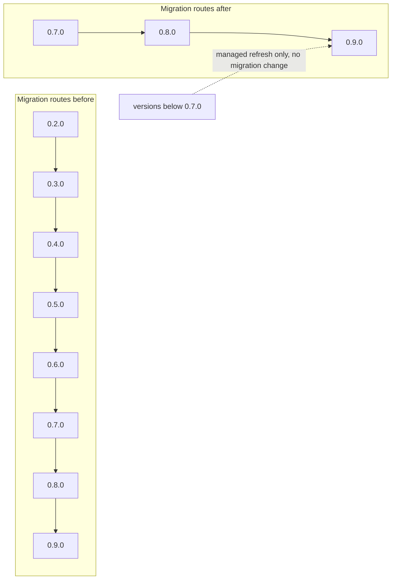

# Design: drop-legacy-residue

## Overview

This change removes residue, not capability. Three surfaces change:

1. **The product code loses the retired and legacy paths.** The
   `givn rewrite-history` subcommand and its module go; the vestigial
   `extras` manifest flag and its overlay merge go; the legacy two-command
   coverage schema (`coverage.non_e2e_command` / `coverage.e2e_command`), the
   gate's built-in legacy merge, and the legacy README badge stripper go; the
   embedded `{{MIGRATION_GUIDE}}` include for the deleted 0.2.0-to-0.3.0
   asset goes; the legacy Givn attribution-trailer prefixes go.
2. **The migration catalog loses the pre-0.8 routes.** The five bundles
   `0.2.0-to-0.3.0` … `0.6.0-to-0.7.0` and their guides are deleted; the
   oldest declared source becomes `0.7.0`. A project below the oldest route
   receives the managed refresh only.
3. **Documentation, the served guidance assets, the executable spec's Given
   steps, the reference and configuration scaffold, the acceptance fixtures,
   and arc42 are corrected.** Every stale claim the removed paths left behind
   is fixed where it lives, including the served instructions and spec Given
   steps that point readers at the wrong configuration file, and the scaffold
   text that shows addon keys outside the `addons:` block.

The WHAT lives in `proposal.md` and the delta features. This design owns the
HOW: exact deletions, the config-refusal consequences, the fixture
re-pointing, the retirement mechanics, and the evidence contract.

## Decisions

- Decides D1: a consumer config that still carries the retired `extras:` key
  is **accepted and ignored**. The overlay document is lenient by design (only
  the `coverage:` block carries `deny_unknown_fields`), the flag has had no
  reader since the extras became addons, and a rejection would hard-fail every
  command — including `givn upgrade`, the only refresh path — for a key Givn
  itself once wrote. Realized by deleting the field and the merge in
  `src/config/manifest.rs` / `src/config/overlay.rs`; no new validation code.
- Decides D2: removing `coverage.non_e2e_command` / `coverage.e2e_command`
  **refuses on load, automatically**, because `Coverage` carries
  `#[serde(deny_unknown_fields)]`. The serde error already names the unknown
  field and the expected keys
  (`failed to parse givn/config.yaml: coverage: unknown field
  'non_e2e_command', expected one of ...`); no custom message is added.
  `givn upgrade` cannot rewrite the block — the strict parse refuses the file
  before the upgrade path reads it — so the repair is a manual edit to declare
  `measure_command` / `merge_command`. Realized in `src/config/manifest.rs`
  and `src/integrity_hook.rs`; recorded as risk R-81 in chapter 11.
- Decides D3: the retired command gets one `@e2e` scenario under
  `apply-a-managed-upgrade`, mirroring the retired `givn spec index`
  precedent in the same capability. The two commands are distinct consumer
  actions (a variant flag or input does not create a new action; a different
  command does), and each retired command keeps its own refusal evidence so a
  re-added subcommand cannot hide behind the other's scenario. Realized in
  the delta and the fixture interaction row.
- Decides D4: the oldest supported migration source is `0.7.0`;
  `migration_path` already returns an empty vector when no route starts at the
  recorded version, so no production logic changes — only the catalog, the
  fixtures, and the docs. Realized in `assets/migrations/catalog.yaml`, the
  re-pointed scenarios, and the catalog test.
- Decides D5: the capability feature and the use-case narrative both leave
  at the archive merge. The feature must keep existing until the merge
  (`resolve_capability_usecase` needs it to find the use-case directory);
  the narrative leaves with the feature because the archive retirement is
  extended to remove a use-case directory whose last capability retires.
  Deleting the narrative during implementation was rejected: default-scope
  `givn lint` would exit 3 for the interval where the directory holds a
  feature and no narrative. Realized in the retirement mechanics and the
  task list.
- Decides D6: the guide scenario keeps its unversioned title and is re-pointed
  to `docs/migrations/0.7.0-to-0.8.0.md`, the oldest retained guide; its
  assertions become that guide's actual prompt contract. Realized in the
  `describe-the-release` delta and the steps in
  `tests/steps/release_0_3_0_steps.rs`.
- Decides (design-review, Q2): `CHANGELOG.md` enters scope for exactly one
  edit. The released 0.3.0 bullet keeps the `0.2.0-to-0.3.0` string — the
  scenario "The changelog describes the complete 0.3.0 release" asserts the
  string via the step "it contains the 0.2.0 to 0.3.0 migration entry point"
  — and the dead markdown link target becomes plain text. No other changelog
  line changes: the release-record principle stays intact. Rejected: leaving
  the dead link with a recorded rationale (a broken front-door reference
  stays broken); removing the changelog/migration-entry scenario (unpins the
  release-record contract). Realized in the Assets and docs table.
- Decides (design-review, Q3): no new glossary row for the migration floor.
  The floor is held by the existing **Migration catalog** glossary entry —
  "Embedded release policy at `assets/migrations/catalog.yaml` that declares
  source/target bundle edges and their order" — the oldest declared source is
  the first edge the catalog declares. The durable chapters phrase the
  boundary as "the oldest source the migration catalog declares (0.7.0)",
  tied to the catalog concept rather than an undefined standalone term.
  Rejected: a new "migration floor" glossary row (a duplicate of the
  catalog's declared-edge concept). Realized in the arc42 chapters.
- Decides (design): `CoberturaReport.line_hits` and `CoberturaLine.number`
  are removed with `merge_legacy_reports`. They exist only for the legacy
  union; `file_lines` stays because `assert_distinct` uses it. Rejected:
  keeping the field — it would be dead parsed data, the residue this change
  exists to remove.
- Decides (design): the `remove_legacy_coverage_badges` step goes with the
  legacy path. Its sole subject is the even older shields.io badge formats
  Givn itself used to write; the current badge renderer keeps writing the
  current format, and no scenario pins the older-format cleanup.
- Decides (design): the attribution stamper now replaces only the managed
  `Co-Authored-By: … with Givn …` line. The legacy `Givn-Version:`, `LLM:`,
  `LLM-Reasoning:`, `LLM-Harness:`, and `Givn-Attribution-Status:` prefixes
  are no longer stripped; an existing message that carries them keeps them
  (they are ordinary body lines now). The unit test keeps the managed-line
  replacement assertions and drops the legacy-stripping assertions.
- Decides (design): the historical records stay untouched — `givn/archive/**`,
  `docs/archive/**`, `givn/ideation/**`, `docs/ideation/**`, and the archived
  seeds that name the retired command. The published ideation topic describes
  the state at handoff; the retirement is recorded by the tombstone, the
  review's `RETIRE:` line, and the deleted use case.
- Decides (design): the retired use case leaves the corpus through the
  archive retirement, not a plain file deletion. No use-case narrative delta
  is written for `rewrite-history` — a delta replaces a narrative, it cannot
  remove one — and no implementation task deletes the narrative, because a
  use-case directory without its narrative fails default-scope `givn lint`
  (exit 3) while the feature still exists. The extended retirement removes
  the feature, the narrative, and the directory at the archive merge.
- Decides (design): the served-guidance corrections are prose fixes with no
  spec delta. No permanent scenario pins the grilling instruction's source
  inventory or its drift examples, and the corrected config-file attributions
  keep resolving as references; the audit is recorded under the
  served-guidance spec coverage section. Realized in the served guidance
  assets below.
- Decides (design): the spec-text config misattribution ships as
  `@givn.modified` delta scenarios with the permanent titles and identical
  observable behaviour — only the Given step's file name changes, and the
  fixtures already write `givn/commands.yaml`. The implementation pass
  renames the three matching step attributes in
  `tests/steps/enforce_post_merge_e2e_gate_steps.rs`; no behaviour and no
  interaction inventory changes.
- Decides (design): the reference and configuration-scaffold corrections are
  text fixes with no spec delta. No scenario pins the scaffold or the
  reference text; the manifest-schema unit tests assert only key-name
  presence and the embedded run-template copy, and both survive. Realized in
  the reference and scaffold edits below; this repository's own
  `givn/config.yaml` is not regenerated. The scaffold edit also repays arc42
  debt D-3 (chapter 11, recorded in 11.4).

## Architecture impact

No new building block, dependency, data format, or public contract is
introduced. The change removes one CLI subcommand, one module, one manifest
field, two coverage config fields, one embedded-doc substitution, and one
attribution branch; it narrows the embedded migration catalog, and it
extends the archive retirement merge so a use-case directory whose last
capability retires is removed together with its narrative.



## Exact file changes

### Production code

| File | Change |
|---|---|
| `src/cli/rewrite_history.rs` | Delete the module (107 lines). |
| `src/cli/mod.rs` | Delete `pub mod rewrite_history;`. |
| `src/main.rs` | Delete the `RewriteHistory { yes }` clap variant (with its doc comment) and the `Commands::RewriteHistory` dispatch arm. |
| `src/config/manifest.rs` | Delete `Manifest.extras`; delete `Coverage.non_e2e_command` / `Coverage.e2e_command` and their `Default` initializers; delete the `legacy_coverage_commands_are_accepted_during_migration` unit test. `Manifest` keeps `deny_unknown_fields`; `Coverage` keeps it too, which is what makes a stale legacy coverage block a hard load error (D2). |
| `src/config/overlay.rs` | Delete the `overlay.extras` merge and the `OverlayDoc.extras` field. `OverlayDoc` stays lenient, which is what keeps a stale `extras:` line harmless (D1). |
| `src/cli/graph.rs` | Delete `extras: false` from the test manifest constructor. |
| `src/hooks.rs` | Delete `extras: false` from the test manifest constructor. |
| `src/cli/coverage_gate.rs` | Delete the `legacy_commands` probe, the legacy command-execution branch, `write_legacy_merged_report`, and `remove_legacy_coverage_badges`. The gate keeps: measure → parse/validate both sources → `assert_distinct` → run `merge_command` → validate the merged report → badges and README summary. The README summary now always names `coverage.measure_command` and `coverage.merge_command` (drop the legacy `unwrap_or` fallbacks). |
| `src/cobertura.rs` | Delete `merge_legacy_reports`, the `CoberturaReport.line_hits` field, `CoberturaXml::line_hits()`, `CoberturaLine.number`, and the two tests that exercise the legacy merge. Keep `file_lines`, `parse`, `validate`, `assert_distinct`, `render_*`. |
| `src/integrity_hook.rs` | In `check_coverage_config`, delete the `legacy_configured` acceptance and the "Legacy projects may temporarily keep…" sentence; the refusal keeps naming `coverage.measure_command` / `coverage.merge_command`. |
| `src/cli/migration.rs` | Delete `const MIGRATION_GUIDE` and the `.replace("{{MIGRATION_GUIDE}}", MIGRATION_GUIDE)` substitution — no retained asset carries that placeholder. Update the unit tests: the `bundle()` helper points at `migrations/0.7.0-to-0.8.0/…`; `catalog_contains_the_0_2_to_0_3_bundle` becomes a test that the oldest declared source is `0.7.0`; `aggregate_design_keeps_bundle_phases_in_order` anchors on the retained design asset's heading (`## Phase 1 — Use-case model (inventory)`) instead of the deleted `## Prompt 1: Inventory`. |
| `src/cli/attribution.rs` | Delete `LEGACY_TRAILER_PREFIXES` and the prefix branch in `is_managed_trailer`; `stamp_text` keeps replacing the managed co-author line. Update the unit test: drop the legacy trailer lines from the fixture and the assertions that they disappear; keep the human `Co-Authored-By`, the `User-Trailer: keep` line, and the managed-line replacement assertions. |
| `src/cli/readme.rs` | **Unchanged** — `LEGACY_TEXTS` is current README-enforcement behaviour (the reviewed out-of-scope item). |
| `src/cli/archive.rs` | Extend the retirement branch of `process_delta_file`: after removing the retiring capability's `.feature`, when the use-case directory is not `fragments` and holds no remaining `.feature` files, remove `usecase.md` when present and remove the directory. Errors propagate with `.with_context()`; the tombstone record stays (repair-forward). Update the retirement unit tests: `retirement_deletes_capability_and_writes_tombstone` (last-capability fixture) now also asserts the use-case directory and narrative are gone; add `retirement_of_shared_usecase_keeps_directory_and_narrative` (a remaining sibling capability's `.feature` keeps the directory untouched). |

### Assets, migration catalog, and docs

| Path | Change |
|---|---|
| `assets/migrations/0.2.0-to-0.3.0/`, `0.3.0-to-0.4.0/`, `0.4.0-to-0.5.0/`, `0.5.0-to-0.6.0/`, `0.6.0-to-0.7.0/` | Delete the five bundle directories. |
| `assets/migrations/catalog.yaml` | Delete the five bundle entries; the first remaining entry is `migrate-0-7-0-to-0-8-0`. |
| `docs/migrations/0.2.0-to-0.3.0.md`, `docs/migrations/0.4.0-to-0.5.0.md` | Delete. |
| `docs/migrations/README.md` | Delete the retrieval-installation paragraph; rewrite the placeholder paragraph (no retained asset uses `{{MIGRATION_GUIDE}}`; the three generated-metadata placeholders stay); state the oldest declared route (`0.7.0`) and the no-route refresh behaviour. |
| `README.md` | Remove the semantic-duplicate-review clause from "Blocking gates"; replace the stale "Configurable without forking" build text (one feature-free binary, `[features] default = []`); correct the "Runner-agnostic" skill formats (`agents` neutral plus `claude`, `opencode`, `omp`); fix the install block comments; fix the `docs/workflow.md` bullet ("how semantic search assures deduplication" goes); drop `extras` from the reference bullet; delete the "Enforcement note for agents" section (the semantic engine is gone and its referenced chapter section no longer exists). |
| `docs/reference.md` | Drop the retrieval-aware clause from the `givn-spec` row; "Enables all addons and extras by default." → "Enables all addons by default."; fold the four former extras into the addons table (`domain_modeling`, `dev_principles`, `grill_me`, `grill_with_docs`) and delete the `## Extras` section and the `--no-extras` / `givn extras install` references; `addons:` / `extras:` → `addons:`; drop `extras` from the document intro; split the Configuration section by owning file and fix the project-layout comment (exact content below). |
| `assets/config.yaml.tmpl` | Fold the four project-level addon keys into the main commented `addons:` block; delete the four top-level commented example lines from their per-addon sections; replace the fake `arc42: output_dir/chapters` snippet with the fixed-path truth; replace the stale "Defaults already in the embedded manifest" post lists with the mandatory-check contract and relabel the examples additive; fix the header repository URL (exact content below). |
| `assets/commands.yaml.tmpl` | Replace the undefined "harness evaluator" reader with the commands that actually read the file — `givn check`, `givn archive`, `givn run`, `givn upgrade`, `givn status` (exact content below). |
| `docs/workflow.md` | Delete the advisory row "missing index notice" (no such hint or command); replace the archive chokepoint's "fresh similarity gate" with the real gates (configured hooks, run-declaration gate, README completeness gate, use-case/delta prevalidation, E2E-runner configuration check, verification scopes). |
| `docs/INDEX.md` | Remove the deleted 0.2.0 and 0.4.0 guide entries; add the `0.7.0-to-0.8.0` guide entry; drop `extras` from the reference description and `retrieval` from the chapter-08 description. |
| `AGENTS.md` | Acceptance prerequisites: drop `git-filter-repo` and the rewrite-history clause. |
| `CHANGELOG.md` | One edit (Q2, option B): in the released `## [0.3.0]` Added section, the bullet "Added the LLM migration playbook at [`docs/migrations/0.2.0-to-0.3.0.md`](docs/migrations/0.2.0-to-0.3.0.md)." keeps the `0.2.0-to-0.3.0` string and drops the dead link target — the text becomes plain `` `docs/migrations/0.2.0-to-0.3.0.md` ``. The scenario "The changelog describes the complete 0.3.0 release" stays green (its step asserts the string, not the link). The later prose code block naming the same path is already plain text and is untouched; no other changelog line changes — the release-record principle stays intact. |
| `.github/workflows/ci.yml`, `.github/workflows/release.yml` | Drop `git-filter-repo` from both apt install lists; no test needs it after the command is gone. |

### Served guidance assets

Sweep of `assets/instructions/`, `assets/commands/`, `assets/skills/`, and
`assets/templates/` for the stale configuration vocabulary (`extras`,
`set_extras`, and `verify.command` / `features_path` attributed to
`givn/config.yaml`). `assets/commands/` and `assets/skills/` carry no hit;
`assets/templates/design-review.md`'s `addons.arc42` mention is correct and
stays. Every hit below is corrected to name the file that actually owns the
value — the runner commands live in `givn/commands.yaml`, applied as the later
overlay; addons, skill targets, extensions, and the rules policy live in
`givn/config.yaml`.

| File and hit | Correction |
|---|---|
| `assets/instructions/grill-with-docs.md:26` — `givn/config.yaml` (verify.command, features_path, addons, extras) | Split the inventory by file: `givn/commands.yaml` (verify.command, verify.e2e_command, features_path, coverage, run) and `givn/config.yaml` (addons, skills.targets, extensions, rules). |
| `assets/instructions/grill-with-docs.md:33-35` — two drift examples using `set_extras` / `extras` | Replace with current-vocabulary examples (below). |
| `assets/instructions/review.md:54` — "Read the command itself from `givn/config.yaml`" | "…from `givn/commands.yaml`". |
| `assets/instructions/review.md:70` — "Read both values from `givn/config.yaml`" | "…from `givn/commands.yaml`". |
| `assets/instructions/review.md:381` — "Read both `verify.command` and `verify.e2e_command` from `givn/config.yaml` yourself" | "…from `givn/commands.yaml` yourself". |
| `assets/instructions/specs.md:131` — "`verify.e2e_command` (configured in `givn/config.yaml`)" | "`verify.e2e_command` (configured in `givn/commands.yaml`)". |
| `assets/instructions/tasks.md:31` — "Set `verify.command` in `givn/config.yaml` to the exact runner invocation" | "Set `verify.command` in `givn/commands.yaml` to the exact runner invocation". |
| `assets/templates/design.md:75` — "Test runner command (from `verify.command` in givn/config.yaml)" | "…(from `verify.command` in givn/commands.yaml)". |
| `assets/templates/review.md:71` — "`verify.command` and `verify.e2e_command` read literally from `givn/config.yaml`" | "…read literally from `givn/commands.yaml`". |

Exact corrected wording for `grill-with-docs.md` (wrapped to the file's line
length):

```text
- `givn/commands.yaml` (verify.command, verify.e2e_command, features_path,
  coverage, run) and `givn/config.yaml` (addons, skills.targets, extensions,
  rules)
```

and the two illustrative drift examples, in current vocabulary:

```text
- "tasks.md says the flow is write `givn/config.yaml` -> `givn skills sync` ->
  commit, but design.md names `givn/commands.yaml` as the home of the runner
  values. Is the ordering and the file split covered?"
- "The spec asserts `rules: versioned`, but the config scaffold ships the key
  commented and an absent value resolves to `local-only`. Which step makes the
  policy explicit?"
```

The generated copies in this repository's agent targets refresh from these
assets through the normal dogfood `givn skills sync` after archive; the assets
are the durable home, and `assets/commands/grill-with-docs.md` carries only
the trigger, so it needs no edit.

### Configuration scaffold and reference text

The scaffold is the embedded `assets/config.yaml.tmpl`, rendered by
`givn init` and refreshed comment-for-comment by `givn upgrade`; this
repository's own `givn/config.yaml` is user-owned and is **not** regenerated
by this change (its commented scaffold refreshes on the next upgrade, its
uncommented settings stay untouched).

**Addons block.** Extend the commented example so all eight flags are nested
under `addons:`:

```text
# addons:
#   arc42: true             # set to false to disable the arc42 documentation artifact
#   absolute_mode: true     # set to false to disable the Absolute Mode communication
#                          # policy. Manages a fenced <!-- givn:begin:absolute-mode -->
#                          # block in AGENTS.md; the rest of AGENTS.md is untouched.
#   readme: true            # set to false to disable the readme scaffolding addon
#   coverage: true          # set to false to disable the coverage lifecycle artifact
#   domain_modeling: true   # project-level skill; see below
#   dev_principles: true    # project-level skill; see below
#   grill_me: true          # project-level command; see below
#   grill_with_docs: true   # project-level command; see below
#                          # Toggle with: givn addons enable|disable <name>, or
#                          # `givn addons list` to see all known addons.
```

Then delete the four trailing top-level example lines from the per-addon
sections — `# domain_modeling: false`, `# dev_principles: false`,
`# grill_me: false`, `# grill_with_docs: false` (each followed by
`# set to true to enable`) — and keep each section's description and
`Toggle with: givn addons enable|disable <name>` line. An uncommented
top-level key is ignored by the lenient overlay, so the old shape taught a
setting that does nothing; the main block is now the one canonical example.

**arc42 block.** Replace the fake `arc42: output_dir/chapters` snippet with
the truth, keeping the design-phase and archive-gate paragraph:

```text
# --- arc42 documentation (requires addons.arc42: true) -----------------------
# Durable arc42 chapters live at the fixed path `docs/arc42/`, using the
# embedded twelve-chapter set. There is no output-dir or chapter-list setting.
#
# When addons.arc42 is true, the arc42 document is produced during the
# design phase and checked in design-review: design-review requires
# arc42-docs, and arc42-docs itself gates archive (added to apply.requires) --
# an enabled-but-unfinished arc42 doc blocks `givn archive`, not just the
# "ready-to-archive" status label.
```

**Header URL.** `#  givn configuration  —  https://github.com/TBD/givn` →
`#  givn configuration  —  https://github.com/buster/givn` (matches
`Cargo.toml`'s `repository`).

**Hooks block.** Replace the stale post-default claim and relabel the
examples:

```text
# A `post:` list is purely additive — it adds user hooks and never replaces
# the mandatory checks the binary owns:
#   `givn check tasks`  -> WIP protection and the test runner (verify)
#   `givn check review` -> integrity, the run-declaration check, and (for a
#                          named change) the overlap dispositions
#   `givn archive`      -> both verification scopes (regular and e2e) and the
#                          coverage gate when enabled
```

Then rename `# Override examples:` to `# Additive examples:` and change the
tasks example to `post: [lint]` (the mandatory check already runs `verify`
for tasks, so the old `post: [lint, verify]` taught a duplicate run); the
review example (`verify` with a display name, plus a custom script with
`allow_failure: true`) stays. The embedded manifest's `tasks`/`review` `post`
lists are empty, and the `check`/`archive` mandatory behavior above is the
effective contract.

**`assets/commands.yaml.tmpl` header.** Replace the undefined reader:

```text
#  `givn check`, `givn archive`, `givn run`, `givn upgrade`, and `givn status`
#  read from here.
```

(Replaces the old line that credited "the harness evaluator"; the following
"`givn/config.yaml` stores project structure config; test commands live
HERE." line is already accurate and stays. Each named command reads the
file's effective values — `check` runs `verify.command`, `archive` runs the
verification scopes and the coverage gate, `run` executes the `run:`
declaration, `upgrade` reads, backfills, and stages the file, and `status`
reports `verify_command`.)

**`docs/reference.md` Configuration section.** Replace the single
`givn/config.yaml` description and key list with the split:

```text
## Configuration

`givn/config.yaml` is the structural scaffold, generated fully-commented by
`givn init`: commented lines are the managed documentation scaffold
(refreshed by `givn upgrade`); uncommented key/value lines are user-owned and
never touched by upgrades. Carries `givn_config_version`.

`givn/commands.yaml` is the project-owned command file: the test runner,
coverage commands, and the product run declaration live there, applied as the
later overlay.

The first value a working project must set is `verify.command` in
`givn/commands.yaml`.

Key sections of `givn/commands.yaml`:

- `verify.command` / `verify.e2e_command` — test runner(s). Must be a
  Gherkin/Cucumber runner executing the `.feature` files, not a bare
  unit-test command.
- `verify.features_path` — where the runner reads `.feature` files from
  (default `givn/specs`).
- `coverage.measure_command` / `coverage.merge_command` — project-owned
  scripts producing Cobertura reports for the archive coverage gate.
- `run:` — the run declaration: `command`, `product_type`
  (`server`/`cli`/`library`), exactly one of `port` (fixed) or `port_env`
  (the caller hands the port over) for servers, `ready_path`, and
  `ready_timeout_s`. Validated by rules R1–R10; gating `givn check review`
  and `givn archive`; executed by `givn run`; documented in the README's run
  managed block.

Key sections of `givn/config.yaml`:

- `artifacts:` — patch the embedded workflow graph: remove/reorder steps,
  make steps optional, add custom steps with own template and instruction.
- `apply.requires` — which artifacts gate `givn archive` (default
  `[tasks, review]`).
- Hooks (`post:` per artifact) — built-ins `verify`, `verify-e2e`, `lint`,
  `integrity`, or any shell command; object form supports `allow_failure`
  and display `name` (built-in hook names always ignore `allow_failure`).
- `extensions:` — (existing bullet and YAML example, unchanged)
- `addons:` — see the addons table above.
- `skills:` — the persisted agent targets `givn skills sync` installs to.
- `rules:` — the generated-rules policy: `local-only` (the default when
  absent) or `versioned`.
```

**`docs/reference.md` layout block.** Fix the attributed values:

```text
givn/
├── config.yaml                       # documented + versioned: overlay, addons, rules, extensions
├── commands.yaml                     # project-owned verify, coverage, and run values
```

**Stale step-file label.** Rename the `tests/steps/mod.rs` section comment
`// --- Steps for install-extras ---` to a current label (for example
`// --- Steps for optional addons ---`); implementation pass only.

**Pinning result.** No spec scenario pins the template's or the reference's
text: the `initialize-project` scenarios drive `givn addons enable|disable`
against the generated config, the `match-guidance-to-enabled-addons`
scenarios drive conditional template sections, and the `rules-policy` /
`initialize-a-project` scenarios assert generated values. The unit test
`config_template_keys_match_manifest_schema` asserts that the template
mentions the key names `verify`, `apply`, `artifacts`, `addons`, `coverage`,
and `givn_config_version` — all survive the edit, so no test update is
required (re-verify at implementation). The `run_scaffold_is_embedded_verbatim`
test pins `commands.yaml.tmpl` to embed `run.yaml.tmpl` byte-for-byte; the
header edit leaves that copy untouched. The `src/cli/upgrade.rs` tests render
the scaffold and assert the version marker plus appended user overrides, not
the edited lines. No delta scenario is added for these corrections.

### Spec corpus

| Path | Change |
|---|---|
| `givn/specs/rewrite-history/history-rewrite.feature` | Removed by the retirement delta at archive. |
| `givn/specs/rewrite-history/usecase.md` | Removed by the archive retirement together with the feature: the extended retirement removes the use-case directory when its last capability retires. No implementation deletion (a directory with a feature and no narrative fails default-scope `givn lint`). |
| `givn/specs/upgrade-a-project/apply-a-managed-upgrade.feature`, `givn/specs/archive-change/extract-coverage-gate.feature`, `givn/specs/publish-a-release/describe-the-release.feature`, `givn/specs/fragments/customize-the-lifecycle-graph.feature`, `givn/specs/archive-change/enforce-post-merge-e2e-gate.feature`, `givn/specs/archive-change/grouped-merge-for-new-capabilities.feature`, `givn/specs/verify-change/resolve-change-directories.feature` | Merged delta operations only (see the delta map below); the permanent files stay untouched until archive. A delta scenario tagged `@givn.modified` carries the permanent title, so the merge replaces the Given text in place. |

## Delta map and merge semantics

| Capability | Delta file | Operations |
|---|---|---|
| `extract-coverage-gate` | `specs/archive-change/extract-coverage-gate.feature` | 2 × `@givn.removed` (the legacy coverage union scenarios). |
| `apply-a-managed-upgrade` | `specs/upgrade-a-project/apply-a-managed-upgrade.feature` | 1 × `@givn.removed` (the 0.2.0 outline), 2 × `@givn.added` `@e2e` (0.7.0 outline; retired-command refusal), 1 × `@givn.added` (no-route refresh), 4 × `@givn.modified` (unclean, outside-Git, existing-plan, Fossil-unclean fixtures re-pointed to 0.7.0). |
| `describe-the-release` | `specs/publish-a-release/describe-the-release.feature` | 1 × `@givn.modified` (guide scenario re-pointed to the retained guide). |
| `customize-the-lifecycle-graph` | `specs/fragments/customize-the-lifecycle-graph.feature` | 1 × `@givn.removed` (extras propagation). |
| `enforce-post-merge-e2e-gate` | `specs/archive-change/enforce-post-merge-e2e-gate.feature` | 3 × `@givn.modified` (two regular, one `@e2e`), Given text re-pointed to `givn/commands.yaml`. |
| `grouped-merge-for-new-capabilities` | `specs/archive-change/grouped-merge-for-new-capabilities.feature` | 3 × `@givn.modified` `@e2e`, Given text re-pointed to `givn/commands.yaml`; 1 × `@givn.added` `@wip` (last-capability retirement removes the use-case directory and its narrative; deliberately not `@e2e` — see the retirement mechanics). |
| `resolve-change-directories` | `specs/verify-change/resolve-change-directories.feature` | 1 × `@givn.modified`, Given text re-pointed to `givn/commands.yaml`. |
| `history-rewrite` | `specs/rewrite-history/history-rewrite.feature` | Tombstone: `@givn.delta @givn.retired @history-rewrite`, zero scenarios. |
| narrative | `specs/upgrade-a-project/usecase.md` | Full narrative replacement with base SHA-256; replaces the 0.2.0 plan row with the 0.7.0 title and adds the retired-history-rewrite interaction row. |

The retired 0.2.0 outline cannot be `@givn.modified` (its title carries the
version, and modified replaces by exact title), so the delta removes it and
adds the 0.7.0 outline; the merge applies both atomically against the
projected state.

## Served-guidance spec coverage audit

No delta scenario is added for the served-guidance corrections. Audit result:

- `instruction-integrity` pins generic properties of served instructions —
  the interaction and E2E policy, the JSON contract, project overrides, the
  absence of retrieval wording, the deterministic disposition gates, the
  dialog policy, the use-case criteria, reference resolution, instruction-id
  resolution, addon-conditional sections, and one-direction-per-file — and
  none of its scenarios assert the grilling source inventory, the drift
  examples, or the config-file attribution of `verify.command` /
  `verify.e2e_command`.
- `match-guidance-to-enabled-addons` pins only the addon-conditional
  sections; the corrected files carry none.
- The instruction-integrity step helpers resolve instruction ids, grade
  references, and map generated guidance files to ids; the printed-instruction
  corpus covers the artifact instructions plus `review-reverse`,
  `specs-reverse`, `tasks-reverse`, and `dialog` (not `grill-with-docs`, which
  is an addon command). No helper asserts the corrected sentences.
- The reference-resolution scenarios (`the printed instructions reference
  only resolvable files`, `the generated guidance references resolve …`) stay
  green either way: `givn/config.yaml` and `givn/commands.yaml` both resolve
  in an initialized project, and the corrections only change which true file
  a sentence names. The contract they describe — the runner commands' actual
  home and the overlay order — is exercised elsewhere (the coverage and run
  declarations are configured in `givn/commands.yaml` by their scenarios).

Adding a content-pin scenario for this prose would over-fit incidental
wording; the repository pins policy obligations, not file-home trivia. The
corrected text is plain prose like the README and reference corrections in the
same change.

## Spec-text correction (Given wording)

The stale Given text in the permanent scenarios is corrected through
`@givn.modified` deltas with identical observable behaviour. The new wording:

```text
- And the givn/commands.yaml has e2e_command unconfigured
- Given a givn project with verify.e2e_command unconfigured in givn/commands.yaml
- Given a committed givn project with verify.e2e_command unconfigured in givn/commands.yaml
```

Sweep result for the permanent specs (every `givn/config.yaml` mention was
classified): the only misattributed runner/e2e keys are the seven Given lines
above in
`givn/specs/archive-change/enforce-post-merge-e2e-gate.feature` (lines 5, 17,
35), `givn/specs/archive-change/grouped-merge-for-new-capabilities.feature`
(lines 5, 16, 27), and
`givn/specs/verify-change/resolve-change-directories.feature` (line 15); all
seven deltas re-point them to `givn/commands.yaml`. Every other
`givn/config.yaml` mention in the permanent specs is a legitimate key (skill
targets, the rules policy, the extensions map, the version marker) or an init
error message and stays unchanged. No coverage or `run:` key is attributed to
the wrong file anywhere in the corpus.

## Config-refusal contract

- `extras: true` in `givn/config.yaml` (or `givn/commands.yaml`): parsed as an
  unknown overlay key and ignored. Every command behaves exactly as before
  the field existed; `givn upgrade` preserves the line as a user-owned value.
- `coverage.non_e2e_command` / `coverage.e2e_command` in either file: the
  strict `Coverage` deserializer refuses the document with
  `failed to parse givn/config.yaml: coverage: unknown field
  'non_e2e_command'` (the exact field named first is parse-order dependent).
  The configuration must declare `coverage.measure_command` and
  `coverage.merge_command` instead. Covered by the design decision D2 and the
  risk entry, not by a new scenario: the behavior is serde's strict-struct
  contract, and the surviving archive-coverage scenarios keep the working
  path pinned.

## Retirement mechanics

- Delta: `givn/changes/drop-legacy-residue/specs/rewrite-history/history-rewrite.feature`
  — two lines, zero scenarios, capability tag matching the permanent
  capability.
- At archive, `process_delta_file` removes
  `givn/specs/rewrite-history/history-rewrite.feature` and appends
  `history-rewrite / retired_by_change: drop-legacy-residue` to
  `givn/specs/.retired.yaml`.
- **Last-capability directory removal (code change).** The retirement path
  currently removes only the capability `.feature`. The archive merge is
  extended: after removing the retiring capability's feature, when the
  use-case directory holds no remaining `.feature` files and is not the
  `fragments` directory, `process_delta_file` also removes the directory's
  `usecase.md` (when present) and removes the directory itself; any
  `io::Error` propagates with `.with_context()`, leaving the already-recorded
  tombstone in place (repair-forward). A directory that still holds another
  capability's `.feature` is left untouched together with its narrative.
  Realized in `src/cli/archive.rs` (the `Some(usecase_dir)` arm of the
  retirement branch). Pinned by the delta scenario "Retiring a use case's
  last capability removes the use-case directory and its narrative" under
  `grouped-merge-for-new-capabilities` — the capability that owns the archive
  merge step's "retirement and grouping rules" (`archive-change` main
  flow 2, `resolve_capability_usecase` + `process_delta_file`; the retirement
  unit tests live beside the merge loop). The scenario is `@givn.added @wip`
  and deliberately not `@e2e`: it pins a merge rule through the real archive
  subprocess (established practice in `archive-proof` and
  `preserve-scenario-docstrings`), the capability's `@e2e` evidence is
  unchanged, no interaction-inventory row is added, and the terminal evidence
  set stays at the six transcripts of Q1.
- **No implementation deletion of the narrative.** `givn/specs/rewrite-history/usecase.md`
  stays in the corpus through the archive merge; the retirement removes it
  together with the feature. An earlier design draft deleted the narrative
  during implementation — rejected because default-scope `givn lint`
  enumerates every directory under `givn/specs/` except `fragments` and
  exits 3 whenever the directory is not a complete use case: a directory
  with a feature and no narrative fails (`usecase_invalid`, "usecase.md
  cannot be read"), a directory with a narrative and no feature fails
  (`dangling_capability_ref`), and — today — the narrative's baseline
  findings fail while it exists: the dangling `Includes: fragment:
  rules-policy` reference (`dangling_use_case_ref`; the fragment's id is
  `support`) and the `history-rewrite` interaction inventory's missing-@e2e
  mismatch (`interaction_mismatch`). Both baseline findings belong to the
  retired use case and clear exactly when the retirement removes the
  directory: `givn lint` default scope currently exits 3 and returns to 0
  only when the directory is gone.
- `review.md` must contain `RETIRE: history-rewrite — <reason>`; the
  retirement disclosure gate blocks without it.

## Fixtures and step definitions

| Delta capability | Step definition file(s) | Change |
|---|---|---|
| `apply-a-managed-upgrade` | `tests/steps/release_0_3_0_e2e_steps.rs` (e2e), `tests/steps/release_0_3_0_steps.rs` (regular) | Parameterise the legacy fixture with its recorded version: a 0.7.0 Git/Fossil fixture (route exists) and the existing 0.2.0 fixture (below the oldest route). Add `#[given("a clean Git project created with Givn 0.7.0")]`, the Fossil 0.7.0 variants, `a Givn 0.7.0 project with uncommitted user changes`, `a Givn 0.7.0 project that is not a Git repository`, the 0.7.0 existing-plan regex, and `a Givn 0.7.0 Fossil project with uncommitted user changes`; delete the now-unused 0.2.0 step functions except `a clean Git project created with Givn 0.2.0` (the no-route scenario). `current_version_migration_change_exists` asserts the `migrate-0-7-0-to-` prefix; `migration_contains_plan` asserts `id: migrate-0-7-0-to-0-8-0`; `no_migration_change_exists` drops the redundant per-version prefix scan. The migration-change fixture helpers move to the 0.7.0 fixture because a 0.2.0 project no longer gets a plan: `automatic_migration_change` in `release_0_3_0_steps.rs` and `prepared_project`, `completed_automatic_migration`, `dirty_legacy_project`, and `non_git_legacy_project` in `release_0_3_0_e2e_steps.rs`. Add `the consumer invokes the retired `givn rewrite-history` command` and `the error reports "rewrite-history" is not an available command` beside the existing retired-engine-command steps. |
| `describe-the-release` | `tests/steps/release_0_3_0_steps.rs` | Re-point `the 0.7.0 to 0.8.0 migration guide` and `an LLM reads the guide from a project using Givn` to `docs/migrations/0.7.0-to-0.8.0.md`; assert the retained guide's actual prompt contract: ordered headings of the exact shape `### Prompt N — <Title>` (em dash) ending in `### Prompt 6 — Validate and archive`, the sentence "The LLM must inspect the project before editing it", and the corpus boundary in the guide's own words — "The maintenance change is the **inventory and plan**, not the repair site." (line 42), "Do not edit the corpus in this change." (Prompt 1), and "Confirm this change edited no corpus artifact except the term collision-check cells" (Prompt 6). The guide carries no standalone "edits no corpus artifact" sentence; the rewrite matches the phrases above. |
| `extract-coverage-gate` | `tests/steps/extract_coverage_gate_steps.rs` | Delete `legacy_coverage_project`, `fixture_report_xml`, `legacy_coverage_same_lines`, `legacy_coverage_disjoint_lines`, `merged_report_has_line_counters`, and `make_executable` (used only by the legacy fixture). |
| `enforce-post-merge-e2e-gate` | `tests/steps/enforce_post_merge_e2e_gate_steps.rs` | Rename the three matching Given attributes from `givn/config.yaml` to `givn/commands.yaml`: `a givn project with verify.e2e_command unconfigured in givn/commands.yaml` (~line 5), `the givn/commands.yaml has e2e_command unconfigured` (~line 77), and `a committed givn project with verify.e2e_command unconfigured in givn/commands.yaml` (~line 367). The fixture bodies already write `givn/commands.yaml`; nothing else changes. |
| `grouped-merge-for-new-capabilities` | `tests/steps/enforce_post_merge_e2e_gate_steps.rs` (shared Given), `tests/steps/grouped_merge_steps.rs` (other steps) | Uses the same three Given definitions; the shared rename covers it. The added retirement scenario gets its fixture steps in `tests/steps/grouped_merge_steps.rs`: `a givn project with a permanent use case "…" whose only capability is "…"`, `a completed change "…" whose delta retires capability "…"`, and `the tombstone "givn/specs/.retired.yaml" records capability "…"`; its archive steps (`the project declares a complete run declaration`, `the user invokes `givn archive --change …``, `the command exits 0`, `the directory "…" does not exist`) already exist. |
| `resolve-change-directories` | `tests/steps/enforce_post_merge_e2e_gate_steps.rs` (shared Given), `tests/steps/deduplicate_change_dir_detection_steps.rs` (fixture steps) | Uses `the givn/commands.yaml has e2e_command unconfigured`; the shared rename covers it. No additional step change. |
| `customize-the-lifecycle-graph` | `tests/steps/mod.rs` | Delete the `the effective manifest has extras enabled` step (`manifest_extras_enabled`), which reads the removed field; the removed scenario's other steps are shared overlay steps. |
| `history-rewrite` | `tests/steps/local_only_rules_steps.rs` | Tombstone, zero scenarios. Delete the two Then steps orphaned by the retirement (F14) — `the reachable history contains "…"` and its sibling `the reachable history does not contain "…"` (both regexes, used only by the retired capability's scenarios; verified against the active corpus) — the second step-deletion entry in this table, beside `manifest_extras_enabled` (the `customize-the-lifecycle-graph` row). The other `local_only_rules_steps.rs` steps stay: they serve the `rules-policy` / `publication-cleanliness` report-only scenarios. |
| (served-guidance corrections) | none | Text edits only; no scenario pins the corrected prose (see the served-guidance spec coverage audit). |
| (reference and scaffold corrections) | `src/config/manifest.rs` unit tests `config_template_keys_match_manifest_schema` and `run_scaffold_is_embedded_verbatim` (existing) | No change required: the asserted key names (`verify`, `apply`, `artifacts`, `addons`, `coverage`, `givn_config_version`) survive the scaffold edit, and the header edit leaves the embedded `run.yaml.tmpl` copy byte-identical — re-verify at implementation. No scenario pins the template or reference text (see the scaffold section's pinning result). |
| (documentation corrections) | none | Text edits only. |

No new step-definition file is created: each touched capability already owns
its step-definition file(s), and the design instruction's one-file-per-
capability rule is satisfied by extending the owning capability's existing
file rather than adding a change-wide file.

## Black-box-first note

Every behavior this change removes or re-points is exercised through the real
CLI: the migration fixtures spawn the compiled binary, and the retired-command
scenario spawns `CARGO_BIN_EXE_givn`. The retained internal tests cover
contracts the CLI cannot reach deterministically: the catalog's structural
validation and route ordering (`src/cli/migration.rs` unit tests), the overlay
application errors and flag propagation (`tests/steps/mod.rs` module-boundary
steps), the attribution stamping transformation (in-crate test), and the
Cobertura parse/validate contracts (in-crate tests). The internal tests this
change deletes — `merge_legacy_reports`, the attribution legacy-stripping
assertions, the catalog's deleted-bundle test — have no surviving subject:
their CLI scenarios go with the same branches.

## Runner, strict mode, and single-scenario evidence

- `verify.command`: `./run-tests.sh`; `verify.e2e_command`:
  `./run-tests.sh --e2e`. `run-tests.sh` runs the Rust `cucumber-rs` runner
  (`tests/features_runner.rs`, `harness = false`) over `GIVN_FEATURES`
  (the active change's `specs/` during implement/review, `givn/specs/` after
  archive).
- Strict mode: `.fail_on_skipped()` on the Cucumber builder in
  `tests/features_runner.rs`; undefined or skipped steps fail the process.
  The setup task proves it by running a scenario with an empty step body and
  requiring a non-zero exit.
- Single-scenario evidence command:
  ```text
  GIVN_FEATURES=givn/changes/drop-legacy-residue/specs \
  cargo test --test features_runner -- --name '^<scenario title>$'
  ```
  `--name` is used alone because the Cucumber CLI does not combine name and
  tag filters; the `@e2e` scenario is selected by its unique title.
- Runner caveat (F21): the single-scenario debug command runs plain
  `cargo test` (libtest protocol, `--name` filter) while the gate runs
  `./run-tests.sh` under cargo-nextest (the `GIVN_CUCUMBER_TAGS` protocol).
  The two runners select and report scenarios differently — the task list
  must not treat a green single-scenario libtest run as the nextest gate
  result, and must record nextest evidence per scenario in `tasks.md`.
- Retirement-sequencing note: the rewrite-history production deletions (the
  clap variant, the module, the `local_only_rules_steps.rs` reachable-history
  steps) land in the final implementation task before archive. Until the
  archive merge, the permanent `history-rewrite` feature still exists, so
  the change-scoped gates run only the delta (`GIVN_FEATURES`), and the
  archive's verification scopes run the merged corpus where the feature is
  already gone — no interval executes the permanent rewrite-history
  scenarios against the deleted glue. The same property covers the guide
  re-point: between the re-pointing commit and the merge, the permanent
  "The migration guide is an executable prompt sequence" scenario still
  names the old guide steps, and the delta-scoped gates are the only runner
  input until the merge replaces the scenario.

## E2E smoke test infrastructure

- **E2E runner command**: `./run-tests.sh --e2e` (strict subset, `@e2e` tag
  expression).
- **E2E step definition location**: `tests/steps/release_0_3_0_e2e_steps.rs`,
  the owning capability's existing file; regular steps stay in
  `tests/steps/release_0_3_0_steps.rs`.
- **Local test infrastructure**: the compiled `givn` binary
  (`CARGO_BIN_EXE_givn`), `git`, `fossil`, and `script` (util-linux) on
  `PATH`; temp project roots per scenario; no server, container, or network.
  The E2E scenarios for this change spawn the real binary in a temp project
  and assert its exit code, stdout, and on-disk effects.
- **E2E framework choice**: `cucumber-rs` through the repository's
  `features_runner`, matching the real CLI boundary and reusing the shared
  `GivnWorld` fixtures.
- **E2E strict-mode proof**: the same `.fail_on_skipped()` builder; the setup
  task's strictness probe covers the `--e2e` invocation too.

## Visual Design Contract

- Interface: terminal
- Interface rationale: the change's user-visible surface is CLI text output
  (the retired command's refusal, the upgrade's migration-plan output); the
  documentation edits are repository text. Nothing renders HTML, CSS, or
  JavaScript in a browser — the opposite classification does not hold.
- Viewports: not applicable to CLI text; no screen is introduced or changed.
- Design system: not applicable; existing plain CLI output.
- Evidence kind: captured final transcripts, one per delta `@e2e` scenario,
  at `givn/changes/drop-legacy-residue/evidence/visual/<scenario-slug>/transcript.txt`
  (`givn::integrity_hook::scenario_slug`).
- Expected evidence set (6 transcripts): one per delta `@e2e` scenario — the
  two new scenarios plus the four re-pointed ones (Q1, option A). The
  re-pointed scenarios keep their `@e2e` tags and their corrected Given text,
  so their evidence is real archive/CLI runs, not withdrawn or untagged.
  1. `a-clean-0-7-0-project-receives-a-reviewable-aggregate-migration-plan`
     (new, `apply-a-managed-upgrade`) — the outline as a whole; the
     transcript records the Git example's `givn upgrade` run (argv, cwd,
     exit code, raw stdout/stderr) and the resulting migration change and
     revision shape.
  2. `a-consumer-invoking-the-retired-history-rewrite-command-is-told-it-does-not-exist`
     (new, `apply-a-managed-upgrade`) — the compiled binary's
     `givn rewrite-history` invocation, exit code, and raw stderr.
  3. `consumer-archives-a-delta-that-adds-e2e-scenarios-and-is-blocked-without-a-configured-runner`
     (re-pointed, `enforce-post-merge-e2e-gate`) — the blocked archive run:
     argv, cwd, exit code, and raw stderr naming the unconfigured runner.
  4. `consumer-archives-a-new-capability-and-the-merged-spec-lands-in-its-declared-use-case`
     (re-pointed, `grouped-merge-for-new-capabilities`) — the successful
     grouped-merge archive run and its merged-tree output.
  5. `archive-is-blocked-when-a-new-capability-has-no-declared-routing-decision`
     (re-pointed, `grouped-merge-for-new-capabilities`) — the blocked archive
     run and its routing refusal.
  6. `nothing-is-merged-when-one-delta-file-of-a-change-has-no-routing-decision`
     (re-pointed, `grouped-merge-for-new-capabilities`) — the blocked
     multi-delta run and the untouched-corpus assertion.
- Capture procedure: run the scenario's real commands against the compiled
  binary in its fixture project; after the final assertion write one
  transcript recording the scenario title, the exact `argv`, the
  working-directory disposition, the exit code, and raw stdout/stderr.
  Intermediate captures, if any, live under `reports/visual/` and are not
  review evidence.
- Motion: n/a — text interface.

## Use-case traceability

| Use-case element | Technical realization | Evidence |
|---|---|---|
| `upgrade-a-project` goal: cross a release gap with reviewable upgrade and migration revisions | Catalog keeps 0.7.0 → 0.8.0 → 0.9.0; `prepare_legacy_upgrade` and aggregate plan generation unchanged; below-route projects fall through to the managed refresh | `@e2e` "A clean 0.7.0 project receives a reviewable aggregate migration plan" (Git + Fossil examples); regular "A project below the oldest migration route receives no migration change" |
| `upgrade-a-project` main-flow 6 / extension 6: the system names any command a release removed | The retired `givn rewrite-history` subcommand leaves `src/main.rs`; clap refuses it by name | `@e2e` "A consumer invoking the retired history rewrite command is told it does not exist" |
| `publish-a-release` rule: the migration guide is an executable prompt sequence that forbids automatic changes to domain specifications and architecture decisions | The oldest retained guide (`docs/migrations/0.7.0-to-0.8.0.md`) carries the ordered prompt pack, the inspect-before-editing requirement, and the maintenance-change boundary | `@givn.modified` "The migration guide is an executable prompt sequence" |
| `archive-change` capability `extract-coverage-gate`: the archive gate runs the project-owned measurement and merge commands and publishes the merged report | `run_coverage_gate_inner` keeps measure → validate → distinctness → merge → validate → README; the legacy branch and built-in merge are removed | `@e2e` "Consumer archives a change with coverage enabled and the coverage summary appears in README" (unchanged) |
| fragment `support` / `customize-the-lifecycle-graph`: overlay flags reach the effective manifest | `extras` leaves `Manifest`/`OverlayDoc`; all remaining addon flags are unaffected | Remaining fragment scenarios (unchanged); the extras scenario is removed |
| `archive-change` main flow 2: the archive merge applies retirement and grouping rules | The extended retirement removes a use-case directory when its last capability retires (feature, narrative, directory) and records the tombstone | The `@givn.added` `@wip` scenario "Retiring a use case's last capability removes the use-case directory and its narrative"; the updated `process_delta_file` unit tests |
| `rewrite-history` use case: remove generated rules from reachable history | Retired; rule cleanliness stays report-only | Tombstone + `RETIRE:` disclosure; the extended archive retirement removes the use-case directory at the merge; no scenarios |
| Confirmed Personas: `developer--primary-user` (runs the retired command, crosses the gap), `agent--technical-role` (reads exit codes and stderr), `givn-maintainer--owner` (owns the catalog and release routes) | The CLI refusal, the upgrade output, and the catalog boundary address each role in its own terms | The capability has CLI text output, so Personas are named |

Actors in the scenarios (`the consumer`) stay distinct from Personas; the
Persona row records review context only.

## Interaction Coverage Matrix

| Inventory entry | @e2e scenario title | Real interface | Driving mechanism |
|---|---|---|---|
| `apply-a-managed-upgrade`: plan a release migration | "A clean 0.7.0 project receives a reviewable aggregate migration plan" (outline) | CLI | Real `givn upgrade` subprocess in a temp Git/Fossil project created with Givn 0.7.0; migration change, `migration.yaml`, and revision shape asserted |
| `apply-a-managed-upgrade`: run a managed upgrade | "A clean project without migration requirements receives one managed upgrade commit" | CLI | Real `givn upgrade` subprocess; revision count and subject asserted |
| `apply-a-managed-upgrade`: upgrade a Fossil project | "A clean Fossil project receives the same managed upgrade revision shape" | CLI | Real `givn upgrade` subprocess in a Fossil checkout; check-in count and comment asserted |
| `apply-a-managed-upgrade`: invoke a retired engine command | "A consumer invoking a retired engine command is told it does not exist" | CLI | Compiled binary invoked as `givn spec index`; non-zero exit and stderr asserted |
| `apply-a-managed-upgrade`: invoke the retired history rewrite command | "A consumer invoking the retired history rewrite command is told it does not exist" | CLI | Compiled binary invoked as `givn rewrite-history`; non-zero exit and stderr asserted |
| `apply-a-managed-upgrade`: archive a maintenance migration | "A completed maintenance migration can be archived without a product specification" | CLI | Real `givn archive` subprocess over the repair fixture; archive state and merged tree asserted |
| `extract-coverage-gate`: archive with coverage | "Consumer archives a change with coverage enabled and the coverage summary appears in README" | CLI | Real `givn archive` subprocess with script-based coverage; README and archive state asserted |
| `describe-the-release`: generate the release section | "Repeated revisions of one change yield one changelog entry" | CLI | Changelog generation over a real revision range (git-cliff fixture) |
| fragment `customize-the-lifecycle-graph` | (no inventory row — fragments carry no interactions) | — | In-process overlay application via the shared overlay steps |

The `@givn.modified` deltas keep their permanent scenario titles, so no
interaction inventory entry changes: the e2e titles for
`enforce-post-merge-e2e-gate`, `grouped-merge-for-new-capabilities`, and
`resolve-change-directories` are the same before and after the merge, and the
`archive-change` and `verify-change` `usecase.md` interaction tables are not
touched by this change. The added retirement scenario is deliberately not
`@e2e`, so it creates no inventory entry and no matrix row; the matrix gains
nothing beyond the two new `apply-a-managed-upgrade` rows above.

## Version freshness

No language, runtime, framework, library, database, browser, or image version
is introduced or changed. The change deletes code and text, narrows the
embedded catalog, and edits a lockfile-free repository; `Cargo.lock` is
untouched.

## Local runnability & digital twins

No external or third-party dependency is touched. Local run and test command:
`./run-tests.sh`; E2E smoke via `./run-tests.sh --e2e`. The only external
tools are the SCM executables and `script` already required by the acceptance
suite; no digital twin is required.

## Coverage process boundaries

Coverage is enabled in this project (`addons.coverage: true`,
`measure-coverage.sh` + `merge-coverages.sh`). The change removes lines from
the coverage gate itself, so the remaining gate path must stay exercised:

| Process | Started by | Instrumented artifact | Profile output | Merge step | Non-zero production probe |
|---|---|---|---|---|---|
| `features_runner` non-e2e | `measure-coverage.sh` (`cargo llvm-cov nextest`, `not @e2e`) | `target/llvm-cov-target` build of the test harness + `givn` binary | profraw under `target/llvm-cov-target` | `cargo llvm-cov report --cobertura` → `coverage/non-e2e-cobertura.xml` | `run_coverage_gate_inner` measure/validate/distinctness path in `src/cli/coverage_gate.rs` (exercised by the extract-coverage-gate scenarios) |
| `features_runner` e2e | `measure-coverage.sh` (`@e2e`) | same instrumented harness | profraw reset via `cargo llvm-cov clean --profraw-only` | → `coverage/e2e-cobertura.xml` | `GivnWorld` fixture path invoking the compiled CLI (`tests/common/mod.rs`) |
| `ready_fixture` | `cov_ready` in `measure-coverage.sh` | instrumented `ready_fixture` binary | discarded with the clean before the replay | n/a | fixture startup path |

`merge-coverages.sh` unions the two reports into
`coverage/cobertura-coverage.xml`; the README publish step consumes that
file. The repository's own merge script and its union arithmetic are
unchanged (the deleted built-in merge was the tool's legacy fallback).

## Expected overlap advisories (for the review dispositions)

`givn lint --change drop-legacy-residue` prints the exact pairs; the
disposition gate requires a row for every non-contradiction `shape_match`
finding involving a delta file (subset advisories are advisory only). The
distinct families:

1. SHAPE "A clean 0.2.0 project…" vs "A clean 0.7.0 project…" — the removed
   and added outline pair; the title carries the fixture version, so the
   operation is remove + add.
2. SHAPE "A clean project without migration requirements…" vs "A project
   below the oldest migration route…" — same observable end state, distinct
   precondition (version below the oldest declared route vs current version
   with a stale integration); the no-route case is the boundary the change
   exists to pin.
3. SUBST "A consumer invoking the retired history rewrite command…" ⊂ "A
   consumer invoking a retired engine command…" — same refusal shape for a
   different command; each retired command keeps its own refusal evidence
   (D3).
4. **Modified-delta matches.** The `@givn.modified` scenarios share their
   permanent titles, so the pairs against their own merge targets are the
   replacement pairs; the remaining `shape_match` findings pair each revised
   scenario with unrelated short scenarios whose step shape coincides
   (`resolve-change-directories` is the broadest, matching the readme,
   visual-gate, review-disposition, and workflow-enforcement families; the
   two archive capabilities match the gate-shaped scenarios). Each gets a
   `variant` (or `boundary`) disposition row; the operation changes only a
   Given step's file name, never the asserted behaviour.
5. SUBST findings against other permanent scenarios (hundreds, dominated by
   the generic short scenarios) — cross-corpus shape coincidence on common
   assertion shapes; advisory, no gate row required, but review may record
   the boundary rationale once.
