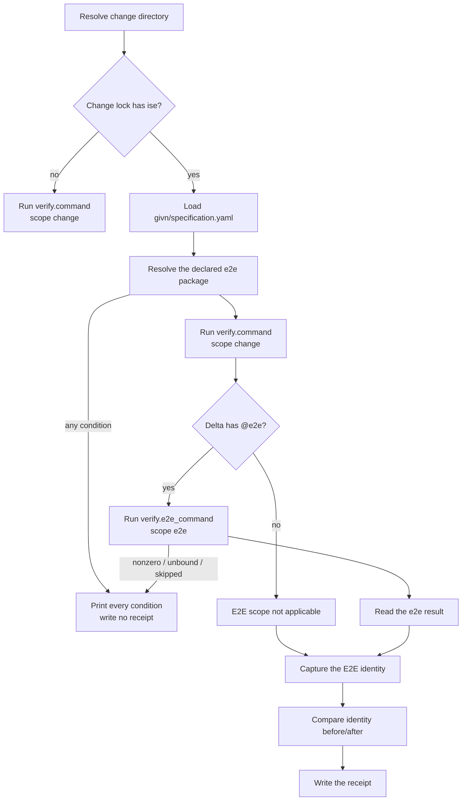

# Design: enforce-ise-e2e-boundary

## Overview

Four coordinated surfaces, each owned by one component:

1. **Declared-boundary resolver** (`src/e2e_boundary/`, new) absorbs the Cargo
   package reader from `src/cli/lint/manifest.rs` and the glob matcher and
   bounded walk from `src/cli/lint/specification.rs`. It resolves the declared
   `e2e` role to its set of packages (each matched path's package, or the path
   itself when it resolves none), reports every boundary condition once, and
   computes the resolved package digests that form the receipt identity.
2. **Blocking change check** (`src/cli/check.rs`) reads the change's
   `config-lock.yaml`, refuses on a boundary condition, runs the change-scoped
   E2E execution when the delta has `@e2e` scenarios, and writes the receipt
   only after both scopes are green and stable.
3. **Receipt identity and freshness** (`src/proof.rs`) adds the E2E identity and
   E2E scope outcome to `ChangeReceipt`, writes the second change-scoped result
   file, and classifies every new stale reason. Review and archive consume the
   shared freshness result; neither runs the E2E suite.
4. **Canonical policy and vocabulary** (`assets/instructions/specs.md`,
   `givn/specs/create-change/usecase.md`, the two pinned
   `prose-consolidation` scenarios, `docs/glossary.md`, `docs/reference.md`,
   and the affected arc42 chapters) states the same package boundary the check
   enforces.

`givn lint` keeps its four advisory findings, their kinds, messages, severity,
and exit code. Its e2e-boundary computation moves to the shared resolver; its
output is byte-identical for the existing fixtures.

A project whose change has `ise` off reads no declaration, runs one scope, and
writes byte-identical receipt content: neither E2E field is serialized.

## Visual Design Contract

```
- Interface: terminal
- Viewports: not applicable (terminal text surface)
- States: not applicable
- Design system: none (CLI)
```

`Interface: terminal` is deliberate: the change alters terminal text, exit
codes, and a JSON receipt, not a rendered screen. The delta adds no `@e2e`
scenario, so the transcript rule collects nothing and no evidence file is
committed. The terminal baseline is the served refusal text: every refusal in
the delta's regular scenarios names the condition and its subject, and the
receipt JSON carries the domain names below.

**Baseline asserted at every refusal and receipt assertion:**

- every refusal names the condition and the package, path, edge, runner
  command, or step it is about;
- no Rust module, struct, or field name appears in user-facing output;
- exit codes stay stable: `givn check tasks` 0 on a green run, nonzero on a
  refusal or failed scope; `givn lint` 0 for advisories;
- the receipt JSON uses domain names (`e2e_identity`, `e2e_scope`,
  `package_digests`, `runner_command_digest`, `givn_version`) and carries the
  same values the text report names.

**Personas:** `developer--primary-user`, `agent--technical-role`,
`givn-maintainer--owner` are confirmed. `agent--technical-role` reads the
refusals and the receipt; `givn-maintainer--owner` owns the declaration and
the runner command.

## Use-Case Traceability

Owning use-case IDs: `verify-change` (`givn-workflow-enforcement`) and
`create-change` (`prose-consolidation`).
Ideation source: `ise-rebuildability`.
Confirmed Persona IDs: `developer--primary-user`, `agent--technical-role`,
`givn-maintainer--owner`.

| Use-case contract element | Technical decision | Capability / scenario evidence |
|---|---|---|
| `verify-change` rule: with `ise` effective, the change check requires the declared package to exist, link no production source, and be named by `verify.e2e_command` | `E2eBoundary::resolve` returns every condition; `run_change_verification` refuses on any of them before execution | `gvn-workflow-enforcement`: the package-resolution Outline, the dependency-edge Outline, the two source-root scenarios, the runner-command Outline, and the import-mode scenario |
| `verify-change` extension: the declared package is missing → refuse, name it, issue no receipt | `BoundaryCondition::MissingPackage` when the resolved set is empty | `gvn-workflow-enforcement`: `An ise-effective change whose declared e2e role resolves no readable package fails the tasks check`, `matches no path` row |
| `verify-change` extension: several matched paths resolve several packages → each is checked on its own manifest | `E2eBoundary::resolve` returns one resolved package per distinct package directory | `gvn-workflow-enforcement`: the two-package fixture inside the receipt-binding scenario |
| `verify-change` extension: a dependency edge reaches `source` → refuse, name the edge | `BoundaryCondition::DependencyEdge` from each package's direct, transitive, and workspace-inherited graph | same Outline, `direct`, `transitive`, `workspace-inherited` rows |
| `verify-change` extension: the `e2e` and `source` roots are disjoint both ways → refuse, name the root | `BoundaryCondition::PackageUnderSource` and `BoundaryCondition::SourceInsidePackage` | `gvn-workflow-enforcement`: `An ise-effective change whose e2e path sits under a source root fails the tasks check` and `... whose e2e package contains a source root ...` |
| `verify-change` extension: a resolved path in no package imports a package under a `source` root → refuse, name the reference | `BoundaryCondition::ImportEdge` from the import-mode reader | `gvn-workflow-enforcement`: `An ise-effective change whose e2e path resolves no package and imports a source package fails the tasks check` |
| `verify-change` extension: the runner names no declared root → refuse, name the root | `BoundaryCondition::RunnerNamesNoPackage` from the textual root-naming rule | `gvn-workflow-enforcement`: the runner-command Outline |
| `verify-change` rule: unbound or skipped step fails the E2E run and yields no receipt | `.fail_on_skipped()` rewrites a skipped step into a failed `NotFound` step, so the run exits nonzero and writes `failed = 1`; the result read also refuses a reported skip | `gvn-workflow-enforcement`: the unbound and the skipped scenario, each asserting its own reported count |
| `verify-change` rule: the receipt binds the resolved package digests, runner command digest, and Givn version | `E2eIdentity` on `ChangeReceipt`; `e2e_boundary::identity` hashes each resolved package's tracked tree | `gvn-workflow-enforcement`: `An ise-effective change receipt binds the declared e2e package, the E2E runner command, and the Givn version` |
| `verify-change` rule: archive freshness compares them | `ChangeReceipt::freshness` adds the six E2E stale reasons; `cli::archive` calls the same gate before the move | `gvn-workflow-enforcement`: the two stale Outlines; `archive-change`: `Archive refuses a stale change verification receipt before merging` (permanent) |
| `verify-change` rule: the scope outcome is delta-aware | `gherkin::parse::has_e2e_scenarios` at check and freshness time; `not_applicable` only without a delta `@e2e` scenario | `gvn-workflow-enforcement`: the not-applicable scenario and the E2E-scope stale Outline |
| `verify-change` rule: only the declared package is frozen; component steps are implementation | The identity hashes only the resolved packages; a component step edit still changes the tested-content digest (deviation D7a) | `gvn-workflow-enforcement`: the stale-identity Outline; the permanent tested-content stale reason |
| `verify-change` rule: advisory findings stay advisory and veto nothing | The shared resolver marks placement conditions advisory-eligible; `cli::lint` renders them `Severity::Advisory` | the permanent `check-specification-health` scenarios exercise the same kinds and messages |
| `verify-change` rule: a change with `ise` off keeps today's receipt | `config::lock` decides effectiveness; both E2E fields stay `None` and are not serialized | `gvn-workflow-enforcement`: `A change without ise keeps today's receipt without an E2E identity` |
| `create-change` rule: the canonical `@e2e` policy names the declared package, no production source, the runner target, the unbound/skipped failure, and shared feature files | Conditional `{{#if addons.ise}}` block in `assets/instructions/specs.md` | `prose-consolidation`: `Canonical policy names the declared e2e package as the E2E target` |
| `create-change` rule: a library public API runs in process only from the declared package; a production-source call becomes a component scenario | The `@e2e` bullet's `{{#if addons.ise}}` branch; the `{{else}}` branch keeps today's allowance | `prose-consolidation`: the two modified pinned scenarios and `Canonical policy keeps the in-process allowance while ise is off` |
| `create-change` rule: the E2E execution runs the declared package and links no production source | The shared-runner paragraph's `{{#if addons.ise}}` sentence | `prose-consolidation`: `Canonical policy selects E2E scope explicitly rather than by command shape` (modified) |
| `create-change` rule: component scenarios stay in the Specification; only their step definitions and fakes are implementation | `assets/instructions/ise.md` `two-layer test boundary` bullet | `prose-consolidation`: `Served ise guidance keeps component scenarios in the Specification` |

## Architecture Impact

New module `src/e2e_boundary/` (`mod.rs`, `manifest.rs` moved from
`src/cli/lint/manifest.rs`, plus the shared `hash.rs`). Modified modules:
`src/lib.rs` (declare the module), `src/cli/lint/mod.rs` and
`src/cli/lint/specification.rs` (consume the shared resolver), `src/cli/check.rs`
(boundary preflight, E2E scope, receipt input), `src/proof.rs` (receipt fields,
result path, freshness), and `src/config/lock.rs` (read-only helper
`ise_effective_for_change`, no schema change). `src/config/declaration.rs` is
unchanged.

The Cargo reader moves rather than duplicates: `cli::lint` and `cli::check`
both import `e2e_boundary`, and `cli::lint::manifest` no longer exists. The
glob matcher and the bounded walk move with it, so the declaration's path
semantics have one implementation. The shared path/executable/bytes hash rule
(`hash_entry`) also moves into `src/e2e_boundary/hash.rs`: `src/proof.rs`
imports it, and no `e2e_boundary` module imports `proof`, so the component
dependency stays one-way.

```mermaid
flowchart TB
  subgraph boundary["e2e_boundary (declared boundary)"]
    resolver["E2eBoundary::resolve<br/>resolved packages, conditions"]
    identity["E2eIdentity<br/>package digests"]
    graph["Cargo package graph<br/>direct, transitive, workspace"]
    hash["hash_entry<br/>path, executable, bytes"]
  end
  subgraph consumers["cli consumers"]
    lint["lint health pass<br/>advisory mapping"]
    check["check tasks<br/>blocking mapping"]
    freshness["proof freshness<br/>review and archive"]
  end
  declaration["config::declaration<br/>strict loader"] --> resolver
  resolver --> graph
  resolver --> identity
  identity --> hash
  lint --> resolver
  check --> resolver
  check --> identity
  freshness --> identity
  freshness --> hash
```

Arrows point from consumer to provider, so the diagram matches the import
direction: only the `cli` modules and `proof` import `e2e_boundary`.

### Contracts and Components

| Contract | Consumer use case | Consumers | Implementing component today | Split trigger |
|---|---|---|---|---|
| `E2eBoundary` (`resolve`, `conditions`, `identity`) | `verify-change` (`gvn-workflow-enforcement`, `check-specification-health`) | `cli::check`, `cli::lint`, `proof::freshness` | `src/e2e_boundary` (new; absorbs `cli/lint/manifest.rs` and the shared hash rule) | a second package-manifest format, a second acceptance boundary, or a runtime target probe replaces the textual rule |
| `ChangeReceipt` (`write`, `read`, `freshness`) | `verify-change` | `cli::check`, `cli::review`, `cli::archive` | `src/proof.rs` | a receipt consumer outside review and archive |

One contract, one component. `cli::lint` renders `BoundaryCondition::message`
as advisory; `cli::check` renders the same message as a refusal; `proof`
compares the identity values and consumes `e2e_boundary::hash_entry`. No
condition text is written twice, and `e2e_boundary` depends on no consumer.

## Technology Decisions

| Technology | Version | Resolution |
|---|---|---|
| Rust | edition 2024, toolchain from `rust-toolchain`/`flake.nix` | Repository-pinned; unchanged |
| cucumber-rs | 0.23 (locked in `Cargo.lock`) | Existing test runner; unchanged |
| `toml` | locked in `Cargo.lock` | Existing dependency from the predecessor; used only to read Cargo manifests |
| `serde_json` / `serde_yaml_ng` | locked in `Cargo.lock` | Existing; receipt and lock serialization |
| cargo-nextest | locked by `run-tests.sh` default | Existing runner; unchanged |

No new dependency. No version number is selected from memory.

## Decisions

- Decides D1 (seed open question: which proof scope carries the E2E identity):
  **additive fields under `change-proof/v1`**, schema 2. `ChangeReceipt` gains
  `Option<E2eIdentity>` and `Option<ScopeOutcome>` with `#[serde(default)]`;
  an `ise`-effective change adds `StaleReason::MissingE2eIdentity` and refuses
  a receipt written before the identity existed. Rejected: a new
  `change-proof/v2` scope, because it creates two live scopes and forces every
  consumer to learn a version for an additive field; the one consumer
  (`freshness`) can already refuse a missing field by name. Realized in
  `src/proof.rs`.
- Decides D2 (seed open question: which manifests the edge check reads):
  **Cargo manifests only for a resolved package, plus an import fallback for a
  resolved path that resolves no package**. The existing reader already resolves
  path, transitive, and workspace-inherited edges for a package. A project whose
  declared path resolves no Cargo manifest is not refused for that reason
  alone: the resolver reads the path's tracked files and refuses a reference
  that resolves to a file or directory under a `source:` root. Rejected: four
  additional stack readers (no fixtures, four failure modes) and a
  project-declared dependency command (a new trust boundary and a non-static
  lint). Realized in `src/e2e_boundary/manifest.rs` and the import reader; the
  limit lands in `docs/reference.md` and R-139.
- Decides D3 (effectiveness): the change's `config-lock.yaml` is the authority,
  not the current project manifest. A change with no lock, or with `ise: false`
  in its lock, gains no gate even if the project later enables `ise`; the
  existing review/archive lock check already refuses that drift. Realized in
  `config::lock::ise_effective_for_change`, `check::run_change_verification`,
  and `ChangeReceipt::freshness`.
- Decides D4 (seed Q5: what the declared `e2e` role freezes): **the resolved
  package set**. A role entry may match several paths; each matched path resolves
  its nearest `Cargo.toml` at or above it, and every distinct package directory
  is one resolved package. Each is checked on its own manifest, including direct,
  transitive, and workspace-inherited edges. A matched path that resolves no
  manifest is checked by imports instead (D2). An empty resolved set refuses.
  The `e2e` and `source` roots stay disjoint both ways: a resolved path inside
  a `source:` root refuses, and a resolved package whose tree contains a `source:`
  root refuses. Rejected: the seed's single-manifest rule, because a workspace
  with several disjoint test crates has no honest single-package
  resolution and the receipt can bind the set without ambiguity; the unlisted
  project-root condition, because a project-root package fails the rule that a
  resolved package's tree contains no `source` root, which applies to every
  package. Recorded
  deviation from seed Q5: the freeze is the resolved set, not one manifest.
  Realized in `E2eBoundary::resolve`.
- Decides D5 (E2E scope applicability): the change-scoped E2E run happens only
  when the delta contains at least one `@e2e` scenario; otherwise the receipt
  records `e2e_scope: { status: "not_applicable" }`. The boundary preflight
  still runs. Realized in `check::run_change_verification` and
  `gherkin::parse::has_e2e_scenarios`, and freshness applies the same rule.
- Decides D6 (runner target): the check is textual. `verify.e2e_command` must
  name every resolved `e2e` root by whole token (its project-relative
  directory) or by a token containing `<directory>/`; in import mode the
  resolved path must appear the same way. The empty command and the
  `givn missing-e2e-runner` sentinel name no root and refuse, naming the first
  root the command must name. Rejected: executing the command to discover its
  target, because that is the run itself and cannot precede a refusal;
  refusing a command string identical to `verify.command`, because a shared
  runner distinguishes the executions through `GIVN_RESULT_SCOPE` (the
  canonical policy's own allowance, which this change keeps) and a run that
  executed the regular scope is refused by the result's `scope` field. The
  rule proves naming, not execution: the recorded result binds the counts and
  the scope the runner declared, and nothing here proves which target the
  process selected. The limit is recorded as R-138 and in `docs/reference.md`.
- Decides D7 (identity scope): the E2E identity hashes each resolved package's
  tracked tree, keyed by the project-relative package directory; in import mode it
  hashes the tracked tree of each resolved path, keyed by that path. It hashes
  no declaration pattern and no file outside the resolved set. Realized in
  `e2e_boundary::identity`.
- Decides D7a (deviation from plan S3): plan S3 expected a component step
  definition edit to leave the receipt valid. That is false: the tested-content
  digest covers every tracked file, so a component step edit invalidates the
  receipt by the existing rule. The E2E identity stays scoped to the resolved
  packages and adds no component-step accounting; the corrected claim is that the
  identity distinguishes the frozen suite from implementation, while the
  receipt as a whole still refuses a changed component step. No scenario is
  added for the plan's original claim, because it was wrong.
- Decides D8 (condition ownership): `E2eBoundary` produces one condition set.
  `givn lint` renders the placement conditions (`MissingPackage`,
  `NoPackageManifest`, `PackageUnderSource`, `DependencyEdge`) as advisory
  findings and keeps its exit code; `NoPackageManifest` is advisory only,
  because the change check falls back to imports. `givn check tasks` refuses
  the acceptance conditions: `MissingPackage`, `PackageUnderSource`,
  `SourceInsidePackage`, `DependencyEdge`, `ImportEdge`, `MalformedManifest`,
  and `RunnerNamesNoPackage`. The malformed-declaration error stays the
  declaration's own blocking error. Realized in `BoundaryCondition::placement`
  and the two mappings.

No decision is carried. D1, D2, and D4 are resolved here; the remaining
decisions are local to this change and their reversal is a code edit within one
batch. The textual runner rule and the import reader's depth are recorded risks
(R-138, R-139), not carried decisions.

## Data Model Changes

### Receipt shape

`ChangeReceipt` keeps schema 2 and `content_scope: "change-proof/v1"` and gains
two optional fields:

```json
{
  "schema": 2,
  "change": "example",
  "status": "passed",
  "head": "…",
  "features_path": "givn/changes/example/specs",
  "features_digest": "…",
  "command_digest": "…",
  "command": "./run-tests.sh --non-e2e",
  "tested_content_digest": "…",
  "content_scope": "change-proof/v1",
  "runner_exit": 0,
  "result": { "scope": "change", "total": 2, "passed": 2, "failed": 0, "skipped": 0 },
  "e2e_identity": {
    "package_digests": { "tests/e2e": "…" },
    "runner_command_digest": "…",
    "givn_version": "0.9.x"
  },
  "e2e_scope": { "status": "passed", "total": 1, "passed": 1, "failed": 0, "skipped": 0, "seconds": 0.0 },
  "finished_at_unix": 0
}
```

- `e2e_identity` and `e2e_scope` are `Option` fields with
  `skip_serializing_if = "Option::is_none"`, so neither key appears on a
  change whose lock has `ise` off and neither appears on a receipt written
  before this change. An `ise`-off receipt therefore keeps its previous bytes;
  no `null` is serialized.
- `e2e_scope.status` is `passed` or `not_applicable`; `not_applicable` is
  valid only when the delta has no `@e2e` scenario.
- `package_digests` is a map from each resolved package directory (project
  relative) to the digest of its tracked tree; in import mode the key is the
  resolved path. Every resolved package has one entry.
- An existing schema-2 receipt without the new fields parses; freshness treats
  the absence as stale only when the change's lock has `ise` effective.

### New constants and types

```rust
pub const CHANGE_E2E_RESULT_FILE: &str = "verification/e2e-result.json";

#[derive(Debug, Clone, PartialEq, Eq, Serialize, Deserialize)]
pub struct E2eIdentity {
    pub package_digests: BTreeMap<String, String>,
    pub runner_command_digest: String,
    pub givn_version: String,
}

pub struct ChangeReceipt {
    // existing fields …
    #[serde(default, skip_serializing_if = "Option::is_none")]
    pub e2e_identity: Option<E2eIdentity>,
    #[serde(default, skip_serializing_if = "Option::is_none")]
    pub e2e_scope: Option<ScopeOutcome>,
}

pub enum StaleReason {
    // existing variants …
    MissingE2eIdentity,
    E2eIdentityUnavailable { reason: String },
    E2ePackageChanged { package: String, receipt: String, current: String },
    E2eRunnerCommandChanged { receipt: String, current: String },
    GivnVersionChanged { receipt: String, current: String },
    E2eScopeMissing,
    E2eScopeUnexpected,
}
```

`StaleReason::E2ePackageChanged` renders the first changed package with both
digests, so a refusal names the path: `the e2e package digest for 'tests/e2e'
changed: receipt …, current …`.

## Boundary Resolution

`E2eBoundary::resolve(project_root, declaration)` performs one bounded pass:

1. Walk the project with the existing exclusions (`.git`, `.hg`, `.svn`,
   `.fossil`, `target`, `givn/archive`, `givn/changes`) and compile each
   declared `e2e` entry into a glob.
2. Collect the union of matched files and directories. Empty → one
   `MissingPackage` per declared entry.
3. Resolve each matched path to the nearest `Cargo.toml` at or above it, bounded
   at the project root. Distinct package directories are the resolved packages; a
   matched path with no manifest is an import-mode path.
4. A package directory matched by a `source:` glob → `PackageUnderSource`,
   naming the entry and the root.
5. A package directory that contains a path matching a `source:` glob →
   `SourceInsidePackage`, naming the package and the root. A project-root package
   fails this rule, because every declared source root lies inside it.
6. Read every `Cargo.toml` under the walk once. A resolved package whose manifest
   exists but does not parse, or declares neither `[package]` nor `[workspace]`
   → `MalformedManifest { package, reason }`; a malformed manifest elsewhere is
   ignored as today.
7. Build the direct edges from path dependencies and `workspace = true`
   dependencies resolved through the nearest workspace root. Breadth-first
   traversal from each package reports every reachable package under a `source:`
   root as `DependencyEdge { transitive }`; each target is reported once per
   starting package.
8. For each import-mode path, read every tracked file under it. A `mod`, `use`,
   `require`, or `import` reference that reduces to path segments naming a file
   or directory under a `source:` root, or a relative reference that escapes
   the path into a `source:` root, is refused as `ImportEdge { path, target }`.
   External package names, standard-library names, and references that resolve
   to no project path are ignored.
9. `conditions(command)` adds `RunnerNamesNoPackage` naming the first resolved
   root the command does not name by the D6 rule.

Conditions are returned in that order. The change check prints every condition;
the existing advisory pass prints the placement subset in the same order and
with the same wording as today.

## Change Check Flow



Order inside `run_change_verification`:

1. `preflight_readme_impact` and `change_verification_not_applicable` as today.
2. Boundary preflight when the change lock has `ise` effective. It resolves the
   declared `e2e` role to its packages and refuses on any condition. It runs before
   the no-behavior-change return, so an `ise`-effective change always needs a
   readable declaration and a non-empty resolved set.
3. Scenario-commit and clean-tree checks as today.
4. Capture `VerificationInputs` and run `verify.command` with scope `change`.
5. When the delta has `@e2e`, clear `verification/e2e-result.json`, capture the
   identity, run `verify.e2e_command` with `GIVN_RESULT_SCOPE=e2e`, read the
   result with `RunnerResult::read(_, "e2e")`, and recapture the identity; a
   difference refuses with no receipt.
6. Recapture `VerificationInputs`; `ensure_unchanged` as today.
7. Write the receipt through a `ChangeVerification` input struct carrying the
   regular result, the optional identity, and the optional E2E scope.

The E2E process gets `GIVN_FEATURES` pointing at the change's `specs/`
directory, so the project runner selects `@e2e` scenarios from the shared
feature files. The package boundary, not the file, selects the code that runs.

## Receipt Freshness

`ChangeReceipt::freshness` keeps its existing checks and adds, only when
`config::lock::ise_effective_for_change(change_dir)` is true:

| Condition | Stale reason |
|---|---|
| `e2e_identity` absent | `MissingE2eIdentity` |
| declaration absent or unreadable | `E2eIdentityUnavailable` naming the declaration error |
| a resolved package's recomputed digest differs | `E2ePackageChanged` naming the package |
| `digest_text(manifest.verify.e2e_command)` differs | `E2eRunnerCommandChanged` |
| `env!("CARGO_PKG_VERSION")` differs | `GivnVersionChanged` |
| the delta has an `@e2e` scenario and `e2e_scope` is absent, `not_applicable`, or not green | `E2eScopeMissing` |
| `e2e_scope` is `passed` while the delta has no `@e2e` scenario | `E2eScopeUnexpected` |

The scope rule is delta-aware: `not_applicable` is accepted exactly when the
delta has no `@e2e` scenario, and a green scope is required when it has one.
Freshness re-tests the delta with `gherkin::parse::has_e2e_scenarios`, so a
delta edited after `givn check tasks` reports a scope stale reason instead of
reusing the earlier outcome.

A change with `ise` off ignores both fields, so an old receipt keeps today's
classification. Every stale reason is collected, not short-circuited; review
and archive print all of them and route to `givn check tasks`.

Plan S3's archive exit criterion ("`givn archive` refuses a stale E2E-bound
receipt") is met by this one shared gate, not by a second archive mechanism:
`src/cli/archive.rs` calls `ChangeReceipt::freshness` before the move and
refuses every reported reason. The identity reasons are asserted by the two
stale Outlines in `gvn-workflow-enforcement`; the archive path itself is
asserted by the permanent `Archive refuses a stale change verification receipt
before merging` in the `archive-change` capability. No new archive scenario is
added for this change.

## Guidance Amendments

| Asset / artifact | Change |
|---|---|
| `assets/instructions/specs.md` `@e2e` section | Add a conditional `{{#if addons.ise}}` paragraph: the declared `e2e` role names the package holding the E2E runner and every `@e2e` step definition; it links no production source; `verify.e2e_command` runs it; an unbound or skipped step fails the run; feature files stay shared. |
| `assets/instructions/specs.md` library bullet | `{{#if addons.ise}}` branch: calls may run in process only from the declared `e2e` package, and a call that needs production source becomes a component scenario. `{{else}}` branch keeps today's sentence byte-for-byte. |
| `assets/instructions/specs.md` shared-runner paragraph | Keep the explicit-scope, equal-count, and zero-failure sentences; add the conditional sentence that the E2E execution runs the declared package, which links no production source. |
| `assets/instructions/ise.md` `two-layer test boundary` bullet | Correct the claim: component scenarios stay in the Specification unchanged, and only their step definitions and fakes are implementation and may be rewritten inside the component boundary. Keep the phrase `two-layer test boundary`. |
| `givn/specs/create-change/prose-consolidation.feature` | Modify the two pinned scenarios by exact title; add the package-boundary, ise-off allowance, and served `ise` guidance scenarios. |
| `givn/specs/create-change/usecase.md` | Add the boundary rules; revise the scope rule and the interface-evidence rule; record that the `ise` instruction wording is a canonical-guidance variant. |
| `docs/reference.md` | Record the `ise`-only change E2E scope, the receipt fields and their omission, the stale reasons, the resolved-package rule, the import fallback, and the textual runner-target limit. |
| `docs/glossary.md` | Extend `Change verification receipt` with the E2E identity; `E2E identity` is already recorded as a term. |
| `docs/arc42/**` | Chapter 02 constraint, chapter 04 strategy row, chapter 05 module map, chapter 06 check/freshness flows, chapter 08 receipt concept, chapter 09/ADR-070 amendment, chapter 11 risk rows. |

Exact `@e2e` wording for the conditional paragraph:

```text
**Declared E2E package.** The declared `e2e` role names the package that
holds the E2E runner and every `@e2e` step definition. The package links no
production source, and `verify.e2e_command` runs it. An unbound or skipped
step fails the E2E run. Feature files stay shared: the package boundary, not
the file, selects what the E2E runner executes.
```

## External Boundary Cases

| Boundary | Adversarial cases the scenarios must cover |
|---|---|
| Declaration | absent while the change lock has `ise` effective; malformed; unreadable |
| `e2e` role | matches no path; resolves several packages; a matched path resolves no manifest (import mode); a package under a `source:` root; a package tree containing a `source:` root; a malformed package manifest |
| Cargo graph | direct edge; transitive edge; `workspace = true` inherited edge; malformed manifest; a manifest that declares neither package nor workspace |
| Imports (no package) | a relative reference escaping into `source`; a qualified reference naming a source path; an external package name (ignored); a standard-library name (ignored) |
| Runner command | empty; `givn missing-e2e-runner`; names a foreign target; names each root by directory; names each root by a `<directory>/` token; omits one of several roots |
| E2E run | nonzero exit without a result; malformed result; wrong scope; zero counts; unreconciled counts; failed count; skipped count; unbound step (reported as a failed count); skipped step (reported as a skipped count) |
| Receipt freshness | identity absent; package digest changed; runner command changed; Givn version changed; declaration unreadable; E2E scope absent; `not_applicable` while the delta has `@e2e`; `passed` while it has none; `ise` off |
| Precedence | a boundary condition refuses before the runner executes; a failed E2E run leaves no receipt; a stale receipt routes to `givn check tasks` |

Sensitivity checks: the identity covers every resolved package and no file
outside the resolved set; a component step edit changes no package digest but
still changes the tested-content digest; the advisory findings must keep their
exact kind, message, severity, and exit code; a change with `ise` off must
produce the schema-2 receipt with no E2E key at all.

## Step Definitions

| Capability | Step definition file | Permanent merge target |
|---|---|---|
| `gvn-workflow-enforcement` | `tests/steps/workflow_enforcement_steps.rs` | same file |
| `gvn-workflow-enforcement` (E2E) | `tests/steps/workflow_enforcement_e2e_steps.rs` | same file |
| `prose-consolidation` | `tests/steps/prose_consolidation_steps.rs` | same file |
| `prose-consolidation` (E2E) | `tests/steps/prose_consolidation_e2e_steps.rs` | same file |

Every delta phrase is bound in these permanent files; no delta step copy is
introduced. The fixture builders (ise-effective temp project, declaration,
Cargo package graph, scoped runner script, receipt rewrite) live in a new
support module `tests/steps/e2e_boundary_support.rs`, registered in
`tests/steps/mod.rs`; it carries no `#[given]`/`#[when]`/`#[then]`.

Not-implemented pattern: every delta step drives the built `givn` binary
against its fixture and asserts a named reason phrase, a receipt field, or a
served sentence. No step replaces a missing production path with a stub, so a
RED run fails on the assertion, never on a placeholder that reports PASS.

Test runner command (from `givn/commands.yaml`):

```text
./run-tests.sh --non-e2e
```

E2E runner command:

```text
./run-tests.sh --e2e
```

Single-scenario run command (used by every RED/GREEN check in `tasks.md`):

```text
GIVN_FEATURES=givn/changes/enforce-ise-e2e-boundary/specs cargo test --locked --test features_runner -- --exact "verify-change/givn-workflow-enforcement.feature::An ise-effective change receipt binds the declared e2e package, the E2E runner command, and the Givn version"
```

## Internal Primitives

| Primitive | Type | Purpose |
|---|---|---|
| `E2eBoundary` | `struct` | Resolved packages, import-mode paths, matched tree, and condition list |
| `BoundaryCondition` | `enum` | One condition with `kind`, `subject`, `message`, `placement` |
| `E2eIdentity` | `struct` | Unit digests, runner command digest, Givn version |
| `Glob` | `struct` | One compiled declaration pattern (`*`, `**`, `?`, literal) |
| `walk_project` | `fn` | Bounded project walk used by the resolver and lint |
| `CargoPackage` | `struct` | Package name, manifest dir, path/workspace dependency names |
| `dependency_edges` | `fn` | Direct path and workspace-inherited edges |
| `import_references` | `fn` | Path-resolving references read from an import-mode path |
| `E2eBoundary::identity` | `fn` | Per-package digest of each resolved package's tracked tree |
| `hash_entry` | `fn` | The shared path/executable/bytes hash rule, owned by `e2e_boundary` and consumed by `proof` |
| `ise_effective_for_change` | `fn` | Read the change lock and resolve `addons.ise` |
| `ChangeVerification` | `struct` | Input to `write_change_receipt` |
| `CHANGE_E2E_RESULT_FILE` | `const` | `verification/e2e-result.json` |

## Strict Mode

`cucumber-rs` 0.23 with `.fail_on_skipped()` on both registration points in
`tests/features_runner.rs` (lines 55 and 155 today). The wrapper rewrites a
skipped step event into a failed step carrying `StepError::NotFound`, so an
undefined step reaches the result writer as `failed = 1`; the run exits 1.
The writer records the four counts, and Givn's `RunnerResult::read` refuses
`failed != 0`, `skipped != 0`, `total == 0`, a malformed result, an
unreconciled result, or the wrong scope, so a project runner that reports a
skip instead of failing is refused too.

Strict-mode proof, run in the setup batch against the real runner:

1. Write a scratch delta `@e2e` scenario whose single step has no binding, and
   run it through `cargo test --locked --test features_runner` with
   `GIVN_CUCUMBER_TAGS='@e2e'` and a scratch `GIVN_RESULT_FILE`. Record the
   nonzero exit and the four counts the writer emits (`failed = 1`,
   `skipped = 0`).
2. Record the absence of `verification/tasks-verification.json` for the same
   delta through `givn check tasks`.
3. Delete the scratch files and record both transcripts in the batch evidence.

The two delta E2E-run scenarios then drive the two result paths with fixtures
whose E2E runner writes `failed = 1` and `skipped = 1`, and each asserts its
own reported count, so one generic failure message cannot satisfy both. No
production edit is needed to prove strictness.

## Interaction Coverage Matrix

| Inventory entry | @e2e scenario title | Real interface | Driving mechanism |
|---|---|---|---|
| verify-change / validate-artifact-ids: check an unknown artifact | Consumer invokes givn check with an unknown artifact and gets a helpful error | CLI | Real `givn check unknown-artifact` subprocess; assert nonzero and the known-artifact list |
| verify-change / visual-review-gate: run the review check on a visual change | A visual change with complete evidence passes review | CLI | Real `givn check review --change <id>`; assert the verdict |
| verify-change / visual-review-gate: read the visual review guidance | Review guidance requires the visual verdict and persona lenses | CLI | Real `givn instructions review --change <id>`; assert the served text |
| verify-change / spec-overlap-gates: detect a duplicate title | A duplicate title across two permanent spec files is a hard error | CLI | Real `givn lint` on a fixture with two permanent files sharing a title; assert exit 3 |
| verify-change / spec-overlap-gates: inspect duplicate JSON | The json output reports duplicate-title findings machine-readably | CLI | Real `givn lint --json`; parse the finding kind |
| verify-change / resolve-change-directories: run integrity in a change | Consumer runs the integrity check on a change inside givn/changes and the correct directory is detected | CLI | Real `givn check review --change <id>`; assert the integrity phase scopes to the change |
| verify-change / resolve-change-directories: reject placeholder commit evidence | Integrity check detects a placeholder COMMIT hash in tasks.md and fails | CLI | Real `givn check review --change <id>` with a placeholder hash; assert the refusal |
| verify-change / check-specification-health: lint the specification corpus (the declaration findings are data variants) | All clean .feature files report a clean summary on stdout | CLI | Real `givn lint`; assert exit 0 and the clean summary |
| verify-change / givn-workflow-enforcement: run migration coverage check | Consumer runs migration coverage check and sees passed evidence | CLI | Real `givn check migration --change <id>`; assert the receipt |
| verify-change / givn-workflow-enforcement: run the change-scoped checks (the ise boundary, E2E scope, and receipt cases are variants) | Consumer runs check tasks and receives a change verification receipt | CLI | Real `givn check tasks --change <id>`; assert the receipt path and counts |
| verify-change / givn-workflow-enforcement: request bare-check guidance without execution | Consumer invokes bare check and receives explicit non-executing guidance | CLI | Real `givn check`; assert the guidance and that no runner executed |
| verify-change / givn-workflow-enforcement: write a runner result | The result helper writes four counts without a scope | CLI | Real `givn test-result --total 3 --passed 3 --failed 0 --skipped 0`; read `GIVN_RESULT_FILE` |
| verify-change / givn-workflow-enforcement: run the review check on a change with use-case schema errors | Consumer runs review and receives every use-case schema problem in one pass | CLI | Real `givn check review --change <id>`; assert every problem in one output |
| create-change / prose-consolidation: request canonical E2E guidance (the ise-effective policy and ise-off allowance are variants) | Canonical E2E policy is emitted by specs instructions | CLI | Real `givn instructions specs --change <id>`; assert the canonical policy section |
| create-change / prose-consolidation: synchronize and inspect generated E2E guidance | Generated guidance points to the canonical E2E policy | CLI | Real `givn skills sync`; read the generated `SKILL.md` |
| create-change / visual-design-contract: request the design guidance for a visual interface | Author requests the visual design contract guidance | CLI | Real `givn instructions design --change <id>`; assert the contract section |
| create-change / visual-design-contract: read the synchronized design and step guidance | Synchronized guidance defines the contract approval and capture mechanics | CLI | Real `givn skills sync`; read the generated design and steps skills |
| create-change / change-release-note: create a change | A new change's proposal carries the release-note field | CLI | Real `givn new <id>`; read the generated `proposal.md` |
| create-change / change-release-note: read the proposal guidance | The proposal guidance requires a release note | CLI | Real `givn instructions proposal --change <id>`; assert the served text |
| create-change / change-release-note: read the generated implementation guidance | The generated implementation guidance shares the release note | CLI | Real `givn skills sync`; read the generated implement skill |
| create-change / change-strategy: read the design guidance for a rebuilding change (variants) | The design guidance requires one recorded change strategy | CLI | Real `givn instructions design --change <id>`; assert the served text |
| create-change / spec-gap: read the review guidance after an Ise Test (variants) | The review guidance requires one spec gap outcome before any fix | CLI | Real `givn instructions review --change <id>`; assert the served text |

Every row has a driving mechanism. The product is a CLI, so every `@e2e`
scenario drives the compiled `givn` binary as a real subprocess. The delta adds
no inventory entry: the boundary refusals, the E2E execution, the receipt
inspection, the served `ise` guidance wording, and the ise-effective policy are
variants of the `gvn-workflow-enforcement` change-check action and the
`prose-consolidation` canonical-guidance action, which already have their
`@e2e` scenarios. Their delta cases are regular scenarios, so the delta adds no
`@e2e` scenario and the transcript evidence rule collects nothing.

## Persona impact

| Capability | Persona | Impact |
|---|---|---|
| `gvn-workflow-enforcement` | `developer--primary-user` | A boundary violation is refused before any runner executes, with the package, path, edge, root, or command named; a green receipt names the protected packages. |
| `gvn-workflow-enforcement` | `agent--technical-role` | The refusal and stale-reason text says what to repair and routes to `givn check tasks`; the receipt fields use domain names. |
| `gvn-workflow-enforcement` | `givn-maintainer--owner` | The declared `e2e` role and `verify.e2e_command` become the acceptance boundary; the import-reader and textual-target limits are documented, not silent. |
| `prose-consolidation` | `agent--technical-role` | The served policy states the same boundary the check enforces, with the in-process allowance scoped to the declared package. |
| `prose-consolidation` | `developer--primary-user` | A project without `ise` keeps the existing in-process allowance and reads no false package requirement. |

## E2E smoke-test infrastructure

- **Runner**: `./run-tests.sh --e2e` (`verify.e2e_command`) under
  `GIVN_RESULT_SCOPE=e2e`; the change-scoped E2E execution uses the same
  command with `GIVN_FEATURES=givn/changes/<id>/specs`.
- **Step definitions**: the `*_e2e_steps.rs` files named in the Step
  Definitions table; no new `@e2e` step is added.
- **Local infrastructure**: no server, database, container, or browser. Each
  scenario creates a `tempfile::TempDir`, writes a minimal Givn project,
  initializes Git, and runs the built `givn` binary
  (`env!("CARGO_BIN_EXE_givn")`). The fixture runner is a small `sh` script
  that branches on `GIVN_RESULT_SCOPE` and writes the requested counts: the
  unbound-step fixture writes `failed = 1`, the skipped-step fixture writes
  `skipped = 1`, and both exit nonzero.
- **Framework**: cucumber-rs, because the product's real interface is a CLI and
  the runner already drives it end to end.
- **Strict-mode proof**: `.fail_on_skipped()` in `tests/features_runner.rs`
  plus the scratch real-runner probe above. The two E2E-failure delta scenarios
  prove that a nonzero E2E run writes no receipt and asserts its own reported
  count. The result read refuses failed, skipped, zero, malformed,
  unreconciled, and wrong-scope results.

The delta adds no `@e2e` scenario, so no new transcript or screenshot is
committed; this change's terminal evidence is the refusal text the regular
scenarios assert.

## Local Runnability

The product needs no services: `cargo run -- instructions` (the declared
`run.command`) starts it. Tests need only the repository toolchain. There is no
external third-party dependency, so no digital twin is required. Two interface
obstacles have designed fixes:

- **One result file per scope**: the change check uses
  `verification/tasks-result.json` for the regular scope and
  `verification/e2e-result.json` for the E2E scope, removes both before launch,
  and reads each with its expected scope. `run-tests.sh` already forces the
  single-process `cargo` path when `GIVN_RESULT_FILE` is set.
- **Shared feature files**: the E2E scope receives the same
  `GIVN_FEATURES` directory and selects `@e2e` by tag; no file is copied or
  duplicated.

## Coverage

| Process | Started by | Instrumented artifact | Profile output | Merge step | Non-zero production probe |
|---|---|---|---|---|---|
| Gherkin runner and `givn` subprocesses | `./measure-coverage.sh` | cargo coverage builds for the non-E2E and E2E scopes | `coverage/non-e2e-cobertura.xml`, `coverage/e2e-cobertura.xml` | `./merge-coverages.sh` | `e2e_boundary::resolve` (executed by every boundary scenario) and `E2eBoundary::identity` |

Measured population: `src/`. Excluded: tests, generated assets, and fixtures.
The population is declared before the first run and is not changed after
seeing the result.

## Risks and Trade-offs

- **Textual runner-target rule.** The check proves that `verify.e2e_command`
  names every resolved `e2e` root; it cannot prove that the process it starts
  executed those roots, and it does not try to execute the command to discover
  a target. A command can name the root and still run another target; the
  recorded result binds the counts and the scope the runner declared, and
  nothing here proves the target selection. A project-declared target marker
  can replace the rule later without a receipt-scope change. Recorded as
  R-138.
- **Import reader depth.** A resolved path outside every package is checked by
  references only: an external package name, a build alias, or a language whose
  import syntax the reader does not recognize is admitted. A package resolves a
  package graph and is checked on it; the fallback is shallower by design and
  the limit is recorded in `docs/reference.md` and R-139.
- **Broad `e2e` role entries.** A role entry matching a large tree resolves
  larger packages, so the identity covers more than the intended suite. The
  disjointness rules reject a path inside a `source:` root and a package
  containing one, which is what a project-wide entry produces; a broad entry
  that still resolves clean packages is the developer's declaration, and the
  refusal names the package. Recorded as R-141.
- **Two scopes in the change check.** An `ise`-effective change with `@e2e`
  deltas runs the E2E command at check time in addition to the regular scope.
  The cost is a second runner execution; the alternative leaves the acceptance
  authority unproven until archive.
- **Freshness reads the declaration and the delta.** A declaration or delta
  edited after `givn check tasks` makes the receipt stale. That is the intended
  binding; the stale reason names the declaration error or the scope mismatch.
- **Shared reader refactor.** Moving the glob matcher and Cargo reader can
  change lint output if a message or ordering changes. The permanent
  `check-specification-health` scenarios pin the kinds, messages, severity, and
  exit code; the refactor is verified against them before the blocking check is
  enabled.
