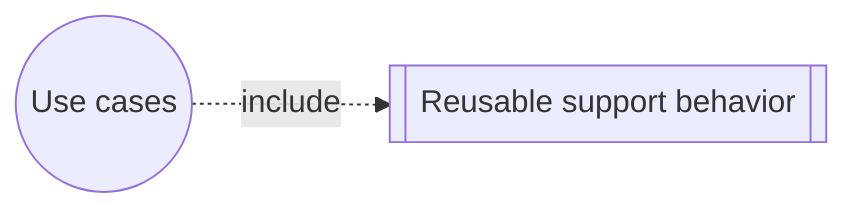

# Fragment: support

## Capabilities

- generate-ideation-guidance
- match-guidance-to-enabled-addons
- guide-domain-modeling
- find-existing-scenarios
- measure-coverage-per-project
- verify-repository-ownership
- coverage-readme-example
- route-a-change
- show-coverage-in-the-readme
- refresh-generated-guidance
- review-architecture-documentation
- instruction-integrity
- choose-project-license
- adr-qualification-gate
- attribute-commits
- enable-commit-attribution
- detect-the-project-repository
- customize-the-lifecycle-graph
- rules-policy
- local-only-transition
- publication-cleanliness

## Interactions

| Capability | Consumer action | E2E scenario |
|---|---|---|
| instruction-integrity | resolve an instruction and expose the machine contract | An agent requests machine-readable artifact guidance |
| instruction-integrity | request normal session-start instructions | Author starts a session with the universal dialog obligation |

## Diagram

<!-- givn:base-sha256:bdeb83f73773a3536ceec513d87bf59ab336798b5b34f7f9f0d1c30645194bc5 -->
