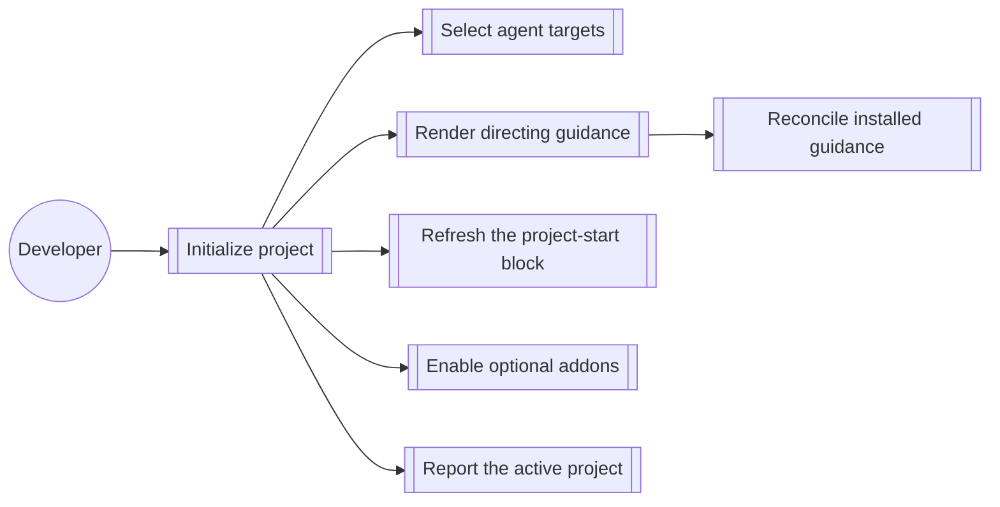

<!-- givn:base-sha256:175e4d9ef7fbf41de7e9f4163cf50f558a28dfae87fd24e02c7084d1b5885476 -->
# Use case: initialize-project

## Level

!

## Actors

- Developer
- Supporting: Authoring agent

## Goal

Set up a Givn project and its agent integrations.

## Trigger

The developer initializes a project or re-synchronizes the agent
integrations.

## Preconditions

- The project directory is writable.
- The active version-control system is detected when one exists.

## Main flow

1. The developer selects at least one agent target — the interactive list
   opens with `.opencode` marked and re-asks when nothing is marked; the
   system writes generated guidance only to the selected targets and reports
   what was skipped and why.
2. The system renders each selected target's skill and command as a direction
   to the served instruction: trigger metadata, invocation-specific
   orchestration, and the call to `givn instructions <id>`; no built-in rule
   content is copied.
3. The system reconciles installed guidance: a full copy from an earlier
   version is rewritten to carry the direction, a disabled addon's files are
   removed, and a project-owned replacement stays byte-for-byte.
4. The system refreshes the managed project-start block: the direction to
   `givn instructions`, the dialog-policy obligation, and the task-checkoff
   and commit-message obligations rendered from the canonical source that
   `givn instructions` serves.
5. The developer enables optional addons; the system records the choice.
6. The system reports the detected version-control system and installs the
   attribution plumbing only where it works, naming what was skipped.

## Extensions

- 1: no version-control system exists → the system scaffolds the corpus, generates guidance, exits 0, and warns that archive and managed upgrade are unavailable; protects the success guarantee.
- 1: the interactive confirmation marks no target → the system states that at least one agent target must be marked, shows the selection again, and proceeds only after a target is marked; protects the success guarantee.
- 1: a non-interactive answer or an `--agents` value resolves to no known target → the system refuses with an error naming the valid agent targets, exits non-zero, and writes nothing; protects the minimal guarantee.
- 2: a step has no installed file for the target → the system writes only the files the target owns and the report names what was skipped; protects the success guarantee.
- 3: a project-owned skill or command replacement exists → it is preserved byte-for-byte and receives no injected text; protects the success guarantee.
- 3: an addon is disabled → its generated files are removed; protects the success guarantee.
- 6: the active version-control system lacks a capability (for example transparent attribution hooks) → the report and the generated guidance state the limitation instead of naming a command that would fail; protects the success guarantee.

## Rules

- Initialization without a version-control system does not refuse; it warns.
- Initialization requires at least one selected agent target.
- Generated guidance may name only commands that work in the active project.
- The installation report names what was installed, what was skipped, and why.
- Optional addons are enabled or disabled by explicit user decision.
- A generated file carries trigger metadata, invocation-specific orchestration, and the direction to the served instruction only — subagent boundaries, stop conditions, reporting; rule content comes from the guidance request.
- Every direction names an instruction id that resolves in the same Givn version or a later one.
- Reconciliation never overwrites a project-owned replacement and never injects text into it.
- The managed project-start block requires the effective dialog policy independently of optional addons and preserves human-authored instructions outside that block.
- The managed project-start block renders its task-checkoff and commit-message obligations from the canonical source that `givn instructions` serves; the block's text and the served instruction cannot disagree.
- Resynchronization refreshes the managed policy obligation without duplicating the block or changing the selected agent targets.
- Fresh delegated contexts receive the obligation explicitly; the presenting agent remains responsible for user-facing questions.
- Setup changes no workflow behavior: same targets, same files, same commands.
- The generated content stays technology-agnostic; project-specific guidance arrives only through extensions.

## Examples

- Git: `givn init` writes `.githooks/commit-msg`, chains an existing hook, generates skills, and reports `commit attribution: .githooks/commit-msg`. The agent then commits with `givn commit -m "feat: parser"` or raw `git commit`; both carry attribution.
- Fossil: `givn init` scaffolds `givn/`, writes no hook, and reports `commit attribution: givn commit path only`. `givn commit -m "feat: parser"` stamps the check-in comment; raw `fossil commit` does not, and the managed project-start block states that.
- No SCM: `givn init` exits 0 with a warning that archive and managed upgrade are unavailable; skills are generated; a later `givn archive` refuses by name.
- Addon-free initialization still installs the managed dialog obligation beside existing human-authored project instructions; resynchronization updates only the managed block.
- No agent target: the interactive prompt opens with `.opencode` marked; a confirmation that marks nothing prints an error naming the requirement and shows the list again. A scripted `givn init` without `--agents`, an empty answer, or an unknown-only value exits non-zero, names `.opencode`, `.agents`, `.claude`, and leaves the project unchanged.
- Direction: `givn init` writes `.opencode/skills/givn-propose/SKILL.md` as a file that names `givn instructions proposal`; the rules arrive only when the agent pulls them.
- Existing full copy: a file from an earlier version that carries the rules is rewritten to carry the direction on the next `givn skills sync`.

## Minimal guarantee

The project remains unchanged when an invalid request is rejected, and no
generated guidance names a command that cannot work in the active project.

## Success guarantee

The project is initialized with the chosen agent integrations, and every
selected target's generated guidance leads an agent to the effective
instructions for its step while carrying no duplicated built-in rules.

## Personas

- developer--primary-user
- agent--technical-role
- givn-maintainer--owner

## Capabilities

- initialize-a-project
- enable-optional-addons

## Interactions

| Capability | Consumer action | E2E scenario |
|---|---|---|
| initialize-a-project | select agent targets in the interactive terminal | Consumer selects agent targets during interactive init |
| initialize-a-project | initialize with an explicit noninteractive target selection (SCM backend and no-SCM are precondition variants) | Consumer runs init non-interactively and gets opencode skills |
| initialize-a-project | resynchronize selected targets | Consumer re-syncs skills after init and the selection is honoured |

## Includes

- fragment: support

## Extends

- none

## Out of scope

Changing an existing project's configuration without a request; implementing
the product behavior described by a change (`create-change`).

## Diagram

