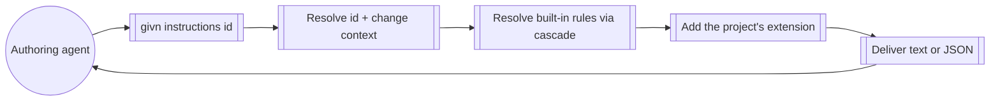

# Use case: obtain-effective-guidance

## Level

!

## Actors

- Authoring agent
- Supporting: Developer (manual reading)

## Goal

Obtain the rules governing the work at hand, extended with the project's
extension.

## Trigger

The authoring agent requests the guidance for an instruction id
(`givn instructions <id> [--change <id>] [--json]`), typically because an
invoked skill or slash command directs it there; the developer may request
the same id manually.

## Preconditions

- The project is initialized as a Givn project.
- For an artifact instruction, exactly one change context resolves: the explicit `--change`, or the single active change.

## Main flow

1. The authoring agent requests the guidance for an instruction id; the
   system resolves the id as an artifact, a policy, or a step.
2. For an artifact instruction, the system resolves the change context
   (explicit `--change`, or the single active change).
3. The system resolves the built-in rules through the project-overrides-first
   cascade (project replacement, then embedded, then addon).
4. The system loads and validates the project's configured extension for
   that id, then adds it after the built-in rules under a marked section; a
   rejected entry warns and is skipped, and the built-in rules stay
   unmodified.
5. The system delivers the effective content on the requested path — text or
   machine-readable — with identical content.
6. The agent follows the extended rule for its step.

## Extensions

- 1: the id is unknown → the system refuses by name and lists the known ids; protects the minimal guarantee.
- 2: multiple active changes and no `--change` → the system refuses and names the boundary; protects the minimal guarantee.
- 2: no active change and no `--change` for an artifact instruction → the system refuses and names the missing context; protects the minimal guarantee.
- 4: no extension exists for the id → the built-in rules are served alone; the call is valid and unchanged.
- 4: a configured entry is rejected while the guidance is resolved (unknown id, or a malformed, empty, or whitespace-only rule) → the entry is skipped with a warning and the request serves the built-in rules alone for it; nothing is mutated.
- 5: the machine-readable path is requested → the same extended content is carried as `instruction` alongside `id`, `generates`, `requires`, and `skill_to_load`.

## Rules

- The served content is the extended rule: the built-in rules resolved from the canonical asset (or the project's replacement of the instruction facet) plus the project's extension when one exists.
- An extension never overrides, suppresses, or reorders the built-in rules.
- The text path and the machine-readable path carry the same effective content, extensions included.
- Improved built-in rules are served at the next request after an upgrade; no project action and no synchronization is needed.
- A request never mutates project state: it resolves configuration and content and prints. A rejected configuration entry warns and is skipped; the request still succeeds and serves the built-in rules alone for it.
- The unknown-id refusal, the change-context rules, and the machine contract shape are unchanged.
- The built-in rules stay technology-agnostic; project-specific guidance arrives only through the extension.

## Examples

- An extension exists: the project records "Keep proposals under 500 words" for the proposal instruction. The agent runs `givn instructions proposal --change add-user-auth` and receives the built-in proposal rules followed by the marked section carrying the project's line.
- No extension exists: `givn instructions specs --change add-user-auth` serves the built-in rules alone.
- Unknown id: `givn instructions propozal` exits non-zero with the unknown-artifact error naming the known ids; no project state changes.
- Machine-readable: an agent requests the same proposal id with `--json` and finds the project's line inside `instruction`.

## Minimal guarantee

A request never modifies project state. A request that cannot be satisfied
refuses and names what is missing — the unknown id, the ambiguous change
context, or the absent change; a rejected configuration entry is skipped
with a warning and the request serves the built-in rules alone for it.

## Success guarantee

The caller holds the extended rule for the requested id: Givn's built-in
rules as the canonical asset (or the project's replacement) defines them,
plus the project's extension when one exists — identical on the text and
machine-readable paths.

## Personas

- agent--technical-role
- developer--primary-user

## Capabilities

- serve-extended-rules

## Interactions

| Capability | Consumer action | E2E scenario |
|---|---|---|
| serve-extended-rules | request effective instructions by id (artifact, general policy, JSON, and change context are variants) | An agent receives the extended rules through the Givn CLI |

## Includes

- fragment: support

## Extends

- none

## Out of scope

The cascade resolution mechanics, override precedence, and reference
integrity (the instruction-integrity capability); recording, changing, or
removing the project's extensions (extend-an-instruction); generating and
refreshing installed guidance (initialize-project, upgrade-a-project);
session-start next-step guidance (inspect-change-state); changing the
built-in flow.

## Diagram

