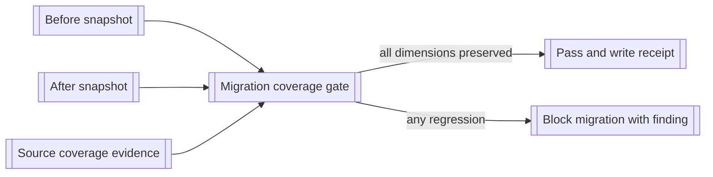

# Design: finalize-usecase-migration-release

## Overview

Extend the verification contract with executable migration-coverage scenarios,
complete the missing capability ownership in the active use-case narratives, and
finalize the release-owned migration bundle from Givn `0.5.0` to `0.6.0`.
Historical archives remain read-only. The Kiekste ideation topic remains
Handoff-pending.

## Use-Case Traceability

- Owning use case: `verify-change`
- Supporting use case: `maintain-project`
- Ideation source: none
- Confirmed Personas: none

| Use-case guarantee or rule | Technical decision | Evidence |
|---|---|---|
| A migration cannot lose behavior or E2E evidence | Compare canonical behavior identity and E2E state in the migration gate | Migration coverage scenarios |
| Interaction coverage cannot decrease | Count mapped interactions before and after and fail on a decrease | Lower interaction coverage scenario |
| Source coverage cannot decrease | Compare line and branch coverage ratios using cross-multiplication | Lower line and branch coverage scenarios |
| Every active capability has one explicit owner | Replace the incomplete `verify-change` and `inspect-change-state` narratives with complete capability lists | Use-case document deltas |
| Release guidance is reviewable and historical archives remain stable | Materialize the `0.5.0` to `0.6.0` bundle and update only active plan and release assets | Bundle and plan evidence |

## Technology Decisions

- Rust and the existing `cucumber-rs` feature runner remain unchanged.
- Migration fixtures use temporary initialized Givn projects and invoke the real
  `givn check migration` subprocess.
- Source coverage fixtures use the existing JSON evidence schema consumed by
  `src/spec/coverage.rs`.
- The release bundle directory becomes
  `assets/migrations/0.5.0-to-0.6.0/` and the catalog target becomes `0.6.0`.
- No compatibility alias or legacy `group.md` reader is added.

## Architecture Impact

Affected surfaces:

- `src/spec/coverage.rs` tests for migration regression dimensions.
- `tests/steps/workflow_enforcement_steps.rs` for temporary migration fixtures.
- `tests/steps/workflow_enforcement_e2e_steps.rs` for the real CLI smoke test.
- `tests/steps/mod.rs` module registration.
- `givn/specs/verify-change/usecase.md` and
  `givn/specs/inspect-change-state/usecase.md` ownership corrections.
- The active release migration assets and release plan.



## Step Definitions

| Capability | Step definition file |
|---|---|
| givn-workflow-enforcement | `tests/steps/workflow_enforcement_steps.rs` |
| givn-workflow-enforcement E2E | `tests/steps/workflow_enforcement_e2e_steps.rs` |

## Test Runner

Unit and feature verification:

```text
./run-tests.sh
```

Scoped feature verification:

```text
GIVN_FEATURES=givn/changes/finalize-usecase-migration-release/specs ./run-tests.sh
```

Single-scenario verification uses the same scoped feature path with
`cargo test --test features_runner -- --name "<scenario title>"` and the
development semantic fixtures configured by `run-tests.sh`.

The runner is strict through `GivnWorld::cucumber().fail_on_skipped()` in
`tests/features_runner.rs`. Undefined or pending steps therefore fail with a
non-zero exit. No empty step bodies are permitted.

## E2E Infrastructure

- E2E command: `./run-tests.sh --e2e`.
- Real interface: the installed Givn CLI subprocess in an isolated temporary
  project.
- E2E driver: `tests/steps/workflow_enforcement_e2e_steps.rs` invokes
  `givn check migration --change migration-test` and asserts the CLI output.
- Application server, database, message bus, browser, and third-party services:
  none.
- Digital twins: none; the CLI is the complete product boundary and migration
  evidence is deterministic local JSON.
- Interface obstacle: none. The subprocess receives the temporary project as
  its working directory and the fixture owns all evidence files.

## Interaction Coverage Matrix

| Inventory entry | @e2e scenario title | Real interface | Driving mechanism |
|---|---|---|---|
| run migration coverage check | Consumer runs migration coverage check and sees passed evidence | CLI | Rust Cucumber step launches the real `givn check migration` subprocess in a temporary project and reads stdout |

## Data and Evidence Contract

The migration change creates or validates:

- `coverage-before.json` and `coverage-after.json` snapshots;
- `coverage-comparison.json` receipts;
- `source-coverage-before.json` and `source-coverage-after.json` evidence;
- `source-coverage-comparison.json` receipts.

The existing checker remains responsible for writing comparison receipts and
blocking any behavior, E2E, interaction, line, or branch regression.

## Verify Commands

```text
./run-tests.sh
./run-tests.sh --e2e
```
