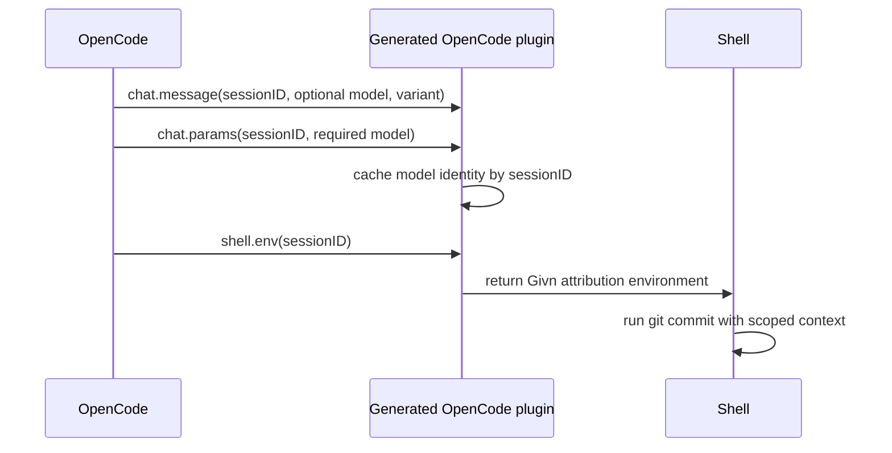

# Design: fix-opencode-llm-attribution

## Technical Decisions

The generated OpenCode plugin remains the owner of the OpenCode-to-Givn
attribution translation. Its `chat.params` hook will read the selected model
from the current OpenCode payload shape, where the provider and model IDs are
required on `input.model`. The optional `chat.message` hook also records model
and variant data when available. The session cache continues to be keyed by
`sessionID`.
The `shell.env` hook will continue to read that cache and expose the existing
Givn environment protocol. The Claude PreToolUse hook exports the context for
the entire Bash command instead of prefixing it with a one-process `env`
invocation. This keeps the variables in scope for compound commands and shell
wrappers such as RTK; the shared Git hook consumes them when the compound
command eventually invokes Git.

The plugin will use the provider/model pair as the model identity when both
IDs are available, and the model ID alone when the provider ID is absent. A
missing model remains non-blocking and preserves the existing unavailable-value
fallback. These fallback branches are existing behavior and are not changed by
this payload-shape correction.



The Claude PreToolUse integration will resolve the latest assistant model from
the `transcript_path` supplied in the hook payload. It will retain the existing
environment-variable fallbacks and the non-blocking `claude-code` fallback when
the transcript is unavailable or contains no model. This avoids claiming a
specific model from a static configuration value that may be stale after a
Claude `/model` change.

## Production Impact

- `assets/agent-integrations/opencode/givn-attribution.js`: read
  `input.model.providerID` and `input.model.modelID` from the current
  `chat.params` payload, with optional `chat.message` enrichment.
- `src/cli/attribution.rs`: resolve the Claude model from the latest assistant
  record in the hook payload's transcript before environment fallbacks.
- `src/cli/attribution.rs`: stamp only the managed `Co-Authored-By` trailer,
  remove stale legacy Givn trailers, and export Claude context across the full
  Bash command.
- No persisted data or new Git hook is introduced; the existing hook consumes
  the context when available.

The generated asset is already embedded and synchronized by
`src/skills/targets.rs`; changing the checked-in asset updates future project
initialization and synchronization without adding another generation path.

## Test Design

The executable scenario is bound in the existing capability-specific E2E step
file:

```text
tests/steps/llm_attribution_e2e_steps.rs
```

The steps create temporary projects and initialize the real Givn CLI with the
relevant target. The OpenCode scenario invokes the generated plugin module
through Node.js latest LTS. The Claude scenario invokes the generated hook
script with a real PreToolUse payload and executes its returned `env ... git
commit` command in a temporary Git repository. Commit identity and message are
the primary assertion surfaces. No external service or digital twin is
required; the only runtime dependency beyond the compiled CLI is Node.js for
the OpenCode integration.

The test runner is `./run-tests.sh`, which executes the repository's
Cucumber-rs feature suite and uses `.fail_on_skipped()` in
`tests/features_runner.rs` as strict mode. The E2E runner is
`./run-tests.sh --e2e`.

The single-scenario command is:

```sh
GIVN_FEATURES=givn/changes/fix-opencode-llm-attribution/specs cargo test --test features_runner -- --name "OpenCode prepares attribution using its selected model"
```

The full change-scoped E2E command is:

```sh
GIVN_FEATURES=givn/changes/fix-opencode-llm-attribution/specs ./run-tests.sh --e2e
```

Undefined or skipped steps fail through `.fail_on_skipped()`. New step bodies
start as `unimplemented!()` during RED and are removed only after the real
plugin execution passes.

## Interaction Coverage Matrix

This delta extends a reusable support fragment. The owning fragment carries no
consumer interaction inventory; its E2E scenario is direct generated-plugin
boundary evidence. Existing commit-attribution interactions remain owned by
the historical support contract and are not duplicated in this fragment delta.

| Inventory entry | @e2e scenario title | Real interface | Driving mechanism |
|---|---|---|---|
| Create a commit while attribution context is available | An attributed commit exposes the current LLM and harness | Git CLI | Rust Cucumber steps invoke the real Git commit hook and inspect the resulting commit message and committer |
| Prepare a shell command from an OpenCode session with a selected model | OpenCode prepares attribution using its selected model | Generated OpenCode plugin module | Node.js latest LTS imports the generated module, dispatches `chat.message` and authoritative `chat.params`, then dispatches `shell.env` for the same session and inspects returned environment values |
| Prepare an RTK-wrapped Bash commit command from a Claude session with a current model | Claude attributes a commit using its current model | Claude Code PreToolUse hook, RTK shell wrapper, and Git CLI | The generated hook receives a real JSON payload with `transcript_path`, rewrites the Bash command, and the test executes that returned RTK-wrapped command before inspecting the Git commit |

## Use-Case Traceability

| Use-case guarantee or rule | Design decision | Capability | E2E evidence |
|---|---|---|---|
| An agent harness exposes the attribution context active for a commit | Read the provider/model pair from the current OpenCode params payload and retain it by session | llm-attribution fragment | OpenCode supplies a selected model and the plugin returns its model identity |
| The commit records available context without blocking normal work | Preserve the existing environment protocol and missing-model fallback | llm-attribution fragment | The shell environment is returned by the real generated plugin without error |
| A reviewer can inspect the model identity through native commit attribution | Keep `GIVN_ATTRIBUTION_LLM` and `GIT_COMMITTER_NAME` formats unchanged | llm-attribution fragment | Returned environment contains the existing LLM and committer values |
| A Claude harness exposes the current model for a commit | Read the latest assistant model from the hook payload transcript | llm-attribution fragment | The generated Claude hook produces a real attributed Git commit |
| Confirmed Personas | None | llm-attribution | No Persona review lens applies |

## Local Runnability

The local verification command is `./run-tests.sh`. This capability has no
application server, database, network dependency, or third-party service, so
no isolated service network or digital twin is required. The interface obstacle
are JavaScript module loading for a generated `.js` plugin and deterministic
Claude transcript input; the tests create the temporary project boundary and
drive each generated integration through its actual hook/module interface.
