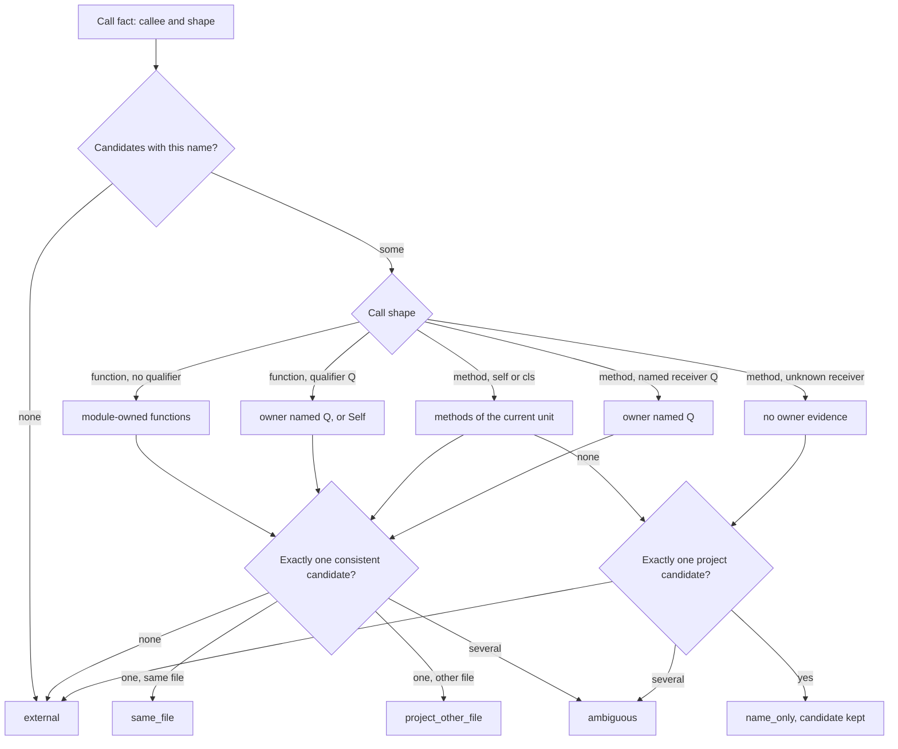

# Design: fix-outline-report-fidelity

## Context

`givn outline report` is one neutral pipeline: adapters produce an
`Analysis`, a shared pass resolves calls, shared metrics and classification
add hints, and one renderer writes human text or schema-v3 JSON. The six
reported defects live at three seams: adapter facts (call shape, member
types, signatures, inline-test spans), the shared resolver (certainty it does
not have), and rendering/evidence (false comparisons, missing targets,
whole-file counts). This design fixes each seam once, so the Rust and Python
adapters cannot drift apart.

The report and the `outline-review-gate` capability share `render_outline`,
so call tags printed by the gate change with the renderer. The gate's
touched-unit selection is also corrected to units with at least one method,
because module outlines now carry type items. No verdict, threshold, or
blocking rule changes.

## Decisions

The proposal records no open questions. These are the design decisions that
realize its six corrections; no decision is carried or unresolved.

- **Decides D1 — Call-shape facts are language-neutral and mandatory.**
  Every adapter supplies `CallShape` for each call (free or associated
  function with an optional path qualifier, or method with receiver evidence:
  `self`/`cls`, a named owner, or unknown). The shared resolver may claim
  `same_file` or `project_other_file` only when the resolved owner is
  compatible with that evidence; an unknown receiver caps the claim at
  `name_only` (or `ambiguous`/`external` when the candidate count does not
  allow one). A named receiver that names a type but whose only candidate is a trait
  declaration becomes `name_only`, not `external`, because the implementor
  relation is not proven. The per-language shape derivation is normative and lives in the
  shape table below. — Realized in `src/outline/model.rs`,
  `src/outline/resolve.rs`, `src/outline/syn_adapter/facts.rs`,
  `src/outline/python_adapter/extractor.py`, and
  `src/outline/python_adapter/mod.rs`.
- **Decides D2 — `name_only` is auditable but not expanded and not
  cohesive.** A `name_only` call keeps the unique candidate target so a reader
  can inspect the guess; the human tree renders it as a leaf. A resolved call
  nests, and contributes to LCOM4, only when its target belongs to the same
  unit and its resolution is `same_file` or `project_other_file`. A
  same-unit method implemented in another file is labelled
  `project_other_file` and still nests. An unevidenced edge never counts as
  cohesion, so a corrected input may change an individual unit's
  classification (for example `cohesive-large-type` to `god-type`); the
  classification rule set and thresholds are unchanged. — Realized in
  `src/outline/resolve.rs`, `src/outline/report.rs::render_calls`, and
  `src/outline/metrics.rs::cohesion`.
- **Decides D3 — Evidence lists only fired predicates.** Each classification
  branch constructs its evidence from the predicates that were true; no
  evidence line records an untested comparison. — Realized in
  `src/outline/classify.rs`.
- **Decides D4 — Module outlines list declared member types.** Both adapters
  construct `OutlineKind::Type` items for every type the module file
  declares; the existing renderer and JSON writer already handle them. Type
  items carry no signature and no calls, and do not enter the method index.
  Because a module outline can now be non-empty without a method, the review
  gate selects a touched unit with at least one method
  (`unit.metrics.methods > 0`), not any non-empty outline. — Realized in
  `src/outline/syn_adapter/file_builder.rs`,
  `src/outline/python_adapter/mod.rs`, and `src/outline/gate.rs`.
- **Decides D5 — The call graph is auditable in both renderings.**
  JSON call objects add `target` (the resolved method id or `null`); human
  tags lead with the resolution label. Schema version stays **3**: a field is
  added and existing labels/values are corrected, no field is removed or
  renamed. — Realized in `src/outline/report.rs`.
- **Decides D6 — Production-only accounting is span-based.** An analyzed
  file records the spans of excluded test items; every line count subtracts
  them. File code lines exclude them. A unit's physical lines are the union
  of its own spans minus the excluded spans, not its containing files. Unit
  code lines are code lines inside the unit's spans minus the excluded spans.
  A Rust module's spans cover its declarations, impls, and functions, so its
  physical lines omit unrelated `use`/`const` lines; file physical lines
  remain the whole file. — Realized in `src/outline/model.rs`
  (`AnalyzedFile.excluded_spans`), `src/outline/syn_adapter/file_builder.rs`,
  `src/outline/python_adapter/mod.rs`, `src/outline/scan.rs`,
  `src/outline/metrics.rs`, and `src/outline/report.rs`.
- **Decides D7 — Signatures render the whole type shape.** Rust renders from
  `syn::Type` recursively (paths, generic arguments, references, tuples,
  slices, arrays, pointers, trait objects, impl trait, never, infer); no new
  dependency and no `quote`. Python already uses `ast.unparse` and is
  unchanged. — Realized in `src/outline/syn_adapter/syntax.rs`.
- **Decides D9 — The existing runner executes the delta.** `verify.command`
  and `verify.e2e_command` are unchanged; a single scenario is filtered by
  the anchored name regex through the plain-cargo cucumber path with
  `GIVN_FEATURES` scoped to the change. — Realized in the Test Strategy
  section.
- **D8 is withdrawn.** The hardening removed the proposed second `@e2e` and
  its inventory row. The resolution labels are asserted by regular scenarios;
  the capability keeps its one permanent e2e action, and the delta adds no
  new interaction. The identifier stays vacated so D9 and earlier references
  remain stable.
- **ADR verdict: no candidate (NOT_QUALIFIED).** The choices are local to the
  outline component, reversible within this change, and the report behaviour
  is owned by `assess-code-structure` Gherkin plus this design. ADR-074
  already owns the analyzer port and its Qualification evidence assigns
  change-scoped model fields, metric formulas, and rendering mechanics to
  `design.md`. Routing is `CANONICAL_ARTIFACT` → `design.md`; ADR-074 is not
  amended.
- **Version verdict: schema 3, rules 1.** Schema stays 3 because no field is
  removed or renamed and the document shape is not broken. Rules stay 1
  because thresholds and classification rules are unchanged. The LCOM4
  *inputs* are corrected so that an unevidenced edge no longer counts as
  cohesion; that is a correction of the measured evidence, not a tuning of
  the rule set, so it is not a rules-version event.

## Use-case traceability

| Use-case element | Technical decision | Scenario / E2E evidence |
|---|---|---|
| Goal: see the structure of a codebase and the units that are findings | D1, D2, D3 | The correction scenarios below; the existing classified-units e2e stays the capability's one e2e action |
| Main flow 2: same-unit calls nest under the caller; calls to another component are leaves tagged with the target | D1, D2, D5 | `A call on the unit's own receiver resolves within the unit`; `A same-unit method implemented in another file is project_other_file`; `A name-only guess is not expanded as a same-unit call`; `A developer reads each call's resolution in the human report` |
| Rule: the report leads with the per-component call tree, without data | D4, D5 | `A Rust module outline lists the types it declares`; `A Python module outline lists its classes`; `A module outline interleaves member types and free functions in source order` |
| Rule: the report is deterministic and offline | D1, D4, D7 | No new I/O, clock, network, or iteration-order source; adapters sort as today |
| Rule: the report format is independent of the analysis engine | D1, D2, D4, D7 | Both adapters supply the same neutral call shape and type items; fixtures cover Rust and Python |
| Success guarantee: a complete report for production sources | D4, D6, D7 | Module member types; file and unit production-only line counts; signature fidelity |
| Rule: finds no action or recommendation | D3, D5 | Evidence stays factual; no recommendation field or text is added |
| Capability `outline-report` ownership | D1–D7, D9 | All delta scenarios live under `givn/specs/assess-code-structure/`; the delta adds no interaction |
| Persona `developer--primary-user` | D1, D2, D5, D7 | Reads a call tree whose certainty labels and signatures are trustworthy |
| Persona `agent--technical-role` | D5, D6 | Uses JSON `target` and production-only line counts without re-deriving them |
| Persona `givn-maintainer--owner` | D1–D7 | Audits resolver evidence and adapter parity through one neutral model |

## Architecture impact

No new module, binary, command, dependency, or configuration key. The
existing neutral analyzer port (ADR-074) carries three additional facts:
call shape, excluded test spans, and member type items. The CLI surface,
exit codes, addon gate, and output paths are unchanged. The review gate's
touched-unit selection changes from a non-empty outline to at least one
method, so a module that declares only types still needs no verdict.



### Contracts and Components

| Contract | Consumer use case | Consumers | Implementing component today | Split trigger |
|---|---|---|---|---|
| `SourceAnalyzer` (ADR-074): neutral `Analysis` plus capabilities | assess-code-structure (outline report); verify-change (outline review gate) | `outline::analyzer` orchestration | `SynAnalyzer`, `PythonAnalyzer` | an adapter needs analysis the neutral model cannot express without parser types |
| Outline call tree: text and JSON from one classified model | assess-code-structure | `cli::outline` report handler; `outline::gate` renderer | `outline::report` | the report and the gate need different evidence or ordering |

The contract surface grows by one neutral enum (`CallShape`) and one file
field (`excluded_spans`); no consumer gains a new method, and the component
split remains premature.

### Files and modules

| Path | Change |
|---|---|
| `src/outline/model.rs` | Add `CallShape`, `ReceiverEvidence`; add `shape` to `Call`; add `excluded_spans` to `AnalyzedFile`. |
| `src/outline/resolve.rs` | Replace name-first precedence with shape-consistent resolution; keep outline/method call sync. |
| `src/outline/syn_adapter/facts.rs` | Emit a call shape from `ExprMethodCall`/`ExprCall` per the shape table; keep macro-argument visiting; derive the qualifier from the path segments before the callee. |
| `src/outline/syn_adapter/syntax.rs` | Replace the last-segment `type_label` with a recursive faithful type renderer. |
| `src/outline/syn_adapter/file_builder.rs` | Record `#[cfg(test)]` item spans, including impl-level test methods; build module outline type items. |
| `src/outline/python_adapter/extractor.py` | Emit `{callee, kind, receiver/qualifier}` per call; drop the `ast.unparse` callee fallback. |
| `src/outline/python_adapter/mod.rs` | Map call-shape JSON; build module outline class items; set `excluded_spans` empty; advertise `name_only`. |
| `src/outline/classify.rs` | Construct evidence per fired predicate. |
| `src/outline/metrics.rs` | Span-scoped code and physical lines with excluded spans subtracted; LCOM4 unions only same-unit, evidenced method edges. |
| `src/outline/scan.rs` | Helpers for production code lines and span line counts outside excluded spans. |
| `src/outline/report.rs` | JSON call `target`; resolution label in human tags; production file code lines; nest on same-unit membership plus an evidenced resolution. |
| `src/outline/gate.rs` | Select touched units with `unit.metrics.methods > 0` instead of `!unit.outline.is_empty()`; regression test for a module with only type items and for a module with free functions. |
| `src/outline/report.rs` unit tests, `src/outline/resolve.rs` unit tests | Update the call-tag and target expectations to the corrected resolution; rewrite the resolver test around call shapes, including a table test for every shape row. |
| `tests/steps/outline_report_steps.rs` | New regular given/then bindings for the non-e2e scenarios; update the existing call-tag expectations (`[public, OrderBook] add` → `[same_file, public, OrderBook] add`, `[public, module] normalize` → `[same_file, public, module] normalize` for the same-file fixture, `[private, module] helper` → `[same_file, private, module] helper`). |
| `tests/steps/outline_report_e2e_steps.rs` | No change: the delta adds no e2e step; the permanent e2e keeps its assertions. |
| `tests/steps/outline_report_support.rs` | New fixtures and expected-count constants; fixture roots use `common::make_init_root` where a project plus addon is needed and `common::make_bare_root` only for in-process assessment. |
| `docs/outline.md`, `docs/arc42/01-introduction-and-goals.md`, `03-context-and-scope.md`, `04-solution-strategy.md`, `05-building-block-view.md`, `06-runtime-view.md` §6.19, `08-crosscutting-concepts.md`, `10-quality-requirements.md`, `11-risks-and-technical-debt.md`, `12-glossary.md`, `docs/arc42/README.md` | Documentation corrections listed below; `arc42.md` records the 12-row assessment. |
| `README.md` | Summarize declared member types and the resolution label in the outline bullet. |
| `givn/specs/assess-code-structure/usecase.md` | State that a module outline lists its declared member types; the interaction table is unchanged (the delta adds no interaction). |

The fake and hand-built `AnalyzedFile` literals
(`tests/steps/outline_report_support.rs`, the `src/outline/report.rs` tests,
the `src/outline/resolve.rs` tests, and the four `python_adapter/mod.rs`
sites) gain `excluded_spans: Vec::new()` with the new field.

## Data model

### Call shape and resolution

```rust
#[derive(Clone, Debug, PartialEq, Eq)]
pub enum CallShape {
    Function { qualifier: Option<String> },
    Method { receiver: ReceiverEvidence },
}

#[derive(Clone, Debug, PartialEq, Eq)]
pub enum ReceiverEvidence {
    SelfUnit,          // self, &self, &mut self, Self::method, cls
    Qualifier(String), // a named owner: Foo::bar(), Foo.bar(), Cls.method()
    Unknown,           // arbitrary expression, field receiver, attribute chain, inferred value
}

pub struct Call {
    pub order: u32,
    pub callee: String,
    pub shape: CallShape,
    pub resolution: Resolution,
    pub target: Option<MethodId>,
}
```

`Resolution` keeps its six values. `dynamic` remains reserved for dispatch
the static analysis cannot see; this change adds no new producer for it.

The shape is derived from syntax alone; no adapter consults imports, inferred
types, or a symbol table.

| Language | Call form | Derived shape |
|---|---|---|
| Rust | `self.method()` where the receiver is `self` (`&self`, `&mut self`, or `self`) | `Method { SelfUnit }` |
| Rust | `Self::method()` | `Function { Some("Self") }` |
| Rust | `Type::method()`, `crate::module::function()`, `super::module::function()`; the qualifier is every path segment before the callee, joined with `::` | `Function { Some(qualifier) }` |
| Rust | Turbofish `Type::<T>::method()` | `Function { Some("Type") }`: generic arguments are stripped from every segment |
| Rust | Qualified self `<T as Trait>::method()`; with `qself` the path segments before the callee are the trait path | `Function { Some("Trait") }` (the last segment before the callee); for the inherent form `<T>::method()` the qself type `T` is the owner |
| Rust | Bare `foo()` | `Function { None }` |
| Rust | Method call whose receiver is any other expression: `Expr::Field` (`self.engine.start()`), `Expr::Call`, `Expr::Index`, `Expr::MethodCall`, `Expr::Paren`, `Expr::Reference`, `Expr::Unary`, `Expr::Macro`, `Expr::Await`, `Expr::Try` | `Method { Unknown }` |
| Rust | A call recovered from an expression-list macro argument (`format!`, `println!`, `vec!`) | The same derivation as an ordinary call; it belongs to the enclosing method |
| Python | Bare `Name` | `Function { None }` |
| Python | `self.method()` or `cls.method()` inside a class method | `Method { SelfUnit }` |
| Python | `Attribute` over a single `Name` whose first character is uppercase (`OrderBook.add()`) | `Method { Qualifier("OrderBook") }`: a class-name convention, not proof |
| Python | `Attribute` over a single `Name` whose first character is lowercase (`module.func()`, `obj.method()`) | `Method { Unknown }`: a module and an instance are not distinguishable syntactically, so the claim is capped at `name_only` |
| Python | `Attribute` over `Attribute`, `Call`, or `Subscript` (`self.engine.start()`, `factory().start()`) | `Method { Unknown }` |
| Python | A callee that is not a `Name` or `Attribute` | Not recorded: the `ast.unparse` fallback is removed, so the adapter does not fabricate a callee name |

The Rust adapter never mints `Qualifier` from an `ExprMethodCall` receiver: a
Rust method receiver is always a value, so a path value is not a type name.
The Python uppercase rule is explicitly a heuristic; the resolver treats a
`Qualifier` from Python as weaker evidence than a Rust path (see below).

### Resolution rules

The resolver indexes production methods by callee name and language. Its
internal candidate record gains the owner's unit id, unit kind, unit name,
and module path so shape compatibility can be checked without a second
lookup. It then applies the shape evidence:

| Call shape | Compatible owner | Resolution |
|---|---|---|
| `Function { qualifier: None }` | a module unit (free function) | one: `same_file` if the target's file equals the caller's file, else `project_other_file`; several: `ambiguous`; none: `external` |
| `Function { qualifier: Some(q) }` | an associated function of a type or trait named `q`, a module whose last module-path segment is `q`, or the current unit when `q` is `Self` | one: `same_file` / `project_other_file` by file; several: `ambiguous`; none: `external` (a contradictory explicit qualifier is never a guess) |
| `Method { receiver: SelfUnit }` | a method of the current unit | one: `same_file` if the target's file equals the caller's file, else `project_other_file`; none: `name_only` with the unique project candidate, `ambiguous` for several, `external` for none |
| `Method { receiver: Qualifier(q) }` | a method of a type or trait named `q`, a module function in a module whose last segment is `q`, or the current unit when `q` is `Self` | one: `same_file` / `project_other_file` by file; several: `ambiguous`; none: a trait-only unique candidate becomes `name_only`; otherwise `external` |
| `Method { receiver: Unknown }` | no owner evidence | `name_only` with the unique project candidate, `ambiguous` for several, `external` for none |

A qualifier may match a project owner only when it is a single segment or
starts with `crate`, `self`, or `super`. A multi-segment path qualifier such
as `std::line::Line` or `std::mem` therefore never matches a project `Line`
or `mem`, and resolves `external`.

A Python `Qualifier` is a naming convention, not syntax: when no owner
matches it, a unique project candidate becomes `name_only` rather than
`external`; several become `ambiguous`; none stays `external`. A Rust
qualifier is syntactic, so no matching owner is `external`.

When a named receiver names a type but its only candidate is a method
declared by a trait, the result is `name_only` with that candidate, because
the implementor relation that would prove the owner is not available to the
resolver. A contradictory explicit qualifier still
becomes `external` when no candidate can own it.

Several compatible candidates are always `ambiguous`. Compatibility never
upgrades an unknown receiver: a `.is_empty()` call on a local value stays
`name_only` even when the current unit happens to declare `is_empty`.

The resolution label compares the target method's file with the caller
method's file. It is not the nesting predicate:

- A resolved call nests when `target.unit_id` equals the current unit id and
  the resolution is `same_file` or `project_other_file`.
- A same-file call to a different unit is a leaf even though it is labelled
  `same_file`.
- A same-unit method implemented in another file is labelled
  `project_other_file` (the files differ) and still nests.
- `name_only` never nests, even when the candidate belongs to the caller's
  unit.

LCOM4 uses the same predicate: only a method–method edge whose target is in
the unit and whose resolution is `same_file` or `project_other_file` unions
two methods. An unevidenced `name_only` edge never contributes cohesion.

`name_only` keeps the unique candidate target. `ambiguous` and `external`
carry no target. `dynamic` carries no target.

### Production line accounting

`AnalyzedFile` gains `excluded_spans: Vec<SourceSpan>`. The Rust adapter
records the span of every `#[cfg(test)]` item it skips (module, item, or
impl method). The span starts at the first outer attribute of the skipped
item when present, so an attribute line is excluded with its item, and ends
at the item's closing line. Python records none because its test exclusion is
by file name.

`scan` exposes two helpers; both take the file's lines, the unit's spans, the
file's excluded spans, and the file path:

- `production_code_lines` = `LineKind::Code` lines inside the spans, outside
  every excluded span.
- `span_lines` = every line inside the spans, regardless of line kind,
  outside every excluded span.

The counts then are:

- `files[].code_lines` = `LineKind::Code` lines in the file, outside every
  excluded span (`scan::production_code_lines` with the whole-file span).
- `files[].physical_lines` = the whole file, unchanged.
- `units[].metrics.code_lines` = `scan::production_code_lines` over the
  unit's spans, so an impl-level `#[cfg(test)]` method inside a non-test impl
  is excluded from the unit's code lines.
- `units[].metrics.physical_lines` = `scan::span_lines` over the unit's
  spans, so the same test method is excluded from the physical count too.

A Rust module's spans cover its declarations, impls, and functions, so its
physical lines naturally omit unrelated `use`, `const`, and `static` lines; a
Python module's span covers its file, so its physical lines equal the file's
physical lines. File physical lines remain the whole file regardless.

### Outline type items

Both adapters append `OutlineItem` values with `kind: OutlineKind::Type`:

```rust
OutlineItem {
    id: unit_id,             // the member unit's id
    kind: OutlineKind::Type,
    name,
    visibility,
    signature: String::new(),
    order: declaration_start_line,
    calls: Vec::new(),
}
```

Rust derives them from the file's type units after the item walk; Python
derives them from the class units in the extractor result. Module outline
items are sorted by `(order, name)` so types and free functions interleave in
source order deterministically. Type items are ignored by `MethodIndex`, so
they cannot become call targets or affect nesting.

In JSON a type item has `kind: "type"`, an empty `signature`, and empty
`calls`; `kind` distinguishes it from a method item. In the human rendering
it prints as `type <Name>`. A module whose outline contains only type items
has `metrics.methods == 0`: the renderer prints it, but the review gate
selects touched units by method count, so it needs no verdict. A module with
at least one free function still needs one. A gate regression test covers
both cases, and a module that already had methods now prints its type items
in gate output as a visible but harmless text change.

### JSON call object

```json
{
  "callee": "normalize",
  "resolution": "project_other_file",
  "target": "component::normalize"
}
```

`target` is `null` for `ambiguous`, `external`, and `dynamic`, and for a
`name_only` call with no single candidate (which cannot occur under the
rules above, but the field is total). Schema version remains `3`; rules
version remains `1`.

## Classification evidence

Only predicates that are true in the selected branch become evidence.

| Classification | Fired predicate(s) | Evidence emitted |
|---|---|---|
| `interface` | trait and over readable size | `type-kind-trait = 1` |
| `interface` | more than 50 public methods (with or without the trait/size predicate) | `type-public-methods > 50` |
| `data-only` | struct/enum, at most one method, over readable size | `type-code-lines > 500`, `type-method-count <= 1` |
| `god-type` | over readable size and LCOM4 > 2 | `type-code-lines > 500`, `type-lcom4 > 2` |
| `god-type` | over readable size and TCC < 500 permille | `type-code-lines > 500`, `type-tcc < 500` |
| `cohesive-large-type` | over readable size, no earlier branch | `type-code-lines > 500` |
| `module` | over 1,000 code lines | `module-code-lines > 1000` |
| `multi-type-module` | 500–1,000 code lines and at least two declared types | `module-declared-types >= 2` |
| `module` | 500–1,000 code lines otherwise | `module-code-lines >= 500` |
| `method-length` | max method code lines > 100 | `method-code-lines > 100` |
| `method-length` | max method complexity > 50 | `method-complexity > 50` |

When both god-type cohesion predicates fire, both evidence lines are
emitted. When a finding is triggered by public methods only, the trait line
is absent; when it is triggered by complexity only, the length line is
absent. `Evidence.satisfied` stays `true` for every emitted line; the field
is retained because removing it would change the schema.

## Signature rendering

`type_label` becomes a recursive renderer over `syn::Type`:

- `Path`: every segment joined with `::`, including `Self`, leading `crate`,
  and angle-bracketed arguments (`Type`, lifetime, const, associated binding)
  rendered recursively; parenthesized `Fn` arguments rendered as
  `Fn(A, B) -> C`.
- `Reference`: `&`, optional lifetime, `mut`, element. `Ptr`: `*const` /
  `*mut`. `Tuple`: `(A, B)`, `(A,)`, `()`. `Slice`: `[T]`. `Array`:
  `[T; N]` for a literal, path, or a stable `_` fallback. `Paren`/`Group`:
  recurse. `Never`: `!`. `Infer`: `_`. `TraitObject`: `dyn A + B`.
  `ImplTrait`: `impl A + B`. `BareFn`: `fn(A) -> B`. `Macro`/`Verbatim`:
  the macro name plus token text.
- No new dependency: the renderer uses `syn` and the existing direct
  `proc-macro2` dependency for verbatim tokens.

Expected output: `fn from_config(&self) -> Result<Self, Error>`, and
parameters such as `raw: &[u8]`, `pair: (u32, String)`,
`config: *const Config`, `path: crate::config::Config`.

## Risks

The most likely failure is shape mis-derivation: a real project edge silently
becomes `external` or `name_only`, so the tree loses a nesting it used to
show and the reader trusts a thinner graph without noticing. The mitigation
is the normative shape table, one fixture and one scenario per shape, a
resolver unit test for every row of the resolution table (including the
qualifier-prefix rule and the Python convention fallback), and a before/after
`givn outline report` diff on this checkout to inspect every moved label.
A second risk is the inverted one: a Python `Qualifier` is a naming
convention, so an uppercase instance variable can still be read as a class;
it is capped at `same_file`/`project_other_file` only when an owner of that
name exists, and the label remains auditable. The gate selection change is
guarded by its regression test: a type-only module must not start requiring a
verdict.

## Test strategy

### Runner and commands

| Purpose | Exact command |
|---|---|
| Verification (regular scope) | `./run-tests.sh --non-e2e` |
| Verification (E2E scope) | `./run-tests.sh --e2e` |
| Single scenario | `GIVN_FEATURES=givn/changes/fix-outline-report-fidelity/specs cargo test --locked --test features_runner -- --name '^<exact scenario title>$'` |
| Compile check | `cargo check` |
| Lint | `cargo clippy --locked --all-targets -- -D warnings` |

`./run-tests.sh --non-e2e` is `verify.command`; it checks `cargo fmt`, runs
clippy, builds the ready fixture, then runs
`cargo nextest run --test features_runner` with
`GIVN_CUCUMBER_TAGS='not @e2e and not @givn.removed'`.
`./run-tests.sh --e2e` is `verify.e2e_command` and runs the same binary with
`@e2e and not @givn.removed`. `GIVN_FEATURES` is required for a delta-only
run because the runner defaults to `givn/specs/`. `GIVN_TEST_RUNNER=cargo`
is only needed when going through `run-tests.sh`; a direct `cargo test`
already takes the plain-cargo path, where `features_runner` parses
cucumber's default CLI and the `--name` regex filters the single scenario.
`--name` is a regex (`cucumber-0.23/src/cli.rs:93-99`), so the command
anchors it with `^...$` to select exactly one scenario. `cargo nextest`
would instead select by unit name, so the single-scenario command
deliberately uses `cargo test`.

### Strict mode

The runner is `cucumber-rs` through `tests/features_runner.rs`:

- `.fail_on_skipped()` on both the plain and nextest execution paths
  (`tests/features_runner.rs:55`, `:151`).
- The plain path exits 1 when `stats.failed > 0 || stats.skipped > 0`
  (`tests/features_runner.rs:64`).
- Undefined steps are reported as failures by cucumber-rs; no step body may
  be empty.

Proof task in the setup scenario: write a scratch feature whose only step is
undefined, run
`GIVN_FEATURES="<scratch-dir>" cargo test --locked --test features_runner -- --name "Undefined step fails"`,
and confirm a non-zero exit. Then run the same command against the delta
feature with all `@wip` scenarios and confirm the run is non-zero (pending is
not green).

### RED/GREEN loop and stub pattern

Each scenario's step bindings and its fixture are added together, in the
scenario commit. Only the bindings for the current scenario are added; the
whole step file is never filled in at once, and no binding references a
production symbol that does not exist yet, because a compile error in
`features_runner` would fail every scenario and hide the current RED.

- For the RED run, the binding body is a named panic stub (`unimplemented!`
  or a `panic!` with a message naming the expected observation), never an
  empty body, `todo!()`, a passing assertion, or `#[ignore]`. The stub keeps
  the scenario failing on a missing observation rather than on a compile
  error.
- The single-scenario command from the table is used with the anchored
  `^...$` name, so only the current scenario runs.
- Only after the RED is observed is the scenario's production change applied,
  then the same single-scenario command is rerun for the GREEN.
- Bindings read stdout or `serde_json::Value`; they never call a new
  production function directly. A behaviour is asserted on the observable
  report, so the steps need no production API.

### Step definitions and fixtures

One file per capability, as today:

- `tests/steps/outline_report_steps.rs` — new regular bindings:
  `unknown_receiver_call`, `json_call_resolution`, `json_call_target`,
  `json_call_no_target`, `human_call_label`,
  `name_only_call_is_not_expanded`, `self_receiver_call`,
  `named_receiver_call`, `ambiguous_call`, `cross_file_unit_call`,
  `contradictory_qualifier_call`, `tcc_god_type`,
  `report_records_evidence`, `report_records_no_evidence`,
  `complex_method`, `rust_module_with_types`, `interleaved_module`,
  `json_module_outline_lists_types`, `json_module_outline_order`,
  `python_module_with_classes`, `json_module_outline_lists_classes`,
  `inline_test_module`, `json_file_metric`, `span_scoped_unit`,
  `json_unit_metric`, `human_unit_metric`, `impl_level_test_method`,
  `signature_shapes`, `json_signature_contains`, `name_only_cohesion`, and
  `resolution_report_fixture` (the regular, multi-call human-report Given).
- `tests/steps/outline_report_e2e_steps.rs` — no change. The delta adds no
  `@e2e` scenario, so no transcript capture and no new e2e binding.
- `tests/steps/outline_report_support.rs` — fixture writers and constants:
  `write_unknown_receiver_call`, `write_self_receiver_call`,
  `write_named_receiver_call`, `write_ambiguous_call`,
  `write_cross_file_unit`, `write_contradictory_qualifier`,
  `write_tcc_god_type`, `write_cohesion_guess`, `write_complexity_method`,
  `write_module_with_types`, `write_interleaved_module`,
  `write_python_classes_module`, `write_inline_test_module`,
  `write_impl_level_test_method`, `write_span_scoped_unit`,
  `write_signature_shapes`, and `write_resolution_report` for the
  multi-call human-report fixture. Expected line counts live in named
  constants beside the fixture.

Fixture roots follow the existing rule: `common::make_init_root` when the
scenario needs a project plus the outline addon and a real `givn outline
report` subprocess; `common::make_bare_root` only for in-process assessment
scenarios that do not read the addon configuration. The regular
human-report fixture and every `givn outline report` scenario use
`make_init_root`.

All bindings reuse the existing vocabulary (`the developer runs "<cmd>"`,
`the outline report assesses the unit`, `the report classifies the unit as
...`) so the scenarios read as behaviour, not implementation.

#### Fixtures and exact constants

Method ids are the adapter-produced ids: the Rust module path of the
declaring file, the type, and the method (`src/engine.rs` →
`engine::Engine::validate`); a Python method id is its unit id plus the
method (`type:src/tracker.py::OrderBook::add`). Unit ids are
`type:<declaration path>::<Name>` and `module:<path>`. Every Then asserts one
of these exact ids; no `ends_with` shortcut.

| Fixture | Shape | Exact expectation |
|---|---|---|
| `src/tier.rs` | `TierReasoning { rank }` with public `is_empty` (calls private `probe`, which reads the field), private `probe`, public `classify` calling `value.is_empty()` on a `&Tier` parameter | `is_empty` → `name_only`, target `tier::TierReasoning::is_empty`; human tag `-> [name_only, public, TierReasoning] is_empty`; the next line is not a deeper-indented call line (today it prints `probe`); unit LCOM4 = 2 because the name-only edge does not connect `classify` (today 1) |
| `src/engine.rs` | `Engine { limit }` with `run` calling `self.validate()`, `validate` calling `Self::check(self.limit)`, associated `check` | `validate` → `same_file`, target `engine::Engine::validate`; `check` → `same_file`, target `engine::Engine::check` |
| `src/line.rs` | `Line { value }` with associated `from` (calling `Self::new`) and `new`; `Reader` calling `Line::from(1)` | `from` → `same_file`, target `line::Line::from`; unit `type:src/line.rs::Line` has 2 methods |
| `src/ambiguous.rs` | `Left::refresh` and `Right::refresh`; `Board::update` calls `value.refresh()` on a `&Left` parameter | `refresh` → `ambiguous`, no target |
| `src/engine_core.rs` + `src/engine_parts.rs` | `Engine` declared with `start`; a second-file impl adds `validate`, which calls `recheck` | `type:src/engine_core.rs::Engine`; `validate` → `project_other_file`, target `engine_parts::Engine::validate`; the human tree prints a deeper-indented `recheck` line under `validate`; unit `lcom4` = 1 |
| `src/mixed.rs` | free `alpha`, type `Beta`, free `gamma`, type `Delta` in that order | module outline is `alpha`, `Beta`, `gamma`, `Delta` in source order |
| `src/cohesion.rs` | `Engine` with `first` (505 filler `let _ = self.value;` lines, then `self.value`), `second` and `third` calling `other.probe()` on a `&Probe`, `probe` returning `0`; `Probe` is a unit type | unit `lcom4` = 4; classified `god-type`; evidence `type-lcom4 > 2` (today LCOM4 is 1 and the unit is `cohesive-large-type`) |
| `src/counted.rs` | 18-line file: production struct + impl (8 code lines) and an inline `#[cfg(test)] mod tests` of 8 lines | file `code_lines` = 8, file `physical_lines` = 18 (today the file code count is 15) |
| `src/scoped.rs` | 32-line file: `Scoped` declaration (3) + impl (5) and a 22-line unrelated function | unit `type:src/scoped.rs::Scoped`: `physical_lines` = 8, `code_lines` = 8; file `physical_lines` = 32 (today the unit reports 32) |
| `src/guarded.rs` | 13-line file: `Guarded` declaration (3) + impl (9), with an inline `#[cfg(test)] fn test_only` (3 lines) | unit `type:src/guarded.rs::Guarded`: `code_lines` = 8, `physical_lines` = 9, `methods` = 1 (today 11 and 12) |
| `src/signature.rs` | one method with `Result<Self, Error>`, `&[u8]`, `(u32, String)`, `*const Config`, `[u8; 4]`, and `crate::config::Config` | the JSON signature contains all six substrings |

### Interaction coverage matrix

The owning use case declares one interaction and the delta adds none. The
resolution labels are asserted by regular scenarios, and the permanent e2e
remains the capability's one e2e action for `givn outline report`.

| Inventory entry | @e2e scenario title | Real interface | Driving mechanism |
|---|---|---|---|
| `outline-report`: run a outline report | A developer runs a outline report and sees the classified units | CLI | Real `givn` subprocess: `common::run_givn(env, ["outline", "report"])` against a temporary project with the outline addon enabled |

Input variants (`--json`, `--out`, `--path`) and the resolution-label
assertions stay regular scenarios or are already covered.

### E2E smoke test infrastructure

- **Runner**: `./run-tests.sh --e2e`, tag expression `@e2e and not
  @givn.removed`.
- **Step location**: `tests/steps/outline_report_e2e_steps.rs`, separate
  from the regular bindings, one file for this capability; unchanged by this
  change.
- **Local infrastructure**: none beyond the built `givn` binary
  (`CARGO_BIN_EXE_givn` through `common::run_givn`) and a temporary project
  root (`common::make_init_root`), which is the root the existing outline
  Given uses; `make_bare_root` has no `givn/` configuration. The fixture
  enables the addon with `givn addons enable outline`. The e2e fixture is
  Rust only, so `python3` is not required for it. No network, container, or
  database.
- **Framework**: the project's existing `cucumber-rs` runner. It matches the
  real interface because the assertion is on the stdout of a real
  subprocess.
- **Strict-mode proof**: the same `.fail_on_skipped()` configuration and the
  undefined-step scratch check above; the e2e scope is not exempt.

## Documentation and glossary updates

The chapter list follows the arc42 12-row impact table, verified with
`givn instructions arc42-docs --change fix-outline-report-fidelity`. Rows
with no impact are named so the assessment is auditable.

- `docs/outline.md`: update the sample call tags to
  `[resolution, visibility, owner]`; rewrite "Calls are resolved by name" as
  call-shape resolution with `name_only`, the non-nesting rule, the
  contradictory-qualifier rule, and the fact that `same_file` names the
  caller's file while nesting is same-unit membership; state that module
  outlines list member types; define file production code lines and unit
  physical lines; show a full signature.
- `docs/arc42/01-introduction-and-goals.md`: FR-46 gains the fidelity
  guarantee — each call carries a resolution label and a resolved target, and
  a module outline lists its declared member types alongside its free
  functions.
- `docs/arc42/03-context-and-scope.md`: the `givn outline report` interface
  row names the resolution label, the JSON `target` field, and declared
  member types.
- `docs/arc42/04-solution-strategy.md`: replace "A shared resolution pass
  maps call names to declared methods" with the shape-consistent model.
- `docs/arc42/05-building-block-view.md`: update the `outline` and
  `outline::resolve` rows for shape evidence and member type items; update
  `outline::gate` for the method-count selection; name production-only line
  accounting.
- `docs/arc42/06-runtime-view.md` §6.19: update steps 3–5 for shape-aware
  resolution, module member types, JSON `target`, the resolution label in
  human tags, and span-based production metrics.
- `docs/arc42/08-crosscutting-concepts.md`: replace the name-based resolution
  paragraph in the outline concept (§8.26) with call-shape resolution;
  update "Outline first, hints second" for declared member types and the
  leading resolution label; keep the format-version paragraph and state that
  the LCOM4 inputs are corrected, not tuned.
- `docs/arc42/10-quality-requirements.md`: Q-119 gains the `name_only` leaf
  and the same-unit nesting rule (a same-unit cross-file call is
  `project_other_file` but still nests). Q-108 and Q-109 need no wording
  change: output stays deterministic and hints stay advisory.
- `docs/arc42/11-risks-and-technical-debt.md`: rewrite R-106 (resolution is
  shape-based, and only evidenced same-unit edges count for LCOM4) and R-121
  (the tree is forward-only and shape-resolved); extend R-115 for the
  additive `target` field; add the risk that a consumer reads `target`
  without `resolution` and treats a `name_only` candidate as certain. R-105
  (macro-hidden calls), R-108 (syntactic cfg/test detection), and R-112
  (threshold hints) remain true and need no wording change.
- `docs/arc42/12-glossary.md`:
  - **Outline**: include declared member types as type items.
  - **Call tree**: tags lead with the resolution label; `name_only` is a leaf
    and never nests even when its candidate is in the same unit.
  - **Outline report**: schema stays v3; calls carry a target.
  - **Source unit**: physical and code lines are the unit's own spans; a Rust
    module's span-based lines omit unrelated file content, while file
    physical lines remain the whole file.
  - **Production source**: file and unit code lines exclude recorded test
    spans, including an impl-level `#[cfg(test)]` method.
  - Add **Call shape** (the neutral fact an adapter supplies about a call:
    free/associated function with an optional qualifier, or method with
    `self`/`cls`, a named owner, or unknown evidence) and **Call resolution**
    (the label stating how far the target is evidenced, including
    `name_only`, and the candidate-target meaning).
- `docs/arc42/README.md`: add the change to the status log with the durable
  facts it touches.
- `givn/changes/fix-outline-report-fidelity/arc42.md`: the full 12-row
  assessment table with `STATUS: DONE`.
- `README.md`: add declared member types and the leading resolution label to
  the outline bullet.
- `givn/specs/assess-code-structure/usecase.md`: state that a module outline
  lists its declared member types; no change to the goal, guarantees, rules,
  capabilities, or the interaction table.

## Visual Design Contract

```
- Interface: terminal
- Viewports: not applicable (terminal transcript)
- Design system: none
```

- **Screens covered**: the human `givn outline report` output; the tag
  vocabulary change is the visible difference.
- **Text baseline**: every tag names a domain label (`same_file`,
  `project_other_file`, `name_only`, `ambiguous`) plus visibility and owner;
  no internal identifier replaces a label; output remains line-oriented,
  deterministic, and free of progress noise.
- **Rendered reference**: the three new tag lines in context:

  ```text
  -> [same_file, public, Engine] validate
  -> [project_other_file, public, module] normalize
  -> [name_only, public, TierReasoning] is_empty
  ```

  A `name_only` line has no deeper-indented call line beneath it; an
  evidenced same-unit call does. The resolved target appears in JSON and the
  owner stays in the human tag.
- **Capture mechanism and evidence path**: no new transcript is committed.
  The delta adds no `@e2e` scenario, and the capability's permanent e2e keeps
  its existing evidence path. The rendered reference above and the regular
  human-report scenarios are the review evidence for the tag change.
- **Motion**: none.

## Local runnability, versions, and coverage

- **Local run command**: `cargo run -- outline report` in this checkout (the
  outline addon is enabled). For a fixture project,
  `cargo install --path . --locked --force` then `givn outline report`.
- **External dependencies**: none. The command is offline and deterministic;
  no digital twin is needed. Python fixtures use the interpreter already
  required by the project's acceptance suite.
- **Versions**: no dependency, toolchain, or container version changes; the
  existing lockfile-pinned `syn` and `cucumber` versions continue to apply,
  so no new version claim is made.

| Process | Started by | Instrumented artifact | Profile output | Merge step | Non-zero production probe |
|---|---|---|---|---|---|
| Gherkin runner (non-e2e and e2e) | `./measure-coverage.sh` → `cargo llvm-cov nextest` | instrumented `features_runner` and the `givn` subprocess it spawns | separate non-e2e/e2e profraw sets | `./merge-coverages.sh` | `outline::resolve::resolve_calls` (every shape branch) |
| `python3` extractor | Python scenarios through the real `givn` binary | not instrumented (standard-library interpreter outside Rust coverage) | none | not merged | the Rust mapping in `python_adapter::methods_from` |
