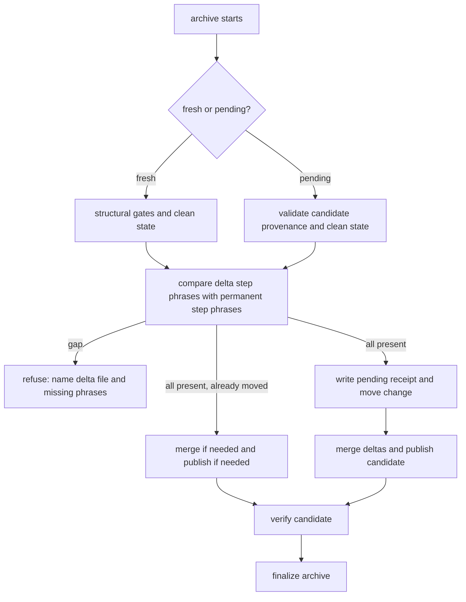

# Design: gate-delta-step-definitions-at-archive

## Overview

The archive gains one preflight comparison at the mutation boundary: the step
phrases bound by the change's delta step-definition files must all be bound
somewhere in the permanent test tree. The comparison is text-level, lives in
`src/cli/archive.rs`, and adds no dependency.

The gate runs in two places:

- the fresh path, before the archive hooks and before any receipt write or
  rename;
- the pending/resume path, before the candidate is merged or verified again.

It never writes, copies, or deletes a step definition. A delta step file is
history that travels with the archived change; the permanent per-capability
step file is the durable home.



## Visual Design Contract

```text
- Interface: none
- Viewports: not applicable — no rendered screen; the consumer reads CLI text
- States: none
- Design system: not applicable; diagnostics follow the existing `[timestamp] message` CLI convention
```

This change produces CLI text only (a refusal on stderr and the unchanged
success output). There is no browser or terminal screen, so screenshots do not
apply; the `@e2e` evidence is the subprocess exit code and captured stdout and
stderr.

Persona impact: **developer--primary-user** (the developer archiving a change
reads the refusal and the named repair) and **givn-maintainer--owner** (the
maintainer owns the archive contract and the heuristic's limits). The agent
Persona **agent--technical-role** is an affected consumer because it runs
archive in automated loops and depends on the failure being pre-mutation.

## Use-Case Traceability

Owning use-case ID: archive-change
Ideation source: none
Confirmed Persona IDs: developer--primary-user, agent--technical-role,
givn-maintainer--owner

| Use-case contract element | Technical decision | Capability / E2E evidence |
|---|---|---|
| Rule: archive compares delta step phrases with the permanent tree before mutation | `ensure_step_definitions_merged(project_root, change_root, Phase)` called in the fresh path before `run_archive_gate_hooks`; phrase sets from `collect_step_phrases_in_tree` | `require-merged-step-definitions`; scenario "Archive is blocked when a delta step definition is missing from the permanent test tree" |
| Rule: archive refuses when a delta phrase has no permanent binding, and names the delta file and the missing phrases (bounded with a remainder count) | Error builder in `ensure_step_definitions_merged`; project-relative delta path; `MAX_REPORTED_PHRASES = 20` then `+N more` | scenarios "Archive is blocked when a delta step definition is missing from the permanent test tree" and "The refusal lists a bounded number of missing step phrases and a remainder count" |
| Rule: delta step definitions are never copied, moved, or deleted | The gate only reads; the permanent walk prunes `givn/changes`, `givn/archive`, and `givn/history` as project-relative prefixes; no archive-merge path for step files | scenario "Consumer archives a change whose delta step definitions are already in the permanent test tree" |
| Rule: a delta step copy may stay under the change's spec tree as history | The change moves as one directory; the preflight reads the delta copy but never relocates it | scenario "Consumer archives a change whose delta step definitions are already in the permanent test tree" |
| Rule: a resumed unproven candidate repeats the comparison before its verification scopes run again | Second call site in the pending path before `ensure_e2e_configured` / `apply_merge_plan` | scenario "An unproven archive candidate with a missing step definition is not verified again" |
| Extension 1: a delta phrase has no permanent definition → refused before mutation | Fresh call site placement after `ensure_artifact_gates`, before the hooks | scenarios "Archive is blocked when a delta step definition is missing from the permanent test tree" and "The refusal lists a bounded number of missing step phrases and a remainder count" |
| Extension 6: an unproven candidate still lacks a phrase → refused and stays unproven | Pending call site placement before any scope runs | scenario "An unproven archive candidate with a missing step definition is not verified again" |
| Success guarantee: the permanent corpus is bound to a receipt for the revision that passed the scopes | Gate runs before the candidate exists, so a published candidate's merged suite can bind its steps | scenario "Consumer archives a change whose delta step definitions are already in the permanent test tree" |
| Minimal guarantee: a failed archive is never reported as proven and stays repairable | A gap on the resume path leaves the receipt pending and the candidate in place | scenario "An unproven archive candidate with a missing step definition is not verified again" |

## Technology Decisions

| Technology | Version | Resolution |
|---|---|---|
| Rust | latest stable | Resolve with the developer's toolchain at implementation time; the workspace declares only `edition = "2024"` and this change adds no toolchain pin. |
| `cucumber` (Gherkin runner) | 0.23.0 | Read from the repository's `Cargo.lock` at design time; unchanged by this change. |
| Step-phrase extraction | standard library only | Hand-written recursive tree walker plus a binding-expression scanner (token search, parenthesis/string/comment-aware depth counter, literal extraction); no new crate, no regex crate, no parser. |

The extractor is deliberately a text heuristic rather than a per-framework
parser: it must cover Behave, Cucumber-JVM, Cucumber-JS, Cucumber-Ruby, and Rust
bindings with one code path, and the failure it prevents is a missing phrase,
not a malformed body. It scans binding *expressions*, not lines, so a
multi-line binding and a raw-string regex are read whole. The remaining cost is
recorded as risk R-122: a binding whose phrase is produced dynamically (a
variable, a table-driven loop, a computed string) yields no phrase and is
skipped, and the comparison is literal after whitespace normalization, so two
different spellings of the same step are not equated.

## Decisions

- Decides D1: archive refuses with a named repair instead of auto-merging step
  definitions — realized in `ensure_step_definitions_merged` (`src/cli/archive.rs`);
  archive never writes step source.
- Decides D2: recognition is the documented path rule (a file under a directory
  named `steps` or ending in `_steps`, or a file whose name ends in
  `_steps.<ext>`) plus a binding-expression scanner. The scanner finds the
  supported binding tokens anywhere in the file, consumes each binding to its
  matching `)`, and reads the first resolvable literal (escaped string, raw
  string with any `#` delimiter, or `/regex/` literal; adjacent Python literals
  joined; internal whitespace normalized) — realized in
  `is_step_definition_path`, `step_binding_expressions`, and
  `collect_step_phrases`. Limitations (unresolvable/dynamic bindings skipped;
  literal phrase comparison) are recorded as risk R-122.

## Step Definitions

| Capability | Step definition file | Permanent merge target |
|---|---|---|
| require-merged-step-definitions (non-`@e2e`) | `tests/steps/require_merged_step_definitions_steps.rs` | n/a — the delta and permanent step files this capability creates are fixtures, not repository source |
| require-merged-step-definitions (`@e2e`) | `tests/steps/require_merged_step_definitions_e2e_steps.rs` | n/a |

Column 1 is the path `src/integrity_hook.rs` resolves and validates; a delta
mirror never shares that cell. Shared Givens (`the change's spec tree binds …`,
`no permanent step-definition file binds …`, the bounded-list Givens) live in
`tests/steps/require_merged_step_definitions_steps.rs`; the `@e2e` file defines
only the steps its `@e2e` scenario needs and reuses the shared Givens from the
non-`@e2e` file. Both files reuse `tests/steps/archive_proof_support.rs`
(`ready_change`, `make_init_root`, receipt and tree helpers) rather than
duplicating fixture setup.

Test runner command (from `verify.command` in `givn/commands.yaml`):

```text
./run-tests.sh --non-e2e
```

Single-scenario run command (non-`@e2e`):

```sh
GIVN_FEATURES=givn/changes/gate-delta-step-definitions-at-archive/specs \
  cargo test --locked --test features_runner -- \
  "archive-change/require-merged-step-definitions.feature::Archive is blocked when a delta step definition is missing from the permanent test tree" \
  --exact --nocapture
```

Single-scenario run command (`@e2e`):

```sh
GIVN_FEATURES=givn/changes/gate-delta-step-definitions-at-archive/specs \
  cargo test --locked --test features_runner -- \
  "archive-change/require-merged-step-definitions.feature::Consumer archives a change whose delta step definitions are already in the permanent test tree" \
  --exact --nocapture
```

## Internal Primitives

| Primitive | Type | Purpose |
|---|---|---|
| `is_step_definition_path` | `fn(&Path) -> bool` | One path rule everywhere: a file whose name ends in `_steps.<ext>` (or is exactly `_steps`), or a file with any ancestor directory component named `steps` or ending in `_steps`. |
| `step_binding_expressions` | `fn(&str) -> Vec<Range<usize>>` | Finds the supported binding tokens at identifier boundaries, returns each token's expression span from `(` to the matching `)`. |
| `binding_phrase` | `fn(&str) -> Option<String>` | Extracts the first resolvable phrase literal from one expression; returns `None` when the expression binds no resolvable literal. |
| `collect_step_phrases` | `fn(&Path) -> BTreeSet<String>` | Reads one file, yields every phrase bound by its step bindings with internal whitespace normalized. A non-UTF-8 or unreadable file yields an empty set (skipped, documented as R-122). A file with zero phrases is skipped by callers. |
| `collect_step_phrases_in_tree` | `fn(&Path, &PruneRules) -> BTreeSet<String>` | Recursive walker over a tree, pruning by component name and by project-relative prefix. |
| `PruneRules` | `struct { components: &'static [&'static str], prefixes: &'static [&'static str] }` | Two prune sets: the component-name set shared by both walks, and the project-relative prefixes used only on the permanent walk. |
| `StepDefinitionGap` | `struct { delta_file: PathBuf, phrases: Vec<String> }` | One delta file (project-relative) and the phrases it binds that the permanent tree does not. |
| `ensure_step_definitions_merged` | `fn(project_root: &Path, change_root: &Path, phase: Phase) -> Result<()>` | Delta tree = `change_root.join("specs")`; permanent tree = `project_root` walked with `PruneRules`. Builds both phrase sets, computes gaps, and formats the refusal. `Phase` distinguishes fresh from resume so the message names the action that applies. |
| `MAX_REPORTED_PHRASES` | `const usize = 20` | Caps the listed phrases; the refusal appends `+N more`. |

### Binding-expression scanner

Supported binding tokens, tried longest-first and matched anywhere in the file
at an identifier boundary (the preceding character is not an ASCII
alphanumeric, `_`, `.`, `@`, or `#` unless the token itself includes it):

- Rust attributes: `#[given(`, `#[when(`, `#[then(`.
- Annotated decorators: `@given(`, `@when(`, `@then(`, `@step(`, `@Given(`,
  `@When(`, `@Then(`, `@And(`, `@But(`, `@Step(`.
- Bare calls/definitions: `Given(`, `When(`, `Then(`, `And(`, `But(`, `Step(`.
- Object-method bindings: `.Given(`, `.When(`, `.Then(`, `.Step(`.

A token match that begins inside an already-parsed binding is skipped, so the
`Given(` inside `#[given(` never produces a second, truncated phrase.

From the token's `(`, the scanner advances to the matching `)` with a
string/raw-string/regex/comment-aware depth counter: normal `"…"`/`'…'`
literals with backslash escapes, raw strings with any `#` delimiter
(`r"…"`, `r#"…"#`, `r##"…"##`), JS/Ruby `/…/` regex literals, `//` and `#`
line comments, and `/* … */` block comments are skipped as opaque text and
parentheses inside them do not change the depth. A multi-line binding is
consumed as one expression.

From the expression, the first resolvable literal is the phrase:

- a normal string, with `\"`/`\\` unescaped;
- a raw string, keeping its content verbatim between the delimiters;
- a `/regex/` literal, recognized only in literal position (after `(`, `,`,
  `=`, or the expression start) and closed by a `/` followed by a
  non-identifier character;
- Python implicit adjacent literals joined when separated only by whitespace
  or newlines.

Internal whitespace runs (including newlines) collapse to one space and the
result is trimmed. A binding with no resolvable literal yields no phrase and is
skipped; this is the documented risk, not an error.

### Pruning and the two trees

The delta walk root is `change_root.join("specs")` and prunes only by component
name. The permanent walk root is `project_root` and prunes:

- any directory component equal to `.git`, `.hg`, `.svn`, `target`,
  `node_modules`, `.venv`, `venv`, `coverage`, `dist`, `build`, `vendor`, or
  `__pycache__`;
- any relative path starting with the project-relative prefixes
  `givn/changes`, `givn/archive`, or `givn/history` (component-wise
  `Path::starts_with`, so `.git` never matches `.github`).

Both walks skip unreadable and non-UTF-8 files without failing, so a stray
`__pycache__/*.pyc` or a binary artifact cannot abort the archive with an
unrelated decoding error.

Call sites:

- fresh: `ensure_step_definitions_merged(&project_root, &change_dir, Phase::Fresh)`
  after `ensure_artifact_gates` and before `run_archive_gate_hooks`;
- pending/resume: `ensure_step_definitions_merged(&project_root, &archive_target, Phase::Resume)`
  before `ensure_e2e_configured` and `apply_merge_plan`.

Both pass the same `project_root`, so the permanent tree is the project root
minus the pruned prefixes and components in every phase. The refusal prints
`delta_file` project-relative (`givn/changes/<id>/specs/steps/catalog_steps.py`
or `givn/archive/<id>/specs/steps/catalog_steps.py`), which always contains the
`specs/steps/catalog_steps.py` suffix.

### Extractor acceptance expectations

- The motivating file
  `/home/buster/projects/givn-harness/givn/archive/enable-paid-stage-runs/specs/steps/complete_stage_run_steps.py`
  yields all **52** binding phrases, not the 44 single-line ones: multi-line
  decorators and their adjacent literals are read as one expression.
- The repository's own raw-regex binding
  `#[given(regex = r#"^a givn project with a completed change "([^"]+)" ready to archive$"#)]`
  yields the full regex string including the inner quotes and capture group.
- A phrase present only inside `givn/changes/<id>/specs/steps/` or
  `givn/archive/<id>/specs/steps/` does not satisfy the gate.
- A `__pycache__/*.pyc` file under either tree neither aborts the walk nor
  contributes a phrase.
- A phrase bound in `tests/steps/catalog_steps.py` (outside `givn/specs`)
  satisfies the permanent side, proving project-root scanning.

## Strict Mode (mandatory)

```text
cucumber-rs: .fail_on_skipped() on the Cucumber builder in tests/features_runner.rs
```

Not-implemented stub for every step without a real assertion yet:

```rust
todo!("TODO: implement givn archive step-definition gate step")
```

The runner already fails on skipped and undefined steps; the setup task proves
it once with a probe scenario that binds nothing and requires a non-zero exit.

## Local Runnability & Digital Twins (mandatory)

**Local run command** — the repository's canonical build and test path:

```sh
cargo build --locked && ./run-tests.sh --non-e2e
```

**Isolated network:** not applicable. The scenarios run the compiled `givn`
binary against temporary fixture directories under the OS temp dir; no
service, port, database, or network dependency is involved.

**Digital twin per external/third-party dependency:** none. The fixtures use
the local `git` and `fossil` executables (already a documented prerequisite in
`AGENTS.md`, shared with the existing archive scenarios); the archive gate
itself talks to no external service.

**Anticipated interface obstacles and their fix:**

- The fresh fixtures must reach the gate before any mutation, so each writes a
  completed change, a delta step file at
  `givn/changes/<id>/specs/steps/catalog_steps.py`, a permanent step file, and
  a committed tree through the existing `archive_proof_support` helpers. The
  success fixture's permanent file is pinned at
  `tests/steps/catalog_steps.py` — outside `givn/specs` — so the scenario
  proves project-root scanning; a fixture that writes the permanent file where
  the implementation scans would pass circularly.
- The pending fixture is built in two phases: first
  `ready_change(world, id, false, "fail")` plus the existing
  `run_archive`-based unproven-candidate Given (the `fail` runner exits before
  writing a result file), then the candidate's
  `givn/archive/<id>/specs/steps/catalog_steps.py` phrase is written and the
  existing Given `the runner records every invocation with its scope and
  features path` switches the runner to `record` and commits. The `record`
  runner writes `GIVN_RESULT_FILE` on every invocation, so its absence proves
  no verification scope ran — the discriminating assertion the design needs.
- `user_runs` commits the fixture and refreshes the active-change receipt
  before spawning the binary, so the candidate's new delta file is committed
  and the archive's clean-state witness does not refuse for an unrelated
  reason.

## E2E Smoke Test Infrastructure

**Interface type:** CLI — the compiled `givn` binary invoked as a subprocess
through `tests/common`.

**E2E runner command** (`verify.e2e_command`):

```text
./run-tests.sh --e2e
```

**E2E step location:** `tests/steps/require_merged_step_definitions_e2e_steps.rs`
(separate from the non-`@e2e` file, one file per capability). Shared Givens are
defined once in `tests/steps/require_merged_step_definitions_steps.rs`; the e2e
file adds only e2e-specific steps, so no same-kind definition is duplicated.

**Local test infrastructure:** no browser driver and no server. The scenario
builds a Git fixture through `tests/steps/archive_proof_support.rs`, writes the
delta step file under the change and the permanent step file at
`tests/steps/catalog_steps.py`, invokes `CARGO_BIN_EXE_givn archive --change
merged-steps`, and inspects exit status, stdout, stderr, and the resulting
`givn/archive/merged-steps/specs/steps/catalog_steps.py` path.

**E2E framework choice and justification:** the repository's single
`cucumber-rs` runner (`tests/features_runner.rs`) executes the `.feature` files
under `givn/specs/**` and the change's `specs/**`; the real interface is a
subprocess CLI, so a Gherkin scenario that spawns the binary is the correct
end-to-end driver.

**E2E strict-mode proof:** the same `.fail_on_skipped()` runner configuration
and the same proof-of-strictness setup task; an undefined `@e2e` step makes the
run non-zero.

**Interaction Coverage Matrix:**

| Inventory entry | @e2e scenario title | Real interface | Driving mechanism |
|---|---|---|---|
| require-merged-step-definitions: archive a change whose delta step definitions are already in the permanent test tree | Consumer archives a change whose delta step definitions are already in the permanent test tree | CLI | `cucumber-rs` step spawns `CARGO_BIN_EXE_givn archive --change merged-steps` in the fixture root, reads exit code, stdout, stderr, and the archived tree |
| require-merged-step-definitions (blocking variant of the same action, not a separate inventory entry) | Archive is blocked when a delta step definition is missing from the permanent test tree | CLI | Same subprocess driver with a fixture whose permanent tree omits the phrase |
| require-merged-step-definitions (bounded-list variant of the same refusal, not a separate inventory entry) | The refusal lists a bounded number of missing step phrases and a remainder count | CLI | Same subprocess driver with 21 missing phrases; asserts the first 20 and `+1 more` |
| require-merged-step-definitions (resume variant, not a separate inventory entry) | An unproven archive candidate with a missing step definition is not verified again | CLI | Same subprocess driver against an unproven candidate whose `record` runner would write `results/regular.json` if any scope ran |

## Architecture Impact

`src/cli/archive.rs` only:

- new helpers placed next to `build_merge_plan` (the merge-precondition
  neighbourhood), so the step-definition preflight and the merge preconditions
  are read together;
- fresh path call site inside `run()` after `ensure_artifact_gates` and before
  `run_archive_gate_hooks`, passing `&project_root` (already computed at the
  top of `run()`) and `&change_dir`;
- pending/resume path call site before `ensure_e2e_configured` and
  `apply_merge_plan`, passing the same `&project_root` and `&archive_target`.

No new module, no new crate, no API change. The archive hooks receive the same
arguments as before.

### Contracts and Components

No new contract: the preflight is an internal helper inside `cli::archive`, and
the external CLI surface (`givn archive --change <id>`) is unchanged. The
helper has one consumer (the archive command) and no consumer use case imports
its implementation, so the contract table is deleted for this change.

## Data Model Changes

None. The verification receipt schema and its `merge_completed` field are
unchanged; the gate adds no persisted state.

## Instruction and Documentation Updates (part of this change)

- `assets/instructions/steps.md`: state that step definitions are durable
  project source, that archive merges feature and use-case documents only, that
  a delta step copy must be mirrored into the permanent per-capability step file
  before archive, and which binding tokens the archive gate reads.
- `assets/instructions/archive.md`: add the new pre-mutation gate, the
  permanent-tree definition (project root minus the pruned trees), the bounded
  refusal with a project-relative delta path, and the resume behaviour.
- `assets/instructions/design.md`: require the design to name permanent step
  locations and, when a delta mirror is needed, both the mirror and its
  permanent merge target. The `## Step Definitions` table keeps column 1 as the
  hook-validated `Step definition file` and adds a third `Permanent merge target`
  column for the delta mirror; never put two paths in one cell.
- `assets/instructions/tasks.md`: add the closeout check that every delta step
  phrase is bound in the permanent step file before archive (the archive gate
  enforces the same condition).
- `assets/templates/design.md`: mirror the three-column Step Definitions table
  and the column-1 rule.
- `docs/arc42/README.md`: add the change paragraph (no ADR; durable facts in
  chapters 5, 6, 8, 11, and 12).
- `docs/arc42/05-building-block-view.md`: extend the archive row with the step
  definition preflight.
- `docs/arc42/06-runtime-view.md` §6.7: add the preflight to the stage list and
  the sequence diagram.
- `docs/arc42/08-crosscutting-concepts.md` §8.3: state that archive merges
  features and narratives only, and record the path rule, the binding-expression
  scanner, the two prune sets, the unreadable-file behaviour, and the bounded
  refusal.
- `docs/arc42/11-risks-and-technical-debt.md`: update R-122 for the scanner and
  its remaining limits (unresolvable/dynamic bindings skipped; literal phrase
  comparison; unreadable files skipped).
- `docs/arc42/12-glossary.md`: add **Step phrase** and reconcile the
  **Step definition** entry with the one path rule and the delta-step-file
  wording.

## Open Technical Questions

None. The two proposal questions are answered above; the heuristic's limits are
recorded as a risk rather than carried.
