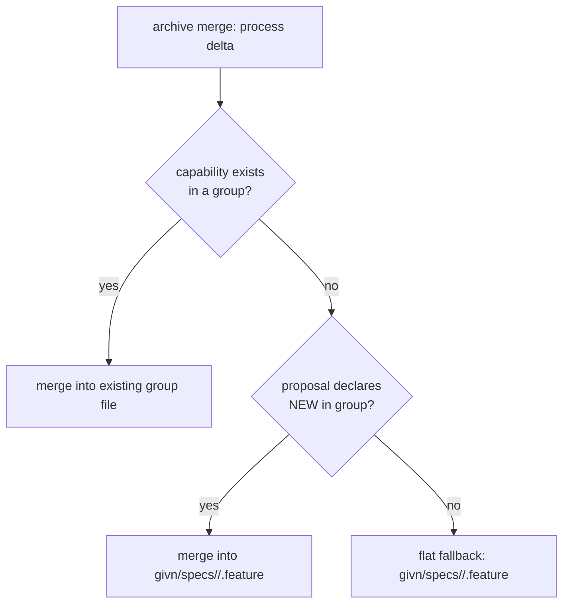

# Design: grouped-merge-for-new-capabilities

## Technical Approach

One decision branch in the archive merge. When the merged capability exists
nowhere in the permanent corpus, the merge reads the change's recorded
routing decision and targets the declared group instead of falling back to
the flat layout. The flat fallback remains the default whenever no decision
names the capability (pre-migration corpus, maintenance changes, legacy
proposals).



No renderer, gate, or merge-validation change. The routing gate
(`check review`) is untouched; the merge only consumes its recorded decision.

## Production Change

`src/cli/archive.rs`, `process_delta_file`: in the merge path (not the
retirement path), when `resolve_capability_group` returns `None`, load
`givn/changes/<change-id>/proposal.md`, run the existing
`spec::routing_table::parse_routing_table`, and look up the capability's
row. `Decision::NewIn(group)` → merge target
`specs_root.join(group).join(<cap>.feature)`; anything else (no proposal,
parse failure, no row, `EXTEND` of a nonexistent capability) → the current
flat fallback. The group directory is created by the existing file write
path. No other function changes.

## Step Definitions

| Step | Defined in |
|---|---|
| `a givn project with verify.e2e_command unconfigured in givn/config.yaml` | `tests/steps/enforce_post_merge_e2e_gate_steps.rs` (reused) |
| `the project declares a complete run declaration` | `tests/steps/run_declaration_fixtures_support.rs` (reused) |
| `the user invokes \`givn archive --change <id>\`` | `tests/steps/mod.rs` (reused) |
| `the command exits 0` | `tests/steps/mod.rs` (reused) |
| `the file "..." exists` / `the directory "..." does not exist` | `tests/steps/mod.rs` (reused) |
| `the change directory has been moved to givn/archive/` | `tests/steps/workflow_enforcement_steps.rs` (reused) |
| `a completed change "..." whose proposal declares the capability NEW in "..." and whose delta lives under specs/.../` | `tests/steps/grouped_merge_steps.rs` (new) |
| `a completed change "..." whose proposal records no routing decision and whose delta lives under specs/.../` | `tests/steps/grouped_merge_steps.rs` (new) |

One new step file for the capability; it builds a completed change fixture
(artifact stubs with passing markers, delta under the declared group, a
proposal whose Capability Routing table carries the declared row — parseable
by the production table parser) modeled on the
`enforce_post_merge_e2e_gate_steps` fixtures.

## Runner and Strict Mode

Existing contract, unchanged: `./run-tests.sh`, `./run-tests.sh --e2e`,
strict mode `.fail_on_skipped()` in `tests/features_runner.rs`. New step
stubs use `unimplemented!()`. Single-scenario command:

```text
GIVN_FEATURES=givn/changes/grouped-merge-for-new-capabilities/specs cargo test --test features_runner -- --name '^<scenario title>$'
```

## Local Runnability and E2E

The real interface is the CLI. The runner launches the compiled `givn`
subprocess in a temporary initialized project; no server, browser, database,
or third-party dependency exists — no digital twins. The fixtures reuse the
established archive harness (verify command `true`, coverage stub reports,
complete run declaration).

RED anchors: both scenarios fail in RED — the grouped scenario on the
missing grouped file (the merge still lands flat), the flat scenario on its
undefined Given step.

## Interaction Coverage Matrix

| Inventory entry | @e2e scenario title | Real interface | Driving mechanism |
|---|---|---|---|
| Consumer archives a new capability and the merged spec lands in its declared group | Consumer archives a new capability and the merged spec lands in its declared group | CLI | Real `givn archive --change grouped-new` subprocess; assert exit code, grouped permanent file, absent flat directory, archived change |

The flat-layout scenario is a regular variant (no declared group) and adds
no inventory action.

## Coverage

| Process | Started by | Instrumented artifact | Profile output | Merge step | Non-zero production probe |
|---|---|---|---|---|---|
| Gherkin runner and givn subprocesses | `./measure-coverage.sh` | cargo coverage build | separate non-E2E/E2E Cobertura reports | `./merge-coverages.sh` | `cli::archive::process_delta_file` (new grouped-target branch) |

## Version Freshness

No new dependency, tool, runtime, or container; the existing Rust toolchain
and cucumber runner apply unchanged.