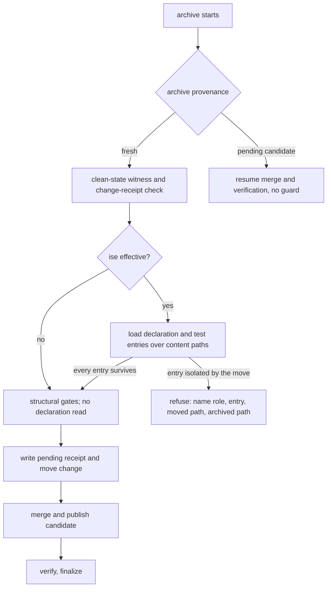
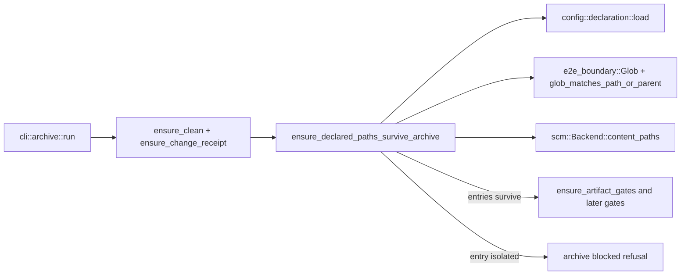

# Design: guard-retained-paths-across-archive

## Overview

Archive gains one pre-mutation check on the fresh path: while `ise` is
effective, every declared retained role entry must still resolve after the
change moves. The check reads `givn/specification.yaml` through the existing
`config::declaration` loader and reads the project's content paths once through
`scm::Backend::content_paths`. An entry survives iff it matches a content path
outside `givn/changes/<id>/`, or the archived form (`givn/archive/<id>/…`) of a
content path inside it. The check refuses before the pending receipt write when
an entry that matches moved content satisfies neither.

The check never writes the declaration. It runs after the change-receipt
freshness check (so a broken declaration in the ordinary flow is already
reported as a stale receipt) and before the structural gates that run archive
hooks. The resume path is unchanged: a guarded archive cannot create the state
where a moved path is still declared, and `givn ise replace` keeps naming it if
an older binary did.



## Visual Design Contract

```text
- Interface: terminal
- Viewports: not applicable — terminal text surface; no browser viewport
- States: refusal and success, both terminal text
- Design system: not applicable; the refusal follows the existing
  `archive blocked: ...` stderr convention
```

`Interface: terminal` is deliberate: the change alters terminal text and exit
codes, not a rendered screen. The failure scenario's transcript is committed at
`givn/changes/guard-retained-paths-across-archive/evidence/visual/archive-is-blocked-when-a-declared-retained-path-moves-with-the-change/transcript.txt`;
the `@e2e` success scenario captures its transcript at
`givn/changes/guard-retained-paths-across-archive/evidence/visual/consumer-archives-a-change-whose-declared-retained-paths-survive-the-move/transcript.txt`.
No screenshots and no viewports apply.

The change produces CLI text only: one refusal on stderr and the unchanged
success output. The `@e2e` evidence is the subprocess exit code and the
captured stdout and stderr.

Persona impact: **developer--primary-user** (reads the refusal and the named
archived path), **agent--technical-role** (runs archive in automated loops and
must see the pre-mutation failure instead of an unseedable archive), and
**givn-maintainer--owner** (owns the archive contract and the guard's
effectiveness rule).

## Use-Case Traceability

Owning use-case ID: `archive-change`
Fragment capability: `instruction-integrity` (`support`)
Ideation source: none (D1–D3 in the proposal; no seed)
Confirmed Persona IDs: `developer--primary-user`, `agent--technical-role`,
`givn-maintainer--owner`

Base narrative digest: the delta's `givn:base-sha256` records
`1d7d8d8bd7db3ed06a2afb4401b2c4a001bf2458fc55ece51b418424b5751e82`, the
current `givn/specs/archive-change/usecase.md` digest. Any change that replaces
that narrative first invalidates this digest and requires a recompute before
this change can merge. The tasks author must carry the same statement into
`tasks.md`.

| Use-case contract element | Technical decision | Capability / E2E evidence |
|---|---|---|
| Main flow 1: refuse a declaration whose retained path the move would orphan | `ensure_declared_paths_survive_archive` in the fresh block of `cli::archive::run`, after `ensure_change_receipt` and before `ensure_artifact_gates` | `require-durable-retained-paths`; scenario "Archive is blocked when a declared retained path moves with the change" |
| Extension 1: a retained entry matches moved content and neither a surviving content path nor an archived counterpart → refused before mutation, naming entry, moved path, and archived path | One predicate over `Backend::content_paths`; offender collection over `declaration.roles()` and `Glob`; bounded report; `bail!` with the repair sentence | scenarios "Archive is blocked when a declared retained path moves with the change" (literal and wildcard rows), "The refusal reports at most twenty isolated retained paths", and "Archive is blocked when the declaration cannot be loaded" |
| Extension 1: the declaration cannot be loaded → refused by name | `SpecificationDeclaration::load` error is wrapped as `archive blocked: the declared retained paths cannot be read: {error}` | scenario "Archive is blocked when the declaration cannot be loaded" |
| Rule: entry matching uses the declaration's path patterns; an entry that also resolves after the move is unaffected | `Glob::compile` + `glob_matches_path_or_parent` over content paths outside the move and archived counterparts of content paths inside it | scenarios "A retained root that also covers the archive location is unaffected" and the wildcard row of the refusal outline |
| Rule: the guard runs on the fresh move only | Single call site inside `if fresh { ... }` | the resume scenarios in `archive-change` stay unchanged; no scenario changes |
| Rule: read only while `ise` is effective | `SpecificationDeclaration::is_effective(manifest)` early return | scenario "A project with ise off archives without reading the declaration" |
| Success guarantee: a project cannot archive itself into an unseedable state | The refusal precedes the pending receipt write and the rename, so the declaration and the change tree are unchanged | the refusal scenarios assert the change directory still exists, carries no pending archive receipt, and no archive candidate exists |
| Guidance: retained roles name paths that survive archive | `assets/instructions/ise.md` Specification-completeness obligation and `assets/instructions/archive.md` gate list | `instruction-integrity`; scenario "The ise instruction says declared retained paths survive archiving" |

## Architecture Impact

`src/cli/archive.rs` gains the guard and its helpers; `src/config/declaration.rs`
is reused unchanged; `src/e2e_boundary/paths.rs` gains the shared
`glob_matches_path_or_parent` helper, moved from `src/ise/partition.rs`, which
keeps its behavior by importing it. `src/e2e_boundary/mod.rs` adds the moved
function to its `pub(crate)` re-export list beside `Glob`, `ProjectPath`, and
`walk_project`.

The guard cannot reuse `walk_project`: that walk drops `givn/changes` and
`givn/archive` by design, so it cannot see either the moving tree or its
archived form. The guard instead reads its path sets from
`Backend::content_paths`, the same listing `givn ise verify` reads.

Insertion point (exact): `src/cli/archive.rs`, `run()`, `if fresh { ... }`,
between

```rust
ensure_change_receipt(&backend, &manifest, &project_root, &change_dir, change)?;
```

and

```rust
ensure_artifact_gates(&change_dir, &manifest)?;
```

with the call `ensure_declared_paths_survive_archive(&project_root, &backend, &manifest, change)?`.
That is after the clean-state witness and the receipt freshness check, and
before every gate that can run hooks or write, and before the pending-receipt
write and rename.



No new module, no new crate, no CLI surface change. `givn archive --change
<id>` keeps its arguments and success output.

### Contracts and Components

No new contract. The guard is an internal helper inside `cli::archive` with one
consumer (the archive command); `config::declaration` already owns the
declaration contract and is consumed, not changed. The subsection is deleted
because this change declares no contract.

## Technology Decisions

| Technology | Version | Resolution |
|---|---|---|
| Rust | latest stable | Resolve with the developer's toolchain at implementation time; the workspace declares `edition = "2024"` and this change adds no toolchain pin. |
| `cucumber` (Gherkin runner) | 0.23.0 | Read from the repository's `Cargo.lock` at design time; unchanged by this change. |
| Path matching | existing `crate::e2e_boundary::Glob` | No new dependency; the one declaration-pattern matcher already used by the `e2e` boundary and the clean-room partition. |
| Content-path source | existing `scm::Backend::content_paths` | No new dependency; the tracked-plus-untracked listing `givn ise verify` reads, so an untracked evidence file under the moving change is visible to the guard. |

## Decisions

- Decides D1: the guard covers the five retained roles only. `source:` roots
  are out of scope by the operator's change boundary; the deferred `source:`
  question is recorded in the proposal and no scenario depends on it — realized
  by the guard iterating `declaration.roles()` and never `source_roots()`.
- Decides D2: an unreadable or malformed declaration refuses the archive by
  name. The guard reuses `SpecificationDeclaration::load`'s message and wraps it
  as `archive blocked: the declared retained paths cannot be read: {error}` —
  realized in `ensure_declared_paths_survive_archive`; the branch is defensive
  because the change-receipt gate runs first and a changed declaration is
  tested content.
- Decides D3: the guard runs on the fresh move only, against the active change
  directory — realized by the single call site inside `if fresh { ... }`. A
  resume repeats no guard; the state it would detect cannot be created by a
  guarded archive, and `givn ise replace` already names it.
- Decides Q1: one survival predicate over `Backend::content_paths`. An entry
  survives iff it matches a content path outside `givn/changes/<id>/` or the
  `givn/archive/<id>/` form of a content path inside it. This replaces both
  earlier tests, sees untracked non-ignored evidence the rename moves, and
  matches the trial's condition over the published tree. Ignored files are
  absent from `content_paths`, so the guard never refuses for a file the trial
  cannot read either.
- Decides Q2: the advice matches the entry's shape. A literal entry is answered
  with its archived literal path; a wildcard entry starting with
  `givn/changes` is answered with the same pattern under `givn/archive`
  (`givn/changes/**` → `givn/archive/**`). The guard never proposes a narrower
  Specification than the entry.
- Decides Q3: `Interface: terminal`. One transcript is committed for the
  failure scenario; the `@e2e` success transcript is captured by its step at
  implementation.
- Decides Q4: the symlink hole is accepted and recorded. A declared retained
  path outside the change tree that is a symlink into it is invisible to the
  guard, and the trial cannot see through symlinks either. No canonicalization
  is added.
- Decides Q5: the three unasserted branches are pinned: the refusal scenario
  asserts no pending archive receipt, a 21-entry fixture asserts the bounded
  report and `+1 more`, and a malformed-declaration scenario asserts the loader
  refusal. Scenario counts and the interaction matrix are updated accordingly.

## Guard Algorithm

Inputs: `project_root`, the selected `backend`, the effective `manifest`, and
the change id.

1. If `SpecificationDeclaration::is_effective(manifest)` is false, return
   `Ok(())` without touching the file.
2. Load the declaration with `SpecificationDeclaration::load(project_root)`.
   `Ok(None)` returns `Ok(())`; `Err(error)` refuses with the wrapper message.
3. Read `backend.content_paths()` once, format each path project-relative with
   `/`, and sort. Partition the listing into `moved` (paths starting with
   `givn/changes/<id>/`) and `surviving` (every other path). Derive `archived`
   as `archived_counterpart` of every moved path. The listing is tracked plus
   untracked non-ignored content; it omits ignored files and never follows a
   symlink.
4. For each `(role, pattern)` in `declaration.roles()`: compile `Glob`; collect
   `moved_matches`, the moved paths the pattern matches with
   `glob_matches_path_or_parent`. If it matches none, skip. The entry survives
   when it matches any `surviving` path or any `archived` path. Otherwise it is
   an offender.
5. The offender's reported moved path is the shallowest prefix of the first
   matched moved path, at or below `givn/changes/<id>`, that the pattern
   matches. The advice is shape-preserving: replace the leading
   `givn/changes` segments of the entry with `givn/archive`; a wildcard entry
   that reaches the tree through another prefix prints no replacement pattern,
   and the line states that the archived paths must still match the entry.
6. Sort offenders by role declaration order then entry text. Report at most
   `MAX_REPORTED_RETAINED_PATHS = 20` lines and append `  +N more`; refuse with
   the repair sentence.

Refusal text (literal, wildcard, and bounded forms):

```text
archive blocked: a declared retained path is moved by this archive:
  - limits 'givn/changes/moved-limits/design.md' matches 'givn/changes/moved-limits/design.md'; declare 'givn/archive/moved-limits/design.md'
  - limits 'givn/changes/**' matches 'givn/changes/moved-limits'; declare 'givn/archive/**'
  +N more
A retained role names a path that survives `givn archive`. Declare the archived
or another durable path in givn/specification.yaml and rerun `givn archive
--change moved-limits`.
```

Why one predicate: it is the condition the trial applies to the published
tree, it sees the untracked evidence paths the rename moves (which a
revision-only reader misses), and it removes the pattern-name fiction where a
wildcard entry was answered with a literal path. A broad root such as
`givn/**` or a directory that still holds another active change survives
because it also matches surviving content. A naive "refuse whenever moved
content matches" would refuse `givn/**` and is rejected.

## Internal Primitives

| Primitive | Type | Purpose |
|---|---|---|
| `glob_matches_path_or_parent` | `pub(crate) fn(&Glob, &str) -> bool` | Moved from `src/ise/partition.rs` to `src/e2e_boundary/paths.rs` and re-exported from `src/e2e_boundary/mod.rs`; matches the path or any ancestor, the retained-entry semantics. `ise::partition` imports it, so behavior is unchanged. |
| `content_paths` | `fn(&Backend) -> Result<Vec<String>>` | The project's content paths as project-relative `/` strings, sorted: tracked plus untracked non-ignored, no symlink following. |
| `archived_counterpart` | `fn(&str, &str) -> String` | `givn/changes/<id><rest>` → `givn/archive/<id><rest>`. |
| `reported_moved_path` | `fn(&Glob, &str, &str) -> String` | The shallowest matched prefix at or below `givn/changes/<id>`, used as the moved path in the refusal. |
| `archive_advice` | `fn(&str) -> Option<String>` | The shape-preserving archived pattern: leading `givn/changes` segments replaced by `givn/archive`; `None` when the entry reaches the tree through another prefix, so no narrower path is invented. |
| `ensure_declared_paths_survive_archive` | `fn(&Path, &Backend, &Manifest, &str) -> Result<()>` | The guard: effective check, load, content partition, offender collection, bounded refusal. |
| `MAX_REPORTED_RETAINED_PATHS` | `const usize = 20` | Caps the refusal lines; the remainder is appended as `+N more`. |

## External Boundary Cases

The declaration is project-owned external input. Its adversarial cases:

- **Missing file with `ise` effective**: `load` returns `Ok(None)`; the guard
  passes. A change that needs a green receipt for an ise-effective lock cannot
  reach archive without a declaration, because `givn check tasks` refuses first.
- **Malformed shape**: an unknown key, a repeated role, a scalar where a list
  belongs, or a path outside the project is refused by the loader; archive wraps
  the message and moves nothing. Pinned by the malformed-declaration scenario.
- **Unreadable file**: a directory at `givn/specification.yaml` is refused by
  the loader, not silently treated as empty.
- **Glob-shaped entry**: matched with the same `Glob` semantics as every other
  declaration reader; a wildcard spanning the change tree is refused like a
  literal entry, and its advice keeps the entry's shape (`givn/archive/**`).
- **Broad entry**: `givn/**` and `givn` survive because they also match
  surviving content paths; a declaration that still resolves is never blocked.
- **Boundary**: an entry matching the change directory itself is refused; its
  archived advice is `givn/archive/<id>`, while `archived_counterpart` maps
  each moved content path.
- **Symlink**: a declared retained path outside the change tree that is a
  symlink into it is visible only as the symlink path, so the entry survives.
  The guard does not canonicalize, and the trial cannot see through symlinks
  either (Q4).
- **Ignored file**: `content_paths` omits ignored files, so the guard never
  refuses for content the trial cannot read.
- **Volume**: 21 offenders list 20 and `+1 more`; pinned by the bounded-report
  scenario.
- **Replay/partial response/timeout**: not applicable; the input is a local file
  read once, and a read error is a refusal.

High-risk rules that need sensitivity checks (implemented as the scenarios
above): broad-root acceptance (`givn/**`), addon gating (`ise` off reads
nothing), pattern semantics (wildcard vs literal), and the placement before
publication (change directory present, no candidate).

## Step Definitions

| Capability | Step definition file | Permanent merge target |
|---|---|---|
| `require-durable-retained-paths` (non-`@e2e`) | `tests/steps/require_durable_retained_paths_steps.rs` | n/a — permanent file, written directly |
| `require-durable-retained-paths` (`@e2e`) | `tests/steps/require_durable_retained_paths_e2e_steps.rs` | n/a — permanent file, written directly |
| `instruction-integrity` (non-`@e2e`) | `tests/steps/instruction_integrity_steps.rs` | n/a — existing permanent file, extended in place |

Shared Givens live in `tests/steps/require_durable_retained_paths_steps.rs`
(`an effective declaration whose <role> role names "<entry>"`, `an effective
declaration whose limits role names 21 paths under "<directory>"`, `an
effective but malformed declaration`, `a declaration whose <role> role names
"<entry>" while ise is off`, and the refusal assertions). The `@e2e` file
defines only the steps its scenario needs (`the archived change contains
"<name>"`) and reuses the shared Givens. Both files reuse
`tests/steps/archive_proof_support.rs` (`ready_change`, `run_givn`, receipt and
tree helpers) instead of duplicating fixture setup.

The declaration Given runs `givn addons enable ise` through
`tests/common::run_givn`, asserts success, then rewrites the scaffolded
declaration with the named role set; the generic archive step commits the
fixture and refreshes the change receipt, so the archive starts from a committed
project with a current receipt. The fixture has no `config-lock.yaml`
(`ready_change` removes addon locks), so enabling `ise` creates no addon drift.

Test runner command (from `verify.command` in `givn/commands.yaml`):

```text
./run-tests.sh --non-e2e
```

Single-scenario run command (non-`@e2e`):

```sh
GIVN_FEATURES=givn/changes/guard-retained-paths-across-archive/specs \
  cargo test --locked --test features_runner -- \
  "archive-change/require-durable-retained-paths.feature::Archive is blocked when a declared retained path moves with the change" \
  --exact --nocapture
```

Single-scenario run command (bounded report):

```sh
GIVN_FEATURES=givn/changes/guard-retained-paths-across-archive/specs \
  cargo test --locked --test features_runner -- \
  "archive-change/require-durable-retained-paths.feature::The refusal reports at most twenty isolated retained paths" \
  --exact --nocapture
```

Single-scenario run command (malformed declaration):

```sh
GIVN_FEATURES=givn/changes/guard-retained-paths-across-archive/specs \
  cargo test --locked --test features_runner -- \
  "archive-change/require-durable-retained-paths.feature::Archive is blocked when the declaration cannot be loaded" \
  --exact --nocapture
```

Single-scenario run command (`@e2e`):

```sh
GIVN_FEATURES=givn/changes/guard-retained-paths-across-archive/specs \
  cargo test --locked --test features_runner -- \
  "archive-change/require-durable-retained-paths.feature::Consumer archives a change whose declared retained paths survive the move" \
  --exact --nocapture
```

Single-scenario run command (guidance):

```sh
GIVN_FEATURES=givn/changes/guard-retained-paths-across-archive/specs \
  cargo test --locked --test features_runner -- \
  "fragments/instruction-integrity.feature::The ise instruction says declared retained paths survive archiving" \
  --exact --nocapture
```

## Strict Mode (mandatory)

```text
cucumber-rs: .fail_on_skipped() on the Cucumber builder in tests/features_runner.rs
```

Not-implemented stub for every step without a real assertion yet:

```rust
todo!("TODO: implement the retained-path archive guard step")
```

The runner already fails on skipped and undefined steps; the setup task proves
it once with a probe scenario that binds nothing and requires a non-zero exit.

## Local Runnability & Digital Twins (mandatory)

**Local run command**:

```sh
cargo build --locked && ./run-tests.sh --non-e2e
```

**Isolated network:** not applicable. Scenarios run the compiled `givn` binary
against temporary fixture projects under the OS temp dir; no service, port,
database, or network dependency is involved.

**Digital twin per external/third-party dependency:** none. The fixtures use the
local `git` executable (a documented prerequisite in `AGENTS.md`, shared with
the existing archive scenarios); the guard itself reads only project files and
the selected backend.

**Anticipated interface obstacles and their fix:**

- The refusal scenarios must reach the guard, not an earlier gate. Each writes a
  complete change through `ready_change`, and the declaration Given runs after
  it; the generic archive step commits and refreshes the receipt. The guard call
  site is before the artifact gates, so a complete change still refuses for the
  declaration.
- The declaration must be committed when archive reads it: the archive's
  clean-state witness refuses untracked non-evidence paths. The generic archive
  step commits the fixture, so the declaration and the refreshed receipt are in
  the tested revision, and `content_paths` lists both.
- Enabling `ise` after `ready_change` must not trip addon drift: the fixture
  carries no `config-lock.yaml`, so `config::lock::check` skips the change.
- The success scenario must prove the recommendation is archivable: it declares
  `givn/archive/<id>/design.md`, archives, and asserts `design.md` landed in the
  archive directory.

## E2E Smoke Test Infrastructure

**Interface type:** CLI — the compiled `givn` binary invoked as a subprocess
through `tests/common`.

**E2E runner command** (`verify.e2e_command`):

```text
./run-tests.sh --e2e
```

with `GIVN_RESULT_SCOPE=e2e` under the archive result contract.

**E2E step location:** `tests/steps/require_durable_retained_paths_e2e_steps.rs`
(separate from the non-`@e2e` file, one file per capability).

**Local test infrastructure:** no browser driver and no server. The scenario
builds a Git fixture through `tests/steps/archive_proof_support.rs`, writes the
declaration, invokes `CARGO_BIN_EXE_givn archive --change durable-paths`, and
inspects exit status, stdout, stderr, and the archived tree.

**E2E framework choice and justification:** the repository's single cucumber-rs
runner (`tests/features_runner.rs`) executes the `.feature` files under
`givn/specs/**` and the change's `specs/**`; the real interface is a subprocess
CLI, so a Gherkin scenario that spawns the binary is the correct driver.

**E2E strict-mode proof:** the same `.fail_on_skipped()` runner configuration
and the proof-of-strictness setup task; an undefined `@e2e` step makes the run
non-zero.

**Interaction Coverage Matrix:**

| Inventory entry | @e2e scenario title | Real interface | Driving mechanism |
|---|---|---|---|
| `require-durable-retained-paths`: archive a change whose declared retained paths survive the move | Consumer archives a change whose declared retained paths survive the move | CLI | `cucumber-rs` step spawns `CARGO_BIN_EXE_givn archive --change durable-paths` in a fixture with an `ise`-effective declaration naming `givn/archive/durable-paths/design.md`; asserts exit 0, the moved change, and `design.md` in the archive directory |

The inventory has exactly one entry, so the matrix has exactly one row. The
same consumer action's other observable outcomes are variants, not additional
entries: the refusal variants are the literal and wildcard rows of "Archive is
blocked when a declared retained path moves with the change", "The refusal
reports at most twenty isolated retained paths", and "Archive is blocked when
the declaration cannot be loaded"; the broad-root variant is "A retained root
that also covers the archive location is unaffected"; the addon-gating variant
is "A project with ise off archives without reading the declaration". All drive
the same CLI action or its refusal and add no `@e2e` scenario.

**Scenario count:** the capability feature holds six titles: one `@e2e` success
scenario and five regular titles (the refusal outline with two Examples rows,
the broad-root scenario, the ise-off scenario, the bounded-report scenario, and
the malformed-declaration scenario). The fragment feature holds one title.

## Coverage

| Process | Started by | Instrumented artifact | Profile output | Merge step | Non-zero production probe |
|---|---|---|---|---|---|
| Gherkin runner and `givn` subprocesses | `./measure-coverage.sh` | cargo coverage builds for the non-E2E and E2E scopes | `coverage/non-e2e-cobertura.xml`, `coverage/e2e-cobertura.xml` | `./merge-coverages.sh` | `cli::archive::ensure_declared_paths_survive_archive` (executed by the declaration scenarios and by every archive run in this repository, which is `ise`-off through the early return) |

Measured population: `src/`. Excluded: tests, generated assets, and fixtures.
The population is declared here before the first run and is not changed after
seeing the result.

## Instruction and Documentation Updates (part of this change)

- `assets/instructions/ise.md`: state in the Specification-completeness
  obligation that a retained role names a path that survives `givn archive`,
  that a change's artifacts move from `givn/changes/<id>/` to
  `givn/archive/<id>/`, and that a declaration names the archived or another
  durable path; archive refuses such a declaration before moving the change.
  The obligation count stays five, so the title "carries the five rebuild
  obligations" stays true.
- `assets/instructions/archive.md`: add the retained-path guard to the archive
  gate list, with the effective-addon condition, the single content-path
  survival predicate, the shape-preserving advice, the bounded refusal, and the
  unchanged `ise`-off behavior.
- `docs/reference.md` §"Archive verification and recovery": one paragraph
  stating that, with `ise` effective, archive refuses before mutation when a
  declared retained path would be isolated by the move, and naming the archived
  path to declare instead.
- `docs/arc42/05-building-block-view.md`: extend the `cli::archive` row with
  the declared-retained-path guard and the `e2e_boundary`/`declaration` reuse.
- `docs/arc42/06-runtime-view.md` §6.7: add the guard to stage 3 and to the
  fresh-archive line of the sequence diagram.
- `docs/arc42/08-crosscutting-concepts.md`: after the declaration paragraph,
  state that archive reads the declaration only under `ise` and refuses a
  retained path the move would isolate; name the shared parent matcher's home.
- `docs/arc42/11-risks-and-technical-debt.md`: replace the guard's comparison
  basis with content paths, and add the accepted symlink hole beside it.
- `docs/arc42/README.md`: add the change paragraph (no ADR; durable facts in
  chapters 5, 6, 8, and 11).
- `docs/glossary.md`: add "Retained path" and "Content path", the two terms the
  rule and the guard algorithm use.

No ADR: the guard is a refusal rule inside one existing component (the archive
command), has no real alternative beyond the three proposal options that the
design ledger records, and defines no port/adapter, component split, storage,
or compatibility boundary. The durable contract it enforces already lives in
`declare-the-specification` and the `ise` obligations.

## Risks and Trade-offs

- **Comparison basis is content paths.** The guard proves survival against
  `Backend::content_paths` (tracked plus untracked non-ignored), while the
  trial's declared-entry check reads tracked revision content. The archive's
  clean-state witness refuses untracked non-evidence paths before the guard, so
  the remaining untracked content is evidence under the change tree, which the
  finalization revision publishes. Ignored files are absent from both the guard
  and the trial. Recorded in chapter 11.
- **Symlink hole.** A declared retained path outside the change tree that is a
  symlink into it is invisible to the guard: only the symlink path is content,
  so the entry survives; matching the target would require canonicalization.
  The trial cannot see through symlinks either, so the guard and the trial agree
  on the same limitation. Accepted by Q4 and recorded in chapter 11.
- **The fresh path only.** A pending candidate produced by a pre-guard binary is
  not re-checked; `givn ise replace` names the stale entry. Recorded as D3.
- **Bounded list.** Twenty refusal lines plus a remainder keep the message
  readable; a declaration with more offenders needs more than one edit.
- **One content listing per archive.** The guard reads the backend listing once
  and compares strings; the change tree is a subset of that listing, so the
  cost is bounded and no directory walk is added.

## Open Technical Questions

None. The three proposal questions are resolved in the Decisions ledger and
the five review questions are resolved in the ledger above; no carried decision
remains.
