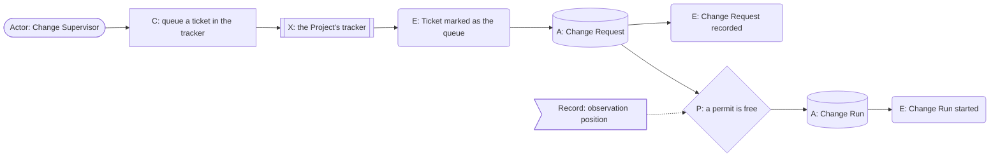

# Proposal: harden-event-storming

## Release note

Event storming requires a rendered canvas of real actors, commands, aggregates, and events, where every aggregate is a declared consistency boundary — never a record, a specification, or a configuration.

## Use-Case Context

- Use-case ID: fragment `support` — capability `generate-ideation-guidance`
- Ideation topic: none — originates from user feedback (2026-10-03)
- Seed path: none
- Confirmed Personas: `developer--primary-user` (reads the ideation guidance), `agent--technical-role` (runs the event storming phase), `givn-maintainer--owner` (owns the guidance corpus)

## Problem / Opportunity

The event storming guidance fails in two ways, both observed in one incident.

**No canvas.** The guidance describes the phase as a text chain — one event per line, each line naming actor, command, policy, and read model — and never asks for a picture. Across four repositories eleven `eventstorming.md` records exist; ten contain no diagram at all, and the single record with a diagram charts events only: no command, no aggregate, no actor appears in it. A reviewer cannot see the causal chain or who commands what without reconstructing it from prose, and gaps — an event with no command, a command with no actor — stay invisible because prose cannot show absence.

**No element legality.** When an agent is pushed to add the missing layer, nothing tells it what an aggregate is, so it invents them. In the kiekste `interface-abilities` topic, the first canvas drew `Interface contract`, `Adapter declaration`, `Run destination`, `Observation position`, `Evaluation`, and `Preview grant` as aggregates. All six are wrong: the interface contract is a static specification with no runtime commands; the adapter declaration is host configuration plus recorded evidence; the run destination is a field pair on real aggregates; the observation position is a cursor record; the evaluation and the preview grant are records. Only `Project`, `Change Request`, and `Change Run` are aggregates there. A canvas check that asks only "does it show aggregates?" passes this draft — the failure mode survives its own remedy, and the invented aggregates propagate into event lines, use cases, and change seeds.

## Proposed Solution

### Requirements (observable outcomes)

1. **The canvas is part of the record.** An event storming record carries one or more mermaid diagrams in `eventstorming.md` that show every event, command, aggregate, and actor of the chain. A text chain without a canvas is an incomplete event storming. The causal reading is stated: a command sits between the actor that issues it and the aggregate it changes; the aggregate emits the events.
2. **Kinds are distinguishable in the picture.** A reader can tell from the canvas itself which node is an actor, a command, an aggregate, an event, a policy, a read model, an external system, and which is a record or specification — through a legend or per-node kind markers. Coverage cannot be reviewed from a picture whose kinds are invisible.
3. **Every event line names its aggregate**, beside its actor, command, policy, and read model, so the lines and the canvas cannot drift apart.
4. **Aggregate legality.** Every aggregate in the canvas and in the event lines is a consistency boundary: a domain-noun root that receives commands and emits events under one invariant, and it names the commands it receives and the events it owns. The project's declared aggregates (the arc42 glossary's "Aggregates / boundaries") are reused by name. A new aggregate is introduced as a domain term — root noun, invariant, commands, events — and confirmed by the user before the canvas relies on it.
5. **Non-aggregates are named as what they are.** A contract, a declaration, a configuration, a cursor position, a grant, a report, a request record, or a hosted service is a record, a specification, a configuration, or an external system — never an aggregate. Record-like nouns are never drawn in the aggregate shape.
6. **The phase review checks the canvas**, not only the text: coverage (every event, command, aggregate, actor appears), legality (every aggregate is a declared or confirmed boundary; no record, specification, configuration, or service drawn as one), agreement (the canvas and the lines name the same aggregates), and rendering (a diagram that does not render is incomplete).
7. **The command guardrails repeat the rule** in one line, so an agent that reads only the command still ships a canvas.
8. **The human-facing records define event storming as the canvas with legal elements**: the phase row in the workflow document and the glossary row.

### The rules the generated guidance must carry

Verbatim, for the implementer — the ideation skill's Event Storming bullets:

```text
- One event per line, past tense, in the domain's own language.
- For each event: who triggers it (actor), with which command, on which
  aggregate (the consistency boundary the command changes), which policy
  reacts, what the actor reads (read model).
- Draw the canvas: one or more mermaid diagrams in `eventstorming.md` that
  show every event, command, aggregate, and actor, with the kinds
  distinguishable (per-node kind markers or a legend). A command sits between
  the actor that issues it and the aggregate it changes; the aggregate emits
  its events.
- Aggregates are given, not minted. An aggregate is a consistency boundary:
  a domain-noun root that receives commands and emits events under one
  invariant. Reuse the aggregates the project already declares (the arc42
  glossary's "Aggregates / boundaries"); a new aggregate is introduced as a
  domain term — its root noun, invariant, commands, and events — and
  confirmed before the canvas relies on it.
- A contract, a declaration, a configuration, a cursor position, a grant, a
  report, a request record, or a hosted service is a record, a specification,
  a configuration, or an external system — never an aggregate. Name the kind
  where the canvas shows it.
- A text chain without a canvas is an incomplete event storming: the picture
  and the lines must cover the same elements, and the canvas must render.
```

The quality-review lens for the phase:

```text
- Event Storming: symmetry of cause and effect, missing event partners, a
  canvas that shows every event, command, aggregate, and actor with its kinds
  distinguishable, every aggregate a declared glossary aggregate or a
  confirmed domain term (a record, specification, configuration, or service
  drawn as an aggregate is a defect), the lines and the picture naming the
  same aggregates, a canvas that renders, and a recorded collision check for
  every `confirmed` term entry.
```

The command guardrail line:

```text
- The event storming ships a rendered mermaid canvas naming every event,
  command, aggregate, and actor — and every aggregate is a declared
  consistency boundary, never a record or a specification.
```

The workflow document's phase row:

```text
| event storming | domain events in past tense, reverse narrative ("which events must happen for this?"), commands/actors/aggregates/policies, a rendered mermaid canvas showing every event, command, aggregate, and actor with legal aggregates (declared boundaries, never records or specifications), hotspots parked | `eventstorming.md`, `domain-terms.md`, `questions.md` |
```

The glossary row:

```text
| **Event Storming** | The ideation phase that models the domain as a chain of past-tense domain events with actors, commands, aggregates, policies, and read models, drawn as a rendered mermaid canvas whose aggregates are declared consistency boundaries (never records, specifications, configurations, or services). Anti-term: Storm (rejected as ambiguous). |
```

### Examples

**Example 1 — the incident's elements, judged.**

| Drawn in the shape of an aggregate | Legal? | Correct kind | Why |
|---|---|---|---|
| `Project` | yes | aggregate | the consistency boundary owning bindings, connection records, the queue and permits, the forge record |
| `Change Request` | yes | aggregate | the persisted order; one item admits one order under its uniqueness rule |
| `Change Run` | yes | aggregate | run state, the single driver lease, Run Events, the destination override |
| `Interface contract` | no | specification | a static declaration of abilities; no runtime command changes it, no state transition |
| `Adapter declaration` | no | configuration and recorded evidence | the deployment operator edits host configuration directly |
| `Run destination` | no | fields of `Change Request` and `Change Run` | state inside real aggregates, not a boundary of its own |
| `Observation position` | no | record (a cursor) | written by the engine as part of an act; the guarded act's uniqueness lives on the order record |
| `Evaluation`, `Preview grant` | no | records | recorded verdicts and grants, each with a rule, none with commands of its own |

**Example 2 — a correct minimal canvas.** Actor, command, external system, two aggregates, a policy, events, a record — every kind distinguishable.



**Example 3 — an event line before and after.**

Before (no aggregate — the canvas has nothing legal to draw):

```text
| 31 | Change Request recorded | Engine | the one persisted-order path | order record |
```

After:

```text
| 31 | Change Request recorded | Engine | record the order | Change Request | source connection, external item, and origin recorded; one ticket is one order | order record |
```

**Example 4 — a rejected canvas fragment.** `[(A: Interface contract)] --> [(A: Adapter declaration)]` is a defect: neither receives a command nor enforces an invariant. The corrected drawing puts both in record/specification shapes and leaves the aggregate shape to `Change Request`, `Change Run`, and `Project`.

## Capability Routing

| Proposed capability | Decision | Rationale |
|---|---|---|
| `generate-ideation-guidance` | `EXTEND generate-ideation-guidance` | Route reports no signal. The capability is declared in `givn/specs/fragments/fragment.md`; this change amends the guidance it owns, so the delta lives under `specs/fragments/` per the fragment convention. |

## Out of Scope

- Machine enforcement: no lint rule, parser, or gate inspects the canvas. The rule is authoring guidance checked at the phase boundary (accepted risk R-46); a mechanical check is a separate decision.
- Mermaid syntax validation or a rendering gate in the toolchain; "the canvas must render" is a review obligation on the author.
- Repairing existing `eventstorming.md` records in consumer projects; the change fixes the rule, not the artifacts written under the old one.
- The other ideation phases and their artifacts; the domain-modeling skill's aggregate discipline is referenced, not restated or amended here.

## Open Questions

### D1 — Canvas shape: prescribed edges or coverage

- Question: does the rule prescribe the diagram's node-and-edge vocabulary (actor → command → aggregate → event), or require coverage — that every event, command, aggregate, and actor appears?
- Options:
  1. **Coverage rule.** Every event, command, aggregate, and actor appears; the arrangement stays the author's choice. Gain: fits any domain, cannot be satisfied by an empty picture; cost: causality may be drawn loosely.
  2. **Prescribed shape.** Every canvas uses actor → command → aggregate → event edges. Gain: uniform diagrams; cost: domains with policies, read models, or event-less commands fight the template.
  3. **Presence only.** One diagram, content unchecked. Gain: minimal; cost: a decorative picture satisfies the letter and the failure returns.
- Disposition: **answered — coverage rule** (user, 2026-10-03): the one or more diagrams show every event, command, aggregate, and actor; the causal reading is stated but the shape stays explanatory.

### D2 — Enforce the canvas mechanically

- Question: does a check verify that `eventstorming.md` contains a rendered canvas with the four element kinds?
- Options:
  1. **Guidance only.** The rule lives in the generated guidance and the phase review. Gain: no parser, no false positives; cost: an agent can still skip it.
  2. **Advisory lint.** A warning when a topic's `eventstorming.md` has no diagram. Gain: early signal; cost: a new check on ideation state, history warns.
  3. **Hard gate.** Handoff refuses without the canvas. Gain: guaranteed; cost: bricks in-flight topics, needs a classifier.
- Disposition: **out of scope** — guidance only (user, 2026-10-03); ideation state stays convention exercised at the phase boundary (R-46).

### D3 — Must the canvas distinguish the element kinds

- Question: must a reader be able to tell which node is an actor, a command, an aggregate, an event, a record, and so on, or is a diagram of untyped boxes enough?
- Options:
  1. **Kinds distinguishable** — per-node markers or a legend (chosen). Gain: coverage and legality are checkable from the picture; cost: one convention to follow.
  2. **Untyped boxes.** Gain: minimal; cost: "shows every aggregate" becomes unverifiable, and the canvas stops being an event storming artifact.
- Disposition: **answered — kinds distinguishable** (user, 2026-10-03): the request is a representation with real actors, aggregates, events, and commands.
