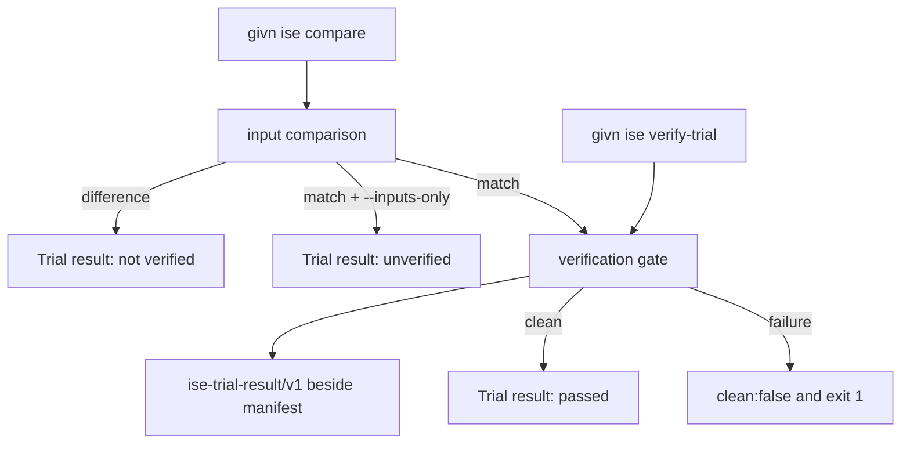

# Design: ise-compare-runs-trial

## Scope

Make `givn ise compare` the normal trial command. It compares the frozen
inputs, then executes the generated verification contract when they match,
writes the `ise-trial-result/v1` record outside the copy, and exits 0 only for
`clean: true`. `--inputs-only` keeps the read-only input check. The explicit
`givn ise verify-trial` command remains for a caller that names the result path
or records a not-run decision. No numeric coverage non-decline rule is added:
the gate stays the exact declared component and End-to-end execution-unit
multiset plus the existing non-zero component line measurement.

## Architecture Impact

| Area | Change |
|---|---|
| `src/main.rs` | `ise compare` gains `--result <file>` and `--inputs-only`; the two flags conflict. |
| `src/cli/ise.rs` | `CompareCommand` carries manifest, copy, optional result, and the inputs-only switch. `compare` validates and revokes the result path before the comparison, then either reports inputs-only unverified, reports an input difference, or runs the shared verification gate and renders its trial report. The default result path is `<manifest>.trial-result.json`. |
| `src/ise/verify.rs` | `prepare_trial_result` refuses a result equal to the manifest, inside the checkout, inside the copy, or a symlink; it removes a previous file only when it is a regular Givn trial result, and a raw sibling only when it is a regular Givn runner result. The rest of the gate is unchanged. |
| `src/ise/compare.rs` | Unchanged; it remains the input-only helper used internally by `verify_trial`, so the new CLI path cannot recurse. |
| `assets/instructions/ise.md` | The commands table, the trial-gate section, and a new **Component workflow** obligation: write the component runner, steps, fakes, and fixture builders; execute the frozen component feature files; record per-tier coverage; never substitute a coverage number for execution. |
| `docs/reference.md`, `README.md`, `docs/glossary.md`, `docs/arc42/**` | Describe the executed compare path, `--inputs-only`, the default result path, freshness, and the security boundary; update TC-53, ADR-076, risks, and the trial-result glossary entry. |
| `tests/ise_component_tier_gate.rs`, `tests/ise_passuff_trial.rs` | Passuff-shaped and ten-component fixtures exercise default compare with step-binding component runners: a clean trial, a missing component runner, count mismatches, result-path safety, and inputs-only. |
| `tests/steps/trial_input_verification_steps.rs`, `e2e/tests/steps/trial_input_verification_e2e_steps.rs`, `tests/steps/prose_consolidation_steps.rs` | Bind the delta scenarios; the permanent comparison phrase uses `--inputs-only`; the e2e fixture runs the real contract through compare. |

### Contracts and Components

| Contract | Consumer use case | Consumers | Implementing component today | Split trigger |
|---|---|---|---|---|
| `IseTrial` (compare/verify-trial CLI) | `prepare-an-ise-test` | Independent verifier or harness | `cli::ise` plus `ise::verify` | The verifier grows a second execution backend or a non-CLI surface |
| `ServedInstruction` (ise guidance) | `obtain-effective-guidance` | Builder agent | `src/cli/instructions` plus `assets/instructions/ise.md` | Another instruction id needs an independent source |



## Data Model

No manifest, contract, or result schema changes. The existing
`ise-trial-result/v1` record is reused. The only new path rule is the default
result location: the selected manifest's file name plus
`.trial-result.json` in the same directory. `prepare_trial_result` resolves it
through `resolved_target`, refuses a symlink or a path equal to the manifest,
inside the checkout, or inside the canonical copy, and removes a previous file
only when it parses as a regular Givn trial or runner result.

## Step Definitions

| Capability | Step definition file | Permanent merge target |
|---|---|---|
| `trial-input-verification` | `tests/steps/trial_input_verification_steps.rs` | same file |
| `trial-input-verification` (E2E) | `e2e/tests/steps/trial_input_verification_e2e_steps.rs` | same file |
| `serve-extended-rules` | `tests/steps/prose_consolidation_steps.rs` | same file |
| fixture builders | `tests/steps/ise_clean_room_support.rs` | same file |
| E2E fixture builders | `e2e/tests/steps/ise_clean_room_support.rs` | same file |

## Test Runner

- Regular: `./run-tests.sh --non-e2e`.
- End-to-end: `./run-tests.sh --e2e --package e2e`.
- Delta scope: `GIVN_FEATURES=givn/changes/ise-compare-runs-trial/specs ./run-tests.sh --non-e2e`.
- Integration tests: `cargo test --locked --test ise_component_tier_gate -- --test-threads=1`
  and `cargo test --locked --test ise_passuff_trial -- --test-threads=1`.

## Single-Scenario Run Command

```sh
GIVN_FEATURES=givn/changes/ise-compare-runs-trial/specs \
  cargo test --locked --test features_runner -- --name '^<scenario title>$'
```

The E2E package runs the same feature files through the separate `e2e_runner`.

## Strict Mode

The runner is cucumber-rs. `tests/features_runner.rs` calls
`.fail_on_skipped()` and exits non-zero when `stats.failed > 0 ||
stats.skipped > 0`; an undefined or pending step therefore fails the command.
The `e2e_runner` carries the same strictness. Every new step must have a body
that asserts observable output; no empty step is admitted.

## Decisions

- **Decides D1**: `givn ise compare` executes the trial by default after the
  frozen inputs match. Realized in `cli::ise::compare`, the delta E2E scenario,
  and the Passuff-shaped integration test. The operator rejected a green input
  comparison with `Trial result: unverified` as the normal path.
- **Decides D2**: `--inputs-only` is the explicit read-only form. It executes
  no contract command, writes no result, prints
  `Trial result: unverified (inputs only; no trial command was executed)`, and
  exits 0 only when both subjects match. Realized in `cli::ise::compare` and
  the modified `Comparison labels frozen-input equality as unverified` scenario.
- **Decides D3**: `givn ise verify-trial` remains the explicit executor for a
  named result path and `--component-not-run`. `compare` is the canonical
  path; both call the same `ise::verify_trial` gate, and the library
  `ise::compare` stays the internal input-only helper, so there is no
  recursion.
- **Decides D4**: the result defaults beside the manifest
  (`<manifest>.trial-result.json`) and `--result` overrides it. The result path
  refuses when it equals the manifest, lies inside the checkout, lies inside
  the copy, or is a symlink. The path is validated and a previous result is
  revoked before the comparison, including when the inputs differ; a previous
  file is removed only when it is a regular Givn trial result, and a raw
  sibling only when it is a regular Givn runner result. A directory, symlink,
  malformed file, or unrelated file refuses. Realized in
  `cli::ise::default_result_path`, `ise::prepare_trial_result`, and the CLI
  compare preflight; `--inputs-only` touches no result.
- **Decides D5**: compare executes the copy's declared commands. The help,
  reference, and served guidance state it; `--inputs-only` is the safe path on
  an untrusted copy. This supersedes ADR-076's 2026-11-18 rejected alternative.
- **Decides D6**: no numeric coverage non-decline rule. The gate remains the
  exact declared scenario execution-unit multiset and the existing non-zero
  component line measurement; per-tier coverage is recorded, and a subprocess
  End-to-end report stays uninstrumented. Research showed the pre/post
  source-line percentage compares different files and denominators (4293 vs
  4965) and can pass vacuously when the branch denominator is zero.
- **Decides D7**: the served ise guidance requires the builder to write the
  component runner, step definitions, fakes, and fixture builders, and to
  execute the frozen component feature files, even though those features stay
  in the Specification. Deleting, skipping, or replacing a component scenario
  is a Specification edit. Realized in `assets/instructions/ise.md` and the
  new `Served ise guidance requires the ordinary component workflow` scenario.
- **Decides D8**: Ise rebuild decision: `No rebuild`. This change edits the
  existing verifier and guidance; no Source code is replaced, and no
  `Rebuilt code` line is recorded.
- **Decides D9**: the component fixtures use a minimal step-binding runner,
  not a title printer: it parses the frozen feature, executes the `Given
  nothing` step for every non-`@e2e` scenario, refuses an unbound step, and
  writes the executed titles. The gate still validates the declared multiset;
  the runner is representative of a project script, not the real Passuff
  consumer, and no claim is made that the actor's actual Passuff trial passes.

## Use-Case Traceability

| Use-case guarantee, rule, or capability | Decision | E2E or regular evidence |
|---|---|---|
| Frozen-input equality precedes every trial result | D1, D2 | `Verifier compares the spec copy with the manifest and runs the trial`; `Comparison labels frozen-input equality as unverified` |
| The kept component corpus executes exactly as declared | D1, D6, D7 | `Comparison refuses a missing component runner`; Passuff-shaped integration tests |
| The result is evidence outside the copy and describes the current attempt | D4 | `Comparison refuses a trial result inside the spec copy`; freshness block in `verify_trial` |
| The End-to-end suite drives the rebuilt product | existing gate | Passuff product binding test through compare |
| Guidance names the normal path and the safe path | D2, D5, D7 | `Served ise guidance distinguishes the trial gate from input equality`; `Served ise guidance requires the ordinary component workflow` |
| `trial-input-verification` interaction inventory | D1 | `Verifier compares the spec copy with the manifest and runs the trial` |

Persona impact: `developer--primary-user` and `agent--technical-role` read the
new command output and guidance; the change is CLI text only, no visual design
contract.

## Version Freshness

No new language, runtime, framework, library, database, browser, or container
version is introduced. The repository reuses the pinned Rust toolchain and the
existing cucumber-rs runner.
