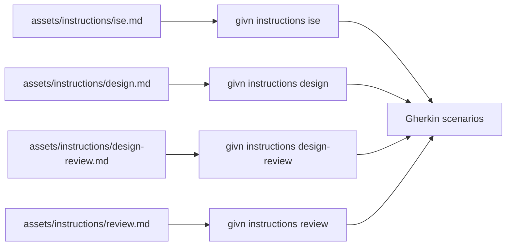

# Design: ise-rebuild-decision-and-working-tree-ship

## Scope

A documentation-and-guidance change with Gherkin and step-definition additions. No product command, flag, exit code, persisted format, report label, or `ise-manifest/v1` field changes. The behavior under test is the served text and the executable scenarios that assert it.

The site edit lives in the separate repository `/home/buster/projects/iseprinciples`; it uses the shared Ise vocabulary and names no Givn command, flag, or record. It is verified as a rendered page, not a Givn delta.

**Direct work already landed.** The operator authorized plain 1:1 renamings outside a Givn change, then decided in this session that the new working-tree guidance text is also direct work. The vocabulary sweep and the guidance text are committed at `bbd7de5dac0121e25d8ca0158b5d57dc4cb18e98`. The delta carries only the new regression scenarios that assert the ship sequence, the limitation, the copy distinction, the restart rule, and the `No rebuild` line.

## Architecture Impact

| Surface | Change | Owner |
|---|---|---|
| `assets/instructions/ise.md` | Ise rebuild decision, two rebuild practices, working-tree ship sequence, limitation, implementation freedom, rebuild impact record content, and the https://iseprinciple.org citation. Copy-based rules kept. | served `ise` instruction |
| `assets/instructions/design.md` | One Ise rebuild decision and the plain `Rebuilt code` line; points at the `ise` instruction for the ship sequence. | served `design` instruction |
| `assets/instructions/design-review.md` | Keeps an unresolved decision and a rebuild with no `Rebuilt code` line findings. | served `design-review` instruction |
| `assets/instructions/review.md` | Working-tree limitation and rebuild impact record; the clean-room scan is its own line. | served `review` instruction |
| `assets/instructions/architecture-principles.md` | Names the callable boundary **Component Interface**. | served `architecture-principles` instruction |
| `assets/instructions/archive.md` | Manifest-entry vocabulary in the archive guard. | served `archive` instruction |
| `assets/instructions/domain-modeling.md`, `ideation.md` | Component Interface in the term-introduction example and persona stance. | served instructions |
| `assets/specification.yaml.tmpl` | Specification Manifest and category wording in the scaffold. | scaffold |
| `docs/glossary.md`, `docs/reference.md`, `docs/arc42/**` | Vocabulary authority, operational reference, and current architecture descriptions. | durable documentation |
| `README.md` | Cites https://iseprinciple.org and names the Component, Component Interface, spec-copy manifest, and project working tree in the command table. | project README |
| `givn/specs/create-change/ise-rebuild-decision.feature` | Renamed decision capability; the decision values and `Rebuilt code` line. | permanent spec |
| `givn/specs/declare-the-specification/specification-manifest.feature` | Renamed declaration capability with the Specification Manifest and category wording. | permanent spec |
| `givn/specs/create-change/prose-consolidation.feature`, `initialize-project/enable-optional-addons.feature`, `upgrade-a-project/apply-a-managed-upgrade.feature`, `obtain-effective-guidance/serve-extended-rules.feature`, `verify-change/check-specification-health.feature` | Vocabulary-only scenario text and bindings for the same behaviors. | permanent specs |
| `givn/specs/fragments/instruction-integrity.feature` | Served-text contract for the `ise` instruction. | permanent spec |
| `givn/specs/create-change/usecase.md`, `declare-the-specification/usecase.md`, `prepare-an-ise-test/usecase.md` | Decision rules, Specification Manifest, and the copy-vs-ship distinction. | durable contracts |
| `tests/steps/instruction_integrity_steps.rs`, `change_strategy_steps.rs`, `spec_gap_steps.rs`, `prose_consolidation_steps.rs`, `enable_optional_addons_ise_steps.rs`, `run_upgrade_steps.rs`, `serve_extended_rules_steps.rs`, `specification_health_steps.rs`, `specification_declaration_steps.rs` | Bind the renamed and new assertions. | permanent step files |
| `e2e/tests/steps/change_strategy_e2e_steps.rs` | Binds the modified `@e2e` decision scenario. | e2e step file |

The change is one served-guidance surface with no runtime composition change:

### Contracts and Components

No Component or contract is added or changed. The served guidance assets are documentation, not a Component; the existing CLI binary is the consumer surface the scenarios exercise.

| Contract | Consumer use case | Consumers | Implementing component today | Split trigger |
|---|---|---|---|---|
| (none added) | `create-change`, `obtain-effective-guidance`, `verify-change` | Developer, authoring agent, independent reviewer | existing CLI instruction server | none |

## Data Model

None. The delta reads no persisted state and writes none. `ise-manifest/v1` is unchanged.

## Step Definitions

| Capability | Step definition file | Permanent merge target |
|---|---|---|
| `instruction-integrity` | `tests/steps/instruction_integrity_steps.rs` | the same file |
| `ise-rebuild-decision` | `tests/steps/change_strategy_steps.rs` | the same file |

This table lists the delta's new bindings; the direct-work bindings are listed in Architecture Impact. The new phrases bind in the permanent files before the delta runs. Archive's phrase comparison therefore finds a permanent binding for every delta phrase.

## Test Runner, Strict Mode, and Stubs

- Regular scope: `./run-tests.sh --non-e2e`, which runs `cargo fmt --all -- --check`, `cargo clippy --locked --all-targets -- -D warnings`, and the cucumber-rs suite over `givn/specs`.
- Change scope: `GIVN_FEATURES=givn/changes/ise-rebuild-decision-and-working-tree-ship/specs GIVN_CUCUMBER_TAGS='not @e2e and not @givn.removed' cargo nextest run --locked --test features_runner`.
- One scenario: `GIVN_FEATURES=<feature> GIVN_CUCUMBER_TAGS='not @e2e and not @givn.removed' cargo nextest run --locked --test features_runner -E 'test("<feature>::<scenario title>")'`.
- E2E scope (unchanged, used by archive): `./run-tests.sh --e2e --package e2e`.
- Strict mode: `tests/features_runner.rs` calls `.fail_on_skipped()` on the cucumber builder; the e2e package runner fails on a skipped step.
- Not-implemented stub: every new step body starts as `unimplemented!("<step text>: no assertion yet")` (or an explicit panic), never an empty or no-op body, and carries `@wip` until GREEN. The delta carries no `@wip` at archive.

## Decisions

- **Decides D1: the whole-system decision value is `Whole-system rebuild`.** Realized in `docs/glossary.md`, `assets/instructions/ise.md`, `assets/instructions/design.md`, and the site.
- **Decides D2: full manifest split.** `givn/specification.yaml` is the **Specification Manifest**; generated `ise-manifest/v1` evidence is the **spec-copy manifest**; effective artifact rules are **the Givn configuration**; package build files are named concretely (`Cargo.toml`). Realized in the glossary, reference, and instructions; the `--manifest` flag and `ise-manifest/v1` fields are untouched.
- **Decides D3: the review record is the `Rebuild impact record` with effects only.** The clean-room scan is its own line; a file read but undeclared is a `specification defect`. Realized in `ise.md`, `review.md`, `reference.md`, and the glossary.
- **Decides D4: the `Specification role`/`path`/`file` sweep is direct work.** The operator selected the full sweep, then directed that plain 1:1 renamings land as direct work outside a Givn change, and then decided that the new working-tree guidance text is direct work too. Served guidance, reference, Arc42, the `declare-the-specification` and `create-change` narratives, and the changed capabilities use category, manifest entry, matched file, and Specification file in the spec copy. The deliberate exception is the unchanged `prepare-an-ise-test` narrative and its two feature files: their sentences describe the unchanged external-copy command, whose report labels remain `Specification files:`. The literal report subjects and error text (`Specification files:`, `Specification changed after the copy was written`, and the `ise compare:` refusal at `docs/reference.md:661`) keep their bytes for the same reason. A later wording-migration change can sweep the exception without touching behavior.
- **Decides D5: the ship path is instruction-only.** `givn ise rebuild-component` keeps its external-copy contract. Realized in `ise.md` and `reference.md`.
- **Decides D6: `Ise Test` is redefined for both practices.** The copy path isolates history; the working-tree path relies on an instruction and states its limitation. Realized in the glossary and `ise.md`.
- **Decides D7: no archive timing change.** The active delta is verified by `givn check tasks`; review checks the projection; archive merges once. Verified in `src/cli/check.rs`, `src/spec/projection.rs`, and `src/cli/archive.rs`; no code change.
- **Decides D8: this change is `ise rebuild decision No rebuild`.** It edits guidance, specifications, and step definitions and replaces no Source code; it records no `Rebuilt code` line. The affected consumers are the authoring agent, the developer, and the site reader; no persisted state or rebuild boundary is involved.

## Use-Case Traceability

| Guarantee or rule | Technical decision | Evidence |
|---|---|---|
| One recorded decision with three values | D1, `design.md` decision block | direct-work permanent scenario `The design guidance requires one Ise rebuild decision` (`bbd7de5`) |
| A rebuilding change records `Rebuilt code: discard` or `ship`; No rebuild records none | D1, `design.md`, `design-review.md` | direct-work permanent scenario plus the delta's `The design guidance omits the Rebuilt code line for No rebuild` |
| A ship rebuild runs in the current project working tree | D5, `ise.md` ship sequence | `instruction-integrity.feature` (added) |
| A passing ship verification does not prove Specification sufficiency | D6, `ise.md` limitation | `instruction-integrity.feature` (added) |
| The copy command never edits the working tree | D5, `ise.md`, `reference.md` | `instruction-integrity.feature` (added) |
| The review records outside effects and a separate scan line | D3, `review.md` | direct-work permanent scenario `The ise instruction records a rebuild's impact and consolidations` (`bbd7de5`) |
| The ship path requires no spec copy, candidate revision, early archive merge, generated spec-copy manifest, repository view that hides history, or sandbox | D5, `ise.md` | `instruction-integrity.feature` (added) |
| A changed Specification or E2E suite restarts verification | D5, `ise.md` | `instruction-integrity.feature` (added) |
| Archive merges the delta once | D7 | existing archive scenarios |
| This change itself does not rebuild | D8 | this design |
| Givn cites the principle source | reference direction | `instruction-integrity.feature` (added `The ise instruction cites the principle source`) |

## Interaction Coverage Matrix

| Capability | Inventory entry (owning use case) | Real driver | One `@e2e` scenario | Change treatment |
|---|---|---|---|---|
| `prose-consolidation` | request canonical E2E guidance | `givn instructions specs` | Canonical E2E policy is emitted by specs instructions | direct wording |
| `prose-consolidation` | synchronize and inspect generated E2E guidance | `givn skills sync` and `givn instructions specs` | Generated guidance points to the canonical E2E policy | direct wording |
| `visual-design-contract` | request the design guidance for a visual interface | `givn instructions design --change <id>` | Author requests the visual design contract guidance | unchanged; inventory checked |
| `visual-design-contract` | read the synchronized design and step guidance | `givn instructions design-review --change <id>` | Synchronized guidance defines the contract approval and capture mechanics | unchanged; inventory checked |
| `change-release-note` | create a change | `givn new <id>` | A new change's proposal carries the release-note field | unchanged; inventory checked |
| `change-release-note` | read the proposal guidance | `givn instructions proposal --change <id>` | The proposal guidance requires a release note | unchanged; inventory checked |
| `change-release-note` | read the generated implementation guidance | `givn instructions tasks --change <id>` | The generated implementation guidance shares the release note | unchanged; inventory checked |
| `ise-rebuild-decision` | read the design guidance for a rebuilding change | `givn instructions design --change <id>` | The design guidance requires one Ise rebuild decision | direct rename; delta adds the working-tree and No rebuild variants |
| `spec-gap` | read the review guidance after an Ise Test | `givn instructions review --change <id>` | The review guidance requires one spec gap outcome before any fix | direct wording |
| `specification-manifest` | declare the five categories and the replaceable source entries | `givn lint` | The declared categories are read by the project-health pass | direct rename |
| `clean-room-preparation` | prepare a spec copy | `givn ise rebuild-component` | Developer rebuilds the whole product from its Specification | unchanged; D4 exception |
| `trial-input-verification` | compare a spec copy with its manifest | `givn ise compare` | Verifier compares the spec copy with the manifest | unchanged; D4 exception |
| `instruction-integrity` | resolve an instruction and expose the machine contract | `givn instructions ise` and `givn instructions design-review` | An agent requests machine-readable artifact guidance | direct wording; delta adds the ship, limitation, copy-distinction, restart, and citation variants |
| `instruction-integrity` | request normal session-start instructions | `givn instructions` | Author starts a session with the universal dialog obligation | unchanged; inventory checked |
| `refresh-generated-guidance` | synchronize selected skills | `givn skills sync` | Synchronized guidance explains how to resolve the deterministic gates | unchanged; inventory checked |
| `adr-qualification-gate` | request architecture-decision guidance | `givn instructions design-review --change <id>` | An author requests the strict ADR guidance through the Givn CLI | unchanged; inventory checked |
| `review-architecture-documentation` | request architecture-aware review guidance | `givn instructions review --change <id>` | Arc42-enabled review instructions require conformance evidence | unchanged; inventory checked |
| `review-architecture-documentation` | eject the review template | `givn` CLI | The review template includes the Arc42 conformance block | unchanged; inventory checked |
| `review-architecture-documentation` | synchronize the generated review skill | `givn` CLI | Generated review guidance stays aligned after skill sync | unchanged; inventory checked |
| `attribute-commits` | initialize shared attribution plumbing | `givn` CLI | Consumer initializes a project and receives shared attribution plumbing | unchanged; inventory checked |
| `attribute-commits` | commit explicit selected paths with attribution | `givn` CLI | An attributed commit exposes the current LLM and harness | unchanged; inventory checked |
| `attribute-commits` | prepare attribution with OpenCode's selected model | `givn` CLI | OpenCode prepares attribution using its selected model | unchanged; inventory checked |
| `attribute-commits` | attribute a commit with Claude's current model | `givn` CLI | Claude attributes a commit using its current model | unchanged; inventory checked |
| `attribute-commits` | attribute a commit with omp's current model | `givn` CLI | omp attributes a commit using its current model | unchanged; inventory checked |
| `attribute-commits` | attribute a commit with Maki's current model | `givn` CLI | Maki attributes a commit using its current model | unchanged; inventory checked |
| `enable-commit-attribution` | inspect attribution installation | `givn` CLI | Consumer sees the commit attribution installation report | unchanged; inventory checked |
| `enable-commit-attribution` | upgrade missing attribution plumbing | `givn` CLI | Consumer upgrades an existing project with attribution plumbing missing | unchanged; inventory checked |
| `enable-commit-attribution` | initialize Fossil attribution | `givn` CLI | Consumer initializes a Fossil project and receives the givn commit path without a hook | unchanged; inventory checked |
| `measure-coverage-per-project` | inspect initialized test and coverage scripts | `givn` CLI | An initialized project documents reusable test and coverage scripts | unchanged; inventory checked |
| `measure-coverage-per-project` | publish line and branch badges when archiving | `givn` CLI | Archiving publishes line and branch badges from the merged report | unchanged; inventory checked |
| `coverage-readme-example` | receive a complete README coverage example | `givn` CLI | Coverage-enabled project receives a complete README coverage example | unchanged; inventory checked |
| `detect-the-project-repository` | detect the repository from a Git worktree at the project root | `givn` CLI | A Git worktree at the project root selects the Git backend | unchanged; inventory checked |
| `find-existing-scenarios` | find a permanent scenario by a step text token | `givn` CLI | Lexical search locates a permanent scenario by a step text token | unchanged; inventory checked |
| `find-existing-scenarios` | inspect per-use-case counts in the spec tree | `givn` CLI | The spec tree reports per-use-case counts and the use-case narrative | unchanged; inventory checked |
| `guide-domain-modeling` | receive domain guidance for the next step | `givn` CLI | An agent requests next-step guidance and is routed to the domain skill | unchanged; inventory checked |
| `guide-domain-modeling` | receive domain guidance for design | `givn` CLI | An agent requests the design guidance and is routed to the domain skill | unchanged; inventory checked |
| `guide-domain-modeling` | receive domain guidance for specs | `givn` CLI | An agent requests the specs guidance and is routed to the domain skill | unchanged; inventory checked |
| `guide-domain-modeling` | receive the domain skill after synchronizing skills | `givn` CLI | An agent synchronizes skills and the domain skill is routed | unchanged; inventory checked |
| `match-guidance-to-enabled-addons` | enable the addons a generated section needs | `givn` CLI | A consumer enables the addons a generated section needs and the guidance gains it | unchanged; inventory checked |
| `match-guidance-to-enabled-addons` | synchronize skills with disabled-addon sections omitted | `givn` CLI | A consumer synchronizes skills and the generated guidance omits disabled-addon sections | unchanged; inventory checked |
| `route-a-change` | route a proposal and inspect ranked candidates | `givn` CLI | Routing a proposal prints ranked candidates with evidence | unchanged; inventory checked |
| `show-coverage-in-the-readme` | place the coverage badge after the README title | `givn` CLI | Coverage-enabled project is guided to place the coverage badge directly after the README title | unchanged; inventory checked |
| `verify-repository-ownership` | archive and publish consolidated permanent specifications | `givn` CLI | Archive publishes consolidated permanent specifications | unchanged; inventory checked |
| `verify-repository-ownership` | accept explicit overlap dispositions in repository-wide review | `givn` CLI | Repository-wide review accepts explicit overlap dispositions | unchanged; inventory checked |

Every inventory entry of the touched use cases appears above with its existing `@e2e` scenario. No inventory row is invented for a regular variant; the new scenarios are variants of these actions.

## Visual Design Contract

- Interface: none
- Viewports: not applicable
- Design system: not applicable

The change renders no screen in this repository. The served guidance is terminal text, asserted by regular scenarios.

### Persona dispositions

| Persona | Relevance | Evidence |
|---|---|---|
| `developer--primary-user` | Authoring-instruction lens; the developer records the decision and follows the ship sequence. | `design.md` decision block and `ise.md` ship sequence scenarios. |
| `agent--technical-role` | Served-CLI consumer; the coding agent reads `givn instructions ise` and rebuilds. | `instruction-integrity.feature` scenarios that request the served instruction. |
| `givn-maintainer--owner` | Vocabulary and Arc42 owner; the maintainer keeps the glossary, reference, and chapters consistent. | `docs/glossary.md`, `docs/reference.md`, and the arc42 assessment. |

## E2E Infrastructure

The direct commit modifies the existing `@e2e` scenario; its step file is `e2e/tests/steps/change_strategy_e2e_steps.rs`, and it still runs from the declared `e2e` package. The package and `verify.e2e_command` are unchanged. The delta carries only regular added scenarios, because the real interface is the CLI text and the capability's `@e2e` smoke already exists.

## Black-Box-First

The scenarios drive the built binary and read its stdout. They do not read the asset files, so an embedded-asset or serving defect is caught.

## External Boundary Cases

None. The change adds no external service, message, or network boundary.

## Structural Model

`docs/domain-model.md` is assessed: the Change aggregate already owns the delta, design, review, and task evidence, and the project configuration already owns `givn/config.yaml`. The change names the recorded decision and the Specification Manifest in the Change aggregate's description and the project configuration entry, so the durable model matches the glossary. No new bounded context or aggregate is introduced.

## Risks and Tradeoffs

- **The instruction is the only enforcement for the ship path.** D5 keeps the command out of application code. The review records the limitation; it cannot prove history was unread. Recorded as chapter 11 risk R-165.
- **The copy-path narrative and scenario text keep old nouns.** Deliberate exception under D4, authorized by the operator's direct-rename decision. Do not report full corpus alignment until a wording-migration change lands.
- **Two manifest nouns.** The glossary states the distinction in one sentence each; the `--manifest` help names the spec-copy manifest.
- **The site is a separate repository.** Its verification is a rendered page check, not a Givn delta.
- **Direct work precedes the delta.** The operator decided that the vocabulary and the working-tree guidance text are direct work; the delta's added scenarios exercise them and are expected to pass immediately, which the workflow permits for a distinct requirement. The change's verification still runs the delta scenarios through the real binary.
