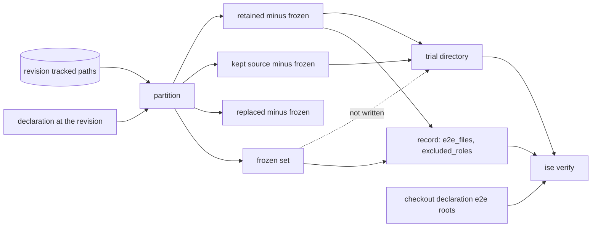

# Design: keep-frozen-verifier-out-of-the-trial

## Overview

The clean-room trial currently receives the `e2e` role like any other retained
role: `Partition::retained` is the union of the five declared roles plus the
declaration, and `copy_paths()` is `retained ∪ kept_source`. The record already
separates the frozen identity (`e2e_files`, `e2e_digest`) from the retained set,
but the copy set does not follow that separation, so the builder reads its own
acceptance evidence.

This change makes the frozen set a first-class placement. `src/ise/partition.rs`
computes the frozen set once per revision and removes it from `retained`, from
the replacement candidates, from `kept_source`, and from `outside`. The trial
writes `retained ∪ kept_source` as before, so the exclusion needs no new write
path or write-time exception: the trial remains exactly the revision's files
minus the replaced paths minus the frozen set, and every written file is still
compared to its revision content.

Three consequences follow and are each owned by one place:

- **The record names the exclusion.** `src/ise/record.rs` gains
  `excluded_roles`, so a reader pairs `Retained` with the roles whose files the
  trial does not hold instead of inferring the exclusion from a smaller number.
  The scope stays `ise-trial/v1`.
- **The report names it once.** `src/cli/ise.rs` prints one conditional
  `Frozen package: e2e, not copied (N files)` line between `E2E digest` and
  `Written path`.
- **Verification refuses a trial that holds one.** `src/ise/verify.rs` refuses,
  before comparing any identity, a trial that holds a path the frozen package
  covers, and only for a record whose `excluded_roles` names `e2e`.
  `givn/specification.yaml` and every path the record's `retained_files` lists
  are exempt from that test, so a legitimate trial whose `e2e` role resolves over
  `givn/**` is not refused for holding its own declaration. A record written
  before this rule names no excluded role, so its trial's frozen files are
  retained entries and the retained comparison still covers them.

Writer-side exclusion plus verifier-side refusal make the guarantee a property
of the trial directory rather than of one command.



## Visual Design Contract

```text
- Interface: terminal
- Viewports: not applicable — terminal text surface; no browser viewport
- States: preparation success and refusal, verification clean and refusal, all
  terminal text
- Design system: not applicable; the line follows the existing
  `Label: value` report convention and the refusals follow `ise verify: ...`
  on stderr
```

`Interface: terminal` is deliberate: the change alters one report line and adds
one refusal, not a rendered screen. The one modified `@e2e` scenario
(`Developer prepares a clean-room trial from a recorded revision`) commits its
transcript at
`givn/changes/keep-frozen-verifier-out-of-the-trial/evidence/visual/developer-prepares-a-clean-room-trial-from-a-recorded-revision/transcript.txt`.
The refusal and compatibility scenarios are regular scenarios; only `@e2e`
evidence is enforced, so they commit no transcript. No screenshots and no
viewports apply.

Persona impact: **developer--primary-user** (reads the frozen line and hands the
trial over), **agent--technical-role** (rebuilds from the Specification alone
and no longer sees the acceptance suite), **givn-maintainer--owner** (owns the
frozen-boundary rule and the record shape).

## Use-Case Traceability

Owning use-case ID: `prepare-an-ise-test`
Capabilities: `clean-room-preparation` (modified) and `trial-input-verification`
(modified)
Ideation source: `ise-rebuildability` (settled rule that the frozen
`End-to-end (E2E) test` package runs outside the builder's authority); no change
seed.
Confirmed Persona IDs: `developer--primary-user`, `agent--technical-role`,
`givn-maintainer--owner`

Base narrative digest: the delta's `givn:base-sha256` records
`7953c190a04eed4909012c16d586293f8872ff778c779ee0e508e1c26cad51cb`, the
current `givn/specs/prepare-an-ise-test/usecase.md` digest, verified with
`sha256sum`. The change `add-delivery-identity-to-trial-record` is in review on
this branch and carries its own delta of the same document with the same base
digest; whichever change archives second must re-derive its digest against the
merged document. The tasks author must carry this statement into `tasks.md`.

| Use-case contract element | Technical decision | Capability / E2E evidence |
|---|---|---|
| Main flow 2: partition includes the frozen package | `partition()` computes the frozen set from `e2e_file_set` and removes it from every other bucket | `clean-room-preparation`; scenario "Developer prepares a clean-room trial from a recorded revision" |
| Main flow 4: no frozen path enters the trial | `Partition::copy_paths()` is `retained ∪ kept_source`, and the frozen set is in neither | scenario "Developer prepares a clean-room trial from a recorded revision" (trial omits both package files) |
| Main flow 5: the record names the excluded role | `TrialRecord::excluded_roles` built from `Role::E2e.as_str()` when the frozen set is non-empty | scenario "The trial record names the frozen role its trial omits" |
| Rule: a frozen path is neither retained, kept source, replaced, nor outside | Four `!frozen.contains(path)` filters in `partition()` | scenarios "Developer prepares a clean-room trial from a recorded revision" (`Retained: 2`, `Replaced: 1`) and "A frozen package root that covers the declaration keeps it in the trial" |
| Rule: the declaration is never frozen | `frozen.remove(DECLARATION_PATH)` after resolving the frozen set, and `require_frozen_absent` exempts it on the verifier side | scenarios "A frozen package root that covers the declaration keeps it in the trial" and "A frozen role that covers the declaration re-checks clean" |
| Rule: `Retained` equals `retained_files.len()` and counts no frozen path | The retained vector and the `retained_files` map are built from the same `retained_paths()` | scenario "Developer prepares a clean-room trial from a recorded revision" |
| Rule: the record keeps `ise-trial/v1`; a record without `excluded_roles` names no excluded role | `SCHEMA` and `CONTENT_SCOPE` unchanged; `#[serde(default)]` on the new field | scenario "Verification keeps a trial prepared before the package was excluded re-checkable" |
| Rule: the `Frozen package` line prints only when the frozen set is non-empty | `Report::excluded_roles` empty when nothing is frozen; `render` prints the line only when non-empty | scenarios "Developer prepares a clean-room trial from a recorded revision" and "A declaration with no frozen package excludes no role" |
| Main flow 6 / Extension 6: refuse a trial that holds a frozen path | `require_frozen_absent` in `verify`, before any identity comparison; it exempts `givn/specification.yaml` and every path the record's `retained_files` lists | scenarios "Verification names an e2e package file changed in the trial", "Verification bounds the frozen paths it refuses", and "A frozen role that covers the declaration re-checks clean" |
| Rule: a trial-side frozen path is one the record's `e2e_files` lists or one `E2eBoundary::contains` covers, unless it is exempt | the recorded set plus the checkout's resolved roots, tested through `E2eBoundary::contains` | scenarios "Verification names an e2e package file changed in the trial" (recorded set), "Verification bounds the frozen paths it refuses" (checkout roots), and "A frozen role that covers the declaration re-checks clean" (retained exemption) |
| Rule: the `Frozen package` line counts the frozen set | `Report::frozen_files` is `partition.frozen.len()`; the record's `e2e_files` keeps one identity per resolved package path | scenario "A frozen package root that covers the declaration keeps it in the trial" (`(1 file)` printed while `e2e_files` holds two identities) |
| Rule: the trial-side refusal is bounded at twenty paths | `FROZEN_REPORT_LIMIT` and the remainder count | scenario "Verification bounds the frozen paths it refuses" |
| Rule: the `e2e` identity is compared against the checkout, never the trial | `check_checkout` is unchanged; `check_retained` iterates `retained_files`, which holds no frozen path | scenarios "Verification names an e2e package file changed in the checkout" (permanent, unchanged) and "Verification names every drifting path in one run" |
| Rule: a dry run lists no frozen path in `Would write:` | `would_write` is `copy_paths()`, which excludes the frozen set | scenario "A dry run performs every read and writes no trial or record" |
| Success guarantee: the trial holds no path the frozen package covers | writer exclusion plus the verifier refusal | both `clean-room-preparation` and `trial-input-verification` scenarios above |

## Architecture Impact

No new module and no new dependency. Six source files and three durable
documents change.

| File | Change |
|---|---|
| `src/ise/partition.rs` | `Partition` gains `frozen`; `partition()` computes the frozen set and filters it out of retained, candidates, kept source, and outside; `frozen_paths()` accessor |
| `src/ise/mod.rs` | reports `frozen_files` and `excluded_roles`; passes the frozen paths to `require_copy_set`; builds the record field |
| `src/ise/record.rs` | `TrialRecord::excluded_roles` with `#[serde(default)]` |
| `src/ise/verify.rs` | loads the declaration before the comparisons, adds `require_frozen_absent` and the trial walk, threads the declaration into `check_checkout` |
| `src/cli/ise.rs` | renders the `Frozen package` line |
| `src/e2e_boundary/mod.rs` | `E2eBoundary::contains` joins the contract surface (the existing root-or-below rule); no behaviour change |
| `docs/reference.md` | the report block, the record field table, and the verification section gain the frozen set, `excluded_roles`, and the trial-side refusal with its exempt set |
| `docs/arc42/02-architecture-constraints.md` | TC-47 states the exempt set; TC-51 states the count basis |
| `docs/arc42/03-context-and-scope.md` | the `givn ise replace` row names the frozen package and the conditional line |

ADR-078 moves the active register to 30 accepted records. The register
(`docs/arc42/adr/README.md`) already counts 30, while
`givn/specs/fragments/adr-qualification-gate.feature` and its binding in
`tests/steps/adr_qualification_gate_steps.rs` still assert 29, so the permanent
suite is red without a reconciliation. This change adds the delta
`@givn.modified` scenario `specs/fragments/adr-qualification-gate.feature`
asserting 30 and moves the permanent scenario and its binding to 30 in the same
batch, following `c6b9eb6b`.

### Contracts and Components

| Contract | Consumer use case | Consumers | Implementing component today | Split trigger |
|---|---|---|---|---|
| `CleanRoomTrial` (prepare, verify) | prepare-an-ise-test | `crate::cli::ise` | `crate::ise` (`mod`, `partition`, `record`, `verify`) | A third consumer of the trial record appears (a report reader, a harness reader) or a second frozen role needs its own resolution rule |
| `E2eBoundary` (`resolve`, `roots`, `contains`) | prepare-an-ise-test, verify-change | `crate::cli::check`, `crate::cli::lint`, `crate::ise` | `crate::e2e_boundary` | The boundary gains a second resolution strategy, for example a non-Cargo package |

`crate::ise` owns one contract and one consumer; it stays one component. The
change adds a second consumer to `E2eBoundary`, which is exactly the re-use that
component exists for, and no split trigger fires. The containment rule enters
that contract as `E2eBoundary::contains(&self, path: &str) -> bool` (resolved
root or below it); `crate::ise` calls it through the contract and never imports
the private `is_under` helper.

## Data Model Changes

### The frozen set

`Partition::frozen` is the sorted tracked paths of the `e2e` role's resolved
packages at the selected revision, minus `DECLARATION_PATH`:

```rust
let frozen: BTreeSet<String> = crate::e2e_boundary::e2e_file_set(declaration, &tracked_paths)
    .into_iter()
    .filter(|path| path != DECLARATION_PATH)
    .collect();
```

`e2e_file_set` already resolves every matched path to its nearest package
manifest at or above it, so the set is the whole package and not only the paths
the declared patterns match directly. The same call already produces
`e2e_files` in `replace()`, so the exclusion and the identity cannot disagree.

`e2e_files` and the frozen set are not the same set: `e2e_files` is the identity
of every path of the resolved package, and the frozen set is that set minus
`DECLARATION_PATH`. The two coincide unless the resolved package covers the
declaration. Three artifacts carry the three values:

| Artifact | Value | Why |
|---|---|---|
| Report `Frozen package` line | `partition.frozen.len()` | It states what the trial does not hold, so a reader counts exactly the omitted files |
| Record | `e2e_files` (one identity per resolved package path) and `excluded_roles: [e2e]` | The identity covers the package the checkout comparison re-checks, including a declaration inside it; the role field states that the trial holds none of it |
| Use-case rule | the frozen set, not the `e2e_files` count | A trial-side exemption for the declaration must stay compatible with the recorded identity |

The declaration exemption is not cosmetic: a declaration whose `e2e` role
matches `givn/**` resolves `givn/specification.yaml` as its own package root, and
without the filter the trial would lose the declaration and `Retained` would
disagree with the entry TC-49 requires.

### The record

```rust
pub(super) struct TrialRecord {
    // … unchanged fields …
    pub counts: Counts,
    #[serde(default)]
    pub excluded_roles: Vec<String>,
    pub retained_digest: String,
    // … unchanged fields …
}
```

- `SCHEMA` stays `1` and `CONTENT_SCOPE` stays `ise-trial/v1`.
- `excluded_roles` holds `["e2e"]` when the frozen set is non-empty and `[]`
  otherwise, in the declaration's role keys and sorted.
- `#[serde(default)]` makes a record written before this rule readable with an
  empty list, which is exactly what that record attests.
- `TrialRecord` keeps `deny_unknown_fields`, so an earlier Givn refuses a record
  carrying `excluded_roles` by name instead of reading it as a trial that omits
  nothing.

### The report

`Report` gains `excluded_roles: Vec<&'static str>` and `frozen_files: usize`.
`render` prints, after `E2E digest` and only when `excluded_roles` is non-empty:

```text
Frozen package: e2e, not copied (2 files)
```

`frozen_files` is `partition.frozen.len()`, not `e2e_files.len()`: the line
states what the trial omits, so an `e2e` role that resolves over `givn/**`
prints `(1 file)` while the record's `e2e_files` holds two identities (the
declaration and the package file). `1 file` is singular. `Retained` needs no
wording change: it counts `retained_files`, which no longer holds a frozen
path.

## Technology Decisions

| Decision | Choice | Why |
|---|---|---|
| Language and runtime | unchanged (Rust, as pinned in `rust-toolchain`/`Cargo.toml`) | No new behaviour needs a new runtime |
| Test runner | `cucumber-rs` via `./run-tests.sh --non-e2e` and `./run-tests.sh --e2e`, as pinned in `Cargo.lock` | The delta is Gherkin; the runner already binds the feature corpus |
| Frozen-set source of truth | `crate::e2e_boundary::e2e_file_set` | One implementation of "which files does the declared `e2e` role freeze"; a second resolver would drift from the change check and the record |
| Record compatibility | additive field, same scope | Every record on disk stays readable and every open trial stays re-checkable |
| Trial-side refusal source | the record's `excluded_roles` decides whether the rule applies; the record's `e2e_files` and the checkout's resolved roots decide what counts as frozen | The record is the trust anchor; the record's set catches the prepared package and the checkout's roots catch a path created afterwards |
| New dependencies | none | The walk and the set arithmetic are standard library plus existing helpers |

Version freshness: this change names no new language, runtime, framework,
library, driver, database, or image version. The runner and toolchain are the
ones already pinned in this repository's lockfile and toolchain file, and the
tasks setup task proves strictness against that exact configuration.

## Decisions

Decides D1: the trial holds nothing in place of the frozen package — realized by
the absent copy set and the report's frozen line. The trial remains
exactly the revision's files minus the replaced set minus the frozen set, so
`write_trial`'s compare-against-the-revision check needs no exception and no
synthesized file needs its own rule. The builder learns the exclusion from three
places that already exist or are added here: the declaration it opens first
(names the `e2e` role), the report line (names the role and the count), and the
record (`excluded_roles` plus `e2e_files`).
Rejected: a note file at the trial root (a file that is not at the revision
forces an exception in the copy set, the write-time comparison, and the record,
and the builder may edit or delete it); a listing of the excluded paths (it
exposes the test file names, which describe the covered areas, and needs the
same exception).

Decides D2: the frozen identity stays a checkout comparison, and the reasons
keep their names — realized by `check_checkout`, unchanged. `record.e2e_files`
is compared against the current checkout's resolved package and the `.feature`
selection, and a missing, differing, or gained path is named per path with
`CHECKOUT_MISSING_PATH`, `CHECKOUT_DIFFERS`, `CHECKOUT_GAINED_PATH`, or
`SCENARIOS_DIFFER`. `check_retained` iterates `record.retained_files` only, which
holds no frozen path once `excluded_roles` names `e2e`, so no identity is ever
looked for in the trial.
Rejected: comparing the package against the trial (every recorded path would be
reported missing, because the trial deliberately holds none); dropping the
comparison (a suite edited after preparation would pass unnoticed).

Decides D3: one conditional report line names the role and the count — realized
by `Report::excluded_roles`/`frozen_files` and `render`. The line prints only
when the frozen set is non-empty, matching the existing conditional
`Receipt path` line, so a project with `e2e: []` keeps its ten-line report. The
count is the frozen set's size, so the line states exactly the paths the trial
omits; the record's `e2e_files` may carry one more identity when the resolved
package covers the declaration.
Rejected: relying on `Retained` alone (a smaller count states no reason, and a
reader cannot separate a deliberate exclusion from a shrinking declaration); an
unconditional line (it would print `not copied (0 files)` where nothing is
frozen).

Decides D4: the record gains `excluded_roles` and keeps `ise-trial/v1` —
realized by `TrialRecord::excluded_roles` with `#[serde(default)]`. The field
makes the trial's content part of what the record attests, so `Retained` is
unambiguous for both the old and the new counting rule. Keeping the scope keeps
every record on disk readable and keeps an earlier reader fail-closed through
`deny_unknown_fields`. This change and `add-delivery-identity-to-trial-record`
both alter the record: that change adds an optional `delivery` block, this one an
optional `excluded_roles` field. Neither renames a field, both are additive, and
the two blocks do not interact: `delivery.delivered_files` covers every trial
path outside `retained_files`, which already excludes the frozen paths.
Rejected: a scope bump to `ise-trial/v2` (every record on disk becomes
unreadable, every open trial must be re-prepared, and a permanent alias reader
must exist); no field at all (an old and a new record would differ only through
`givn_version`, a string no reader interprets).

Decides D5: preparation never writes a frozen path, and verification refuses a
trial that holds one when the record names the exclusion — realized by the
partition filter and `require_frozen_absent`.
`require_frozen_absent` runs after `require_record_belongs` and before
`check_retained`, so a leak cannot be reported as `Retained: clean`. It returns
early unless `record.excluded_roles` names `e2e`: a record written before this
rule attests a trial that legitimately holds the package, and its frozen files
are retained entries, so the retained comparison covers them. A frozen path is
one `record.e2e_files` lists or one `E2eBoundary::contains` covers, so a path
created under a package directory after preparation is caught too.
Two exemptions apply before that test: `DECLARATION_PATH` and every key of
`record.retained_files`. The declaration is the retained entry an `e2e` role
resolving over `givn/**` also covers, and a recorded retained path is content the
record attests the trial holds, so neither may be refused as a leak. The refusal
names up to `FROZEN_REPORT_LIMIT = 20` sorted paths and then the remainder count.
Rejected: preparation-only (a trial that gains a frozen path is verified clean,
so the guarantee would be a preparation property rather than a trial property);
a new `--path`-only refusal that replaced the trial-side test (the existing
retained-role refusal already refuses a frozen `--path` candidate, and a copied
file after preparation stays invisible to it).

Decides D6: the behavior corpus's component scenarios are the builder's local
feedback, and the lost local suite is recorded as a risk — realized by the
`clean-room-preparation` rule that component step definitions enter the trial
only as kept source, and by `R-154`.
The trial still holds the `.feature` files the `behavior` role declares, so the
builder reads the accepted behaviour and runs the component's own scenarios
against its reconstruction. The frozen suite is met only when the independent
verifier runs it.
Rejected: a stub package that fails every test (a stub that names the tests
reintroduces the leak at assertion-name level, and one that does not names
nothing); a declaration toggle that keeps the package readable (it puts the
closed trap back behind configuration).

## Partition and Replace Flow

Order inside `partition()` after the three existing refusals and the source-root
compilation:

1. `frozen = e2e_file_set(declaration, tracked_paths) - {DECLARATION_PATH}`.
2. `retained_paths = {DECLARATION_PATH} ∪ {role matches}` minus `frozen`.
3. `candidates` as today (`--full` over the source roots, or the `--path`
   expansion), then `require_replaceable_paths`.
4. `replaced = candidates - retained - frozen`.
5. `kept_source = (under a source root) - retained - replaced - frozen`.
6. `outside = (not under a source root) - retained - replaced - frozen`.
7. `not_replaced = direct_siblings(tracked, replaced)` unchanged, so a frozen
   file in a replaced file's directory counts as a sibling like a retained one.

A frozen path is therefore in no bucket, and the frozen count is
`frozen.len()`, not `e2e_files.len()`. Under `--path` a frozen path refuses at
step 3 as a retained-role match, so the filter only changes the `--full`
partition. `Replaced` can only lose a candidate the frozen set covers,
which is reachable under `--full` for a declaration whose `e2e` package sits
under a `source` root, where the ise boundary check already refuses a change;
the rule exists so `Replaced` never claims a frozen file was removed from a
component.

Refusal order in `replace()` is unchanged except for one widening:
`require_copy_set` now runs over `copy_paths ∪ frozen_paths`. A repository link
or a version-control marker inside the frozen package would otherwise reach
`revision_blobs` and fail as an unreadable blob instead of the named refusal.
The two message texts stay because a repository link in either set cannot be
copied or hashed as content.

## Verify Flow

```mermaid
sequenceDiagram
  participant V as "givn ise verify"
  participant R as "record"
  participant T as "trial directory"
  participant C as "checkout"
  V->>R: read_record (strict, scope, replaced digest)
  V->>T: canonicalize the trial directory
  V->>C: select backend, compare written path and backend
  V->>C: load the declaration
  alt excluded_roles names e2e
    V->>T: walk every path
    V->>C: E2eBoundary::resolve, then contains
    V->>V: exempt the declaration and recorded retained paths; refuse on the first covered path, bounded at 20
  end
  V->>T: compare retained_files
  V->>C: compare e2e_files, gained paths, scenario digests
```

The declaration load moves from `check_checkout` into `verify` so the frozen
refusal and the checkout comparison share one load. The observable error
precedence changes only for a run where the checkout's declaration is missing or
malformed and the trial already drifted: the run now names the declaration
instead of printing drift that the error would discard anyway.

`require_frozen_absent` tests each walked path in this order: skip it when it is
`DECLARATION_PATH` or a key of `record.retained_files`; otherwise refuse it when
`record.e2e_files` lists it or `E2eBoundary::contains` covers it. The first
exemption keeps a trial prepared under `e2e: ["givn/**"]` clean, because that
record's `e2e_files` lists the declaration the trial deliberately retains; the
second keeps the record's own retained set authoritative over a widened checkout
root. `contains` is a method on `E2eBoundary`, not a re-exported helper.

`trial_paths(trial)` walks the trial with `read_dir` and returns every
non-directory path relative to the trial, sorted, without following symlinks. It
deliberately skips nothing: a frozen path planted under `target/` or
`givn/changes/` counts, which `walk_project`'s finding exclusions would drop.

## Refusals and Exit Codes

| Condition | Message prefix | Exit |
|---|---|---|
| A trial holds a frozen path, and the record names `e2e` | `ise verify: the trial '<dir>' holds N path(s) the frozen e2e package covers; the builder must not receive the acceptance suite: <paths>` | 1 |
| Any existing preparation refusal | unchanged | 1 |
| Usage error | unchanged | 2 |

The bounded list prints the first twenty sorted paths followed by
`(and N more)`. The refusal never names `givn/specification.yaml` or a path the
record's `retained_files` lists.

## External Boundary Cases

| Boundary | Adversarial case | Handling |
|---|---|---|
| The revision's declaration | `e2e` role matches nothing | Existing refusal 5 names the entry and the revision |
| The revision's declaration | `e2e` role matches `givn/**`, so the declaration is inside a resolved package | `frozen` drops `DECLARATION_PATH`; the trial keeps the declaration and `Retained: 1` |
| The frozen package | A repository link inside the package | `require_copy_set` over the frozen paths refuses by name before any content read |
| The frozen package | The package sits under a `source` root, so a `--path` or `--full` candidate is frozen | Frozen wins; the path is not replaced and `Replaced` stays truthful |
| The record | `excluded_roles` names an unknown role | The refusal tests `e2e` only, so an unknown value changes nothing; `role` values are written from `Role::as_str()` |
| The record | `excluded_roles` removed from a record written with it | The field is optional, so the refusal is skipped: the record then attests a trial prepared under the older rule, and `retained_files` (which lists no frozen path) is the only remaining evidence. The record lies outside the builder's authority, so this residual is accepted and recorded in ADR-078 |
| The trial | The whole frozen package copied in | One bounded refusal, 20 paths plus the remainder count |
| The trial | The `e2e` role resolves over `givn/**`, so `e2e_files` lists the declaration the trial retains | `DECLARATION_PATH` is exempt from the refusal; the re-check reports clean |
| The trial | A recorded retained path that the widened checkout's `e2e` roots now cover | A key of `retained_files` is exempt; the widening still reports `CHECKOUT_GAINED_PATH` drift for the package path and fails the run |
| The trial | A path created under a package directory that the record does not list | Caught by the checkout-root test, not the recorded set |
| The trial | A symlink under the trial pointing at a frozen file outside it | The walk does not follow symlinks and the link's own path is not under a frozen root, so it reports nothing; the link is not the package's content and the verifier's runner reads the checkout |
| The checkout's declaration | `e2e` role narrowed after preparation | `e2e_files` paths leave `current_e2e`, so `CHECKOUT_MISSING_PATH` drift fires and the run fails even where the root test no longer covers the path |
| The checkout's declaration | `e2e` role widened after preparation | The gained path reports `CHECKOUT_GAINED_PATH`; the trial-side test widens with it |
| An older record | Written before this rule, its trial holds the package | `excluded_roles` defaults to empty, the refusal is skipped, and the retained comparison verifies the package files in the trial |

## Step Definitions

| Capability | Step definition file | Permanent merge target |
|---|---|---|
| `clean-room-preparation` (non-`@e2e`) | `tests/steps/clean_room_preparation_steps.rs` | n/a — permanent file, extended in place |
| `clean-room-preparation` (`@e2e`) | `tests/steps/clean_room_preparation_e2e_steps.rs` | n/a — permanent file, extended in place |
| `trial-input-verification` (non-`@e2e`) | `tests/steps/trial_input_verification_steps.rs` | n/a — permanent file, extended in place |
| `trial-input-verification` (`@e2e`) | `tests/steps/trial_input_verification_e2e_steps.rs` | n/a — permanent file, extended in place |

New and changed phrases:

| Phrase (exact) | Binding file | Note |
|---|---|---|
| `a Git project with ise enabled and a declaration whose "e2e" role names "<entry>"` | `clean_room_preparation_steps.rs` | New Given; `e2e_declaration(entry, source)` helper beside `declaration()` |
| `preparation succeeds and prints "Retained: 1" and "Frozen package: e2e, not copied (1 file)"` | `clean_room_preparation_steps.rs` | New; asserts both lines |
| `the trial holds "givn/specification.yaml"` | `clean_room_preparation_steps.rs` | New generic assertion; the existing bindings name fixed paths |
| `the trial omits "givn/specs/a.md"` | `clean_room_preparation_steps.rs` | New generic omission assertion |
| `the receipt's excluded roles hold "<role>"` | `clean_room_preparation_steps.rs` | New; parses the receipt YAML through `TrialRecord` |
| `the receipt's retained set holds no path under "<dir>"` | `clean_room_preparation_steps.rs` | New; same parse |
| `the receipt holds one e2e identity per resolved package path` | `clean_room_preparation_steps.rs` | New; `e2e_files.len()` equals the resolved package size, which equals the frozen count for this fixture |
| `the receipt's excluded roles are empty` | `clean_room_preparation_steps.rs` | New; same parse |
| `the report holds no "Frozen package" line` | `clean_room_preparation_steps.rs` | New; stdout assertion |
| `the dry run prints the fixed report lines, the receipt path line, the frozen line, and a "Would write:" block` | `clean_room_preparation_steps.rs` | Replaces `the dry run prints the ten fixed report lines, the receipt path line, and a "Would write:" block` |
| `the "Would write:" block lists no path under "<dir>"` | `clean_room_preparation_steps.rs` | New assertion |
| `the report prints "Retained: 2", "Kept source: 2", "Replaced: 1", "Outside the declaration: 1", and "Not replaced: 1"` | `clean_room_preparation_e2e_steps.rs` | Changed from `Retained: 4`; the package files leave the retained count |
| `the report prints "Frozen package: e2e, not copied (2 files)"` | `clean_room_preparation_e2e_steps.rs` | New; the `@e2e` preparation scenario |
| `the trial omits "src/keys/parser.rs", "notes.md", "tests/e2e/Cargo.toml", and "tests/e2e/steps/demo.rs"` | `clean_room_preparation_e2e_steps.rs` | Changed from the two-path form |
| `the verifier copies the e2e file "<path>" into the trial` | `trial_input_verification_steps.rs` | New; writes the frozen bytes from the checkout instead of appending |
| `verification reports the trial holds a path the frozen package covers` | `trial_input_verification_steps.rs` | New; stderr assertion |
| `the verifier changes the retained files "<a>" and "<b>" in the trial` | `trial_input_verification_steps.rs` | New; replaces the three-path step |
| `a prepared Git trial with a receipt whose frozen package holds twenty-five files` | `trial_input_verification_steps.rs` | New Given; commits 25 files under `tests/e2e` |
| `the verifier copies the whole e2e package "<dir>" into the trial` | `trial_input_verification_steps.rs` | New; copies every checkout file under the package |
| `verification names the first twenty frozen paths in sorted order` | `trial_input_verification_steps.rs` | New; bounded-list assertion |
| `verification reports the count of the remaining frozen paths` | `trial_input_verification_steps.rs` | New; `(and 5 more)` assertion |
| `a prepared Git trial whose record and trial were written before the frozen package was excluded` | `trial_input_verification_steps.rs` | New Given; prepares, re-plants the frozen files, merges `e2e_files` into `retained_files`, drops `excluded_roles` |
| `the record names no excluded role` | `trial_input_verification_steps.rs` | New; parse assertion |
| `the trial holds "<path>"` | `trial_input_verification_steps.rs` | New generic assertion; no preparation-file binding covers a bare path, so this file binds its own |
| `a prepared Git trial whose frozen role covers the declaration` | `trial_input_verification_steps.rs` | New Given; prepares with `e2e: ["givn/**"]`, so the record's `e2e_files` lists the declaration the trial retains |
| `verification reports the retained and e2e identities clean` | `trial_input_verification_e2e_steps.rs` | Existing; the new regular scenario shares this binding rather than duplicating it |
| `verification exits zero` | `trial_input_verification_e2e_steps.rs` | Existing; shared the same way |
| `the final register has 30 accepted decisions and no proposed decisions` | `tests/steps/adr_qualification_gate_steps.rs` | Replaces the `29` binding in the same batch as the `@givn.modified` scenario in `specs/fragments/adr-qualification-gate.feature`; the register gained ADR-078 |

A phrase above with no binding yet is created in the batch that owns its
scenario, and the binding, the feature body, and the permanent-feature
reconciliation land in that scenario's commit. The four capability files are
permanent; none is a delta copy.

The fixtures live in `tests/steps/ise_clean_room_support.rs` (`ise_project`,
`declaration`, `commit_files`, `append_bytes`). Two helpers are added there:
`e2e_declaration(entry: &str, source: &str) -> String` and
`rewrite_record_without_excluded_roles(env, receipt, package_paths)`.

Test runner command (from `verify.command` in `givn/commands.yaml`):

```text
./run-tests.sh --non-e2e
```

Single-scenario run command (preparation, `@e2e`):

```sh
GIVN_FEATURES=givn/changes/keep-frozen-verifier-out-of-the-trial/specs \
  cargo test --locked --test features_runner -- \
  "prepare-an-ise-test/clean-room-preparation.feature::Developer prepares a clean-room trial from a recorded revision" \
  --exact --nocapture
```

Single-scenario run command (verification refusal):

```sh
GIVN_FEATURES=givn/changes/keep-frozen-verifier-out-of-the-trial/specs \
  cargo test --locked --test features_runner -- \
  "prepare-an-ise-test/trial-input-verification.feature::Verification names an e2e package file changed in the trial" \
  --exact --nocapture
```

## Strict Mode

```text
cucumber-rs: .fail_on_skipped() on both Cucumber builders in tests/features_runner.rs
```

`tests/features_runner.rs` calls `.fail_on_skipped()` on the discovery builder
and on the run builder, so an undefined or pending step fails the run instead of
passing silently. Step bodies are never empty; a not-yet-implemented phrase uses
`todo!("TODO: implement the frozen-package exclusion step")`. The tasks setup
task proves strictness once with a probe scenario whose step binds nothing and
requires a non-zero exit.

## Interaction Coverage Matrix

| Inventory entry | @e2e scenario title | Real interface | Driving mechanism |
|---|---|---|---|
| `clean-room-preparation`: prepare a clean-room trial from a selected revision | Developer prepares a clean-room trial from a recorded revision | CLI | Run the compiled `givn` binary as a subprocess (`ise replace --at HEAD --path … --into … --receipt …`) against a temporary Git fixture project and assert stdout, exit code, and the written trial tree |
| `trial-input-verification`: re-check a prepared trial's frozen inputs | Verifier re-checks a prepared trial and receives the frozen-input report | CLI | Run the compiled `givn` binary as a subprocess (`ise verify --trial … --at …`) and assert stdout, exit code, and stderr |

Both matrices are unchanged from the permanent corpus: no inventory entry is
added, removed, or re-scoped, and the change modifies the content of one
existing `@e2e` scenario (clean-room preparation) rather than adding a second
action. The verification `@e2e` scenario is unchanged; its new refusal and
compatibility cases are regular scenarios that prove variants of the same
re-check action.

## Black-Box-First

Every scenario drives the compiled binary through `tests/common::run_givn` and
asserts its stdout, stderr, exit code, or written files. No scenario calls
`crate::ise` in process. The unit tests inside `src/ise/partition.rs` stay: they
cover the set arithmetic over synthetic `RevisionEntry` lists, which the CLI
scenarios reach only through whole fixture projects and cannot distinguish at
the level of a single filter interaction. Each retained unit test answers "which
case does the E2E not cover": the four-way filter order when a path is both
frozen and under a source root.

## Persona impact

- **developer--primary-user**: reads `Frozen package: e2e, not copied (2 files)`
  at handover and knows the builder never saw the suite; the record carries the
  same fact for a later reader.
- **agent--technical-role**: rebuilds from the Specification and the component's
  own scenarios, with no read access to the acceptance suite; a missing test
  dependency surfaces at the verifier's run rather than during the build.
- **givn-maintainer--owner**: owns the frozen-boundary rule, the additive record
  field, and the refusal that makes the boundary a trial property.

## Local Runnability & Digital Twins

**Local run command**:

```sh
cargo build --locked && ./run-tests.sh --non-e2e
```

**Isolated network:** not applicable. Every scenario runs the compiled `givn`
binary against a temporary fixture project under the OS temp dir, through
`tests/common::make_init_root`.

**Digital twin per external/third-party dependency:** none. The fixtures use the
local `git` and `fossil` executables, both documented prerequisites in
`AGENTS.md`; the code under test reads project files and the selected backend
only.

**Anticipated interface obstacles and their fix:**

- A scenario needs a frozen path present in the trial. Preparation refuses to
  write one, by design, so the step writes it from the checkout's own bytes
  (`std::fs::copy` at the resolved package path) instead of reusing the
  preparation command.
- A scenario needs a record that predates the field. Preparation always writes
  `excluded_roles`, so the step rewrites the receipt through `serde_yaml_ng`
  after preparation, moving each `e2e_files` entry into `retained_files` and
  setting `excluded_roles` to `[]`. The digests are already correct because the
  trial holds the same bytes.
- The twenty-five-file package must resolve as one package. The fixture commits
  a `tests/e2e/Cargo.toml` beside the 25 files, so `e2e_file_set` resolves the
  directory to that manifest and returns exactly those files.

## E2E Smoke Test Infrastructure

- **E2E runner command**: `./run-tests.sh --e2e`, with `GIVN_RESULT_SCOPE=e2e`
  set by the runner when the caller does not supply a scope (see
  `run-tests.sh`). The same `cucumber-rs` binary serves both scopes; the
  selection is the `@e2e` tag expression plus the `GIVN_FEATURES` path.
- **E2E step definition location**:
  `tests/steps/clean_room_preparation_e2e_steps.rs` and
  `tests/steps/trial_input_verification_e2e_steps.rs`, one file per capability,
  separate from the regular step files.
- **Local test infrastructure**: the compiled binary under `target/`, a
  `git`/`fossil` executable on `PATH`, and a temporary directory per scenario.
  No port, database, container, or service.
- **E2E framework choice and justification**: `cucumber-rs` is the project's one
  Gherkin runner and the delta's `.feature` files are the specification; the
  CLI subprocess is the real interface for a terminal product.
- **E2E strict-mode proof**: `.fail_on_skipped()` on both builders, proven by
  the setup task's probe scenario.

## Coverage

Coverage is enabled for this project. The change starts no new production
process: every scenario runs the compiled `givn` binary that the runner launches,
exactly as the existing ISE scenarios do.

| Process | Started by | Instrumented artifact | Profile output | Merge step | Non-zero production probe |
|---|---|---|---|---|---|
| `givn` CLI | `tests/common::run_givn` inside each scenario | the `cargo llvm-cov`-instrumented binary built by `./run-tests.sh` | `coverage/non-e2e-cobertura.xml` and `coverage/e2e-cobertura.xml` via `measure-coverage.sh` | `merge-coverages.sh` | `src/ise/partition.rs`'s frozen filter, exercised by every preparation scenario |

Measured population: `src/` production code.
Excluded: `tests/`, generated code, and the fixture modules under
`tests/steps/ise_clean_room_support.rs`.
Changed after the result: forbidden; a measurement gap is fixed by moving or
instrumenting the file, never by narrowing the population.

## Risks and Trade-offs

| # | Risk | Likelihood | Impact | Mitigation |
|---|---|---|---|---|
| 1 | A builder can no longer run the acceptance suite locally, so a missing mock or a structural mismatch surfaces at the verifier instead of during the build (`R-154`) | High | Medium | The behavior corpus's component scenarios stay in the trial and are the builder's local feedback; the frozen line and `excluded_roles` state the exclusion, so a builder does not hunt a defect that is not there. When a behavior-corpus component scenario contradicts the frozen suite, the builder does not adjust the suite; the difference is recorded as a `Spec gap` and the trial restarts after the Specification or the suite is corrected |
| 2 | A record whose `excluded_roles` was deleted stops the trial-side refusal, because the field is optional and its absence declares the older trial content | Low | Low | ADR-078 records the residual: the refusal is a record property, not an unconditional trial property. The record lies outside the builder's authority, and every path the record does list stays covered by the retained comparison |
| 3 | A declaration whose `e2e` package sits under a `source` root loses those files from `Replaced` | Low | Low | Frozen wins by rule, the report's `Replaced` count and the frozen count show it, and the ise boundary check refuses such a change |
| 4 | `Retained` drops by the package size, so a reader comparing historical counts sees a discontinuity | Medium | Low | `excluded_roles` and the `Frozen package` line state the reason; the use case records that `Retained` equals `retained_files.len()` under both rules |
| 5 | The trial-side refusal walks the whole trial on every re-check | Low | Low | The walk is one `read_dir` recursion over a directory holding a few hundred files, and it runs only for a record that names an excluded role |

## Open Technical Questions

None. Every `D<n>` is decided above; `D6`'s cost is recorded as risk 1 and
`R-154`.
