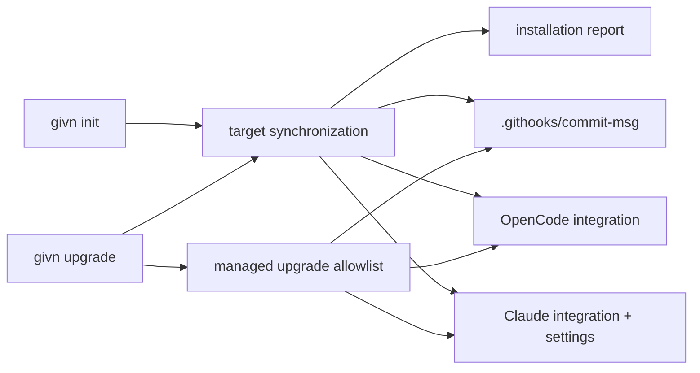

# Design: llm-attribution-installation

## Runtime decisions

`givn init` keeps the existing synchronization path and adds an explicit
installation report after synchronization. The report names:

- `.githooks/commit-msg` as the checked-in shared hook;
- local Git activation as installed, unavailable without a Git worktree, or
  left unchanged because an existing hook path could not be safely chained;
- `.opencode/plugins/givn-attribution.js` when OpenCode is selected; and
- `.claude/hooks/givn-attribution.sh` plus `.claude/settings.json` when Claude
  Code is selected.

The report is derived from the persisted agent targets, not from model
configuration.

`givn upgrade` already invokes the same synchronization path before its managed
commit. The managed path allowlist is extended to include the Claude settings
file. The upgrade preflight requires a clean worktree, so staging the merged
settings file captures only the Givn hook addition relative to the committed
baseline and preserves unrelated settings. The checked-in hook and selected
agent integrations remain in the same managed allowlist.

The upgrade output explicitly reports that commit-attribution plumbing was
refreshed before reporting the managed commit hash. Legacy migration preparation
uses the same path and therefore receives the same retrofit.

## Architecture impact



## Production files

- `src/cli/init.rs`: print the unconditional Git hook report and selected
  attribution integration paths in the initialization summary.
- `src/skills/targets.rs`: report synchronized attribution files and include
  Claude settings in the managed generated-path allowlist.
- `src/cli/upgrade.rs`: report attribution retrofit completion after the
  managed synchronization/commit path.
- Existing Git and agent integration modules remain the implementation owners;
  no new attribution protocol is introduced.

## Step definitions

```text
tests/steps/llm_attribution_installation_steps.rs
tests/steps/llm_attribution_installation_e2e_steps.rs
```

The E2E steps invoke the compiled CLI as a real subprocess and inspect stdout,
Git commits, and generated project files. No external service or digital twin
is required.

## Use-case traceability

| Guarantee | Design decision | Evidence |
|---|---|---|
| Initialization makes installed plumbing visible | Explicit report names shared hook, activation, and selected integrations | Consumer sees the installation report |
| Upgrade retrofits existing projects | Shared sync path plus Claude settings allowlist entry | Consumer's managed upgrade contains attribution files |
| Human workflow is unchanged | Reporting only; existing attribution behavior is untouched | Existing attribution scenarios remain green |

## Verification

The project runner remains `./run-tests.sh`; the E2E runner remains
`./run-tests.sh --e2e`. Strict mode is `GivnWorld::cucumber().fail_on_skipped()`
in `tests/features_runner.rs`. The single-scenario command is:

```sh
GIVN_FEATURES=givn/changes/llm-attribution-installation/specs cargo test --test features_runner -- --name "Consumer sees the commit attribution installation report"
```

The E2E interaction matrix is:

| Inventory entry | E2E scenario | Interface | Driving mechanism |
|---|---|---|---|
| Initialize a project and inspect attribution installation report | Consumer sees the commit attribution installation report | CLI and filesystem | Compiled `givn init --agents opencode,claude` subprocess plus stdout/file assertions |
| Upgrade an existing project and receive attribution retrofit | Consumer upgrades an existing project with attribution plumbing missing | CLI and Git | Compiled `givn upgrade` subprocess plus `git show` and generated-file assertions |

No local services or digital twins are required. The only interface obstacle is
Git state setup; each scenario creates a temporary repository, configures a
local identity, and commits the setup before invoking the consumer action.
