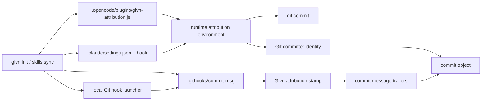

# Design: llm-attribution

## Technical decisions

### Shared Git plumbing

The checked-in hook logic lives at `.githooks/commit-msg`. It is a POSIX shell
launcher target that delegates attribution stamping to the installed `givn`
binary. The hook receives Git's message-file argument and never opens or
replaces the user's editor.

`givn init` and `givn skills sync` always materialize `.githooks/commit-msg`.
When the current directory is a Git worktree, they also install a small local
launcher at Git's resolved hooks directory (`git rev-parse --git-path hooks`):

```text
<git hooks directory>/commit-msg
```

The local launcher is not checked in. It invokes any pre-existing local
`commit-msg` hook preserved as a `.givn-original` sibling, then invokes the
checked-in `.githooks/commit-msg`. Existing hooks therefore remain active and
retain their failure behavior. Givn stamping runs only after the existing hook
succeeds; a Givn stamping failure is swallowed so attribution never blocks the
commit.

Installation is idempotent. A Givn-owned launcher is refreshed in place. An
unknown existing hook is moved to the `.givn-original` sibling only when that
sibling does not already exist; Givn never overwrites an existing backup. If a
custom hook path already resolves to the checked-in `.githooks` directory, the
installer does not overwrite an unknown `commit-msg` file and reports that
activation must be resolved manually. A project without a Git repository still
receives the checked-in hook and gets activation when `givn init` or `givn
skills sync` is run after Git is initialized.

The checked-in hook is best effort. It exits successfully without modifying the
message when no attribution context is present. When context is present, it
invokes a hidden Givn attribution command that:

- obtains the installed Givn version from `env!`-equivalent binary metadata;
- reads the optional runtime values `GIVN_ATTRIBUTION_LLM`,
  `GIVN_ATTRIBUTION_REASONING`, and `GIVN_ATTRIBUTION_HARNESS`;
- removes the previous managed attribution trailers, if any;
- appends the current values after the final user-edited message content; and
- writes explicit `unavailable` values for missing fields without failing the
  commit.

The managed trailers are:

```text
Givn-Version: <version>
LLM: <llm or unavailable>
LLM-Reasoning: <reasoning mode or unavailable>
LLM-Harness: <harness or unavailable>
Givn-Attribution-Status: complete|partial
```

The hook does not change the committer identity. The process that launches
`git commit` may provide `GIT_COMMITTER_NAME` and, optionally,
`GIT_COMMITTER_EMAIL`; Git then records those values in the commit object.

### Runtime attribution protocol

The protocol is environment-based so it is independent of Givn's project
initialization timing:

```text
GIVN_ATTRIBUTION_ACTIVE=1
GIVN_ATTRIBUTION_LLM=<provider/model or harness fallback>
GIVN_ATTRIBUTION_REASONING=<effort or unavailable>
GIVN_ATTRIBUTION_HARNESS=<harness name>
GIT_COMMITTER_NAME=<visible LLM committer name, optional>
GIT_COMMITTER_EMAIL=<visible LLM committer email, optional>
```

The variables are scoped to the agent shell that can create a commit. They are
not persisted in `givn/config.yaml` and are refreshed by the harness for every
shell invocation. A model or harness change therefore affects only later
commits.

### OpenCode integration

When `opencode` is a configured agent target, `givn skills sync` writes:

```text
.opencode/plugins/givn-attribution.js
```

The plugin implements OpenCode's `shell.env` extension point and contributes
the protocol variables to each shell subprocess. It subscribes to the
`chat.message` event, which carries the provider, model, and variant for the
current prompt, and keeps the latest session model information keyed by session
ID. The model identifier is composed from provider and model IDs; the OpenCode
variant is used as the reasoning-mode value when available.

If the current session model is not available to the plugin, it still marks
the harness as `opencode` and leaves the model and reasoning values as
`unavailable`. It does not replace the user's Git email unless an explicit
`GIVN_ATTRIBUTION_EMAIL` is already present. When a model is known, it sets
`GIT_COMMITTER_NAME` to `LLM: <provider>/<model> via opencode`, leaving Git's
configured email as the fallback unless an attribution email was supplied.

### Claude Code integration

When `claude` is a configured agent target, `givn skills sync` writes:

```text
.claude/hooks/givn-attribution.sh
.claude/settings.json
```

The settings file is merged without removing unrelated project settings. Givn
owns only the `PreToolUse` Bash hook entry that invokes the checked-in script.
The script delegates JSON parsing and command rewriting to the hidden Givn
attribution command, avoiding a mandatory `jq` dependency.

For Bash commands containing a Git commit, the Claude integration returns an
updated command with the attribution environment scoped to that command. It
uses optional model and effort values from the Claude hook payload or process
environment when available. Otherwise it identifies the harness as
`claude-code` and uses `claude-code` as the explicit LLM fallback while leaving
the reasoning value unavailable. When a model value is available it also
supplies the LLM committer name.

For non-commit Bash commands it returns no update. A malformed hook payload,
missing `givn` binary, or unavailable model metadata is non-blocking and falls
back to ordinary Git behavior.

### Asset and synchronization impact

New embedded assets:

```text
assets/hooks/commit-msg
assets/hooks/git-commit-msg-launcher
assets/agent-integrations/opencode/givn-attribution.js
assets/agent-integrations/claude/givn-attribution.sh
```

The target synchronizer writes the OpenCode integration only to `.opencode/`
and the Claude integration only to `.claude/`. The Git hook is unconditional and
is not controlled by the agent target selection.

The managed generated-path allowlist includes the checked-in hook and selected
agent integration files. Existing Claude settings remain user-owned except for
the one Givn-marked hook entry. The hook activation launcher under `.git` is
never staged.

### CLI and module impact

Add a hidden `givn attribution` command with two operations:

```text
givn attribution stamp --message-file <path>
givn attribution claude-pre-tool-use
```

`stamp` implements trailer normalization and best-effort fallback behavior.
`claude-pre-tool-use` reads the Claude hook JSON from stdin and emits the
documented `updatedInput` response only for commit-containing Bash commands.
The Git installer and attribution command live under `src/cli/` and are called
from both `givn init` and `givn skills sync`.

### Architecture impact



## Use-case traceability

| Use-case guarantee | Design decision | Capability owner | Evidence |
|---|---|---|---|
| Shared attribution plumbing is present after initialization | Checked-in `.githooks/commit-msg` plus local launcher activation | `llm-attribution` | Consumer initializes a project and receives shared attribution plumbing |
| OpenCode and Claude Code can contribute runtime context | Target-specific generated integrations use each harness's shell/tool extension point | `llm-attribution` | Same initialization scenario verifies both integrations |
| Commit visibility uses native Git surfaces | Runtime committer environment plus final-message trailers | `llm-attribution` | Consumer creates an attributed commit and inspects it with Git |
| Missing context never blocks a human commit | Hook exits successfully and leaves a context-free message unchanged | `llm-attribution` | Human commit remains usable without attribution context |
| Model and harness changes are per-commit | Runtime values are refreshed per shell invocation and never stored in project config | `llm-attribution` | Attribution follows a model change between commits |
| Confirmed Personas | None recorded for this change | `llm-attribution` | No Persona review lens applies |

## Test runner and strictness

The project-owned verification command is `./run-tests.sh`. It runs the
`tests/features_runner.rs` cucumber-rs binary against `GIVN_FEATURES`, which
must include both `givn/specs/` and the active change's feature tree through the
existing scoped test invocation.

Strict mode is already configured by
`GivnWorld::cucumber().fail_on_skipped()` in `tests/features_runner.rs`.
Undefined or pending steps therefore fail. New step bodies must not use empty
or no-op implementations; RED stubs use `unimplemented!()` until the scenario
is implemented.

The exact single-scenario command is:

```sh
GIVN_FEATURES=givn/changes/llm-attribution/specs cargo test --test features_runner -- --name "An attributed commit exposes the current LLM and harness"
```

## Step definitions

Unit/integration step definitions:

```text
tests/steps/llm_attribution_steps.rs
```

End-to-end step definitions:

```text
tests/steps/llm_attribution_e2e_steps.rs
```

The integration steps create an isolated Git repository, invoke the compiled
Givn binary, execute real Git commits with controlled environment variables,
and inspect the resulting commit object and message. The E2E steps invoke the
compiled `givn` CLI as a subprocess and inspect generated project files through
the project filesystem, which is the CLI's real external boundary for this
capability.

## E2E infrastructure

The E2E command is the existing `./run-tests.sh --e2e`. No application server,
database, external API, browser, or third-party service is required. Each
scenario uses a temporary project directory and a local Git repository. No
digital twins are required.

The E2E interface is the real CLI subprocess plus the generated project files.
The driving mechanism is the existing Rust cucumber runner invoking `givn init`
with `--agents opencode,claude`, followed by filesystem assertions on the
checked-in hook, launcher activation, and agent integration files.

## Interaction Coverage Matrix

| Inventory entry | @e2e scenario title | Real interface | Driving mechanism |
|---|---|---|---|
| Initialize a Givn project with OpenCode and Claude Code targets | Consumer initializes a project and receives shared attribution plumbing | CLI and project filesystem | Rust cucumber subprocess invokes `givn init --agents opencode,claude`, then inspects generated files and Git hook activation |
| Create a commit while attribution context is available | Consumer creates an attributed commit and inspects it with Git | Git CLI | Rust cucumber invokes real `git commit` with runtime attribution environment and reads `git show` output |

## Local runnability

The complete local verification command is:

```sh
./run-tests.sh
```

The E2E command is:

```sh
./run-tests.sh --e2e
```

Both commands use isolated temporary directories for project and Git state.
No external process or network dependency is required.
