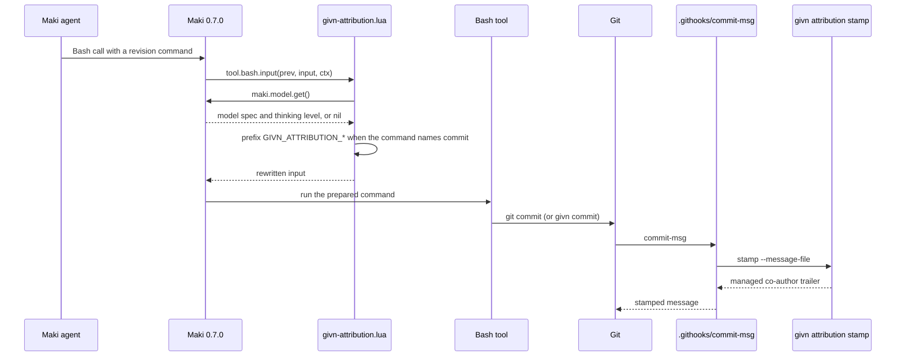

# Design: maki-commit-attribution

## Decisions

- **Decides D1: Maki attribution names the focused session's model.** The
  integration reads `maki.model.get()` once per prepared revision command and
  uses its `spec` (falling back to `provider/id`, then `id`) and
  `thinking_shown` (falling back to `thinking`). When Maki exposes no model,
  both facts are `unavailable`. Realized in
  `assets/agent-integrations/maki/givn-attribution.lua` (`current_model`).
  Rationale: one documented source supplies both the model identity and the
  reasoning mode; the timeline reporter observes the same session model, and
  Maki 0.7.0 returns `nil, "no interactive UI attached"` in headless runs.
  For a top-level command the focused session is the issuing session; a
  subagent's own session may differ and is out of scope. Revisit trigger: a
  requirement to attribute a subagent's commit to the subagent's own model;
  that would need `maki.agent.resolve_model(ctx, {})` and an explicit
  reasoning fallback.
- **Attach to Maki's `tool.bash.input` slot.** Maki fires the slot before a
  Bash call is parsed or checked, and a layer may replace `input.command`.
  `tool.bash.input` costs `run`, `session_read`, and `session_write`; no other
  permission is requested. Realized in the Lua asset's `setup`.
- **Rewrite only revision commands.** The layer rewrites a command only when
  the final command text contains the Lua frontier pattern
  `%f[%w]commit%f[%W]`, matching `git commit`, `git -c … commit`,
  `givn commit`, and `git merge --commit`. A command that creates no revision
  is returned unchanged. Accepted cost: a revision path that never spells
  `commit` (for example `git cherry-pick`) receives no attribution.
- **Use the existing attribution environment protocol.** The prepared command
  is prefixed with the same `GIVN_ATTRIBUTION_*` exports and optional
  `GIT_COMMITTER_NAME` as the OpenCode, omp, and Claude integrations. No
  change to `src/cli/attribution.rs` or the commit-msg hook is needed.
- **Recognize the exact prior generated manifest.** A permission manifest
  byte-identical to the pre-attribution asset (after CRLF normalization) is
  replaced by the current asset, which grants `session_write`. Any other
  manifest is merged key-by-key; an explicit `session_write = false` is
  preserved and warned about. Realized in `src/skills/targets.rs`.
- **Load the module through a second managed fence.** `.maki/init.lua` gains
  a fail-soft `-- givn:begin:attribution` fence beside the existing timeline
  fence. Both fences are merged in memory and written once. Realized in
  `src/skills/targets.rs` (`merge_maki_init`).
- **Report the integration.** Initialization prints the Maki attribution path
  beside the development reporter; synchronization prints the copied asset
  through the existing integration row. Realized in `src/cli/init.rs` and
  `src/skills/targets.rs`.

## Architecture Impact

The change extends the generated agent-integration adapter owned by ADR-013
and the commit-attribution environment described in arc42 8.12a. It adds one
generated Lua asset, one prior-manifest recognition asset, one managed fence,
and one required permission. No new crate, runtime dependency, network
boundary, or data store is introduced.

### Contracts and Components

| Contract | Consumer use case | Consumers | Implementing component today | Split trigger |
|---|---|---|---|---|
| Initialize project and its agent integrations | `initialize-project` | Developer, Authoring agent | `src/skills/targets.rs` (`sync_agent_integrations`, `merge_maki_plugin`, `merge_maki_init`) | Another harness needs a different user-owned merge model, or the Maki manifest gains a non-permission section Givn must own |
| Commit attribution | `attribute-commits` (support fragment included by `initialize-project`) | Generated harness integrations, `givn commit` | `src/cli/attribution.rs` (managed trailer) | A harness needs a non-shell attribution transport, or the trailer protocol changes |

The CLI summary in `src/cli/init.rs` is the terminal adapter over the
initialization component. The generated Maki Lua asset is the Maki adapter over
the commit-attribution environment; it contributes model, reasoning, and
harness facts and owns no trailer formatting. Neither adapter imports another
component's implementation.

### Affected components

| Path | Change |
|---|---|
| `assets/agent-integrations/maki/givn-attribution.lua` | New Lua integration: slot registration, model lookup, command rewrite |
| `assets/agent-integrations/maki/plugin-before-attribution.toml` | Exact prior generated manifest, used only as a recognition key |
| `assets/agent-integrations/maki/plugin.toml` | Grants `session_write`; documents the attribution grant |
| `src/skills/targets.rs` | Adds the asset to `MAKI_INTEGRATIONS`; adds the attribution fence; adds `session_write` to the required grants; migrates the exact prior manifest; warns on an edited revocation |
| `src/cli/init.rs` | Prints the Maki attribution integration in the initialization summary |
| `src/skills/rules.rs` | Treats `.maki/lua/givn-attribution.lua` as a strict rule in the ignore and discovery paths |
| `docs/arc42/08-crosscutting-concepts.md` | Updates 8.12a and the agent-integration/reporter material |
| `docs/glossary.md` | Names Maki in the Harness definition and records the Maki attribution grant |
| `tests/steps/...` | Maki attribution, manifest migration, installation, and upgrade coverage |

### Runtime view



## Attribute integration asset

`assets/agent-integrations/maki/givn-attribution.lua` is a plain Lua module
with no host call at load time. It exports:

- `M.setup()` — registers the `tool.bash.input` layer through
  `maki.api.set_slot` when the host exposes it. Registration is guarded so a
  double `setup()` (for example a hand-written `init.lua` plus the fence)
  registers one layer.
- `M.prepare(command)` — returns the command unchanged when it does not match
  the revision-verb pattern, or the attribution-prefixed command otherwise.
  The test driver calls this through the real Maki binary; production calls it
  from the slot layer.

The layer calls `prev(value, ctx)` first so the tool's own layers and other
plugins' layers run, then reads `input.command` from the returned table (or
the original input when the chain left it untouched). It shallow-copies the
input before replacing `command`. A stop or `ask` verdict from `prev` is
propagated unchanged. A non-table input, a non-string command, or a missing
`maki` API returns the value untouched.

The prepared prefix is:

```text
export GIVN_ATTRIBUTION_ACTIVE=1 GIVN_ATTRIBUTION_LLM='<identity>' GIVN_ATTRIBUTION_REASONING='<reasoning>' GIVN_ATTRIBUTION_HARNESS='maki'[ GIT_COMMITTER_NAME='LLM: <identity> via maki']; <command>
```

Values are single-quoted with embedded single quotes escaped as `'"'"'`.
`GIT_COMMITTER_NAME` is omitted when the identity is `unavailable`, matching
the OpenCode integration's partial-context behavior. `unavailable` is used
for a missing identity or reasoning mode.

## Permission manifest handling

`merge_maki_plugin(project_root)` in `src/skills/targets.rs`:

1. A missing `.maki/plugin.toml` is written from the current asset, which
   grants `fs_read`, `fs_write`, `run`, `session_read`, and `session_write`,
   and revokes `net`, `env`, `agent`, `session_settings`, and `input`.
2. A file equal to `plugin-before-attribution.toml` after CRLF normalization
   is replaced by the current asset. This is the only path that flips the
   generated `session_write = false`.
3. Any other file is merged key-by-key: the missing keys of
   `[fs_read, fs_write, run, session_read, session_write]` are appended as
   `key = true` inside the `[permissions]` table, or a `[permissions]` table
   is appended when absent. Existing keys are never removed or flipped.
4. When the merged file still names `session_write = false`, the command
   prints
   `warning: .maki/plugin.toml sets session_write = false; Maki commit attribution requires session_write = true`
   to stderr. Maki skips the layer in that state; the warning is the
   actionable repair.

The prior-asset comparison uses `include_str!` of
`assets/agent-integrations/maki/plugin-before-attribution.toml`, so the
recognition key is compiled with the binary. The exact old asset in this
checkout is the one already installed in `/home/buster/projects/gh-notify`
(sha256 `755cf4a1a22f1c878b10e3afdf8accd8aacef7b7edd9f1ee6b1601723e61681b`).

## Initialization fence

`merge_maki_init(project_root)` reads `.maki/init.lua` once, merges the
existing timeline fence and the new attribution fence in memory, and writes
once. A missing file is created with both fences. A present file without a
fence gets the fence appended after a blank line. A fence with a begin marker
but no end marker is refused before any write.

The new fence is:

```lua
-- givn:begin:attribution
local attribution_ok, attribution = pcall(require, "givn-attribution")
if attribution_ok and type(attribution) == "table" and attribution.setup then
  attribution.setup()
end
-- givn:end:attribution
```

## Installation report

`src/cli/init.rs` prints, for the `maki` target:

```text
  attribution integration: .maki/lua/givn-attribution.lua
  development reporter: .maki/lua/givn-timeline.lua + .maki/plugin.toml + .maki/init.lua
```

`sync_target_integrations` prints
`integration: .maki/lua/givn-attribution.lua` from the integrations table,
then the reporter row from the summary. No new report code is needed for
synchronization.

## Ownership

`.maki/lua/givn-attribution.lua` is a strict Givn rule. It is added to
`ignore_entries()`, `is_rule_path()`, and the rule-shape test in
`src/skills/rules.rs`. `.maki/plugin.toml` and `.maki/init.lua` remain
user-owned merged files and are not strict rules.

## Data model

None. The change adds no record entry, schema field, or persisted state. The
manifest and `init.lua` edits are generated-file changes. The structural model
in `docs/domain-model.md` is unchanged: no bounded context, aggregate,
external system, or relationship is added; Maki remains the agent-harness
external system and the version-control system remains the revision boundary.

## Step Definitions

| Capability | Step definition file | Scenarios |
|---|---|---|
| Commit attribution | `tests/steps/llm_attribution_e2e_steps.rs` | Maki prepare, non-revision, partial, and attributed-commit steps; prepared-environment assertions |
| Commit attribution | `tests/steps/development_timeline_support.rs` | `run_maki_attribution_driver`, the real-Maki driver that writes the prepared command |
| Initialize project | `tests/steps/initialize_a_project_steps.rs` | Previous/edited Maki manifest fixtures; grant/revoke assertions; attribution-fence assertion |
| Initialize project | `tests/steps/llm_attribution_steps.rs` | Installation integration path list |
| Initialize project | `tests/steps/llm_attribution_installation_e2e_steps.rs` | Upgrade fixtures and managed-revision path list |
| Initialize project | `tests/steps/agent_activity_reporting_steps.rs` | Generated Maki manifest, fence, and asset assertions |

No delta step copies are added; the step bodies live in these permanent
files from the start.

## Verification

- `verify.command`: `./run-tests.sh --non-e2e` (already configured).
- `verify.e2e_command`: `./run-tests.sh --e2e` (already configured).
- Single scenario:
  `GIVN_FEATURES=givn/changes/maki-commit-attribution/specs cargo test --locked --test features_runner -- --name "Maki prepares attribution for a revision command"`.
- Strict mode: `tests/features_runner.rs` builds with `.fail_on_skipped()`
  and exits nonzero when the scenario statistics contain a failure or a
  skipped scenario. No step body is left empty.

## E2E infrastructure

- The real Maki 0.7.0 binary is resolved by `maki_binary()` in
  `tests/steps/development_timeline_support.rs` from `GIVN_E2E_BIN`,
  `$HOME/.cache/givn-e2e/bin/maki`, or `PATH`; the project harness pins 0.7.0.
- The driver runs `maki --trust prompt` in the project root with the `givn`
  shim on `PATH`. It appends a script to the generated `.maki/init.lua` that
  overrides `maki.model.get`, calls `require("givn-attribution").prepare`, and
  writes the result to `.maki-attribution-prepared`. The driver also reads
  `maki.api.get_slots()` and fails unless `tool.bash.input` lists the project
  `init.lua` filler, proving `setup()` registered the layer. No model turn or
  network request is made.
- The e2e commit step writes `fixture.txt`, stages it, runs the prepared
  command through `sh -c` with the compiled `givn` shim on `PATH`, and asserts
  the committer name and the managed trailer from Git.
- `git` is already required by the suite; no new external service is
  introduced.

## Visual Design Contract

- Interface: none
- Reason: the change renders no screen. It adds generated files and one
  installation-report line; the existing terminal transcript in the
  installation scenario covers the CLI output.
- Personas: `developer--primary-user` (reads the installation report and owns
  the permission manifest), `agent--technical-role` (issues the attributed
  Maki commit).

## Interaction Coverage

| Capability | Consumer action (from the owning document) | E2E scenario | Change |
|---|---|---|---|
| `initialize-a-project` | select agent targets in the interactive terminal | Consumer selects agent targets during interactive init | unchanged |
| `initialize-a-project` | initialize with an explicit noninteractive target selection | Consumer runs init non-interactively and gets opencode skills | unchanged; the declared scenario is an existing corpus mismatch |
| `initialize-a-project` | resynchronize selected targets | Consumer re-syncs skills after init and the selection is honoured | unchanged |
| `enable-optional-addons` | enable the outline addon | Consumer enables the outline addon and it is listed as enabled | unchanged |
| `attribute-commits` | initialize shared attribution plumbing | Consumer initializes a project and receives shared attribution plumbing | modified to include the Maki integration |
| `attribute-commits` | commit explicit selected paths with attribution | An attributed commit exposes the current LLM and harness | unchanged; the Maki commit e2e is the same action through the Maki interface |
| `enable-commit-attribution` | inspect attribution installation | Consumer sees the commit attribution installation report | modified to include the Maki integration |
| `enable-commit-attribution` | upgrade missing attribution plumbing | Consumer upgrades an existing project with attribution plumbing missing | modified to include the Maki integration |
| `enable-commit-attribution` | initialize Fossil attribution | Consumer initializes a Fossil project and receives the givn commit path without a hook | unchanged |

## Use-Case Traceability

| Use-case guarantee, rule, or interaction | Decision | Evidence |
|---|---|---|
| `initialize-project` main flow 6: install supported attribution plumbing safely and name installed or skipped integrations | Generated Maki attribution asset and installation report line | Consumer initializes a project and receives shared attribution plumbing; Consumer sees the commit attribution installation report |
| `initialize-project` rule: Git attribution hooks preserve user hooks and never break an ordinary human commit | The existing hook and environment protocol are unchanged; Maki rewrites only revision commands | A human commit remains usable without attribution context; Maki leaves a command that creates no revision unchanged |
| `attribute-commits` support rule: missing facts remain unavailable, never invented | `unavailable` fallback and omitted committer identity | Maki marks a partial attribution context as unavailable |
| `enable-commit-attribution` support rule: reports name the shared hook and selected harness integrations | The Maki integration is a selected harness integration in the report | Consumer sees the commit attribution installation report |
| `initialize-project` rule: resynchronization preserves user-owned configuration | Exact-prior-manifest migration; edited manifests keep their explicit revocation and receive a warning | Synchronizing an unmodified generated Maki manifest grants attribution; Synchronizing an edited Maki manifest preserves its attribution revocation and names the needed grant |
| Confirmed Persona `developer--primary-user` | Readable report and a non-silent permission change | Installation report; edited-manifest warning |
| Confirmed Persona `agent--technical-role` | A Maki-issued revision carries the managed attribution | Maki attributes a commit using its current model |

## Version freshness

- Maki 0.7.0 — verified with `maki --version` on 2026-11-05 and pinned by the
  project's E2E harness. The `tool.bash.input` slot, the `set_slot` API, and
  `maki.model.get()` were exercised with the real binary before this design.
- cucumber 0.23 and the Rust toolchain — resolved by `Cargo.toml` and
  `Cargo.lock`; no new dependency or version change.
- Lua — Maki's embedded plugin language; no separate runtime version.

## Risks and trade-offs

- **Maki API drift.** A future Maki rename of `tool.bash.input` or
  `maki.model.get` would silently stop attribution. The module no-ops when
  `set_slot` is absent; the E2E driver fails if the module does not load or
  the slot is not registered. The harness pin is the detection point.
- **Edited manifest.** A developer who explicitly revokes `session_write`
  keeps that revocation; Maki skips the layer and the warning names the
  repair. This is safer than silently widening a user-owned file.
- **Line-ending or whitespace edits.** The exact-prior-manifest path
  normalizes CRLF; any other edit takes the preserved-and-warned path.
- **Subagent attribution.** The focused session's model is used; a subagent
  committing under a different model is out of scope and is named in the
  proposal.
- **Headless Maki.** No UI means no model identity; the commit still stamps
  `maki` with unavailable facts.
- **Permission broadening.** `session_write` is required by Maki's own layer
  rule even though the module never writes session content. The generated
  manifest states why.

## ADR qualification

`AMEND_ADR`, target `docs/arc42/adr/ADR-013-agent-integration.md`. ADR-013
already owns the generated agent-integration boundary and its user-owned merge
discipline. Its Consequences sentence enumerates what a selected `maki` target
receives; this change adds the generated attribution integration under that
same boundary. The amendment is a one-sentence refinement of that enumeration,
not a new component, authority, storage, or provider boundary. The four-question
assessment is recorded in the Arc42 change assessment.
