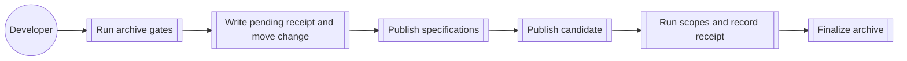

<!-- givn:base-sha256:9110d19960efb32af61660066b22987abc19105c975a6282f5f36fd9f0a54396 -->
# Use case: archive-change

## Level

!

## Actors

- Developer

## Goal

Archive a completed change with proven publication.

## Trigger

The developer archives a reviewed change.

## Preconditions

- The change has passed its required workflow gates.
- The active version-control system is selected and its clean-state witness is available.
- The system can publish a subset of paths as a revision.
- The permanent corpus is available for update.

## Main flow

1. Run the archive gates, confirm the project state is clean in the active version-control system (only resolved evidence paths may be dirty), validate the current green change-scoped verification receipt when applicable or the explicit no-behavior-change exemption, and compare the step phrases bound by the change's delta step-definition files with the phrases bound by the permanent test tree (the project root minus the change, archive, history, version-control, build, and cache trees), all before any mutation; validate every delta for supported executable content and compatible inherited setup before moving the change or writing a receipt. A revision that changed only documentation or evidence keeps the receipt current.
2. Write the pending receipt and move the active change into the archive location as one state transition; the receipt marks the archive unproven.
3. Merge the accepted behavior and use-case documents (delta merge with base-revision match, retirement and grouping rules).
4. Resolve the evidence scope: the archive directory, the README when the readme addon is on, and the configured coverage outputs.
5. Publish the merged state as the archive candidate revision, containing exactly the merged corpus paths and the pending receipt (unbound, marking the archive unproven).
6. Run each applicable verification scope once against the candidate and check fresh valid reported scenario counts and stable relevant inputs; persist successful scope evidence for reuse on retry.
7. Measure applicable coverage once and publish it; persist valid measurement evidence for reuse while its relevant inputs remain unchanged.
8. Check the candidate revision binding and the unchanged relevant inputs of any reused scope evidence, refresh the README managed blocks, record the proven receipt, and publish the evidence-only finalization revision.
9. Report the archive as proven.

## Extensions

- 1: uncommitted work outside the resolved evidence → the archive is blocked and names the offending files; protects the minimal guarantee.
- 1: an applicable change-scoped verification receipt is missing or stale → the archive is refused before mutation; protects the success guarantee.
- 1: a delta step definition phrase has no permanent definition → the archive is refused before mutation, names the project-relative delta file, and lists the missing phrases (a bounded list followed by a remainder count); protects the success guarantee.
- 6: an unproven candidate's permanent test tree still lacks a delta step phrase → the candidate is refused before its verification scopes run again and stays unproven; protects the minimal guarantee.
- 2: the archive move is interrupted → either the active change with its pending receipt or the pending candidate remains, and a rerun re-runs the gates and retries the move; protects the minimal guarantee.
- 3: the delta merge is interrupted → the pending candidate records the merge as incomplete and a rerun completes the merge idempotently; protects the minimal guarantee.
- 6: a verification scope fails or lacks fresh valid passing output, or relevant inputs change during execution → the candidate stays published and repairable, retaining unaffected successful scope evidence; protects the minimal guarantee.
- 8: finalization publication fails → retain the successful scope results and coverage measurement; unchanged relevant inputs allow retry without repeating those executions; protects the minimal guarantee.
- 8: the tested tree changed outside the resolved evidence → finalization refuses; protects the success guarantee.
- 5: a version-control hook rejects the candidate revision → the archive stays unproven and repairable, and the exact intermediate state is version-control-specific; protects the minimal guarantee.
- 1: no version-control system is selected → the archive is refused by name before any mutation; protects the minimal guarantee.
- 1: the archive is already proven → another run is refused; protects the success guarantee.
- 1: the archive has no receipt → another run is refused; protects the success guarantee.
- 1: the active change and an archive directory without a receipt → both exist and the archive is refused as corrupt; protects the success guarantee.
- 1: the active change and a pending archive candidate conflict → the archive is refused as corrupt and names the conflict; protects the success guarantee.
- 1: the active change and a pending archive candidate are identical → the duplicate active change is removed and the archive resumes; protects the minimal guarantee.

## Rules

- A use-case replacement must match its recorded base revision.
- Feature behavior is never silently dropped. Supported English Gherkin preserves Background setup, inherited execution tags, steps, docstrings, data tables, and every Scenario Outline Examples block and its tags. Only delta-operation tags are stripped.
- 0.9.10 supports English Gherkin only. Unsupported Rule constructs and explicit non-English dialects are named with their feature path and refused before any active-change move, archive receipt write, or permanent-spec mutation. A conflicting Background replacement is likewise refused rather than silently changing setup for modified or unaffected scenarios.
- Existing capabilities resolve to exactly one use-case or fragment owner; EXTEND uses that owner, NEW conflicts with an existing owner, and ambiguous owners or missing required routing refuse the entire merge before mutation. Routing refusals and multi-file variants of archiving a new capability are regular acceptance cases, not separate consumer actions.
- Only a proven archive is complete; an unproven candidate is never reported as proven.
- A rerun resumes an unproven candidate and refuses a proven archive.
- Archive validates the current green change-scoped receipt when applicable before merging and does not rerun the change suite. A proposal declaring `Behavior change: none`, an explicitly skipped specs artifact, and no delta feature files make changed-scenario verification not applicable, not passed. Applicable identity, integrity, review, and merged-candidate verification remain required; no invented scenario or changed-scenario receipt is required. Contradictory executable deltas or a missing explicit specs skip refuse before mutation.
- A receipt stays current across revisions that change only documentation or evidence; archive reuses it and still runs the merged suite once.
- A receipt whose relevant tested content changed outside existing evidence exemptions is stale and archive refuses before mutation.
- The candidate revision contains exactly the merged corpus paths.
- The finalization revision contains only resolved evidence paths.
- Newly executed scope evidence binds the published candidate revision and inputs captured before execution and checked afterward. Persisted successful scopes and coverage may be reused for a repaired candidate only when their relevant inputs remain unchanged; the proven receipt records the repaired revision and reused evidence. Rerun only failed or invalidated scopes, not completed merging or unchanged accepted review. Cheap revision and relevant-content checks do not add blanket retry review, a full-suite rerun, or narrower evidence-output allowlists.
- Archive-directory evidence exemptions remain broad during proof reuse. Report that executable changes inside exempt paths may escape cheap input checks; this does not claim semantic equivalence or authenticate arbitrary runner honesty.
- A file the version-control system would not publish still counts as dirty and blocks the archive outside the resolved evidence paths: untracked and extra files both block. Plain-text CLI and interaction transcripts under the change's `evidence/` tree are declared evidence.
- Givn publishes the candidate revision and the finalization revision on both supported systems; the developer's coherent behavior-batch revisions remain theirs.
- The hook-rejection promise is "unproven and repairable", not an identical internal state.
- The active change and a pending archive candidate whose active artifacts are byte-identical are reconciled; a conflicting pair is corrupt.
- The active change moves into the archive location as one transition; an interrupted transition leaves either the active change with its pending receipt or an unproven candidate, never a partial copy.
- A resumed candidate repeats the delta merge only when the receipt records that the merge did not complete.
- Archive refuses before mutation when a step phrase bound by the change's delta step-definition files has no binding in the permanent test tree; the refusal names the project-relative delta file and lists the missing phrases, bounded with a remainder count.
- Delta step definitions are durable project source: the archive merges feature files and use-case documents only, and it never copies, moves, or deletes a step definition.
- A delta step-definition copy may stay under the change's spec tree as history once every phrase it binds is also bound in the permanent test tree.
- A resumed unproven candidate repeats the step-definition comparison before its verification scopes run again.

## Examples

- Git candidate: a change with merged specs and a clean worktree publishes candidate `a1b2c3d4e5f6...`; both scopes pass; the finalization revision contains the archive directory and the README; the proven receipt records `tested_revision: a1b2c3d4e5f6...`.
- Fossil candidate: the same change in a Fossil checkout whose `EXTRA` files are clean publishes a candidate check-in; both scopes pass; the finalization check-in contains the archive directory; the proven receipt binds the candidate check-in.
- Failed scope: the candidate stays published; `givn status` reports the unproven candidate; a repair changes only end-to-end inputs, so the retry reuses the persisted regular result and reruns only end-to-end verification without repeating the merge.
- Failed finalization: both scopes and coverage succeeded before publication failed; unchanged relevant inputs allow retry to publish proof without another suite or measurement.
- No behavior change: `Behavior change: none`, explicitly skipped specs, and no delta features allow archive without a changed-scenario receipt; applicable merged-candidate verification still runs.
- Interrupted move: the process stops after the receipt write but before the rename; the active change carries the pending receipt, the rerun re-runs the gates, retries the rename, and continues from the merge.
- Interrupted merge: the process stops after the rename but before the merge completes; the pending receipt records `merge_completed: false`, and the rerun re-applies the delta file that was in flight without adding a duplicate scenario.
- Restored duplicate: a recovery reset restores the active change beside the pending candidate; the two copies are identical, so the rerun removes the active duplicate and publishes the resulting candidate.
- Hook rejection, Git: a commit hook exits non-zero; the merge stays staged; the archive is unproven.
- Hook rejection, Fossil: a commit hook exits non-zero; the merged state stays in the checkout uncommitted; the archive is unproven.
- No SCM: `givn archive --change multi-scm-support` in a plain directory exits non-zero with a named refusal and mutates nothing.
- Unmerged step definition: a change's `specs/steps/catalog_steps.py` binds `an imported catalog`, while the permanent step files bind no such phrase; the archive exits non-zero before the move, names the project-relative `givn/changes/<id>/specs/steps/catalog_steps.py` and "an imported catalog", and the change stays under `givn/changes/`.
- Merged step definition: the same phrase is bound in `tests/steps/catalog_steps.py` (or in a permanent step file under `givn/specs`); the archive proceeds, the change moves to `givn/archive/`, and the delta step file stays there as history.

## Minimal guarantee

A failed archive is never reported as proven, and its candidate remains repairable in place.

## Success guarantee

The permanent corpus contains the accepted change, bound to a verification receipt identifying the proven candidate revision and every applicable passing scope, including reusable successful evidence whose relevant inputs remain unchanged.

## Personas

- developer--primary-user
- agent--technical-role
- givn-maintainer--owner

## Capabilities

- archive-proof
- grouped-merge-for-new-capabilities
- preserve-scenario-docstrings
- extract-coverage-gate
- enforce-post-merge-e2e-gate
- require-merged-step-definitions

## Interactions

| Capability | Consumer action | E2E scenario |
|---|---|---|
| archive-proof | archive a completed change | Consumer archives a completed change and receives a proven archive |
| archive-proof | repair a blocked archive | Consumer repairs a blocked archive and the rerun proves it |
| archive-proof | inspect an unproven archive candidate | Consumer inspects an unproven archive candidate |
| archive-proof | archive a change after documentation-only review edits | Consumer archives a change after documentation-only review edits and the proof is reused |
| grouped-merge-for-new-capabilities | archive a new capability | Consumer archives a new capability and the merged spec lands in its declared use case |
| preserve-scenario-docstrings | archive a modified scenario | Consumer archives a modified scenario and the permanent spec keeps the docstring |
| extract-coverage-gate | archive with coverage | Consumer archives a change with coverage enabled and the coverage summary appears in README |
| enforce-post-merge-e2e-gate | archive an E2E delta | Consumer archives a delta that adds e2e scenarios and is blocked without a configured runner |
| require-merged-step-definitions | archive a change whose delta step definitions are already in the permanent test tree | Consumer archives a change whose delta step definitions are already in the permanent test tree |

## Includes

- fragment: support

## Extends

- none

## Out of scope

Reviewing implementation design or inventing new behavior during archive.

## Diagram

