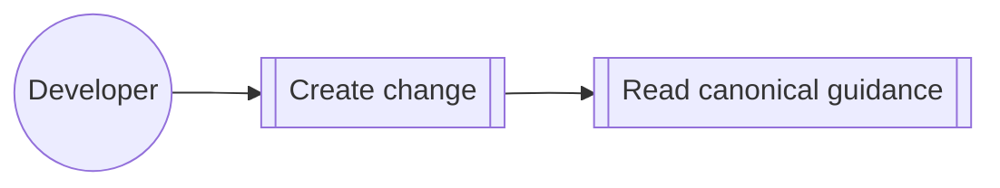

<!-- givn:base-sha256:bc4bddb80391007bbd67b4f1dc45e5488adacb2e2fd87b8c197a91bb3da605b6 -->
# Use case: create-change

## Level

!

## Actors

- Developer
- Supporting: Authoring agent

## Goal

Create a change ready to carry from intent to executable specification.

## Trigger

The developer starts a new change.

## Preconditions

- The project is initialized as a Givn project.

## Main flow

1. The developer creates a change; the system writes the scaffold with a
   stable identity.
2. The developer reads the artifact guidance; the system keeps one canonical
   policy per topic and points derived guidance at it.

## Extensions

- 1: the requested identity is invalid → the system rejects it and leaves the project unchanged; protects the minimal guarantee.

## Rules

- Change identities are stable kebab-case values.
- Generated thin skills are synchronized from canonical source assets; detailed rules have one served owner per topic, with no separately generated command surface.
- Managed bootstrap owns loading the effective dialog policy before the first user-facing question once per context, independently of optional addons and named workflows; reload it if lost. Skills contain no repeated policy-loading, handoff, or delegation boilerplate.
- Before the first question of an indexed type in a context, read its companion regression examples: scope approval, target selection, behavior choice, persistent-format commitment, or discoverable diagnosis. Ask one question at a time; retained policy and examples need not be reread for every question.
- Project-owned skill replacements stay authoritative without injected policy text; user-owned legacy command files are neither generated nor mutated.
- Dialog supplies decision-critical facts, concrete consequences, material revision costs, and proportional clarification; discoverable facts are researched rather than delegated to the user as questions.
- A change proposal carries one release note. Plan coherent named behavior batches with scenarios, validation, and intended commit boundaries; each completed batch's explicit-path revision uses the release note as subject and identifies the batch in the body, or the scenario title for a single-scenario batch.
- Actual behavioral RED runs before production edits; actual GREEN and REFACTOR checks are recorded compactly. Existing-behavior regressions may pass immediately without a production edit for that requirement; skipped RED is admitted, never reconstructed. Record the actual completed batch revision before checking off its scenario tasks.
- Regular and E2E executions select scope explicitly, including a shared command using GIVN_RESULT_SCOPE. Equal counts or command strings do not invalidate honest isolation; required executions still require zero failures and skips without an extra isolation run.
- Justified E2E reclassification aligns inventory, tasks, and review reasons and retains exactly one smoke for each real action; tags are never removed merely to evade verification.
- Evidence matches the actual product interface: a real browser may render static content without invented state changes; a library's public API may be called in-process; CLI uses the binary and services their public protocol. Isolation, twins, and full-stack infrastructure are required only for dependencies that exist. Preserve applicable visual contracts, baselines, screenshots or transcripts, and honest obstacle reporting.

## Examples

- A developer creates a multi-word change without manual scaffolding.
- An author entering through a skill relies on managed bootstrap to load dialog once before the first question and reads the relevant indexed companion examples; the skill does not carry a duplicate policy block.
- Two scenarios in one behavior batch share its actual implementation or regression-test revision; a maintenance batch with no behavior change does not invent delta scenarios.
- A static browser page is verified in a real browser, while a library without a service is exercised through real public API calls without inventing server infrastructure.

## Minimal guarantee

The project remains unchanged when an invalid identity is rejected.

## Success guarantee

The project has the requested change, ready to carry from intent to
executable specification.

## Personas

- developer--primary-user
- agent--technical-role
- givn-maintainer--owner

## Capabilities

- change-release-note
- create-a-change
- prose-consolidation
- visual-design-contract

## Interactions

| Capability | Consumer action | E2E scenario |
|---|---|---|
| prose-consolidation | request canonical E2E guidance | Canonical E2E policy is emitted by specs instructions |
| prose-consolidation | synchronize and inspect generated E2E guidance | Generated guidance points to the canonical E2E policy |
| visual-design-contract | request the design guidance for a visual interface | Author requests the visual design contract guidance |
| visual-design-contract | read the synchronized design and step guidance | Synchronized guidance defines the contract approval and capture mechanics |
| change-release-note | create a change | A new change's proposal carries the release-note field |
| change-release-note | read the proposal guidance | The proposal guidance requires a release note |
| change-release-note | read the generated implementation guidance | The generated implementation guidance shares the release note |

## Includes

- fragment: support

## Extends

- none

## Out of scope

Implementing the change's product behavior; archiving the change
(`archive-change`); managed upgrade (`maintain-project`).

## Diagram

