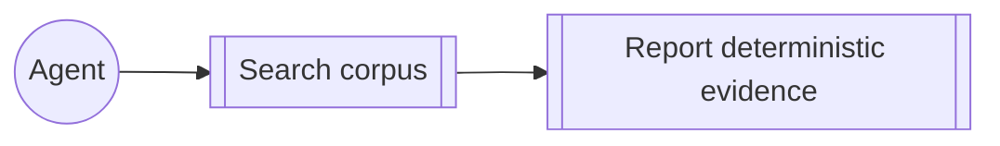

<!-- givn:base-sha256:8d47251ad5915718615b3dc30648f46ddce3cec95dd583a8a6231c63c55b3242 -->
# Use case: discover-specifications

## Level

!

## Actors

- Authoring agent

## Goal

Find existing behavior deterministically before authoring or reviewing a specification.

## Trigger

The agent investigates a proposed behavior or the permanent corpus.

## Preconditions

- The active specification corpus is readable.

## Main flow

1. The agent searches or inspects the corpus.
2. The system reports exact and structural overlap.
3. The system preserves deterministic evidence for review.

## Extensions

- 1: model evidence is unavailable → the deterministic checks remain useful; protects the minimal guarantee.

## Rules

- Discovery commands do not modify permanent specifications.
- JSON output remains machine-readable.
- Exact duplicates mean literally equal supported executable content: inherited Background setup and execution tags, step keywords and text, tables, docstrings, and all Scenario Outline Examples content. Titles and file paths identify endpoints rather than determine equality.
- Masked quoted or numeric parameters, argument cells, docstrings, or Examples values may yield a structural match but cannot establish literal equality. Different actions or inherited setup likewise prevent an exact-duplicate claim.
- Structural labels such as same_assertion_shape are advisory candidates, not proof of equivalent behavior or mandatory review/archive dispositions.
- Endpoint and match ordering is deterministic in text and JSON and does not depend on filesystem enumeration.

## Examples

- An agent audits duplicate scenarios without downloading a model.

## Minimal guarantee

The corpus remains unchanged by discovery.

## Success guarantee

The agent receives stable, actionable candidates that distinguish literal supported executable equality from advisory shape similarity without claiming semantic equivalence.

## Personas

- agent--technical-role

## Capabilities

- keep-audit-output-clean
- spec-duplicates

## Interactions

| Capability | Consumer action | E2E scenario |
|---|---|---|
| keep-audit-output-clean | request JSON duplicate audit | The JSON duplicate audit is valid JSON without progress wording |
| spec-duplicates | audit duplicates in one feature | Exact duplicates in one feature are reported together |

## Includes

- fragment: support

## Extends

- none

## Out of scope

Changing the behavior of a capability discovered in the corpus.

## Diagram

