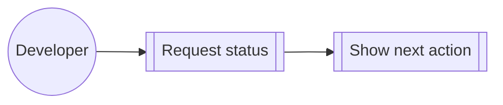

<!-- givn:base-sha256:8f4841dd352cfa5ef02709bb7d2e2aacf5c29c994e99ff311c51f7cfaa49202d -->
# Use case: inspect-change-state

## Level

!

## Actors

- Developer

## Goal

Understand the current change and artifact state without reading workflow files by hand.

## Trigger

The developer requests the current change state.

## Preconditions

- A Givn project exists.

## Main flow

1. The developer requests the state; the system discovers active changes and archive locations.
2. The system reads artifact completion and task progress separately from receipt freshness, using cheap revision and relevant-input information.
3. The system distinguishes current, stale, and not-checked verification, and pending archive candidates from proven archives.
4. The system reports the next required workflow action without executing tests or establishing a readiness gate.

## Extensions

- 1: the requested identity is invalid → the request is rejected before any file is read; protects the minimal guarantee.

## Rules

- Skipped artifacts remain visible in status output.
- Uppercase and lowercase completed task markers are equivalent.
- Artifact completion alone never establishes or claims archive readiness.
- A green receipt matching current relevant inputs is current; changed tested executable inputs make it stale; absent verification evidence is not checked.
- An archive directory with missing or stale archive proof is a pending candidate, not a proven archive. Proven status requires matching archive evidence.
- Text, JSON, list, and detail modes preserve these distinctions using cheap information only; status runs no verification or readiness command and mutates neither artifacts nor receipts.

## Examples

- A path traversal change identity is rejected before filesystem access.

## Minimal guarantee

Status inspection does not mutate change artifacts or receipts and never executes verification.

## Success guarantee

The developer can distinguish artifact progress, verification freshness, pending publication, and proven archive state and identify the next action without mistaking completion for readiness.

## Personas

- developer--primary-user

## Capabilities

- validate-change-ids
- show-skipped-artifacts
- read-task-progress
- report-change-status

## Interactions

| Capability | Consumer action | E2E scenario |
|---|---|---|
| validate-change-ids | reject unsafe status identity | Consumer invokes givn status with a path traversal change id and gets a clear error |
| show-skipped-artifacts | inspect skipped status | Consumer runs givn status on a change with skipped artifacts and sees them correctly |
| read-task-progress | inspect uppercase task status | Consumer runs givn status on a change with uppercase checkboxes |
| report-change-status | inspect detailed change state (text/JSON and receipt freshness are variants) | Detail mode — active change with all required done (text) |

## Includes

- fragment: support

## Extends

- none

## Out of scope

Mutating change artifacts or completing workflow tasks on the developer's behalf.

## Diagram

