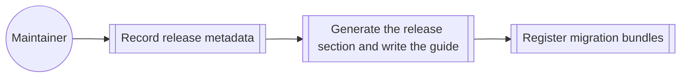

<!-- givn:base-sha256:33853d5c89c058a09051729ae03815bd1fc67320208bdac74b5be565792d493e -->
# Use case: publish-a-release

## Level

!

## Actors

- Project maintainer

## Goal

Publish a Givn release with truthful metadata and an accurate migration baseline and any supported routes.

## Trigger

The maintainer prepares a release.

## Preconditions

- The release version and its user-visible changes are known.

## Main flow

1. The maintainer records the release metadata; the system reports the version from the package and keeps the default feature set empty.
2. The maintainer generates the release section from the changes since the last version tag and writes the migration guide; the system keeps the guide an ordered prompt sequence.
3. The maintainer declares the migration catalog schema and any supported migration bundles; the system permits an empty shipped route catalog at the 1.0 migration baseline and validates that every declared bundle has a source, target, order, proposal, and design.

## Extensions

- 2: a guide prompt omits the project evidence it must inspect → the review blocks the release; protects the success guarantee.
- 2: the range since the last version tag holds no user-visible change → the release stops before the version revision and the tag; protects the success guarantee.
- 3: a bundle is missing a field → the catalog validation fails and names the bundle; protects the success guarantee.

## Rules

- The reported version matches the package version.
- The default feature set stays empty; no optional model features are declared.
- The shipped migration catalog declares its schema but may contain no routes at the 1.0 migration baseline; embedded pre-1.0 routes are removed.
- Every declared migration bundle still requires a source, target, order, proposal asset, and design asset. Synthetic future supported-route fixtures exercise complete bundle validation without requiring a legacy route in the shipped catalog.
- The migration guide is an executable prompt sequence that forbids automatic changes to domain specifications and architecture decisions.
- A release section lists only user-visible change — breaking changes, features, bug fixes, performance changes, and reverts — with exactly one entry per change, taken from the change's release note.
- A release starts at a version tag that matches the version the package declares current; a range without user-visible change produces no release.

## Examples

- Historical example: a maintainer published 0.3.0 with a changelog entry and the 0.2.0 to 0.3.0 guide; this does not require an embedded pre-1.0 route in the current shipped catalog.
- During 0.9.10 preparation the shipped catalog declares its schema and an empty route collection, with 1.0 as the future migration baseline; a synthetic future bundle missing its design still fails validation.
- A maintainer prepares 0.9.0: the release section lists each change exactly once, and a range holding only documentation stops before the release revision.

## Minimal guarantee

A release with incomplete metadata is never presented as complete.

## Success guarantee

The release describes itself truthfully, declares its migration baseline, and carries complete metadata for every supported migration route; an empty shipped route catalog does not claim a nonexistent automatic route.

## Personas

- givn-maintainer--owner

## Capabilities

- describe-the-release

## Interactions

| Capability | Consumer action | E2E scenario |
|---|---|---|
| describe-the-release | generate the release section for a range of changes | Repeated revisions of one change yield one changelog entry |

## Includes

- fragment: support

## Extends

- none

## Out of scope

Publishing consumer projects; crossing a release gap in a project (`upgrade-a-project`).

## Diagram

