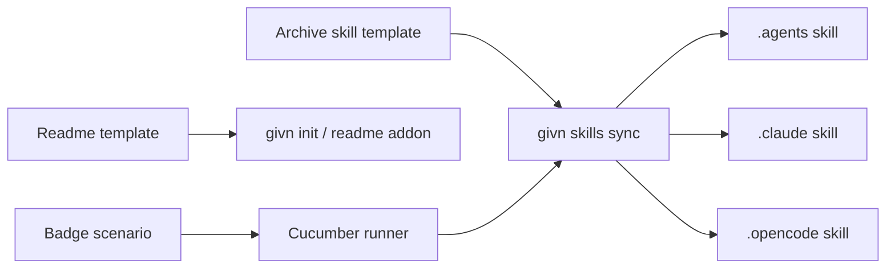

# Design: readme-coverage-badge

## Technical Approach

Placement of the coverage badge is a documentation rule, not a system flow.
The change updates the generated archive guidance and the scaffolded README
template so that the badge sits directly after the README title.

Canonical files:

- `assets/addons/readme/README.md.tmpl` — add the badge line under the
  `# {{PROJECT_NAME}}` title, documented as the coverage slot.
- `assets/skills/givn-archive/SKILL.md.tmpl` — the post-archive README update
  rule now says to place the coverage badge directly after the README title,
  then keep the Coverage section with totals and the reproduction commands.
  The embedded example shows the badge under the title and the details below.
- `.agents/skills/givn-archive/SKILL.md`, `.claude/skills/givn-archive/SKILL.md`,
  `.opencode/skills/givn-archive/SKILL.md` — regenerated from the template by
  `givn skills sync` (requires a binary rebuild because templates are embedded).
- `README.md` (repo) — badge line added under the title with the measured
  value from `coverage/cobertura-coverage.xml`.
- `tests/steps/readme_coverage_badge_steps.rs` — capability-specific e2e step
  module, registered in `tests/steps/mod.rs`.

No production module, config schema, or CLI surface changes.



## Test Design

### Runner

The repository's `cucumber-rs` runner executes the `.feature` under
`GIVN_FEATURES`:

```sh
cargo test --test features_runner
```

### Strict Mode

`tests/features_runner.rs` uses `.fail_on_skipped()`; the new steps must carry
real assertions and must not be empty.

### Single-Scenario Command

```sh
GIVN_FEATURES=givn/changes/readme-coverage-badge/specs \
  cargo test --test features_runner -- \
  --name "Coverage-enabled project is guided to place the coverage badge directly after the README title"
```

### E2E Infrastructure

CLI end-to-end: an isolated temp project is initialised and `givn skills
sync` runs through the real subprocess; the generated opencode archive skill
is inspected. No browser, server, database, or external service. No digital
twins or network dependencies.

```sh
GIVN_FEATURES=givn/changes/readme-coverage-badge/specs \
  cargo test --test features_runner -- --tags @e2e
```

### Interaction Coverage Matrix

| Inventory entry | @e2e scenario title | Real interface | Driving mechanism |
|---|---|---|---|
| synchronize the project's generated skills after enabling coverage | Coverage-enabled project is guided to place the coverage badge directly after the README title | CLI | Run `givn skills sync` via real subprocess and inspect the generated archive guidance |

## Implementation Constraints

- Keep badge values and commands illustrative and project-specific.
- Keep the managed coverage markers untouched.
- Regenerate the three skill targets from the embedded template.
