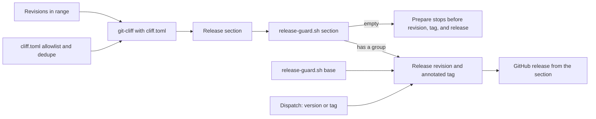

# Design: release-truth

## Status and implementation boundary

Delivered by this change:

- The changelog selection rules in `cliff.toml`: a group allowlist, an
  internal-scope skip for test-harness fixes, and per-group subject dedupe.
- `scripts/release-guard.sh` with the `base` and `section` checks, driven by
  the release workflow (operator decision: guards as a script with one
  scenario each).
- One release workflow, `.github/workflows/release.yml`, replacing the pair
  `release.yml` + `prepare-release.yml`: dispatch with `version` prepares,
  gates, tags, and publishes; dispatch with `tag` revalidates and publishes.
  No crates.io publication; the GitHub release stays the only channel.
- `ci.yml` caching and installing the pinned changelog tool for the permanent
  scenarios.
- Five delta scenarios for `describe-the-release` (four regular, one `@e2e`)
  and their step bindings.
- Durable updates: `docs/arc42/07-deployment-view.md`,
  `docs/arc42/11-risks-and-technical-debt.md`,
  `docs/arc42/12-glossary.md` (new terms: **Changelog**, **Release section**,
  **Release base tag**, **Release revision**), and the acceptance
  prerequisites in `AGENTS.md`.

Not delivered: crates.io publication, release binaries, a shell installer,
Homebrew, rewrites of published changelog sections, retroactive releases, and
the one-time baseline tag that §D2 describes as an operator rollout step for
the next release.

No product code changes: `src/**`, `Cargo.toml`, `Cargo.lock`, and
`givn/config.yaml` are untouched. The change edits repository release tooling,
one use-case document, one test corpus, two step modules, and durable docs.

## Decisions

### D1 — a pushed version tag does not publish a release

Chosen: dispatch is the only entry point. The release job runs in the same
workflow run as the preparation; a dispatch naming an existing annotated tag
revalidates that tag and publishes its release when it is missing.

Realized in `.github/workflows/release.yml`:

- trigger: `workflow_dispatch` with the optional inputs `version` and `tag`;
  the `push: tags` trigger is gone;
- `prepare` runs `if: ${{ inputs.version != '' }}`;
- `release` needs `prepare` and runs
  `if: ${{ !cancelled() && (needs.prepare.result == 'success' || needs.prepare.result == 'skipped') }}`;
- concurrency group `givn-release`, `cancel-in-progress: false`;
- workflow-level `permissions: contents: read`; the `release` job raises
  `contents: write` for `gh release create`;
- the release commit and the annotated tag are pushed with
  `secrets.RELEASE_PUSH_TOKEN` (A8), not `GITHUB_TOKEN`.

Rejected: keeping `push: tags` as a second entry point. That path reaches a
release with no preparation state, so it must rebuild and re-run the whole
gate suite from raw tag content — the current two-workflow shape — and two
entry points double the gate suite for no new gate. The tag is still
validated: the release job refuses a non-annotated tag, a tag whose commit
differs from the prepared release commit, a tag commit that is not reachable
from `origin/main`, and any mismatch between the tag version and
`Cargo.toml`, `Cargo.lock`, or the changelog heading.

### D2 — refuse to prepare while the current version has no matching tag

Chosen: the prepare job fails when the newest version tag does not match the
package version, naming the missing tag. Realized through
`scripts/release-guard.sh base "$CURRENT_VERSION"`, called before the version
bump, with `$CURRENT_VERSION` read from `cargo metadata` (A3) — the script is
a pure predicate over the repository's tags and the expected version.

Rollout: the maintainer creates the annotated `v0.8.0` tag on `5548eeda` (the
revision that set the package version to 0.8.0) before the next release. This
change performs no tag operation and depends on no new tag existing today.

Rejected: generating from the newest available tag (`v0.4.0`). The first
generated section would span 912 revisions and repeat the changes the
hand-written 0.7.0 and 0.8.0 sections already describe. Rejected: a
hand-maintained baseline commit in the workflow — a second invisible baseline
that drifts and has no reader-facing meaning.

### A1 — selection rules: group allowlist, internal-scope fix skip, per-group subject dedupe

Three aspects in `cliff.toml`:

- parser allowlist: Breaking Changes, Features, Bug Fixes, Performance,
  Reverts; `^docs`, `^refactor`, `^test`, `^chore`, `^ci`, `^spec`, `^review`,
  `^wip`, `^archive`, and merges all reach the `.*` skip fallback;
- internal test-scope fixes (`fix(harness)`, `fix(tests)`, `fix(e2e)`, and
  `fix(ci|givn|release|specs)`) are skipped ahead of the generic fix rule:
  two `fix(harness)` revisions exist in the next release range and eight in
  history, and they are not user-visible;
- the body template dedupes each group with
  `unique(attribute="message", case_sensitive=true)`.

The dedupe compares the conventional-commit description only (the type and
scope are stripped by git-cliff) and is applied inside each group. Accepted
limitations, recorded in `docs/arc42/11-risks-and-technical-debt.md`:
two changes whose release notes are byte-identical collapse into one entry,
and one change whose revisions carry both a `feat` and a `fix` subject with
the same description appears once per group. Givn's convention — every
revision of a change shares the release note as its subject — makes both
collisions convention violations, and both are review-visible. The scope
prefix stays part of the rendered line, so a collapsed entry names the scope
of the first revision.

### A2 — the guards are a checked-in script

Operator decision (recorded in `design-review.md`): `scripts/release-guard.sh`
owns the two predicates, and each gets one regular scenario.

- `scripts/release-guard.sh base <expected-version>` exits 0 exactly when the
  newest `vX.Y.Z` tag equals `v<expected-version>`; otherwise it exits
  non-zero and names the missing tag.
- `scripts/release-guard.sh section <version> <changelog-file>` exits 0
  exactly when the file carries a `## [<version>]` section with at least one
  `### ` group; otherwise it exits non-zero and names the version.

The workflow calls `base` in the prepare job before the version bump and
`section` twice: after the changelog merge in prepare (before the release
revision and the tag) and again in the release job's identity validation,
which covers the recovery dispatch that skips prepare. The `gh release
create` call keeps its own group check as the backstop. Bounds of this
decision: the job wiring, permissions, and step ordering remain verified by
diff review, actionlint, and zizmor (`security.yml`), not by scenarios.

### A3 — one job graph, carried version checks, no repeated suite

`prepare` (optional) → `release`. The prepare job keeps the checks the split
workflows carried today: the version is a plain semantic version strictly
newer than the package manifest's, no version tag exists for it, and a
release tag is absent from the remote. The release job validates identity and
publishes; it does not rebuild the binary and does not re-run the acceptance
suites. Rejected: repeating the full suite as the old tag-triggered workflow
did — with D1 the tag is created by the run that already ran the gates.

### A4 — the release job is idempotent

It exits successfully when the GitHub release already exists, so a recovery
dispatch after a partial publication is safe.

### A5 — CI installs the pinned changelog tool

`ci.yml` caches `~/.cargo/bin` and installs `git-cliff 2.13.1` before the
acceptance suites, like the release workflow will. The delta scenarios run
under `GIVN_FEATURES` in the change's gates; the install exists for the
permanent `describe-the-release` scenarios that archive merges into
`givn/specs`, which CI runs on every push. `AGENTS.md` names `git-cliff` in
the acceptance-suite prerequisites.

### A6 — the use case records the new consumer action

`publish-a-release`'s `## Interactions` section replaces the `- none` line
with one row: `describe-the-release` — generate the release section for a
range of changes — `Repeated revisions of one change yield one changelog
entry`. `src/gherkin/interaction.rs` compares declared interactions against
actual `@e2e` titles over the merged corpus; without the row the archive
merge would create an unlisted `@e2e` scenario.

### A7 — the release job publishes only what the changelog states

The GitHub release notes are the generated release section extracted from
`CHANGELOG.md`; the release job refuses a section without a `### ` group
(A2), so an empty or missing release description never reaches the release
page.

### A8 — the push credential stays the release token

The prepare job pushes the release commit and the annotated tag with
`secrets.RELEASE_PUSH_TOKEN`. Rejected: `GITHUB_TOKEN` with `contents: write`
— pushes authenticated with the workflow token do not trigger further
workflows and can be blocked by branch protection, so the repository already
requires the token for release pushes; keeping it preserves today's behavior
and needs no new secret. The release job needs `contents: write` only for
`gh release create`.

## Use-case and Persona traceability

| Contract element (publish-a-release) | Technical decision | Capability / E2E evidence |
|---|---|---|
| Rule: a release section lists only user-visible change, one entry per change, from the release note | A1, A7 | `A release section lists only the user-visible change groups`; `A release range without user-visible change has no release section`; `Repeated revisions of one change yield one changelog entry` (`@e2e`) |
| Rule: a release starts at a version tag matching the current version | D2, A2 | `A release cannot be prepared without a tag for the current version` |
| Extension: a range without user-visible change stops before the version revision and the tag | A1, A2 | `A release range without user-visible change has no release section`; `A release section without user-visible change stops the release`; the workflow wiring is diff-reviewed |
| Main flow: the maintainer generates the release section from the changes since the last version tag | A1, D2 | the changelog and guard scenarios |
| Success guarantee: the release describes itself truthfully | A1, A2, A4, A7 | selection and guard scenarios plus the release job's identity checks |
| Persona `givn-maintainer--owner` (truth-keeper) | A1, A2 | reads the generated section; the guard refuses an empty or repeated section and a missing base tag |

| Persona | Relevance | Evidence |
|---|---|---|
| givn-maintainer--owner | Prepares the release and reads its notes; the change removes hand-written sections and duplicate entries from what that persona must review | the delta scenarios and the workflow diff review |

No persona is invented; the use case already confirms this one.

## Technology decisions

| Technology | Version | Resolution |
|---|---|---|
| git-cliff | 2.13.1 | Existing project pin; the pin lives in `prepare-release.yml` (tools cache key and install step), which this change deletes, so the rewritten `release.yml` reintroduces it; local binary `git-cliff 2.13.1` verified 2026-10-04; both probes below ran against this version |
| Tera `unique` filter | bundled with git-cliff 2.13.1 (Tera 1.20.1) | Probed 2026-10-04: `unique(attribute="message", case_sensitive=true)` is accepted and keeps case-differing subjects separate |
| cargo-release | 1.1.4 | Existing project pin in `prepare-release.yml` (deleted here); the rewritten `release.yml` reintroduces it for the version bump |
| cargo-audit / cargo-deny | 0.22.2 / 0.20.2 | Existing project pins; `release.yml` installs them, `security.yml` runs them on pushes |
| GitHub Actions runner | `ubuntu-24.04` | Existing project pin in `ci.yml`, `release.yml`, `security.yml` |
| actions/checkout / actions/cache | `v7.0.1` / `v6.1.0` (SHA-pinned) | Existing project pins, reused unchanged |
| cucumber-rs | 0.23 (workspace `dev-dependencies`) | Existing test runner; strict mode via `.fail_on_skipped()` |
| python3, jq, awk, git | runner-provided | The changelog merge script is unchanged; the guards are POSIX `sh` |
| util-linux `script` | existing acceptance prerequisite | Unchanged |

## Production edit set

- `cliff.toml` — selection rules (A1).
- `scripts/release-guard.sh` — new guard predicates (A2, D2).
- `.github/workflows/release.yml` — rewritten (D1, A2, A3, A4, A7, A8).
- `.github/workflows/prepare-release.yml` — deleted (D1).
- `.github/workflows/ci.yml` — cache and install `git-cliff 2.13.1` (A5).
- `tests/steps/release_steps.rs`, `tests/steps/release_e2e_steps.rs`,
  `tests/steps/mod.rs` — step bindings and registration.
- `givn/changes/release-truth/**` — delta spec, delta narrative, evidence.
- `givn/specs/publish-a-release/usecase.md` — via the delta narrative (A6).
- `docs/arc42/07-deployment-view.md`, `docs/arc42/11-risks-and-technical-debt.md`,
  `docs/arc42/12-glossary.md`, `AGENTS.md`.

Nothing else: no `src/**`, no `Cargo.toml`, no `givn/config.yaml`, no
`CHANGELOG.md` edit (only the release workflow writes it, at release time).

## Specification delta and cutover

- Delta file: `givn/changes/release-truth/specs/publish-a-release/describe-the-release.feature`,
  five `@givn.added` scenarios (four regular, one `@e2e`), all `@wip` until
  their task clears the tag.
- Narrative replacement: `givn/changes/release-truth/specs/publish-a-release/usecase.md`
  carries `<!-- givn:base-sha256:e184f398451e3780cd2b6a60d7bc0d6312cddbcfc65e3ebf0579d5c99fbd4368 -->`
  and adds the two rules, the extension, the example, the interaction row, and
  the main-flow wording.
- Cutover: `prepare-release.yml` is deleted; a tracked-file sweep
  (`git grep 'prepare-release'`, excluding `givn/archive/**` and
  `assets/migrations/**`) finds no durable reference; the frozen
  0.3.0-to-0.4.0 migration bundle names "prepare-release" as a 0.4.0 release
  fact and stays unchanged.
- No migration bundle is needed: the release pipeline is not part of the
  product's consumer contract, and no project file format changes.

## Step definitions

| Capability | Kind | File |
|---|---|---|
| describe-the-release | regular | `tests/steps/release_steps.rs` |
| describe-the-release | `@e2e` | `tests/steps/release_e2e_steps.rs` |

Both modules are registered in `tests/steps/mod.rs`. The `@e2e` module reuses
the changelog generator helper from the regular module; it does not duplicate
bindings.

## Fixture and assertion design

Changelog fixture (in `release_steps.rs`):

- `make_bare_root()` plus `git_init()` from `tests/common/mod.rs` gives a
  temp repository with fixture-local `user.name`, `user.email`, and
  `commit.gpgsign=false`, and one initial revision; the step additionally sets
  `core.hooksPath` to an empty directory so host hooks cannot reach the
  fixture;
- `commit(subject)` records one empty revision with that subject;
- the range is `<initial revision>..HEAD`;
- `generate_changelog(fixture)` runs
  `git-cliff --config <workspace>/cliff.toml <range>` with
  `Command::new("git-cliff")` (bare name through `PATH`, the harness's
  external-tool convention) and panics with the pinned install command when
  the binary is missing; assertions read stdout only (git-cliff 2.13.1 logs
  its update notice to stderr).

Guard fixtures (in `release_steps.rs`):

- the base fixture is a temp repository with an optional annotated tag and
  the expected version passed as an argument — no package manifest is needed
  because the workflow supplies the version;
- the section fixture is a temp `CHANGELOG.md` written by the step, with or
  without a `### ` group;
- both steps run `sh <workspace>/scripts/release-guard.sh …` and assert exit
  status and the named message.

| # | Scenario | Discriminating assertion | RED before its own change |
|---|---|---|---|
| S1 | A release section lists only the user-visible change groups | the five group headings are present; no `### Other Changes` group; the test-harness fix's sentence is absent | `OLD_PRODUCT_RED`: the current parsers group the uncategorised revision under `### Other Changes` and the `fix(harness)` revision under `### Bug Fixes` |
| S2 | A release range without user-visible change has no release section | no `### ` group for a range holding only skipped revisions | `OLD_PRODUCT_RED` after S1: `### Documentation` and `### Refactoring` remain |
| S3 | A release cannot be prepared without a tag for the current version | the `base` check exits non-zero naming `v0.8.0`; exits 0 once the tag exists | `OLD_PRODUCT_RED` (behavior absent): the script does not exist, the step records the literal shell failure, and the named-tag assertion fails; no stub is introduced in its place |
| S4 | A release section without user-visible change stops the release | the `section` check exits non-zero naming `0.9.0`; exits 0 for a section holding a group | `OLD_PRODUCT_RED` (behavior absent): same literal-failure record as S3 |
| S5 | Repeated revisions of one change yield one changelog entry (`@e2e`) | the release-note sentence occurs exactly once in stdout for three feature revisions that share it | `OLD_PRODUCT_RED`: without the dedupe filter stdout holds three identical entries; the "no documentation entry" assertion is already delivered by S2 and is recorded as such |

Sequence: S1 → S2 → S3 → S4 → E2E setup → S5 → workflow and CI → durable docs
→ review. The two parser aspects are split so S1 and S2 each own a real
behavior change; S1 owns the internal-scope fix skip and the `.*` fallback,
S2 owns the `^docs`/`^refactor` skip. All three feature revisions in S5 use
the same `feat(<capability>):` subject shape, which is required for its RED.

## Runner, strict mode, local runnability

- Runner: `tests/features_runner.rs` (cucumber-rs 0.23) is the only runner.
  `verify.command` is `./run-tests.sh`, `verify.e2e_command` is
  `./run-tests.sh --e2e` (`givn/commands.yaml`).
- Strict mode: `.fail_on_skipped()` on the `Cucumber` builder
  (`tests/features_runner.rs`). Proof: the setup task runs all five delta
  scenarios before any binding exists and records the non-zero
  undefined-step failure.
- Single scenario, cargo fallback:
  `GIVN_FEATURES=givn/changes/release-truth/specs cargo test --locked --test features_runner -- --exact 'publish-a-release/describe-the-release.feature::<title>'`
- Single scenario, nextest:
  `GIVN_FEATURES=givn/changes/release-truth/specs cargo nextest run --test features_runner --exact 'publish-a-release/describe-the-release.feature::<title>'`
- Whole delta: `GIVN_FEATURES=givn/changes/release-truth/specs ./run-tests.sh`,
  `... --non-e2e`, `... --e2e`.
- Local run command: the same commands; no service, port, database,
  container, or network is involved.
- Digital twins: none — the interface is a local binary over a local git
  repository.
- Anticipated interface obstacles: host git configuration leaking into the
  fixture (fixed by fixture-local configuration); git-cliff's update notice on
  stderr (assertions read stdout); a missing `git-cliff` binary (the fixture
  panics with the pinned install command, and `AGENTS.md` plus `ci.yml`
  install it); the guard script is invoked through `sh` so a missing execute
  bit cannot mask behavior.

## Interaction Coverage Matrix

| Inventory entry | `@e2e` scenario title | Real interface | Driving mechanism |
|---|---|---|---|
| describe-the-release: generate the release section for a range of changes | Repeated revisions of one change yield one changelog entry | CLI | Spawn the real `git-cliff` 2.13.1 binary with the workspace `cliff.toml` over a fixture git repository and count the release-note occurrences in stdout |

The capability's E2E scope follows `givn instructions specs --change release-truth`
(one `@e2e` scenario per distinct action); the four regular scenarios assert
distinct invariants — group selection, the empty-range boundary, the base-tag
guard, and the section guard — not a second driver of the same action.

## Visual Design Contract

- Interface: terminal.
- Viewports: not applicable — no Web UI is introduced; the generator prints
  text and the changelog is Markdown. The opposite classification does not
  hold: no HTML, CSS, or JavaScript is rendered.
- Design system: the existing plain-Markdown changelog conventions —
  `## [x.y.z] - date` release headings, `### <Group>` group headings,
  `- **scope:** Sentence` entries, and the compare-link footer.
- Surfaces covered: the generated release section on stdout and in
  `CHANGELOG.md`.
- Tokens/primitives: headings, bullet entries, bold scope prefixes, compare
  links. No color and no interactive control.
- Motion: not applicable — static text output; no animation, transition, or
  reduced-motion rule applies.
- Accessibility: headings identify their subject; entries are complete
  sentences; no internal identifiers appear in visible text.
- Rendered reference: the committed `@e2e` transcript below shows the real
  rendered stdout of the generated section.
- Capture mechanism and evidence path: the `@e2e` scenario commits
  `givn/changes/release-truth/evidence/visual/repeated-revisions-of-one-change-yield-one-changelog-entry/transcript.txt`
  (scenario, command, working directory, exit status, stdout, stderr).

## Architecture impact and ADR classification

| Candidate | Real alternatives | Architect. impact | Durable consequence | Lower-level artifact | Existing-ADR check | Routing | Canonical destination (exactly one) |
|---|---|---|---|---|---|---|---|
| A1 selection rules | fix in the merge script | FAIL | FAIL | PASS (not yet owned) | no match | `CANONICAL_ARTIFACT` | the code: `cliff.toml` |
| D1 dispatch-only release | keep the tag-push trigger | FAIL (release operations, no component or interface boundary) | PASS (constrains future release runs) | PASS | no match | `CANONICAL_ARTIFACT` | `docs/arc42/07-deployment-view.md` |
| D2 base-tag guard | newest available tag; recorded baseline commit | FAIL | PASS | PASS | no match | `CANONICAL_ARTIFACT` | the process contract: `givn/specs/publish-a-release/usecase.md` |
| A2 guard script | inline workflow shell | FAIL | FAIL | PASS | no match | `CANONICAL_ARTIFACT` | the code: `scripts/release-guard.sh` |

No `NEW_ADR` is claimed; each candidate has exactly one canonical
destination, and the existing register contains no related decision.

## Risks and implementation sequencing

| Risk | Mitigation |
|---|---|
| Workflow wiring (job conditions, permissions, ordering) has no executable test; the first real run is remote | The two guard predicates are scenarios (A2); the remaining YAML is covered by diff review plus actionlint/zizmor in `security.yml`; the next release is manually dispatched and operator-observed |
| Dedupe collapses two changes with identical release notes, and a change with mixed subject types appears once per group | Recorded as an accepted limitation in A1 and in `docs/arc42/11-risks-and-technical-debt.md`; convention violations are review-visible |
| The base guard blocks the next release until `v0.8.0` exists | Documented rollout step; the failure message names the missing tag |
| Fixture inherits host git configuration | Fixture-local identity, `commit.gpgsign=false`, empty `core.hooksPath` |
| A stale `prepare-release.yml` reference survives the cutover | Sweep with `git grep 'prepare-release'` excluding `givn/archive/**` and `assets/migrations/**` |
| The rewritten workflow loses one of today's version checks | A3 names them; the tasks file lists them in the workflow task's acceptance |

Sequencing: setup (strictness and baseline) → S1 → S2 → S3 → S4 → E2E setup
→ S5 → workflow and CI → durable docs → review → archive.

## Planning verification performed

- Selection probe, 2026-10-04, git-cliff 2.13.1, eleven-revision fixture (two
  `feat` revisions sharing one sentence under different scopes, one `fix`,
  one `docs`, one `refactor`, one `test`, one `chore`, one uncategorised, one
  `perf`, one `revert`, one `feat!`): the current configuration emits eight
  groups and the shared sentence twice; the proposed configuration emits five
  groups and the sentence once.
- Case probe, 2026-10-04, same version: `unique(attribute="message")` collapses
  `Same note sentence` and `same note sentence`;
  `unique(attribute="message", case_sensitive=true)` keeps both.
- Tool inventory on the implementation host: `git-cliff 2.13.1`, `git`,
  `fossil`, `git-filter-repo`, `script`, `jq`, `cargo-nextest 0.9.143`.
- Interaction gate: `src/gherkin/interaction.rs` matches declared
  interactions against `@e2e` titles over the merged corpus, which forces A6.
- Release references: `git grep 'prepare-release'` finds no durable document
  outside the frozen 0.3.0-to-0.4.0 migration bundle.
- Discovery: `cargo nextest list` under the delta root enumerates the delta
  scenarios with unit names `<usecase>/<capability>.feature::<title>`.
