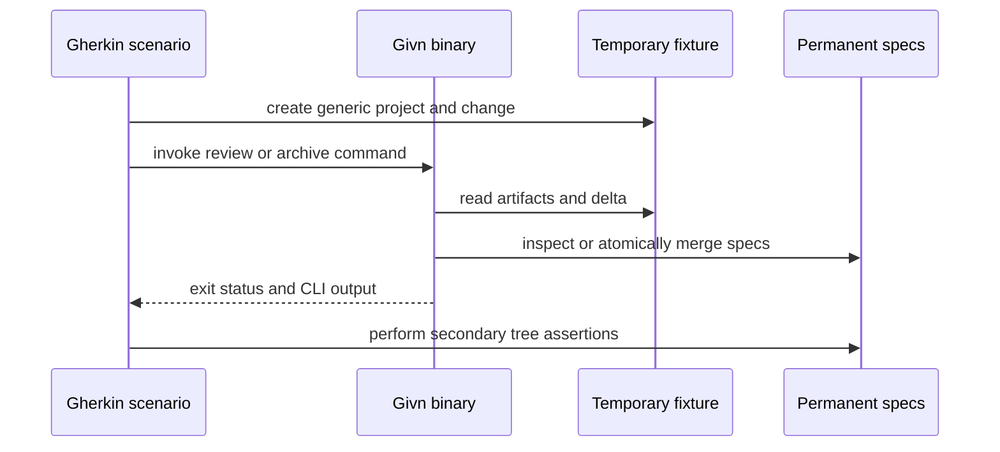

# Design: repository-wide-ownership-e2e

## Scope

This change moves the generic review, archive, and failure-preservation
acceptance proof into Givn. It is stacked on the `spec-overlap-gates` change
(PR #5), which supplies the review-disposition gate and net-delta receipt that
these fixtures exercise. This change adds no second overlap implementation.

The fixture describes a small repository with an obsolete permanent scenario
in one capability and a retained scenario added in another capability. It
contains no Watn-specific behavior and does not contact a provider or network
service.

The change does not alter the review or archive algorithm supplied by
`spec-overlap-gates`. It makes the existing public CLI contract executable in
the repository that owns that contract.

## Technology Decisions

- Use the existing Rust `cucumber-rs` runner and `TempDir` fixture utilities.
- Invoke the compiled Givn binary through `CARGO_BIN_EXE_givn`; this is the
  same executable a user receives from the current build.
- Keep the fixture deterministic by writing generic feature files and local
  shell commands (`true` for successful hooks and `false` for the failing
  archive hook).
- Reuse `tests/common::TestEnv` and `tests/common::run_givn` rather than
  maintaining a second subprocess abstraction.
- Add no dependency, service, database, model, or network integration.

## Components

| Component | Path | Responsibility |
|---|---|---|
| Delta specifications | `givn/changes/repository-wide-ownership-e2e/specs/repository-ownership-fixtures/repository-ownership-fixtures.feature` | Executable review, archive, and rollback behavior |
| CLI E2E step definitions | `tests/steps/repository_ownership_fixtures_steps.rs` | Review, successful archive, and failing pre-merge archive scenarios |
| Shared fixture helpers | `tests/steps/repository_ownership_fixtures_support.rs` | Fixture layout, subprocess capture, snapshots, and repository-wide title checks |
| Runner registration | `tests/steps/mod.rs` | Registers the capability and shared support modules |
| Existing runner | `tests/features_runner.rs` | Runs permanent specs or the path supplied through `GIVN_FEATURES` |

All three scenarios are E2E because each invokes the real Givn CLI. The shared
helper file contains no Cucumber step functions.

## Fixture Lifecycle

Each scenario creates a fresh `TempDir` and invokes the compiled Givn binary
with that directory as its current working directory.



The fixture layout is:

```text
<temp>/givn/specs/fixture-existing/fixture-existing.feature
<temp>/givn/specs/fixture-retained/fixture-retained.feature
<temp>/givn/changes/fixture-consolidation/{proposal.md,design.md,design-review.md,tasks.md,review.md}
<temp>/givn/changes/fixture-consolidation/specs/fixture-existing/fixture-existing.feature
<temp>/givn/changes/fixture-consolidation/specs/fixture-retained/fixture-retained.feature
<temp>/givn/commands.yaml
```

The fixture writes these exact feature contents:

```gherkin
# givn/specs/fixture-existing/fixture-existing.feature
Feature: Existing fixture

  Scenario: Obsolete behavior
    Given a fixture behavior
    When the old behavior runs
    Then the old result appears

# givn/specs/fixture-retained/fixture-retained.feature
Feature: Retained fixture

  Scenario: Existing unrelated behavior
    Given a different fixture behavior
    When unrelated behavior runs
    Then unrelated result appears

# givn/changes/fixture-consolidation/specs/fixture-existing/fixture-existing.feature
@givn.delta @fixture-existing
Feature: Existing fixture

  @givn.removed
  Scenario: Obsolete behavior
    Given this obsolete scenario is removed

# givn/changes/fixture-consolidation/specs/fixture-retained/fixture-retained.feature
@givn.delta @fixture-retained
Feature: Retained fixture

  @givn.added
  Scenario: Canonical retained behavior
    Given a fixture behavior
    When the old behavior runs
    Then the old result appears
```

The active tree therefore produces exactly one non-contradictory cross-
capability shape match (`Obsolete behavior` / `Canonical retained behavior`),
one added operation, and one removed operation. The unrelated scenario has a
different assertion fingerprint, and no scenario exceeds the long-scenario
threshold or creates a duplicate-title error.

The permanent tree contains `Obsolete behavior` and an unrelated
`Existing unrelated behavior` in separate capabilities. The delta removes the
obsolete title from `fixture-existing` and adds `Canonical retained behavior`
under `fixture-retained`. The review fixture contains one explicit disposition
row for the cross-capability shape match. The fixture uses `givn init
--no-addons` and writes explicit local commands: `true` for successful review
and archive hooks, `true` for the E2E command, and `false` for the failing
pre-merge archive hook. Coverage is disabled in the fixture; Givn's own
coverage workflow remains the outer gate.

The fixture review contains this disposition table:

```markdown
## Overlap dispositions

| Scenario A | Scenario B | Disposition |
|---|---|---|
| `Obsolete behavior` | `Canonical retained behavior` | merge |
```

The fixture command configuration is explicit:

```yaml
verify:
  command: "true"
  e2e_command: "true"
```

The failure fixture writes the same configuration with only
`verify.command: "false"`. Because `givn archive` runs the `verify` hook for
the required `tasks`/`review` artifacts before creating the permanent-spec
backup, this is an explicit pre-merge gate failure and no merge is attempted.

The rollback scenario fails before any merge begins and snapshots the complete
permanent tree before invoking archive. This is deliberately a pre-merge
failure-preservation contract; multi-file post-merge rollback is already
covered by the existing archive-gate scenarios.

## Runner and Strictness

The project-owned commands remain:

```text
./run-tests.sh
./run-tests.sh --e2e
```

`run-tests.sh` forwards `GIVN_FEATURES` to `tests/features_runner.rs`. Givn's
artifact hooks set that variable to the active change's `specs/` directory;
the normal standalone command defaults to the permanent `givn/specs/` tree.
For the active delta, the full in-scope command and its filtered projections
are:

```text
GIVN_FEATURES=givn/changes/repository-wide-ownership-e2e/specs cargo test --test features_runner
GIVN_FEATURES=givn/changes/repository-wide-ownership-e2e/specs cargo test --test features_runner -- --tags 'not @e2e'
GIVN_FEATURES=givn/changes/repository-wide-ownership-e2e/specs cargo test --test features_runner -- --tags @e2e
GIVN_FEATURES=givn/changes/repository-wide-ownership-e2e/specs cargo test --test features_runner -- --name "<scenario title>"
```

The exact strict-mode mechanism is `.fail_on_skipped()` in
`tests/features_runner.rs`. New step bodies start with `unimplemented!()` in
the RED phase; a pending or undefined step therefore exits non-zero.

The unfiltered active-delta command is the full in-scope count. Every active
scenario is intentionally tagged `@e2e`, so the E2E projection has the same
count and this is stated explicitly rather than pretending it is a strict
subset. The repository-level `./run-tests.sh` and `./run-tests.sh --e2e`
commands remain the permanent-tree projections used by the existing project
hooks.

## E2E Infrastructure

The capability interface type is CLI/terminal. The driving mechanism is a
real compiled `givn` subprocess, not an in-process call into Givn modules and
not a repository-only simulation.

- E2E command: `./run-tests.sh --e2e` with the active change supplied through
  `GIVN_FEATURES` when the change is under implementation.
- E2E step file: `tests/steps/repository_ownership_fixtures_steps.rs`.
- Local infrastructure: no server, database, queue, browser, container, or
  digital twin. `TempDir` is the only isolation boundary.
- Primary assertions: subprocess exit status and captured stdout. Permanent
  tree and duplicate-title assertions are secondary checks of the CLI result.
- Interface obstacle fix: every subprocess uses the fixture root as its
  current directory, and the temporary directory is retained until all Then
  assertions finish. The rollback scenario compares sorted relative paths and
  file bytes before and after the failed archive.

## Interaction Coverage Matrix

| Inventory entry | @e2e scenario title | Real interface | Driving mechanism |
|---|---|---|---|
| invoke repository-wide review for a project with explicit overlap dispositions | `Repository-wide review accepts explicit overlap dispositions` | CLI | Run the compiled `givn check review --change fixture-consolidation` subprocess in a fresh `TempDir`; assert exit status and stdout |
| archive a consolidated project and publish its permanent specifications | `Archive publishes consolidated permanent specifications` | CLI | Run the compiled `givn archive --change fixture-consolidation` subprocess in a fresh `TempDir`; assert exit status and stdout, then inspect the resulting tree secondarily |
| invoke archive for a project whose pre-merge hook fails | `Pre-merge archive failure preserves the permanent specification tree` | CLI | Run the compiled `givn archive --change fixture-consolidation` subprocess with `verify.command: "false"`; assert non-zero exit status and unchanged tree |

## Coverage Boundaries

The existing coverage command instruments the Givn library and the Gherkin
runner. Run `./measure-coverage.sh` followed by `./merge-coverages.sh`, then
inspect both `coverage/e2e-cobertura.xml` and the merged
`coverage/cobertura-coverage.xml`. The review must record non-zero
`lines-covered` for `src/cli/check.rs` and `src/cli/archive.rs` in the E2E
report. If either path is absent or zero, coverage is invalid and the
instrumentation must be fixed before review sign-off. The child binary is the
real interface under test and its CLI output is the acceptance boundary. This
change adds no production runtime branch.

## Risks and Mitigations

| Risk | Mitigation |
|---|---|
| The fixture accidentally archives the working Givn repository | Every command runs with a fresh `TempDir` as current directory and uses the fixture-only change id |
| A failed archive partially mutates permanent specs | Snapshot and byte-compare the permanent tree after the expected failure |
| A consumer-specific assumption returns | Fixture titles, paths, and behavior are generic; no Watn files or provider values appear |
| E2E steps assert only filesystem state | Every E2E scenario asserts the real CLI exit status and stdout before secondary tree checks |
| The implementation branch lacks the overlap gate under test | Keep this change stacked on `spec-overlap-gates`; do not duplicate its production implementation |
