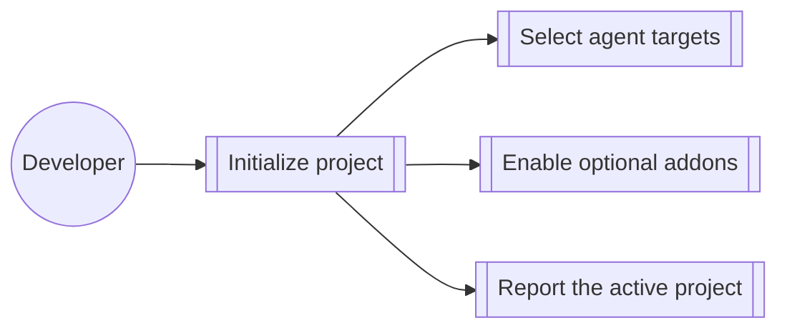

<!-- givn:base-sha256:96acc3cb38b6960cdd5a884efe1b1b158f3b31ec46e71016adb3cadc89ac93d8 -->
# Use case: initialize-project

## Level

!

## Actors

- Developer
- Supporting: Authoring agent

## Goal

Set up a Givn project and its agent integrations.

## Trigger

The developer initializes a project.

## Preconditions

- The project directory is writable.
- The active version-control system is detected when one exists.

## Main flow

1. The developer selects at least one agent target; the system writes
   generated guidance only to the selected targets and reports what was
   skipped and why.
2. The developer enables optional addons; the system records the choice.
3. The system reports the detected version-control system and installs the
   attribution plumbing only where it works, naming what was skipped.

## Extensions

- 1: no version-control system exists → the system scaffolds the corpus, generates guidance, exits 0, and warns that archive and managed upgrade are unavailable; protects the success guarantee.
- 1: the selected target set is empty or unknown-only → the system refuses with an error naming the valid agent targets, exits non-zero, and writes nothing; protects the minimal guarantee.
- 3: the active version-control system lacks a capability (for example transparent attribution hooks) → the report and the generated guidance state the limitation instead of naming a command that would fail; protects the success guarantee.

## Rules

- Initialization without a version-control system does not refuse; it warns.
- Initialization requires at least one selected agent target.
- Generated guidance may name only commands that work in the active project.
- The installation report names what was installed, what was skipped, and why.
- Optional addons are enabled or disabled by explicit user decision.

## Examples

- Git: `givn init` writes `.githooks/commit-msg`, chains an existing hook, generates skills, and reports `commit attribution: .githooks/commit-msg`. The agent then commits with `givn commit -m "feat: parser"` or raw `git commit`; both carry attribution.
- Fossil: `givn init` scaffolds `givn/`, writes no hook, and reports `commit attribution: givn commit path only`. `givn commit -m "feat: parser"` stamps the check-in comment; raw `fossil commit` does not, and the generated skill states that.
- No SCM: `givn init` exits 0 with a warning that archive and managed upgrade are unavailable; skills are generated; a later `givn archive` refuses by name.
- No agent target: `givn init` with no marked target and no `--agents` value exits non-zero, names `.opencode`, `.agents`, `.claude`, and leaves the project unchanged.

## Minimal guarantee

The project remains unchanged when an invalid request is rejected, and no
generated guidance names a command that cannot work in the active project.

## Success guarantee

The project is initialized with the chosen agent integrations and guidance
that does not misstate the active project.

## Personas

- developer--primary-user
- agent--technical-role
- givn-maintainer--owner

## Capabilities

- initialize-a-project
- enable-optional-addons

## Interactions

| Capability | Consumer action | E2E scenario |
|---|---|---|
| initialize-a-project | select agent targets | Consumer selects agent targets during interactive init |
| initialize-a-project | initialize non-interactively | Consumer runs init non-interactively and gets opencode skills |
| initialize-a-project | resynchronize selected targets | Consumer re-syncs skills after init and the selection is honoured |
| initialize-a-project | initialize a Fossil project | Consumer initializes a Fossil checkout and receives backend-aware guidance |
| initialize-a-project | initialize without SCM | Consumer initializes a plain directory and receives a named warning |

## Includes

- fragment: support

## Extends

- none

## Out of scope

Changing an existing project's configuration without a request; implementing
the product behavior described by a change (`create-change`).

## Diagram

