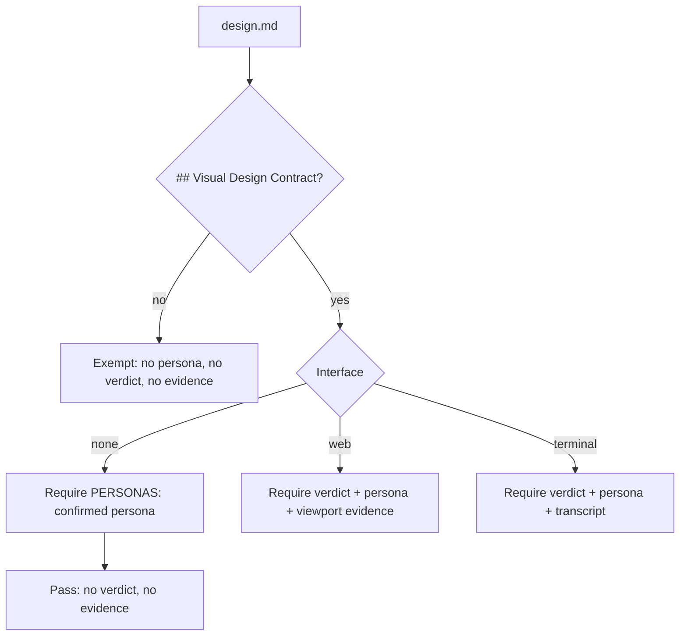

# Design: require-persona-for-interface-none

## Overview

The review gate currently treats `## Visual Design Contract` as two independent facts: the section declares a visual design contract, and the `Interface:` value decides which checks run. It returns early when the interface is `none`, so the Persona disposition is skipped along with the verdict and evidence.

This change separates those concerns. The section's presence is the Persona boundary; the `Interface:` value stays the evidence boundary. A declared contract always requires a confirmed Persona. `Interface: none` skips only the visual verdict and visual evidence. A change with no `## Visual Design Contract` section keeps today's full exemption.

The implementation is one control-flow change in `check_visual_review`, one broadened doc comment and three error strings in `check_persona_disposition`, unit tests, one fixture step, the delta scenarios, and the guidance/templates/durable documentation that teach the rule.

## Visual Design Contract

This change introduces no rendered screen and no visual interface. It declares a contract because the review gate's own rule is the subject of the change, and the rule now covers `Interface: none`.

- Interface: none
- Design system: docs/design/design-system.md

The contract carries no viewports, no UI states, no screens, and no evidence: an `Interface: none` contract requires neither a visual verdict nor screenshots or transcripts. The Persona disposition is still required for this change, and `review.md` records it when the review artifact is written.

## Behavior rule

| Design declaration | Persona disposition | Visual verdict | Visual evidence |
|---|---|---|---|
| No `## Visual Design Contract` section | Not required; a reasoned none is allowed | Not required; `VISUAL-REVIEW: NOT APPLICABLE` remains valid | Not required |
| Contract with `- Interface: none` | Required: at least one confirmed Persona resolving to `givn/personas/<id>.md` | Not required | Not required |
| Contract with `- Interface: web` | Required | Required (`VISUAL-REVIEW: PASS`) | Required per viewport and declared state |
| Contract with `- Interface: terminal` | Required | Required (`VISUAL-REVIEW: PASS`) | Required transcript per `@e2e` scenario |

Two statements hold after the change:

- No declared visual design contract remains exempt from the Persona disposition. `Interface: none` is a declared contract and requires a confirmed Persona.
- A change that declares no visual contract remains exempt. A change with no visual design contract at all is exempt from the Persona disposition, the visual verdict, and visual evidence. That is the deliberate documentation-only exemption and this change does not narrow it.

`PERSONAS: none`, `PERSONAS: none — <reason>`, and an empty value never satisfy a declared contract. A reviewed `none` value continues to fail with the offending value named.

## Controlled behavior change in `check_visual_review`

`src/integrity_hook.rs`, `fn check_visual_review`:

1. `design.md` absent → return `Ok(())` (unchanged).
2. `parse_visual_contract` returns `None` → return `Ok(())` (unchanged; no-contract exemption).
3. `Interface: web` with an empty viewports list → bail with the existing viewport message (unchanged).
4. `Interface: none` → the new branch:
   - Read `review.md`. If it is missing, bail with the missing-persona message below.
   - Call `check_persona_disposition(&review, change_dir)?`.
   - Return `Ok(())`. Do not read or require `VISUAL-REVIEW:`, `check_visual_evidence`, or any evidence file.
5. `Interface: web` or `Interface: terminal` → the existing order: require `review.md`, require exactly one verdict, call `check_persona_disposition`, then `check_visual_evidence`.

The ordering matters for existing scenarios: the verdict check stays before the Persona check for web and terminal, so a missing verdict still reports `VISUAL-REVIEW` rather than `PERSONAS`. `Interface: none` has no verdict check, so its first failure is the Persona disposition.



`check_persona_disposition` keeps its signature `(review: &str, change_dir: &Path) -> Result<()>` and its resolution rule (the value must name a file directly under `givn/personas/<value>.md`). Its doc comment changes from "a declared visual interface" to "a declared visual design contract". Error strings:

- Missing line or missing `review.md`: `review.md is missing the persona disposition — add 'PERSONAS: <confirmed persona>' to review.md`
- Empty or `none` value: `a declared visual design contract requires at least one confirmed Persona — 'PERSONAS: {value}' is not a confirmed persona`
- Value that resolves to no file: `the persona disposition '{value}' matches no file in givn/personas/ — name a confirmed Persona; a reasoned none is valid only when the design declares no visual design contract`

No other production code changes. `parse_visual_contract`, `VisualContract`, `VisualInterface`, `visual_verdict`, `check_visual_evidence`, `collect_e2e_scenario_titles`, `check_deferrals`, and `run_integrity_hook` keep their behavior.

## Affected files

| File | Change |
|---|---|
| `src/integrity_hook.rs` | New `Interface: none` branch in `check_visual_review`; broadened `check_persona_disposition` doc comment and three error strings; new and updated unit tests. |
| `tests/steps/visual_review_gate_steps.rs` | One new Given step that writes `review.md` with `README-IMPACT: none`, `REVIEW: PASS`, and `PERSONAS: fixture-persona`, and no `VISUAL-REVIEW:` line. Existing steps cover the missing-disposition and reasoned-none scenarios. |
| `givn/changes/require-persona-for-interface-none/specs/verify-change/visual-review-gate.feature` | New delta: modify the old exemption scenario into the confirmed-Persona passing case, with a description pinning the exemption to the visual verdict and evidence; add the missing-Persona and reasoned-none `Interface: none` failure scenarios; add the review-guidance scenario asserting the new rule. |
| `assets/instructions/design.md` | `Interface: none` is a declared contract; the section's presence, not the rendered screen, triggers the Persona requirement. Preserve the asserted `user-visible`, `CLI text`, and `reason` phrases in the surrounding classification text. |
| `assets/instructions/design-review.md` | Persona disposition rule follows the declared contract, including `Interface: none`; only a no-contract design records a reasoned none. Preserve the asserted `per persona`, `relevance and evidence`, and `operator confirmation` phrases. |
| `assets/instructions/proposal.md` | Persona confirmation names at least one confirmed Persona when the change will declare any contract, including `Interface: none`. Preserve the asserted `user-visible`, `operator confirmation`, and `reason` phrases. |
| `assets/instructions/review.md` | Conformance section says: "A declared visual design contract — including `Interface: none` — requires at least one confirmed Persona; only a change that declares no visual design contract may record a reasoned `none`." The visual review block stays conditional on a non-`none` interface. Preserve the asserted `disposition for every confirmed Persona`, `at least one confirmed Persona`, and `record the reason` phrases. |
| `assets/templates/design.md` | Section note distinguishes "no contract, omit it" from "`Interface: none`, Persona still required". Preserve the asserted `Visual Design Contract`, `Interface:`, `States:`, `Breakpoints`, and `Accessibility` lines. |
| `assets/templates/design-review.md` | Persona disposition note matches the contract-based rule. Preserve the asserted `persona`, `Relevance`, and `Evidence` table text. |
| `assets/templates/review.md` | Persona disposition note and `## Visual Review` N/A note match the new rule. Preserve the asserted `PERSONAS:`, `DEFERRAL:`, and `OPERATOR-DECISION:` markers, the `VISUAL-REVIEW: PASS` example, and the word `persona`. |
| `docs/arc42/05-building-block-view.md` | Updated the `integrity_hook` row: every declared contract requires the Persona disposition, while the visual verdict and evidence stay conditional on `web` and `terminal`. |
| `docs/arc42/06-runtime-view.md` | The visual gate description: absent section exempts; `Interface: none` exempts verdict and evidence but not the Persona disposition. |
| `docs/arc42/08-crosscutting-concepts.md` | Contract-line semantics: `none` is a declared contract with no rendered screen; only an absent section is exempt. |
| `docs/arc42/09-architecture-decisions.md` | Added the current-trigger register note: every declared contract requires a Persona; the candidate is `NOT_QUALIFIED`/`CANONICAL_ARTIFACT`, so no ADR file or amendment. |
| `docs/arc42/10-quality-requirements.md` | Broadened Q-89 to every declared contract and added Q-119: `Interface: none` with a confirmed Persona passes without a visual verdict or evidence. |
| `docs/arc42/11-risks-and-technical-debt.md` | Updated R-59: the Persona half of the declared-`none` bypass closes; the misdeclared-none visual-evidence bypass and the omitted-section exemption remain residual risks. |
| `docs/arc42/12-glossary.md` | `Visual Design Contract` includes the `Interface: none` declaration; `Persona disposition` and the visual-review invariant follow the declared contract rather than rendered evidence. |
| `docs/arc42/README.md` | Added the change's current-fact summary and the pointer to chapters 5, 6, 8, 10, 11, and the glossary; no ADR is introduced. |
| `givn/specs/verify-change/visual-review-gate.feature` | Unchanged now; the archive merge replaces the existing exemption scenario in place and appends the two new failure scenarios and the review-guidance scenario. |
| `givn/specs/verify-change/usecase.md` | Unchanged: no new consumer action, capability, or Persona. |
| `givn/commands.yaml`, `givn/config.yaml` | Unchanged. |

`assets/skills/givn-review/SKILL.md.tmpl` carries no rules; it only points at the served review instruction, so it needs no edit.

## Technology Decisions

No language, framework, library, driver, or runtime version is introduced. The change is in the existing Rust binary, uses the repository's existing cucumber-rs runner, and adds no dependency.

| Technology | Version | Resolution |
|---|---|---|
| Rust | Edition 2024, already declared in `Cargo.toml` | No version change; the repository resolves the toolchain it already builds with. |
| cucumber-rs | Already pinned in `Cargo.lock` | No change. |

## Decisions

- Decides D1: the Persona requirement follows the presence of a declared `## Visual Design Contract`, not the rendered interface. `Interface: none` requires at least one confirmed Persona; the visual verdict and visual evidence remain conditional on `web`/`terminal`; a change with no contract at all remains exempt — realized in `src/integrity_hook.rs::check_visual_review` step 4 above, the delta scenarios, and the guidance/templates/arc42 updates.

## Step Definitions

| Capability | Step definition file |
|---|---|
| visual-review-gate | `tests/steps/visual_review_gate_steps.rs` |

The `@e2e` and regular scenarios for this capability share the real-boundary fixture steps: every scenario spawns the built `givn` binary through `common::run_givn`, and the `@e2e` tag only selects the E2E verification scope. The new fixture step is `#[given("the change's review.md names a confirmed persona without a visual verdict")]` in `tests/steps/visual_review_gate_steps.rs`; it writes `README-IMPACT: none`, `REVIEW: PASS`, and `PERSONAS: fixture-persona`, and no `VISUAL-REVIEW:` line. The `Given a givn project with a change that has passed design-review` step lives in `tests/steps/workflow_enforcement_steps.rs` and is reused unchanged; it creates the `fixture-persona` file that the Persona check resolves. The review-guidance scenario reuses the existing `Given a givn project`, `When the user runs givn instructions review --change ...`, and `Then stdout contains ...` steps; it needs no new step definition.

Test runner command (`verify.command` in `givn/commands.yaml`):

```
./run-tests.sh --non-e2e
```

Single-scenario run command:

```
GIVN_FEATURES=givn/changes/require-persona-for-interface-none/specs \
cargo test --locked --test features_runner -- \
  --name "A change that declares the interface none without a persona disposition fails review"
```

Delta-scope run:

```
GIVN_FEATURES=givn/changes/require-persona-for-interface-none/specs ./run-tests.sh --non-e2e
```

Unit tests for the gate:

```
cargo test --locked integrity_hook::tests::interface_none_requires_confirmed_persona
cargo test --locked integrity_hook::tests::interface_none_default_requires_persona
cargo test --locked integrity_hook::tests::interface_none_does_not_require_visual_evidence
cargo test --locked integrity_hook::tests::no_visual_contract_remains_exempt
```

## Internal Primitives

No new primitive. `VisualContract` and `VisualInterface` are reused unchanged. `check_persona_disposition` keeps its signature and gains the contract-based meaning in its doc comment and error text.

| Primitive | Type | Purpose |
|---|---|---|
| `VisualContract` | `struct` | Unchanged: parsed interface, viewports, states. |
| `VisualInterface` | `enum` | Unchanged: `Web`, `Terminal`, `None`. |
| `check_persona_disposition` | `fn` | Unchanged signature; now enforces the disposition for any declared contract. |

## Strict Mode

The runner is cucumber-rs in `tests/features_runner.rs`. The builder calls `.fail_on_skipped()`, and `main` exits `1` when `stats.failed > 0 || stats.skipped > 0`. An undefined or pending step therefore fails the run; a `@givn.removed` placeholder is filtered from execution and is not a behavioral scenario.

New step bodies start as `todo!("...")` when written, never as an empty body, so the strict-mode proof fails until the step performs its real assertion.

## Local Runnability & Digital Twins

The product is a CLI. The configured start command in `givn/commands.yaml` runs locally:

```
cargo run -- instructions
```

The change's gate is a separate verification invocation:

```
cargo build --locked && cargo run -- check review --change require-persona-for-interface-none
```

The gate command is expected to fail until `review.md` and the task evidence exist; that is the gate working, not a startup failure.

Test fixtures invoke the built binary through `common::run_givn`, which runs `CARGO_BIN_EXE_givn` in a temporary project root. There is no server, database, browser, container, or network dependency.

**Isolated network:** not applicable; no service is started and no network access is required.

**Digital twins:** none. The CLI reads local project files (`design.md`, `review.md`, `givn/personas/*.md`, `givn/specs/**`, and the change's `specs/**`) and talks to no external or third-party service.

**Anticipated interface obstacles:** none for the fixture boundary. The review check additionally requires a complete run declaration and a current verification receipt; the existing `Given` fixture already sets the run declaration and writes the change receipt (`write_fixture_change_receipt`). Unit tests call `check_visual_review` directly, so they do not need either. No browser, cookie, redirect, or streaming obstacle exists.

## E2E Smoke Test Infrastructure

**Interface type:** CLI — the consumer runs the real `givn` binary and reads its exit code, stdout, and stderr.

**E2E runner command (`verify.e2e_command`):**

```
./run-tests.sh --e2e
```

**E2E step location:** `tests/steps/visual_review_gate_steps.rs` for the capability fixtures; the `When`/`Then` steps are the shared CLI steps in `tests/steps/mod.rs`. The E2E scope is selected by the `@e2e` tag, and every scenario drives the same real binary.

**Local test infrastructure:** `cargo build --locked --test ready_fixture` (run by `run-tests.sh`), a temporary fixture project per scenario, and the compiled `givn` binary. No browser driver, server port, database, or container.

**E2E framework choice and justification:** cucumber-rs through `tests/features_runner.rs`. The capability's real interface is the CLI process, and the existing `GivnWorld` and `common::run_givn` drive exactly that process; a second E2E harness would duplicate the CLI boundary.

**E2E strict-mode proof:** the same `.fail_on_skipped()` builder and `skipped > 0` exit apply to the `@e2e` scope; `run-tests.sh --e2e` filters `@e2e and not @givn.removed`. An undefined `@e2e` step fails the scope.

**Interaction Coverage Matrix:**

| Inventory entry | @e2e scenario title | Real interface | Driving mechanism |
|---|---|---|---|
| visual-review-gate — run the review check on a visual change | A visual change with complete evidence passes review | CLI | `common::run_givn` spawns `CARGO_BIN_EXE_givn` with `check review --change test-change`; asserts exit code and stderr/stdout |
| visual-review-gate — read the visual review guidance | Review guidance requires the visual verdict and persona lenses | CLI | `common::run_givn` spawns `CARGO_BIN_EXE_givn` with `instructions review --change visual-ui-review`; asserts stdout |

The inventory gains no entry: the new `Interface: none` behavior is a variant of the existing review-check action, and the new guidance scenario is a variant of the existing guidance action, so the modified and added scenarios are regular scenarios and the two `@e2e` mappings are preserved.

## Coverage process boundaries

Coverage is enabled in this project (`addons.coverage: true`). The changed code runs in the test runner and in the CLI subprocess that the scenarios start.

| Process | Started by | Instrumented artifact | Profile output | Merge step | Non-zero production probe |
|---|---|---|---|---|---|
| `features_runner` | `./measure-coverage.sh` (`cargo llvm-cov nextest --test features_runner`); `./run-tests.sh` runs the uninstrumented suite | instrumented `target/llvm-cov-target` test harness and `givn` binary | cargo-llvm-cov profraw files under `target/llvm-cov-target/`, collision-safe per process | `cargo llvm-cov report --cobertura` per scope, then `./merge-coverages.sh` | `integrity_hook::check_visual_review` and `check_persona_disposition` executed by the new scenarios |
| `givn` CLI subprocess | `common::run_givn` in every scenario | `target/llvm-cov-target/debug/givn`, discovered through `CARGO_BIN_EXE_givn` | inherits `LLVM_PROFILE_FILE`; each process flushes on normal exit | same per-scope report and `./merge-coverages.sh` | `integrity_hook::check_visual_review` step 4 (`Interface: none` Persona branch) executed by `givn check review` |

No browser, server, database, queue, or container process exists for this change. `measure-coverage.sh` and `merge-coverages.sh` are used unchanged.

## Test Impact

`src/integrity_hook.rs` unit tests:

| Test | Assertion |
|---|---|
| `interface_none_requires_confirmed_persona` (new) | A design with `Interface: none` plus `review.md` naming `shopper-anna` passes; missing `review.md`, a missing `PERSONAS:` line, `PERSONAS: none`, and `PERSONAS: none — operator confirmed` all fail. |
| `interface_none_default_requires_persona` (new) | A `## Visual Design Contract` section with no recognized `- Interface:` line (and an unrecognized value) is treated as `Interface: none`; without a confirmed Persona it fails, so the parser default is locked to the contract-based rule. |
| `interface_none_does_not_require_visual_evidence` (new) | A design with `Interface: none`, a delta `@e2e` scenario, a confirmed Persona, and no screenshot or verdict passes `check_visual_review`. |
| `no_visual_contract_remains_exempt` (new) | A design with no contract section and no `review.md` passes; the deliberate no-contract exemption is locked. |
| `persona_disposition_requires_a_confirmed_persona` (existing) | Unchanged behavior for the resolved-ID, unknown-ID, none, empty, and missing-line branches. |
| `no_visual_contract_accepts_not_applicable` (existing) | Unchanged: no contract plus `VISUAL-REVIEW: NOT APPLICABLE` passes. |

Delta `.feature` scenarios:

| Scenario | Tag | Meaning |
|---|---|---|
| A change that declares no visual interface is exempt | `@givn.modified @wip` | The existing title stays for merge safety; the scenario description and the Persona step pin the exemption to the visual verdict and evidence while a confirmed Persona still passes review. |
| A change that declares the interface none without a persona disposition fails review | `@givn.added @wip` | Missing Persona blocks even when a visual verdict is present. |
| A change that declares the interface none with a reasoned none fails review | `@givn.added @wip` | A reasoned none still fails for a declared contract and the value is reported. |
| Review guidance requires a persona for a declared interface none contract | `@givn.added @wip` | The served review instruction names `Interface: none` and the contract-based Persona rule; no new `@e2e`. |

Permanent-spec effect at archive: `givn/specs/verify-change/visual-review-gate.feature` replaces the existing exemption scenario in place and appends the two new failure scenarios and the review-guidance scenario. Its two existing `@e2e` scenarios and their inventory mapping are untouched. The guidance and template edits are asserted by `givn/specs/create-change/visual-design-contract.feature` and `givn/specs/verify-change/visual-review-gate.feature`; edit the Persona paragraphs surgically and preserve every asserted phrase, including `Visual Design Contract`, `Interface:`, `States:`, `Breakpoints`, `Accessibility`, `style-level`, `not pixel`, `docs/design/`, `design tokens`, `component states`, `rendered reference`, `improvement`, `updates the contract`, `Samsung S24`, `360x780`, `Full HD`, `1920x1080`, `renders HTML, CSS, or JavaScript in a browser`, `even when it needs only a page request`, `no controls`, `default browser driver`, `Playwright`, `does not pin`, `is a Web UI row`, `needs a browser driver`, `user-visible`, `CLI text`, `reason`, `operator confirmation`, `opposite classification`, `rendered in a browser`, `must say why`, `propose`, `user approves`, `rendered options`, `per persona`, `relevance and evidence`, `operator question`, `mandatory check`, `do not sign off`, `persona`, `Relevance`, `Evidence`, `PERSONAS:`, `DEFERRAL:`, `OPERATOR-DECISION:`, `VISUAL-REVIEW: PASS`, `confirmed Persona`, `disposition for every confirmed Persona`, `at least one confirmed Persona`, `record the reason`, `no pixel-level`, `state screenshots the review saw`, `each declared UI state`, `vision`, and `transcript`. The full `./run-tests.sh --non-e2e` run is the regression net; the delta-scope run alone is not enough because these assertions live in the permanent corpus. The two new `Interface: none` failure scenarios are variants of each other, the modified exemption scenario is a boundary against the permanent no-contract exemption, and the guidance scenario is a variant of the existing guidance action; record those dispositions in the review's Overlap dispositions.

## Use-Case Traceability

Owning use-case ID: `verify-change`
Ideation source: none
Confirmed Persona IDs: `developer--primary-user`, `agent--technical-role`, `givn-maintainer--owner`

| Use-case contract element | Technical decision | Capability / E2E evidence |
|---|---|---|
| Goal: check a change for structural validity and completeness | The Persona disposition is part of completeness for any declared contract, not only a rendered interface (D1). | Scenario "A change that declares the interface none without a persona disposition fails review". |
| Main flow 2: detect structural failures and invalid references | A Persona value must resolve to `givn/personas/<id>.md`; an unknown ID blocks. | Existing scenario "A visual change with an unknown persona disposition fails review"; the same `check_persona_disposition` path serves `Interface: none`. |
| Main flow 5: report blocking findings | The failure names the missing or offending Persona value, so the developer can correct it in one pass. | Scenario "A change that declares the interface none with a reasoned none fails review" asserts the value in stderr. |
| Minimal guarantee: an invalid change cannot pass the verification gate | Any declared contract without a confirmed Persona exits non-zero. | Scenarios "…without a persona disposition fails review" and "…with a reasoned none fails review". |
| Success guarantee: the developer receives a complete verification result | A valid `Interface: none` contract with a confirmed Persona passes without demanding irrelevant visual evidence. | Scenario "A change that declares no visual interface is exempt". |
| Extension 4/5: missing receipt or review disposition blocks completion | Unchanged; the Persona check runs inside the review integrity hook alongside the receipt and disposition gates. | Existing receipt and disposition scenarios; no new interaction. |
| Persona: `developer--primary-user` | Runs `givn check review` and now records a Persona for non-rendered changes. | Passing and failing `Interface: none` scenarios. |
| Persona: `agent--technical-role` | Authors `design.md` and `review.md`; the guidance distinguishes a no-contract design from `Interface: none`. | The new review-guidance scenario plus the guidance scenarios in the permanent corpus; no new `@e2e`. |
| Persona: `givn-maintainer--owner` | Owns the rule corpus and durable docs; this change keeps instruction, template, and arc42 wording aligned. | The unchanged guidance `@e2e` scenario plus the docs updates in this design. |

## Architecture Impact

One production function changes behavior. No new module, command, artifact, configuration key, or dependency is introduced. The gate remains inside `run_integrity_hook` and keeps its existing position in the review check.

## Data Model Changes

None. The design contract parser, the `VisualContract` shape, and the persona file layout are unchanged.

## Residual risk

R-59 remains open: a change that visibly adds a screen but omits the `## Visual Design Contract` section is still exempt from both the Persona disposition and the visual gate. This change deliberately preserves that no-contract exemption for documentation-only work. A screen misclassified as `Interface: none` now requires a confirmed Persona, but it still avoids the visual verdict and evidence; the existing design/review fabrication audit and the review instruction's `Interface:` classification check remain the mitigations for both gaps. Closing them would require a different rule, for example deriving the contract's presence from changed files or proving the rendered surface, which is out of scope here.

## Open Technical Questions

None.
