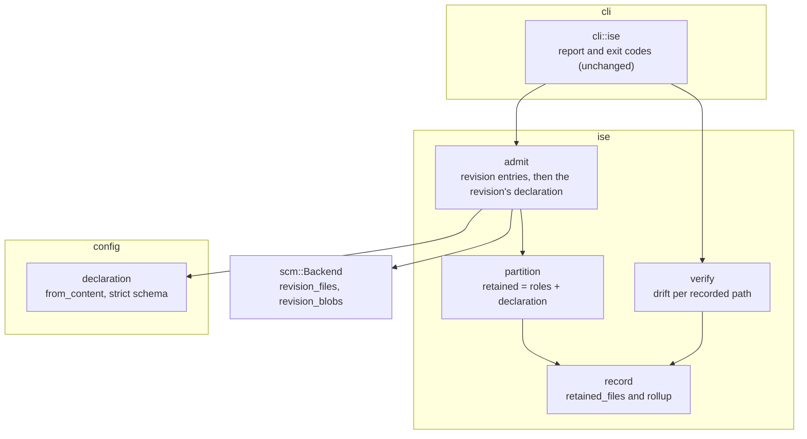
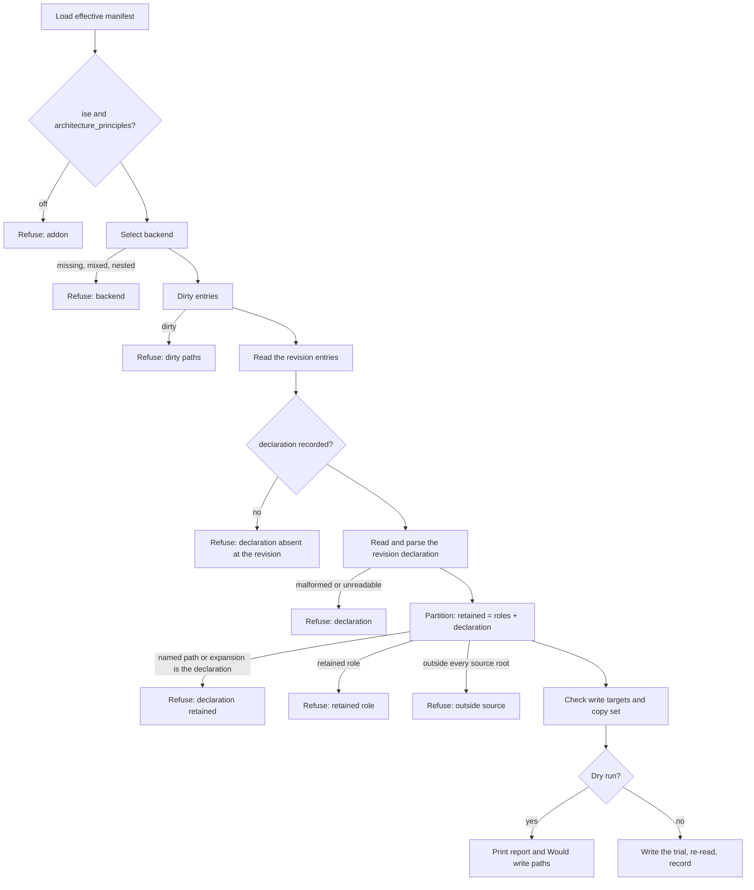
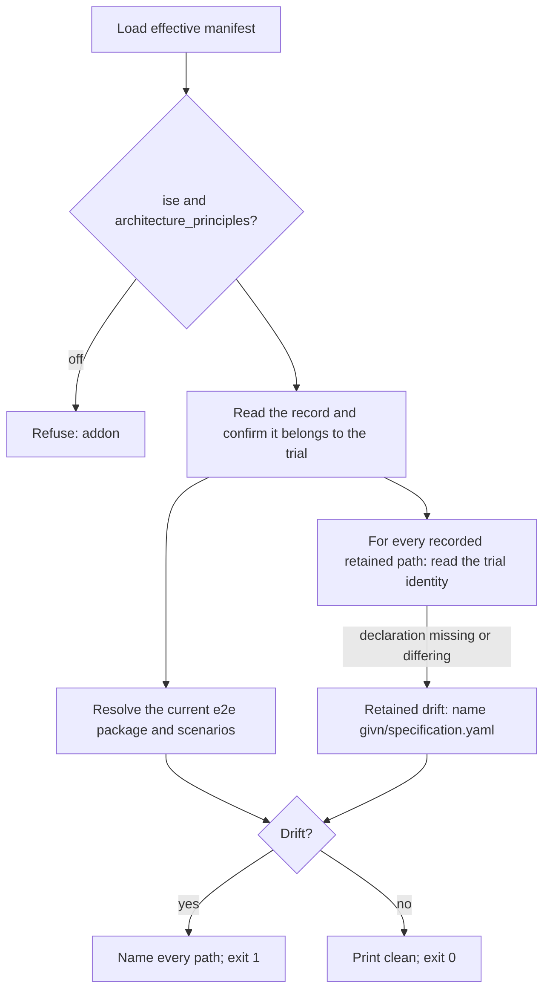

# Design: retain-declaration-in-trial

## Overview

One retained entry, one read seam, and one refusal:

1. **`src/ise/partition.rs` owns the declaration as an implicit retained
   entry.** Every partition retains `givn/specification.yaml` beside the five
   declared roles, so `Retained`, the copy set, the dry-run `Would write:`
   block, `retained_paths`, `retained_files`, and `Retained digest` gain the
   path with no new field and no new report line. The retained set is a union,
   so a role that also matches the declaration adds no second entry and
   `Retained` equals `retained_files.len()`. The declaration is tested
   before any role, so `--full` cannot replace it and a `--path` value or
   directory expansion that contains it refuses with one deterministic
   message.
2. **`src/ise/mod.rs` reads the declaration at the selected revision.** The
   admission reads the tracked entries first, refuses a revision that does not
   record the declaration, then parses that revision's bytes as the partition's
   only declaration authority. `ise replace` no longer reads the working tree's
   declaration at all; `ise verify` keeps its working-tree read only to derive
   the frozen `e2e` set and the `behavior` feature selection (D6).
3. **`src/config/declaration.rs` gains one entry point.** `parse` becomes
   `pub(crate) fn from_content`, so a revision's bytes use the same strict
   schema as `load`. The schema, the keys, and the error variants are
   unchanged.
4. **`src/ise/record.rs`, `src/ise/verify.rs`, and `src/cli/ise.rs` need no
   line change.** The record's retained identity already covers every entry of
   `retained_paths`; the re-check already iterates every entry of
   `retained_files`; the report already renders `Counts::retained`. The
   declaration is covered because it is now a member of those sets, not
   because a second code path was added.

5. **`assets/instructions/ise.md` states the rule, and one scenario asserts
   it.** The served instruction says the trial always carries the declaration
   and that it is an implicit retained entry, not a sixth role;
   `prose-consolidation` reads the served text and asserts both sentences.

The change adds no dependency, no config key, no report line, no record field,
and no change to `ise-trial/v1`.

## Visual Design Contract

```
- Interface: terminal
- Viewports: not applicable (terminal text surface)
- States: not applicable
- Design system: none (CLI)
```

`Interface: terminal` is deliberate: the change alters terminal text (one
report count, two refusal messages), the trial directory's contents, and one
YAML field's member set. No rendered screen exists.

**Baseline asserted at every transcript-producing assertion:**

- every refusal names the condition and the path, revision, role, or target it
  is about; a refusal never names a Rust module, struct, or field;
- the report keeps its ten fixed lines, plus `Receipt path` only when a receipt
  path was given; the dry run keeps its `Would write:` block;
- exit codes are unchanged: `0` for a successful preparation or a clean
  re-check, `1` for a refusal or drift, `2` for a clap usage error;
- `givn ise verify` keeps its clean lines and prints one `Retained drift`
  line per drifting path, the declaration included;
- the trial record keeps its domain names and its full digests.

**Capture mechanism and evidence path.** The modified `@e2e` scenario
`Developer prepares a clean-room trial from a recorded revision` commits a
transcript at
`givn/changes/retain-declaration-in-trial/evidence/visual/developer-prepares-a-clean-room-trial-from-a-recorded-revision/transcript.txt`.
The transcript holds `Retained: 4` for the seven-file fixture plus the
declaration, the `Would write:` block is not part of this scenario, and the
receipt path line is present. The permanent `trial-input-verification` `@e2e`
scenario has no delta scenario and no text change, so it commits no new
transcript in this change; its report text is unchanged because the clean
report prints `Retained: clean`, not a count.

**Personas:** `developer--primary-user` prepares the trial, `agent--technical-role`
reads the report, the record, and the refusals, and `givn-maintainer--owner`
owns the declaration, the record, and the backend parity. All three are
confirmed by the owning use case's `## Personas` section.

## Use-Case Traceability

Owning use-case IDs: `prepare-an-ise-test` (`clean-room-preparation`,
`trial-input-verification`) and `create-change` (`prose-consolidation` for the
served `ise` guidance sentence).
Ideation source: `ise-rebuildability` (no change seed covers this defect).
Confirmed Persona IDs: `developer--primary-user`, `agent--technical-role`,
`givn-maintainer--owner` (from `prepare-an-ise-test`; `create-change` adds no
Persona to this change).

| Use-case contract element | Technical decision | Capability / scenario evidence |
|---|---|---|
| The declaration is an implicit retained entry, never a sixth role | `partition()` seeds `retained` with `DECLARATION_PATH` | `clean-room-preparation`: the E2E prepare scenario asserts `Retained: 4` and holds the declaration; `The trial carries the declaration when no role names it` asserts it with every role list empty |
| A role that also matches the declaration counts it once, and `Retained` equals the record's retained entries | `partition()` builds the retained set as a union, not a concatenation | `clean-room-preparation`: `A role that matches the declaration counts it once` asserts `Retained: 2` for a `contracts: ["givn/**"]` declaration plus one matched document |
| The copy at the selected revision is the partition authority and the trial's copy | `admit` reads the entry list, then parses the revision's declaration bytes | `clean-room-preparation`: `Preparation partitions with the declaration recorded at the selected revision` (roles and bytes from the older revision) |
| A revision without the declaration refuses before any write | the `admit` membership check | `clean-room-preparation`: `Preparation refuses a revision that does not record the declaration`; the permanent missing-declaration scenario keeps its path assertion |
| A malformed declaration at the selected revision refuses with the loader's reason | `from_content` parses the revision's bytes, not the working tree's | `clean-room-preparation`: `Preparation refuses a malformed declaration at the selected revision`, whose first revision is malformed while `HEAD` is valid |
| A declaration that is not UTF-8 at the selected revision refuses and names the path | `admit` decodes the revision's bytes before the one strict loader | `clean-room-preparation`: `Preparation refuses a declaration that is not UTF-8`, whose first revision holds the invalid bytes while `HEAD` is valid |
| A retained path is never replaced, and a `source:` root cannot remove it | the retained test runs before the source-root test and before `replaced` | `clean-room-preparation`: `A full replacement keeps the declaration under a source root` asserts `Replaced: 3` (the fixture's committed `givn/config.yaml`, `givn/commands.yaml`, and `givn/notes.md`) and holds the declaration |
| Naming the declaration, or a directory containing it, refuses | the declaration candidate check in `require_replaceable_paths` | `clean-room-preparation`: `Preparation refuses a replacement path that names the declaration` and `Preparation refuses a directory that contains the declaration` |
| The record's retained set carries the declaration with its digest | `identities(retained_paths())`; `rollup` over the retained map | `clean-room-preparation`: `The trial record lists the declaration in its retained set`; the E2E prepare scenario asserts the receipt's fields |
| The re-check covers the declaration like any recorded retained path | `check_retained` iterates `record.retained_files` | `trial-input-verification`: `Verification names a declaration changed in the trial` and `Verification names a declaration missing from the trial` |
| The dry run lists the declaration among the paths it would write | `copy_paths()` includes it | `clean-room-preparation`: the permanent dry-run scenario, whose fixture expectation gains `givn/specification.yaml` |
| The checkout is never written and the receipt stays outside the trial | unchanged target checks | `clean-room-preparation`: the target and receipt refusal scenarios stay unchanged and still pass |
| A checkout declaration edit is drift only where it derives the frozen `e2e` set or the `behavior` selection | `check_checkout` loads the checkout's declaration for the `e2e` set and the feature selection, never for the retained identities | `trial-input-verification`: `Verification reports no drift after only the checkout's structure role changes` and `Verification names the e2e package a checkout declaration's added root brings`; D6 |
| A changed file outside the frozen inputs produces no drift | the retained set is the trial's, and the checkout's declaration only derives the `e2e` set and the `behavior` selection | `trial-input-verification`: the permanent kept-source no-drift scenario; D6 |
| Git and Fossil agree | the declaration is one tracked path read through the existing backend seam | `clean-room-preparation`: the permanent Fossil scenario, whose fixture already commits the declaration |
| Nine refusals, exit codes unchanged | condition 5 absorbs the declaration's absence and condition 7 the declaration candidate | `clean-room-preparation`: the refusal scenarios; D4 |
| The served `ise` guidance names the rule | two sentences in `assets/instructions/ise.md`'s `Specification completeness` bullet | `prose-consolidation`: `Served ise guidance states that the trial always carries the declaration` |

## Architecture Impact

Modified modules:

- `src/ise/mod.rs`: `admit` resolves the revision and its entries before the
  declaration, refuses a revision without the declaration, and parses the
  revision's bytes; the working-tree load is removed from this path.
- `src/ise/partition.rs`: the implicit retained entry, the declaration
  candidate check, and the doc comments that enumerate the owned refusals.
- `src/config/declaration.rs`: `parse` becomes `pub(crate) from_content`
  (same body, same errors); `load` delegates to it.
- `tests/steps/ise_clean_room_support.rs`: the two `.git/info/exclude`
  fixtures commit the declaration, and four fixtures are added (a declaration
  with one `givn/**` source root, a declaration that retains one document, a
  first revision that predates the declaration, and a later revision that
  rewrites the declaration).
- `tests/steps/clean_room_preparation_steps.rs`,
  `tests/steps/clean_room_preparation_e2e_steps.rs`,
  `tests/steps/trial_input_verification_steps.rs`: the new bindings and the
  changed fixture expectations listed under `## Step Definitions`.
- `assets/instructions/ise.md`, `docs/reference.md`, `docs/glossary.md`, and
  the affected arc42 chapters: the guidance table below.

Unchanged, with the reason recorded so a reviewer does not look for a diff:

- `src/ise/record.rs`: the retained identity, the rollup, and the record
  fields already take their input from `retained_paths()`, which now includes
  the declaration.
- `src/ise/verify.rs`: `check_retained` walks `record.retained_files`, so the
  declaration is re-checked and named on the retained drift line without a new
  branch; `check_checkout` still loads the current declaration, but only to
  derive the frozen `e2e` set and the `behavior` feature selection, which is
  the only comparison D6 allows.
- `src/cli/ise.rs`: `Retained` already prints `Counts::retained`, and the two
  refusal messages travel through `{error:#}`.
- `src/scm.rs`, `src/git.rs`, `src/fossil.rs`: one tracked path read through
  the existing `revision_blobs` seam.
- `src/e2e_boundary/`, `src/gherkin/`: the frozen `e2e` set and the scenario
  digests are out of scope.
- `src/config/declaration.rs`'s schema: no key, role, or error variant changes.



Arrows point from consumer to provider. `admit` is the only new edge: it reads
the declaration from the revision through the existing backend seam.

### Contracts and Components

| Contract | Consumer use case | Consumers | Implementing component today | Split trigger |
|---|---|---|---|---|
| `DeclarationContent` (parse a declaration string under the strict schema: five roles plus `source`, no unknown key) | `prepare-an-ise-test` (partition by the declaration recorded at a revision) | `ise::replace`; `cli::lint` and `cli::addons` keep the file-loading entry point | `config::declaration` | a second declaration format, a non-YAML source, or a schema version |
| `CleanRoomTrial` (`replace`, `verify`, the `ise-trial/v1` record) | `prepare-an-ise-test` (`clean-room-preparation`, `trial-input-verification`) | `cli::ise` | `src/ise` | a second materialization mode (branch or worktree) or a second record scope |
| `RevisionContent` (`revision_files`, `revision_blobs`) | `prepare-an-ise-test` (read one revision) | `ise` (`replace`, `verify`) | `src/scm`, `src/git`, `src/fossil` | a third backend or a revision stream instead of a path list |
| `InstructionCorpus` (the served text of one instruction id, with addon conditionals and project extensions) | `create-change` (`prose-consolidation`: the author reads the served `ise` guidance) | `cli::instructions`; the acceptance suite reads it through the real CLI | `assets/instructions/*` served by `src/config/render` and `src/cli/instructions` | a per-project corpus that is not the embedded assets, or a second serving channel |

`config::declaration` gains a second consumer shape, not a second
responsibility: both entry points parse the same schema, one from a file and
one from bytes. It stays one component because the schema, the key scan, the
normalizer, and the error variants must agree; splitting them would give the
project two declarations to keep in step.

`src/ise` keeps one responsibility: legal partition and frozen-input evidence
for one selected revision. The declaration entry is a partition rule inside
that responsibility, so the component does not split.

## Technology Decisions

| Technology | Version | Resolution |
|---|---|---|
| Rust | edition 2024, repository-pinned toolchain | Repository-pinned; unchanged |
| `serde_yaml_ng` | 0.10.0 | Locked in `Cargo.lock`; existing; parses the revision's declaration and serializes the record |
| `sha2` | 0.11.0 | Locked in `Cargo.lock`; existing; hashes the retained identities |
| `cucumber` (cucumber-rs) | 0.23.0 | Locked in `Cargo.lock`; existing runner |
| `git`, `fossil` CLIs | repository toolchain | Existing read and test requirement; the Fossil scenario needs `fossil` on PATH |

No dependency is added and no version is selected from memory.

## Decisions

- **Decides D1: the declaration recorded at the selected revision is the only
  authority, and the trial copies those bytes.** `admit` reads
  `revision_files`, refuses a revision that does not list
  `givn/specification.yaml`, reads that one blob, and parses it with the strict
  loader; the `Admission` declaration is that value. The working-tree load is
  removed from `ise replace` only; `ise verify` keeps its working-tree read
  because that read derives the current `e2e` set and the `behavior` feature
  selection, and it never supplies a retained identity (D6). `--at <revision>`
  therefore partitions by what the revision declared and a builder reading the
  trial sees the roles that were applied. A project whose declaration is
  untracked or ignored refuses through the same membership check, which is the
  intended form: the index of the Specification must be committed to be
  frozen. Rejected: the working-tree declaration (it pairs one Spec's roles
  with another Spec's bytes, which is the reported defect one step later) and
  a both-must-agree check (the clean-checkout precondition already makes a
  tracked declaration agree with `HEAD`, so the check would only refuse cases
  the revision read handles correctly). Realized in `src/ise/mod.rs::admit`
  and `src/config/declaration.rs::from_content`.
- **Decides D2: the declaration is an implicit retained entry, not a sixth
  role and not a separate line.** `partition()` starts `retained` from
  `DECLARATION_PATH` and unions the five role matches into it, so a role that
  also matches the declaration produces one entry, `counts.retained` equals
  `retained_files.len()`, and the copy set, the record's `retained_files`, and
  `Retained digest` gain the path through the existing sets. No report line,
  record field, or config key is added, every existing declaration keeps
  working, and the digest already covers the declaration.
  `Retained` therefore counts the declaration plus every role-retained file
  once, and the report example moves from `Retained: 214` to `Retained: 215`.
  Rejected: a sixth `declaration:` role (every existing declaration becomes
  invalid, the strict loader gains a key, and a project could point the entry
  at a file that is not the declaration) and a separate
  `Declaration:` line plus record field (one path would carry two evidence
  channels that must agree). Realized in `src/ise/partition.rs::partition`.
- **Decides D3: a replacement that names the declaration refuses, naming the
  path and the declaration.** The declaration candidate test runs before the
  retained-role test over the whole candidate set, so
  `--path givn/specification.yaml` and `--path <dir>` whose expansion includes
  it both report the declaration, deterministically, whatever roles the
  project declares. The message is
  `'givn/specification.yaml' is retained by the Specification declaration at
  revision '<revision>'; a retained path is never replaced`. Rejected: keeping
  it silently (the developer would believe the named directory was replaced
  while one of its files stayed, with only `Replaced` as the signal) and
  removing it (`--path` would strip the index the trial exists to carry).
  Realized in `src/ise/partition.rs::require_replaceable_paths`.
- **Decides D4: a revision without the declaration is an instance of refusal 5,
  not a tenth refusal.** The declaration is a retained entry; its absence at
  the revision refuses with
  `the revision '<revision>' does not record 'givn/specification.yaml'; a
  clean-room trial always carries the declaration`, which names the path and
  the revision like the other retained-path refusal. The nine conditions, the
  exit codes, and the reference table keep their shape. Rejected: a tenth
  numbered condition (every count of the refusals in the corpus, the
  reference, and the arc42 chapters would move, and the condition restates a
  settled rule). Realized in `src/ise/mod.rs::admit`.
- **Decides D5: no record field and no content-scope bump.** The declaration is
  one more `retained_files` entry and `retained_digest` covers it, so a current
  verifier re-checks an older record and an older verifier re-checks a current
  record, both comparing the recorded set. `schema: 1` and
  `content_scope: ise-trial/v1` stay. Rejected: a `declaration` field (the
  record's `deny_unknown_fields` would make an older verifier refuse a current
  record, and one path would hash twice) and `ise-trial/v2` (the shape does not
  change, so every reader would branch on a version with no format difference).
  Realized in `src/ise/record.rs` (unchanged) and the record-content section
  below.
- **Decides D6: the trial's declaration is re-checked against the record; the
  checkout's declaration is read only to derive the frozen `e2e` set and the
  `behavior` feature selection.** The retained set stays the trial's
  authority, exactly as for every other retained path, so a trial whose
  declaration is missing or differs is drift and the line names the path. The
  checkout's declaration is never a retained identity: it is the input that
  resolves the current `e2e` package and the `behavior` features, so an edit
  that moves `e2e:` or `behavior:` moves a compared set and is drift, while an
  edit that moves only `structure:` or `limits:` changes no compared input and
  is not. That preserves the rule that a changed file outside the frozen
  inputs produces no drift. Rejected: comparing the checkout's declaration
  bytes to the record's (every later editorial edit, including a `limits:` or
  `structure:` addition, would fail every older trial's clean report).
  Realized in `src/ise/verify.rs` (unchanged `check_retained`; `check_checkout`
  keeps its existing derivation).
- **Change strategy record (ise ledger entry): incremental modification.** The
  change edits one existing capability pair's behaviour, adds no rebuild
  boundary, and takes no `Ise Test` mode; the affected consumers are the
  developer, the builder, and the independent verifier, the persisted state is
  a prepared trial directory and its record, and no rebuild is performed.

## Data Model Changes

### The implicit retained entry

`partition()` builds `retained` as the union of the five role matches and
`DECLARATION_PATH`, sorted. It is a set, never a concatenation, so a role that
also matches the declaration contributes no second entry and
`counts().retained == retained_paths().len() == retained_files.len()`. Every
downstream consumer already reads that vector:

| Consumer | Effect of the extra entry |
|---|---|
| `copy_paths()` | the trial writes the declaration and the dry run lists it |
| `counts().retained` | `Retained` grows by one for every project, and a role that matches the declaration does not grow it twice |
| `retained_paths()` | `record::identities` hashes the declaration |
| `record::rollup` over the retained map | `Retained digest` covers the declaration and the printed abbreviation differs |
| `require_replaceable_paths` | the declaration candidate refuses (D3) |
| `kept_source`, `outside` | unaffected: the declaration is neither, so `Kept source` and `Outside the declaration` do not move |

No struct gains a field. `Partition`, `Counts`, `Report`, and `TrialRecord`
keep their shapes.

### `SpecificationDeclaration::from_content`

`parse(content: &str)` becomes `pub(crate) fn from_content(content: &str)`.
`load` keeps its signature and delegates. The key scan, the role order, the
normalizer, and every `DeclarationError` variant are unchanged, so a
revision's malformed declaration reports the same reason a working-tree one
did. `admit` decodes the revision's bytes as UTF-8 before the loader runs; a
decoding failure refuses with `<path>: <utf8 error>` and names the path.

### Record content

`retained_files` gains the key `givn/specification.yaml` with its 64-hex
identity, and `retained_digest` covers it. No other field, key, or scope
changes. A record written by an earlier build simply lacks the entry; a
current `givn ise verify` re-checks what the record lists, so an older trial
still verifies and the missing entry is not synthesized.

### Report and refusal text

| Surface | Before | After |
|---|---|---|
| `Retained` | the role-matched count | the role-matched count plus the declaration, with every path counted once |
| `Retained digest` | a rollup over the role-matched identities | a rollup that includes the declaration's identity |
| missing declaration at the revision (`ise replace`) | `<path> is missing; the clean-room trial requires a declared Specification` | `the revision '<revision>' does not record 'givn/specification.yaml'; a clean-room trial always carries the declaration` |
| missing declaration in the checkout (`ise verify`) | `<path> is missing; the clean-room trial requires a declared Specification` | unchanged: the message still prints, because the checkout's declaration is still the input that derives the `e2e` set and the `behavior` selection (D6) |
| malformed declaration (`ise replace`) | the working tree's loader reason | the selected revision's loader reason, in the same wording under `givn/specification.yaml:` |
| malformed declaration (`ise verify`) | the checkout's loader reason | unchanged, because `verify` still loads the checkout's declaration |
| named declaration | (no such refusal) | `'givn/specification.yaml' is retained by the Specification declaration at revision '<revision>'; a retained path is never replaced` |

## Admission and Replace Flow

The checks run in this order. Every one precedes the first write.

1. **Addon.** Load the effective manifest; `ise` off, or its
   `architecture_principles` prerequisite off, refuses and reads no
   declaration.
2. **Backend.** `scm::select`; missing, mixed, and nested refuse with the
   selector's message.
3. **Dirty checkout.** `Backend::dirty_entries`; every dirty path is printed.
4. **Revision.** Resolve `HEAD` with `Backend::revision`; an explicit revision
   is checked with `commit_exists`. Read `revision_files(revision, "")`.
5. **Declaration.** Refuse when the entry list holds no
   `givn/specification.yaml`, naming the revision and the path (D4); otherwise
   read that blob and parse it with `from_content`. A malformed declaration or
   an unreadable blob refuses with the declaration path and the reason.
6. **Partition.** `retained` = the five role matches ∪ the declaration.
   Derived directories come from the tracked paths; a declared non-empty role
   entry that matches nothing refuses. Each `--path` value is normalized with
   the declaration's normalizer. Over the candidate set, the declaration is
   checked first (D3), then a retained role; a path outside every source root
   refuses; the survivors join `replaced_paths`. Non-retained tracked files
   inside a source root are kept source; the rest are outside the declaration;
   `Not replaced` counts direct tracked siblings of the removed files.
7. **Targets.** Unchanged: both targets outside the checkout, created new, the
   receipt outside the trial and not its ancestor.
8. **Copy set.** Unchanged: no repository link and no version-control marker.
9. **Writes.** Unchanged: `create_dir`, then per-path directories and files,
   executable bit and symlink preserved; a symlink on a platform without
   symlink support refuses.
10. **Re-read.** Unchanged: every written path is compared to the revision
    entry; a mismatch removes the trial and writes no record.
11. **Record.** Unchanged: identities and counts are assembled from
    `retained_paths()`, so the declaration is hashed with the same rule as
    every other retained path; the record is written with `create_new` or
    printed to stdout.

`--dry-run` stops after step 8 and prints the same lines, with the declaration
among the `Would write:` paths.



## Verify Flow

Unchanged except in its inputs:

1. Load the effective manifest; an addon off refuses and reads no record.
2. Read the record with the strict schema; an unreadable, wrong-scope,
   unknown-field, or missing-field record refuses.
3. Confirm the trial directory exists and that the record belongs to it.
4. Re-check every `record.retained_files` path against the trial. The
   declaration is one of those paths, so a missing or differing declaration is
   printed on the retained drift line with its reason
   (`the path is missing from the trial` or `the trial differs from the
   record`) and the run exits 1.
5. Re-check the current `e2e` package and the selected `@e2e` scenarios, as
   before. The checkout's declaration is loaded only to derive that `e2e` set
   and the `behavior` feature selection, so an edit that moves `e2e:` or
   `behavior:` is drift and an edit that moves only `structure:` or `limits:`
   is not; the retained identities are not re-resolved from it (D6).



## Partition Rules

| Placement | A tracked path belongs here when | Copied | Counted |
|---|---|---|---|
| Retained | the path is `givn/specification.yaml`, or a retained role matches it or every tracked file under a directory it matches; the first match in `behavior`, `structure`, `contracts`, `limits`, `e2e` order wins | yes | `Retained`; never `Replaced`, even when a `source:` root also matches |
| Replaced | a `--path` value resolves to it, or `--full` is given and a `source:` root matches it and neither the declaration nor a retained role matches it | no | `Replaced` |
| Kept source | a `source:` root matches it and it is neither retained nor replaced | yes | `Kept source` |
| Outside the declaration | no retained role, no source root, and it is not the declaration | no | `Outside the declaration` |

- **Declaration first.** The declaration test runs before the role test and
  before the source-root test, so the retained membership and the refusal
  message are the same whatever the project declares.
- **A union, counted once.** The retained set is the set union of the
  declaration and every role match, so a role entry that also matches the
  declaration (for example `contracts: ["givn/**"]`) keeps one entry and
  `Retained` equals `retained_files.len()`.
- **`--full`.** The union of the source roots reaches the declaration only
  after the retained test, so `source: ["givn/**"]` keeps the declaration and
  `Replaced` counts only the other files under `givn/`.
- **`--path`.** A file contributes itself, a directory every tracked file
  beneath it, repeats collapse, a glob is never expanded, and a value that
  resolves to no tracked file removes nothing. A declaration in the expansion
  refuses the whole run.
- **`Not replaced`.** Direct tracked files in the removed files' parent
  directories that were not removed, the declaration included when it sits
  beside a removed file.

## Refusals and Exit Codes

| # | Condition | Named output |
|---|---|---|
| 1 | A declaration recorded at the revision is malformed, not UTF-8, or unreadable | `givn/specification.yaml` and the loader or decoding reason |
| 2 | `ise` off, or `architecture_principles` off | `ise` or `architecture_principles` and the enable command |
| 3 | Dirty checkout | the dirty paths |
| 4 | Missing, mixed, or nested backend | the selector's message |
| 5 | A declared retained entry matches nothing, or the revision does not record the declaration | the entry and the revision, or `givn/specification.yaml` and the revision |
| 6 | A `--path` value outside every source root | the path |
| 7 | A `--path` value, or a tracked file under a named directory, is the declaration or is matched by a retained role | the path and the declaration, or the path and the role |
| 8 | A target inside the checkout, existing, inside the trial, an ancestor of the trial, or an existing receipt | the target or receipt path |
| 9 | A repository link or nested marker in the copy set | the file |

Exit codes are unchanged: `0` success or clean, `1` refusal, drift, read or
write failure, `2` clap usage. Every refusal prints `ise replace: <reason>` or
`ise verify: <reason>` and writes nothing.

## External Boundary Cases

| Boundary | Adversarial cases the scenarios must cover |
|---|---|
| Declaration | absent from the revision; malformed at the revision; not UTF-8 at the revision; `ise` off; `architecture_principles` off; empty role lists; a role entry matching nothing; a role entry that also matches the declaration; the working tree's declaration differing from the revision's; a declaration outside every role and every source root; a declaration inside a source root |
| Declaration as a candidate | named exactly by `--path`; inside a `--path` directory's expansion; under `--full` with a covering source root |
| Revision | `HEAD`; explicit revision; absent revision; a revision that predates the declaration; an unreadable blob; a malformed historical declaration while `HEAD` is valid; non-UTF-8 historical declaration bytes while `HEAD` is valid; Fossil |
| Replacement form and target | unchanged from the permanent corpus |
| Record | unchanged shape; a record without the declaration entry (an older trial) still verifies |
| Verify | the declaration changed in the trial; the declaration missing from the trial; a checkout declaration edit that moves only `structure:` or `limits:` reports clean; a checkout declaration edit that adds an `e2e:` root names the gained package path; every other recorded retained path unchanged |

The declaration boundary gains seven cases that did not exist: absence at the
revision, malformed at the revision, an undecodable declaration at the
revision, the working-tree-versus-revision difference, a role that also
matches the declaration, exact and directory candidacy, and a covering source
root. The malformed-at-the-revision scenario
uses an older revision whose `HEAD` is valid, so it distinguishes the revision
read from a working-tree read. The identity, precedence, and lifetime cases are
covered because the declaration now travels the same path, but each is asserted
with its own path so a wrong implementation that special-cases the declaration's
presence without its identity is caught by `Verification names a declaration
changed in the trial`.

## Guidance Amendments

| Asset / artifact | Change |
|---|---|
| `assets/instructions/ise.md` | The `Specification completeness` bullet ends with: "The trial always carries the declaration itself: `givn/specification.yaml` is an implicit retained entry, not a sixth role, so a project need not list it and a builder reads the declared roles from the copy the selected revision records." |
| `docs/reference.md` | The clean-room trial section states that the trial always holds the declaration, that `Retained` counts it once, that the partition reads the declaration recorded at the selected revision, that a revision without it refuses, that naming it refuses, that the record's `retained_files` includes it, and that verification re-checks the trial's declaration while the checkout's declaration only derives the `e2e` set and the `behavior` selection. The report example moves to `Retained: 215`; refusal 1 becomes malformed-or-unreadable-at-the-revision, and refusals 5 and 7 gain their new subjects. |
| `docs/glossary.md` | `Retained path` becomes "a path matched by one of the five retained roles, or `givn/specification.yaml` itself, which every trial retains as an implicit entry"; `Trial directory` gains the declaration to its member list. Anti-terms are unchanged. |
| `docs/arc42/02-architecture-constraints.md` | Add `TC-49`: a trial and its record always carry the declaration, the selected revision's declaration is the partition authority, and the declaration is counted once in the retained union. |
| `docs/arc42/04-solution-strategy.md` | The clean-room trial row names the declaration as an always-retained member and the selected revision's copy as the read authority. |
| `docs/arc42/05-building-block-view.md` | `config::declaration` gains the byte-level entry point beside the file loader; `ise` gains the declaration entry in its responsibility row. |
| `docs/arc42/06-runtime-view.md` | The replace flow's step order gains the revision-declaration read and the declaration refusal; the verify flow names the declaration among the retained paths and the checkout's declaration as only the `e2e` and `behavior` input. |
| `docs/arc42/08-crosscutting-concepts.md` | The `ise-trial/v1` record section says `retained_files` always includes `givn/specification.yaml`. |
| `docs/arc42/11-risks-and-technical-debt.md` | Add `R-151` (an older record has no declaration entry and the verifier checks only what the record lists) and `R-152` (a declaration that is not committed now refuses a trial). |

Every row above is applied in this design-review pass, so the affected chapters
describe the reviewed plan before tasks are written. The `ise` instruction
sentence is applied with them; the scenario that asserts it is a `@wip` delta
scenario whose binding is a not-implemented stub until the implementation
batch.

`docs/domain-model.md` needs no change: the model covers domain units and
excludes internal components, command parsing, and file formats, so a trial
member is architecture, not domain structure.

`docs/arc42/03-context-and-scope.md` and chapter 09 need no change: no command
surface and no durable decision boundary (ADR) is added or altered. The
qualified candidate below records why.

```text
Architectural commitment: the declaration is a mandatory member of every clean-room trial and of its record, and the selected revision's declaration is the partition authority.
Real alternatives: implicit entry versus a sixth role versus a separate report line and record field (proposal D2); the revision's declaration versus the working tree's versus a both-must-agree check (proposal D1).
Durable consequence: every prepared trial and every record carries one more path, and a project must commit its declaration to run a trial.
Existing-decision search: ADR-010 owns the declaration authority for the corpus and the archive gate; ADR-076 owns the trial record's shape and does not enumerate its members; ADR-071 owns the SCM seam.
Cheaper home: `docs/reference.md` and the `ise` use case own the current rule; ADR-076 owns the record's shape and is not amended because no record field, scope, or identity rule changes.
ADR action: none — no new compatibility boundary and no amended record format.
```

## E2E smoke-test infrastructure

- **Runner:** `./run-tests.sh --e2e` (`verify.e2e_command`) with
  `GIVN_RESULT_SCOPE=e2e`; the regular scope is
  `./run-tests.sh --non-e2e`.
- **Step definitions:** the five files in `## Step Definitions`, plus
  `tests/steps/ise_clean_room_support.rs` for the fixtures. No `@e2e` step is
  added to an existing file except the changed report binding and the new
  trial-holds binding in `clean_room_preparation_e2e_steps.rs`.
- **Local infrastructure:** no server, database, container, or browser. Each
  scenario creates a `tempfile::TempDir`, writes a minimal Givn project with a
  committed declaration, and runs the built `givn` binary
  (`env!("CARGO_BIN_EXE_givn")`). The Git fixtures use real worktrees; the
  permanent Fossil scenario already commits its declaration and needs
  `fossil` on PATH.
- **Framework:** cucumber-rs, because the product's real interface is the CLI.
- **Strict-mode proof:** `.fail_on_skipped()` in `tests/features_runner.rs`.
  An undefined step is a failed `NotFound`, the writer records `failed = 1`,
  and the run exits 1. The setup batch records the unbound-step probe and the
  `givn check tasks` refusal while a selected delta scenario is `@wip`.
- **Evidence:** one transcript for the modified `@e2e` scenario at the path in
  `## Visual Design Contract`.

## Step Definitions

| Capability | Step definition file | Permanent merge target |
|---|---|---|
| `clean-room-preparation` | `tests/steps/clean_room_preparation_steps.rs` | same file |
| `clean-room-preparation` (E2E) | `tests/steps/clean_room_preparation_e2e_steps.rs` | same file |
| `trial-input-verification` | `tests/steps/trial_input_verification_steps.rs` | same file |
| `trial-input-verification` (E2E) | `tests/steps/trial_input_verification_e2e_steps.rs` | same file (no change; the permanent `@e2e` scenario is untouched) |
| `prose-consolidation` | `tests/steps/prose_consolidation_steps.rs` | same file (the `Given` and `When` already exist; one `Then` is added) |

Every delta phrase is bound in these permanent files; no delta step copy is
introduced. The fixture builders live in
`tests/steps/ise_clean_room_support.rs` and carry no `#[given]`/`#[when]`/`#[then]`.

Test runner command (from `givn/commands.yaml`):

```text
./run-tests.sh --non-e2e
```

E2E runner command:

```text
./run-tests.sh --e2e
```

Single-scenario run command:

```text
GIVN_FEATURES=givn/changes/retain-declaration-in-trial/specs cargo test --locked --test features_runner -- --exact "prepare-an-ise-test/clean-room-preparation.feature::Preparation refuses a revision that does not record the declaration"
```

## Bindings and Fixtures

New bindings, by file:

| File | Phrase |
|---|---|
| `clean_room_preparation_steps.rs` | Given `a Git project with ise enabled and a declaration that sources "givn/**"` |
| `clean_room_preparation_steps.rs` | Given `a Git project with ise enabled and a declaration whose "contracts" role names "givn/**"` |
| `clean_room_preparation_steps.rs` | Given `a Git project with ise enabled and a declaration whose "structure" role names "docs/glossary.md"` |
| `clean_room_preparation_steps.rs` | Given `a Git project with ise enabled, a malformed declaration in its first revision, and a valid declaration at "HEAD"` |
| `clean_room_preparation_steps.rs` | Given `a Git project with ise enabled, a non-UTF-8 declaration in its first revision, and a valid declaration at "HEAD"` |
| `clean_room_preparation_steps.rs` | Given `a committed revision with "docs/glossary.md" and "src/one.rs"` |
| `clean_room_preparation_steps.rs` | Given `a committed revision with "givn/notes.md"` |
| `clean_room_preparation_steps.rs` | Given `a committed revision with "givn/specs/a.md"` |
| `clean_room_preparation_steps.rs` | Given `a later revision that rewrites the declaration without the "structure" entry` |
| `clean_room_preparation_steps.rs` | Given `a Git project with ise enabled whose first revision predates the declaration` |
| `clean_room_preparation_steps.rs` | When `the developer prepares a trial from "HEAD" with a full replacement and a receipt` |
| `clean_room_preparation_steps.rs` | When `the developer prepares a trial from "HEAD" with the path "givn/specification.yaml"` |
| `clean_room_preparation_steps.rs` | When `the developer prepares a trial from "HEAD" with the directory path "givn"` |
| `clean_room_preparation_steps.rs` | Then `preparation fails and names "givn/specification.yaml" as retained` |
| `clean_room_preparation_steps.rs` | Then `preparation fails and names "givn/specification.yaml" and the revision` |
| `clean_room_preparation_steps.rs` | Then `preparation fails and names "givn/specification.yaml" and the UTF-8 error` |
| `clean_room_preparation_steps.rs` | Then `preparation succeeds and prints "Retained: 2"` |
| `clean_room_preparation_steps.rs` | Then `preparation succeeds and prints "Replaced: 3"` |
| `clean_room_preparation_steps.rs` | Then `the receipt lists "givn/specification.yaml" in its retained set` |
| `clean_room_preparation_steps.rs` | Then `the trial holds "givn/specification.yaml"` |
| `clean_room_preparation_steps.rs` | Then `the trial omits "givn/notes.md"` |
| `clean_room_preparation_steps.rs` | Then `the trial's "givn/specification.yaml" is the declaration committed at the selected revision` |
| `clean_room_preparation_e2e_steps.rs` | Then `the report prints "Retained: 4", "Kept source: 2", "Replaced: 1", "Outside the declaration: 1", and "Not replaced: 1"` (the `Retained: 3` binding is deleted, with its step function) |
| `clean_room_preparation_e2e_steps.rs` | Then `the trial holds the declaration "givn/specification.yaml"` |
| `trial_input_verification_steps.rs` | When `the verifier changes the retained file "givn/specification.yaml" in the trial` |
| `trial_input_verification_steps.rs` | When `the trial loses the retained file "givn/specification.yaml"` |
| `trial_input_verification_steps.rs` | When `the developer rewrites the checkout declaration's "structure" role to "docs/glossary.md"` |
| `trial_input_verification_steps.rs` | When `the developer adds the e2e root "tests/extra-e2e" to the checkout declaration` |
| `trial_input_verification_steps.rs` | When `the developer adds the e2e file "tests/extra-e2e/Cargo.toml" to the checkout` |
| `prose_consolidation_steps.rs` | Then `the guidance states that the trial always carries the declaration itself` |
| `prose_consolidation_steps.rs` | Then `the guidance states that it is an implicit retained entry, not a sixth role` |

The malformed-at-the-revision scenario reuses the existing
`preparation fails and names "givn/specification.yaml" and the loader's reason`
binding, which asserts the `unknown key 'component'` reason.

Fixture changes in `tests/steps/ise_clean_room_support.rs`:

| Fixture | Change |
|---|---|
| `e2e_trial_project` and `commit_e2e_trial_revision` | Drop `givn/specification.yaml` from `.git/info/exclude` and commit it with the seven fixture files; `givn/config.yaml` stays excluded and untracked, so the revision's `givn/` holds the declaration only |
| `verify_trial_project` and `commit_verify_trial_revision` | Same: the declaration is committed, so the trial and the record carry it |
| `DEFAULT_TRIAL_PATHS` (in `clean_room_preparation_steps.rs`) | Gains `givn/specification.yaml`, sorted between `docs/reference.md` and `givn/specs/demo.feature` |
| new | A declaration with one `givn/**` source root whose roles are all empty; the committed project also holds `givn/config.yaml` and `givn/commands.yaml`, so `--full` replaces three files and keeps the declaration |
| new | A project whose `contracts` role names `givn/**` and whose revision's `givn/` holds only the declaration and `givn/specs/a.md` (the config is excluded), so `Retained: 2` isolates the union |
| new | A declaration whose `structure` role names one document (`docs/glossary.md`), with one `src/**` source root |
| new | A project whose first revision declares the malformed declaration and whose `HEAD` declares the valid one, so the working tree is clean at `HEAD` |
| new | A project whose first revision commits non-UTF-8 declaration bytes and whose `HEAD` declares the valid one, so the working tree is clean at `HEAD` |
| new | A project whose first revision predates the declaration and whose `HEAD` records it |
| new | A later revision that rewrites the declaration without the `structure` entry: it records the current `HEAD` as the first revision, then commits `source_only_declaration` over it |

## Strict Mode

`cucumber-rs` 0.23 with `.fail_on_skipped()` in `tests/features_runner.rs`. An
undefined step is rewritten to a failed `NotFound` step, the writer records
`failed = 1`, and the process exits 1. Every delta phrase is bound in its
permanent step file, so an unbound phrase cannot pass silently; `givn check
tasks` refuses the change while a selected delta scenario carries `@wip`.

**Not-implemented stub pattern.** Every new delta phrase is bound to a function
returning `Err(anyhow!("not implemented: <step text>"))` before the production
change exists, so RED is a failed step that names the phrase, never a skip, a
compile error, or a warning. Each batch replaces the stub with the assertion
and the production code; no stub survives its batch.

## Interaction Coverage Matrix

| Inventory entry | @e2e scenario title | Real interface | Driving mechanism |
|---|---|---|---|
| clean-room-preparation: prepare a clean-room trial from a selected revision (the `--path` and `--full` forms, the nine refusals, dry run, and both backends are variants) | Developer prepares a clean-room trial from a recorded revision | CLI | Real `givn ise replace` subprocess in a temp Git project; assert the ten fixed report lines plus the receipt path, the trial's declaration, and the record fields |
| trial-input-verification: re-check a prepared trial's frozen inputs (a clean run, retained drift, `e2e` drift, current-checkout drift, and a record that does not belong to the trial are variants) | Verifier re-checks a prepared trial and receives the frozen-input report | CLI | Real `givn ise verify` subprocess against a prepared trial; assert the clean report and exit 0 |

Neither inventory row changes: the change alters the contents of the existing
consumer actions, not the actions. The declaration scenarios are regular
scenarios, and the modified `@e2e` prepare scenario carries the smoke
assertion that the trial a builder receives holds the declaration.

`create-change`'s `prose-consolidation` inventory is not reproduced here: this
change adds a served-text assertion, not a consumer action, and the capability's
existing `@e2e` scenario still covers its two declared interactions. The new
scenario is regular, reads the real `givn instructions ise` output, and asserts
two sentences of the served text.

## Black-Box-First

Every new requirement is asserted through the CLI, so no new internal test is
added. Two existing internal test groups are retained unchanged and each covers
a case a scenario cannot:

- **The injectable trial writer** in `src/ise/mod.rs`: a deterministic fixture
  cannot corrupt a file between the write and the re-read, so the rule that a
  mismatch removes the trial and writes no record is proven by a writer that
  corrupts one path. No scenario can reach the same state.
- **The strict-loader tests** in `src/config/declaration.rs`: each
  `DeclarationError` variant (unknown key, duplicate key, missing role, missing
  source, an escaping path, lexical normalization) is proven against the
  parser. The CLI exercises two of them; the rest would need one fixture per
  malformed shape and would assert the same parser branch.

Neither duplicates a scenario's assertion, and no test is added to raise a
count.

## Persona impact

| Capability | Persona | Impact |
|---|---|---|
| `clean-room-preparation` | `developer--primary-user` | The trial a builder receives holds the declaration, so a rebuild no longer stops on a missing index; the report's `Retained` grows by one; naming the declaration refuses with a reason. |
| `clean-room-preparation` | `agent--technical-role` | `--at <revision>` partitions by that revision's declaration, so the report and the trial agree; a refusal names the path and the revision. |
| `clean-room-preparation` | `givn-maintainer--owner` | The declaration must be committed; the index of the Specification is frozen with it. |
| `trial-input-verification` | `developer--primary-user` | A trial that lost or changed its declaration fails verification, naming the path. |
| `trial-input-verification` | `agent--technical-role` | The declaration is one retained drift line like any other path, with the same reasons. |
| `trial-input-verification` | `givn-maintainer--owner` | The record's retained set names the declaration, so the frozen index is auditable per path. |

## Local Runnability

The product needs no services: `cargo run -- instructions` starts it. The
commands run with `cargo run -- ise replace ...` and
`cargo run -- ise verify ...`. Tests need the repository toolchain plus `git`,
`fossil`, and `script`. No external service, container, or browser is involved,
so no digital twin is required.

Foreseeable interface obstacles and their fixes:

- **A fixture that excludes the declaration.** Two fixtures hid
  `givn/specification.yaml` through `.git/info/exclude` so the revision held
  only the counted files. The declaration is now a counted retained file, so
  both fixtures commit it and their expectations move; no exclude entry
  remains for it.
- **A revision that predates the declaration.** The fixture commits a source
  file first and the declaration second, so the first revision is a real
  revision without the declaration and the working tree stays clean at `HEAD`.
- **A later declaration rewrite.** The fixture commits a second revision with a
  declaration that drops the `structure:` entry, so the working tree and the
  selected older revision disagree and the scenario proves which one was read.
- **Fossil.** The permanent Fossil fixture already commits its declaration
  through `fossil_commit_all`; the revision read uses the same
  `revision_blobs` seam, so no fixture change is needed there.
- **A receipt that must list the declaration.** The record's retained map is
  the assertion surface; the step parses the YAML and looks up the key, so it
  does not depend on field order.

## Coverage

| Process | Started by | Instrumented artifact | Profile output | Merge step | Non-zero production probe |
|---|---|---|---|---|---|
| Gherkin runner, regular scope | `./measure-coverage.sh` | the coverage build for the non-E2E scope | `coverage/non-e2e-cobertura.xml` | `./merge-coverages.sh` | `ise::partition` (the declaration retained entry) |
| Gherkin runner, E2E scope | `./measure-coverage.sh` | the coverage build for the E2E scope | `coverage/e2e-cobertura.xml` | `./merge-coverages.sh` | `ise::replace` (the modified prepare `@e2e` scenario) and `ise::verify` (the permanent verify `@e2e` scenario) |

Measured population: `src/`. Excluded: tests, generated assets, and fixtures.
The population is declared before the first run and is not changed after
seeing the result.

## Risks and Trade-offs

- **An older record has no declaration entry.** `givn ise verify` checks what
  the record lists, so a trial prepared before this change re-checks clean
  without its declaration and the verifier cannot invent the entry. The
  project's remedy is a new trial. Recorded as a technical-debt line in
  chapter 11.
- **The declaration must be tracked.** A project that gitignores
  `givn/specification.yaml`, or has not committed it, now refuses a trial that
  used to succeed. That is the intended consequence: the index of the
  Specification cannot be frozen if it is not in the revision.
- **`Retained` moves for every project.** A report consumer that compares
  counts across versions sees one more retained file. No line, field, or exit
  code changes, so the break is a value, not a shape.
- **A broad `--path` now refuses.** `--path givn` refuses instead of keeping
  the declaration silently. The developer names the replaceable subtrees; the
  refusal names the declaration, so the repair is visible.
- **A malformed historical declaration refuses an old-revision prepare.**
  `--at` now parses that revision's declaration, so a document that was
  malformed then refuses, naming the loader's reason. The alternative (trusting
  a working-tree declaration) is the defect this change removes.
- **A checkout declaration edit is drift only where it derives a compared
  set.** Editing only `structure:` or `limits:` after preparation does not fail
  an earlier trial, because the checkout's declaration is consulted only for the
  `e2e` package and the `behavior` selection. That is the accepted boundary
  recorded in D6; the trial's own declaration remains fully re-checked.
- **The declaration is read twice.** `admit` reads it for the partition and the
  identity pass reads it again through the copy set. Both reads are the same
  revision and same blob; the cost is one extra backend invocation per run.
- **The retained identity is the record's only protection.** A builder can add
  files to the trial without changing the retained digest; the frozen inputs,
  not the digest, are the acceptance authority. Unchanged from the permanent
  design.
