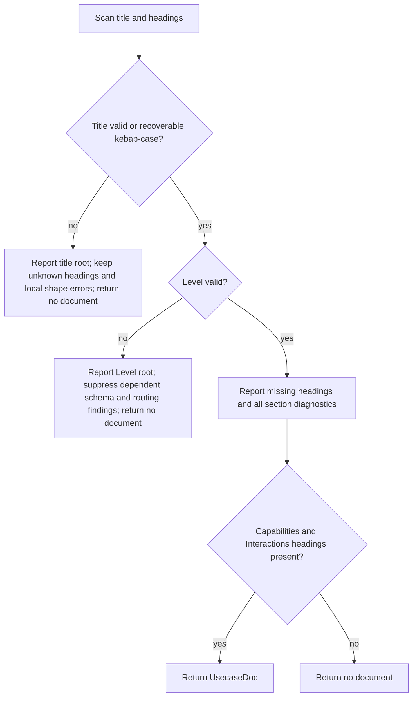

# Design: review-diagnostic-corrections

## Context

This change corrects two defects in the batched use-case diagnostics added by
the archived `review-friction-hardening` change. The gates are correct; only
the review report changes.

The C3 evidence is:

- Bundle: `/tmp/opencode/compare-runs/candidate-c3/20261020T234012Z-candidate-c3-r1`
- Initial review failures: `stages/initial/events.stage.jsonl` and
  `stages/initial/agent.stdout.log`
- Follow-up review failures: `stages/followup/events.stage.jsonl` and
  `stages/followup/agent.stdout.log`
- Final valid use case: `/tmp/givn-harness-workspaces/candidate-c3-lending-register-b8pa6hta/givn/specs/lending-register/usecase.md`
- Harness findings: `/home/buster/projects/givn-harness/docs/findings/2026-10-21-b4-c3-comparison.md`

`givn spec route` reported signal for `EXTEND givn-workflow-enforcement`
during proposal routing; later advisory re-runs vary with proposal prose. The
capability decision remains `EXTEND givn-workflow-enforcement`: the existing
capability owns review-time use-case diagnostics and its inventory already
covers the review action.

The domain vocabulary is the existing `verify-change` contract: **use-case
identifier**, **title line**, **Level**, **section schema**, **diagnostic**,
**review**, **capability**, and **interaction**. This design introduces two
qualifying terms for the suppression boundary:

- **Root diagnostic** — a finding about the document identity or Level: the
  title line is not exactly `# Use case: <kebab-case-id>`, or `## Level` is not
  exactly `!` or `+`.
- **Dependent diagnostic** — a finding whose truth depends on a valid root:
  missing required headings, empty required sections, the leaf-use-case
  capability requirement, and capability-routing complaints that need a
  readable use-case document.

The arc42-docs step records these terms in
`docs/arc42/12-glossary.md`; this design does not write that artifact.

## Technology decisions

- Language: Rust, edition 2024, unchanged. The toolchain is the repository's
  flake-pinned `rustc`/`cargo`; no toolchain change is introduced.
- No new dependency. The implementation reuses `anyhow`, `serde`, and
  `gherkin` as already pinned in `Cargo.lock` (checked 2026-10-21). No version
  number is introduced or changed.
- Diagnostics remain the existing `UsecaseDiagnostic` /
  `UsecaseDiagnostics` types and the existing `anyhow` error at the command
  boundary. No new error framework, report schema, CLI flag, or JSON output is
  added.
- Tests remain Gherkin-first through `tests/features_runner.rs` and
  `cucumber-rs`; parser unit tests stay inside
  `src/gherkin/usecase_md.rs`. No parallel hand-maintained behavioral test file
  is added.

## Architecture impact

| File | Change |
|---|---|
| `src/gherkin/usecase_md.rs` | Move missing-heading emission out of the scanner; validate the title and Level as roots before deriving dependent findings; derive a canonical kebab-case title suggestion; return no usable `UsecaseDoc` for a root-invalid document; add unit tests. |
| `src/spec/routing_table.rs` | No code change is required. The existing `CachedDocument.usecase: Option<UsecaseDoc>` contract already skips routing checks that need a document when the parser returns `None`. The implementation verifies that no routing path fabricates a document from a root-invalid parse. If one does, the only permitted change is to use the parser's `None`; no string post-filtering. |
| `tests/steps/workflow_enforcement_steps.rs` | Add the six scenario fixtures and the new Given steps. Reuse the existing `stderr`, `stderr contains`, and `stderr does not contain` assertions. |
| `givn/changes/review-diagnostic-corrections/specs/verify-change/givn-workflow-enforcement.feature` | New delta scenarios under the existing capability. |

Unchanged consumers: `src/gherkin/interaction.rs`, `src/spec/coverage.rs`,
`src/spec/tree.rs`, `src/overlap/analysis.rs`, and `src/cli/archive.rs`. They
call the same `parse_usecase_md` / `parse_usecase_md_diagnostics` surface and
receive the same strict `Result` / `Option` contract. A root-invalid document
remains unparseable; it simply no longer emits dependent noise.

The parser has no data-model change. `UsecaseDoc`, `FragmentDoc`,
`UsecaseDiagnostic`, and `UsecaseDiagnostics` keep their public shapes.



## Parser flow change

### Diagnostic model (unchanged)

```rust
pub struct UsecaseDiagnostic {
    pub line: Option<usize>,
    pub message: String,
    pub suggestion: Option<String>,
}

pub struct UsecaseDiagnostics(pub Vec<UsecaseDiagnostic>);
```

`UsecaseDiagnostic::rendered` keeps its current format: `line <n>: <message>`
for a located diagnostic, `<message>` for a document-level diagnostic, and
` — did you mean '<suggestion>'?` appended when a suggestion exists.
Deduplication and sorting are unchanged.

### Private scan result

`parse_document` currently returns the title, sections, seen headings, and
diagnostics, and emits missing-heading diagnostics itself. The new private
shape carries the same scan facts without deciding which findings are
dependent:

```rust
struct DocumentScan {
    /// Some only for an exactly valid or exactly recoverable kebab-case ID.
    title: Option<String>,
    /// True when a `# ` title line was present, even if it was invalid.
    title_seen: bool,
    sections: SectionLines,
    seen: std::collections::BTreeSet<&'static str>,
    diagnostics: UsecaseDiagnostics,
}

fn parse_document(
    content: &str,
    kind: &str,
    headings: &[&'static str],
) -> DocumentScan;

fn report_missing_headings(
    seen: &std::collections::BTreeSet<&'static str>,
    headings: &[&'static str],
    diagnostics: &mut UsecaseDiagnostics,
);
```

`parse_document` continues to report the missing title line (`document is
missing '# Use case: <id>'`) only when no `# ` title line was seen at all;
`title_seen` distinguishes a missing title line from a title line that was
present but invalid, so an exact invalid ID does not also produce a spurious
“missing title” diagnostic. It continues to report duplicate titles, duplicate
headings, unknown headings, and content outside a recognized section. It no
longer reports missing required headings; the caller decides whether that
dependent finding is meaningful.

`parse_usecase_md_diagnostics` keeps its public signature:

```rust
pub fn parse_usecase_md_diagnostics(content: &str) -> (Option<UsecaseDoc>, UsecaseDiagnostics);
```

`parse_usecase_md`, `parse_fragment_md_diagnostics`, and `parse_fragment_md`
also keep their signatures.

### Title validation and recovery

The current `recover_title` returns the raw remainder as the suggestion and
lets the caller assign it as the title. The new private contract separates the
suggestion from the recovered identifier:

```rust
struct TitleRecovery {
    /// The exact accepted title line to suggest, when a valid candidate exists.
    suggestion: Option<String>,
    /// Some only when the remainder is already a valid kebab-case ID.
    recovered_id: Option<String>,
}

fn recover_title(expected_title: &str, line: &str) -> Option<TitleRecovery>;

fn canonical_title_id(raw: &str) -> Option<String>;
```

Title handling becomes:

| Input | Diagnostic | Suggestion | Title used for parsing |
|---|---|---|---|
| `# Use case: lending-register` | none | none | `lending-register` |
| `# Use Case: lending-register` | title diagnostic | `# Use case: lending-register` | `lending-register` (recovered: the ID is already valid) |
| `# Use Case: Lending Register` | title diagnostic with the kebab-case note | `# Use case: lending-register` | none; document is not parsed further as a usable document |
| `# Use case: Lending Register` | identifier diagnostic with the kebab-case note and canonical suggestion | `# Use case: lending-register` | none |
| `# Use Case: !!!` | title diagnostic | none | none |
| `# Fragment: send-message` | none | none | `send-message` |

`canonical_title_id` is deliberately a suggestion generator, never an
acceptance path:

1. Iterate the remainder's characters.
2. An ASCII alphanumeric character becomes lowercase and is appended.
3. Any other character becomes a separator; consecutive separators collapse to
   one hyphen and a leading separator is skipped.
4. Trim trailing hyphens.
5. Return `Some` only when `validate_id(&candidate, "Use case")` succeeds.

Examples:

| Remainder | Canonical candidate |
|---|---|
| `Lending Register` | `lending-register` |
| `Start Project` | `start-project` |
| `lending--register` | `lending-register` |
| `Lending.Register` | `lending-register` |
| `review-diagnostics-demo` | `review-diagnostics-demo` |
| `!!!` | none |

The title message keeps the existing prefix and case-sensitivity note so the
archived scenarios and agents keep matching it:

```text
line 1: expected '# Use case: <kebab-case-id>', got '# Use Case: Lending Register'; headings are case-sensitive and IDs are kebab-case — did you mean '# Use case: lending-register'?
```

For a case-mismatched but valid ID, the message remains the existing
`headings are case-sensitive` text and the suggestion is the exact accepted
spelling. The extra `and IDs are kebab-case` clause appears only when the
remainder is not already a valid ID.

The exact-prefix invalid-ID path (`# Use case: Lending Register`) reports the
existing `validate_id` error with the same canonical suggestion and does not
set the title. This closes the same acceptance hole for an exact heading with a
bad identifier, not only for the case-mismatched heading; the suggestion
remains advisory and is never used as the identifier.

### Level validation and root validity

`GoalLevel::parse` stays unchanged. The caller no longer invents a Level:

```rust
let level: Option<GoalLevel> = match GoalLevel::parse(&level_text) {
    Ok(level) => Some(level),
    Err(error) => {
        diagnostics.push(UsecaseDiagnostic::document(error.to_string()));
        None
    }
};
let root_valid = scan.title.is_some() && level.is_some();
```

- A missing or empty `## Level` (after the section text is trimmed) is reported
  by the Level rule violation. The generic `section '## Level' must not be
  empty` diagnostic is not emitted, so the root cause appears once.
- `root_valid` is the single gate for dependent findings and for returning a
  `UsecaseDoc`.
- The leaf-use-case capability requirement runs only when the root is valid,
  the Level is `Leaf`, the `## Capabilities` heading is present, and the parsed
  capability list is empty. Gating on the heading prevents a second complaint
  when the section is simply missing. `interaction_section` receives
  `report_undeclared = root_valid && seen.contains(HEADING_CAPABILITIES)` for
  the same reason.
- A `Summary` Level with no capabilities remains valid, as today. A `Leaf` with
  a present but empty `## Capabilities` section still reports
  `leaf use case '<id>' must declare at least one capability`.

### Missing headings and dependent diagnostics

There is only one use-case section schema (`USECASE_HEADINGS`); the defect was
not an alternate schema selection but validation ordering. Root validity is
decided before schema-completeness findings are derived, so the report cannot
describe a section as unrecognized while the document identity or Level is
still unresolved.

`report_missing_headings` is called by the use-case path only when
`root_valid`:

```rust
if root_valid {
    report_missing_headings(&scan.seen, USECASE_HEADINGS, &mut diagnostics);
}
```

The fragment path calls it unconditionally, preserving the fragment schema's
current missing-heading behavior.

`required_text` gains a `report_empty: bool` parameter:

```rust
fn required_text(
    sections: &SectionLines,
    heading: &'static str,
    report_empty: bool,
    diagnostics: &mut UsecaseDiagnostics,
) -> String;
```

- For `## Level`, pass `false`: the Level parser is the specific reporter.
- For every other required use-case section, pass `root_valid`.
- For fragments, pass `true` to preserve current behavior.

`list_section` and `relationship_section` keep their signatures and always run.
They report only local shape problems in content that is present; a missing
section has no lines, so it produces no local finding.

`interaction_section` gains one flag:

```rust
fn interaction_section(
    sections: &SectionLines,
    capabilities: &[String],
    report_undeclared: bool,
    diagnostics: &mut UsecaseDiagnostics,
) -> Vec<Interaction>;
```

- The Markdown table header, separator, and row-shape checks still run for a
  present `## Interactions` section, even when the root is invalid.
- The `interaction references undeclared capability` check runs only when
  `report_undeclared` is true, which is
  `root_valid && scan.seen.contains(HEADING_CAPABILITIES)`. A root-invalid
  document can have an unreadable capability section, so cross-checking it
  would produce dependent noise. The fragment path passes `true` and keeps its
  current behavior.
- When the `## Interactions` heading is absent and the root is invalid, skip
  the section reader entirely; the root diagnostic is the actionable finding.
  When the root is valid, the missing-heading diagnostic is the actionable
  finding and the existing table-shape check may still add its local message.

The document is built only when the root is valid and both `## Capabilities`
and `## Interactions` were seen:

```rust
let doc = if root_valid
    && scan.seen.contains(HEADING_CAPABILITIES)
    && scan.seen.contains(HEADING_INTERACTIONS)
{
    Some(UsecaseDoc { /* all section values */ })
} else {
    None
};
```

All section values are computed into locals before this conditional; the
conditional only decides whether to wrap the locals in a `UsecaseDoc`. Moving a
section reader into the conditional would drop malformed-bullet, relationship,
and malformed-table findings for an invalid root, which would defeat the
independent-findings promise. The `UsecaseDoc` is withheld only when it cannot
be trusted.

### Behavior matrix

`Some` means the document is usable for routing; as today, it also requires the
`## Capabilities` and `## Interactions` headings to be present.

| Document condition | Reported | `UsecaseDoc` |
|---|---|---|
| Exact valid title, valid Level | only real problems | `Some` |
| Case-mismatched but valid ID | title diagnostic with exact suggestion; all independent section findings | `Some` (recovered) |
| Case-mismatched invalid ID with canonical slug | title diagnostic with canonical suggestion; unknown headings and local shape findings | `None` |
| Case-mismatched invalid ID with no slug | title diagnostic, no suggestion | `None` |
| Exact-prefix invalid ID | `validate_id` diagnostic with the canonical suggestion; unknown headings and local shape findings | `None` |
| Invalid Level | Level rule diagnostic; unknown headings and local shape findings | `None` |
| Invalid title and invalid Level | both root diagnostics; unknown headings and local shape findings | `None` |
| Valid root, missing required heading | missing-heading diagnostic; empty-section diagnostic for required text | `Some` only if Capabilities and Interactions are present; otherwise `None` |
| Invalid root, missing required heading | no missing-heading or empty-section diagnostic | `None` |
| Invalid root, present but empty required section | no empty-section diagnostic | `None` |
| Invalid root, unknown heading | unknown-heading diagnostic | `None` |
| Valid root, unknown heading | unknown-heading diagnostic | `Some` |
| Invalid root, malformed bullet or table row | local shape diagnostic | `None` |
| Valid root, leaf with a present but empty Capabilities section | leaf-capability diagnostic | `Some` if Interactions is present |

## Routing integration

`check_routing_consistency` already stores the parser result as
`Option<UsecaseDoc>` plus diagnostics. A root-invalid document now produces
`None`, so the routing checks that need a document are skipped by the existing
`let Some(doc) = doc else { continue; };` paths. The report still contains:

- the parser's root diagnostic;
- the parser's independent local diagnostics;
- routing errors that do not depend on the document, such as a missing
  permanent capability for `EXTEND`, a wrong delta directory, or a missing
  routing row.

A case-mismatched title whose remainder is already a valid kebab-case ID
remains recoverable and still feeds routing checks in the same pass. That is
the behavior the archived batch scenario proves and this change preserves.

No gate order changes. Integrity still runs first, followed by run declaration,
overlap, retirement, routing, and the receipt. The only change is inside the
schema/routing diagnostic family.

## API and function signatures

Public API (unchanged):

```rust
pub fn parse_usecase_md_diagnostics(content: &str) -> (Option<UsecaseDoc>, UsecaseDiagnostics);
pub fn parse_usecase_md(content: &str) -> anyhow::Result<UsecaseDoc>;
pub fn parse_fragment_md_diagnostics(content: &str) -> (Option<FragmentDoc>, UsecaseDiagnostics);
pub fn parse_fragment_md(content: &str) -> anyhow::Result<FragmentDoc>;
```

Private helpers introduced or changed:

```rust
struct DocumentScan { /* title, title_seen, sections, seen, diagnostics */ }
struct TitleRecovery { suggestion: Option<String>, recovered_id: Option<String> }

fn parse_document(content: &str, kind: &str, headings: &[&'static str]) -> DocumentScan;
fn report_missing_headings(
    seen: &std::collections::BTreeSet<&'static str>,
    headings: &[&'static str],
    diagnostics: &mut UsecaseDiagnostics,
);
fn recover_title(expected_title: &str, line: &str) -> Option<TitleRecovery>;
fn canonical_title_id(raw: &str) -> Option<String>;
fn required_text(
    sections: &SectionLines,
    heading: &'static str,
    report_empty: bool,
    diagnostics: &mut UsecaseDiagnostics,
) -> String;
fn interaction_section(
    sections: &SectionLines,
    capabilities: &[String],
    report_undeclared: bool,
    diagnostics: &mut UsecaseDiagnostics,
) -> Vec<Interaction>;
```

`validate_id` is unchanged. No new public type or function is added.

## Internal primitives

| Primitive | Type | Purpose |
|---|---|---|
| `DocumentScan` | private struct | Carries the title decision, section lines, seen headings, and scan diagnostics without deciding dependent findings. |
| `TitleRecovery` | private struct | Separates the optional exact title-line suggestion from the optional recovered identifier; only a valid kebab-case remainder populates the identifier. |
| `canonical_title_id` | private function | Produces a validated kebab-case candidate from a human-readable remainder; used only for the suggestion. |
| `root_valid` | local boolean | Single gate for dependent schema diagnostics, capability-routing-dependent findings, and `UsecaseDoc` construction. |

## Step definitions

One file per capability, as required:

| Capability | Unit/integration steps | E2E steps |
|---|---|---|
| `givn-workflow-enforcement` | `tests/steps/workflow_enforcement_steps.rs` | `tests/steps/workflow_enforcement_e2e_steps.rs` (unchanged; no new `@e2e` scenario) |

The delta carries seven scenarios: six error variants and one green-at-baseline
regression guard. The guard (valid kebab-case title) cannot fail in RED on
today's code; it is recorded as a guard and is never given a fabricated RED.
The other six scenarios each fail in RED against the current parser.

The new Gherkin scenarios reuse the existing step definitions for running the
real CLI (`the developer runs ...`), exit-code assertions (`the command exits 0`
/ `non-zero`), and stderr assertions (`stderr contains ...`, `stderr does not
contain ...`, `stderr says headings are case-sensitive`, `stderr suggests
exactly ...`). The exact-suggestion step asserts the whole
`did you mean '<suggestion>'?` fragment, not just the presence of both words.
The only new Given steps are the fixture builders:

- `a clean committed change whose use-case contract starts with "# Use Case: Lending Register" and has an unknown "## Guarantees" heading`
- `a clean committed change whose use-case contract starts with "# Use Case: Lending Register" and whose capability list is a table`
- `a clean committed change whose use-case contract starts with "# Use case: Lending Register"`
- `a clean committed change whose use-case contract starts with "# Use Case: Lending Register", omits "## Rules", and leaves "## Examples" empty`
- `a clean committed change whose use-case contract has a malformed Level and omits "## Examples"`
- `a clean committed change whose use-case contract starts with "# Use Case: Lending Register", has a rule line that is not a bullet, and has an interaction that names an undeclared capability`

The valid-title scenario reuses the existing
`a clean committed change with a green change verification receipt recorded at
one revision` fixture. Fixture construction extends `review_contract` with a
Level parameter:

```rust
fn review_contract_with_level(
    id: &str,
    title: Option<&str>,
    level: &str,
    capabilities: &str,
    interactions: &str,
    examples: &str,
    extra: &str,
) -> String;

fn review_contract(/* existing parameters */) -> String; // delegates with level "!"
```

The malformed Level fixture uses the C3 text:
`` `+` — summary use case. Its five capabilities decompose the lending-desk
activity into the goals below.`` The omitted-section fixtures remove the whole
section with the same string replacement style already used by
`review_fixture_missing_sections`. The table-capabilities fixture passes a
Markdown table into the capabilities slot. During RED, each new Given whose
fixture is not yet written uses `unimplemented!()`; an empty body is never
acceptable.

No step calls the parser directly for a CLI scenario. Parser behavior is
proven by the unit tests below; the Gherkin scenarios prove the developer-visible
report through the real `givn check review` subprocess.

## Test strategy

### Runner and strict mode

- Change-scoped suite: `./run-tests.sh --non-e2e` (the effective
  `verify.command`).
- Merged/e2e suite: `./run-tests.sh --e2e` (the effective
  `verify.e2e_command`). This change adds no `@e2e` scenario, so the e2e scope
  does not select the delta; the existing review-diagnostics e2e scenario
  remains in the permanent corpus.
- Supporting parser unit tests: `cargo test --locked --lib usecase_md`; the
  full library unit suite is `cargo test --locked --lib`.
- One named scenario:
  `GIVN_FEATURES=givn/changes/review-diagnostic-corrections/specs cargo test --locked --test features_runner -- --name "<scenario title>"`.
- Strict mode: `tests/features_runner.rs` calls `.fail_on_skipped()` on both the
  normal and the single-scenario builder (lines 55 and 151). An undefined or
  pending step fails the run.
- Strictness proof for the tasks setup: create a throwaway feature with one
  undefined step outside the repository, run
  `GIVN_FEATURES="<scratch-dir>" cargo test --locked --test features_runner -- --name "Undefined step fails"`,
  and require a non-zero exit. The probe is not committed. A green suite is
  not proof of strictness.

### Parser unit tests in `src/gherkin/usecase_md.rs`

Keep the existing tests and add:

1. `invalid_human_title_is_not_recovered_and_suggests_the_canonical_id` — for
   `# Use Case: Lending Register`, assert `doc.is_none()`, the
   `headings are case-sensitive` phrase, and the exact suggestion
   `# Use case: lending-register`.
2. `invalid_human_title_does_not_report_missing_headings` — remove `## Rules`
   and assert the title diagnostic is present while
   `document schema does not recognise '## Rules'` is absent.
3. `invalid_level_does_not_report_missing_headings_or_leaf_capability` — use
   the C3 malformed Level, set `## Capabilities` and `## Interactions` to
   `- none`, remove `## Examples`, and assert the Level rule diagnostic is
   present while the missing-heading diagnostic and
   `must declare at least one capability` are absent. The empty capability
   list makes the old leaf fallback observable.
4. `genuinely_unknown_heading_still_reports_with_invalid_title` — assert
   `unknown heading '## Guarantees'` is present even when the title is
   invalid.
5. `valid_kebab_case_title_still_parses` — `parse_usecase_md` succeeds for
   `# Use case: start-project`.
6. `exact_invalid_id_is_not_recovered` — `# Use case: Start Project` yields no
   document, the `stable kebab-case` diagnostic, and no spurious
   `document is missing '# Use case:` diagnostic.
7. `canonical_title_id_collapses_separators_and_drops_punctuation` — cover
   `Lending Register`, `lending--register`, `!!!`, and an already-valid ID.
8. `fragment_missing_headings_still_report` — a fragment with a missing
   heading keeps the existing diagnostic, proving the use-case suppression did
   not leak into the fragment path.
9. `exact_invalid_id_suggests_the_canonical_id` — `# Use case: Start Project`
   yields no document, the `stable kebab-case` diagnostic, the exact suggestion
   `# Use case: start-project`, and no missing-title diagnostic.
10. `invalid_root_still_reports_local_shape_findings` — with an invalid title,
    a non-bullet capability line and a malformed interaction separator row both
    remain in the report.
11. `invalid_level_suppresses_empty_required_section` — with the C3 malformed
    Level and an empty `## Examples`, the Level rule is present while
    `section '## Examples' must not be empty` is absent.
12. `invalid_title_still_reports_duplicate_title_and_outside_content` — an
    invalid first title followed by a second title and content outside a
    section still reports both independent findings once.
13. `both_roots_invalid_report_both` — an invalid title plus malformed Level
    reports both roots and no missing-heading or leaf-capability finding.
14. `valid_title_with_valid_level_still_reports_missing_section` — a valid
    root with a missing `## Rules` still reports the missing-heading and the
    empty-section diagnostics; this is the non-suppression guard.

Existing tests that must remain green:

- `case_mismatched_title_recovers_and_suggests_the_exact_spelling` (valid ID
  `start-project`).
- `rejects_unknown_heading_without_bleeding_content`.
- `rejects_untyped_relationships_and_invalid_identity` (its exact-prefix
  invalid ID now yields no document; the test asserts the error text only).
- `templates_parse_with_their_own_headings`.

### CLI scenarios in `tests/steps/workflow_enforcement_steps.rs`

The delta feature's seven scenarios drive the real binary. Six are
error-case variants and one is the green-at-baseline valid-title guard. The
step definitions assert:

| Scenario | Primary assertion |
|---|---|
| Review corrects a non-kebab-case use-case title to its canonical identifier | exit non-zero; `headings are case-sensitive`; suggestion exactly `# Use case: lending-register`; unknown heading still reported |
| Review does not accept a non-kebab-case title as the use-case identifier | no `leaf use case 'Lending Register'`; no raw-title suggestion; no `does not declare capability` and no `has no interaction for capability` routing complaint |
| Review corrects an exact-prefix non-kebab-case title with the canonical identifier | `stable kebab-case identifier`; suggestion exactly `# Use case: lending-register`; no missing-title diagnostic |
| A malformed title does not fabricate missing-section or empty-section diagnostics | canonical suggestion present; `document schema does not recognise '## Rules'` and `section '## Examples' must not be empty` absent |
| A malformed Level does not fabricate missing-section or leaf-capability diagnostics | Level rule present; `document schema does not recognise '## Examples'` and `must declare at least one capability` absent |
| Independent local findings are still reported with a malformed title | `section '## Rules' must contain one rule per bullet` present; `interaction references undeclared capability` absent; canonical suggestion present |
| A valid kebab-case use-case title remains accepted (guard) | exit 0; no title or missing-heading diagnostic; green at baseline, no fabricated RED |

### Black-box-first

The CLI scenarios drive the real `givn check review` subprocess in a committed
fixture. Unit tests are retained only for parser branches the CLI scenarios
cannot exhaust: slug edge cases, exact-prefix invalid IDs, document `None`
assertions, line/suggestion rendering, and fragment preservation. The existing
`@e2e` scenario remains the real-action evidence; the new scenarios are error
variants of that same action and do not duplicate it.

### Coverage

The coverage addon is already enabled. `measure-coverage.sh` and
`merge-coverages.sh` remain the only measurement path. The parser branches
under `src/gherkin/usecase_md.rs` are exercised by the unit tests and the CLI
scenarios. No new process, container, or suite run is introduced.

## Interaction Coverage Matrix

The change adds no interaction inventory entry and no `@e2e` scenario. The
existing entry remains the action evidence; the delta scenarios are regular
error-case variants of the same action.

| Inventory entry | @e2e scenario title | Real interface | Driving mechanism |
|---|---|---|---|
| `validate-artifact-ids`: check an unknown artifact | Consumer invokes givn check with an unknown artifact and gets a helpful error | CLI | Existing `givn check` subprocess; unchanged by this change. |
| `visual-review-gate`: run the review check on a visual change | A visual change with complete evidence passes review | CLI | Existing review subprocess and evidence fixtures; unchanged. |
| `visual-review-gate`: read the visual review guidance | Review guidance requires the visual verdict and persona lenses | CLI | Existing instruction output; unchanged. |
| `spec-overlap-gates`: detect a duplicate title | A duplicate title across two permanent spec files is a hard error | CLI | Existing lint/review subprocess; unchanged. |
| `spec-overlap-gates`: inspect duplicate JSON | The json output reports duplicate-title findings machine-readably | CLI | Existing JSON output; unchanged. |
| `review-disposition-gates`: pass a disposed review | Review passes when every shape match is disposed and reports the net-delta receipt | CLI | Existing review subprocess; unchanged. |
| `resolve-change-directories`: run integrity in a change | Consumer runs the integrity check on a change inside givn/changes and the correct directory is detected | CLI | Existing integrity subprocess; unchanged. |
| `resolve-change-directories`: reject placeholder commit evidence | Integrity check detects a placeholder COMMIT hash in tasks.md and fails | CLI | Existing integrity subprocess; unchanged. |
| `givn-workflow-enforcement`: run migration coverage check | Consumer runs migration coverage check and sees passed evidence | CLI | Existing migration subprocess; unchanged. |
| `givn-workflow-enforcement`: run the change-scoped checks | Consumer runs check tasks and receives a change verification receipt | CLI | Existing check subprocess; unchanged. |
| `givn-workflow-enforcement`: write a runner result | The result helper writes four counts without a scope | CLI | Existing runner-result fixture; unchanged. |
| `givn-workflow-enforcement`: run the review check on a change with use-case schema errors | Consumer runs review and receives every use-case schema problem in one pass (existing, unchanged) | CLI | Real `givn check review --change <id>` subprocess in a committed fixture; assert exit code and the grouped stderr report. The seven new scenarios use the same CLI subprocess as regular scenarios. |
| `readability-review-gate`: run the readability review during check review | A developer runs the review with accounted readability findings and it passes | CLI | Existing review subprocess; unchanged. |

## Visual Design Contract

- Interface: terminal
- Interface rationale: the change's user-visible surface is plain CLI text
  output from `givn check review`. Nothing renders HTML, CSS, or JavaScript in
  a browser.
- Viewports: not applicable to terminal text; no screen is introduced or
  changed.
- Design system: not applicable; existing plain CLI output, no color or layout
  contract is added.
- Screens covered: the `givn check review` use-case diagnostic report.
- Rendered reference: the archived terminal transcript at
  `givn/archive/review-friction-hardening/evidence/visual/consumer-runs-review-and-receives-every-use-case-schema-problem-in-one-pass/transcript.txt`
  is a historical reference. It shows the pre-correction output (the invalid
  raw-title suggestion and the derived leaf complaint), so it is not the
  current expected output. No fresh transcript is added: this delta has no
  `@e2e` scenario, and the corrected ordinary-CLI output is asserted by the
  six error-case scenarios through the real subprocess.
- Evidence kind: no new transcript. The integrity check collects visual
  evidence per delta `@e2e` scenario; this delta adds none, so the evidence set
  is empty and the existing action evidence remains the reference for the same
  `givn check review` action.
- Motion: not applicable; no browser or animation.
- Retention of the terminal gate: `Interface: terminal` still requires
  `VISUAL-REVIEW: PASS` in `review.md` and a confirmed `PERSONAS:` line that
  resolves to a Persona file in `givn/personas/` (one of the three Personas
  named by the permanent `verify-change` contract). The absence
  of a delta `@e2e` scenario removes only the per-scenario transcript
  requirement; it does not create a `VISUAL-REVIEW: NOT APPLICABLE` path and
  does not allow `PERSONAS: none`.

## Use-case traceability

| Contract element | Design decision / evidence |
|---|---|
| `verify-change` success guarantee: the developer receives a complete verification result | Root causes and independent local findings are reported together; dependent completeness findings wait for a valid root. Scenario “Review corrects a non-kebab-case use-case title to its canonical identifier” carries the unknown-heading assertion, and “Independent local findings are still reported with a malformed title” carries the local-shape assertion. |
| `verify-change` minimal guarantee: an invalid change cannot pass | No title or Level variant is accepted; a root-invalid parse returns no `UsecaseDoc` and the command exits non-zero. Scenarios “Review does not accept a non-kebab-case title as the use-case identifier” and “A malformed Level does not fabricate missing-section diagnostics”. |
| `verify-change` rule: a review report names every actionable use-case schema and capability-routing problem in one pass; the schema stays strict and semantic validation is not weakened | Valid-root documents keep the full batched report; only dependent findings are withheld for an invalid root. Unit test `invalid_human_title_does_not_report_missing_headings`, `invalid_level_does_not_report_missing_headings_or_leaf_capability`; existing archived batch scenario stays green. |
| `verify-change` rule: structural failures outrank other findings | Gate order is unchanged; title and Level diagnostics are structural roots and are emitted before dependent findings. |
| `verify-change` capability ownership and interaction inventory | The existing `givn-workflow-enforcement` capability and its existing interaction row remain the owner; no new capability or interaction. |
| `verify-change` Personas | Developer, agent, and maintainer review lenses are affected as recorded below; no Persona is invented. |
| Actors versus Personas | Gherkin names the developer/consumer action; Personas remain review lenses only, with no biography in the feature. |
| Domain vocabulary | **use-case identifier**, **title line**, **Level**, **section schema**, **root diagnostic**, and **dependent diagnostic** are used consistently. The arc42-docs step records the new terms in the glossary. |

## Persona impact

| Persona | Impact |
|---|---|
| `developer--primary-user` | Receives an actionable canonical title correction and no longer chases missing-section or leaf-capability complaints derived from an invalid root. |
| `agent--technical-role` | Receives a deterministic canonical suggestion, a stable grouped report, and unchanged exit codes; can distinguish root from dependent findings without parsing prose heuristics. |
| `givn-maintainer--owner` | Owns the strict schema and the documented suppression boundary. The change adds no variant acceptance and keeps the fragment path unchanged. |

No Persona is invented, promoted, or revalidated. The terminal Persona gate is
unchanged: a `PERSONAS: <persona>` line and a confirmed Persona file are still
required; `PERSONAS: none` is not added.

## Decisions

- **Decides D1:** Derive the canonical suggestion by slugifying the title
  remainder, validating it, and using it only as a suggestion; never accept the
  derived identifier as the title. Apply the same suggestion to a case-mismatched
  heading and to an exact-prefix heading with an invalid identifier. A
  case-mismatched title whose remainder is already a valid kebab-case ID remains
  recoverable. Rejected: echoing the raw remainder (the current defect),
  accepting the canonical slug automatically (weakens the strict schema), and
  threading the enclosing document/change ID into every parser caller
  (unnecessary context plumbing for a diagnostic). Realized in
  `canonical_title_id`, `TitleRecovery`, and `recover_title`.
- **Decides D2:** When the title or Level is invalid, suppress dependent
  schema-completeness findings (missing required headings, empty required
  sections, leaf-capability requirement) and capability-routing findings that
  need a document; keep genuinely unknown headings, malformed list bullets, and
  malformed interaction tables. This is not a semantic weakening: the document
  still fails, the schema still rejects every variant, and every independent
  problem is still named. The withheld findings are not independently true
  problems; they are consequences of a root the author must fix first, and
  they are re-derived on the next pass once the root is valid. Rejected:
  suppressing every section diagnostic (loses the one-pass batching) and
  suppressing nothing beyond the title suggestion (leaves the C3 cascade).
  Realized in `report_missing_headings`, the `root_valid` gate, and
  `interaction_section`'s `report_undeclared` flag.
- **Decides D3:** Never invent a Level. An invalid Level is a root diagnostic
  and the parse returns no usable `UsecaseDoc`; the leaf-capability requirement
  runs only for a valid `Leaf` Level with a present `## Capabilities` section.
  Rejected: the current fallback to `Leaf` (fabricates the C3 leaf-capability
  complaint), fallback to `Summary` (equally invented and hides a real leaf
  requirement), and keeping the fallback while patching only the leaf check
  (other level-dependent behavior can still act on an invented Level). Realized
  in the `Option<GoalLevel>` value and the `root_valid` gate.
- **Decides D4:** The parser owns root validation; routing consumes the
  existing `Option<UsecaseDoc>` contract and does not post-filter diagnostic
  strings. Rejected: a routing-layer filter (duplicated title/Level validation,
  brittle text matching, and the other parser callers still cascade). Realized
  in `parse_usecase_md_diagnostics` returning `None` for a root-invalid
  document and the unchanged `check_routing_consistency` optional-document
  paths.
- **Decides D5:** Reuse the existing `givn-workflow-enforcement` inventory
  entry and its existing `@e2e` scenario; add six regular error-case scenarios
  and no new terminal transcript. Rejected: a new `@e2e` scenario and inventory
  row (duplicates the same review action and violates the one-E2E-per-action
  rule) and modifying the existing `@e2e` scenario (would weaken the archived
  batch evidence). Realized in the delta feature and the Interaction Coverage
  Matrix.

## Risks

- **Over-suppression hides a real missing section until the root is fixed.**
  This is the intended root-first sequence: a document with an invalid title or
  Level is invalid regardless, and the author must fix the root before
  completeness findings are meaningful. Mitigation: unknown headings and local
  shape findings still appear in the first pass; valid-root documents still
  report every missing section. The archived “Missing required sections and a
  malformed interaction table are reported together” scenario remains a
  regression guard.
- **The parser is shared by direct parsing, routing, coverage, tree
  inspection, and archive.** Moving missing-heading emission out of
  `parse_document` could change fragment behavior. Mitigation: the fragment
  path calls `report_missing_headings` unconditionally and keeps
  `report_empty = true`; unit test `fragment_missing_headings_still_report`
  guards it.
- **A canonical slug can differ from the intended identifier.** For example, a
  title `Lending Register` could belong to a document whose real ID is
  `library-lending`. The suggestion is advisory and never accepted; the
  diagnostic still requires an explicit edit. The reviewer must confirm the
  suggested ID rather than paste it blindly.
- **A routing path could still fabricate a document from a root-invalid parse.**
  Mitigation: the parser returns `None`; the implementation audits
  `check_routing_consistency` and any other caller that constructs a
  `UsecaseDoc` outside the parser. The existing `let Some(doc) = ... else`
  paths are the only routing-dependent checks.
- **Exact-prefix invalid IDs change behavior.** `# Use case: Start Project`
  previously produced a document with an invalid ID; it now produces no
  document. This is a strictness correction, but any caller that relied on the
  invalid document would change. No such caller is known; `parse_usecase_md`
  already returned an error because of the `validate_id` diagnostic.
- **A section reader moved into the document conditional drops independent
  findings.** If actors, goals, rules, examples, relationships, or a present
  interaction table are only parsed while constructing `UsecaseDoc`, an
  invalid-root document loses its malformed-bullet and malformed-table
  findings. Mitigation: every section value is computed into a local before the
  conditional, and unit test
  `invalid_root_still_reports_local_shape_findings` guards it.
- **An invalid title could hide duplicate-title or outside-content findings.**
  The old logic keyed those checks on `title.is_some()`. Mitigation: both checks
  key on `title_seen`, and unit test
  `invalid_title_still_reports_duplicate_title_and_outside_content` guards it.
- **The archived batch scenario could regress if recovery is tightened too
  far.** The scenario uses `# Use Case: review-diagnostics-demo`, whose
  remainder is a valid kebab-case ID. The design keeps that recovery path and
  the exact suggestion. The existing unit test and permanent scenario are the
  guards.
- **The new canonical-correction scenarios share a shape with the existing
  case-mismatch scenario.** They are distinct variants: the existing scenario
  has a valid kebab-case ID and asserts the exact case correction; the new
  case-mismatched and exact-prefix scenarios have an invalid human title and
  assert the canonical slug plus non-acceptance. The review step must record a
  `variant` overlap disposition for the shape advisories.

## Documentation impact

- `README.md`: update the "One change lifecycle" bullet so review "names the
  root cause of an invalid use-case document first and every actionable
  schema and capability-routing problem in one pass". The review step records
  `README-IMPACT: updated - One change lifecycle`.
- `givn/specs/verify-change/usecase.md`: amend the rule to "A review report
  names the root cause of an invalid use-case document first and every
  actionable use-case schema and capability-routing problem in one pass; the
  schema stays strict and semantic validation is not weakened." This is the
  owning contract for the observable behavior.
- `docs/arc42/12-glossary.md`: the arc42-docs step records **root diagnostic**,
  **dependent diagnostic**, **title line**, and **section schema**.
- `docs/arc42/06-runtime-view.md` and
  `docs/arc42/08-crosscutting-concepts.md`: describe the root-first diagnostic
  flow. `docs/arc42/11-risks-and-technical-debt.md`: records the residual
  advisory-slug and exact-prefix behavior-change risks.
- The archived `review-friction-hardening` artifacts are historical and are not
  edited.

## Local runnability and digital twins

- Local run: the product is a single CLI binary, started per invocation with
  `cargo run -- instructions` (the declared `run.command`). The test system is
  `./run-tests.sh --non-e2e` for the change suite and `./run-tests.sh --e2e`
  for the e2e replay.
- No external service, database, queue, network, browser, or container is
  involved. There is no third-party dependency to twin; no digital twin is
  required.
- No new port, startup script, or environment variable is introduced.
- The fixtures use the real `givn` binary in a temporary Git or Fossil project
  and the existing SCM helpers. No interface obstacle is anticipated; the
  scenarios are plain CLI invocations with committed fixture state.

## Coverage process boundaries

| Process | Started by | Instrumented artifact | Profile output | Merge step | Non-zero production probe |
|---|---|---|---|---|---|
| Feature suite (`features_runner` plus spawned `givn`) | `./run-tests.sh --non-e2e` and `measure-coverage.sh` | `target/llvm-cov-target/debug/givn` built by `cargo llvm-cov` | `target/llvm-cov-target/` profraw set | `cargo llvm-cov report --cobertura` to `coverage/non-e2e-cobertura.xml`, then `merge-coverages.sh` | `src/gherkin/usecase_md.rs` title recovery and root-validity gate |
| E2E replay (`features_runner` plus spawned `givn`) | `./run-tests.sh --e2e` and `measure-coverage.sh` | same instrumented `givn` | fresh profraw set after `cargo llvm-cov clean --profraw-only` | `cargo llvm-cov report --cobertura` to `coverage/e2e-cobertura.xml`, then `merge-coverages.sh` | `src/cli/check.rs` review routing path; the existing review-diagnostics e2e scenario |

No process is added. The existing measurement commands remain the only
measurement path.

## Version freshness

No language, runtime, framework, library, browser, database, or container
image version is introduced or changed. Existing dependencies are taken from
the repository's `Cargo.lock` on 2026-10-21 (`anyhow` 1.0.104, `gherkin`
0.16.0, `serde_json` 1.0.151, `cucumber` 0.23.0). The Rust toolchain is the
flake-pinned `rustc`/`cargo`; no version change is proposed.
