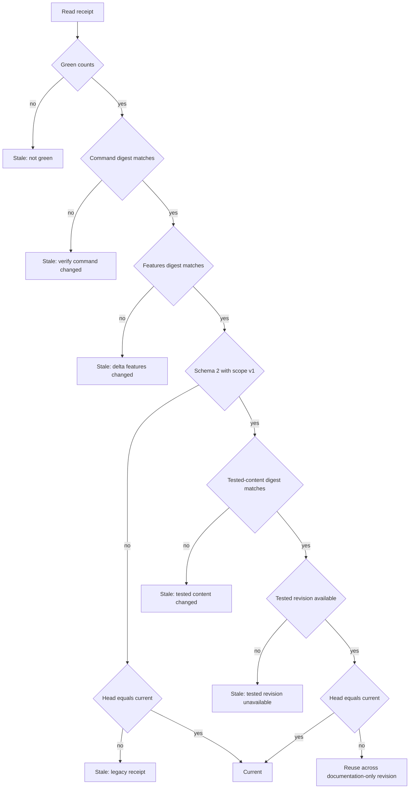

# Design: review-friction-hardening

## Context

This change removes two avoidable review/archive iterations without weakening
either gate:

1. `givn check review` diagnoses the complete use-case schema and
   capability-routing failure set in one pass, while keeping the schema
   strict.
2. `givn check review` and `givn archive` reuse a green change verification
   receipt across revisions that change only documentation or evidence. The
   receipt binds the tested content, so code, tests, configuration, delta
   features, and the verify command still invalidate it.

The domain terms are the existing `verify-change` and `archive-change`
contracts: **change verification receipt**, **tested revision**, **tested
content**, **documentation-only revision**, **review**, **archive**, and
**merged suite**. "Documentation-only revision" is introduced here as the
revision whose only changes are the closed documentation/evidence allowlist
below; it is not a synonym for "any Markdown change".

## Technology decisions

- Language: Rust, edition 2024, unchanged. Toolchain comes from the
  repository's existing flake-pinned `rustc`/`cargo`; no toolchain version is
  introduced or changed.
- No new dependency. The implementation reuses `sha2` (0.11.0), `serde_json`
  (1.0.151), `serde`, `anyhow`, and `gherkin` (0.16.0) as pinned in
  `Cargo.lock` (verified 2026-10-20). No version from memory is used.
- Diagnostics remain `anyhow` errors at the command boundary. The parser
  gains an internal diagnostic type; it does not add a new error framework.
- The SCM seam gains `Backend::content_paths()` so Git and Fossil share one
  tested-content digest. It returns tracked paths plus untracked, non-ignored
  paths: Git uses NUL-separated `git ls-files -z --cached --others
  --exclude-standard`; Fossil uses `fossil ls` plus `fossil extras`; `fossil ls` is
  already used by the rules policy.
- Tests remain Gherkin-first through `tests/features_runner.rs` and
  `cucumber-rs`; no parallel hand-maintained behavioural test file is added.

## Architecture impact

### Fix 1 — batched use-case and routing diagnostics

| File | Change |
|---|---|
| `src/gherkin/usecase_md.rs` | Replace fail-fast section parsing with a diagnostic-collecting parser. Add `UsecaseDiagnostic`, `UsecaseDiagnostics`, suggestion rendering, deduplication, and recovery. Keep `parse_usecase_md`/`parse_fragment_md` as wrappers that format every diagnostic. Add `parse_usecase_md_diagnostics`/`parse_fragment_md_diagnostics` for callers that group by document. |
| `src/spec/routing_table.rs` | Parse each referenced use-case/fragment document once, including every active delta narrative even when the routing decision is `EXTEND`; collect every routing error, append every parser diagnostic once, and print one grouped report. Do not stop at the first placement error when the document can still be read. Keep the existing `error: capability routing decisions do not match the built delta:` prefix. |
| `src/cli/check.rs` | Unchanged control flow for `review`: it continues to call integrity, run declaration, overlap, retirement, routing, then receipt in that order. The routing call now returns the complete report. No cross-gate aggregation. |
| `src/integrity_hook.rs` | No change. The integrity gate still runs first and remains fail-fast; structural precedence is part of the existing `verify-change` contract. |

The parser's public semantic surface does not change. It accepts exactly the
same titles, headings, list shapes, table shapes, IDs, levels, relationships,
and capability declarations as today. It only stops discarding the second and
later failures. Existing callers of `parse_usecase_md`/`parse_fragment_md`
keep their `Result` contract and receive every diagnostic through the wrapper;
they do not lose a validation they had before.

### Fix 2 — tested-content-bound receipt

| File | Change |
|---|---|
| `src/proof.rs` | `ChangeReceipt` schema 2: add `tested_content_digest` and `content_scope`. Add the documentation/evidence path predicate, the tested-content digest, and a freshness result (`Current`, `DocumentationOnly`, `Stale(reasons)`). `write_change_receipt` accepts the precomputed digest and scope. Keep schema 1 readable with strict head equality. |
| `src/scm.rs` | Add `Backend::content_paths()` dispatch. |
| `src/git.rs` | Implement `content_paths()` with `git ls-files -z --cached --others --exclude-standard`; parse NUL-separated relative paths. |
| `src/fossil.rs` | Implement `content_paths()` with `fossil ls` plus `fossil extras`; normalize line-separated relative paths. |
| `src/cli/check.rs` | `run_change_verification` captures the tested-content digest before the run and passes it to `write_change_receipt`. `check_change_receipt` uses the shared freshness result and prints the reused message. |
| `src/cli/archive.rs` | `ensure_change_receipt` uses the shared freshness result, accepts a documentation-only revision, prints the reused message, and emits a stale refusal with the changed boundary for every other case. Archive's merged-suite and coverage flow is unchanged. |

No change to `src/integrity_hook.rs` for Fix 2.

## Fix 1 design — diagnostic collection

### Diagnostic model

```rust
pub struct UsecaseDiagnostic {
    pub line: usize,
    pub message: String,
    pub suggestion: Option<String>,
}

pub struct UsecaseDiagnostics(pub Vec<UsecaseDiagnostic>);
```

`Display` renders `line <n>: <message>` for a located diagnostic and
`<message>` for a document-level diagnostic, appending
` — did you mean '<suggestion>'?` when present. A missing-heading diagnostic
uses the document title line when one was recognised; a diagnostic with no
addressable line is document-level and carries no line prefix (never `line 0`).
Diagnostics are sorted by line (document-level first), then message, then
suggestion. Duplicates with the same `(line, message, suggestion)` are emitted
once. The diagnostic sink also deduplicates identical document-level messages
that would otherwise repeat once per delta capability.

### Parser recovery

The scanner collects instead of returning at the first error:

| Condition | Diagnostic | Recovery |
|---|---|---|
| Title is not exactly `# Use case: <id>` or `# Fragment: <id>` | Expected title, exact accepted spelling, case-sensitivity note | If the line matches the expected prefix case-insensitively, recover the id and continue through the sections; otherwise continue scanning for headings. |
| Unknown `## ` heading | Unknown heading plus the nearest accepted heading(s) | Skip the unknown section's body until the next known heading, so its content does not produce a cascade of "outside a section" errors. |
| Duplicate accepted heading | Duplicate heading | Keep the first section's content; ignore the duplicate body. |
| Missing required heading | Missing heading | Reported after the scan; all missing headings are listed. |
| Content outside a recognised section | One diagnostic per contiguous block, with the block's first line | Continue scanning. |
| Invalid id, level, empty required text, leaf with no capability | Specific existing rule violation | Continue validating the remaining sections. |
| Non-bullet line in a list section | Section requires one `<noun>` per bullet, naming the offending line | Report every offending line in that section. |
| Malformed relationship line/kind/id/duplicate | Existing relationship rule violation | Report every offending line. |
| Interaction table missing/malformed header, separator, row, or undeclared capability | Existing table/capability rule violation | If the header is unusable, report it and skip semantic capability checks for that table; otherwise report every bad row and every undeclared capability. |

Suggestions are deliberately narrow:

- `# Use Case: lending-register` -> `# Use case: lending-register`.
- Case-insensitive heading match -> the exact accepted heading.
- `## Guarantees` -> `## Minimal guarantee` and `## Success guarantee`.
- No close match -> no guessed heading; list the accepted schema headings.

Section checks run independently. A malformed bullet in `## Capabilities` is
reported, and the valid capability bullets that were parsed still feed the
interaction check, so an interaction that names an undeclared capability is
reported in the same pass rather than hidden behind the bullet error. A
malformed table header suppresses only the row semantics that cannot be read;
it does not suppress the header diagnostic.

This is the complete strictness decision (D1): no variant is accepted. The
suggestion removes the "which spelling?" iteration; the batch removes the
"what else is wrong?" iterations.

### Routing aggregation

`check_routing_consistency` builds a document cache:

```rust
struct ParseResult {
    doc: Option<UsecaseDoc>,
    diagnostics: Vec<UsecaseDiagnostic>,
}
```

`doc` is `Some` only when the parser recovered every section it needs for the
routing checks. A case-mismatched title is recoverable: the id and sections are
read, so capability and interaction checks still run. A malformed or missing
`## Capabilities`/`## Interactions` section is not recoverable for the checks
that need it; the parser diagnostics are the complete report for that
document, and no routing-level "does not declare capability" or "has no
interaction" cascade is added on top.

1. Collect every active delta narrative under `change_dir/specs/**` and every
   referenced permanent/declared `usecase.md`/`fragment.md` document into a
   `BTreeMap<PathBuf, ParseResult>`. A delta narrative is validated even when
   its capability decision is `EXTEND`, and even when no delta capability is
   discovered (a narrative-only delta).
2. If no delta capability exists, report the collected narrative diagnostics
   (if any) and return; the routing-table advisory does not apply because there
   are no routing decisions to make.
3. Resolve every delta capability and every declared routing row. If the
   routing table has no filled rows, report the collected narrative
   diagnostics, keep the existing advisory for the undeclared delta
   capabilities, and return.
4. Parse each referenced document once. On a non-recoverable failure, append
   each parser diagnostic once under the document path and skip only the
   routing-level checks that need a complete `UsecaseDoc`.
5. On a recovered or successful document, run every independent routing check
   for every delta capability: row presence, `EXTEND` existence/placement,
   `NEW in` placement, permanent-corpus collision, declared capability,
   interaction presence.
6. Deduplicate exact error strings and print the grouped report.

Example shape:

```text
error: capability routing decisions do not match the built delta:
  usecase document 'givn/specs/lending-register/usecase.md':
    line 1: expected '# Use case: <kebab-case-id>', got '# Use Case: lending-register'; headings are case-sensitive — did you mean '# Use case: lending-register'?
    line 19: unknown heading '## Guarantees'; expected one of '## Minimal guarantee', '## Success guarantee'
    line 31: section '## Capabilities' must contain one capability per bullet: '- gate-a, gate-b'
    line 45: interaction references undeclared capability 'register-readiness'
  decision NEW in lending-register: capability 'register-readiness' is not declared in '## Capabilities'
```

The gate order is unchanged: integrity, run declaration, overlap, retirement,
routing, receipt. A structural failure still outranks routing (D5). The only
new aggregation is inside the schema/routing family. A completely missing or
entirely malformed routing table keeps its existing advisory behavior; this
change does not turn that advisory into a blocking gate.

## Fix 2 design — tested content and receipt reuse

### Receipt schema 2

```json
{
  "schema": 2,
  "change": "review-friction-hardening",
  "status": "passed",
  "head": "<tested revision>",
  "features_path": "givn/changes/review-friction-hardening/specs",
  "features_digest": "<sha256>",
  "command_digest": "<sha256>",
  "command": "./run-tests.sh --non-e2e",
  "tested_content_digest": "<sha256>",
  "content_scope": "change-proof/v1",
  "runner_exit": 0,
  "result": { "total": 1, "passed": 1, "failed": 0, "skipped": 0 },
  "finished_at_unix": 0
}
```

`head` stays the tested revision. `features_digest` and `command_digest` stay
for precise diagnostics and for the delta-feature/command boundary.
`tested_content_digest` binds everything else that the change suite can read.
`content_scope` binds the digest algorithm and the documentation/evidence
allowlist; a future boundary change must use a new scope name so old receipts
cannot be misread.

### Tested-content digest

At `givn check tasks --change <id>`, after the clean-tree check and before
the run, capture the digest so test-created artifacts cannot enter it; write
the captured digest into the receipt after a green run:

1. Ask the SCM seam for every content path of the current tree: tracked paths
   plus untracked, non-ignored paths.
2. Drop every path matched by the documentation/evidence boundary below.
3. Sort the remaining normalized `/`-separated paths.
4. SHA-256 over, for each path:
   `path bytes`, NUL, executable marker, NUL, file bytes, NUL. The marker is
   `1` when the file is executable and `0` otherwise, so a permission change on
   a test script is tested content too.
5. Store the hex digest and `content_scope: "change-proof/v1"` in the receipt.

A Git gitlink (submodule) has no readable file body: hash the path, the
gitlink marker, and the recorded object id instead. A symlink is hashed by its
link target bytes, not by following it. An unreadable regular path is a named
error. Tracked plus untracked-non-ignored hashing keeps ignored build output,
coverage output, local history, and editor files out of the digest, while an
untracked source or test file still changes the digest at review time. Both
`check tasks` and archive require a clean tree outside evidence before the
digest is written or trusted; review may run on a dirty documentation file
(which is excluded), but a dirty or untracked tested file makes the receipt
stale. A missing or unreadable content path is a named error, not a silently
shorter digest.

### Documentation-only boundary (exact)

`is_documentation_or_evidence_path(project_root, change, manifest, path)` returns
true only for:

- Active change root, directly contained: `proposal.md`, `design.md`,
  `design-review.md`, `tasks.md`, `review.md`, `arc42.md`, `HANDOFF.md`, and
  any other `*.md` file directly in `givn/changes/<change>/` (no further
  path separator).
- Active change evidence: `givn/changes/<change>/evidence/**`,
  `givn/changes/<change>/verification/**`,
  `givn/changes/<change>/results/**`,
  `givn/changes/<change>/verification.json`.
- Narrative documents: `givn/changes/<change>/specs/**/usecase.md`,
  `givn/changes/<change>/specs/**/fragment.md`,
  `givn/specs/**/usecase.md`, `givn/specs/fragments/fragment.md`.
- Review lenses: `givn/personas/**`.
- Historical archives: `givn/archive/**`.
- Local development history: `givn/history/**`.
- Generated semantic caches: `givn/.spec-index.json`,
  `givn/.spec-*-cache.json`.
- Durable architecture documentation: `docs/arc42/**`.
- Managed project documentation: `README.md`.

The predicate reuses the existing `is_evidence_path` decision for the
change's evidence/verification/results paths, then adds the unconditional
documentation rules above. `README.md` is documentation even when the readme
addon is disabled, and configured coverage outputs are documentation only when
they fall under `docs/arc42/**`; the predicate does not create a second
clean-state witness. The generated semantic caches are derived indexes, never
test input, so excluding them cannot hide a tested change. Everything else is
tested content. Explicitly not documentation-only:

- `src/**`, `tests/**`, `assets/**`, `run-tests.sh`,
  `measure-coverage.sh`, `merge-coverages.sh`, scripts, and any other
  executable or generated test input;
- `Cargo.toml`, `Cargo.lock`, `givn/commands.yaml`, `givn/config.yaml`;
- every `*.feature` file under `givn/changes/<change>/specs/**` or
  `givn/specs/**`; historical `givn/archive/**` features stay historical
  documentation and are excluded above;
- `givn/changes/<change>/specs/**` other than `usecase.md`/`fragment.md`;
- `docs/**` outside `docs/arc42/**`;
- `CHANGELOG.md` and release notes outside the active change directory.

The boundary is intentionally not "all Markdown": instruction assets under
`assets/**`, permanent features, and configuration can affect test output.
A test that chooses to read a documentation path is outside this boundary and
would need a scope revision; the givn change suite does not read these paths.

### Freshness result

```rust
pub enum ProofStatus {
    Current,
    DocumentationOnly { tested_revision: String, current_revision: String },
    Stale(Vec<StaleReason>),
}

pub enum StaleReason {
    NotGreen,
    FeaturesChanged { receipt: String, current: String },
    CommandChanged { receipt: String, current: String },
    TestedContentChanged { receipt: String, current: String },
    TestedRevisionUnavailable { tested_revision: String },
    LegacyReceiptWithoutContentBinding { tested_revision: String },
    UnsupportedContentScope { scope: String },
    UnsupportedReceiptSchema { schema: u32 },
}
```

`ChangeReceipt::freshness(change_dir, backend, project_root, command)` applies, in
order:

0. Schema other than 1 or 2 -> `UnsupportedReceiptSchema`; never reuse.
   Schema 1 and 2 continue to the checks below.
1. `status == "passed"`, `runner_exit == 0`, zero failed, zero skipped, and
   `total > 0`; otherwise `NotGreen`.
2. `command_digest` matches the effective `verify.command`; otherwise
   `CommandChanged`.
3. `features_digest` matches the delta features; otherwise
   `FeaturesChanged`.
4. Schema 2 with a `content_scope` other than `change-proof/v1` ->
   `UnsupportedContentScope`; never reuse.
5. Schema 1, or schema 2 without `content_scope == "change-proof/v1"` or
   without `tested_content_digest`: current only when `head == current`; a
   different head is `LegacyReceiptWithoutContentBinding`. This is D6.
6. Schema 2 with scope v1: recompute the tested-content digest.
   - Different -> `TestedContentChanged`.
   - Same and `head == current` -> `Current`.
   - Same and `head != current`: Git requires
     `backend.is_ancestor(&receipt.head)`; Fossil's seam can prove only that
     the tested revision exists in the repository. Available ->
     `DocumentationOnly`; otherwise `TestedRevisionUnavailable`.
All independently checkable stale reasons are collected so the refusal can
name every changed boundary, not just the first. A feature or command change
can also change the tested-content digest; both reasons may be named because
each names a distinct boundary.



`Current` is head equality. `DocumentationOnly` is the same tested content
under a different revision; the proof is reused, but the receipt does not claim
that the intervening commits touched only documentation.

### Command behavior

`givn check review` and `givn archive` call the same freshness status:

- `Current`: existing message `✓ change verification receipt passed (N scenario(s) at <head>)`.
- `DocumentationOnly`: `✓ change verification receipt reused across documentation-only revision <current> (tested at <tested>, N scenario(s))`. No test runs.
- `Stale`: `verification receipt is stale` (the existing phrase is retained
  for tests and agent routing), followed by every stale reason and the route
  `Run \`givn check tasks --change <id>\` again.` Archive keeps its
  `archive blocked:` prefix; review keeps its
  `change verification receipt is stale for '<id>'` prefix. The archive still
  refuses before mutation and leaves no candidate.

Archive's post-receipt flow is untouched: it writes the pending receipt, moves
the change, merges, publishes the candidate, runs the merged regular and e2e
scopes once, measures coverage once, binds the candidate revision, and
publishes finalization. Reuse removes only the pre-mutation refusal; it never
adds a test invocation and never skips the merged suite.

A documentation-only revision must be committed. An uncommitted documentation
edit still blocks archive through the existing clean-state witness. The check
establishes that the tested content is byte-for-byte unchanged under a
different revision; it does not inspect the intermediate diff. A revision that
changes tested content and then reverts it therefore reuses the proof, which is
sound because the tested bytes are identical. On Git a history rewrite that
makes the tested revision unreachable is refused even when the tree content
matches; Fossil's seam proves revision existence, not ancestry, and that
limitation is recorded in R-118.

## Test strategy

### Runner and strict mode

- Change-scoped suite: `./run-tests.sh --non-e2e` (the effective
  `verify.command`).
- Supporting Rust unit tests: `cargo test --locked --lib`.
- Merged/e2e suite: `./run-tests.sh --e2e` (the effective
  `verify.e2e_command`).
- One named scenario:
  `GIVN_FEATURES=givn/changes/review-friction-hardening/specs cargo test --locked --test features_runner -- --name "<scenario title>"`.
- Strict mode: `tests/features_runner.rs` calls `.fail_on_skipped()` on the
  cucumber builder for both the normal and the single-scenario path. An
  undefined or pending step is a failure, not a skip.
- E2E strictness: `./run-tests.sh --e2e` uses the same `features_runner` and
  `.fail_on_skipped()`; the setup probe is repeated with an `@e2e` scratch
  feature and must exit non-zero.
- Strictness proof for the setup task: create a throwaway feature with one
  undefined step outside the repository, run
  `GIVN_FEATURES="<scratch-dir>" cargo test --locked --test features_runner -- --name "Undefined step fails"`,
  and require a non-zero exit. The probe is not committed.
- The `tasks` setup task must run this proof against the exact commands above;
  a green run is not proof that the runner is strict.

### Step definitions (one file per capability, e2e separate)

| Capability | Unit/integration steps | E2E steps |
|---|---|---|
| `givn-workflow-enforcement` | `tests/steps/workflow_enforcement_steps.rs` | `tests/steps/workflow_enforcement_e2e_steps.rs` |
| `archive-proof` | `tests/steps/archive_proof_steps.rs` | `tests/steps/archive_proof_e2e_steps.rs` |

Shared fixtures stay in `tests/steps/archive_proof_support.rs` and
`tests/steps/mod.rs`. `refresh_change_receipt` must compute the fixture's
tested-content digest (with the selected backend) and pass it to
`write_change_receipt` so fixtures produce schema 2 receipts. A docs-only
fixture must set `skip_receipt_autowrite` before the documentation commit, or
the shared autowrite would refresh the receipt at the new head and hide the
reuse path. The review-diagnostics fixture must pin its routing decision so a
missing delta-narrative check cannot make the scenario RED for the wrong
reason. The tested-content outline rows must commit the changed content before
the archive run; an uncommitted change exercises the clean-state refusal, not
the stale-receipt path. New helper steps must commit documentation-only
revisions with the real SCM helper, run the real `givn` binary, and assert on
captured stdout, stderr, exit code, and the runner invocation log. No step may
call the parser or digest directly for an `@e2e` assertion.

Unit tests cover what the CLI scenarios cannot exhaust: every parser recovery
branch (including a missing required section and a malformed interaction
table), line numbering, suggestion text, deduplication, `content_paths` on
both Git and Fossil fixtures, digest stability, a receipt round trip
(`Current` with no tree change, `DocumentationOnly` after a receipt-only
commit, `TestedContentChanged` after one tested-file edit, and excluded
`verification/**`), a dirty/untracked tested file at review, gitlinks and
symlinks, schema 1 strict equality, an unknown content scope, and an unknown
schema.

### E2E infrastructure

- E2E runner command: `./run-tests.sh --e2e`, the effective
  `verify.e2e_command`; it filters `@e2e` scenarios in the change delta or the
  merged `givn/specs`.
- E2E step locations: `tests/steps/workflow_enforcement_e2e_steps.rs` and
  `tests/steps/archive_proof_e2e_steps.rs`, one per touched capability.
- Local infrastructure: the real `givn` binary in a temporary Git or Fossil
  fixture, the existing result-runner shell fixture, and the SCM helpers. No
  server, port, database, container, or network is needed.
- Framework choice: `cucumber-rs` through the existing `features_runner`.
  The real interface is a CLI subprocess; a browser or HTTP driver would be a
  weaker boundary. The same runner already owns the permanent `@e2e` corpus.
- E2E strict-mode proof: the same `.fail_on_skipped()` builder is used by the
  `@e2e` replay; the setup probe with an `@e2e` scratch scenario and an
  undefined step must exit non-zero.

### Black-box-first

The `@e2e` scenarios drive the real `givn` binary through the real CLI. The
unit tests are retained only for cases the CLI scenarios cannot exhaust:
every diagnostic recovery branch, line numbering, suggestion text,
deduplication, both backend content-path listings, digest stability,
schema-1 fallback, and unknown-scope refusal. The E2E scenarios prove the
developer-visible report and the archive proof reuse; they are not duplicated
by in-process assertions.

### Coverage

The coverage addon is enabled in this repository. The existing
`measure-coverage.sh` and `merge-coverages.sh` remain the measurement path;
the design adds no new process and no extra suite run. The archive coverage
gate still runs once after the candidate's merged scopes.

## Interaction Coverage Matrix

The delta adds one inventory entry per touched capability. Unchanged entries
remain covered by their existing permanent scenarios. The documentation-only
archive entry is distinct from the ordinary archive entry: its observable
contract is proof reuse and the absence of a change-suite invocation, which
the ordinary archive E2E does not assert. It is not a flag variant of the
ordinary archive action: the fixture state (a green receipt followed only by
documentation/evidence revisions) is what makes the no-change-suite-run
contract observable, and the owner's handoff requires this transcript. The
existing backend-parameterized archive outline continues to own the ordinary
completed-change action.

| Inventory entry | @e2e scenario title | Real interface | Driving mechanism |
|---|---|---|---|
| `givn-workflow-enforcement`: run the review check on a change with use-case schema errors | Consumer runs review and receives every use-case schema problem in one pass | CLI | Real `givn check review --change <id>` subprocess in a committed fixture; assert exit code, full stderr report, and that no test runner ran |
| `givn-workflow-enforcement`: run the change-scoped checks (unchanged) | Consumer runs check tasks and receives a change verification receipt | CLI | Real `givn check tasks --change <id>` subprocess; existing permanent scenario |
| `archive-proof`: archive a change after documentation-only review edits | Consumer archives a change after documentation-only review edits and the proof is reused | CLI | Real `givn archive --change <id>` subprocess; assert proven archive, reused-proof message, one merged regular invocation with `givn/specs`, and no change-features invocation |
| `archive-proof`: archive a completed change (unchanged) | Consumer archives a completed change and receives a proven archive | CLI | Real `givn archive --change <id>` subprocess; existing permanent scenario |

## Visual Design Contract

- Interface: terminal
- Interface rationale: the change's user-visible surface is plain CLI text
  output — the review diagnostic report and the archive proof-reuse/stale
  messages. Nothing renders HTML, CSS, or JavaScript in a browser.
- Viewports: not applicable to terminal text; no screen is introduced or
  changed.
- Design system: not applicable; existing plain CLI output, no color or layout
  contract is added.
- Screens covered: `givn check review` diagnostic output; `givn archive`
  proof-reuse output and stale refusal.
- Rendered reference: no rendered screen. The terminal transcripts are the
  reference.
- Evidence kind: captured final transcripts, one per delta `@e2e` scenario,
  at
  `givn/changes/review-friction-hardening/evidence/visual/<scenario-slug>/transcript.txt`
  using `givn::integrity_hook::scenario_slug`.
- Expected evidence set (2 transcripts):
  1. `consumer-runs-review-and-receives-every-use-case-schema-problem-in-one-pass/transcript.txt`
     — the real `givn check review` run, argv, cwd disposition, exit code,
     raw stdout and stderr, including every diagnostic and the exact
     correction.
  2. `consumer-archives-a-change-after-documentation-only-review-edits-and-the-proof-is-reused/transcript.txt`
     — the real `givn archive` run, argv, cwd disposition, exit code, raw
     stdout and stderr, the reused-proof line, the merged-suite invocation,
     and the proven archive result.
- Capture procedure: run the scenario's real commands against the compiled
  `givn` binary in its fixture project; after the final assertion write one
  transcript recording the scenario title, exact argv, working-directory
  disposition, exit code, and raw stdout/stderr. Preserve raw output; do not
  substitute file excerpts for stdout. Intermediate captures, if any, live
  under `reports/visual/` and are not review evidence.
- Motion: not applicable; no browser or animation. The existing terminal
  visual baseline applies to the text the consumer reads.
- Retention of the terminal gate: `Interface: terminal` requires
  `VISUAL-REVIEW: PASS` and committed transcripts. This change adds no
  `VISUAL-REVIEW: NOT APPLICABLE` path for terminal.

## Use-case traceability

| Contract element | Design decision / evidence |
|---|---|
| `verify-change` success guarantee: the developer receives a complete verification result | Fix 1 collects every use-case schema and routing diagnostic; scenario "Consumer runs review and receives every use-case schema problem in one pass" |
| `verify-change` minimal guarantee: an invalid change cannot pass | Strict schema (D1); no variant acceptance; the batch still exits non-zero; scenario "A case-mismatched document title is refused with the exact correction" |
| `verify-change` rule: a review PASS requires a current green receipt | Shared freshness status in review and archive (D4); scenario "Review accepts a green proof after documentation-only review edits" |
| `verify-change` rule: the receipt binds the tested revision, selected delta features, verify command, and tested content | Receipt schema 2 with `tested_content_digest` and `content_scope` (D3); unit tests in `src/proof.rs` |
| `verify-change` rule: structural failures outrank other findings | Gate order unchanged; only schema/routing diagnostics batch (D5) |
| `archive-change` main-flow step 1: validate the current green receipt before mutation | `ensure_change_receipt` uses the shared freshness status; reusable documentation-only revision accepted |
| `archive-change` rule: archive does not rerun the change suite | Reuse path adds no invocation; scenario "Archive reuses a proof committed with its receipt" |
| `archive-change` rule: archive reuses the receipt and runs the merged suite once | E2E scenario asserts one regular invocation with `givn/specs` and no change-features invocation |
| `archive-change` rule: tested revision equals the published candidate revision | Unchanged candidate/finalization flow; the archive receipt still binds the candidate revision |
| `archive-change` success guarantee: the permanent corpus contains the accepted change bound to a receipt for the revision that passed every scope | Unchanged archive scopes and receipt; only the pre-mutation proof check is relaxed |
| `givn-workflow-enforcement` interaction inventory | New review-diagnostics row in the delta `verify-change/usecase.md`; new E2E scenario title matches it |
| Active delta narrative validation | The routing gate parses every delta `usecase.md`/`fragment.md`, so the two replacement narratives in this change are reviewed before archive |
| `archive-proof` interaction inventory | New documentation-only archive row in the delta `archive-change/usecase.md`; new E2E scenario title matches it |

## Persona impact

| Persona | Impact |
|---|---|
| `developer--primary-user` | Sees the complete review diagnosis in one pass and can archive after documentation-only review edits without rerunning the change suite. This is the primary friction reduction. |
| `agent--technical-role` | Receives a machine-readable complete diagnostic report and a receipt that distinguishes current, documentation-only, and stale states. The archive route and exit codes remain stable. |
| `givn-maintainer--owner` | Owns the strict schema, the closed documentation boundary, the receipt scope version, and the unchanged archive proof. Must keep the permanent specs, arc42 runtime view, and glossary truthful. |

No Persona is invented, promoted, or revalidated. The terminal Persona gate
is unchanged: a `PERSONAS: <persona>` line and a confirmed Persona file are
still required; `PERSONAS: none` is not added.

## Documentation impact

`README.md` describes the change lifecycle and the blocking gates, so it is
updated with the two observable changes: review reports the complete use-case
schema and routing diagnosis in one pass, and review/archive reuse a green
change verification receipt when the tested content is unchanged. The review
records `README-IMPACT: updated` with that evidence. The temporary review
evidence lives under the change's `evidence/visual/` paths declared above and
is not permanent documentation.

## Local runnability and digital twins

- Local run: the product is a single CLI binary, started per invocation with
  `cargo run -- instructions` (the declared `run.command`). The test system is
  `./run-tests.sh` for the full feature suite and `./run-tests.sh --e2e` for
  the e2e replay; both run against the compiled `givn` binary in fixture
  projects.
- No external service, database, queue, network, browser, or container is
  involved. There is no third-party dependency to twin; no digital twin is
  required.
- No new port, startup script, or environment variable is introduced.
- The archive flow remains `givn archive --change <id>`; the tests use the
  existing result-runner fixture and SCM helpers.

## Coverage process boundaries

| Process | Started by | Instrumented artifact | Profile output | Merge step | Non-zero production probe |
|---|---|---|---|---|---|
| Feature suite (`features_runner` plus spawned `givn`) | `./run-tests.sh --non-e2e` and `measure-coverage.sh` | `target/llvm-cov-target/debug/givn` built by `cargo llvm-cov` | `target/llvm-cov-target/` profraw set | `cargo llvm-cov report --cobertura` to `coverage/non-e2e-cobertura.xml`, then `merge-coverages.sh` | `src/gherkin/usecase_md.rs` diagnostic sink and `src/proof.rs` digest path |
| E2E replay (`features_runner` plus spawned `givn`) | `./run-tests.sh --e2e` and `measure-coverage.sh` | same instrumented `givn` | fresh profraw set after `cargo llvm-cov clean --profraw-only` | `cargo llvm-cov report --cobertura` to `coverage/e2e-cobertura.xml`, then `merge-coverages.sh` | `src/cli/check.rs` receipt-freshness branch and `src/cli/archive.rs` proof-reuse branch |

No process is added. The existing measurement commands remain the only
measurement path, and the archive still measures coverage once.

## Decisions

- Decides D1: Keep the schema strict; batch diagnostics and suggest the exact
  accepted spelling. No title or heading variant is accepted. Realized in
  `src/gherkin/usecase_md.rs` and the strictness scenarios.
- Decides D2: Use the closed documentation/evidence allowlist above. All
  other paths are tested content. Realized in
  `is_documentation_or_evidence_path` and the digest filter.
- Decides D3: Bind the receipt to a SHA-256 tested-content digest and the
  versioned `change-proof/v1` scope. Realized in `ChangeReceipt` schema 2 and
  `digest_tested_content`.
- Decides D4: Share the same freshness rule between `givn check review` and
  `givn archive`. Realized in `ChangeReceipt::freshness` and both call sites.
- Decides D5: Batch only the use-case schema and capability-routing family,
  preserving the existing gate order and structural precedence. Realized in
  `check_routing_consistency` and the unchanged `run_mandatory_checks`
  sequence.
- Decides D6: Accept schema 1 receipts only with strict head equality; a
  schema 1 receipt after a docs-only revision is stale and requires one rerun.
  Unknown or future schemas are refused. Realized in `ChangeReceipt::freshness`.

## Risks

- Hashing every non-documentation content file on each review/archive adds I/O
  proportional to the repository. The givn tree is small (about 2,100 tracked
  files); the check runs only at receipt validation. If this becomes material,
  the scope version can add a narrower tested-root declaration, but that is a
  separate change.
- The documentation allowlist is a trust boundary. If a test later reads a
  path on the allowlist, a docs-only commit could change test input without a
  rerun. The closed list, the scope version, and the use-case rules make that
  visible; a future test input must move out of the allowlist or bump the
  scope. Generated semantic caches are excluded because they are derived
  indexes, never test input.
- Fossil's seam proves that the tested revision exists, not that it is an
  ancestor of `HEAD`; a rewritten revision that still exists could be reused.
  The tested-content digest is the actual proof, the Git backend uses real
  ancestry, and R-118 records the limitation. A consumer repository with a
  gitlink, symlink, or unreadable path is handled by the named digest rules
  above rather than a silently shorter digest.
- Existing schema 1 receipts require one rerun after the upgrade. This is
  deliberate and is the D6 cost.
- Rewriting the parser is higher risk than adding a second error path. The
  implementation must preserve every existing semantic check and use the
  existing parser tests as characterization tests before adding new ones.
- New `@e2e` transcripts are required before review/archive. The tasks step
  must commit both transcripts under the declared evidence path; otherwise
  the unchanged terminal gate blocks.
- A full `givn lint` (not `--change`) has a pre-existing blocking inventory
  mismatch in `verify-change`: `The result helper writes four counts without a
  scope` is advertised as the E2E scenario for `write a runner result` but is
  not tagged `@e2e`. This change neither causes nor fixes it; the delta-only
  lint is the gate used here. If archive or release later requires a clean full
  lint, that is a separate decision with its own scenario change.

## Version freshness

No language, runtime, framework, library, browser, database, or container
image version is introduced. Existing versions are taken from the repository's
`Cargo.lock` on 2026-10-20 (`gherkin` 0.16.0, `serde_json` 1.0.151, `sha2`
0.11.0). The Rust toolchain is the flake-pinned `rustc`/`cargo`; no version
change is proposed.
