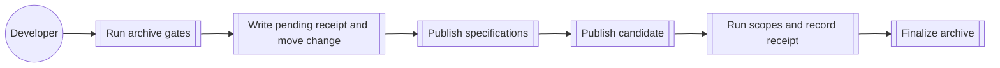

# Use case: archive-change

## Level

!

## Actors

- Developer

## Goal

Archive a completed change with proven publication.

## Trigger

The developer archives a reviewed change.

## Preconditions

- The change has passed its required workflow gates.
- The active version-control system is selected and its clean-state witness is available.
- The system can publish a subset of paths as a revision.
- The permanent corpus is available for update.

## Main flow

1. Run the archive gates, confirm the project state is clean in the active version-control system (only resolved evidence paths may be dirty), and validate the current green change-scoped verification receipt before any mutation.
2. Write the pending receipt and move the active change into the archive location as one state transition; the receipt marks the archive unproven.
3. Merge the accepted behavior and use-case documents (delta merge with base-revision match, retirement and grouping rules).
4. Resolve the evidence scope: the archive directory, the README when the readme addon is on, and the configured coverage outputs.
5. Publish the merged state as the archive candidate revision, containing exactly the merged corpus paths and the pending receipt (unbound, marking the archive unproven).
6. Run each verification scope once against the candidate and check the reported scenario counts.
7. Measure coverage once and publish it.
8. Check the revision binding (tested revision equals candidate revision), refresh the README managed blocks, record the proven receipt, and publish the evidence-only finalization revision.
9. Report the archive as proven.

## Extensions

- 1: uncommitted work outside the resolved evidence → the archive is blocked and names the offending files; protects the minimal guarantee.
- 1: the change-scoped verification receipt is missing or stale → the archive is refused before mutation; protects the success guarantee.
- 2: the archive move is interrupted → either the active change with its pending receipt or the pending candidate remains, and a rerun re-runs the gates and retries the move; protects the minimal guarantee.
- 3: the delta merge is interrupted → the pending candidate records the merge as incomplete and a rerun completes the merge idempotently; protects the minimal guarantee.
- 6: a verification scope fails → the candidate stays published and repairable; protects the minimal guarantee.
- 8: the tested tree changed outside the resolved evidence → finalization refuses; protects the success guarantee.
- 5: a version-control hook rejects the candidate revision → the archive stays unproven and repairable, and the exact intermediate state is version-control-specific; protects the minimal guarantee.
- 1: no version-control system is selected → the archive is refused by name before any mutation; protects the minimal guarantee.
- 1: the archive is already proven → another run is refused; protects the success guarantee.
- 1: the archive has no receipt → another run is refused; protects the success guarantee.
- 1: the active change and an archive directory without a receipt → both exist and the archive is refused as corrupt; protects the success guarantee.
- 1: the active change and a pending archive candidate conflict → the archive is refused as corrupt and names the conflict; protects the success guarantee.
- 1: the active change and a pending archive candidate are identical → the duplicate active change is removed and the archive resumes; protects the minimal guarantee.

## Rules

- A use-case replacement must match its recorded base revision.
- Feature behavior is never silently dropped.
- Only a proven archive is complete; an unproven candidate is never reported as proven.
- A rerun resumes an unproven candidate and refuses a proven archive.
- Archive validates the current green change-scoped receipt before merging and does not rerun the change suite.
- The candidate revision contains exactly the merged corpus paths.
- The finalization revision contains only resolved evidence paths.
- The tested revision equals the published candidate revision.
- A file the version-control system would not publish still counts as dirty and blocks the archive outside the resolved evidence paths: untracked and extra files both block. Plain-text CLI and interaction transcripts under the change's `evidence/` tree are declared evidence.
- Givn publishes the candidate revision and the finalization revision on both supported systems; the developer's per-scenario revisions remain theirs.
- The hook-rejection promise is "unproven and repairable", not an identical internal state.
- The active change and a pending archive candidate whose active artifacts are byte-identical are reconciled; a conflicting pair is corrupt.
- The active change moves into the archive location as one transition; an interrupted transition leaves either the active change with its pending receipt or an unproven candidate, never a partial copy.
- A resumed candidate repeats the delta merge only when the receipt records that the merge did not complete.

## Examples

- Git candidate: a change with merged specs and a clean worktree publishes candidate `a1b2c3d4e5f6...`; both scopes pass; the finalization revision contains the archive directory and the README; the proven receipt records `tested_revision: a1b2c3d4e5f6...`.
- Fossil candidate: the same change in a Fossil checkout whose `EXTRA` files are clean publishes a candidate check-in; both scopes pass; the finalization check-in contains the archive directory; the proven receipt binds the candidate check-in.
- Failed scope: the candidate stays published; `givn status` reports the unproven candidate; the developer repairs with a new revision; the rerun proves the archive without repeating the merge.
- Interrupted move: the process stops after the receipt write but before the rename; the active change carries the pending receipt, the rerun re-runs the gates, retries the rename, and continues from the merge.
- Interrupted merge: the process stops after the rename but before the merge completes; the pending receipt records `merge_completed: false`, and the rerun re-applies the delta file that was in flight without adding a duplicate scenario.
- Restored duplicate: a recovery reset restores the active change beside the pending candidate; the two copies are identical, so the rerun removes the active duplicate and publishes the resulting candidate.
- Hook rejection, Git: a commit hook exits non-zero; the merge stays staged; the archive is unproven.
- Hook rejection, Fossil: a commit hook exits non-zero; the merged state stays in the checkout uncommitted; the archive is unproven.
- No SCM: `givn archive --change multi-scm-support` in a plain directory exits non-zero with a named refusal and mutates nothing.

## Minimal guarantee

A failed archive is never reported as proven, and its candidate remains repairable in place.

## Success guarantee

The permanent corpus contains the accepted change, bound to a verification receipt for the revision that passed every verification scope.

## Personas

- developer--primary-user
- agent--technical-role
- givn-maintainer--owner

## Capabilities

- archive-proof
- grouped-merge-for-new-capabilities
- preserve-scenario-docstrings
- extract-coverage-gate
- enforce-post-merge-e2e-gate

## Interactions

| Capability | Consumer action | E2E scenario |
|---|---|---|
| archive-proof | archive a completed change | Consumer archives a completed change and receives a proven archive |
| archive-proof | repair a blocked archive | Consumer repairs a blocked archive and the rerun proves it |
| archive-proof | inspect an unproven archive candidate | Consumer inspects an unproven archive candidate |
| grouped-merge-for-new-capabilities | archive a new capability | Consumer archives a new capability and the merged spec lands in its declared use case |
| grouped-merge-for-new-capabilities | archive without routing | Archive is blocked when a new capability has no declared routing decision |
| grouped-merge-for-new-capabilities | archive a multi-file change | Nothing is merged when one delta file of a change has no routing decision |
| preserve-scenario-docstrings | archive a modified scenario | Consumer archives a modified scenario and the permanent spec keeps the docstring |
| extract-coverage-gate | archive with coverage | Consumer archives a change with coverage enabled and the coverage summary appears in README |
| enforce-post-merge-e2e-gate | archive an E2E delta | Consumer archives a delta that adds e2e scenarios and is blocked without a configured runner |

## Includes

- fragment: support

## Extends

- none

## Out of scope

Reviewing implementation design or inventing new behavior during archive.

## Diagram

<!-- givn:base-sha256:4e962c7ee4240b9d3e0a6ce33643ada3421bf1a5cc91900c14325353f764f2bd -->
