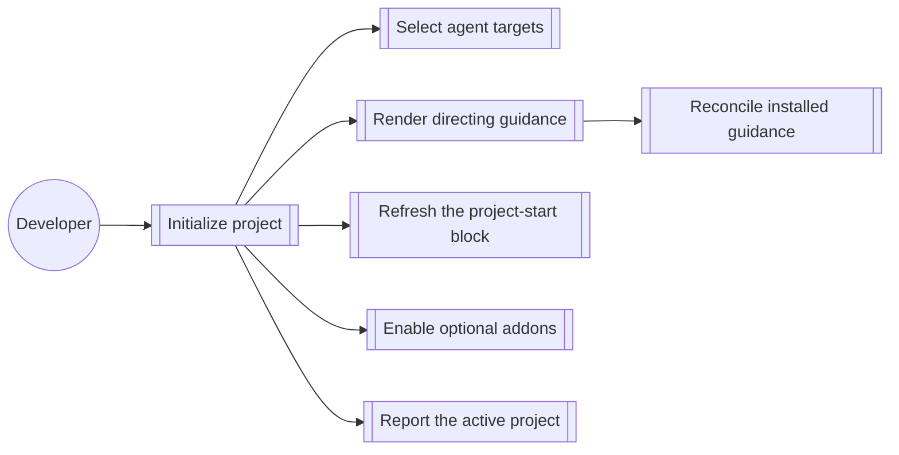

<!-- givn:base-sha256:a2fd76a333e9eed4cecd86ba54e63121abef219a6f9b044f539c6b0e5d12f667 -->
# Use case: initialize-project

## Level

!

## Actors

- Developer
- Supporting: Authoring agent

## Goal

Set up a Givn project and its agent integrations.

## Trigger

The developer initializes a project or re-synchronizes the agent
integrations.

## Preconditions

- The project directory is writable.
- The active version-control system is detected when one exists.

## Main flow

1. The developer selects at least one agent target. The interactive list opens with `.opencode` marked and re-asks when nothing is marked; generation affects selected targets only.
2. The system scaffolds project configuration and thin skills with trigger metadata and a direction to the canonical served instruction, without separately authored command files, orchestration, or copied rulebooks.
3. The system reconciles recognizable generated guidance, removes recognizable generated legacy commands and disabled-addon skills, preserves project-owned replacements and custom commands byte-for-byte, and reports custom commands requiring manual transition.
4. The system refreshes one managed project-start block beside untouched human-authored instructions. Bootstrap owns loading the effective dialog policy before the first question once per context, reloading if lost, independently of addons and named skills.
5. The system resolves effective addon defaults and explicit choices consistently and preserves existing explicit opt-outs on repeated initialization.
6. The system reports the detected version-control system, installs supported attribution plumbing safely, and names installed or skipped integrations and limitations.
7. Only after required skill generation succeeds does the system report initialization complete. No initialization or synchronization action implicitly commits project work.

## Extensions

- 1: no version-control system exists → the system scaffolds the corpus, generates skills, exits 0, and warns that archive and managed upgrade are unavailable; protects the success guarantee.
- 1: interactive confirmation marks no target → the selection is shown again with the at-least-one-target requirement; protects the success guarantee.
- 1: a non-interactive answer or an agents value resolves to no known target → the system names valid targets, exits nonzero, and writes nothing; protects the minimal guarantee.
- 3: a project-owned replacement or custom legacy command exists → its bytes remain authoritative and unchanged, and any manual command transition is reported; protects the minimal guarantee.
- 3: an addon is disabled → only its recognizable generated guidance is removed; protects the success guarantee.
- 5: configuration presentation cannot be safely edited → the request refuses before writes rather than duplicating sections or changing unrelated values; protects the minimal guarantee.
- 6: attribution is unsupported by the active version-control system → the report and guidance name the limitation; protects the success guarantee.
- 7: required skill synchronization fails → the command exits nonzero, names the failed destination and partial initialization, preserves successful scaffold writes and choices, and specifies `givn skills sync` after repair; it prints no unconditional Ready and promises no rollback; protects the minimal guarantee.

## Rules

- Initialization without version control warns rather than refuses; at least one selected agent target is required.
- Thin skills are the only generated invocation surface. Supported Claude and OpenCode versions use native skill invocation, agents use skill discovery, OMP uses `/skill:givn-propose`, and Maki uses explicit requests or agent-selected skills, not generated `/givn-*` commands.
- Every generated skill directs to exactly one served instruction id that resolves; it copies neither built-in rules nor repeated dialog-loading, handoff, delegation, or orchestration blocks. Canonical rules remain served by `givn instructions`.
- Reconciliation rewrites recognizable old generated full copies but never overwrites or injects into project-owned replacements. A matching command filename alone does not prove generated ownership; custom legacy commands require manual transition.
- Managed bootstrap loads the effective dialog policy once before the context's first user-facing question, independently of optional addons; reload it if lost. Skills do not duplicate that obligation, and no portable skill autoload is assumed.
- The managed project-start block preserves human-authored surrounding instructions and derives task-checkoff and revision-message obligations from the same canonical source as served startup instructions.
- Resynchronization refreshes the block once without changing persisted targets or unrelated configuration.
- All current optional addons default enabled. An absent or partial addons block uses the same effective defaults for artifacts, skills, listing, and execution; explicit choices, including opt-outs, survive init reentry and force initialization.
- `--no-addons` explicitly disables every optional addon but never disables mandatory dialog correctness.
- communication_policy replaces absolute_mode; challenge replaces grill_me and grill_with_docs. Retired names have no automatic aliases; refusal explains manual transition. Communication rules govern concrete presentation and documentation formats, never cognitive-rebuilding rhetoric or repository layout.
- Optional challenge installs one thin givn-challenge skill and adds no lifecycle gate. Its subject variants include proposals, tests, specs, design, code, and whole changes; its rules are obtained through the existing instruction-request action.
- Workflow and addon policy belong in config.yaml; command and runtime settings belong in commands.yaml. Misplaced fields fail clearly naming their owner instead of being ignored or silently applied.
- Addon and target edits change only intended values or refuse before writing, preserving unrelated YAML and guidance and introducing no duplicate sections.
- New projects declare explicit unconfigured runners for regular and E2E verification; initialization never assumes test scripts exist. Setup guidance must satisfy scope, selected features, result-file, counts, and failure contracts.
- Required skill failures are nonzero partial initialization, not success or rollback. Retrying synchronization retains persisted targets and addon choices; optional reporting remains non-blocking.
- Git attribution hooks preserve user hooks, are safe under repeated installation and core.hooksPath=.githooks, and never dispatch themselves. Optional attribution failure must not break an ordinary human commit.
- Init and synchronization create no implicit revisions. Later `givn commit` requires explicit file selections on Git and Fossil; raw Git hooks stamp attribution when available, while raw Fossil commits are not stamped.
- Generated guidance remains technology-agnostic; project-specific guidance comes through extensions. Reports name what was installed, skipped, or failed and why.

## Examples

- `givn init --no-addons --agents opencode` installs thin skills and mandatory dialog bootstrap without generated command files or an implicit commit.
- Git initialization preserves an existing commit-msg hook under `.githooks`; a later explicit `givn commit src/parser.rs tests/parser.rs -m "feat: parser"` selects only the named files.
- Fossil initialization installs no Git hook and reports explicit-path `givn commit` as the attribution path; raw Fossil commits are not stamped.
- Without SCM, initialization exits 0 with an archive/upgrade warning and still generates skills.
- A blank interactive target confirmation reopens the list; invalid scripted selection refuses before writes and names valid targets.
- Repeated init preserves an explicit outline or challenge opt-out. A partial addons block disabling outline leaves omitted addons enabled everywhere.
- A failed required skill destination leaves scaffold files available, reports partial initialization, and directs a retry with `givn skills sync` after the destination is repaired.

## Minimal guarantee

Invalid selections or unsafe configuration edits refuse before writes. Project-owned guidance and surrounding human-authored instructions are preserved; a later required generation failure is reported honestly as partial initialization, without an implicit commit or rollback claim.

## Success guarantee

The project has the selected discoverable thin skills, one managed dialog bootstrap, consistent effective addon choices, truthful attribution reporting, and explicit unconfigured runner declarations where newly scaffolded; required generation has succeeded without duplicated built-in rules or implicit commits.

## Personas

- developer--primary-user
- agent--technical-role
- givn-maintainer--owner

## Capabilities

- initialize-a-project
- enable-optional-addons

## Interactions

| Capability | Consumer action | E2E scenario |
|---|---|---|
| initialize-a-project | select agent targets in the interactive terminal | Consumer selects agent targets during interactive init |
| initialize-a-project | initialize with an explicit noninteractive target selection (SCM backend and no-SCM are precondition variants) | Consumer runs init non-interactively and gets opencode skills |
| initialize-a-project | resynchronize selected targets | Consumer re-syncs skills after init and the selection is honoured |
| enable-optional-addons | enable the outline addon | Consumer enables the outline addon and it is listed as enabled |

## Includes

- fragment: support

## Extends

- none

## Out of scope

Changing an existing project's configuration without a request; implementing
the product behavior described by a change (`create-change`).

## Diagram

