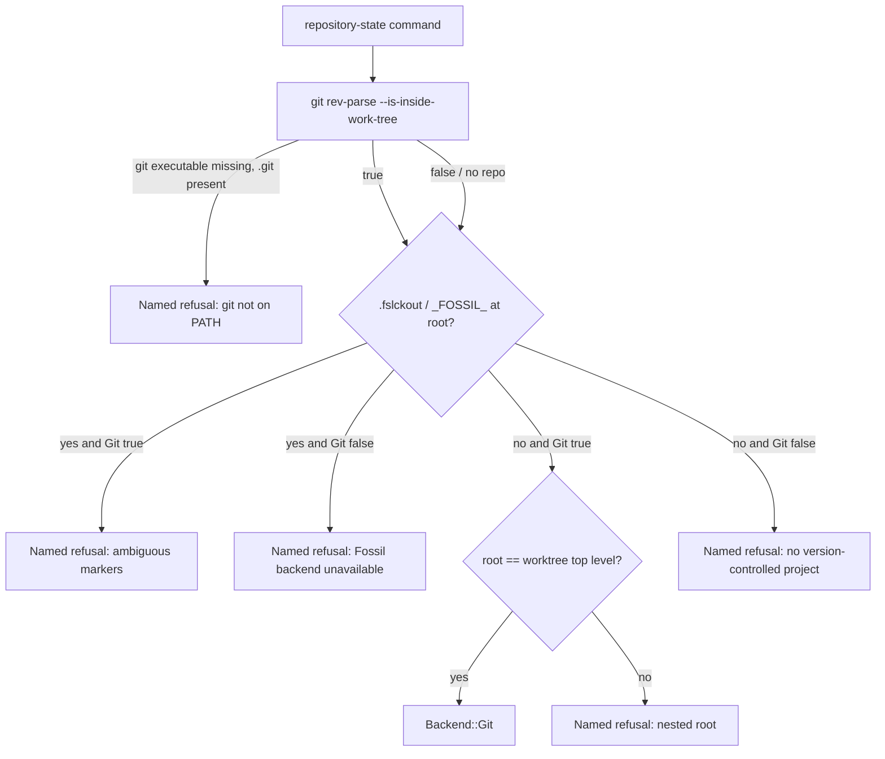

# Design: scm-backend

## Technical Decisions

### One selection seam

A new module `src/scm.rs` owns the question "which version-control system owns
this project root?". It exposes:

```rust
pub enum Backend {
    Git(crate::git::Worktree),
}

pub fn select(project_root: &Path) -> Result<Backend>;
```

`Backend` carries the concrete backend handle; seed 1 has exactly one variant,
Git. Commands ask the seam once and act on the returned handle; they never
re-derive the backend themselves.

### Detection

`select` probes both marker kinds before deciding, so an ambiguous root is
never silently resolved (Q6):

1. **Git probe** — run `git rev-parse --is-inside-work-tree` with the project
   root as the working directory. `stdout == "true"` means a Git worktree
   contains the root. A missing `git` executable (`io::ErrorKind::NotFound`)
   with a `.git` entry at the root is refused by name.
2. **Fossil probe** — `.fslckout` or `_FOSSIL_` exists at the project root.
   `_FOSSIL_` is the Windows alias; both names use the same `exists()`
   predicate. Only `.fslckout` has a dedicated scenario; the alias shares the
   code path and is recorded here as an explicit exclusion.
3. **Decision** — both probes true: ambiguity refusal naming the marker that
   was found; Git only: the boundary check below, then `Backend::Git`; Fossil
   only: the named "Fossil backend not available in this version" refusal;
   neither: the named "no version-controlled project" refusal.

The boundary rule (Q4) is checked before the Git backend is returned: the
worktree top level (`git rev-parse --show-toplevel`, canonicalized) must equal
the canonicalized project root. A nested project root is refused by name. The
rule lives in `scm::select`, so every consumer gets the same neutral message;
`git::Worktree::open` keeps its archive-specific wording until seed 2 moves the
archive onto the seam.



### Refusal messages

All refusals name the project root, mutate nothing, and are produced before
any file write:

| Case | Message shape |
|---|---|
| No backend | `no Git worktree or Fossil checkout found at '<root>'; a version-controlled project is required` |
| Fossil only | `Fossil checkout detected at '<root>'; the Fossil backend is not available in this version` |
| Both markers | `ambiguous version control at '<root>': both a Git worktree marker and a Fossil checkout marker (<marker>) are present`, where `<marker>` is `.fslckout` or `_FOSSIL_` — the one actually found |
| Nested root | `the project root '<root>' must be the worktree top level; it is nested inside '<top>'` |
| `git` missing | `Git worktree detected at '<root>' but the `git` executable was not found on PATH` |

### Git backend operations

`src/git.rs` keeps `Worktree` as the Git implementation and gains the
operations the managed upgrade needs, so migration.rs no longer shells out to
Git itself:

- `Worktree::at(root)` — construct without re-running `open`'s checks (the
  seam already performed detection and the boundary check).
- `Worktree::stage_paths(paths, force)` — `git add [-f] -- <paths>`; `force`
  is used only for the calculated managed allowlist.
- `Worktree::has_staged_changes()` — `git diff --cached --quiet --exit-code`.
- `Worktree::commit_staged(message)` — `git commit -m <message>`; the caller
  reads the resulting revision id through `Backend::revision()`.
- `Worktree::commit(message, paths)` stays as the archive publication
  convenience built from the methods above. It keeps its existing
  `check-ignore` filter: gitignored evidence paths are skipped before
  `stage_paths(paths, force = false)` is called, so the archive behavior
  (including the `commit_skips_gitignored_evidence_paths` unit test) is
  preserved.

### Managed upgrade refactor

`src/cli/migration.rs` replaces `ensure_clean_git`, `stage_paths`,
`has_staged_changes`, `git`, and `git_commit_hash` with `scm::select` plus
`Backend` methods:

- preflight: `select(root)?` then refuse when `backend.dirty_entries()?` is
  not empty (same clean-state semantics as before, untracked files included);
- managed staging: `backend.stage_paths(relative_allowlist, true)`;
- commit: `backend.commit_staged(message)` and `backend.revision()`.

Path filtering (existence, project-root relativity, "no managed files"
refusal) stays in migration.rs: it is project knowledge, not Git knowledge.
Observable behavior on Git is unchanged except the no-version-control refusal
wording.

### Compatibility

No new crate or versioned dependency is introduced; the seam uses
`std::process::Command` and the existing `anyhow` error style. The Rust
toolchain is the runner's stable toolchain; this repository pins no version.

## Production Impact

- `src/scm.rs` (new): `Backend`, `select`, refusal messages.
- `src/lib.rs`: register `pub mod scm;`.
- `src/git.rs`: `Worktree::at`, `stage_paths`, `has_staged_changes`,
  `commit_staged`; `commit`/`open` behavior preserved.
- `src/cli/migration.rs`: use `scm::select` and `Backend` methods; delete the
  duplicated Git helpers.
- `src/cli/archive.rs`: unchanged; seed 2 moves archive onto the seam.
- `givn/specs/fragments/fragment.md`: declares `scm-backend-selection` (the
  review routing check reads the permanent fragment narrative).

## Test Design

The executable scenarios live in the change delta:

```text
givn/changes/scm-backend/specs/fragments/scm-backend-selection.feature
givn/changes/scm-backend/specs/maintain-project/release-0-3-0.feature
```

Step definitions, one file per capability plus its E2E companion, following
the repository convention:

| File | Binds |
|---|---|
| `tests/steps/scm_backend_selection_steps.rs` | Givens for the Git, plain, Fossil-marker, ambiguous, nested, and missing-executable fixtures; the capability-specific When for the PATH-reduced invocation; Thens for the refusal assertions. |
| `tests/steps/scm_backend_selection_e2e_steps.rs` | The `@e2e` Git-selection scenario through the compiled binary. |
| `tests/steps/release_0_3_0_e2e_steps.rs` | Two updated steps: the no-version-control message assertion and the shared `command_fails_before_file_changes` acceptance. |

Both new modules are registered in `tests/steps/mod.rs`.

Step-text strategy (required by the harness): the generic
`the user runs \`...\`` binding in `tests/steps/mod.rs` honors
`cwd_override` and `world_envs`, while the older
`the consumer runs \`...\`` binding ignores both. The nested-root scenario
therefore uses `the user runs`, and the missing-executable scenario uses the
capability-specific text
`the user runs \`givn upgrade\` without the \`git\` executable on PATH`,
bound in `scm_backend_selection_steps.rs` to an invocation whose `PATH` is a
temporary directory without `git`. The permanent release scenario keeps its
old Then text during this change, so `release_0_3_0_e2e_steps.rs` binds both
the old and the new text to the same backend-neutral assertion; after archive
only the new text remains.

Fixtures use `tests/common/mod.rs`: `make_init_root()` (initialized + Git
repository), `make_bare_root()`, `run_givn`, `run_givn_with_envs`,
`git_init`, `git_commit_all`. The Fossil case creates the `.fslckout` marker
only: seed 1 detects the marker and refuses, so the test does not depend on a
`fossil` binary that CI does not install. The missing-executable case runs the
compiled `givn` binary with a `PATH` that contains no `git`.

Runner and strict mode: `verify.command` is `./run-tests.sh`; the cucumber
runner in `tests/features_runner.rs` sets `.fail_on_skipped()`, so an
undefined or pending step fails the run. New step bodies start as
`unimplemented!()` during RED.

Single-scenario command:

```sh
GIVN_FEATURES=givn/changes/scm-backend/specs cargo test --test features_runner -- --name "A Git worktree at the project root selects the Git backend"
```

E2E scope command:

```sh
GIVN_FEATURES=givn/changes/scm-backend/specs ./run-tests.sh --e2e
```

## Interaction Coverage Matrix

This delta adds a reusable fragment capability. The owning fragment declares
no consumer interaction inventory (`fragment.md`: `Interactions: none`), and
the routing and lint contracts exempt fragments from the inventory check, so
this table records the evidence map for the capability's real action rather
than a normalized inventory.

| Evidence | Scenario | Real interface | Driving mechanism |
|---|---|---|---|
| Primary E2E action | "A Git worktree at the project root selects the Git backend" (`@e2e`) | givn CLI | The compiled `givn` binary runs `givn upgrade` in a real temporary Git project; the test asserts exit code 0 and the new revision |
| Refusal invariants (regular scenarios) | The five refusal scenarios (no version control, Fossil, ambiguity, nested root, missing `git`) | givn CLI | Same subprocess boundary; each asserts the named refusal and that nothing was written |

## Use-Case Traceability

| Use-case guarantee or rule | Design decision | Capability | E2E evidence |
|---|---|---|---|
| Selection order: Git worktree, then Fossil checkout, then named refusal | `scm::select` probes `git rev-parse` first, then the Fossil markers, then refuses | scm-backend-selection | A Git worktree is selected and the upgrade proceeds |
| Selection never mutates the project | All probing and refusals happen before any write; `Worktree::at` performs no checks | scm-backend-selection | The refusal scenarios assert no file changed |
| A refusal names the reason and the project root | Fixed message shapes in `scm::select` | scm-backend-selection | Refusal scenarios assert root, reason, and no mutation |
| A backend without its executable is refused by name (Q14) | `io::ErrorKind::NotFound` maps to the named `git` refusal | scm-backend-selection | The missing-executable scenario asserts the refusal |
| The project boundary is the worktree top level / checkout root (Q4) | Boundary check in `scm::select` before the Git backend is returned | scm-backend-selection | The nested-root scenario asserts both paths |
| Both markers at the root are ambiguous (Q6) | Both probes true → ambiguity refusal | scm-backend-selection | The ambiguity scenario names both markers |
| No backend declaration in config (Q1) | No config key is read or written; only markers are probed | scm-backend-selection | Covered by all scenarios (no config involved) |
| The managed upgrade keeps its behavior on Git | migration.rs delegates to `Backend` methods; clean check, force-staging, commit and revision semantics preserved | release-0-3-0 | The existing upgrade scenarios stay green; the outside-Git wording is modified |
| Confirmed Personas | developer--primary-user (named refusals), agent--technical-role (deterministic commands), givn-maintainer--owner (one seam) | — | Review lens, not a scenario actor |

## Local Runnability

`./run-tests.sh` runs the full suite; no server, database, or third-party
service is involved. The only external executables are `git` (already a test
dependency) and the compiled `givn` binary. No digital twin is required. The
Fossil case is deliberately marker-only in seed 1 so the suite runs on CI
without a `fossil` installation; seed 2, which needs real Fossil operations,
owns the decision about installing Fossil for its tests.

Anticipated obstacle: the missing-`git` scenario must not break the test
process itself. The fix: the Given creates the Git worktree first, and only
the `givn` subprocess invocation receives the reduced `PATH`.
