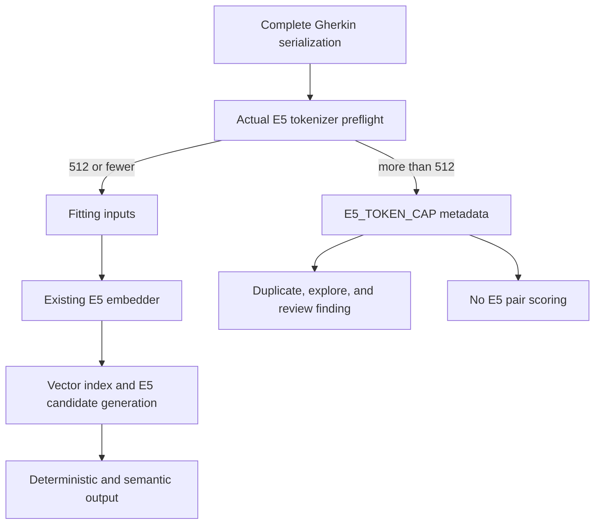

# Design: semantic-e5-token-cap

## Technical Approach

The change remains inside `src/spec/retrieval.rs` and uses the existing E5
model, tokenizer, deterministic serialization, local CLI surfaces, and
Cucumber harness. No dependency or model artifact is added.

The E5 passage path will be split into two phases:

1. Preflight every complete serialized input with the actual untruncated,
   unpadded tokenizer. The role prefix (`passage: ` or `query: `) is included
   in the measured input. A count of 512 fits; a count above 512 produces an
   `E5_TOKEN_CAP` evidence record.
2. Send only fitting inputs to the existing stub or local E5 embedder and map
   returned vectors back to their original input positions. Capped inputs have
   no vector and are never sent to inference.

The deterministic test seam remains restricted to the existing stub embedder.
`GIVN_SPEC_E5_TOKEN_BUDGET` will provide exact, overflow, and partial fixtures
for acceptance tests. The production path always uses the tokenizer loaded
from the configured local E5 artifacts and does not use the seam.

## Data Model And Wire Contract

The existing `SpecIndex.entries` collection remains vector-only. The index
document gains an additive `e5_token_caps` collection, defaulting to an empty
list when reading an older index. Each record contains:

- `file` and `title` endpoint identity;
- `token_count` and `limit`;
- `model` and `tokenizer` provenance identifiers;
- `refactoring_required: true`;
- `guidance` telling the author to shorten or split the scenario and rerun.

The `IndexEntry` shape and existing `embedding` array are unchanged. A cap
record is reused only when its endpoint and complete content hash still match;
otherwise it is remeasured. Index writes remain atomic.

Duplicate JSON and text reports gain additive E5 cap fields. JSON uses an
`e5_token_cap_candidates` collection with one object per capped endpoint and
retains the existing `candidates` collection, candidate ordering, and schema
fields for exact, structural, and scored semantic candidates. A capped
endpoint is absent from every E5 semantic pair; it may still occur in a
deterministic exact or structural candidate. The report-level
`refactoring_required` and `guidance` fields are also set when the collection
is non-empty.

Explore JSON gains the same additive `e5_token_cap_candidates` collection. A
cap in the permanent index is shown alongside normal fitting results. A cap
in the query or active change is shown as a finding with no invented score;
fitting results continue to use the existing rank, title, file, and score
fields. Text output identifies the status, endpoint, count, limit, provenance,
and guidance.

Blocking semantic review renders capped active and permanent endpoints in an
additive E5 token-cap section. The finding has `classification: null` and
`rationale: null`, is counted as blocking, and forces `Status: BLOCKED` until
the scenario is shortened or split and the report is regenerated. It is never
converted into `DUPLIKAT`, `VARIANTE`, or `VALID-BOUNDARY`. Existing BGE/NLI
evidence fields and their `BGE_TOKEN_CAP`/`NLI_TOKEN_CAP` behavior are not
changed.

## Retrieval Flow



`refresh_index` partitions pending permanent scenarios, embeds fitting
scenarios, and writes cap metadata without aborting. Duplicate discovery runs
deterministic exact/structural analysis first, then only forms semantic pairs
whose two endpoints have vectors. Semantic change review applies the same
partition to active delta passages and excludes all capped permanent and
active endpoints from pair generation. The report gate separately includes
the cap metadata so exclusion from scoring cannot become invisible.

Explore refreshes the permanent index before embedding its query. If the query
is capped, it emits the query finding and no ranked result rather than failing
or truncating. If only a permanent or active candidate is capped, normal
fitting E5 results remain ranked and the cap finding is emitted separately.

Advisory `givn spec review` and the strict similarity path use the same result:
the advisory path prints the finding and remains advisory; the blocking
semantic report path writes the complete blocked report before returning
non-zero. Any optional BGE/NLI stage receives only E5 candidates with actual
vectors, so neither stage can fabricate a score for a capped endpoint.

## Architecture Impact

| Area | Change |
|---|---|
| `src/spec/retrieval.rs` | Add E5 passage budget/evidence types, partial embedding mapping, additive index/report fields, and cap-aware flows for index, duplicates, explore, advisory review, and semantic review. |
| Persistent index | Keep fitting vectors in `entries`; add backward-compatible `e5_token_caps` metadata. |
| Semantic candidate generation | Omit pairs with a capped endpoint; retain deterministic duplicate/structural analysis. |
| CLI output | Additive text and JSON findings; existing fitting contracts remain unchanged. |
| Tests | Add `tests/steps/semantic_e5_token_cap_steps.rs` and the separate CLI E2E module `tests/steps/semantic_e5_token_cap_e2e_steps.rs`; register both in `tests/steps/mod.rs`. |
| Documentation | Update affected Arc42 chapters and the change-level `arc42.md` assessment. |

No production module outside retrieval is required. No persistent vector is
created for a capped passage, and no zero or truncated vector is used as a
sentinel.

## Test Design

### Runner And Strictness

`givn/commands.yaml` configures `./run-tests.sh` as `verify.command` and
`./run-tests.sh --e2e` as `verify.e2e_command`. The runner ultimately invokes
the repository's Cucumber binary:

```sh
cargo test --features spec-retrieval --test features_runner
```

`tests/features_runner.rs` calls `.fail_on_skipped()` on the Cucumber builder,
which makes undefined, pending, and skipped steps fail the process. New step
definitions must not contain `unimplemented!()`, `todo!()`, or empty bodies.
The strict proof is a named scenario run with every `@wip` tag removed; a
temporary undefined-step probe is not needed because the existing builder
configuration is executable and already used by the full suite.

The exact single-scenario command is:

```sh
GIVN_FEATURES=givn/changes/semantic-e5-token-cap/specs \
GIVN_SPEC_EMBEDDER=stub \
cargo test --features spec-retrieval --test features_runner -- \
  --name "Indexing keeps fitting scenarios when another passage exceeds E5 capacity"
```

The BGE/NLI combinations use the same command with their existing feature
flags only when an existing regression suite is run. The new E5 capability
does not require BGE or NLI model loading.

### Black-Box And E2E Coverage

Regular bindings in `tests/steps/semantic_e5_token_cap_steps.rs` cover fixture
construction, deterministic budget setup, and report assertions that need
filesystem evidence. E2E bindings in
`tests/steps/semantic_e5_token_cap_e2e_steps.rs` invoke the compiled `givn`
binary through `common::run_givn_with_envs`; they do not call retrieval
functions in-process. The production report renderer is exercised unchanged;
the test-only E5 budget seam and stub embedder only avoid network access and
large local model artifacts while assigning deterministic 512/550 counts.

There are no external services, databases, queues, browser surfaces, or
third-party runtime calls in this capability. The local full run is
`./run-tests.sh`; it is self-contained and requires no isolated service
network or digital twin. The CLI is the real interface, and each E2E assertion
checks subprocess exit status and rendered stdout/report bytes first.

| Inventory entry | @e2e scenario title | Real interface | Driving mechanism |
|---|---|---|---|
| build or refresh the permanent E5 scenario index through the givn CLI | Indexing keeps fitting scenarios when another passage exceeds E5 capacity | CLI / terminal | Cucumber E2E step starts the compiled `givn spec index` subprocess and reads stdout and the resulting index as secondary evidence. |
| run the permanent duplicate audit through the givn CLI | Duplicate audit preserves deterministic findings and reports an E5 token-cap candidate | CLI / terminal | Cucumber E2E step starts `givn spec duplicates --format json` and parses the real JSON response. |
| explore a complete scenario through the givn CLI | Explore keeps an E5 token-cap finding visible while fitting results remain usable | CLI / terminal | Cucumber E2E step starts `givn spec explore --file ... --format json` and parses rendered exploration JSON. |
| run blocking semantic change review through the givn CLI | Blocking review keeps an over-cap active scenario unresolved | CLI / terminal | Cucumber E2E step starts `givn check review --change running-change`, then asserts the subprocess failure and reads the generated report. |

The fifth regular scenario, `Exactly 512 E5 passage tokens retain normal
embedding behaviour`, is a boundary regression in the existing E5 contract;
its concrete distinction from the E2E cases is proving the inclusive boundary
without requiring another real-user action.

### Test Matrix

| Case | Embedder | E5 budget seam | Expected result |
|---|---|---|---|
| fitting-only | deterministic stub | exact 512 | Existing E5 vectors and candidate behavior. |
| partial corpus | deterministic stub | fitting plus 550 | Index succeeds; fitting vectors exist; cap metadata is visible; no capped pair is scored. |
| active cap | deterministic stub | 550 | Explore/review emit E5 cap finding; blocking review writes a blocked report. |
| real tokenizer guard | local artifact path only | measured actual count | No truncation; fitting inputs proceed and over-cap inputs are metadata-only. |

The real-tokenizer case is covered by the production code path and existing
local-artifact conventions; acceptance tests do not download or construct a
multi-gigabyte model. No test asserts a fabricated semantic score for an
E5-token-cap endpoint.

## Implementation Constraints

- Keep `E5_MAX_LENGTH` at 512 and make the inclusive comparison explicit.
- Measure the complete canonical serialization plus role prefix; never measure
  a shortened or truncated representation.
- Preserve existing content-hash reuse for fitting entries and make cap reuse
  conditional on the same endpoint and content hash.
- Keep cap metadata sorted by normalized file and title for deterministic text,
  JSON, index, and report output.
- Do not alter the existing BGE/NLI pair budget partition or their wire names.
- Write the blocked semantic report atomically before returning the unresolved
  error.
