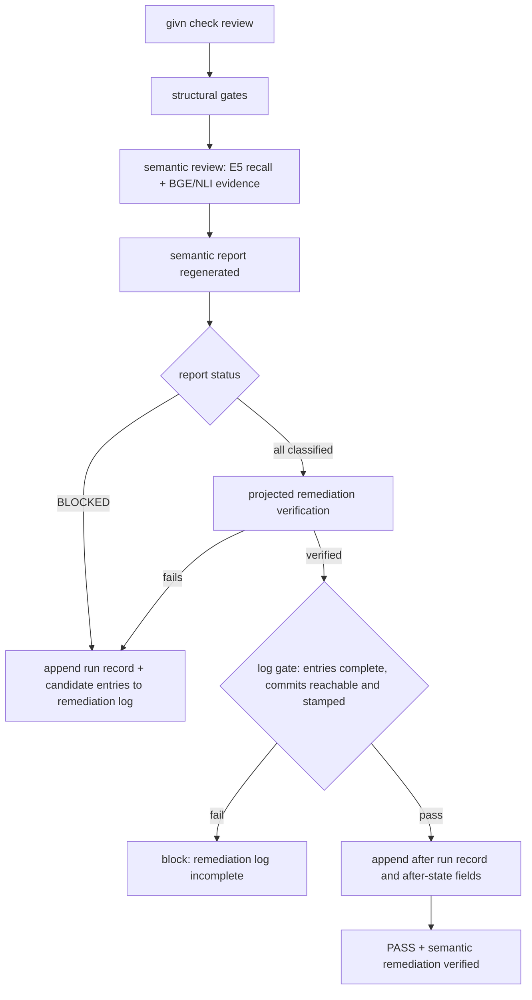

# Design: semantic-remediation-log

## Overview

The blocking semantic review (`givn check review`) gains a second change-local
artifact, the **remediation log** (`givn/changes/<id>/semantic-remediation.md`),
written by the same code path that writes the semantic report — strictly behind
the report-writing branch, so the archive similarity gate (which re-runs the
semantic core with `write_report = false`) neither appends to nor validates the
log. The log is append-only: each run appends a run record (kind, git anchor,
per-stage durations) and, for newly admitted candidate evidence, a candidate
entry (before evidence, verbatim endpoint text, decision fields). The agent
completes the decision fields in place: classification and rationale are copied
from the report (the report remains authoritative on any mismatch — the log is
a historical snapshot, not a second gate input), and remediation text and
commits are written into the entry. The passing rerun writes after-state fields
and the after run record. The review gate validates log completeness and — when
the project has Git history with at least one commit — that every recorded
remediation commit is reachable and carries the
`semantic-remediation: <change-id>/<candidate-id>` stamp line. Backward
compatibility: the gate demands entries only for candidates whose entries exist
in the log or were admitted in a log-writing run; a verified prior remediation
that predates the log passes without one. Archive retention needs no code
change: the archive moves the whole change directory.



## Technology Decisions

No new dependencies. Everything is std + existing crates:

| Technology | Version | Resolution |
|---|---|---|
| Rust | stable toolchain already pinned by `Cargo.toml`/`Cargo.lock` | no change |
| `gherkin` crate | `0.16` (pinned in `Cargo.toml`, verified in-repo at design time) | used for endpoint positions to extract verbatim text |
| Git CLI | whatever `git` is on PATH (already a runtime assumption, see `src/cli/migration.rs`) | used for anchors, reachability, and stamp reading |
| Model stages E5/BGE/NLI | local artifacts via existing fixture-request policy | durations measured with `std::time::Instant` |

Decisions:

- **Separate artifact, not report fields.** The report is regenerated
  deterministically on every run; history would be destroyed and its strict
  grammar forbids per-run state. The log is written once per run and never
  rewritten, so its values stay historical facts.
- **Run records instead of per-candidate durations.** The pipeline scores a
  pool; attributing wall time to one candidate would fabricate numbers.
- **Stamp validation lives in the review gate, not the commit-msg hook.** The
  repo's `commit-msg` hook keeps validating Conventional Commits only; the gate
  validates where candidate ids are known. Projects without Git history keep
  working: anchors are `null` and stamp/reachability checks are skipped.
- **`after_embedding_score` is derived, never claimed.** It is recorded only
  when the passing rerun actually computed a cosine for the prior candidate's
  endpoint pair; removed endpoints record `null`.

## Step Definitions

| Capability | Step definition file |
|---|---|
| semantic-remediation-log (regular) | `tests/steps/semantic_remediation_log_steps.rs` |
| semantic-remediation-log (@e2e) | `tests/steps/semantic_remediation_log_e2e_steps.rs` |

Test runner command (from `verify.command` in givn/commands.yaml):

```
./run-tests.sh
```

Single-scenario run command:

```
cargo test --test features_runner -- --name "<scenario title>"
```

The runner reads `GIVN_FEATURES` verbatim: `run-tests.sh` defaults it to
`givn/specs`, and the review gate scopes it to the active change's specs
directory (`src/cli/check.rs`). The delta file therefore executes in the
gate-scoped E5-only group and the default group of `run-tests.sh`, and its
`@e2e` scenarios in the `--e2e` runs — all with stub models, so BGE/NLI fields
are legitimately `null` there; one dedicated `@rulebook`-tagged scenario runs
in the rulebook group (E5+BGE+NLI stubs) to exercise non-null evidence states.

## Internal Primitives

| Primitive | Type | Purpose |
|---|---|---|
| `RemediationLog` | `struct` (src/spec/remediation_log.rs) | Parsed log state: run records, candidate entries |
| `LogRunRecord` | `struct` | kind (before/after), git anchor commit, e5/bge/nli runtime ms |
| `LogCandidateEntry` | `struct` | before evidence + verbatim text, decision fields, after state |
| `render_remediation_log` | `fn` | Deterministic wire-grammar renderer (headers, exact field order, `null` absence, one final newline) |
| `update_remediation_log` | `fn` | Append-only update: fingerprint dedup for run records, new entries on changed endpoint evidence, after-state completion |
| `validate_remediation_log` | `fn` | Gate: entry completeness for resolved candidates, git reachability, stamp line match |
| `git_anchor` / `git_stamp_lines` | `fn` | `rev-parse HEAD`, `merge-base --is-ancestor`, `%B` message read via the Git CLI |
| `verbatim_scenario_text` | `fn` | Extracts a scenario's exact source lines (tags included) from its feature file using gherkin positions |
| `e5_runtime_ms` | `field` | New: duration of the E5 recall stage, measured with `Instant` around the embed+rank section in `semantic_review_core` |

## Log wire grammar

```
# Semantic Remediation Log
Log schema version: 1
Change: "<change-id>"

## Run N
- kind: before|after
- commit: <16-hex|null>
- e5_runtime_ms: <int|null>
- bge_runtime_ms: <int|null>
- nli_runtime_ms: <int|null>

## Candidate <candidate_id>
- run: <run record number>
- before_embedding_score: <4-decimals>
- before_bge_admission: <state|null>
- before_bge_symmetric_raw: <4-decimals|null>
- before_nli_admission: <state|null>
- before_nli_symmetric_entailment: <4-decimals|null>
- before_left_file: "<path>"
- before_left_title: "<title>"
- before_right_file: "<path>"
- before_right_title: "<title>"
- before_left_content_hash: <16-hex>
- before_right_content_hash: <16-hex>
- before_left_evidence_hash: <16-hex>
- before_right_evidence_hash: <16-hex>
- before_left_gherkin: |
    <verbatim source lines, 4-space block indent>
- before_right_gherkin: |
    <verbatim source lines>
- classification: DUPLICATE|VARIANT|VALID-BOUNDARY|UNCERTAIN
- rationale: <JSON string|null>
- remediation: <JSON string|null>
- commits: [<JSON hash strings>] | []
- after_state: endpoint-absent|outline-consolidated|score-below-boundary|null
- after_embedding_score: <4-decimals|null>
- after_commit: <16-hex|null>
- after_left_gherkin: |
    <verbatim post-remediation text of the delta endpoint>
    | null
```

Semantics:

- **Append-only**: a run record is appended only when the candidate universe
  fingerprint (sorted candidate ids + content hashes) differs from the **last
  run record of any kind**; a candidate entry is appended when its endpoints'
  content or evidence hashes differ from every prior entry; identical evidence
  is never duplicated. Prior entries are never edited by the tool — only
  `classification` and `rationale` (agent, copied from the report), `remediation`
  and `commits` (agent), and the `after_*` fields (tool, at the passing run) are
  filled in place.
- **After-field matching**: the passing run writes after fields into the entry
  whose candidate id and endpoint evidence hashes match the pair the verifier
  just verified — never first-entry-by-id — so a superseded entry (changed
  endpoint) keeps its historical state untouched. `after_left_gherkin` records
  the post-remediation text of the delta endpoint (verbatim) or `null` when the
  endpoint was removed; the permanent endpoint cannot change during verified
  remediation, so it has no after field.
- **Verbatim text** includes the tag lines above `Scenario:`/`Scenario
  Outline:` and ends before the next section directive; trailing blank lines
  are trimmed. The block is byte-identical to the feature-file source.
  Interior blank lines render as exactly the 4-space block indent (a truly
  empty line would end a naive block parse); the block ends only at a
  deindented `- field:` line or a `## ` header. Feature files use spaces, not
  tabs, so deindent is unambiguous.
- **Durations**: measured with `Instant` per stage; BGE/NLI reuse the existing
  `runtime_ms` run fields. `null` only when the stage did not execute (feature
  absent, disabled, or unavailable); a measured 0 is valid, including
  cache-only runs recorded as `Some(0)` today. Steps must not assert `> 0`.
- **Git anchors**: `commit`/`after_commit`/`commits` record **full 40-character
  hex SHAs** (`git rev-parse HEAD` output); 16-hex is reserved for candidate
  ids (including the stamp line). An unborn branch (`git init`, no commits)
  makes HEAD resolution fail and is treated exactly like "no Git history":
  anchors `null`, stamp and reachability checks skipped. Reachability is
  `git merge-base --is-ancestor <hash> HEAD`; a recorded hash that is not an
  ancestor blocks with a reachability message.
- **Backward compatibility**: the gate validates only candidates that have a
  log entry or were admitted in a log-writing run. A remediation verified
  before the log existed (prior report carries a verified entry, no log entry)
  passes without one; a missing log file behaves like an empty log.
- **Atomic write** like the report: temp file + rename, no partial output.

## Strict Mode (mandatory)

```
cucumber-rs: .fail_on_skipped() on the Cucumber builder — already configured
in tests/features_runner.rs; undefined or pending steps fail the run.
```

Not-implemented stub for new steps: `unimplemented!("pending: <scenario>")` —
never an empty body.

## Local Runnability & Digital Twins (mandatory)

**Local run command** (this is a CLI; the full "stack" is the binary plus its
local model artifacts):

```
cargo build && ./run-tests.sh          # full suite, stub models, offline
./run-tests.sh --e2e                   # @e2e subsets with the real binary
cargo run -- check review --change <id>
```

**Isolated network:** no network services are involved; every test runs in a
temp project directory created by the step fixtures. Model artifacts resolve
from the XDG model cache; fixture requests keep the suite offline and fast.

**Digital twin per external/third-party dependency:**

| External dependency | Digital twin (fake/stub/emulator) | Runs where |
|---|---|---|
| E5 embedding model | `GIVN_SPEC_EMBEDDER=stub` fixture request (development build only) | test env vars |
| BGE reranker | `GIVN_SPEC_BGE=stub` fixture request | test env vars |
| NLI model | `GIVN_SPEC_RERANKER=nli-stub` fixture request | test env vars |
| Git history | real `git` CLI invoked in the fixture's temp directory | test env |

No scenario depends on a live third-party service. An installed build ignores
fixture requests by design (existing model-location policy).

**Anticipated interface obstacles and their fix:**
- *Git state in fixtures:* stamp scenarios need a real repository. The e2e/step
  fixture runs `git init`, configures a local user, and commits with
  `-c commit.gpgsign=false` so no signing infrastructure is touched.
- *Candidate id unknown at commit time:* the stamp steps read the candidate id
  from the generated semantic report and build the stamp line
  `semantic-remediation: running-change/<candidate-id>` from it.
- *Multiple check-review invocations per scenario:* each invocation writes the
  log; assertions therefore snapshot the log only at defined points and rely on
  the append-only fingerprint rule rather than file size.

## E2E Smoke Test Infrastructure

**Interface type:** CLI — the real `givn` binary is the public consumer
interface; no browser/HTTP surface exists for this capability.

**E2E runner command** (→ `verify.e2e_command`):

```
./run-tests.sh --e2e
```

**E2E step location:** `tests/steps/semantic_remediation_log_e2e_steps.rs`
(separate from unit/integration steps, one file per capability).

**Local test infrastructure:** temp project via `givn init` fixture, real
binary through `env!("CARGO_BIN_EXE_givn")` (same harness as the existing
semantic e2e steps), stub model fixture requests, real `git` CLI for the
stamped commit.

**E2E framework choice and justification:** cucumber-rs through the existing
`features_runner` — it already drives the real CLI as a subprocess for the
other semantic e2e scenarios, and reusing it keeps one runner and one
strict-mode mechanism for the whole suite.

**Interaction Coverage Matrix:**

| Inventory entry | @e2e scenario title | Real interface | Driving mechanism |
|---|---|---|---|
| run blocking change review with givn check review | Real CLI review completes the remediation log for a stamped duplicate remediation | CLI | `env!("CARGO_BIN_EXE_givn") check review --change rc-log-e2e` invoked as a subprocess; classify/remove/stamp-commit between runs |
| archive a completed change with givn archive | Real CLI archive retains the remediation log | CLI | `env!("CARGO_BIN_EXE_givn") archive --change rc-log-archive-e2e` invoked as a subprocess |

**Real-interface assertion rule:** primary assertions are on CLI stdout/stderr
("semantic remediation verified", exit codes) and on files the real CLI wrote
(remediation log next to the archived semantic report) — the same boundary a
human user touches.

## Architecture Impact

- **New module** `src/spec/remediation_log.rs`: log state, renderer,
  append-only update, gate validation, git helpers, verbatim extraction.
- **Modified** `src/spec/retrieval.rs`: `semantic_review_core` measures the E5
  recall stage, calls `update_remediation_log` and `validate_remediation_log`
  strictly inside the `write_report = true` branch — after successful
  remediation verification, before emitting PASS — so the archive similarity
  gate (`write_report = false`) never touches the log; candidate/run evidence
  structs gain no new required fields (BGE/NLI runtimes already exist; E5
  runtime is added). The git helper pattern from `src/cli/migration.rs` is
  duplicated as small private fns inside `remediation_log.rs` rather than
  widening migration.rs's visibility (three thin wrappers: HEAD resolve,
  ancestor check, message read).
- **No archive changes**: `givn archive` already moves the whole change
  directory (`copy_dir_all`), retaining the log next to the report.
- **Instruction/template updates** (dogfood surface): `assets/instructions/review.md`,
  `assets/templates/review.md`, `assets/commands/givn-review.md`, and the tasks
  instruction/template gain the stamp convention and the log-entry editing duty;
  regenerated integrations via `givn skills sync` after archive.
- **Glossary**: new domain terms recorded in `docs/arc42/12-glossary.md` (done
  in this change); affected arc42 chapters: 5 (building blocks — new module),
  8 (crosscutting concepts — semantic review section), updated at implementation.

## Data Model Changes

No persisted formats outside the change directory change. New file:
`givn/changes/<id>/semantic-remediation.md` (grammar above), carried to
`givn/archive/<id>/semantic-remediation.md`. The semantic report grammar is
untouched (schema stays version 2); E5 runtime is measured internally and only
surfaced in the log, so no report field changes.

## Open Technical Questions

None.
