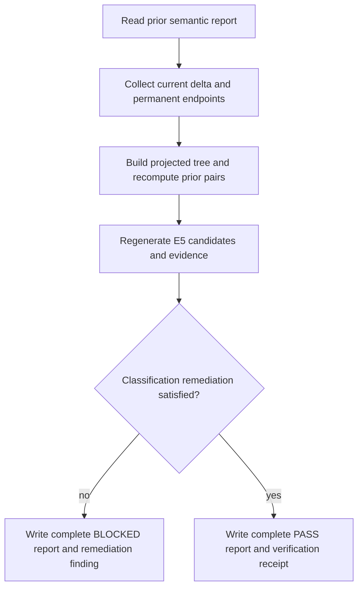

# Design: semantic-remediation

## Architecture Impact

PR 4 extends the blocking semantic-review lifecycle introduced by PR 3. The
existing advisory retrieval path and permanent-only index remain unchanged.
The blocking path now evaluates the previous report classification against the
current projected change before it can return PASS.



The verifier is evidence-based and does not decide classifications or edit
feature files. It compares the previous classified candidate with the current
projected state and checks the contract for that classification:

- `DUPLIKAT`: the redundant current-change endpoint is absent from the
  projected permanent tree, while the retained permanent endpoint remains.
- `VARIANTE`: both behaviors remain available, the changed endpoint evidence is
  different, and the recomputed pair is below `0.9500`, demonstrating an
  explicit observable distinction rather than two unchanged contracts.
- `VALID-BOUNDARY`: both behaviors remain available, the changed endpoint
  evidence is different, and the recomputed pair is below `0.9500`.

An unchanged high-score candidate with a resolved classification is blocked
with a remediation-specific error. A changed endpoint whose previous
classification cannot be matched to a satisfied remediation is blocked as
stale. A candidate that disappeared is not automatically considered resolved:
the verifier checks the prior classification and the projected endpoint state
before accepting the disappearance.

Remediation verification is a separate prior-entry path, not a filter over the
new report candidate list. It recomputes the prior pair even when the new score
is below `0.9500` and uses this matching precedence:

1. Exact prior candidate id plus both endpoint identities and evidence hashes:
   verify the class-specific contract.
2. Same endpoint identities with changed evidence: mark the prior decision
   stale unless the class-specific projected remediation is satisfied.
3. An endpoint absent from the projected tree: use the class-specific
   disappearance contract; never treat absence as an automatic PASS.
4. No identity match: retain a blocking stale finding and do not carry the
   classification.

## Components and Data Flow

| Component | Responsibility | Change |
|---|---|---|
| `src/cli/check.rs` | Invoke the existing semantic gate and preserve structural/advisory ordering | No new command; existing blocking path receives remediation verification |
| `src/spec/retrieval.rs` | Reconstruct prior candidates, evaluate projected remediation, render status, and emit verification/failure output | Extend semantic-review lifecycle with remediation evidence |
| `src/gherkin/merge.rs` | Existing projected/archive rendering remains the source of projected scenario behavior | Reused; no automatic writes during check |
| `tests/steps/semantic_remediation_steps.rs` | Strict regular Cucumber bindings for classification/remediation cases | New capability file |
| `tests/steps/semantic_remediation_e2e_steps.rs` | Real compiled-CLI smoke-test bindings | New separate E2E file |

The existing `SemanticCandidate` identity, endpoint content/evidence hashes,
score seam, report grammar, and permanent-only index remain the persistence and
determinism boundaries. Remediation state is request-local and is never added
to the permanent index.

## Internal Primitives

| Primitive | Role |
|---|---|
| `RemediationStatus` | Internal result distinguishing verified, blocked, and stale candidate outcomes. |
| `RemediationFinding` | Candidate id, classification, expected remediation, and observable mismatch used for a blocking message. |
| `PriorRemediationEntry` | Strict prior-report candidate identity, endpoint identities/hashes, class, and rationale used even when the regenerated candidate disappears. |
| `ProjectedEndpoint` | Read-only endpoint view after applying the active delta in memory, including scenario structure, facts, and identity. |
| `verify_semantic_remediation` | Compare prior classified candidates with current projected endpoints and return findings/verified count. |
| `verify_duplicate_remediation` | Confirm a DUPLIKAT endpoint is removed while the retained endpoint remains. |
| `verify_variant_remediation` | Confirm both endpoints remain, evidence changed, and the recomputed pair is below the boundary. |
| `verify_boundary_remediation` | Confirm both endpoints remain, evidence changed, and the valid boundary is below the boundary. |
| `recompute_prior_pair` | Re-score a prior endpoint pair independently of current report admission, including below-boundary scores. |
| `render_remediation_receipt` | Produce deterministic user-visible verification output without changing the report wire grammar. |

## Classification Contracts

The classification is read from the strict prior report generated by PR 3. The
verifier parses a `PriorRemediationEntry` before regenerating the report and
uses the matching precedence above to locate the corresponding current and
projected state. Invalid, missing, duplicate, stale, or unknown prior entries
continue to follow the PR 3 blocking behavior.

| Classification | Required projected state | Failure message |
|---|---|---|
| `DUPLIKAT` | Redundant current-change endpoint removed; retained endpoint remains | `DUPLIKAT remediation requires removing the redundant scenario` |
| `VARIANTE` | The projected result contains one parameterized `Scenario Outline` contract with a non-empty `Examples` table covering the variant, the prior redundant endpoint resolves to that contract, and the pair score is `< 0.9500` | `VARIANTE remediation requires consolidation` |
| `VALID-BOUNDARY` | Both endpoints remain; the changed endpoint has a changed observable deterministic fact or explicit condition/outcome invariant, and the recomputed pair score is `< 0.9500` | `VALID-BOUNDARY remediation requires an explicit distinction below the similarity boundary` |
| Any resolved class with no satisfied contract | No accepted projected remediation | `semantic classification is stale` or the class-specific message |

On successful verification the command prints `semantic remediation verified`
and the generated report has `Status: PASS`. On failure it writes the complete
report atomically, keeps the candidate blocking, and prints the specific
remediation finding to stderr. Givn never edits the delta, permanent specs,
dispositions, or index.

## Determinism and Compatibility

- The existing E5 boundary remains exactly `0.9500`.
- The existing `GIVN_SPEC_STUB_PAIR_SCORES` fixture seam supplies initial and
  post-remediation scores; production scoring is unchanged.
- Remediation findings are sorted by candidate id and use no timestamps,
  environment values, or nondeterministic paths.
- A below-boundary score is recomputed for prior classified pairs even though it
  is not admitted to the new report candidate list. The deterministic stub
  score seam accepts prior endpoint identities and post-remediation identities.
- A malformed or incompatible permanent index follows PR 3 recovery before
  remediation verification.
- A feature-free build and unavailable model return the existing explicit
  retrieval-unavailable error before remediation state is written.
- `givn spec review --change` remains advisory and does not create or verify a
  semantic report.

## Test Definitions

| Capability | Step definition file |
|---|---|
| Semantic remediation regular scenarios | `tests/steps/semantic_remediation_steps.rs` |
| Semantic remediation CLI E2E scenario | `tests/steps/semantic_remediation_e2e_steps.rs` |

The existing `features_runner` uses `.fail_on_skipped()` as strict mode. Every
new RED step starts with Rust `unimplemented!()` and is replaced with a real
assertion or fixture action in GREEN. No empty step body is allowed.

## Runner Commands

Repository runner:

```sh
./run-tests.sh
```

Change-specific regular runner:

```sh
GIVN_FEATURES=givn/changes/semantic-remediation/specs \
GIVN_SPEC_EMBEDDER=stub GIVN_SPEC_RERANKER=stub \
cargo test --features spec-retrieval --test features_runner -- --tags 'not @e2e'
```

Single-scenario runner:

```sh
GIVN_FEATURES=givn/changes/semantic-remediation/specs \
GIVN_SPEC_EMBEDDER=stub GIVN_SPEC_RERANKER=stub \
cargo test --features spec-retrieval --test features_runner -- \
  --name "A DUPLIKAT classification without removal remains blocked"
```

E2E runner:

```sh
GIVN_FEATURES=givn/changes/semantic-remediation/specs ./run-tests.sh --e2e
```

The repository runner defaults to permanent `givn/specs/**`; the
change-specific command intentionally points at the active change feature path
for isolated scenario execution. Archive verification runs the repository
runner after merging the change into permanent specs. The E2E command is a
strict subset because it passes `--tags @e2e`.

## Interaction Coverage Matrix

| Inventory entry | @e2e scenario title | Real interface | Driving mechanism |
|---|---|---|---|
| invoke `givn check review --change <id>` and inspect remediation verification and exit status | Real CLI review reports successful duplicate remediation | CLI | `std::process::Command` through the compiled `givn` binary; assert exit status, stdout receipt, and report status |

## Local Runnability

This capability is CLI-only. It has no server, database, queue, browser, or
third-party dependency, so no container network or digital twin is required.
The exact local command is `./run-tests.sh`; fixtures use the deterministic
stub embedder and pair-score seam without network access. The E2E step writes a
temporary project, prepares a classified/remediated state, invokes the actual
compiled CLI subprocess, and reads its exit status and report output.

## Coverage Boundaries

The regular scenarios exercise all three classification contracts, endpoint
disappearance, below-boundary recomputation, wrong-endpoint removal, false
variant/boundary remediations, stale evidence, blocked output, successful
verification, non-mutation, and the feature-gated CLI path. The E2E scenario
prepares a classified/remediated state as an observable review precondition,
then verifies the final review action through the real CLI subprocess.
Optional real-model failure is covered by the existing PR 3 unavailable-model
scenario and remains separate from deterministic remediation tests.
