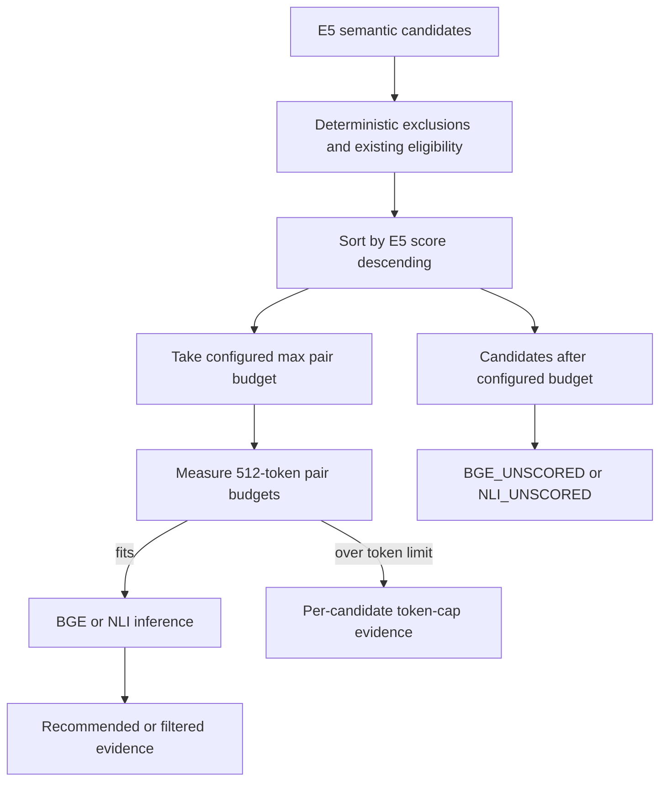

# Design: semantic-reranker-budget

## Technical Approach

The change remains in the existing Rust retrieval pipeline in
`src/spec/retrieval.rs`. No dependency or model artifact is added. The existing
E5 candidate generator, deterministic exclusions, BGE/NLI score thresholds, and
512-token model-input limits remain unchanged.

The fixed pair-count constants are replaced by one runtime setting:
`GIVN_SPEC_MAX_RERANK_PAIRS`. When unset, it resolves to the default `2048`.
Explicit empty, zero, negative, malformed, overflowing, or non-UTF-8 values
fail before model inference with an error identifying the setting. Configured
values are positive decimal `usize` values. The setting is read by every
command that enables BGE or NLI; an invalid value is rejected even when the
eligible pool is otherwise empty.

For every second-stage invocation, the eligible E5 candidates are ordered by
E5 score descending, then by the existing deterministic endpoint tuple. The
first `max_rerank_pairs` candidates are sent to the model. Candidates outside
that selected set remain visible as `BGE_UNSCORED` or `NLI_UNSCORED`; they are
not put in a filtered collection and do not become model judgments.

The permanent duplicate audit keeps its existing BGE top-five endpoint-neighbour
eligibility rule. The configured budget is applied after that eligible union is
formed and after its candidates are sorted by E5 score. NLI keeps its existing
independent E5 semantic candidate pool and applies the same ordered budget; it
does not depend on BGE recommendations. Explore and change-aware review use
the same ordered truncation on their already-selected E5 result pools.

An invocation whose eligible pool is smaller than the active budget scores every
eligible pair. Exceeding the configured budget is no longer a `pair-cap`
unavailable state. `BGE_UNAVAILABLE` and `NLI_UNAVAILABLE` remain for missing
artifacts and the existing all-token-cap cases.

Run summaries expose `max_unique_pairs` alongside E5, scored, recommended,
filtered, and unscored counts. The BGE parity descriptor and approval matching
use the active setting, so a benchmark approval cannot silently authorize a
different pair budget. The candidate-pipeline attestation advances to
`rust-production-v2` because its selection contract changes from refusal to
ordered-prefix scoring. The Python benchmark's declared runtime budget must
match the active setting before an approval artifact can be written.

## Architecture Impact

- `src/spec/retrieval.rs`: add setting parsing, ordered candidate selection,
  dynamic run metadata, and remove pair-count overflow refusal.
- `tests/steps/mod.rs`: carry the setting through the existing subprocess test
  environment seam and register the capability bindings.
- `tests/steps/semantic_reranker_budget_steps.rs`: regular Gherkin bindings for
  ordered BGE/NLI budget behavior and invalid-value validation.
- `tests/steps/semantic_reranker_budget_e2e_steps.rs`: separate compiled-CLI
  E2E binding for the duplicate audit output.
- `tests/steps/bge_reranking_evidence_steps.rs`,
  `tests/steps/nli_evidence_steps.rs`: migrate old overflow fixtures and
  assertions to the configurable prefix contract; update parity fixtures.
- `givn/changes/semantic-reranker-budget/specs/`: add the new behavior and
  remove obsolete fixed pair-cap scenarios from the BGE/NLI permanent specs.
- `tools/approach-comparison/evaluate_bge_admission.py`,
  `tools/approach-comparison/compare.py`: keep benchmark and approval budgets
  aligned with the active default and production pipeline attestation.
- `docs/arc42/01-introduction-and-goals.md`, `02-architecture-constraints.md`,
  `03-context-and-scope.md`, `04-solution-strategy.md`,
  `05-building-block-view.md`, `06-runtime-view.md`,
  `08-crosscutting-concepts.md`, `09-architecture-decisions.md`,
  `10-quality-requirements.md`, `11-risks-and-technical-debt.md`,
  `12-glossary.md`, and the real-model filter report: document the
  configurable budget, ordered selection, and measured runtime.

No persistent index schema changes are required. The active budget is runtime
configuration and is reported as `max_unique_pairs` in each participating
second-stage run object and its text equivalent; E5 content hashes and vector
entries remain unchanged. Explore reports expose the same value in their BGE or
NLI evidence summary. Existing E5-only JSON remains byte-compatible.

## Retrieval Flow



The budget is a work limit, not a semantic classification boundary. The
selected prefix is deterministic, and all omitted candidates retain E5 order
in the unscored collection and remain available for blocking review where the
existing contract requires it. A candidate omitted by the pair budget is never
tokenized for BGE/NLI and therefore cannot receive token-cap evidence from that
layer; token-cap evidence is reserved for selected candidates whose complete
pair exceeds the consuming model's 512-token limit.

## Surface Contract

Text and JSON reports retain their current E5 candidate identities and add the
active `max_unique_pairs` value to each participating BGE/NLI run. A successful
partial run reports `BGE_ENABLED` or `NLI_ENABLED`, its scored count, and its
unscored count. It never emits `pair-cap` solely because the raw E5 pool is
larger than the setting. In duplicate JSON, `unique_pairs` is the number of
actual model-scored pairs, while `unscored_candidates` contains the E5-ranked
tail. In Explore JSON, omitted results retain the legacy result shape and the
run summary's unscored count identifies the tail. In Markdown, omitted semantic
review candidates carry `BGE_UNSCORED` or `NLI_UNSCORED` and remain blocking.

The existing model thresholds remain inclusive at BGE symmetric raw `3.0` and
NLI symmetric entailment `0.5`. A selected candidate below those thresholds is
filtered evidence; an omitted candidate has no model evidence and is unscored.

## Test Runner And Strictness

The repository runner remains `./run-tests.sh`, which executes the Cucumber
binary over `givn/specs/` and the active change feature files through
`GIVN_FEATURES`. The strict-mode mechanism is
`GivnWorld::cucumber().fail_on_skipped()` in `tests/features_runner.rs`.

The exact single-scenario command is:

```sh
GIVN_FEATURES=givn/changes/semantic-reranker-budget/specs \
  cargo test --features spec-retrieval,cross-encoder-reranker,nli-evidence \
  --test features_runner -- \
  --name "BGE receives the highest E5 candidates within the configured budget"
```

The E2E command is `./run-tests.sh --e2e`. The E2E step definition is separate
from regular bindings in
`tests/steps/semantic_reranker_budget_e2e_steps.rs`, and it starts the compiled
`givn` subprocess. The primary assertion is on the CLI's JSON stdout; the
temporary index is secondary evidence.

There are no external services, databases, queues, browsers, or digital twins.
The local run is self-contained and uses deterministic stub E5/BGE/NLI
backends. Real-model runtime measurement uses the existing local BGE and NLI
artifacts outside the Gherkin suite. The permanent corpus baseline for runtime
planning is `397` scenarios, `1311` E5 semantic candidates, an `803`-pair BGE
top-five union, and `1311` independent NLI candidates. The default `2048`
budget covers this baseline, but remains configurable for larger corpora.

## Interaction Coverage Matrix

| Inventory entry | @e2e scenario title | Real interface | Driving mechanism |
|---|---|---|---|
| run a permanent duplicate audit with a configured second-stage pair budget through the givn CLI | The CLI reports the configured second-stage pair budget | CLI / terminal | Cucumber E2E binding starts the compiled `givn spec duplicates --format json` subprocess and asserts its JSON stdout and exit status |

## Decisions

- `2048` is the default because it exceeds the current `1311` E5 semantic
  candidates while remaining an explicit operational setting. A corpus larger
  than the budget receives enabled partial scoring with an explicit unscored
  tail.
- BGE retains its existing top-five endpoint-neighbour eligibility set; the new
  budget controls how many of those eligible pairs reach inference.
- NLI remains independent and receives the highest E5 candidates from its own
  E5 pool, not only BGE survivors.
- Pair-budget overflow is represented by deterministic unscored candidates,
  not by unavailable model status. Token-cap and artifact failures retain their
  existing evidence contracts.
