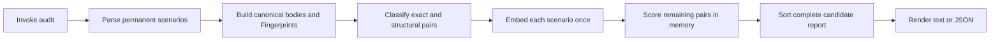

# Design: Read-Only Permanent Scenario Duplicate Audit

## Technical Decision

Add `givn spec duplicates [--format text|json]` to the existing `givn spec`
command family. The command scans the permanent scenario corpus only and
produces a complete, advisory candidate report. It does not modify permanent
specifications, active changes, archive contents, or the persistent retrieval
index. The existing local retrieval model cache may be created or updated;
that cache is outside the audit's read-only boundary.

The implementation stays in the existing Rust retrieval and overlap paths. No
new dependency is required. Exact and structural relationships are determined
from parsed Gherkin and the existing deterministic scenario fingerprint.
Structural overlap means a matching masked assertion sequence or a strict
assertion-subsequence relationship plus the existing extracted fact model. It
does not introduce a Given/When action-structure comparison. The semantic
candidate layer reuses the existing local E5 retrieval embedder and fixed
threshold; it produces advisory threshold-eligible candidates and never makes
an automatic duplicate decision. The later BGE and NLI plan slices remain out
of scope.

The command requires the `spec-retrieval` feature because one complete audit
must include semantic candidates as well as deterministic overlap findings. A
build without that feature returns the existing explicit retrieval-unavailable
error.

## Domain Model

### Ubiquitous Language

- **Permanent scenario**: A scenario under `givn/specs/` that represents
  canonical project behaviour.
- **Audit**: A read-only inspection of every eligible permanent scenario pair.
- **Candidate pair**: Two distinct permanent scenarios for which the audit has
  duplicate, structural, or semantic evidence.
- **Exact duplicate**: Two scenarios with the same canonical behaviour body,
  independent of their title and file location.
- **Structural overlap**: Two scenarios with the same masked assertion shape or
  a strict masked assertion-subset relationship, with the existing extracted
  facts and distinguishing values retained as evidence. Given/When action
  structure is not part of this relation.
- **Semantic candidate**: Two scenarios outside the deterministic findings
  whose local E5 similarity reaches the existing fixed threshold. This is an
  advisory candidate, not an automatic duplicate decision.
- **Scenario identity**: The stable `(project-relative feature file, scenario
  title)` pair used to identify one side of a candidate.

### Boundaries and Invariants

- The audit aggregate is rooted at one project directory and contains only
  permanent, non-removed scenarios under `givn/specs/`. A missing
  `givn/specs/` directory is an empty successful corpus.
- Active change deltas and archived scenarios are never candidate endpoints.
- A malformed or unreadable permanent feature fails with an error naming the
  offending project-relative path; no report is emitted.
- The audit reads current permanent files and transient in-memory embeddings.
  It never reads `.spec-index.json` as evidence and never refreshes or writes
  it.
- A pair is emitted once, with its endpoint identities in canonical order.
- Exact duplicate classification takes precedence over structural overlap;
  structural overlap takes precedence over semantic candidacy.
- Candidate ordering and text/JSON serialization are deterministic for an
  unchanged corpus and configuration.
- Reporting has no project-specification side effect and does not block normal
  change work.

### Lifecycle



## Architecture Impact

### CLI

- Add a `Duplicates { format: SpecFormat }` variant to `SpecCommands` in
  `src/main.rs`.
- Dispatch it to `cli::spec::run_duplicates`.
- Add the public retrieval entry point in `src/cli/spec.rs` and
  `src/spec/retrieval.rs`, following the existing feature-gated behavior of
  `index`, `search`, `explore`, and `review`.
- Reuse the existing `SpecFormat` enum so `--format text` and
  `--format json` have the same CLI contract as `spec explore`.

### Audit Pipeline

The retrieval module gains a small audit-specific model and renderer:

- Parse all feature files below `givn/specs/`, including scenarios nested under
  Rules, in existing project-relative path order. If the directory is absent,
  collect zero scenarios and continue successfully.
- Construct an audit record containing the scenario identity, canonical
  behavior body, existing `Fingerprint`, and normalized retrieval text.
- A read or parse failure aborts with the project-relative feature path in the
  error. No report is emitted and `.spec-index.json` is not opened or changed.
- Compare every unordered pair. Exclude `@givn.removed` records, self-pairs,
  and pairs already classified by a higher-priority class.
- Use only `Fingerprint.assertions` and `Fingerprint.facts` for structural
  evidence. A same-shape finding uses the `same_assertion_shape` relation; a
  strict subsequence finding uses a direction-specific subset relation. The
  Given/When action steps are not structural evidence.
- Build one in-memory E5 passage vector per scanned scenario, then compute
  pairwise cosine scores in memory for pairs not already classified. Do not
  call `refresh_index` and do not use persistent index entries as evidence.
- Sort candidates by class priority, structural relation order or descending
  semantic score as applicable, then canonical endpoint identity.
- Render either a human-readable report or one JSON document.

The canonical behavior body includes backgrounds, step types and values,
docstrings, data tables, and examples, but excludes the scenario title, file
path, and tags. This prevents a renamed or relocated copy of the same behavior
from escaping exact-duplicate detection while keeping observable scenario
content in the comparison.

### Candidate Output Contract

The report contract is byte-stable for an unchanged corpus, configuration, and
model result. It is UTF-8 with LF endings and exactly one final newline. Text
output has exactly these lines before any candidates:

```text
Givn spec duplicates
Scanned scenarios: <unsigned-decimal>
Candidate count: <unsigned-decimal>
```

Each candidate then occupies one line with exactly this field order and one
ASCII space between fields:

```text
rank <unsigned-decimal>: kind=<kind> left=<compact-json-endpoint> right=<compact-json-endpoint> relation=<relation> assertion_shape=<compact-json-value-or-null> facts=<compact-json-value-or-null> distinguishing_facts=<compact-json-array> fact_contradiction=<true-or-false> score=<four-decimal-score-or-null>
```

`<compact-json-endpoint>` is `{"file":"<project-relative-forward-slash-path>","title":"<title>"}`.
All JSON values in text fields use compact JSON escaping. There is no top-five
truncation and no diagnostic prefix or suffix.

JSON output is one object with the following exact field order:

```json
{
  "schema_version": 1,
  "scanned_scenarios": 0,
  "candidate_count": 0,
  "candidates": []
}
```

Each candidate has fields in this order: `rank`, `kind`, `left`, `right`,
`evidence`. Each endpoint has `file` then `title`. Each `evidence` object has
fields in this order: `relation`, `assertion_shape`, `facts`,
`distinguishing_facts`, `fact_contradiction`, `score`. `assertion_shape` is
either null or `{"left":[<masked-assertion>...],"right":[<masked-assertion>...]}`.
`facts` is either null or `{"left":<fingerprint-facts>,"right":<fingerprint-facts>}`.
Fingerprint facts have fields in this order: `exit_code`,
`contains_polarity`, `tables`, `done`, `tty`; missing `exit_code` is JSON null,
and absent map entries are omitted. Map keys are sorted. Each distinguishing
fact is `{"field":"<stable-fact-path>","left":<value-or-null>,"right":<value-or-null>}`
and the array is ordered by `exit_code`, assertion position for
`contains_polarity`, table key, `done`, then `tty`. `fact_contradiction` follows
the existing `Facts::contradicts` conservative rule; an absent fact alone does
not contradict.

`kind` is exactly one of `exact_duplicate`, `structural_overlap`, or
`semantic_candidate`. `relation` is exactly one of
`identical_behavior`, `same_assertion_shape`,
`left_assertions_subset_of_right`, `right_assertions_subset_of_left`, or
`semantic_similarity`. Exact candidates use `identical_behavior`; structural
candidates use one of the three structural relations; semantic candidates use
`semantic_similarity`. Structural fields are null for exact and semantic
candidates, and semantic candidates have an empty `distinguishing_facts` array
and `fact_contradiction: false`, making semantic evidence visibly non-structural.

`score` is a JSON string and text scalar with exactly four decimal places for a
semantic candidate, or JSON/text `null` for exact and structural candidates.
The raw cosine value is thresholded before serialization: `0.9500` is included,
`0.9499` is excluded, and serialized values are never used to admit a candidate.

`scanned_scenarios` equals the number of eligible non-removed permanent
scenarios, including Rule-nested scenarios. `candidate_count` equals the length
of `candidates`; it is zero exactly when the array is empty. Candidate ranks are
assigned after sorting, are contiguous `1..=candidate_count`, and are identical
between text and JSON. An empty or missing corpus is a successful report with
zero counts and no candidate lines.

### Deterministic Ordering

Candidates are sorted by the following keys:

1. Exact duplicates.
2. Structural overlaps.
3. Semantic candidates.
4. Within structural overlaps: `same_assertion_shape`,
   `left_assertions_subset_of_right`, `right_assertions_subset_of_left`.
5. Within semantic candidates: descending raw score.
6. Left file, left title, right file, right title.

Rank numbers are assigned after sorting and are shared by text and JSON output.
Floating-point comparisons use total ordering before four-decimal
serialization; endpoint strings provide the tie-breaker for equal scores.

## Test Design

### Step Definitions

The executable `.feature` file remains the sole scenario source. Add one
capability module for each interface layer:

- `tests/steps/spec_duplicates_steps.rs` for regular black-box subprocess
  scenarios.
- `tests/steps/spec_duplicates_e2e_steps.rs` for the `@e2e` CLI smoke scenario.
- Register both modules in `tests/steps/mod.rs`.

The regular steps create isolated temporary projects, write permanent,
active-change, and archive fixtures, invoke the compiled `givn` subprocess,
parse text or JSON output, and compare byte snapshots of every read-only
boundary. The E2E steps use the same subprocess boundary and fixture setup but
are kept in a separate module. The existing `GivnWorld` output,
retrieval-environment, and snapshot state are reused; no parallel unit test file
is introduced.

The fixture assertions cover the exact header and candidate grammar, JSON key
order, endpoint identities, class and relation values, rank/count invariants,
masked assertion arrays, every `Fingerprint` fact field, distinguishing fact
values, score/null serialization, inclusive `0.9500` admission, `0.9499`
exclusion, precedence across mixed classes, and equal-score endpoint ordering.
Malformed and unreadable permanent features assert a path-specific error.
Missing `givn/specs/` is asserted as an empty successful corpus. Archive
scenarios, active-change files, archive files, permanent files, and the index
are asserted excluded or byte-for-byte unchanged as appropriate.

### Runner and Strict Mode

- `verify.command`: `./run-tests.sh`
- `verify.e2e_command`: `./run-tests.sh --e2e`
- Underlying runner: `cargo test --features spec-retrieval --test
  features_runner`
- Single-scenario command:

  ```text
  GIVN_FEATURES=givn/changes/spec-duplicates/specs/spec-duplicates/spec-duplicates.feature GIVN_SPEC_EMBEDDER=stub cargo test --features spec-retrieval --test features_runner -- --name '^Maintainer inspects the complete permanent scenario audit$'
  ```

The runner invokes `GivnWorld::cucumber().fail_on_skipped()`. This is the
strict-mode mechanism: undefined or skipped steps fail the run. During the RED
phase, step bodies use explicit `panic!("not implemented")` stubs rather than
empty bodies; the runner's `fail_on_skipped` check is the mechanical proof that
no `@wip` scenario can pass silently. `@wip` tags are removed only as each
scenario reaches GREEN.

### E2E Infrastructure

The capability is CLI-only. The real interface is a terminal subprocess, not a
browser or HTTP API. The E2E driver is the compiled `givn` executable launched
by the existing Cucumber subprocess steps. The test uses a temporary initialized
project as its isolated project state and sets `GIVN_SPEC_EMBEDDER=stub` so no
model download or external network is required.

The configured hook remains `./run-tests.sh --e2e`, but the standalone command
for this change is:

```sh
GIVN_FEATURES=givn/changes/spec-duplicates/specs ./run-tests.sh --e2e
```

It starts no server, database, queue, browser, or external service. There are
no third-party dependencies and therefore no digital twins. When a lifecycle
hook runs the command, the existing hook runner injects `GIVN_FEATURES` for the
active change before invoking `verify.e2e_command`; the standalone command sets
the same scope explicitly. The primary E2E assertion is the terminal output
and exit status returned by `givn spec duplicates`; filesystem checks are
secondary evidence for the read-only invariant.

The only anticipated interface obstacle is model availability. The named fix is
the deterministic `GIVN_SPEC_EMBEDDER=stub` backend in local and E2E fixtures;
production invocations use the existing local retrieval model path.

### Deterministic score-control seam

Threshold scenarios use the existing stub-embedder test path, never the
production local E5 path. The test-only environment seam is
`GIVN_SPEC_DUPLICATES_TEST_SCORES`. It is a map of canonical unordered endpoint
pairs to four-decimal scores; each endpoint key is the normalized
`(project-relative-forward-slash-file, scenario-title)` identity. The seam is
honored only when `GIVN_SPEC_EMBEDDER=stub`, is ignored or rejected for
production local-E5 execution, and is not part of the user-facing output or
persisted index. Fixtures use it to set exactly `0.9500`, `0.9499`, and equal
semantic scores without relying on model behavior. The implementation must
reject malformed keys or values with a test-fixture error rather than silently
changing the production score.

### Performance and model-quality evidence

The audit embeds each eligible scenario once and computes remaining pairwise
cosines in memory. The current permanent corpus baseline is approximately 288
eligible scenarios, or `288 * 287 / 2 = 41,328` unordered pairs. An
instrumented implementation/review run must record one embedding per scanned
scenario and the pair count; it must decide on a bounded or indexed approach
before the corpus reaches 500 scenarios (approximately 124,750 pairs). The
current complete audit remains the reference behavior until that threshold is
reached.

Semantic quality is measured against a labeled fixture set containing known
duplicates, structural overlaps, valid boundaries, and unrelated pairs. The
review records true positives, false positives, false negatives, precision,
and recall at the fixed `0.9500` boundary. These metrics are model-quality
evidence and an advisory-risk signal only: a semantic candidate is never an
automatic duplicate decision and cannot be used to suppress deterministic
evidence.

### Interaction Coverage Matrix

| Inventory entry | @e2e scenario title | Real interface | Driving mechanism |
|---|---|---|---|
| invoke `givn spec duplicates` and consume the complete advisory audit, including its JSON output variant | Maintainer inspects the complete permanent scenario audit | CLI / terminal | Cucumber `features_runner` launches the compiled `givn` subprocess with `spec duplicates`, captures stdout and exit status, and validates the audit report |

### Coverage Process Boundaries

| Process | Started by | Instrumented artifact | Profile output | Merge step | Non-zero production path |
|---|---|---|---|---|---|
| Cucumber `features_runner` and its `givn` subprocesses | `./measure-coverage.sh` non-E2E invocation | Cargo LLVM-instrumented test and binary artifacts | `coverage/non-e2e-cobertura.xml` | `./merge-coverages.sh` | `givn spec duplicates` dispatch, permanent pair classification, and renderer |
| Cucumber `features_runner` and its `givn` subprocesses tagged `@e2e` | `./measure-coverage.sh` E2E invocation | Cargo LLVM-instrumented test and binary artifacts | `coverage/e2e-cobertura.xml` | `./merge-coverages.sh` | Real CLI invocation and terminal report assertion |

Coverage uses the repository-owned commands and collision-safe configured
paths. The stub embedder keeps both processes deterministic and local.

## Files and Scope

### Production

- `src/main.rs`: expose and dispatch the new subcommand.
- `src/cli/spec.rs`: add the command entry point.
- `src/spec/retrieval.rs`: collect permanent audit records, classify pairs,
  compute in-memory semantic evidence, and render text/JSON.

No persistent schema, configuration key, index format, or external dependency
changes.

### Tests and Artifacts

- `givn/changes/spec-duplicates/specs/spec-duplicates/spec-duplicates.feature`:
  executable behavior contract.
- `tests/steps/spec_duplicates_steps.rs`: regular black-box bindings.
- `tests/steps/spec_duplicates_e2e_steps.rs`: CLI E2E bindings.
- `tests/steps/mod.rs`: module registration.

The design, tasks, review, and archive artifacts are generated by the normal
Givn workflow. No change-local production fixture is copied into permanent
specifications until archive.

## Verification Sequence

1. Run the single scenario command above and confirm RED with strict skipped
   handling.
2. Implement one scenario at a time using the existing RED/GREEN/REFACTOR
   loop.
3. Run `./run-tests.sh --non-e2e` for regular scenarios and
   `GIVN_FEATURES=givn/changes/spec-duplicates/specs ./run-tests.sh --e2e`
   for the CLI smoke scenario. Hook-injected runs receive the same feature
   scope through the existing `GIVN_FEATURES` environment handling.
4. Run `./run-tests.sh`, formatting, feature/no-feature checks, and clippy
   before review.
5. Run the review and archive gates; archive only after all `@wip` tags and
   artifact checkboxes are complete.
