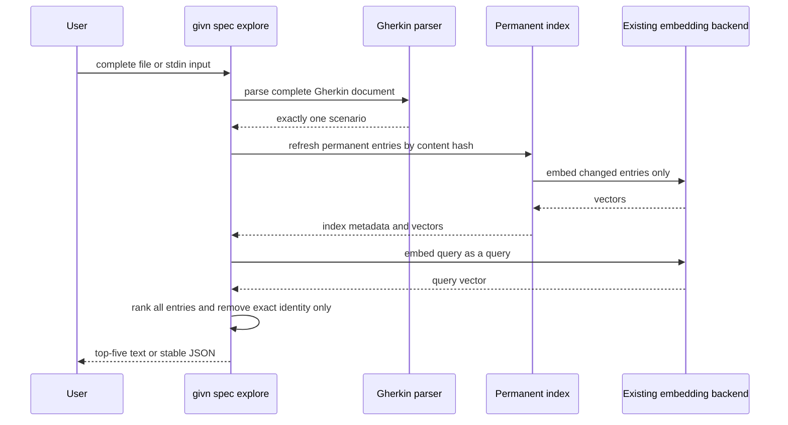

# Design: Explore Permanent Scenarios

## Boundary

The command is a read-only CLI capability. Its real interface is the terminal
and the tests drive it by spawning the compiled `givn` process in a temporary
project root. The command receives one complete Gherkin document containing one
scenario or scenario outline. It does not accept a scenario fragment or an
active change identifier.

The permanent search corpus is `givn/specs/**/*.feature`. The active change
tree is never collected. The command refreshes the existing permanent index
before it creates a query vector, then ranks the permanent entries by the
existing embedding cosine score. It does not call the reranker or NLI paths.

## Architecture Impact

The existing command and retrieval modules are extended without changing the
contracts of `spec index`, `spec search`, or `spec review --change`.

| File | Change |
| --- | --- |
| `src/main.rs` | Add the `spec explore` subcommand, its mutually exclusive input options, and the text/JSON format option. |
| `src/cli/spec.rs` | Validate the input selection and dispatch exploration. |
| `src/spec/retrieval.rs` | Parse one query scenario, refresh the permanent index, exclude only the exact query identity, rank the top five, and render text or JSON. Preserve the existing index/search/review entry points. |
| `tests/steps/mod.rs` | Register the new capability step modules and carry their scenario state. |
| `tests/steps/spec_explore_permanent_steps.rs` | Non-e2e black-box steps for the capability. |
| `tests/steps/spec_explore_permanent_e2e_steps.rs` | Separate e2e step bindings for the real CLI invocations. |
| `tests/common/mod.rs` | Provide stdin process execution with environment overrides. |
| `givn/changes/spec-explore-permanent/specs/spec-explore-permanent/spec-explore-permanent.feature` | Executable CLI scenarios for this slice. |

The runtime flow is:



## Input Contract

`--file <path>` reads the complete UTF-8 file. `--stdin` reads all standard
input until EOF. The CLI rejects zero inputs and both inputs together with a
clear error. The parsed document must contain exactly one scenario or scenario
outline, including scenarios nested below a `Rule:`. Parser failures are
reported as invalid Gherkin; a valid feature with zero or multiple scenarios is
reported as a cardinality error.

For a file query, the identity path is normalized to a forward-slash path
relative to the project root when the file is inside that root. An external
file retains its normalized supplied path. For stdin, the query file is null
and no permanent entry can match its identity. The query content hash uses the
same normalized title-and-step representation as permanent index entries.

The acceptance fixture's normal exploration corpus contains three permanent
scenarios in one feature file. File and stdin queries against an external draft
therefore make same-feature candidates observable. The identity-filter fixture
keeps the queried permanent file to one scenario and places the other
candidates in separate files, because a file query containing multiple
scenarios must itself be rejected.

## Index Refresh and Ranking

The existing `SpecIndex`, `IndexEntry`, content hash, and embedding backend are
retained. The current index refresh loop is split into a result-producing
refresh operation and the existing human-readable `spec index` wrapper. The
refresh result contains the index plus reused and newly embedded counts, so
human exploration can report them while JSON remains a single valid document.

The query is embedded with the existing query role. Every permanent entry is
ranked, including entries with the same file as the query. Only an entry whose
file and title both equal the file query identity and title is removed. Stdin
queries remove nothing. Ranking remains deterministic: descending cosine
score, then ascending file, then ascending title. Results are limited to five
after identity filtering and receive one-based ranks.

## Output Contract

Human output identifies the query source, model, index version, entry count,
reuse/new-vector counts, and each result's rank, title, file, and embedding
score formatted to four decimal places.

JSON is serialized from fixed structs in this field order:

```json
{
  "query": {
    "title": "...",
    "source": "file|stdin",
    "file": "...",
    "content_hash": "..."
  },
  "index": {
    "model": "...",
    "version": 1,
    "entries": 208
  },
  "results": [
    {
      "rank": 1,
      "title": "...",
      "file": "...",
      "score": 0.9342
    }
  ]
}
```

The stdin `file` value is JSON `null`. Candidate ordering is deterministic,
and the score is the existing embedding score, not a reranker or NLI result.
No index refresh log lines are emitted before JSON.

## CLI Surface

```text
givn spec explore --file <draft.feature> [--format text|json]
givn spec explore --stdin [--format text|json]
```

`--format` defaults to `text`. The input validation lives at the CLI boundary
so the no-`spec-retrieval` build rejects the valid command with the existing
unavailable message rather than attempting retrieval. The feature-disabled
path has no retrieval-only types or dependencies. Its acceptance scenario
invokes `cargo run --quiet --no-default-features --bin givn -- spec explore
--stdin` as a separate process and asserts the existing unavailable message.

## Step Definitions and Test Runner

The Gherkin runner is the existing `features_runner` test binary and the
repository's existing `cucumber` dependency. No new test framework or runtime
dependency is introduced. It invokes the real `CARGO_BIN_EXE_givn` executable
through `std::process::Command` in a per-scenario temporary project.

Non-e2e bindings live in
`tests/steps/spec_explore_permanent_steps.rs`. E2e bindings live separately in
`tests/steps/spec_explore_permanent_e2e_steps.rs`; they also spawn the real CLI
and assert on captured terminal output. Shared process helpers remain in
`tests/common/mod.rs`.

The runner's strict mechanism is `.fail_on_skipped()` in
`tests/features_runner.rs`. Undefined or skipped steps therefore fail the
process. During RED, new bindings use Rust's `unimplemented!()` stub; no step
body may be empty. The runner command for the full repository suite remains
`./run-tests.sh`. The change-only command required for this slice is:

```sh
GIVN_SPEC_EMBEDDER=stub \
GIVN_FEATURES=givn/changes/spec-explore-permanent/specs \
cargo test --features spec-retrieval --test features_runner
```

The single-scenario command is the same command with Cucumber's name filter:

```sh
GIVN_SPEC_EMBEDDER=stub \
GIVN_FEATURES=givn/changes/spec-explore-permanent/specs \
cargo test --features spec-retrieval --test features_runner -- \
  --name "<scenario title>"
```

The e2e command is the strict tag-filtered variant:

```sh
GIVN_SPEC_EMBEDDER=stub GIVN_SPEC_RERANKER=stub \
cargo test --features spec-retrieval --test features_runner -- --tags @e2e
```

It is not equal to the full command. The three happy-path CLI interactions are
the only e2e scenarios; validation and compatibility checks remain regular
scenarios.

## Local Runnability

The complete local command is `./run-tests.sh`. Each scenario creates an
isolated temporary project and invokes the CLI process directly. There is no
server, database, queue, network, or third-party dependency for this
capability, so no digital twin or container network is required. The
deterministic embedding stub is selected with `GIVN_SPEC_EMBEDDER=stub` and
does not access the network.

The only interface obstacle is stdin lifecycle: the e2e/test helper writes the
complete document to a piped stdin and closes the pipe before waiting for the
process. File queries use a temporary path under the same isolated project.

The regular change-specific runner also includes explicit invalid-input cases
for a missing scenario, missing file, and simultaneous `--file`/`--stdin`
selection; these are separate from the two happy-path input forms.

## Interaction Coverage Matrix

| Inventory entry | @e2e scenario title | Real interface | Driving mechanism |
| --- | --- | --- | --- |
| invoke `givn spec explore --file <draft.feature>` and read advisory text results | File exploration finds a semantically similar permanent scenario | CLI | `std::process::Command` starts `givn`, passes `--file`, and asserts terminal stdout/stderr |
| invoke `givn spec explore --stdin` and read advisory text results | Stdin exploration returns the same candidates as file exploration | CLI | `std::process::Command` starts `givn`, writes the complete feature to piped stdin, closes it, and compares terminal results |
| invoke `givn spec explore --format json` and consume the machine-readable result | JSON exploration reports query index and candidate fields | CLI | `std::process::Command` starts `givn` with `--format json` and parses the returned stdout as JSON |

## Compatibility and Boundaries

The existing `spec index`, `spec search`, and `spec review --change` paths keep
their dispatch and output behavior. Explore never calls review, coverage, BGE,
NLI, active-change collection, or feature-file mutation. No coverage function,
branch-coverage policy, mutation test, step-definition resolver, classifier,
or automatic edit is introduced in this layer.
