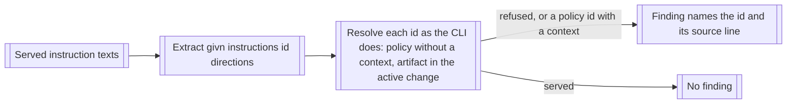

# Design: split-stack-instructions

## Overview

Four coordinated surfaces, each owned by one component:

1. **Shipped guidance corpus** (`assets/instructions/`) gains six stack
   instructions (`steps-rust`, `steps-python`, `steps-node`, `steps-java`,
   `steps-go`, `steps-ruby`) holding the per-runner rows that `steps` and
   `design` carry today. Both core instructions keep the universal rule, name
   each stack instruction id with its load condition, and carry no stack body.
   `specs` and `review` carry no stack body and name no stack instruction;
   `tasks` and `tasks-reverse` point at `steps` for the mapping and carry no
   stack body; `ise` names `steps` and one example id.
2. **Instruction id set** (`src/cli/instructions.rs`) registers the six stack
   ids as policy instruction ids, so a stack id is a policy instruction id with
   no change context and the unknown-id refusal lists it. Reachability is not
   what registration buys: `resolve_instruction` (`src/config/cascade.rs:55-80`)
   already falls back to the embedded `instructions/<id>.md` asset, so
   `givn instructions steps-rust` serves before the ids are registered. The
   registration adds the six ids to the known list the refusal builds
   (`src/cli/instructions.rs:83-95`) and changes no resolution path.
3. **Instruction reference check** (`tests/common/instruction_references.rs`,
   new) extracts every `givn instructions <id>` direction from served guidance
   and every effective addon instruction, then resolves each id in its
   documented context, so a core instruction that names an id nobody serves
   fails by name. It reads the served text, not the asset, so a project
   override is checked as served.
4. **Instruction composition rule**: a core step instruction carries the
   universal rules and the id mapping, and per-stack mechanics are served
   only on a request for that stack's id. The rule is asserted as text
   presence and absence, not as a line count; instruction length carries no
   numeric cap, and prose that adds no rule is the length defect.

The split moves rows; it adds no runner, changes no `@e2e` policy, and changes
no request contract: text and JSON still carry identical content.

## Visual Design Contract

```
- Interface: terminal
- Viewports: not applicable (terminal text surface)
- States: not applicable
- Design system: none (CLI)
```

`Interface: terminal` is deliberate: the change alters served terminal text and
the known-id list in a refusal, not a rendered screen. The delta adds no `@e2e`
scenario (every new scenario is a variant of the existing single request
action), so no transcript evidence is committed. The terminal baseline is the
served guidance and the refusal text:

- every served stack sentence names the id and the condition, never a bare id;
- a refusal names the requested id and lists the known ids;
- no Givn implementation symbol appears in served guidance;
- the text path and the JSON `instruction` field carry the same content.

**Personas:** `agent--technical-role`, `developer--primary-user`, and
`givn-maintainer--owner` are confirmed. `agent--technical-role` loads the stack
instruction; `developer--primary-user` reads the same text manually;
`givn-maintainer--owner` owns the instruction composition rule.

## Use-Case Traceability

Owning use-case IDs: `obtain-effective-guidance` (`serve-extended-rules`) and
the `support` fragment (`instruction-integrity`).
Ideation source: `ise-rebuildability`.
Confirmed Persona IDs: `agent--technical-role`, `developer--primary-user`,
`givn-maintainer--owner`.

| Use-case contract element | Technical decision | Capability / scenario evidence |
|---|---|---|
| `obtain-effective-guidance` rule: each core step instruction names each stack instruction id with the condition for loading it and carries no stack body | `steps` and `design` carry one paragraph naming six ids and their runner condition; the rows move to the stack files | `serve-extended-rules`: `Core step guidance names each stack instruction with its load condition`, `Core step guidance carries no stack body`, `Design guidance names each stack instruction with its load condition and carries no runner table` |
| `obtain-effective-guidance` rule: the core instruction's served text is complete for a change that touches no named stack, and the split removes no universal rule | the one-file-per-capability rule, the empty-body prohibition, the strict-mode proof requirement, and the single-scenario requirement stay in the core instruction without their per-runner tables | same three scenarios; each asserts a retained universal rule beside its absence assertions |
| `obtain-effective-guidance` extension: a stack instruction's body is served only by a request for its own id | `POLICY_INSTRUCTION_IDS` gains the six ids; `resolve_instruction` serves `instructions/<id>.md` | `serve-extended-rules`: `Every stack instruction is served only on its own request with its runner body` |
| `obtain-effective-guidance` extension: the machine-readable path carries the same content | unchanged JSON path; the stack id is a policy id with no `generates`/`requires` | `serve-extended-rules`: `The machine-readable stack path carries the same content as the text path` |
| `obtain-effective-guidance` extension: an unknown id keeps the refusal and lists the known ids, now including the stack ids | the same refusal string builds its list from the manifest ids plus `POLICY_INSTRUCTION_IDS` | `serve-extended-rules`: `An unknown stack instruction id is refused by name with the known list` |
| `obtain-effective-guidance` rule: `specs`, `review`, `tasks`, and `tasks-reverse` carry no stack body | their per-stack mentions are interface-typed (browser driver) or generic; `tasks` and `tasks-reverse` point at `steps`; the split moves nothing in and deletes no rule | `serve-extended-rules`: `Specs and review guidance carry no stack body`, `The tasks guidance points at the stack mapping and carries no stack body` |
| `instruction-integrity` extension: a named instruction id that does not resolve fails the check by name | new `instruction_references` check over served text and every effective addon instruction; each id resolved as the CLI resolves it, a policy id with no context and an artifact id in a change context, so a policy id carrying `--change` is a finding while an artifact id without one is not | `instruction-integrity`: `Every instruction id a served instruction names resolves`, `A dangling stack instruction id fails the reference check by name`, `A policy instruction named with a change context is a finding` |
| `instruction-integrity` rule: the `ise` instruction's directions resolve | `ise.md` names `steps` as the stack mapping and `steps-rust` as one example, plus the two record owners; the check resolves them while `ise` is effective | `instruction-integrity`: `The ise instruction names only instruction ids that resolve` |
| `instruction-integrity` rule: one canonical owner per rule | the moved rows leave the core instruction rather than being copied; the core points at the stack instruction | the four `serve-extended-rules` absence scenarios |
| `instruction-integrity` rule: the review guidance keeps every obligation | `review.md` restores the pre-consolidation content and keeps one stable marker per obligation | `instruction-integrity`: `The review guidance keeps every surviving obligation` |
| `support` fragment rule: a core step instruction carries the universal rules and the id mapping, and a stack instruction's body is served only on request | the core files carry no per-runner table; the six stack files carry the runner mechanics; nothing is measured by line count | `serve-extended-rules`: `Core step guidance carries no stack body`, `Core step guidance names each stack instruction with its load condition`, `Every stack instruction is served only on its own request with its runner body` |
| `support` fragment rule: the register count matches the accepted records | `ADR-077` is already accepted and the register already counts 29, so the modified scenario is existing behavior protected; no capability behavior changes | `adr-qualification-gate`: `The migration preserves independent architecture history across three proposed decisions` (`@givn.modified`) |

## Architecture Impact

No module is added to `src/`. Three code surfaces change:

- `src/cli/instructions.rs`: `POLICY_INSTRUCTION_IDS` gains `steps-rust`,
  `steps-python`, `steps-node`, `steps-java`, `steps-go`, `steps-ruby`. Nothing
  else in the resolver changes; the cascade already serves
  `instructions/<id>.md` and the unknown-id message already builds its known
  list from the manifest plus this array.
- `assets/instructions/`: six new files, and edits to `steps.md`, `design.md`,
  `review.md`, `ise.md`, and one direction in `design-review.md` (the arc42
  addon direction drops its ignored `--change <id>`). `#[folder = "assets/"]` on
  `src/config/embedded.rs` picks up new files at build time, so no registration
  file lists them.
- `tests/common/instruction_references.rs` (new) plus `tests/steps/`: the
  instruction-direction extraction and resolution, and one count binding for
  the modified register scenario.
  `tests/common/reference_check.rs` keeps its file-reference job unchanged.

No Mermaid diagram is warranted: the serving path is unchanged and the change
adds no component. The one new flow is inside the test harness:



### Contracts and Components

| Contract | Consumer use case | Consumers | Implementing component today | Split trigger |
|---|---|---|---|---|
| Served guidance: `givn instructions <id> [--change <id>] [--json]` | obtain effective guidance | authoring agent, developer, every generated skill | `src/cli/instructions.rs` with `src/config/cascade.rs` | a second serving channel (library or HTTP), or per-id serving behaviour diverges |
| Guidance reference check: extract and resolve every named instruction id in served text | instruction integrity | the acceptance suite, the Givn maintainer | `tests/common/instruction_references.rs` (new) | a shipped `givn` command performs the check for consumer projects, or the check gains a second consumer |

The served-guidance contract is unchanged: no parameter, field, or refusal is
added; the id set grows. The check is a new internal contract with one
consumer, so one module with no port is proportionate.

## Technology Decisions

- **Language and runtime:** Rust, as the repository already builds; no version
  decision.
- **Test runner:** `cucumber-rs` 0.23.0 as `Cargo.lock` pins it, already wired
  through `tests/features_runner.rs`; no new dependency, so no version lookup
  applies. `verify.command` is `./run-tests.sh --non-e2e`; `verify.e2e_command`
  is `./run-tests.sh --e2e`.
- **Module layout:** one new test-support module named above; no new production
  module, so the dependency direction is unchanged.
- **Asset delivery:** embedded through `rust_embed`'s folder glob; no manifest
  edit, no build-script entry.

## Decisions

- Decides D1 (seed open question: which stacks receive an instruction in the
  first cut): **every runner the four core instructions name** — `steps-rust`,
  `steps-python`, `steps-node`, `steps-java`, `steps-go`, `steps-ruby`. The
  core instructions name six runners today; moving five of them and keeping one
  would leave stack bodies in the core instruction, which the capability's rule
  forbids, and would keep every author reading other stacks' rows. Rejected:
  Rust only (the core keeps five stacks' bodies and the rule stays false for
  them); the outline's five languages (the Go and Ruby stub rows lose their
  home, and the outline's separate TypeScript/JavaScript entries would split one
  `cucumber-js` runner across two instructions). Realized in the six asset files
  and the two core instructions.
- Decides D2 (proposal question: whether instruction length is capped): **no
  numeric cap; the operator withdrew the corpus budget on 2026-11-15**. The
  durable rule is qualitative: a core step instruction carries the universal
  rules and the id mapping, per-stack mechanics are served only on a request
  for that stack's id, and prose that adds no rule is the length defect. The
  rule is asserted as text presence and absence by the load-condition and body
  scenarios, not by a line count. Rejected: a permanent line cap (it deleted
  valid `review.md` obligations to satisfy a number, which the operator
  overruled); a recorded measurement with no check (no detection of a core
  instruction that regrows a stack body, which the absence scenarios now
  detect). Realized in the delta scenarios and recorded as the
  `## Operator decision: no corpus line cap` entry below.
- Decides D3 (proposal question: which instruction owns the runner mechanics
  the design instruction serves): **one instruction per stack, named by both `steps` and
  `design`**. `steps-rust` holds the Rust step file, binding form, empty-body
  stub, strict-mode mechanism, and single-scenario command; `design` names the
  same id with the condition "the change's runner is Rust". The runner is one
  subject and the rows are three to five lines each, so twelve files would
  add about 60 lines of headers for no additional rule. The id convention
  `<id>-<stack>` still identifies the file: the stack instruction is owned by
  `steps`, the instruction whose rows are the majority, and `design` points at
  it. Rejected: `steps-rust` plus `design-rust` and ten more (corpus cost);
  runner mechanics staying in `design` (D1's rule stays half false). Realized in
  `assets/instructions/steps-rust.md` and the `design` paragraph.
- Decides D4 (which instruction owns the id list): the six ids join
  `POLICY_INSTRUCTION_IDS`, not the artifact manifest. An artifact entry carries
  `generates`, `requires`, and a lifecycle stage; a stack instruction has none,
  and the manifest drives `givn graph` and the known-artifact refusal. Rejected:
  manifest entries (they would invent a lifecycle stage and change `givn
  graph`). Realized in `src/cli/instructions.rs`.
- Decides D5 (where the reference check lives): a new
  `tests/common/instruction_references.rs`, and the existing
  `named_instruction_ids` helper moves there from
  `tests/steps/instruction_integrity_steps.rs` so served-text and
  installed-skill checks share one extractor. The check runs the built `givn`
  binary per id, because resolution — not the asset text — is the thing that can
  fail: an id can resolve from a project override, an addon, or the embedded
  asset. Rejected: a new `givn` subcommand (a new public surface this change
  does not need); reusing `reference_check` (file references and instruction
  ids have different resolution rules); making an artifact id without
  `--change` a finding (the CLI auto-selects the single active change, so the
  rule would flag six correct shipped directions and force an agent to know the
  change id before reading guidance). Realized in the new module, whose context
  rule is one-sided: a policy id with `--change` is a finding because the flag
  is ignored for policy ids.
- Decides D6 (`ise` and the stack instruction): `ise.md` names `steps` as the
  mapping for the change's stack mechanics and names `steps-rust` as one
  worked example, while keeping `design` and `proposal` as the record owners.
  `ise` is served without a change context, so it cannot name "the project's
  runner's" instruction; the mapping lives in `steps`, which the same request
  also serves. Rejected: naming the stack instruction for the project's
  runner (a static addon instruction cannot know the runner); enumerating six
  ids in `ise` (a second copy of a list the core instruction owns). Realized
  in `assets/instructions/ise.md`.

No decision is carried. D1 to D3 resolve the proposal's questions here; D4 to
D6 are local to this change and reversing any is a one-batch edit.
`ADR-077` is accepted, and the active register already reads 29 accepted
decisions. The modified register-count scenario therefore asserts existing
behaviour protected: the `29` binding replaces the `28` phrase, and the dead
`28` binding in `tests/steps/adr_qualification_gate_steps.rs` is deleted. The
reconciliation landed in the operator correction of 2026-11-15 (see
`design-review.md` `## Operator correction`), so the permanent and the
change-scoped runs both pass before archive. No RED is claimed for it.

## Operator decision: no corpus line cap

Date: 2026-11-15.

There is no hard limit on instruction length. Instructions are not padded with
prose that adds nothing, but content that states valid rules is not removed or
split to satisfy an arbitrary line count. The stack split is approved on its
own merits: one owner per rule, and one load per stack.

Reason: the earlier draft derived a 4,500-line corpus cap and a 1,544-line
four-core cap from the plan's `G2` budget rule, not from a requirement. Meeting
the corpus cap required deleting the Step 0 items 0, 8, 9, 10, 11, and 12, the
`## E2e coverage` section, the sign-off E2E block, and the spot-check section
from `review.md`; the operator withdrew both caps and every check derived from
them.

Withdrawn: `CORPUS_LINES_MAX`, `CORE_INSTRUCTIONS_MAX`, the
`CORE_INSTRUCTIONS_BEFORE` constant, the budget check, the two budget
scenarios, ADR-077's budget decision, and every derived statement in
`docs/arc42/`, `givn/ideation/ise-rebuildability/plan.md`, and
`docs/ideation/ise-rebuildability.md`. Retained: the split, the six ids, the id
mapping, the reference check, and the load-condition and body rules.

## The Split: what moves where

Each stack file holds the mechanics the core instructions carried for that
runner, plus the binding form, strict instruction, and single-scenario command
the universal requirements name. Nothing is paraphrased into a new rule, and
the archive binding-token list stays in `steps` as the one statement of the
tokens the archive gate recognises.

| Stack file | Load condition (the runner) | Rows moved in | Source today | Lines |
|---|---|---|---|---|
| `steps-rust.md` | `cucumber-rs` | step definition file, binding form, empty-body stub, strict mode, single scenario | `steps.md` 22-36, 106-124; `design.md` 143-164, 25-28 | 9 |
| `steps-python.md` | `behave` | same five rows | same blocks | 9 |
| `steps-node.md` | `cucumber-js` | same five rows | same blocks | 9 |
| `steps-java.md` | `cucumber-jvm` | step definition file, binding form, empty-body stub, both strict-mode entries, single scenario | same blocks | 10 |
| `steps-go.md` | `godog` | binding registration, empty-body stub, strict behaviour, single scenario | `steps.md` 106-124; `design.md` 158 | 8 |
| `steps-ruby.md` | `cucumber-ruby` | binding form, empty-body stub, strict instruction, single scenario | `steps.md` 106-124 | 8 |

Go and Ruby had no step path, strict row, or command in the core files; the
universal requirement names a binding, a stub, a strict proof, and a single
scenario for every runner, so their stack files carry the runner's own forms.
The source column names the pre-split line ranges in the unmodified assets.

Core instructions, after the split:

| File | Keeps | Names | Removals |
|---|---|---|---|
| `steps.md` | the executable-spec rule, one file per capability, the archive merge rule, `@e2e` tag immutability, the canonical-policy pointer, visual capture, step reuse, the empty-body prohibition, the behavior batch, distinctions, guardrails | six ids, one paragraph with each runner condition | the per-runner step path list and the stub table; the archive binding-token list stays |
| `design.md` | the strict-mode requirement, the single-scenario requirement, the rest of the design contract | the same six ids with the runner condition | the strict-mode table, the per-stack command examples, and the runner-product examples in the executable-spec invariant |
| `specs.md` | unchanged | none | nothing |
| `review.md` | every check and every marker | none | nothing; the earlier line-reduction consolidation is restored |
| `tasks.md` | the strict-proof procedure and the empty-body prohibition | `steps` as the stack mapping | the per-runner strict flags and the stub table |
| `tasks-reverse.md` | the strict-proof procedure and the empty-body prohibition | `steps` as the stack mapping | the per-runner strict flags and the stub table |
| `ise.md` | the ise obligations and the two records | `steps` as the mapping, `steps-rust` as one worked id | nothing |

`review.md` keeps every obligation and one stable marker per obligation,
asserted by the `instruction-integrity` delta scenario; the earlier
line-reduction consolidation is withdrawn and its content restored from
`aa50b100`, with the HTTP-client wording kept in place of `reqwest`.

`steps-rust.md` (the shape the other five follow):

```text
# Instruction: steps-rust

`cucumber-rs` mechanics. The universal rules stay in `givn instructions steps`.

- Step definition file: `tests/steps/<capability>.rs`, one per capability.
- Binding form: `#[given(`, `#[when(`, `#[then(`; one expression per binding.
- Unimplemented body: `unimplemented!()` or `todo!()`.
- Strict mode: `.fail_on_skipped()` on the `Cucumber` builder.
- Single scenario: `cargo test <name> -- --exact`.
```

## Instruction Composition Rule

A core step instruction carries the universal rules of its step and the id
mapping; it does not carry another stack's mechanics. `steps` and `design`
name each stack instruction id with the load condition that selects it, and a
stack instruction's body is served only by a request for its own id. `specs`
and `review` carry no stack body and name no stack instruction. `tasks` and
`tasks-reverse` point at `steps` for the mapping. The relation is the id
convention `steps` to `steps-rust`, the pairing `dialog` to `dialog-examples`
established.

The rule is asserted as text presence and absence over the served output:

- presence: `steps` and `design` name each id with its runner condition, and
  each stack request serves that runner's binding, stub, strict mechanism, and
  single-scenario command;
- absence: the core served text carries no per-runner path, stub, binding
  instruction, strict mechanism, or run command;
- one owner: a moved row leaves the core text instead of being copied.

Instruction length carries no numeric cap. The earlier draft of this design
recorded a corpus budget with two measured ceilings and two scenarios, and
paid for the corpus total by deleting review obligations. The operator
withdrew the budget on 2026-11-15 (see `## Operator decision: no corpus line
cap`). Prose that states no rule is still a defect; a rule that states valid
behavior is never removed or split to satisfy a line count. `review.md`
therefore keeps its full obligation set, restored from `aa50b100`, and no
check is deleted to make a number smaller.

## Instruction Reference Check

`tests/common/instruction_references.rs`:

| Item | Shape | Purpose |
|---|---|---|
| `named_instruction_ids(text)` | `-> Vec<(usize, String, String)>` | every direction as its 1-based line, that line's text, and the id; a direction is a `givn instructions <id>` occurrence inside a code span (or followed by `--change`/`--json`), so prose such as "givn instructions are resolved" is not a direction; moved from `instruction_integrity_steps.rs`, one implementation |
| `IdFinding` | `struct { id, source, line, line_text, expected }` | one unresolved id or one id named in the wrong context |
| `unresolved_instruction_ids(project_root, sources, artifact_ids, change)` | `-> Vec<IdFinding>` | resolve each id with the built `givn` binary as the direction writes it: a policy id with no context, an artifact id in a change context (the direction's own, or the single active change the CLI auto-selects); a `--change` on a policy direction is a finding |
| `describe(findings)` | `-> String` | assertion message naming source line, line text, id, and expected context |

Behaviour:

- An id is resolved, never inferred from the asset set: an override, an addon
  instruction, and an embedded asset all count as resolving, and a retired or
  unknown id fails.
- The direction's context is part of the contract in one direction only: **a
  policy id with `--change` is a finding**. `run_artifact` resolves a
  non-artifact id and prints it before it reads `change`
  (`src/cli/instructions.rs:82-117`), so the flag changes nothing and the
  direction misleads a reader into supplying a context that has no effect. The
  finding keeps the direction's line text, so it names the sentence it read.
  One shipped direction carried the flag and is fixed by this change:
  `assets/instructions/design-review.md:116` named
  `givn instructions arc42-docs --change <id>`; `arc42-docs` is a policy addon
  instruction (resolved by `resolve_instruction`'s addon fallback, absent from
  the manifest), so the flag was ignored. It now names the bare id, and
  `docs/arc42/adr/README.md:19` states the same direction.
- **An artifact id without `--change` is not a finding.** When no change is
  named, `run_artifact` auto-selects the single active change and refuses by
  name only when there is none or more than one
  (`src/cli/instructions.rs:119-130`). Requiring the flag would force an agent
  to know the change id before reading guidance, and six shipped directions
  rely on the auto-selection: `assets/instructions/characterize.md:69`,
  `design-review.md:18,65`, `proposal.md:111`, `review-reverse.md:24`, and
  `specs.md:326`. The check resolves such a direction in the fixture's single
  active change, the same way the CLI does. The wrong-context shape stays the
  `named_change` precedent at
  `tests/steps/instruction_integrity_steps.rs:650-738`.
- An addon-bound id (`ise`) is checked only while the addon is effective in the
  fixture; with `ise` off the request refuses by addon name and the check skips
  that id rather than reporting a false finding.
- Read-only: no file is written, staged, or rewritten.

Served-text sources: every manifest artifact id (with the active change), every
policy id the checkout serves, and every effective addon instruction
(`assets/addons/<id>/instructions.md`). The policy set is read from the
`assets/instructions/` stems of this checkout and the addon instruction ids
(`ise`, `arc42-docs`, resolved by `resolve_instruction`'s addon fallback), minus
the manifest artifact ids; classification of a direction's id uses the graph,
so an id outside the manifest is a policy id whether it resolves from
`assets/instructions/` or from an addon. The addon set is read from
`assets/addons/`, filtered by the fixture's effective addons; the check
never asks the binary to enumerate ids, because that would add a command
surface (D4).

## External Boundary Cases

| Boundary | Adversarial case | Expected |
|---|---|---|
| Served text → instruction id | a core instruction names `steps-rust` with no such asset | the check fails and names `steps-rust` with its source line |
| Served text → instruction id | an override names `steps-rustt` | the check fails and names `steps-rustt`; the CLI refusal keeps the unknown-id text |
| Served text → id context | an artifact direction without `--change` | no finding: the check resolves it in the fixture's single active change, as the CLI auto-selects |
| Served text → id context | a policy direction with `--change` | a finding naming the id and the ignored change context |
| Served text → addon | `ise` named while the fixture has it off | the request refuses naming `ise`; the check skips the addon-bound id |
| Served text → addon instruction | an effective addon instruction names a retired id | the check fails and names the id with its source line |
| Served text → core body | a core instruction regrows a per-runner table | the absence scenario fails naming the stack instruction that owns the row |

## Step Definitions

| Capability | Step definition file | Permanent merge target |
|---|---|---|
| `serve-extended-rules` | `tests/steps/serve_extended_rules_steps.rs` | same file |
| `instruction-integrity` | `tests/steps/instruction_integrity_steps.rs` | same file |
| `adr-qualification-gate` (modified register-count scenario) | `tests/steps/adr_qualification_gate_steps.rs` | same file |

Every delta phrase is bound in these permanent files; no delta step copy is
introduced. The modified register-count scenario is existing behavior
protected: the binding for `the final register has 29 accepted decisions and no
proposed decisions` replaced the now-dead `28` phrase in
`tests/steps/adr_qualification_gate_steps.rs`, and the permanent feature was
reconciled to the same assertion in the operator correction of 2026-11-15, so
both scopes pass before archive; the rest of its steps are already bound. No
RED is claimed for that scenario. The new shared module
`tests/common/instruction_references.rs` is registered in
`tests/common/mod.rs` and carries no `#[given]`/`#[when]`/`#[then]`.

Not-implemented pattern: every new step drives the built `givn` binary against
its fixture, then asserts a named sentence, an absence, a refusal, or a
finding. No step substitutes a stub for a missing production path, so a RED
run fails on the assertion.

Test runner command (from `givn/commands.yaml`):

```text
./run-tests.sh --non-e2e
```

E2E runner command:

```text
./run-tests.sh --e2e
```

Single-scenario run command:

```text
GIVN_FEATURES=givn/changes/split-stack-instructions/specs cargo test --locked --test features_runner -- --exact "obtain-effective-guidance/serve-extended-rules.feature::Core step guidance carries no stack body"
```

## Strict Mode

`cucumber-rs` 0.23.0 with `.fail_on_skipped()` at both registration points in
`tests/features_runner.rs` (lines 55 and 155 today). A skipped step becomes a
failed step carrying `StepError::NotFound`, so an unbound delta phrase reaches
the result writer as `failed = 1` and the run exits 1. The result writer
records the four counts, and `RunnerResult::read` refuses `failed != 0`,
`skipped != 0`, `total == 0`, malformed, unreconciled, and wrong-scope results.

Proof of strictness for this change: the delta's step phrases are bound in the
two named files; the first run before those bindings exist fails as unbound,
which is the proof the runner refuses to count them as skipped.

## Interaction Coverage Matrix

The delta adds no inventory entry: requesting a stack instruction is the same
consumer action as requesting any other instruction id, with another id. The
permanent inventory rows and their `@e2e` scenarios are unchanged, and rows
for support capabilities this change does not touch stay in their permanent
use-case documents and existing designs.

| Inventory entry | @e2e scenario title | Real interface | Driving mechanism |
|---|---|---|---|
| `serve-extended-rules`: request effective instructions by id (permanent row; stack id is a variant) | An agent receives the extended rules through the Givn CLI | CLI | the built `givn` binary invoked in the fixture; stdout asserted |
| `instruction-integrity`: resolve an instruction and expose the machine contract (permanent row) | An agent requests machine-readable artifact guidance | CLI | the built `givn` binary with `--json`; stdout parsed |
| `instruction-integrity`: request normal session-start instructions (permanent row) | Author starts a session with the universal dialog obligation | CLI | the built `givn` binary with no id; stdout asserted |

The delta's own scenarios are regular scenarios: they assert invariants the
`@e2e` rows do not (absence of stack bodies, id resolution, and the review
obligation markers), so they do not duplicate an `@e2e` outcome.

## Persona impact

| Capability | Persona | Impact |
|---|---|---|
| `serve-extended-rules` | `agent--technical-role` | Loads one stack instruction instead of reading six runners' rows; the core instruction names the id and the condition, so the choice is mechanical. |
| `serve-extended-rules` | `developer--primary-user` | Reads the same shorter core text; the Rust mechanics stay reachable by id. |
| `serve-extended-rules` | `givn-maintainer--owner` | A moved row keeps one home; the core instruction shrinks and cannot regrow. |
| `instruction-integrity` | `agent--technical-role` | A dangling id fails by name, so a served direction never points at nothing. |
| `instruction-integrity` | `givn-maintainer--owner` | One owner per rule is checked as text; a core instruction that regrows a stack body fails the absence assertions. |

## E2E smoke-test infrastructure

- **Runner:** `./run-tests.sh --e2e` (`verify.e2e_command`) with
  `GIVN_RESULT_SCOPE=e2e`.
- **Step definitions:** `tests/steps/serve_extended_rules_e2e_steps.rs` and
  `tests/steps/instruction_integrity_steps.rs` (the existing `@e2e` bindings);
  the delta adds no `@e2e` scenario and no new e2e step.
- **Local infrastructure:** no server, database, container, or browser. Each
  scenario creates a `tempfile::TempDir`, writes a minimal Givn project, and
  runs the built `givn` binary (`env!("CARGO_BIN_EXE_givn")`).
- **Framework:** cucumber-rs, because the product's real interface is the CLI.
- **Strict-mode proof:** `.fail_on_skipped()` above; the delta's first RED run
  is an unbound phrase, which the runner reports as failed.

The delta adds no `@e2e` scenario, so no transcript is committed; the terminal
evidence is the served text and the refusal the regular scenarios assert.

## Local Runnability

The product needs no services: `cargo run -- instructions steps` (the declared
`run.command` family) serves the text, and `cargo run -- instructions
steps-rust` proves the new id. Tests need only the repository toolchain
(`cargo`, `nextest`, `git`, `fossil`, `git-cliff`, `script`). There is no
external third-party dependency, so no digital twin is required.

Two interface obstacles have designed fixes:

- **Served text vs asset text**: the check reads served output, so a project
  override is graded as served; grading the asset would grade text the project
  does not receive. D5 keeps the served-text check out of `reference_check`.
- **Addon-bound ids in a fixture**: a fixture with `ise` off refuses `ise`; the
  check reads the fixture's effective addons before deciding to skip that id,
  so a refusal is never reported as a dangling id.

## Coverage

| Process | Started by | Instrumented artifact | Profile output | Merge step | Non-zero production probe |
|---|---|---|---|---|---|
| Gherkin runner and `givn` subprocesses | `./measure-coverage.sh` | cargo coverage builds for the non-E2E and E2E scopes | `coverage/non-e2e-cobertura.xml`, `coverage/e2e-cobertura.xml` | `./merge-coverages.sh` | `cli::instructions::run_artifact` (executed by every serving scenario) |

Measured population: `src/`. Excluded: tests, generated assets, fixtures, and
the instruction corpus itself. The population is declared before the first run
and is not changed after seeing the result.

The reference and composition scenarios execute no new production branch; the
serving scenarios keep `run_artifact` non-zero, which is the probe. A coverage
drop relative to the previous change is expected only in the ratio's
denominator (the delta adds test code, not production code) and is not a
finding by itself.

## Risks and Trade-offs

- **No numeric size signal.** Instruction length is not capped, so a verbose
  instruction is not caught by a number. The absence scenarios catch a core
  instruction that regrows a stack body, and review names prose that adds no
  rule; a valid rule is never a finding on length alone.
- **Six tiny files.** A stack file of eight to ten lines is a lookup, not a
  document; the value is that it is the only place that stack's mechanics
  live. If a seventh runner appears, its rows go into a seventh file.
- **`design` names `steps-<stack>`.** The pairing convention reads
  `<id>-<stack>` with `steps` as the owner while `design` points at the same
  file. The alternative (twelve files) costs more than the convention's
  awkwardness.
- **The reference check runs the binary per id.** A served-text scan of every
  instruction costs one process per id; the suite already runs the binary
  hundreds of times, so the added cost is bounded and local to two scenarios.
- **`review.md` keeps some restated policy.** The restored text repeats the
  canonical E2E and step policy in more than one place. One owner per rule
  remains the review criterion; the duplication is removed only by a later
  reviewed change that keeps every obligation, never to satisfy a count.
